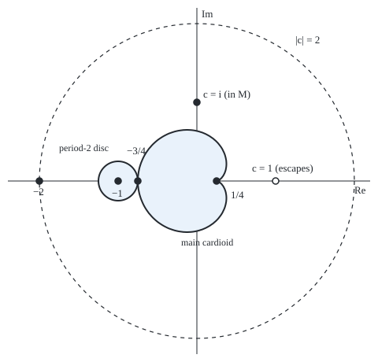

# The Mandelbrot set: the c whose orbit of 0 stays bounded, and why that decides whether the Julia set is in one piece

[Syllabus](../../../SYLLABUS.md) → [Complex analysis](../README.md) → [Complex Dynamics](../README.md#s11) → The Mandelbrot set

---

## General Overview

Take the rule "square, then add c", with c a fixed complex number. Start at 0 and apply it again and again. The list of points it visits is the **orbit** of 0.

With c = i the orbit is 0, i, −1 + i, −i, −1 + i, −i, … It falls into a loop of two points and stays near home forever. With c = 1 it is 0, 1, 2, 5, 26, … and runs off to infinity. The **Mandelbrot set**, written M, is the map of every c, marking which of the two happens: i is in M, 1 is not.

Why one orbit? Each c also has its own **filled Julia set**: every start z whose orbit stays bounded ([Filled Julia sets](01-filled-julia-sets-and-escape.md)). For the house example z² − 1, the start 0 cycles 0, −1, 0, −1 while the start 2 runs off as 2, 3, 8, 63. The point 0 is special. It is the map's only **critical point**: z and −z always land on the same point, and the two meet only at 0, so 0 is where the map folds. Where 0 goes decides the shape of the whole filled Julia set. If its orbit stays bounded, the set is one connected piece. If it escapes, the set shatters into dust.

**The Mandelbrot set is the set of c for which the orbit of 0 under z² + c stays bounded; it sits inside the disc of radius 2, a single step past 2 proves escape, and membership decides whether the filled Julia set is one piece or dust.**

**What kind of fact this is:** M is a definition. The radius-2 facts, the cardioid and the period-2 disc are theorems proved on this card in Why it works. The one-piece-or-dust split is a theorem whose proof is sketched in a fold. That M itself is connected is a theorem stated here without proof.

### The picture: the two largest pieces of M, to scale

<p align="center"></p>

Drawn at 100 pixels per unit. The heart shape is the **main cardioid**, with its notch (the cusp) at 1/4 and its back at −3/4. The disc of radius 1/4 centred at −1 touches it at −3/4. M is much more than these two shapes: c = i lies in neither yet belongs to M. Every point of M lies inside the dashed circle of radius 2.

---

## The formula

Notation first, in words. Write $`f_c(z) = z^2 + c`$ for the map. The orbit of 0 is $`z_0 = 0`$, $`z_1 = c`$, $`z_2 = c^2 + c`$, and so on, each point the map of the one before. Bars measure distance from 0: $`\lvert z\rvert`$ is the modulus.

```math
c \in M \iff \lvert z_n\rvert \le 2 \ \text{ for every } n, \qquad z_0 = 0,\ \ z_{n+1} = z_n^2 + c
```

**Read it aloud:** c is in the Mandelbrot set exactly when every point on the orbit of 0 stays within distance 2 of 0.

The two largest pieces of M have exact formulas:

```math
c = \frac{\lambda}{2} - \frac{\lambda^2}{4} \ \text{ with } \lvert\lambda\rvert < 1, \qquad \lvert c + 1\rvert < \frac{1}{4}
```

**Read it aloud:** the main cardioid is traced by λ/2 minus λ²/4 as λ runs over the unit disc; the period-2 disc holds every c within 1/4 of −1.

At $`\lambda = 1`$ the first gives $`c = 1/2 - 1/4 = 1/4`$, the cusp. At $`\lambda = -1`$ it gives $`c = -1/2 - 1/4 = -3/4`$, where $`\lvert c + 1\rvert = 1/4`$: the disc touches.

| Symbol | Plain meaning | In our example | Push it up and the answer… |
| --- | --- | --- | --- |
| $`f_c`$ | the map: square, then add $`c`$ | $`z^2 + i`$ | — |
| $`c`$ | the parameter: the point of the map M being tested | i, 1, −1 | far enough out and the orbit escapes |
| $`z_n`$, $`n`$ | the orbit of 0 after $`n`$ steps | $`z_3 = -i`$ for $`c = i`$ | — |
| $`M`$; $`K_c`$ | the Mandelbrot set: all $`c`$ with a bounded orbit of 0; the filled Julia set: all starts with a bounded orbit | M contains i, not 1; 0 is in $`K_{-1}`$, 2 is not | — |
| $`D`$, $`U_n`$, $`m`$, $`w`$ | the disc of radius 3; the starts that stay in D for $`n`$ steps; the step at which the orbit of $`c`$ leaves D; a point of a region being pulled back | for $`c = 1`$ the orbit of $`c`$ runs 1, 2, 5 and leaves D at 5 | — |
| $`\lambda`$ | the multiplier of a fixed point: how much $`f_c`$ stretches near it | 0.5 gives $`c = 0.1875`$ | past size 1 the fixed point repels |
| $`p`$; $`a`$, $`b`$ | a fixed point, $`f_c(p) = p`$; the two points of a 2-cycle | $`p = 0.25`$ for $`c = 0.1875`$; 0.0916 and −1.0916 for $`c = -1.1`$ | — |
| $`r`$, $`x`$ | the logistic map's growth rate and population share | $`r = 3.2`$, $`x`$ starting at 1/2 | larger $`r`$ moves $`c`$ left, toward −2 |

### When it holds

- **The quadratic family only.** $`z^2 + c`$ has one folding point, 0. A cubic has two, and both orbits must be followed.
- **Start at 0.** Starting at 2 tests whether 2 is in $`K_c`$, a different question: for c = −1 it runs 2, 3, 8, 63 although −1 is in M.
- **Strictly past 2.** The orbit of −2 is 0, −2, 2, 2, 2: it sits exactly on 2 forever, and −2 is in M.
- **Escape is provable in finite time; membership is not.** c = 0.26 stays within 2 until step 30. A computer that stops at step 29 calls it a member.
- **The cardioid and disc are only the start.** Infinitely many smaller pieces hang off them, and points like c = i lie on thin hairs outside every piece.

---

## Why it works

### Step 0: once the orbit is past 2, squaring beats adding

Everything rests on the escape rule proved in [Filled Julia sets](01-filled-julia-sets-and-escape.md). Adding c pulls a point back toward 0 by at most $`\lvert c\rvert`$, while squaring pushes it from $`\lvert z\rvert`$ out to $`\lvert z\rvert^2`$:

```math
\lvert z^2 + c\rvert \ge \lvert z\rvert^2 - \lvert c\rvert \ge \lvert z\rvert\,(\lvert z\rvert - 1) \quad \text{when } \lvert z\rvert \ge \lvert c\rvert
```

So once a point is past both 2 and $`\lvert c\rvert`$, each step multiplies its distance by more than 1, by a factor that never shrinks, and the orbit runs off. That card applies the rule to every start z; this card applies it to the one start 0.

### Step 1: M lies inside the disc of radius 2

Suppose $`\lvert c\rvert > 2`$. Then $`z_1 = c`$ already meets both conditions of Step 0. Each later step multiplies the distance by at least $`\lvert c\rvert - 1 > 1`$, so the orbit runs off. Every c in M therefore has $`\lvert c\rvert \le 2`$.

### Step 2: one step past 2 proves escape

Now take $`\lvert c\rvert \le 2`$, and suppose some $`z_n`$ has $`\lvert z_n\rvert > 2`$. Then $`\lvert z_n\rvert > 2 \ge \lvert c\rvert`$, so Step 0 applies from that step on, and the orbit escapes. Together with Step 1 this gives the formula: c is in M exactly when every $`z_n`$ stays within 2.

For c = 1 the orbit reads 0, 1, 2, 5. The point 2 is not past 2; the point 5 is, at step 3, so 1 is outside M.

### Step 3: the main cardioid is where a fixed point attracts

A **fixed point** p is a point the map leaves in place: $`p^2 + c = p`$. Its **multiplier** is the derivative there, $`\lambda = f_c'(p) = 2p`$. When $`\lvert\lambda\rvert < 1`$ the fixed point attracts: nearby points move closer each step ([Attracting and repelling cycles](02-multipliers-and-the-fatou-and-julia-sets.md)).

Name the fixed point by its multiplier: $`p = \lambda/2`$. The fixed-point equation then solves for c:

```math
c = p - p^2 = \frac{\lambda}{2} - \frac{\lambda^2}{4}
```

As λ runs round the unit circle, this c traces the cardioid's edge. For λ = 0.5: c = 0.25 − 0.0625 = 0.1875, and the orbit of 0 settles on p = 0.25, where 2p = 0.5 = λ.

### Step 4: the period-2 disc is where a 2-cycle attracts

A 2-cycle is a pair a, b with $`f_c(a) = b`$ and $`f_c(b) = a`$. Both satisfy $`f_c(f_c(z)) = z`$. Divide out the two fixed points and what remains is

```math
z^2 + z + c + 1 = 0, \qquad \text{so} \qquad a + b = -1,\quad ab = c + 1
```

The multiplier of the cycle is the product of the derivatives at its two points, by the chain rule: $`2a \cdot 2b = 4ab = 4(c + 1)`$. The cycle attracts when $`\lvert 4(c + 1)\rvert < 1`$, that is $`\lvert c + 1\rvert < 1/4`$.

For c = −1.1 the points are 0.0916 and −1.0916, and $`4ab = -0.4`$. For the house example c = −1, the multiplier is 0: the cycle 0, −1 is as attracting as a cycle can be.

### Step 5: an attracting cycle captures the orbit of 0

An attracting cycle always pulls in the orbit of 0, the map's only folding point. This is Fatou's theorem, proved in [Attracting and repelling cycles](02-multipliers-and-the-fatou-and-julia-sets.md). So every c in the cardioid or the disc is in M.

The converse fails. For c = i the orbit of 0 lands on the 2-cycle −1 + i, −i. Its multiplier is $`4(-1 + i)(-i) = 4 + 4i`$, of size 5.6569: the cycle repels. The point i is in M with no attracting cycle at all.

### Step 6: in M means one piece, outside means dust

This is the split named in the title. If c is in M, the filled Julia set $`K_c`$ is **connected**: one piece. If c is outside M, $`K_c`$ is a **Cantor dust**: infinitely many points, no two of them joined, like a fine spray. There is never anything in between. Fatou and Julia found this in 1918–1920.

The reason is the fold at 0. Pulling a region back through $`z^2 + c`$ means finding, for each point w of the region, the starts z with $`z^2 + c = w`$: the two square roots of $`w - c`$. Take a region in one piece with no holes. If it contains c, the two square roots join up and the pull-back is one piece. If it misses c, the pull-back is two separate pieces.

<details>
<summary>Proof sketch: why the orbit of 0 decides the shape</summary>

Take the disc D of radius 3. For $`\lvert c\rvert \le 2`$, Step 0 sends every point outside D further out, so the pull-back of D lies inside D. A c outside the disc of radius 2 uses a larger disc in the same way. Write $`U_n`$ for the starts that stay in D for $`n`$ steps. These regions shrink one inside the next, and $`K_c`$ is what all of them share.

Each $`U_{n+1}`$ is the pull-back of $`U_n`$. When $`U_n`$ is one piece with no holes, as D is, $`U_{n+1}`$ is one piece with no holes if $`U_n`$ contains c, and two such pieces if it does not.

If c is in M, the orbit of c stays in D forever, so c lies in every $`U_n`$. Every $`U_n`$ is one piece with no holes. Shrinking one-piece closed regions share a one-piece core, so $`K_c`$ is connected.

If c is outside M, the orbit of c leaves D at some step $`m`$, so c is missing from $`U_m`$. From then on, every piece splits in two at each level: 2, 4, 8, … pieces. With an extra estimate on their sizes, proved in Carleson and Gamelin, the pieces shrink to points, and $`K_c`$ is dust.

</details>

In 1982 Adrien Douady and John Hubbard proved that M itself is connected: all its hairs and bulbs hang together in one piece. This card states that without proof.

---

## Worked numbers, by hand

| Step | Arithmetic | Value |
| --- | --- | --- |
| orbit of 0, c = i | i² + i = −1 + i; (−1 + i)² + i = −i; (−i)² + i = −1 + i | 0, i, −1 + i, −i, −1 + i |
| orbit of 0, c = 1 | 1, 1 + 1, 4 + 1, 25 + 1 | 0, 1, 2, 5, 26: past 2 at step 3 |
| cardioid at λ = 1 | 1/2 − 1/4 | 0.25 |
| cardioid at λ = −1 | −1/2 − 1/4 | −0.75 |
| period-2 disc at c = −3/4 | \|−0.75 + 1\| | 0.25: the disc touches |
| cardioid at λ = 0.5 | 0.25 − 0.0625; fixed point 0.5/2 | c = 0.1875, p = 0.25 |
| 2-cycle at c = −1.1 | 4(c + 1) = 4 × (−0.1) | −0.4: attracting |
| 2-cycle at c = i | 4(−1 + i)(−i) = 4 + 4i | size **5.6569: repelling, yet i is in M** |

The cardioid and disc are certified members of M, but M holds more: c = i stays bounded on a repelling cycle.

### What breaks if you drop a piece

| Mistake | Comes out at | What went wrong |
| --- | --- | --- |
| Treating \|z\| ≥ 2 as escape | c = −2 thrown out, though its orbit is 0, −2, 2, 2, 2 | the test is strictly past 2 |
| Starting the orbit at 2, not 0 | c = −1 called outside: 2, 3, 8, 63 | that tests whether 2 is in $`K_{-1}`$ |
| Cardioid with the sign flipped, λ/2 + λ²/4 | λ = 1 gives c = 0.75: orbit 0, 0.75, 1.3125, 2.4727, out at step 3 | the fixed point needs c = p − p² |
| Period-2 disc taken as \|c + 1\| < 1 | c = −1.9: cycle multiplier 4(c + 1) = −3.6, repelling | the multiplier is 4(c + 1), so the radius is 1/4 |

The code prints all four.

---

## Code, from first principles, and it actually runs

The code takes three independent roads. Road one iterates orbits: exactly, in whole numbers, for c = i, 1, −1 and −2, and in decimals elsewhere. Road two is algebra: the cardioid and the 2-cycle formula predict a multiplier, and the settled orbit is measured against it. Road three rescales the logistic map, a population model, and checks it is the same orbit. A grid of 3,721 values of c tests Steps 1 and 2 directly. Python uses only `cos`, `sin` and `pi` from its standard library; Rust carries its own complex type.

### Python

```python
# The Mandelbrot set -- the check behind the card.  Standard library only.  f(z) = z*z + c,
# and c is in M when the orbit of 0 stays bounded.  Road one iterates the orbit; road two is
# the algebra of fixed points and 2-cycles; road three rescales the logistic map.
from math import cos, sin, pi
def orbit(c, z, n):                      # z and its next n images
    out = [z]
    for _ in range(n): out.append(out[-1] * out[-1] + c)
    return out
def escape(c, n=1000):                   # first step with |z| > 2, or 0 if none
    z = 0
    for k in range(1, n + 1):
        z = z * z + c
        if abs(z) > 2: return k
    return 0
def regrows(c):                          # 1 if the orbit passes 2, then fails to grow
    k = escape(c, 50)
    if k == 0: return 0
    rs = [abs(z) for z in orbit(c, orbit(c, 0, k)[-1], 6)]
    return int(any(b <= a for a, b in zip(rs, rs[1:])))
def f4(x): return f"{round(x, 4) + 0.0:.4f}"     # 4 decimals, no negative zero
def cx(z): return f"{f4(z.real)}{'-' if round(z.imag, 4) < 0 else '+'}{f4(abs(z.imag))}i"
def gi(a, b):                            # a whole-number point a + bi, written like -1+i
    s = {1: "i", -1: "-i"}.get(b, f"{b}i")
    return str(a) if b == 0 else s if a == 0 else f"{a}{'+' if b > 0 else ''}{s}"
def g(zs): return ", ".join(gi(int(z.real), int(z.imag)) for z in zs)
def card(lam): return lam / 2 - lam * lam / 4    # the cardioid: fixed point with multiplier lam
oi = orbit(1j, 0, 5); m_i = 4 * oi[2] * oi[3]   # 2-cycle multiplier: f' = 2z at both points
print(f"house c = -1: orbit of 0 is {g(orbit(-1, 0, 4))}; orbit of 2 is {g(orbit(-1, 2, 3))}")
print(f"c = i: orbit of 0 is {g(oi)}: a 2-cycle, so i is in M")
print(f"c = i: cycle multiplier 4(-1+i)(-i) = {g([m_i])}, size {f4(abs(m_i))}; |c + 1| = {f4(abs(1j + 1))}")
print(f"c = 1: orbit of 0 is {g(orbit(1, 0, 4))}; first |z| > 2 at step {escape(1)}")
print(f"cardioid: lambda = 1 gives c = {f4(card(1))}, lambda = -1 gives c = {f4(card(-1))}, |c + 1| = {f4(abs(card(-1) + 1))}")
ps = [orbit(card(lam), 0, 400)[-1] for lam in (0.5, 0.5j)]
for name, lam, p in (("0.5", 0.5, ps[0]), ("0.5i", 0.5j, ps[1])):
    print(f"lambda = {name}: c = {cx(card(lam))}, orbit of 0 settles at {cx(p)}, measured 2z = {cx(2 * p)}")
c2 = -1.1; a = orbit(c2, 0, 400)[-1]; b = a * a + c2
print(f"c = {c2}: orbit settles on {f4(a)} and {f4(b)}; 4ab = {f4(4 * a * b)}, formula 4(c + 1) = {f4(4 * (c2 + 1))}")
pts = [complex(x / 10, y / 10) for x in range(-30, 31) for y in range(-30, 31)]
held, regrew = sum(escape(c, 50) == 0 for c in pts if abs(c) > 2), sum(regrows(c) for c in pts)
print(f"grid of {len(pts)} c: with |c| > 2 and bounded {held}; passed 2 then failed to grow {regrew}")
ring = [complex(cos(2 * pi * k / 200), sin(2 * pi * k / 200)) for k in range(200)]
edge = sum(escape(c) > 0 for c in [card(0.99 * w) for w in ring] + [-1 + 0.24 * w for w in ring])
print(f"400 c just inside the cardioid and the disc, 1000 steps each: escaped {edge}")
r, xs, zs = 3.2, [0.5], orbit(card(3.2), 0, 50)
for _ in range(50): xs.append(r * xs[-1] * (1 - xs[-1]))
gap = max(abs(r * (0.5 - x) - z) for x, z in zip(xs, zs))
print(f"logistic r = 3.2 from x = 1/2, rescaled by z = r(1/2 - x): matches c = {f4(card(r))} for 50 steps: {'yes' if gap < 1e-9 else 'no'}")
print(f"slow escape: c = 0.26 first passes 2 at step {escape(0.26)}")
print(f"mistake, |z| >= 2 as escape: c = -2 has orbit {g(orbit(-2, 0, 4))}, never past 2: {'yes' if escape(-2) == 0 else 'no'}")
print(f"mistake, cardioid sign flipped: lambda = 1 gives c = {f4(1 / 2 + 1 / 4)}, orbit {', '.join(f4(z) for z in orbit(0.75, 0, 3))}, out at step {escape(0.75)}")
print(f"mistake, disc |c + 1| < 1: c = -1.9 gets 2-cycle multiplier 4(c + 1) = {f4(4 * (-1.9 + 1))}")
print(f"figure, cusp {f4(card(1))}, back {f4(card(-1))}, disc centre -1 radius {f4(0.25)}, points i 1 -1 -2, 100 px per unit")
assert oi[2] == oi[4] == -1 + 1j and oi[3] == oi[5] == -1j and escape(1) == 3    # the orbits by hand
assert abs(2 * ps[0] - 0.5) < 1e-9 and abs(2 * ps[1] - 0.5j) < 1e-9          # iteration meets lambda
assert abs(4 * a * b - 4 * (c2 + 1)) < 1e-9                                    # iteration meets 4(c + 1)
assert held == 0 and regrew == 0 and edge == 0 and escape(card(-1)) == 0       # the radius-2 theorems
assert gap < 1e-9                                                              # logistic road agrees
print("ALL CHECKS PASS")
```

**Ran 2026-11-23 on macOS, Python 3.14.10, standard library only. All checks passed. Output, pasted from the run:**

```
house c = -1: orbit of 0 is 0, -1, 0, -1, 0; orbit of 2 is 2, 3, 8, 63
c = i: orbit of 0 is 0, i, -1+i, -i, -1+i, -i: a 2-cycle, so i is in M
c = i: cycle multiplier 4(-1+i)(-i) = 4+4i, size 5.6569; |c + 1| = 1.4142
c = 1: orbit of 0 is 0, 1, 2, 5, 26; first |z| > 2 at step 3
cardioid: lambda = 1 gives c = 0.2500, lambda = -1 gives c = -0.7500, |c + 1| = 0.2500
lambda = 0.5: c = 0.1875+0.0000i, orbit of 0 settles at 0.2500+0.0000i, measured 2z = 0.5000+0.0000i
lambda = 0.5i: c = 0.0625+0.2500i, orbit of 0 settles at 0.0000+0.2500i, measured 2z = 0.0000+0.5000i
c = -1.1: orbit settles on 0.0916 and -1.0916; 4ab = -0.4000, formula 4(c + 1) = -0.4000
grid of 3721 c: with |c| > 2 and bounded 0; passed 2 then failed to grow 0
400 c just inside the cardioid and the disc, 1000 steps each: escaped 0
logistic r = 3.2 from x = 1/2, rescaled by z = r(1/2 - x): matches c = -0.9600 for 50 steps: yes
slow escape: c = 0.26 first passes 2 at step 30
mistake, |z| >= 2 as escape: c = -2 has orbit 0, -2, 2, 2, 2, never past 2: yes
mistake, cardioid sign flipped: lambda = 1 gives c = 0.7500, orbit 0.0000, 0.7500, 1.3125, 2.4727, out at step 3
mistake, disc |c + 1| < 1: c = -1.9 gets 2-cycle multiplier 4(c + 1) = -3.6000
figure, cusp 0.2500, back -0.7500, disc centre -1 radius 0.2500, points i 1 -1 -2, 100 px per unit
ALL CHECKS PASS
```

### Rust

Same numbers, same labels, built with `rustc --edition 2021 -O`.

```rust
// The Mandelbrot set -- the same check as the Python, in Rust.  No crates.  f(z) = z*z + c,
// and c is in M when the orbit of 0 stays bounded.  Road one iterates the orbit; road two is
// the algebra of fixed points and 2-cycles; road three rescales the logistic map.
#[derive(Clone, Copy, PartialEq)] struct C(f64, f64);   // a complex number: real part, imaginary part
fn add(a: C, b: C) -> C { C(a.0 + b.0, a.1 + b.1) }
fn mul(a: C, b: C) -> C { C(a.0 * b.0 - a.1 * b.1, a.0 * b.1 + a.1 * b.0) }
fn sc(k: f64, a: C) -> C { C(k * a.0, k * a.1) }
fn md(a: C) -> f64 { a.0.hypot(a.1) }
fn orbit(c: C, z: C, n: usize) -> Vec<C> {          // z and its next n images
    let mut out = vec![z];
    for _ in 0..n { let w = *out.last().unwrap(); out.push(add(mul(w, w), c)) }
    out
}
fn escape(c: C, n: usize) -> usize {                // first step with |z| > 2, or 0 if none
    let mut z = C(0.0, 0.0);
    for k in 1..=n { z = add(mul(z, z), c); if md(z) > 2.0 { return k } }
    0
}
fn regrows(c: C) -> usize {                         // 1 if the orbit passes 2, then fails to grow
    let k = escape(c, 50);
    if k == 0 { return 0 }
    let rs: Vec<f64> = orbit(c, orbit(c, C(0.0, 0.0), k)[k], 6).iter().map(|&z| md(z)).collect();
    rs.windows(2).any(|w| w[1] <= w[0]) as usize
}
fn f4(x: f64) -> String { format!("{:.4}", (x * 1e4).round() / 1e4 + 0.0) }   // no negative zero
fn cx(z: C) -> String { format!("{}{}{}i", f4(z.0), if (z.1 * 1e4).round() < 0.0 { "-" } else { "+" }, f4(z.1.abs())) }
fn g(zs: &[C]) -> String {                          // whole-number points, written like -1+i
    zs.iter().map(|z| {
        let (a, b) = (z.0 as i64, z.1 as i64);
        let s = match b { 1 => "i".to_string(), -1 => "-i".to_string(), _ => format!("{}i", b) };
        if b == 0 { a.to_string() } else if a == 0 { s } else { format!("{}{}{}", a, if b > 0 { "+" } else { "" }, s) }
    }).collect::<Vec<_>>().join(", ")
}
fn card(l: C) -> C { add(sc(0.5, l), sc(-0.25, mul(l, l))) }    // the cardioid: fixed point with multiplier l
fn re(x: f64) -> C { C(x, 0.0) }
fn main() {
    let (i, z0) = (C(0.0, 1.0), C(0.0, 0.0));
    let oi = orbit(i, z0, 5); let m_i = sc(4.0, mul(oi[2], oi[3]));   // 2-cycle multiplier: f' = 2z at both points
    println!("house c = -1: orbit of 0 is {}; orbit of 2 is {}", g(&orbit(re(-1.0), z0, 4)), g(&orbit(re(-1.0), re(2.0), 3)));
    println!("c = i: orbit of 0 is {}: a 2-cycle, so i is in M", g(&oi));
    println!("c = i: cycle multiplier 4(-1+i)(-i) = {}, size {}; |c + 1| = {}", g(&[m_i]), f4(md(m_i)), f4(md(C(1.0, 1.0))));
    println!("c = 1: orbit of 0 is {}; first |z| > 2 at step {}", g(&orbit(re(1.0), z0, 4)), escape(re(1.0), 1000));
    println!("cardioid: lambda = 1 gives c = {}, lambda = -1 gives c = {}, |c + 1| = {}",
             f4(card(re(1.0)).0), f4(card(re(-1.0)).0), f4(md(add(card(re(-1.0)), re(1.0)))));
    let lams = [("0.5", re(0.5)), ("0.5i", C(0.0, 0.5))];
    let ps: Vec<C> = lams.iter().map(|&(_, l)| orbit(card(l), z0, 400)[400]).collect();
    for (k, &(name, l)) in lams.iter().enumerate() {
        println!("lambda = {}: c = {}, orbit of 0 settles at {}, measured 2z = {}", name, cx(card(l)), cx(ps[k]), cx(sc(2.0, ps[k])));
    }
    let c2 = -1.1; let a = orbit(re(c2), z0, 400)[400].0; let b = a * a + c2;
    println!("c = {}: orbit settles on {} and {}; 4ab = {}, formula 4(c + 1) = {}", c2, f4(a), f4(b), f4(4.0 * a * b), f4(4.0 * (c2 + 1.0)));
    let pts: Vec<C> = (-30..=30).flat_map(|x| (-30..=30).map(move |y| C(x as f64 / 10.0, y as f64 / 10.0))).collect();
    let held = pts.iter().filter(|&&c| md(c) > 2.0 && escape(c, 50) == 0).count();
    let regrew: usize = pts.iter().map(|&c| regrows(c)).sum();
    println!("grid of {} c: with |c| > 2 and bounded {}; passed 2 then failed to grow {}", pts.len(), held, regrew);
    let ring: Vec<C> = (0..200).map(|k| { let t = 2.0 * std::f64::consts::PI * k as f64 / 200.0; C(t.cos(), t.sin()) }).collect();
    let edge = ring.iter().map(|&w| card(sc(0.99, w))).chain(ring.iter().map(|&w| add(re(-1.0), sc(0.24, w))))
        .filter(|&c| escape(c, 1000) > 0).count();
    println!("400 c just inside the cardioid and the disc, 1000 steps each: escaped {}", edge);
    let (r, zs) = (3.2, orbit(card(re(3.2)), z0, 50));
    let mut xs = vec![0.5];
    for _ in 0..50 { let x = *xs.last().unwrap(); xs.push(r * x * (1.0 - x)) }
    let gap = xs.iter().zip(&zs).map(|(&x, &z)| md(add(re(r * (0.5 - x)), sc(-1.0, z)))).fold(0.0, f64::max);
    println!("logistic r = 3.2 from x = 1/2, rescaled by z = r(1/2 - x): matches c = {} for 50 steps: {}",
             f4(card(re(r)).0), if gap < 1e-9 { "yes" } else { "no" });
    println!("slow escape: c = 0.26 first passes 2 at step {}", escape(re(0.26), 1000));
    println!("mistake, |z| >= 2 as escape: c = -2 has orbit {}, never past 2: {}", g(&orbit(re(-2.0), z0, 4)),
             if escape(re(-2.0), 1000) == 0 { "yes" } else { "no" });
    let o = orbit(re(0.75), z0, 3).iter().map(|z| f4(z.0)).collect::<Vec<_>>().join(", ");
    println!("mistake, cardioid sign flipped: lambda = 1 gives c = {}, orbit {}, out at step {}", f4(0.5 + 0.25), o, escape(re(0.75), 1000));
    println!("mistake, disc |c + 1| < 1: c = -1.9 gets 2-cycle multiplier 4(c + 1) = {}", f4(4.0 * (-1.9 + 1.0)));
    println!("figure, cusp {}, back {}, disc centre -1 radius {}, points i 1 -1 -2, 100 px per unit", f4(card(re(1.0)).0), f4(card(re(-1.0)).0), f4(0.25));
    assert!(oi[2] == oi[4] && oi[2] == C(-1.0, 1.0) && oi[3] == oi[5] && oi[3] == C(0.0, -1.0) && escape(re(1.0), 1000) == 3);
    assert!(md(add(sc(2.0, ps[0]), re(-0.5))) < 1e-9 && md(add(sc(2.0, ps[1]), C(0.0, -0.5))) < 1e-9);
    assert!((4.0 * a * b - 4.0 * (c2 + 1.0)).abs() < 1e-9);
    assert!(held == 0 && regrew == 0 && edge == 0 && escape(card(re(-1.0)), 1000) == 0);
    assert!(gap < 1e-9);
    println!("ALL CHECKS PASS");
}
```

**Ran 2026-11-23 on macOS, rustc 1.98.1, no crates. All checks passed. Output, pasted from the run:**

```
house c = -1: orbit of 0 is 0, -1, 0, -1, 0; orbit of 2 is 2, 3, 8, 63
c = i: orbit of 0 is 0, i, -1+i, -i, -1+i, -i: a 2-cycle, so i is in M
c = i: cycle multiplier 4(-1+i)(-i) = 4+4i, size 5.6569; |c + 1| = 1.4142
c = 1: orbit of 0 is 0, 1, 2, 5, 26; first |z| > 2 at step 3
cardioid: lambda = 1 gives c = 0.2500, lambda = -1 gives c = -0.7500, |c + 1| = 0.2500
lambda = 0.5: c = 0.1875+0.0000i, orbit of 0 settles at 0.2500+0.0000i, measured 2z = 0.5000+0.0000i
lambda = 0.5i: c = 0.0625+0.2500i, orbit of 0 settles at 0.0000+0.2500i, measured 2z = 0.0000+0.5000i
c = -1.1: orbit settles on 0.0916 and -1.0916; 4ab = -0.4000, formula 4(c + 1) = -0.4000
grid of 3721 c: with |c| > 2 and bounded 0; passed 2 then failed to grow 0
400 c just inside the cardioid and the disc, 1000 steps each: escaped 0
logistic r = 3.2 from x = 1/2, rescaled by z = r(1/2 - x): matches c = -0.9600 for 50 steps: yes
slow escape: c = 0.26 first passes 2 at step 30
mistake, |z| >= 2 as escape: c = -2 has orbit 0, -2, 2, 2, 2, never past 2: yes
mistake, cardioid sign flipped: lambda = 1 gives c = 0.7500, orbit 0.0000, 0.7500, 1.3125, 2.4727, out at step 3
mistake, disc |c + 1| < 1: c = -1.9 gets 2-cycle multiplier 4(c + 1) = -3.6000
figure, cusp 0.2500, back -0.7500, disc centre -1 radius 0.2500, points i 1 -1 -2, 100 px per unit
ALL CHECKS PASS
```

The two outputs match line for line.

### Lean

Lean proves the radius-2 test for every complex c, the cardioid and 2-cycle algebra, and the worked orbits.

- c is in M exactly when every point $`z_n`$ of the orbit of 0 stays within distance 2 of 0.
- Take any complex c and λ. Then $`f_c`$ has a fixed point with multiplier λ exactly when $`c = \lambda/2 - \lambda^2/4`$.
- Suppose a and b, with $`a \ne b`$, form a 2-cycle of $`f_c`$. Then $`a + b = -1`$, $`ab = c + 1`$, and the cycle's multiplier is $`4(c + 1)`$.
- For c = i the orbit of 0 runs 0, i, −1 + i, −i, −1 + i, so i is in M.
- The cycle −1 + i, −i has multiplier 4 + 4i.
- For c = 1 the orbit of 0 reaches 5 at step 3 and 26 at step 4, so 1 is not in M.
- For c = −2 the orbit of 0 runs 0, −2, 2 and stays on 2, so −2 is in M.
- For the house example z² − 1, the start 0 is back at 0 after two steps, and the start 2 reaches 63 after three.
- The cardioid gives c = 1/4 at λ = 1 and c = −3/4 at λ = −1, where $`\lvert c + 1\rvert = 1/4`$.

Attraction inside the cardioid and disc, the grid, the slow escape of 0.26 and the logistic link are left to the Python and Rust checks.

```lean
-- The Mandelbrot set: c has a bounded orbit of 0 under z² + c exactly when every point of that orbit stays within 2 of 0, the main cardioid c = λ/2 − λ²/4 is where a fixed point has multiplier λ, and a 2-cycle of z² + c has multiplier 4(c + 1).
import Mathlib.Analysis.Complex.Basic
import Mathlib.Analysis.Calculus.Deriv.Pow
import Mathlib.Analysis.Calculus.Deriv.Add
import Mathlib.Topology.Bornology.Basic
import Mathlib.Logic.Function.Iterate

open Complex

/-- The Mandelbrot set M: every complex c for which the orbit of 0 under z ↦ z² + c,
that is 0, c, c² + c, …, is a bounded set. -/
def mandelbrotSet : Set ℂ :=
  {c | Bornology.IsBounded (Set.range fun n : ℕ => (fun z : ℂ => z ^ 2 + c)^[n] 0)}

theorem deriv_sq_add_const (c p : ℂ) : deriv (fun z : ℂ => z ^ 2 + c) p = 2 * p := by
  simp

#print axioms deriv_sq_add_const

theorem norm_iterate_escape (c : ℂ) (n : ℕ) (r : ℝ) (hr : 2 < r) (hc : ‖c‖ ≤ r)
    (hn : r ≤ ‖(fun z : ℂ => z ^ 2 + c)^[n] 0‖) (k : ℕ) :
    r + k * (r * (r - 2)) ≤ ‖(fun z : ℂ => z ^ 2 + c)^[n + k] 0‖ := by
  induction k with
  | zero => simpa using hn
  | succ k ih =>
    rw [← add_assoc, Function.iterate_succ_apply']
    set w := (fun z : ℂ => z ^ 2 + c)^[n + k] 0
    have h1 : ‖w‖ ^ 2 - ‖c‖ ≤ ‖w ^ 2 + c‖ := by
      have := norm_sub_le (w ^ 2 + c) c
      simp only [add_sub_cancel_right, norm_pow] at this
      linarith
    have hk : (0 : ℝ) ≤ k * (r * (r - 2)) := by positivity
    have hw : r ≤ ‖w‖ := by linarith
    push_cast
    show r + (k + 1) * (r * (r - 2)) ≤ ‖w ^ 2 + c‖
    nlinarith

#print axioms norm_iterate_escape

/-- c is in the Mandelbrot set exactly when every point zₙ of the orbit of 0 under z² + c
stays within distance 2 of 0. So M lies inside the disc of radius 2 (take n = 1, z₁ = c),
and one step strictly past 2 proves escape. -/
theorem mem_mandelbrotSet_iff_forall_norm_le_two (c : ℂ) :
    c ∈ mandelbrotSet ↔ ∀ n : ℕ, ‖(fun z : ℂ => z ^ 2 + c)^[n] 0‖ ≤ 2 := by
  rw [mandelbrotSet, Set.mem_ofPred_eq]
  constructor
  · intro h
    obtain ⟨C, hC⟩ := isBounded_iff_forall_norm_le.1 h
    have hC' : ∀ n, ‖(fun z : ℂ => z ^ 2 + c)^[n] 0‖ ≤ C := fun n => hC _ ⟨n, rfl⟩
    by_contra hne
    push Not at hne
    obtain ⟨m, hm⟩ := hne
    -- find n and r with 2 < r, ‖c‖ ≤ r, r ≤ ‖z_n‖
    obtain ⟨n, r, hr, hcr, hnr⟩ : ∃ n : ℕ, ∃ r : ℝ, 2 < r ∧ ‖c‖ ≤ r ∧
        r ≤ ‖(fun z : ℂ => z ^ 2 + c)^[n] 0‖ := by
      by_cases hc : 2 < ‖c‖
      · exact ⟨1, ‖c‖, hc, le_rfl, by simp⟩
      · exact ⟨m, _, hm, by push Not at hc; linarith, le_rfl⟩
    have hd : 0 < r * (r - 2) := by nlinarith
    obtain ⟨k, hk⟩ := exists_nat_gt (C / (r * (r - 2)))
    have := norm_iterate_escape c n r hr hcr hnr k
    have h2 := hC' (n + k)
    rw [div_lt_iff₀ hd] at hk
    nlinarith
  · intro h
    exact isBounded_iff_forall_norm_le.2 ⟨2, by rintro _ ⟨n, rfl⟩; exact h n⟩

/-- The main cardioid. The map z² + c has a fixed point p (p² + c = p) whose multiplier,
the derivative 2p there, equals λ exactly when c = λ/2 − λ²/4. -/
theorem exists_fixed_point_with_multiplier_iff_cardioid (c lam : ℂ) :
    (∃ p : ℂ, p ^ 2 + c = p ∧ deriv (fun z : ℂ => z ^ 2 + c) p = lam) ↔
      c = lam / 2 - lam ^ 2 / 4 := by
  simp only [deriv_sq_add_const]
  constructor
  · rintro ⟨p, h1, h2⟩
    subst h2
    linear_combination h1
  · intro h
    refine ⟨lam / 2, ?_, by ring⟩
    rw [h]; ring

/-- The period-2 disc. If a ≠ b form a 2-cycle of z² + c (a goes to b and b goes back to a),
then a + b = −1 and ab = c + 1, so the cycle's multiplier, the product of the derivatives
at its two points, is 4(c + 1). It attracts exactly when |c + 1| < 1/4. -/
theorem two_cycle_multiplier (c a b : ℂ) (hab : a ≠ b) (ha : a ^ 2 + c = b)
    (hb : b ^ 2 + c = a) :
    a + b = -1 ∧ a * b = c + 1 ∧
      deriv (fun z : ℂ => z ^ 2 + c) a * deriv (fun z : ℂ => z ^ 2 + c) b = 4 * (c + 1) := by
  have hs : a + b = -1 := by
    have h : (a - b) * (a + b + 1) = 0 := by linear_combination ha - hb
    rcases mul_eq_zero.1 h with h | h
    · exact absurd (sub_eq_zero.1 h) hab
    · linear_combination h
  have hp : a * b = c + 1 := by linear_combination a * hs - ha - hs
  refine ⟨hs, hp, ?_⟩
  simp only [deriv_sq_add_const]
  linear_combination 4 * hp

-- Worked numbers. c = i: the orbit of 0 is 0, i, −1 + i, −i, −1 + i, a 2-cycle, so i is in M.
example : (fun z : ℂ => z ^ 2 + I)^[2] 0 = -1 + I := by
  simp only [Function.iterate_succ_apply', Function.iterate_zero, id]
  norm_num [Complex.ext_iff, pow_two]
example : (fun z : ℂ => z ^ 2 + I)^[3] 0 = -I := by
  simp only [Function.iterate_succ_apply', Function.iterate_zero, id]
  norm_num [Complex.ext_iff, pow_two]
example : (fun z : ℂ => z ^ 2 + I)^[4] 0 = -1 + I := by
  simp only [Function.iterate_succ_apply', Function.iterate_zero, id]
  norm_num [Complex.ext_iff, pow_two]
example : I ∈ mandelbrotSet := by
  have h : ∀ n : ℕ, (fun z : ℂ => z ^ 2 + I)^[n] 0 ∈ ({0, I, -1 + I, -I} : Set ℂ) := by
    intro n
    induction n with
    | zero => simp
    | succ n ih =>
      rw [Function.iterate_succ_apply']
      rcases ih with h | h | h | h <;> rw [h]
      · simp
      · have e : I ^ 2 + I = -1 + I := by rw [I_sq]
        rw [e]; simp
      · have e : (-1 + I) ^ 2 + I = -I := by ring_nf; rw [I_sq]; ring
        rw [e]; simp
      · have e : (-I) ^ 2 + I = -1 + I := by rw [neg_sq, I_sq]
        rw [e]; simp
  exact (Set.toFinite ({0, I, -1 + I, -I} : Set ℂ)).isBounded.subset
    (by rintro _ ⟨n, rfl⟩; exact h n)
-- The 2-cycle −1 + i, −i has multiplier 4(−1 + i)(−i) = 4 + 4i: it repels, yet i is in M.
example : 4 * (-1 + I) * (-I) = 4 + 4 * I := by norm_num [Complex.ext_iff]
-- c = 1: the orbit of 0 is 0, 1, 2, 5, 26, past 2 at step 3, so 1 is not in M.
example : (fun z : ℂ => z ^ 2 + 1)^[2] 0 = 2 := by
  simp only [Function.iterate_succ_apply', Function.iterate_zero, id]
  norm_num [Complex.ext_iff, pow_two]
example : (fun z : ℂ => z ^ 2 + 1)^[3] 0 = 5 := by
  simp only [Function.iterate_succ_apply', Function.iterate_zero, id]
  norm_num [Complex.ext_iff, pow_two]
example : (fun z : ℂ => z ^ 2 + 1)^[4] 0 = 26 := by
  simp only [Function.iterate_succ_apply', Function.iterate_zero, id]
  norm_num [Complex.ext_iff, pow_two]
example : (1 : ℂ) ∉ mandelbrotSet := by
  rw [mem_mandelbrotSet_iff_forall_norm_le_two]
  intro h
  have h3 := h 3
  have : (fun z : ℂ => z ^ 2 + 1)^[3] 0 = 5 := by
    simp only [Function.iterate_succ_apply', Function.iterate_zero, id]
    norm_num [Complex.ext_iff, pow_two]
  rw [this] at h3
  norm_num at h3
-- House example c = −1: 0 goes to −1 and back; the start 2 runs off as 2, 3, 8, 63.
example : (fun z : ℂ => z ^ 2 - 1)^[2] 0 = 0 := by
  simp only [Function.iterate_succ_apply', Function.iterate_zero, id]
  norm_num [Complex.ext_iff, pow_two]
example : (fun z : ℂ => z ^ 2 - 1)^[3] 2 = 63 := by
  simp only [Function.iterate_succ_apply', Function.iterate_zero, id]
  norm_num [Complex.ext_iff, pow_two]
-- c = −2: the orbit 0, −2, 2, 2 sits exactly on 2, and −2 is in M.
example : (fun z : ℂ => z ^ 2 + -2)^[3] 0 = 2 := by
  simp only [Function.iterate_succ_apply', Function.iterate_zero, id]
  norm_num [Complex.ext_iff, pow_two]
example : (-2 : ℂ) ∈ mandelbrotSet := by
  have h : ∀ n : ℕ, (fun z : ℂ => z ^ 2 + -2)^[n] 0 ∈ ({0, -2, 2} : Set ℂ) := by
    intro n
    induction n with
    | zero => simp
    | succ n ih =>
      rw [Function.iterate_succ_apply']
      rcases ih with h | h | h <;> rw [h]
      · simp
      · right; right; norm_num
      · right; right; norm_num
  exact (Set.toFinite ({0, -2, 2} : Set ℂ)).isBounded.subset
    (by rintro _ ⟨n, rfl⟩; exact h n)
-- The cardioid at λ = 1 gives the cusp 1/4, at λ = −1 the back −3/4, where |c + 1| = 1/4.
example : (1 : ℂ) / 2 - 1 ^ 2 / 4 = 1 / 4 := by norm_num [Complex.ext_iff]
example : (-1 : ℂ) / 2 - (-1) ^ 2 / 4 = -3 / 4 := by norm_num [Complex.ext_iff]
example : ‖(-3 / 4 : ℂ) + 1‖ = 1 / 4 := by norm_num [Complex.ext_iff]

#print axioms mem_mandelbrotSet_iff_forall_norm_le_two
#print axioms exists_fixed_point_with_multiplier_iff_cardioid
#print axioms two_cycle_multiplier
```

**Checked 2026-11-23 on macOS, Lean 4.36.0-rc2, Mathlib v4.36.0-rc2. Every proof is complete and uses only Lean's standard axioms. Output, pasted from the run:**

```
'deriv_sq_add_const' depends on axioms: [propext, Classical.choice, Quot.sound]
'norm_iterate_escape' depends on axioms: [propext, Classical.choice, Quot.sound]
'mem_mandelbrotSet_iff_forall_norm_le_two' depends on axioms: [propext, Classical.choice, Quot.sound]
'exists_fixed_point_with_multiplier_iff_cardioid' depends on axioms: [propext, Classical.choice, Quot.sound]
'two_cycle_multiplier' depends on axioms: [propext, Classical.choice, Quot.sound]
```

> [!TIP]
> **Try changing**
> Guess first, then run it.
> - **Creep toward the cusp.** Change both `0.26`s in the slow-escape line to `0.2501`. Guess the escape step: it is 312. Near the cusp 1/4, escape takes longer and longer, so no fixed step count can certify membership.
> - **Shrink the radius.** In the grid line, change `abs(c) > 2` to `abs(c) > 1.9`. One point is now held: c = −2, whose orbit sits on 2. The fourth assert stops the run.
> - **Leave the disc.** Change `c2 = -1.1` to `c2 = -1.3`, so that $`\lvert c + 1\rvert = 0.3`$ is past 1/4. The 2-cycle repels and the orbit settles on a 4-cycle instead: the run prints two of its points, 0.0194 and −1.2996, 4ab reads −0.1010, and the third assert stops the run.

---

## The usual mistake

> [!warning]
> **Reading "stayed within 2 for a while" as proof of membership.** Escape is certain the moment the orbit passes 2. Staying inside is never certain from a finite run: c = 0.26 stays within 2 for 29 steps and passes it at step 30. Every computer picture of M is an outer approximation that a longer run can only shrink.
>
> - **Using |z| ≥ 2 as the escape test.** It throws out c = −2, whose orbit 0, −2, 2, 2, 2 never moves past 2.
> - **Starting the orbit somewhere other than 0.** Starting at 2 with c = −1 gives 2, 3, 8, 63, yet −1 is in M. That run tests the filled Julia set, not M.
> - **Flipping the cardioid's sign.** λ/2 + λ²/4 at λ = 1 gives c = 0.75, which escapes at step 3.
> - **Taking the period-2 disc as |c + 1| < 1.** At c = −1.9 the 2-cycle multiplier is −3.6, so the cycle repels.

---

## Where you meet it in real life

- **Population models.** The logistic map x → r x(1 − x), a standard model of a breeding population, is the same map in disguise. Rescaling by z = r(1/2 − x) turns it into z² + c with c = r/2 − r²/4, the cardioid formula with λ = r. Growth rate r = 3.2 becomes c = −0.96, and the orbits match step for step. The real segment of M from −2 to 1/4 is the logistic map's whole range from r = 1 to 4.
- **Computer pictures of fractals.** Every escape-time picture of M or of a Julia set uses the radius-2 test of Step 2. The proof is what lets a program stop as soon as one point passes 2.
- **Benchmarks for computers.** Drawing M is a standard test of floating-point speed and of splitting work across processors, because every pixel is an independent orbit.

> **Say it back**
> The Mandelbrot set M is every c for which the orbit of 0 under z² + c stays bounded. Once the orbit passes 2 it runs off, so M sits inside the disc of radius 2 and one step past 2 proves escape. An attracting fixed point gives the main cardioid, c = λ/2 − λ²/4, and an attracting 2-cycle gives the disc |c + 1| < 1/4. Inside M the filled Julia set is one piece; outside it is dust. c = i is in M though its cycle repels, and c = 1 escapes at step 3.

---

## What this builds on

- [Filled Julia sets](01-filled-julia-sets-and-escape.md): the set of starts with a bounded orbit for one fixed c, and the escape rule this card turns on c instead.
- [Attracting and repelling cycles](02-multipliers-and-the-fatou-and-julia-sets.md): the multiplier of a fixed point or cycle, why size below 1 means attraction, and why an attracting cycle pulls in 0.

## Where this goes next

- [The logistic map](../../08-Differential%20equations%20and%20dynamics/11-Discrete%20Dynamics%20and%20Chaos/03-the-logistic-map-and-period-doubling.md): the real slice of M, where the cardioid's back at −3/4 becomes the logistic map's first period doubling at r = 3.

This card leaves open what fills the rest of M. The cardioid and the disc each come from an attracting cycle. Whether every open piece of M does the same is the hyperbolicity conjecture, unproved as of 2026-11-23.

---

## Sources

Verified 2026-11-23: every link below resolves to the publisher's page.

- Carleson, Lennart, and Theodore W. Gamelin. *Complex Dynamics*. Springer, 1993. [doi:10.1007/978-1-4612-4364-9](https://doi.org/10.1007/978-1-4612-4364-9). Chapter VIII, Quadratic Polynomials, treats M: its definition, the radius-2 bound and its connectedness. Earlier chapters prove that an attracting cycle captures the critical point and the one-piece-or-dust split.
- Devaney, Robert L. *An Introduction to Chaotic Dynamical Systems*, 2nd ed. CRC Press reissue, 2018. [doi:10.4324/9780429502309](https://doi.org/10.4324/9780429502309). An unhurried treatment of the quadratic family in the complex plane, the escape test and the Mandelbrot set.
- Milnor, John. *Dynamics in One Complex Variable*, 3rd ed. Princeton University Press, 2006. [doi:10.1515/9781400835539](https://doi.org/10.1515/9781400835539). States the Douady–Hubbard connectedness of M and the hyperbolicity conjecture.
- Mandelbrot, Benoit B. "Fractal aspects of the iteration of z ↦ λz(1 − z) for complex λ and z." *Annals of the New York Academy of Sciences* 357 (1980): 249–259. [doi:10.1111/j.1749-6632.1980.tb29690.x](https://doi.org/10.1111/j.1749-6632.1980.tb29690.x). Early computer pictures of the set, drawn for the logistic form of the map.
