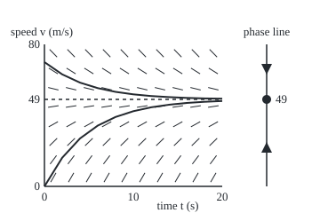

# Slope fields and the phase line: sketch every solution without solving anything

[Syllabus](../../../SYLLABUS.md) → [Differential equations and dynamics](../README.md) → [Rate Equations](../README.md#s01) → Slope fields and the phase line

---

## General Overview

A skydiver leaves the plane. Gravity adds 9.8 m/s of speed every second. Air pushes back, and in this model each 1 m/s of speed costs 0.2 m/s per second. At the door the diver gains 9.8 m/s each second. At 70 m/s drag takes 14 and gravity adds 9.8: a loss of 4.2 m/s each second.

At 49 m/s the two cancel: 0.2 × 49 = 9.8. Below 49 the diver speeds up; above, slows down. Every diver is pushed toward 49 m/s, whatever the start. That is terminal velocity, found without solving anything.

Two drawings make this routine. A **slope field** puts, at many points of the time-and-speed plane, a short tick with the slope the equation demands; every solution's graph runs along the ticks. A **phase line** drops time and keeps the speed axis, marked with the resting speeds and arrows showing which way speed moves between them.

**The rate law gives the slope at every point, so the shape of every solution can be drawn from the law alone; when the law ignores the clock, one line of arrows says where every start ends up.**

**What kind of fact this is:** a method for drawing, backed by a theorem (a solution between resting values moves one way and settles on a rest), proved on this card in Why it works.

### The picture: the skydiver's slope field and phase line

<p align="center"></p>

Scale: 10 units per second across, 2 units per m/s up; the dashed line is 49 m/s. The curves start at 0 and 70 m/s, plotted every 2 s. Ticks in a row share one slope, because the rate ignores the clock.

---

## The formula

Notation from [A differential equation](01-what-a-differential-equation-says.md): $v'$ is the rate of $v$, read "the rate of v at time t is …". An equation whose right side mentions only the unknown, not the time, is called **autonomous**. The skydiver's is:

$$v' = f(v) = 9.8 - 0.2\,v$$

**Read it aloud:** the rate of speed is 9.8 minus a fifth of the speed.

The **slope field** puts, at each point $(t, v)$, a tick of slope $f(v)$. The **phase line** is the $v$ axis alone, with three marks:

$$f(v^*) = 0 \quad\text{marks a rest,}\qquad f(v) > 0 \text{ an arrow up,}\qquad f(v) < 0 \text{ an arrow down.}$$

Arrows pointing in from both sides make a rest **stable**; arrows pointing away, **unstable**. The quick test is the slope of $f$ at the rest:

$$f'(v^*) < 0 \;\Rightarrow\; \text{stable},\qquad f'(v^*) > 0 \;\Rightarrow\; \text{unstable}.$$

Here $f'(v) = -0.2$ everywhere, so 49 m/s attracts.

| Symbol | Plain meaning | In our example | Push it up and the answer… |
| --- | --- | --- | --- |
| $t$ | time since leaving the plane, in s | 0 to 20 s | closer to 49 |
| $v$ | downward speed, in m/s | 0 to 80 | the rate falls |
| $v'$ | rate of speed: m/s gained per s | 9.8 at the door | the curve climbs faster |
| $f$ | the rate law, as a rule on $v$ | 9.8 − 0.2v | — |
| $v^*$ | a rest: a speed where $f$ is zero | 49 m/s | — |
| $f'$ | slope of the rate law; at a rest, the pull back | −0.2 per s | past zero: unstable |
| $v_0$ | starting speed, at time 0 | 0, or 70 | same destination |

The 0.2 is the drag constant, in units of one over seconds.

### When it holds

- **The rate ignores the clock.** If a parachute opens at 10 s, the drag constant jumps from 0.2 to 1.96 per s. The law now depends on the time, and the diver settles at 9.8 ÷ 1.96 = 5 m/s, not 49: at 12 s the speed is 5.74 m/s.
- **The rate law is continuous.** Otherwise arrows could reverse without a rest between them.
- **Solutions are unique.** Two solutions must never share a point, which holds when $f$ has a bounded slope (the Lipschitz condition, from [The Picard-Lindelof theorem](../02-Existence%2C%20Uniqueness%20and%20Sensitivity/02-lipschitz-and-the-picard-lindelof-theorem.md)). Without it, the tank law $h' = -\sqrt{h}$, with $h$ the water depth, drains a tank to empty in finite time, so the empty tank has two different histories: one that was always empty and one that just finished draining.
- **The slope test needs a nonzero slope.** If $f'(v^*) = 0$ the test is silent and the arrows must be read directly.

---

## Why it works

### Step 0: the equation hands out slopes before anyone solves it

A solution's rate at each moment equals $f$ at its current value. So its graph, wherever it passes, has the slope printed there. Draw ticks everywhere and the solutions are the curves that run along them, like iron filings along a magnet's field.

### Step 1: autonomous means every row is the same

At 5 m/s the slope is 8.80 at every time; at 75 m/s, −5.20. Curves of equal slope are **isoclines**.

For a law that reads the clock, such as $y' = t - y$, they tilt: slope 1 holds along the line $y = t - 1$. For an autonomous law they are horizontal, so one column of ticks tells the whole field. Shrink that column to arrows: the phase line.

### Step 2: a rest is a constant solution

If $f(v^*) = 0$, the constant $v(t) = v^*$ has rate 0, as the law asks. So 49 m/s held forever is a solution: the dashed line.

### Step 3: between rests, the motion is one way

A continuous $f$ that is never zero on an interval keeps one sign there, by the [Intermediate value theorem](../../06-Calculus%20and%20analysis/01-Limits%20and%20Continuity/06-intermediate-value-theorem.md): a continuous function cannot skip a value, so it cannot change sign without passing zero. Below 49, $f > 0$, so every solution there rises; above 49, $f < 0$, so it falls. The signs are read off one test point each: 9.80 at 0, and −4.20 at 70.

### Step 4: no solution crosses a rest

If a rising curve touched 49 at some moment, it and the constant 49 would share a point. Uniqueness forbids that. So a diver starting at 0 stays below 49 forever, and one starting at 70 stays above.

### Step 5: a one-way, fenced-in solution settles on a rest

From 0 the speed rises and never passes 49, so it climbs toward some limit no larger than 49. Were the limit below 49, the rate there would be positive, speed would keep rising by a fixed amount each second, and it would pass any bound. So the limit is 49.

<details>
<summary>Detailed proof</summary>

Let $v$ increase on `[0, ∞)` with $v(t) < v^*$, where $v^*$ is the nearest rest above $v_0$. A bounded increasing function has a limit, call it L, with L ≤ $v^*$. Suppose L < $v^*$. Then f(L) > 0, and by continuity some δ > 0 gives f(w) > f(L)/2 for every w within δ below L. Some time T0 has $v(t)$ ≥ L − δ for all later t. For t > T0, $v(t)$ − v(T0) is the integral of f(v(s)) from T0 to t, which exceeds (t − T0) f(L)/2 and grows without bound, contradicting $v(t) < v^*$. So L = $v^*$. The case above a rest is the mirror image.

</details>

### Step 6: the slope test measures the pull

Near a rest, $f(v) \approx f'(v^*)(v - v^*)$: when $f'(v^*) < 0$ the gap from the rest shrinks at a rate proportional to itself. For the skydiver this is exact: the gap is multiplied by $e^{-0.2t}$, so the curves close in on 49 without touching it. From 0 the speed is 30.97 m/s at 5 s and 42.37 at 10 s; from 70, 56.73 and 51.84.

<details>
<summary>When the slope test is silent</summary>

The law $v' = (v - 49)^2$ has slope zero at its rest. Arrows point up on both sides: a start below creeps up to 49, a start above runs away. Such a rest is **semi-stable**.

</details>

Solving gives the same answer, $v = 49 + (v_0 - 49)\,e^{-0.2t}$, by the method of [Separable equations](03-separable-equations.md).

---

## Worked numbers, by hand

| Step | Arithmetic | Value |
| --- | --- | --- |
| the rest | 9.8 − 0.2v = 0, so v = 9.8 ÷ 0.2 | **49 m/s** |
| sign below | rate at 0 = 9.8 − 0 | 9.80, arrow up |
| sign above | rate at 70 = 9.8 − 14 | −4.20, arrow down |
| stability | slope of 9.8 − 0.2v | −0.2 per s: stable |
| a row of ticks | rate at 45 = 9.8 − 9 | 0.80 at every time |
| from 0, at 5 s | 49 − 49 × e^(−1) | 30.97 m/s |
| from 0, at 10 s | 49 − 49 × e^(−2) | 42.37 m/s |
| 90% of 49 | 44.10 when e^(−0.2t) = 0.1, so t = ln 10 ÷ 0.2 | **11.51 s** |

From rest, a diver is within a tenth of terminal speed after 11.51 s.

The shelf's coffee, T' = −0.1(T − 20) with temperature T in C and time in min, reads the same way: one rest at 20 C, slope −0.1 per min. Room temperature attracts every cup, hot or iced.

### What breaks if you drop a piece

| Mistake | Comes out at | What went wrong |
| --- | --- | --- |
| Using the free-fall phase line after the chute opens at 10 s | 5.74 m/s at 12 s, not near 49 | The law changed with time: not autonomous |
| Stepping along the slope with 10 s steps from 70 | 70.00, 28.00, 70.00, 28.00 … | Each step overshoots the rest; the true curve never crosses it |
| Drag sign flipped, v' = 9.8 + 0.2v | 84.20 m/s at 5 s, rest at −49 unstable | Positive slope at the rest: arrows point away |

---

## Code, from first principles, and it actually runs

Road one finds the rest by bisection (halve an interval until the sign change is pinned) and measures the slope there by a difference quotient (the change in the rate across a tiny gap, divided by the gap).

Road two walks the slope field by Euler's rule: from the current speed, move for a short time h along the tick at that speed; it never calls the exponential. The closed form referees both.

The Euler error at 10 s halves each time the step halves: the rule is first order, with its own card, [Euler's method](../05-Numerical%20Evolution/01-eulers-method.md).

### Python

```python
# Slope fields and the phase line -- the check behind the card.  Nothing is
# imported but math.exp and math.log.  The skydiver: v' = 9.8 - 0.2 v, speed
# v in m/s, time t in s.  Road one reads the equilibrium and its stability off
# the rate alone; road two steps along the slope field; the closed form referees.
from math import exp, log
G, K = 9.8, 0.2

def rate(v, g=G, k=K): return g - k * v                    # the right-hand side

def bisect(f, lo, hi):                                     # root finder, written out
    for _ in range(200):
        mid = (lo + hi) / 2
        lo, hi = (mid, hi) if f(lo) * f(mid) > 0 else (lo, mid)
    return (lo + hi) / 2

def closed(v0, t): return G / K + (v0 - G / K) * exp(-K * t)

def euler(v0, t, h, f=rate):                               # small steps along the slope
    v = v0
    for _ in range(round(t / h)): v += h * f(v)
    return v

def f2(xs): return " ".join(f"{x:.2f}" for x in xs)
star = bisect(rate, 0.0, 100.0)
slope = (rate(star + 1e-3) - rate(star - 1e-3)) / 2e-3     # f' at the rest, by differences
ts = [5, 10, 20]
e90, v, n = G / K * 0.9, 0.0, 0                             # step until 90% of terminal
while v < e90: v, n = v + 0.001 * rate(v), n + 1
err = [euler(0, 10, h) - closed(0, 10) for h in (0.1, 0.05, 0.025)]
cof = lambda T: -0.1 * (T - 20)                             # the shelf's coffee, same test
cstar = bisect(cof, 0.0, 100.0)
chute = 5 + (closed(0, 10) - 5) * exp(-1.96 * 2)            # parachute opens at t = 10 s
wrong = -49 + 49 * exp(0.2 * 5)                             # drag sign flipped, v' = 9.8 + 0.2v
print("rate law v' = 9.8 - 0.2 v; units m/s per s")
print(f"equilibrium by bisection {star:.6f} m/s; g/k = {G / K:.6f} m/s")
print(f"slope of the rate at the rest {slope:.6f} per s -> {'stable' if slope < 0 else 'unstable'}")
arrow = lambda x: "up" if rate(x) > 0 else "down"
print(f"phase line signs: rate at 0 = {rate(0):.2f} ({arrow(0)}), rate at 70 = {rate(70):.2f} ({arrow(70)})")
print("slope field rows v = 5, 15, ..., 75:", f2(rate(v) for v in range(5, 80, 10)))
for v0 in (0, 70):
    print(f"from {v0}, closed form at t = 5, 10, 20 s: {f2(closed(v0, t) for t in ts)}")
    print(f"from {v0}, Euler h = 0.001 at t = 5, 10, 20 s: {f2(euler(v0, t, 0.001) for t in ts)}")
print(f"90% of terminal ({e90:.2f} m/s) at t = {log(10) / K:.2f} s closed, {n * 0.001:.2f} s Euler")
print("Euler error at t = 10 s, h = 0.1, 0.05, 0.025:", " ".join(f"{e:.4f}" for e in err))
print(f"coffee T' = -0.1(T - 20): rest {cstar:.6f} C, slope {(cof(cstar + 1e-3) - cof(cstar - 1e-3)) / 2e-3:.6f} per min")
print(f"mistake 1, chute opens at 10 s: v(12) = {chute:.2f} m/s, not near 49")
print("mistake 2, Euler with h = 10 s from 70:", " ".join(f"{euler(70, 10 * i, 10):.2f}" for i in range(5)))
print(f"mistake 3, drag sign flipped: v(5) = {wrong:.2f} m/s, rest -49 with slope +0.2, unstable")
X = lambda t: 50 + 10 * t; Y = lambda v: 210 - 2 * v        # 10 units per s, 2 per m/s
print(f"figure, rest line y = {Y(star):.1f}; phase dot at (300, {Y(star):.1f})")
for v0 in (0, 70):
    print(f"figure, from {v0}:", " ".join(f"{X(t):.0f},{Y(closed(v0, t)):.1f}" for t in range(0, 21, 2)))
assert abs(star - G / K) < 1e-9                              # the rest, two roads
assert max(abs(euler(v0, t, 0.001) - closed(v0, t)) for v0 in (0, 70) for t in ts) < 0.01
assert 1.9 < err[0] / err[1] < 2.1                          # error halves with h: order one
assert abs(slope + K) < 1e-6 and abs(n * 0.001 - log(10) / K) < 0.01
print("ALL CHECKS PASS")
```

**Ran 2026-09-28 on macOS, Python 3.14.6, standard library only. All checks passed. Output, pasted from the run:**

```
rate law v' = 9.8 - 0.2 v; units m/s per s
equilibrium by bisection 49.000000 m/s; g/k = 49.000000 m/s
slope of the rate at the rest -0.200000 per s -> stable
phase line signs: rate at 0 = 9.80 (up), rate at 70 = -4.20 (down)
slope field rows v = 5, 15, ..., 75: 8.80 6.80 4.80 2.80 0.80 -1.20 -3.20 -5.20
from 0, closed form at t = 5, 10, 20 s: 30.97 42.37 48.10
from 0, Euler h = 0.001 at t = 5, 10, 20 s: 30.98 42.37 48.10
from 70, closed form at t = 5, 10, 20 s: 56.73 51.84 49.38
from 70, Euler h = 0.001 at t = 5, 10, 20 s: 56.72 51.84 49.38
90% of terminal (44.10 m/s) at t = 11.51 s closed, 11.51 s Euler
Euler error at t = 10 s, h = 0.1, 0.05, 0.025: 0.1331 0.0664 0.0332
coffee T' = -0.1(T - 20): rest 20.000000 C, slope -0.100000 per min
mistake 1, chute opens at 10 s: v(12) = 5.74 m/s, not near 49
mistake 2, Euler with h = 10 s from 70: 70.00 28.00 70.00 28.00 70.00
mistake 3, drag sign flipped: v(5) = 84.20 m/s, rest -49 with slope +0.2, unstable
figure, rest line y = 112.0; phase dot at (300, 112.0)
figure, from 0: 50,210.0 70,177.7 90,156.0 110,141.5 130,131.8 150,125.3 170,120.9 190,118.0 210,116.0 230,114.7 250,113.8
figure, from 70: 50,70.0 70,83.8 90,93.1 110,99.3 130,103.5 150,106.3 170,108.2 190,109.4 210,110.3 230,110.9 250,111.2
ALL CHECKS PASS
```

### Rust

Same numbers, same labels, built with `rustc --edition 2021 -O`.

```rust
// Slope fields and the phase line -- the same check as the Python, in Rust.
// No crates.  The skydiver: v' = 9.8 - 0.2 v, speed v in m/s, time t in s.
// Road one reads the equilibrium and its stability off the rate alone; road
// two steps along the slope field; the closed form referees.
const G: f64 = 9.8;
const K: f64 = 0.2;

fn rate(v: f64) -> f64 { G - K * v }                      // the right-hand side

fn bisect(f: &dyn Fn(f64) -> f64, mut lo: f64, mut hi: f64) -> f64 {   // root finder
    for _ in 0..200 {
        let mid = (lo + hi) / 2.0;
        if f(lo) * f(mid) > 0.0 { lo = mid } else { hi = mid }
    }
    (lo + hi) / 2.0
}

fn closed(v0: f64, t: f64) -> f64 { G / K + (v0 - G / K) * (-K * t).exp() }

fn euler(v0: f64, t: f64, h: f64) -> f64 {                // small steps along the slope
    let mut v = v0;
    for _ in 0..(t / h).round() as i64 { v += h * rate(v) }
    v
}

fn f2(xs: &[f64]) -> String { xs.iter().map(|x| format!("{:.2}", x)).collect::<Vec<_>>().join(" ") }

fn main() {
    let star = bisect(&rate, 0.0, 100.0);
    let slope = (rate(star + 1e-3) - rate(star - 1e-3)) / 2e-3;   // f' at the rest
    let ts = [5.0, 10.0, 20.0];
    let (e90, mut v, mut n) = (G / K * 0.9, 0.0_f64, 0);          // step until 90% of terminal
    while v < e90 { v += 0.001 * rate(v); n += 1 }
    let err: Vec<f64> = [0.1, 0.05, 0.025].iter().map(|&h| euler(0.0, 10.0, h) - closed(0.0, 10.0)).collect();
    let cof = |t: f64| -0.1 * (t - 20.0);                         // the shelf's coffee
    let cstar = bisect(&cof, 0.0, 100.0);
    let chute = 5.0 + (closed(0.0, 10.0) - 5.0) * (-1.96_f64 * 2.0).exp();
    let wrong = -49.0 + 49.0 * (0.2_f64 * 5.0).exp();
    println!("rate law v' = 9.8 - 0.2 v; units m/s per s");
    println!("equilibrium by bisection {:.6} m/s; g/k = {:.6} m/s", star, G / K);
    println!("slope of the rate at the rest {:.6} per s -> {}", slope, if slope < 0.0 { "stable" } else { "unstable" });
    let arrow = |x: f64| if rate(x) > 0.0 { "up" } else { "down" };
    println!("phase line signs: rate at 0 = {:.2} ({}), rate at 70 = {:.2} ({})", rate(0.0), arrow(0.0), rate(70.0), arrow(70.0));
    let rows: Vec<f64> = (0..8).map(|i| rate(5.0 + 10.0 * i as f64)).collect();
    println!("slope field rows v = 5, 15, ..., 75: {}", f2(&rows));
    for v0 in [0.0, 70.0] {
        let c: Vec<f64> = ts.iter().map(|&t| closed(v0, t)).collect();
        let e: Vec<f64> = ts.iter().map(|&t| euler(v0, t, 0.001)).collect();
        println!("from {}, closed form at t = 5, 10, 20 s: {}", v0, f2(&c));
        println!("from {}, Euler h = 0.001 at t = 5, 10, 20 s: {}", v0, f2(&e));
    }
    println!("90% of terminal ({:.2} m/s) at t = {:.2} s closed, {:.2} s Euler", e90, 10f64.ln() / K, n as f64 * 0.001);
    println!("Euler error at t = 10 s, h = 0.1, 0.05, 0.025: {:.4} {:.4} {:.4}", err[0], err[1], err[2]);
    println!("coffee T' = -0.1(T - 20): rest {:.6} C, slope {:.6} per min", cstar, (cof(cstar + 1e-3) - cof(cstar - 1e-3)) / 2e-3);
    println!("mistake 1, chute opens at 10 s: v(12) = {:.2} m/s, not near 49", chute);
    let e10: Vec<f64> = (0..5).map(|i| euler(70.0, 10.0 * i as f64, 10.0)).collect();
    println!("mistake 2, Euler with h = 10 s from 70: {}", f2(&e10));
    println!("mistake 3, drag sign flipped: v(5) = {:.2} m/s, rest -49 with slope +0.2, unstable", wrong);
    let (x, y) = (|t: f64| 50.0 + 10.0 * t, |v: f64| 210.0 - 2.0 * v);   // 10 units per s, 2 per m/s
    println!("figure, rest line y = {:.1}; phase dot at (300, {:.1})", y(star), y(star));
    for v0 in [0.0, 70.0] {
        let pts: Vec<String> = (0..11).map(|i| { let t = 2.0 * i as f64; format!("{:.0},{:.1}", x(t), y(closed(v0, t))) }).collect();
        println!("figure, from {}: {}", v0, pts.join(" "));
    }
    assert!((star - G / K).abs() < 1e-9);                          // the rest, two roads
    let worst = [0.0, 70.0].iter().flat_map(|&v0| ts.iter().map(move |&t| (euler(v0, t, 0.001) - closed(v0, t)).abs())).fold(0.0, f64::max);
    assert!(worst < 0.01);
    assert!(1.9 < err[0] / err[1] && err[0] / err[1] < 2.1);       // error halves with h: order one
    assert!((slope + K).abs() < 1e-6 && (n as f64 * 0.001 - 10f64.ln() / K).abs() < 0.01);
    println!("ALL CHECKS PASS");
}
```

**Ran 2026-09-28 on macOS, rustc 1.98.1, no crates. All checks passed. Output, pasted from the run:**

```
rate law v' = 9.8 - 0.2 v; units m/s per s
equilibrium by bisection 49.000000 m/s; g/k = 49.000000 m/s
slope of the rate at the rest -0.200000 per s -> stable
phase line signs: rate at 0 = 9.80 (up), rate at 70 = -4.20 (down)
slope field rows v = 5, 15, ..., 75: 8.80 6.80 4.80 2.80 0.80 -1.20 -3.20 -5.20
from 0, closed form at t = 5, 10, 20 s: 30.97 42.37 48.10
from 0, Euler h = 0.001 at t = 5, 10, 20 s: 30.98 42.37 48.10
from 70, closed form at t = 5, 10, 20 s: 56.73 51.84 49.38
from 70, Euler h = 0.001 at t = 5, 10, 20 s: 56.72 51.84 49.38
90% of terminal (44.10 m/s) at t = 11.51 s closed, 11.51 s Euler
Euler error at t = 10 s, h = 0.1, 0.05, 0.025: 0.1331 0.0664 0.0332
coffee T' = -0.1(T - 20): rest 20.000000 C, slope -0.100000 per min
mistake 1, chute opens at 10 s: v(12) = 5.74 m/s, not near 49
mistake 2, Euler with h = 10 s from 70: 70.00 28.00 70.00 28.00 70.00
mistake 3, drag sign flipped: v(5) = 84.20 m/s, rest -49 with slope +0.2, unstable
figure, rest line y = 112.0; phase dot at (300, 112.0)
figure, from 0: 50,210.0 70,177.7 90,156.0 110,141.5 130,131.8 150,125.3 170,120.9 190,118.0 210,116.0 230,114.7 250,113.8
figure, from 70: 50,70.0 70,83.8 90,93.1 110,99.3 130,103.5 150,106.3 170,108.2 190,109.4 210,110.3 230,110.9 250,111.2
ALL CHECKS PASS
```

The two outputs match line for line.

### Lean

Lean proves the phase-line facts for every rate law with a bounded slope, and the skydiver's speed for every start.

- Take a rate law that ignores the clock and has a bounded slope. A solution that starts between two rests, with none between them, stays between them forever.
- If its arrow points up, it rises at every moment and settles on the rest above. If its arrow points down, it falls and settles on the rest below.
- At a rest where the rate law has a negative slope, the arrows point in from both sides: the rest is stable.
- Where that slope is positive, the arrows point away on both sides: the rest is unstable.
- Every solution of v' = 9.8 − 0.2v is $v = 49 + (v_0 - 49)\,e^{-0.2t}$, so every diver closes in on 49 m/s.
- The rest is 49. The rate is 9.8 at 0, −4.2 at 70, 0.8 at 45, 8.8 at 5 and −5.2 at 75.
- 90% of 49 is 44.1. The parachute rest is 5 m/s, the coffee rests at 20 C, and halving the drag moves the rest to 98.
- Euler steps of 10 s from 70 go 70, 28, 70. One 5 s step lands on 49. A 12 s step gives 19.6, multiplying the gap by −1.4.
- With the drag sign flipped, the rest is −49.

The speeds at 5, 10 and 20 s, the 11.51 s time and the Euler errors are left to the Python and Rust checks. So are the speed at 12 s and the figure.

```lean
-- Slope fields and the phase line: for a clock-free rate law v' = f(v) with f Lipschitz, a solution that starts between two rests stays between them, moves one way, and settles on the rest its arrow points to; a rest where f has negative slope has arrows pointing in (positive slope: pointing out); and every skydiver speed under v' = 9.8 - 0.2 v closes in on 49 m/s.
import Mathlib.Analysis.Calculus.Deriv.Basic
import Mathlib.Analysis.Calculus.Deriv.MeanValue
import Mathlib.Analysis.ODE.Gronwall
import Mathlib.Analysis.SpecialFunctions.Exp
import Mathlib.Topology.EMetricSpace.Lipschitz
import Mathlib.Tactic.NormNum

open Filter Topology Set

/-- Backward uniqueness at a rest: a solution that reaches a rest `c` at some time `s ≥ 0`
was already at `c` at time `0`. -/
theorem sf_back_unique (f : ℝ → ℝ) (K : NNReal) (hf : LipschitzWith K f) (c : ℝ) (hc : f c = 0)
    (v : ℝ → ℝ) (hv : ∀ t ∈ Ici (0 : ℝ), HasDerivWithinAt v (f (v t)) (Ici 0) t)
    (s : ℝ) (hs : 0 ≤ s) (hvs : v s = c) : v 0 = c := by
  have hd : ∀ t, 0 < t → HasDerivAt v (f (v t)) t := fun t ht =>
    (hv t (le_of_lt ht)).hasDerivAt (Ici_mem_nhds ht)
  have hcont : ContinuousOn v (Ici 0) := fun t ht => (hv t ht).continuousWithinAt
  have hneg : LipschitzWith K (fun x => -f x) :=
    LipschitzWith.of_dist_le_mul fun x y => by
      rw [dist_neg_neg]; exact hf.dist_le_mul x y
  set u : ℝ → ℝ := fun r => v (s - r) with hu_def
  have hu_cont : ContinuousOn u (Icc 0 s) := by
    refine hcont.comp (continuous_const.sub continuous_id).continuousOn ?_
    intro r hr; simp only [mem_Ici]; linarith [hr.2]
  have hu' : ∀ r ∈ Ico 0 s, HasDerivWithinAt u (-f (u r)) (Ici r) r := by
    intro r hr
    have := (hd (s - r) (by linarith [hr.2])).comp_const_sub s r
    exact this.hasDerivWithinAt
  have hg' : ∀ r ∈ Ico 0 s, HasDerivWithinAt (fun _ => c) (-f c) (Ici r) r := by
    intro r _; rw [hc, neg_zero]; exact hasDerivWithinAt_const _ _ _
  have key := dist_le_of_trajectories_ODE (v := fun _ x => -f x) (K := K) (δ := 0)
    (fun _ => hneg) hu_cont hu' continuousOn_const hg'
    (by simp [u, hvs]) s (right_mem_Icc.2 hs)
  have : dist (u s) c = 0 := le_antisymm (by simpa using key) dist_nonneg
  simpa [u] using dist_eq_zero.1 this

/-- A solution starting strictly between two rests stays strictly between them. -/
theorem sf_stays_between (f : ℝ → ℝ) (K : NNReal) (hf : LipschitzWith K f)
    (a b : ℝ) (ha : f a = 0) (hb : f b = 0)
    (v : ℝ → ℝ) (hv : ∀ t ∈ Ici (0 : ℝ), HasDerivWithinAt v (f (v t)) (Ici 0) t)
    (hv0 : v 0 ∈ Ioo a b) : ∀ t ∈ Ici (0 : ℝ), v t ∈ Ioo a b := by
  have hcont : ContinuousOn v (Ici 0) := fun t ht => (hv t ht).continuousWithinAt
  intro t ht
  have ht0 : (0 : ℝ) ≤ t := ht
  have hc : ContinuousOn v (Icc 0 t) := hcont.mono Icc_subset_Ici_self
  constructor
  · by_contra h
    push Not at h
    obtain ⟨s, hs, hvs⟩ := intermediate_value_Icc' ht0 hc ⟨h, le_of_lt hv0.1⟩
    have := sf_back_unique f K hf a ha v hv s hs.1 hvs
    linarith [hv0.1]
  · by_contra h
    push Not at h
    obtain ⟨s, hs, hvs⟩ := intermediate_value_Icc ht0 hc ⟨le_of_lt hv0.2, h⟩
    have := sf_back_unique f K hf b hb v hv s hs.1 hvs
    linarith [hv0.2]

/-- With no rest between `a` and `b`, the rate keeps one sign there. -/
theorem sf_sign_const (f : ℝ → ℝ) (hc : Continuous f) (a b : ℝ)
    (hno : ∀ x ∈ Ioo a b, f x ≠ 0) (x y : ℝ) (hx : x ∈ Ioo a b) (hy : y ∈ Ioo a b)
    (hfx : 0 < f x) : 0 < f y := by
  by_contra h
  push Not at h
  have hy' : f y < 0 := lt_of_le_of_ne h (hno y hy)
  obtain ⟨z, hz, hfz⟩ := intermediate_value_uIcc (hc.continuousOn (s := uIcc x y))
    (show (0 : ℝ) ∈ uIcc (f x) (f y) from mem_uIcc.2 (Or.inr ⟨le_of_lt hy', le_of_lt hfx⟩))
  exact hno z ((ordConnected_Ioo).uIcc_subset hx hy hz) hfz

/-- Rising case: a solution inside `(a, b)` where the rate is positive rises strictly and
tends to `b`. -/
theorem sf_rising (f : ℝ → ℝ) (hc : Continuous f) (a b : ℝ)
    (hpos : ∀ x ∈ Ioo a b, 0 < f x)
    (v : ℝ → ℝ) (hv : ∀ t ∈ Ici (0 : ℝ), HasDerivWithinAt v (f (v t)) (Ici 0) t)
    (hin : ∀ t ∈ Ici (0 : ℝ), v t ∈ Ioo a b) :
    StrictMonoOn v (Ici 0) ∧ Tendsto v atTop (𝓝 b) := by
  have hd : ∀ t, 0 < t → HasDerivAt v (f (v t)) t := fun t ht =>
    (hv t (le_of_lt ht)).hasDerivAt (Ici_mem_nhds ht)
  have hcont : ContinuousOn v (Ici 0) := fun t ht => (hv t ht).continuousWithinAt
  have hmono : StrictMonoOn v (Ici 0) := by
    refine strictMonoOn_of_deriv_pos (convex_Ici 0) hcont fun x hx => ?_
    rw [interior_Ici] at hx
    rw [(hd x hx).deriv]
    exact hpos _ (hin x (mem_Ici.2 (le_of_lt hx)))
  refine ⟨hmono, ?_⟩
  rw [tendsto_order]
  constructor
  · intro a' ha'
    set c := max a' (v 0) with hc_def
    have hcb : c < b := max_lt ha' (hin 0 self_mem_Ici).2
    by_cases hex : ∃ T ∈ Ici (0 : ℝ), c < v T
    · obtain ⟨T, hT, hcT⟩ := hex
      refine eventually_atTop.2 ⟨T, fun t ht => ?_⟩
      have hT0 : (0 : ℝ) ≤ T := hT
      have : v T ≤ v t := hmono.monotoneOn hT (show (0:ℝ) ≤ t by linarith) ht
      exact lt_of_le_of_lt (le_max_left _ _) (lt_of_lt_of_le hcT this)
    · exfalso
      push Not at hex
      have hv0c : v 0 ≤ c := le_max_right _ _
      obtain ⟨x0, hx0, hmin⟩ := isCompact_Icc.exists_isMinOn (nonempty_Icc.2 hv0c)
        hc.continuousOn
      have hx0in : x0 ∈ Ioo a b :=
        ⟨lt_of_lt_of_le (hin 0 self_mem_Ici).1 hx0.1, lt_of_le_of_lt hx0.2 hcb⟩
      set m := f x0 with hm_def
      have hm : 0 < m := hpos x0 hx0in
      have hrange : ∀ t ∈ Ici (0 : ℝ), v t ∈ Icc (v 0) c := fun t ht =>
        ⟨hmono.monotoneOn self_mem_Ici ht ht, hex t ht⟩
      have hh : MonotoneOn (fun t => v t - m * t) (Ici 0) := by
        have hd2 : ∀ t, 0 < t → HasDerivAt (fun t => v t - m * t) (f (v t) - m) t := by
          intro t ht
          exact ((hd t ht).sub ((hasDerivAt_id' t).const_mul m)).congr_deriv (by ring)
        refine monotoneOn_of_deriv_nonneg (convex_Ici 0)
          (hcont.sub (continuous_const.mul continuous_id).continuousOn) ?_ ?_
        · rw [interior_Ici]
          exact fun t ht => (hd2 t ht).differentiableAt.differentiableWithinAt
        · rw [interior_Ici]
          intro t ht
          rw [(hd2 t ht).deriv]
          have := hmin (hrange t (mem_Ici.2 (le_of_lt ht)))
          simp only [mem_ofPred_eq] at this
          linarith
      set T := (c - v 0) / m + 1 with hT_def
      have hT0 : 0 ≤ T := by
        have : 0 ≤ (c - v 0) / m := div_nonneg (by linarith) (le_of_lt hm)
        linarith
      have h1 := hh self_mem_Ici hT0 hT0
      simp only [mul_zero, sub_zero] at h1
      have h2 : v T ≤ c := hex T hT0
      have h3 : m * T = c - v 0 + m := by
        rw [hT_def, mul_add, mul_div_cancel₀ _ (ne_of_gt hm), mul_one]
      linarith
  · intro b' hb'
    exact eventually_atTop.2 ⟨0, fun t ht => (hin t ht).2.trans hb'⟩

#print axioms sf_back_unique
#print axioms sf_stays_between
#print axioms sf_sign_const
#print axioms sf_rising

/-- Between rests, the motion is one way and settles on a rest. Take a rate law `v' = f(v)`
that ignores the clock, with `f` Lipschitz (bounded slope, so solutions are unique and `f` is
continuous). Let `a < b` be two rests (`f a = 0`, `f b = 0`) with no rest between them. Then any
solution `v` on `[0, ∞)` that starts strictly between `a` and `b` stays strictly between them
for all time, never crossing a rest; if its starting arrow points up (`f (v 0) > 0`) it rises
strictly and tends to `b`, and if it points down (`f (v 0) < 0`) it falls strictly and tends
to `a`. -/
theorem solution_between_rests_moves_one_way_and_settles
    (f : ℝ → ℝ) (K : NNReal) (hf : LipschitzWith K f)
    (a b : ℝ) (hab : a < b) (ha : f a = 0) (hb : f b = 0)
    (hno : ∀ x ∈ Ioo a b, f x ≠ 0)
    (v : ℝ → ℝ) (hv : ∀ t ∈ Ici (0 : ℝ), HasDerivWithinAt v (f (v t)) (Ici 0) t)
    (hv0 : v 0 ∈ Ioo a b) :
    (∀ t ∈ Ici (0 : ℝ), v t ∈ Ioo a b) ∧
    (0 < f (v 0) → StrictMonoOn v (Ici 0) ∧ Tendsto v atTop (𝓝 b)) ∧
    (f (v 0) < 0 → StrictAntiOn v (Ici 0) ∧ Tendsto v atTop (𝓝 a)) := by
  have hc : Continuous f := hf.continuous
  have hin := sf_stays_between f K hf a b ha hb v hv hv0
  refine ⟨hin, ?_, ?_⟩
  · intro hpos0
    exact sf_rising f hc a b (fun x hx => sf_sign_const f hc a b hno (v 0) x hv0 hx hpos0)
      v hv hin
  · intro hneg0
    have hneg : ∀ x ∈ Ioo a b, f x < 0 := by
      intro x hx
      rcases lt_or_gt_of_ne (hno x hx) with h | h
      · exact h
      · exact absurd (sf_sign_const f hc a b hno x (v 0) hx hv0 h) (not_lt.2 (le_of_lt hneg0))
    set g : ℝ → ℝ := fun x => -f (-x) with hg_def
    have hgc : Continuous g := (hc.comp continuous_neg).neg
    have hgpos : ∀ x ∈ Ioo (-b) (-a), 0 < g x := by
      intro x hx
      have : -x ∈ Ioo a b := ⟨by linarith [hx.2], by linarith [hx.1]⟩
      simp only [g]; linarith [hneg (-x) this]
    have hw : ∀ t ∈ Ici (0 : ℝ), HasDerivWithinAt (fun t => -v t) (g (-v t)) (Ici 0) t := by
      intro t ht
      exact (hv t ht).neg.congr_deriv (by simp [g])
    have hwin : ∀ t ∈ Ici (0 : ℝ), -v t ∈ Ioo (-b) (-a) := fun t ht =>
      ⟨by linarith [(hin t ht).2], by linarith [(hin t ht).1]⟩
    obtain ⟨hm, ht⟩ := sf_rising g hgc (-b) (-a) hgpos (fun t => -v t) hw hwin
    refine ⟨fun x hx y hy hxy => ?_, ?_⟩
    · have := hm hx hy hxy
      simp only at this
      linarith
    · simpa using ht.neg

/-- The slope test. At a rest `v*` (`f v* = 0`) where the rate law has slope `d`: if `d < 0`,
the arrows point in from both sides (`f > 0` just below `v*`, `f < 0` just above), so the rest
is stable; if `d > 0`, the arrows point away on both sides, so the rest is unstable. -/
theorem slope_test_for_rests (f : ℝ → ℝ) (vstar d : ℝ) (hrest : f vstar = 0)
    (hd : HasDerivAt f d vstar) :
    (d < 0 → ∃ δ > 0, (∀ x ∈ Ioo (vstar - δ) vstar, 0 < f x) ∧
                       (∀ x ∈ Ioo vstar (vstar + δ), f x < 0)) ∧
    (0 < d → ∃ δ > 0, (∀ x ∈ Ioo (vstar - δ) vstar, f x < 0) ∧
                       (∀ x ∈ Ioo vstar (vstar + δ), 0 < f x)) := by
  rw [hasDerivAt_iff_tendsto_slope] at hd
  have hδ : ∀ {p : ℝ → Prop}, (∀ᶠ x in 𝓝[≠] vstar, p x) →
      ∃ δ > 0, ∀ x, dist x vstar < δ → x ≠ vstar → p x := by
    intro p hp
    rw [eventually_nhdsWithin_iff, Metric.eventually_nhds_iff] at hp
    obtain ⟨δ, hδ, h⟩ := hp
    exact ⟨δ, hδ, fun x hx hne => h hx hne⟩
  have hsl : ∀ x, slope f vstar x = f x / (x - vstar) := by
    intro x; rw [slope_def_field, hrest, sub_zero]
  constructor
  · intro hdn
    obtain ⟨δ, hδpos, h⟩ := hδ (hd.eventually (eventually_lt_nhds hdn))
    refine ⟨δ, hδpos, fun x hx => ?_, fun x hx => ?_⟩
    · have hne : x ≠ vstar := ne_of_lt hx.2
      have hdist : dist x vstar < δ := by
        rw [Real.dist_eq, abs_sub_lt_iff]; constructor <;> linarith [hx.1, hx.2]
      have := h x hdist hne
      rw [hsl] at this
      have hneg : x - vstar < 0 := by linarith [hx.2]
      rcases div_neg_iff.1 this with h | h <;> linarith [h.1, h.2]
    · have hne : x ≠ vstar := ne_of_gt hx.1
      have hdist : dist x vstar < δ := by
        rw [Real.dist_eq, abs_sub_lt_iff]; constructor <;> linarith [hx.1, hx.2]
      have := h x hdist hne
      rw [hsl] at this
      have hpos : 0 < x - vstar := by linarith [hx.1]
      rcases div_neg_iff.1 this with h | h <;> linarith [h.1, h.2]
  · intro hdp
    obtain ⟨δ, hδpos, h⟩ := hδ (hd.eventually (eventually_gt_nhds hdp))
    refine ⟨δ, hδpos, fun x hx => ?_, fun x hx => ?_⟩
    · have hne : x ≠ vstar := ne_of_lt hx.2
      have hdist : dist x vstar < δ := by
        rw [Real.dist_eq, abs_sub_lt_iff]; constructor <;> linarith [hx.1, hx.2]
      have := h x hdist hne
      rw [hsl] at this
      have hneg : x - vstar < 0 := by linarith [hx.2]
      rcases div_pos_iff.1 this with h | h <;> linarith [h.1, h.2]
    · have hne : x ≠ vstar := ne_of_gt hx.1
      have hdist : dist x vstar < δ := by
        rw [Real.dist_eq, abs_sub_lt_iff]; constructor <;> linarith [hx.1, hx.2]
      have := h x hdist hne
      rw [hsl] at this
      have hpos : 0 < x - vstar := by linarith [hx.1]
      rcases div_pos_iff.1 this with h | h <;> linarith [h.1, h.2]

/-- The skydiver. Every solution on `[0, ∞)` of `v' = 9.8 - 0.2 v` (written `49/5 - v/5`) is
`v(t) = 49 + (v₀ - 49) e^(-0.2 t)`, so every diver, whatever the starting speed, is pushed
toward the terminal speed of 49 m/s. -/
theorem skydiver_speed_tends_to_terminal_velocity
    (v : ℝ → ℝ) (hv : ∀ t ∈ Ici (0 : ℝ), HasDerivWithinAt v (49 / 5 - v t / 5) (Ici 0) t) :
    (∀ t ∈ Ici (0 : ℝ), v t = 49 + (v 0 - 49) * Real.exp (-(t / 5))) ∧
    Tendsto v atTop (𝓝 49) := by
  set w : ℝ → ℝ := fun t => (v t - 49) * Real.exp (t / 5) with hw_def
  have hcont : ContinuousOn v (Ici 0) := fun t ht => (hv t ht).continuousWithinAt
  have hwd : ∀ t ∈ Ici (0 : ℝ), HasDerivWithinAt w 0 (Ici 0) t := by
    intro t ht
    have he : HasDerivAt (fun x : ℝ => Real.exp (x / 5)) (Real.exp (t / 5) * (1 / 5)) t :=
      ((hasDerivAt_id t).div_const 5).exp
    have := ((hv t ht).sub_const 49).mul he.hasDerivWithinAt
    refine this.congr_deriv ?_
    ring
  have hform : ∀ t ∈ Ici (0 : ℝ), v t = 49 + (v 0 - 49) * Real.exp (-(t / 5)) := by
    intro t ht
    have ht0 : (0 : ℝ) ≤ t := ht
    have hwc : ContinuousOn w (Icc 0 t) :=
      ((hcont.sub continuousOn_const).mul
        ((continuous_id.div_const 5).rexp.continuousOn)).mono Icc_subset_Ici_self
    have key := constant_of_has_deriv_right_zero hwc
      (fun x hx => (hwd x hx.1).mono (Ici_subset_Ici.2 hx.1)) t (right_mem_Icc.2 ht0)
    simp only [w, zero_div, Real.exp_zero, mul_one] at key
    have hexp : Real.exp (t / 5) * Real.exp (-(t / 5)) = 1 := by
      rw [← Real.exp_add, add_neg_cancel, Real.exp_zero]
    have : v t - 49 = (v t - 49) * Real.exp (t / 5) * Real.exp (-(t / 5)) := by
      rw [mul_assoc, hexp, mul_one]
    rw [key] at this
    linarith
  refine ⟨hform, ?_⟩
  have hlim : Tendsto (fun t : ℝ => 49 + (v 0 - 49) * Real.exp (-(t / 5))) atTop
      (𝓝 (49 + (v 0 - 49) * 0)) :=
    tendsto_const_nhds.add (tendsto_const_nhds.mul
      (Real.tendsto_exp_neg_atTop_nhds_zero.comp (tendsto_id.atTop_div_const (by norm_num))))
  rw [mul_zero, add_zero] at hlim
  refine hlim.congr' ?_
  filter_upwards [eventually_ge_atTop 0] with t ht
  exact (hform t ht).symm

/-! The card's worked numbers, with 9.8 = 49/5 and 0.2 = 1/5, checked exactly. -/

-- The rest: 9.8 - 0.2 × 49 = 0.
example : (49 / 5 : ℚ) - 1 / 5 * 49 = 0 := by norm_num

-- Sign below: the rate at 0 is 9.8 (arrow up). Sign above: the rate at 70 is -4.2 (arrow down).
example : (49 / 5 : ℚ) - 1 / 5 * 0 = 49 / 5 ∧ (0 : ℚ) < 49 / 5 := by norm_num
example : (49 / 5 : ℚ) - 1 / 5 * 70 = -21 / 5 ∧ (-21 / 5 : ℚ) < 0 := by norm_num

-- A row of ticks: the rate at 45 is 0.8; at 5 it is 8.8; at 75 it is -5.2.
example : (49 / 5 : ℚ) - 1 / 5 * 45 = 4 / 5 := by norm_num
example : (49 / 5 : ℚ) - 1 / 5 * 5 = 44 / 5 ∧ (49 / 5 : ℚ) - 1 / 5 * 75 = -26 / 5 := by norm_num

-- 90% of 49 is 44.1.
example : (9 / 10 : ℚ) * 49 = 441 / 10 := by norm_num

-- The parachute: drag 1.96 per s gives the new rest 9.8 ÷ 1.96 = 5 m/s.
example : (49 / 5 : ℚ) / (49 / 25) = 5 := by norm_num

-- The coffee T' = -0.1 (T - 20) rests at 20.
example : -(1 / 10 : ℚ) * (20 - 20) = 0 := by norm_num

-- Mistake 2: Euler steps of 10 s from 70 go 70, 28, 70: each step multiplies the gap by -1.
example : (70 : ℚ) + 10 * (49 / 5 - 1 / 5 * 70) = 28 ∧
    (28 : ℚ) + 10 * (49 / 5 - 1 / 5 * 28) = 70 := by norm_num

-- Try changing: one step of 5 s from 70 lands on 49 at once (the gap is multiplied by 0).
example : (70 : ℚ) + 5 * (49 / 5 - 1 / 5 * 70) = 49 ∧ (1 : ℚ) - 1 / 5 * 5 = 0 := by norm_num

-- Too coarse: steps of 12 s multiply the gap by -1.4, giving 19.6 after one step.
example : (1 : ℚ) - 1 / 5 * 12 = -7 / 5 ∧ (70 : ℚ) + 12 * (49 / 5 - 1 / 5 * 70) = 98 / 5 := by
  norm_num

-- Halve the drag: with 0.1 per s the rest is 98.
example : (49 / 5 : ℚ) - 1 / 10 * 98 = 0 := by norm_num

-- Mistake 3: with the drag sign flipped, v' = 9.8 + 0.2 v rests at -49 with slope +0.2.
example : (49 / 5 : ℚ) + 1 / 5 * (-49) = 0 := by norm_num

#print axioms solution_between_rests_moves_one_way_and_settles
#print axioms slope_test_for_rests
#print axioms skydiver_speed_tends_to_terminal_velocity
```

**Checked 2026-11-12 on macOS, Lean 4.36.0-rc2, Mathlib v4.36.0-rc2. Every proof is complete and uses only Lean's standard axioms. Output, pasted from the run:**

```
'sf_back_unique' depends on axioms: [propext, Classical.choice, Quot.sound]
'sf_stays_between' depends on axioms: [propext, Classical.choice, Quot.sound]
'sf_sign_const' depends on axioms: [propext, Classical.choice, Quot.sound]
'sf_rising' depends on axioms: [propext, Classical.choice, Quot.sound]
'solution_between_rests_moves_one_way_and_settles' depends on axioms: [propext, Classical.choice, Quot.sound]
'slope_test_for_rests' depends on axioms: [propext, Classical.choice, Quot.sound]
'skydiver_speed_tends_to_terminal_velocity' depends on axioms: [propext, Classical.choice, Quot.sound]
```

> [!TIP]
> **Try changing**
> Guess first, then run it. Both roads move with the law, so every run passes its asserts.
> - **Halve the drag.** Set `K` to `0.1`. Guess the new rest: 98 m/s, reached more slowly; from 0 the diver is at 84.74 m/s after 20 s.
> - **Start at the rest.** In the first `for v0 in (0, 70)` loop, change `70` to `49`. Guess: both roads print 49.00 at every time, since the tick there is flat.
> - **The right coarse step.** In the mistake-2 line, change `10 * i, 10` to `5 * i, 5`. Guess: one step of 5 s multiplies the gap by 1 − 0.2 × 5 = 0, so the walk lands on 49.00 at once and stays.
> - **Too coarse.** Use `12 * i, 12`. Each step multiplies the gap by −1.4: 19.60, 90.16, −8.62, swinging ever wider.

---

## The usual mistake

> [!warning]
> **Reading the phase line as a picture of time.** It shows where speed goes, not when. From 0 the diver is still short of 49 at 20 s (48.10): the rest is approached, never reached.
>
> - **Drawing a curve across the rest.** No solution crosses 49; a walk with 10 s steps does, printing 70.00, 28.00, 70.00 for ever.
> - **Judging a rest by how slowly things move near it.** Every rest has rate zero. Stability comes from the sign of $f$ on each side: with the drag sign flipped the rest at −49 repels.
> - **One phase line for a law that changes in time.** After the chute opens the rest is 5 m/s; the diver is at 5.74 m/s by 12 s.

---

## Where you meet it in real life

- **Falling objects.** Real drag grows faster than speed; the phase line still finds terminal velocity without solving.
- **A cooling cup.** Room temperature is the stable rest: [Growth, decay and cooling](04-exponential-growth-decay-and-cooling.md).
- **A drip into a tank or a vein.** The level settles where inflow balances outflow: [Mixing tanks](06-mixing-tanks-and-compartments.md).
- **Populations.** Extinction and capacity are rests of opposite kinds: [Logistic growth](07-logistic-growth.md).

> **Say it back**
> A rate law gives every solution's slope at every point, so a field of ticks shows every solution's shape. When the law ignores the clock, one line of arrows says it all. Between rests the motion is one way and never crosses a rest. The skydiver's line has one rest, 49 m/s, with arrows pointing in, so every diver settles there. The law's slope there, −0.2 per s, confirms it attracts.

---

## What this builds on

- [A differential equation](01-what-a-differential-equation-says.md): the rate law, the initial value, and what counts as a solution.
- [The number line and inequalities](../../01-Foundations/02-The%20Number%20Line/02-number-line-and-inequalities.md): the line, its order, and reading which side of a value a number sits.

## Where this goes next

- [Logistic growth](07-logistic-growth.md): a phase line with a stable and an unstable rest.
- [Phase portraits and nullclines](../06-Nonlinear%20Dynamics%20in%20the%20Plane/01-phase-portraits-and-nullclines.md): the phase line grown into a plane, for two quantities at once.
- [Bifurcations](../06-Nonlinear%20Dynamics%20in%20the%20Plane/10-bifurcations-of-equilibria.md): rests appearing and vanishing as a constant in the law is turned.
- [Iteration](../11-Discrete%20Dynamics%20and%20Chaos/01-iteration-and-cobweb-plots.md): rules applied in steps, where overshooting like the 10 s walk here is the main event.

Left open: when two quantities push on each other, one line of arrows cannot hold both, so what picture replaces it?

---

## Sources

Verified 2026-09-28: every link below resolves to the publisher's page.

- Strogatz, Steven H. *Nonlinear Dynamics and Chaos*, 3rd ed. CRC Press, 2024. [Publisher page](https://www.routledge.com/Nonlinear-Dynamics-and-Chaos-With-Applications-to-Physics-Biology-Chemistry-and-Engineering/Strogatz/p/book/9780367026509). Chapter 2: flows on the line and the slope test.
- Dawkins, Paul. "Direction Fields." Paul's Online Notes, Lamar University. [Page](https://tutorial.math.lamar.edu/Classes/DE/DirectionFields.aspx). Slope fields by hand, with a falling-object law.
- Dawkins, Paul. "Equilibrium Solutions." Paul's Online Notes, Lamar University. [Page](https://tutorial.math.lamar.edu/Classes/DE/EquilibriumSolutions.aspx). Rests classified from the arrows.
- MIT OpenCourseWare. *18.03 Differential Equations*, Spring 2010. [Course page](https://ocw.mit.edu/courses/18-03-differential-equations-spring-2010/). Opening lectures on direction fields and isoclines.
