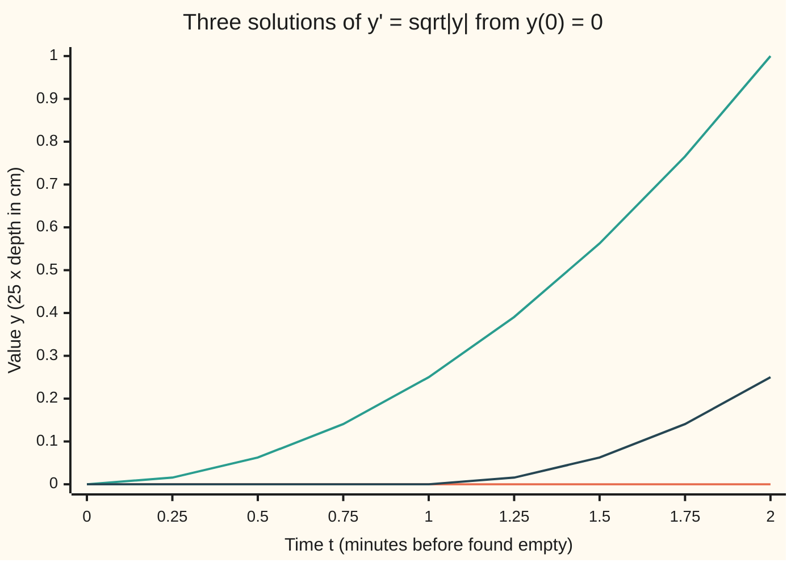

# Peano's theorem: continuity alone is enough for a solution, built from Euler polygons

[Syllabus](../../../SYLLABUS.md) → [Differential equations and dynamics](../README.md) → [Existence, Uniqueness and Sensitivity](../README.md#s02) → Peano's theorem

---

## General Overview

Take $`y' = \sqrt{\lvert y\rvert}`$ from $`y(0) = 0`$: the rate of $`y`$ is the square root of its size. Run [Euler's method](../05-Numerical%20Evolution/01-eulers-method.md) (new value = old value + step × rate). From 0 the rate is 0, so every step stays at 0. With steps 0.1, 0.01 and 0.001 the value at time 2 is 0.0000.

Yet $`y = t^2/4`$ also solves it: its slope $`t/2`$ is the square root of $`t^2/4`$, and it reads 1.0000 at time 2. The rule is continuous (no jumps) but has no Lipschitz bound at 0 (no cap on how fast the rate changes with $`y`$). So [The Picard-Lindelof theorem](02-lipschitz-and-the-picard-lindelof-theorem.md) is silent, and one start has two futures.

This is the leaking bucket in that card's picture, filmed backward: $`t`$ in minutes before it is found empty, $`y`$ = 25 × depth in cm. Then $`y = 0`$ is "always empty" and $`t^2/4`$ is "drained, empty just now".

Giuseppe Peano proved that continuity alone promises at least one solution: for one equation in 1886, for systems in 1890. Euler polygons (the broken lines Euler's method draws) share one speed limit, so as the step shrinks some of them settle on a limit curve, and that limit is a solution. The same tools show how a solution ends: $`y' = 1 + y^2`$ from 0 has the solution $`\tan t`$, which leaves every bounded range as $`t`$ nears $`\pi/2 = 1.5708`$.

**If the rate law is continuous, Euler polygons with shrinking steps have a subsequence (some of them, in order) that converges to a solution, so a solution exists; and a solution carried as far as it goes either lasts for all time or leaves every closed bounded set (bounded, edge included).**

**What kind of fact this is:** a theorem, proved on this card in Why it works.

### The picture: one start, many solutions



Orange: $`y = 0`$, where every Euler polygon stays. Teal: $`y = t^2/4`$. Dark blue: rest until $`t = 1`$, then rise as $`(t-1)^2/4`$. Any resting time works.

---

## The formula

The rate law is $`y' = f(t, y)`$ with start $`y(0) = y_0`$. The value $`y`$ is one number or a list of $`n`$ numbers (a point of $`\mathbb{R}^n`$), with length $`\lvert y\rvert`$. Euler's method with step $`h`$ joins corner values by straight lines:

```math
y_h(t) = y_h(t_k) + (t - t_k)\,f\bigl(t_k,\, y_h(t_k)\bigr) \quad\text{for } t_k \le t \le t_k + h,\qquad t_k = k\,h
```

**Read it aloud:** between corners, the polygon runs straight at the slope the rule gives at the left corner.

Peano's theorem works in a box: times from 0 to $`a`$, values within $`b`$ of $`y_0`$. $`M`$ is the largest size of $`f`$ in the box.

```math
f \text{ continuous on the box} \;\Longrightarrow\; \text{some } y \text{ solves } y' = f(t, y),\ y(0) = y_0, \text{ for } 0 \le t \le T = \min\Bigl(a, \frac{b}{M}\Bigr)
```

**Read it aloud:** if the rule is continuous in the box, a solution exists as long as a curve at top speed $`M`$ stays inside.

With $`f`$ continuous everywhere, a solution carried as far as it goes lives on a largest interval, ending at $`T_+`$:

```math
T_+ < \infty \;\Longrightarrow\; \lvert y(t)\rvert \to \infty \text{ as } t \to T_+
```

**Read it aloud:** a solution that ends at a finite time grows past every bound on the way.

| Symbol | Plain meaning | In our example | Push it up and the answer… |
| --- | --- | --- | --- |
| $`t`$, $`s`$, $`y`$, $`\lvert y\rvert`$, $`n`$, $`m`$ | time ($`s`$ inside integrals); value; its length; count of numbers in $`y`$; size bound | $`t`$ from 0 to 2; $`n = 1`$ | — |
| $`f`$, $`y_0`$ | the rate law; the start | $`1 + y^2`$; 0 | — |
| $`h`$, $`k`$, $`t_k`$, $`\lfloor s\rfloor_h`$ | step length; corner count; corner times; last corner at or before $`s`$ | 0.1, 0.01, 0.001 | bigger gap |
| $`y_h`$; $`y_i`$, $`y_j`$ | Euler polygon; two polygons far along the list | 0.546133 at 0.5 | — |
| $`a`$, $`b`$ | box: times up to $`a`$, values within $`b`$ | 1 and 1 | $`b`$ up: $`M`$ grows |
| $`M`$, $`C`$ | speed limits: largest $`\lvert f\rvert`$ in the box, or in Step 4's region | 2 | shorter window |
| $`T`$, $`T_+`$ | guaranteed window; end of the largest interval | 0.5; 1.5708 | — |
| $`\varepsilon`$, $`\delta`$, $`r`$, $`u`$, $`S_1`$, $`S_2`$ | proof tools: tolerance; closeness it needs; rational time; stand-in for $`y`$; nested sub-lists | — | — |

### When it holds

- **The rule is continuous in time and value.** Drop it and no solution may exist: with rate 1 at or below 0 and −1 above, a start at 0 is pushed up, where it is pushed down.
- **The box is closed and bounded.** Then $`M`$ is finite. On the whole line $`1 + y^2`$ has no largest value, so gives no window.
- **Finitely many numbers.** Step 2 uses Bolzano–Weierstrass, a fact about $`\mathbb{R}^n`$. In infinite-dimensional spaces Peano's theorem fails.
- **Existence only.** Many solutions may leave one start, and nearby starts can end far apart: a start of 0.000001 reaches about 1 at time 2, not 0.
- **The rule is defined for every value**, for the escape statement. Otherwise a solution can end at the region's edge, like the bucket on [Blow-up](03-blow-up-and-the-life-span-of-a-solution.md).

---

## Why it works

### Step 0: a shared speed limit stops the polygons from wiggling apart

Every polygon moves at speed at most $`M`$. Curves from one start with one speed limit cannot spread without bound or wiggle ever faster, so some subsequence settles. Each polygon obeys the equation up to an error that shrinks with the step, so the limit obeys it exactly.

### Step 1: the polygons stay in the box

At speed at most $`M`$, a polygon moves at most $`M t`$ by time $`t`$, which is at most $`b`$ while $`t \le b/M`$. So it stays in the box, where the bound holds. Hence $`T = \min(a, b/M)`$.

For $`1 + y^2`$, the steepest segment of the three polygons has slope 1.2968, under the bound 2.

### Step 2: a subsequence converges uniformly

Bolzano–Weierstrass ([Compactness of [a, b]](../../06-Calculus%20and%20analysis/01-Limits%20and%20Continuity/09-compactness-of-closed-intervals.md)) says bounded values have a converging subsequence. A diagonal argument (nested sub-lists, one per time) applies it at every rational time (fraction) in the window. The shared speed limit then turns convergence at those times into convergence at all times at once: uniform convergence ([Uniform convergence](../../06-Calculus%20and%20analysis/06-Series/07-uniform-convergence.md)).

<details>
<summary>Detailed proof: the diagonal argument</summary>

List the rational times in $`[0, T]`$ as $`r_1, r_2, \dots`$. Bolzano–Weierstrass, one coordinate at a time, gives a subsequence $`S_1`$ converging at $`r_1`$; inside it, $`S_2`$ converging at $`r_2`$; and so on. The diagonal list (first of $`S_1`$, second of $`S_2`$, …) converges at every rational time.

Fix a tolerance $`\varepsilon`$ and finitely many rational times with gaps at most $`\varepsilon/(3M)`$. Far along, polygons $`y_i`$, $`y_j`$ differ by under $`\varepsilon/3`$ at each. For any $`t`$, with $`r`$ the nearest chosen time:

$`\displaystyle \lvert y_i(t) - y_j(t)\rvert \le \lvert y_i(t) - y_i(r)\rvert + \lvert y_i(r) - y_j(r)\rvert + \lvert y_j(r) - y_j(t)\rvert < \varepsilon`$

The outer terms are under $`\varepsilon/3`$ by the speed limit, for every $`t`$, so the list converges uniformly.

</details>

### Step 3: the limit solves the integral equation

A polygon's slope at time $`s`$ is $`f`$ at the last corner. As the step shrinks, corner and curve point merge, and uniform continuity of $`f`$ on the box ([Uniform continuity](../../06-Calculus%20and%20analysis/01-Limits%20and%20Continuity/08-uniform-continuity-and-lipschitz.md)) makes the two slopes agree everywhere at once. So the limit satisfies

```math
y(t) = y_0 + \int_0^t f\bigl(s, y(s)\bigr)\,ds,
```

which is the same as solving the problem ([Picard iteration](01-picard-iteration.md), Step 1).

<details>
<summary>Detailed proof: passing to the limit</summary>

Write $`\lfloor s\rfloor_h`$ for the last corner time at or before $`s`$. Adding the straight pieces gives exactly

$`\displaystyle y_h(t) = y_0 + \int_0^t f\bigl(\lfloor s\rfloor_h,\, y_h(\lfloor s\rfloor_h)\bigr)\,ds.`$

Fix $`\varepsilon`$. Uniform continuity gives a $`\delta`$: points within $`\delta`$ give values of $`f`$ within $`\varepsilon`$. Now $`\lvert \lfloor s\rfloor_h - s\rvert \le h`$, and

$`\displaystyle \lvert y_h(\lfloor s\rfloor_h) - y(s)\rvert \le M h + \max_t \lvert y_h(t) - y(t)\rvert.`$

Far along the list both are below $`\delta`$ for every $`s`$, so the integrals differ by less than $`\varepsilon T`$. Letting $`\varepsilon`$ shrink, $`y`$ satisfies the integral equation.

</details>

| Step $`h`$ | 0.1 | 0.01 | 0.001 |
| --- | --- | --- | --- |
| largest gap to $`\tan t`$ on [0, 0.5] | 0.014789 | 0.001672 | 0.000169 |
| integral-equation miss | 0.013180 | 0.001473 | 0.000149 |

Both shrink tenfold with the step.

### Step 4: a maximal solution leaves every closed bounded set

A maximal solution is one that cannot be extended; every solution extends to one (Hartman, chapter II). [Blow-up](03-blow-up-and-the-life-span-of-a-solution.md) proved the end behavior using uniqueness. Two short arguments avoid it, for a finite end $`T_+`$:

1. **It cannot stay bounded.** If $`\lvert y\rvert \le m`$ up to $`T_+`$, then $`\lvert y'\rvert = \lvert f\rvert`$ stays below some $`C`$, so $`y`$ has a limit at $`T_+`$. Peano's theorem from there continues it, contradicting maximality.
2. **It cannot keep coming back.** With $`C`$ the largest $`\lvert f\rvert`$ for times up to $`T_+`$ and $`\lvert y\rvert \le m + 1`$, each trip from size $`m`$ to size $`m + 1`$ takes time at least $`1/C`$. Item 1 makes $`y`$ unbounded near $`T_+`$, so each dip back to size $`m`$ forces another trip. Only finitely many fit, so $`\lvert y\rvert > m`$ for good near $`T_+`$.

Every closed bounded set fits in some ball $`\lvert y\rvert \le m`$, so the solution leaves it for good.

For $`\tan t`$, Euler steps of 0.000001 pass sizes 10, 100 and 1000 at $`t`$ = 1.4711, 1.5608 and 1.5698, their arctangents. The end time is the area under $`1/(1 + u^2)`$ from 0 to infinity (time = rise ÷ rate, as in [Blow-up](03-blow-up-and-the-life-span-of-a-solution.md), Step 2); swapping $`u`$ for $`1/u`$ makes it twice the area from 0 to 1: 1.570796, or $`\pi/2`$.

---

## Worked numbers, by hand

| Step | Arithmetic | Value |
| --- | --- | --- |
| Euler from 0 on $`\sqrt{\lvert y\rvert}`$ | 0 + h × √0, every step | 0 at $`t = 2`$ |
| the other solution at 2 | $`2^2/4`$ | 1 |
| speed limit for $`1 + y^2`$, box b = 1 | $`1 + 1^2`$ | M = 2 |
| guaranteed window | min(1, 1/2) | **T = 0.5** |
| Euler, step 0.001, at 0.5 | 500 steps | 0.546133 |
| exact value | $`\tan 0.5`$ | 0.546302 |
| end of the life span | 2 × area under $`1/(1+u^2)`$ on [0, 1] | **1.570796** |

Continuity guarantees 0.5 time units; the solution lasts to 1.5708.

### What breaks if you drop a piece

| Mistake | Comes out at | What went wrong |
| --- | --- | --- |
| Euler's limit taken as the only solution of $`\sqrt{\lvert y\rvert}`$ | y(2) = 0 | $`t^2/4`$ gives 1: Peano gives a solution, not uniqueness |
| The window taken as the life span | 0.5 | Only a lower bound; $`\tan t`$ lasts to 1.5708 |
| $`\tan t`$ read past the end, at t = 2 | −2.1850 | A different branch; the solution ended at 1.5708 |
| Euler, step 0.1, run through the end to t = 2 | 925.9 | Finite steps never reach infinity, so they step past it |

---

## Code, from first principles, and it actually runs

The script checks Euler polygons four independent ways: central-difference slopes show $`t^2/4`$ and the dark-blue curve solve $`\sqrt{\lvert y\rvert}`$; polygons for $`1 + y^2`$ are compared with $`\tan t`$; their integral-equation miss is measured by Simpson's rule (parabolas through evenly spaced points), exact on each straight piece; escape times match arctangents and a Simpson area.

### Python

```python
# Peano's theorem -- the check behind the card.  Standard library only.
# Euler polygons for y' = sqrt|y| and y' = 1 + y^2, both from y(0) = 0, are
# compared with exact solutions (0, t^2/4, tan t), with the integral equation
# they converge to, and with the blow-up time found as an area by Simpson's rule.
import math
def euler(f, y0, t_end, h):                 # corner values of the polygon at t = 0, h, 2h, ...
    ys = [y0]
    for _ in range(round(t_end / h)):
        ys.append(ys[-1] + h * f(ys[-1]))   # new value = old value + step x rate
    return ys
def simpson(g, a, b, n=1000):               # area under g from a to b, n even
    w = (b - a) / n
    return w / 3 * sum(g(a + i * w) * (1 if i in (0, n) else 4 if i % 2 else 2) for i in range(n + 1))
def residual(f, ys, h):                     # largest |y(t) - integral of f(y) from 0 to t|, Simpson per piece
    area, worst = 0.0, 0.0
    for k in range(1, len(ys)):
        area += h * (f(ys[k - 1]) + 4 * f((ys[k - 1] + ys[k]) / 2) + f(ys[k])) / 6   # exact: f is quadratic here
        worst = max(worst, abs(ys[k] - area))
    return worst
sq, tn = (lambda y: math.sqrt(abs(y))), (lambda y: 1 + y * y)
hs = (0.1, 0.01, 0.001)
fmt = lambda xs, d: ", ".join(f"{x:.{d}f}" for x in xs)
stuck = [euler(sq, 0.0, 2, h)[-1] for h in hs]
late = lambda t: 0.0 if t < 1 else (t - 1) ** 2 / 4    # rests until t = 1, then rises
grid = [i / 100 for i in range(201)]        # do t^2/4 and late solve it? slopes by central difference
miss = max(abs((g(t + 1e-6) - g(t - 1e-6)) / 2e-6 - sq(g(t))) for g in (lambda s: s * s / 4, late) for t in grid)
ts = [i / 4 for i in range(9)]
nudged = euler(sq, 1e-6, 2, 0.001)[-1]
B = 1.0; M = tn(B); T = min(1.0, B / M)    # box: times 0 to 1, values -1 to 1
runs = [euler(tn, 0.0, T, h) for h in hs]
gaps = [max(abs(y - math.tan(k * h)) for k, y in enumerate(r)) for r, h in zip(runs, hs)]
slope = max(abs(r[k + 1] - r[k]) / h for r, h in zip(runs, hs) for k in range(len(r) - 1))
res = [residual(tn, r, h) for r, h in zip(runs, hs)]
t, y, h, marks, hit = 0.0, 0.0, 1e-6, (10, 100, 1000), []
while len(hit) < 3:                         # Euler until |y| leaves the boxes of size 10, 100, 1000
    y, t = y + h * tn(y), t + h
    if y > marks[len(hit)]: hit.append(t)
life = 2 * simpson(lambda u: 1 / tn(u), 0, 1)   # time to infinity = area under 1/(1 + u^2)
past = euler(tn, 0.0, 2, 0.1)[-1]
print(f"y' = sqrt|y|, y(0) = 0: Euler y(2) with h = 0.1, 0.01, 0.001: {fmt(stuck, 4)}")
print(f"t^2/4 and waits 1: largest |slope - sqrt(y)| on [0, 2] = {miss:.6f}; 2^2/4 = {2 * 2 / 4:.4f}")
print(f"chart t:        {fmt(ts, 2)}")
print(f"chart Euler:    {fmt([0.0 for _ in ts], 4)}")
print(f"chart t^2/4:    {fmt([s * s / 4 for s in ts], 4)}")
print(f"chart waits 1:  {fmt([late(s) for s in ts], 4)}")
print(f"start nudged to 0.000001, h = 0.001: Euler y(2) = {nudged:.6f}; exact (1 + 0.001)^2 = {1.001 ** 2:.6f}")
print(f"y' = 1 + y^2 in the box b = {B:.0f}: M = {M:.0f}, window T = min(1, b/M) = {T:.2f}")
print(f"Euler y(0.5) with h = 0.1, 0.01, 0.001: {fmt([r[-1] for r in runs], 6)}; tan 0.5 = {math.tan(0.5):.6f}")
print(f"largest gap to tan t on [0, 0.5]: {fmt(gaps, 6)}")
print(f"steepest polygon segment: {slope:.4f}, under the bound M = {M:.0f}")
print(f"integral-equation residual: {fmt(res, 6)}")
print(f"Euler (h = 0.000001) leaves |y| <= 10, 100, 1000 at t = {fmt(hit, 4)}")
print(f"arctan of 10, 100, 1000:                         {fmt([math.atan(m) for m in marks], 4)}")
print(f"blow-up time: 2 x area under 1/(1 + u^2) on [0, 1] = {life:.6f}; pi/2 = {math.pi / 2:.6f} = {math.pi / 2:.4f} to 4 places")
print(f"mistakes: tan 2 = {math.tan(2):.4f}; Euler h = 0.1 run to t = 2: {past:.1f}")
assert max(stuck) == 0.0 and miss < 1e-6 and abs(nudged - 1.001 ** 2) < 0.01   # two solutions, one start
assert gaps[2] < gaps[1] / 5 < gaps[0] / 25 and slope <= M                      # polygons converge to tan
assert res[2] < res[1] / 5 < res[0] / 25                                         # limit obeys the equation
assert all(abs(a - math.atan(m)) < 5e-5 for a, m in zip(hit, marks)) and abs(life - math.pi / 2) < 1e-9
print("ALL CHECKS PASS")
```

**Ran 2026-11-23 on macOS, Python 3.14.10, standard library only. All checks passed. Output, pasted from the run:**

```
y' = sqrt|y|, y(0) = 0: Euler y(2) with h = 0.1, 0.01, 0.001: 0.0000, 0.0000, 0.0000
t^2/4 and waits 1: largest |slope - sqrt(y)| on [0, 2] = 0.000000; 2^2/4 = 1.0000
chart t:        0.00, 0.25, 0.50, 0.75, 1.00, 1.25, 1.50, 1.75, 2.00
chart Euler:    0.0000, 0.0000, 0.0000, 0.0000, 0.0000, 0.0000, 0.0000, 0.0000, 0.0000
chart t^2/4:    0.0000, 0.0156, 0.0625, 0.1406, 0.2500, 0.3906, 0.5625, 0.7656, 1.0000
chart waits 1:  0.0000, 0.0000, 0.0000, 0.0000, 0.0000, 0.0156, 0.0625, 0.1406, 0.2500
start nudged to 0.000001, h = 0.001: Euler y(2) = 0.998551; exact (1 + 0.001)^2 = 1.002001
y' = 1 + y^2 in the box b = 1: M = 2, window T = min(1, b/M) = 0.50
Euler y(0.5) with h = 0.1, 0.01, 0.001: 0.531513, 0.544631, 0.546133; tan 0.5 = 0.546302
largest gap to tan t on [0, 0.5]: 0.014789, 0.001672, 0.000169
steepest polygon segment: 1.2968, under the bound M = 2
integral-equation residual: 0.013180, 0.001473, 0.000149
Euler (h = 0.000001) leaves |y| <= 10, 100, 1000 at t = 1.4711, 1.5608, 1.5698
arctan of 10, 100, 1000:                         1.4711, 1.5608, 1.5698
blow-up time: 2 x area under 1/(1 + u^2) on [0, 1] = 1.570796; pi/2 = 1.570796 = 1.5708 to 4 places
mistakes: tan 2 = -2.1850; Euler h = 0.1 run to t = 2: 925.9
ALL CHECKS PASS
```

### Rust

Same numbers, same labels, built with `rustc --edition 2021 -O`.

```rust
// Peano's theorem -- the same check as the Python, in Rust.  No crates.
// Euler polygons for y' = sqrt|y| and y' = 1 + y^2, both from y(0) = 0, are
// compared with exact solutions (0, t^2/4, tan t), with the integral equation
// they converge to, and with the blow-up time found as an area by Simpson's rule.
fn euler(f: fn(f64) -> f64, y0: f64, t_end: f64, h: f64) -> Vec<f64> {
    let mut ys = vec![y0];                  // corner values of the polygon at t = 0, h, 2h, ...
    for _ in 0..(t_end / h).round() as usize {
        let y = *ys.last().unwrap();
        ys.push(y + h * f(y));              // new value = old value + step x rate
    }
    ys
}
fn simpson(g: fn(f64) -> f64, a: f64, b: f64, n: usize) -> f64 {   // area under g, n even
    let w = (b - a) / n as f64;
    let mut s = 0.0;
    for i in 0..=n { s += g(a + i as f64 * w) * if i == 0 || i == n { 1.0 } else if i % 2 == 1 { 4.0 } else { 2.0 } }
    w / 3.0 * s
}
fn residual(f: fn(f64) -> f64, ys: &[f64], h: f64) -> f64 {   // largest |y(t) - integral of f(y)|
    let (mut area, mut worst) = (0.0f64, 0.0f64);
    for k in 1..ys.len() {
        area += h * (f(ys[k - 1]) + 4.0 * f((ys[k - 1] + ys[k]) / 2.0) + f(ys[k])) / 6.0;   // Simpson, exact here
        worst = worst.max((ys[k] - area).abs());
    }
    worst
}
fn sq(y: f64) -> f64 { y.abs().sqrt() }   fn tn(y: f64) -> f64 { 1.0 + y * y }
fn inv(u: f64) -> f64 { 1.0 / tn(u) }   fn quarter(t: f64) -> f64 { t * t / 4.0 }
fn fmt(xs: &[f64], d: usize) -> String {
    xs.iter().map(|x| format!("{:.*}", d, x)).collect::<Vec<_>>().join(", ")
}
fn late(t: f64) -> f64 { if t < 1.0 { 0.0 } else { (t - 1.0) * (t - 1.0) / 4.0 } }   // rests, then rises
fn main() {
    let hs = [0.1, 0.01, 0.001];
    let stuck: Vec<f64> = hs.iter().map(|&h| *euler(sq, 0.0, 2.0, h).last().unwrap()).collect();
    let miss = (0..201).map(|i| i as f64 / 100.0)    // do t^2/4 and late solve it? slopes by central difference
        .flat_map(|t| [quarter as fn(f64) -> f64, late].map(|g| ((g(t + 1e-6) - g(t - 1e-6)) / 2e-6 - sq(g(t))).abs()))
        .fold(0.0f64, f64::max);
    let ts: Vec<f64> = (0..9).map(|i| i as f64 / 4.0).collect();
    let nudged = *euler(sq, 1e-6, 2.0, 0.001).last().unwrap();
    let b = 1.0f64; let m = tn(b); let tw = (1.0f64).min(b / m);    // box: times 0 to 1, values -1 to 1
    let runs: Vec<Vec<f64>> = hs.iter().map(|&h| euler(tn, 0.0, tw, h)).collect();
    let mut gaps = vec![]; let mut res = vec![]; let mut slope = 0.0f64;
    for (r, &h) in runs.iter().zip(hs.iter()) {
        gaps.push(r.iter().enumerate().map(|(k, y)| (y - (k as f64 * h).tan()).abs()).fold(0.0, f64::max));
        for k in 0..r.len() - 1 { slope = slope.max((r[k + 1] - r[k]).abs() / h) }
        res.push(residual(tn, r, h));
    }
    let (mut t, mut y, h, marks) = (0.0f64, 0.0f64, 1e-6, [10.0f64, 100.0, 1000.0]);
    let mut hit: Vec<f64> = vec![];
    while hit.len() < 3 {                   // Euler until |y| leaves the boxes of size 10, 100, 1000
        y = y + h * tn(y); t = t + h;
        if y > marks[hit.len()] { hit.push(t) }
    }
    let life = 2.0 * simpson(inv, 0.0, 1.0, 1000);   // time to infinity = area under 1/(1 + u^2)
    let past = *euler(tn, 0.0, 2.0, 0.1).last().unwrap();
    let ends: Vec<f64> = runs.iter().map(|r| *r.last().unwrap()).collect();
    let atans: Vec<f64> = marks.iter().map(|x| x.atan()).collect();
    println!("y' = sqrt|y|, y(0) = 0: Euler y(2) with h = 0.1, 0.01, 0.001: {}", fmt(&stuck, 4));
    println!("t^2/4 and waits 1: largest |slope - sqrt(y)| on [0, 2] = {:.6}; 2^2/4 = {:.4}", miss, 2.0 * 2.0 / 4.0);
    println!("chart t:        {}", fmt(&ts, 2));
    println!("chart Euler:    {}", fmt(&vec![0.0; ts.len()], 4));
    println!("chart t^2/4:    {}", fmt(&ts.iter().map(|s| s * s / 4.0).collect::<Vec<_>>(), 4));
    println!("chart waits 1:  {}", fmt(&ts.iter().map(|&s| late(s)).collect::<Vec<_>>(), 4));
    println!("start nudged to 0.000001, h = 0.001: Euler y(2) = {:.6}; exact (1 + 0.001)^2 = {:.6}", nudged, 1.001f64.powi(2));
    println!("y' = 1 + y^2 in the box b = {:.0}: M = {:.0}, window T = min(1, b/M) = {:.2}", b, m, tw);
    println!("Euler y(0.5) with h = 0.1, 0.01, 0.001: {}; tan 0.5 = {:.6}", fmt(&ends, 6), 0.5f64.tan());
    println!("largest gap to tan t on [0, 0.5]: {}", fmt(&gaps, 6));
    println!("steepest polygon segment: {:.4}, under the bound M = {:.0}", slope, m);
    println!("integral-equation residual: {}", fmt(&res, 6));
    println!("Euler (h = 0.000001) leaves |y| <= 10, 100, 1000 at t = {}", fmt(&hit, 4));
    println!("arctan of 10, 100, 1000:                         {}", fmt(&atans, 4));
    println!("blow-up time: 2 x area under 1/(1 + u^2) on [0, 1] = {:.6}; pi/2 = {:.6} = {:.4} to 4 places", life, std::f64::consts::PI / 2.0, std::f64::consts::PI / 2.0);
    println!("mistakes: tan 2 = {:.4}; Euler h = 0.1 run to t = 2: {:.1}", 2.0f64.tan(), past);
    assert!(stuck.iter().all(|&v| v == 0.0) && miss < 1e-6 && (nudged - 1.001f64.powi(2)).abs() < 0.01);
    assert!(gaps[2] < gaps[1] / 5.0 && gaps[1] / 5.0 < gaps[0] / 25.0 && slope <= m);   // converge to tan
    assert!(res[2] < res[1] / 5.0 && res[1] / 5.0 < res[0] / 25.0);                     // obey the equation
    assert!(hit.iter().zip(atans.iter()).all(|(a, b)| (a - b).abs() < 5e-5) && (life - std::f64::consts::PI / 2.0).abs() < 1e-9);
    println!("ALL CHECKS PASS");
}
```

**Ran 2026-11-23 on macOS, rustc 1.98.1, no crates. All checks passed. Output, pasted from the run:**

```
y' = sqrt|y|, y(0) = 0: Euler y(2) with h = 0.1, 0.01, 0.001: 0.0000, 0.0000, 0.0000
t^2/4 and waits 1: largest |slope - sqrt(y)| on [0, 2] = 0.000000; 2^2/4 = 1.0000
chart t:        0.00, 0.25, 0.50, 0.75, 1.00, 1.25, 1.50, 1.75, 2.00
chart Euler:    0.0000, 0.0000, 0.0000, 0.0000, 0.0000, 0.0000, 0.0000, 0.0000, 0.0000
chart t^2/4:    0.0000, 0.0156, 0.0625, 0.1406, 0.2500, 0.3906, 0.5625, 0.7656, 1.0000
chart waits 1:  0.0000, 0.0000, 0.0000, 0.0000, 0.0000, 0.0156, 0.0625, 0.1406, 0.2500
start nudged to 0.000001, h = 0.001: Euler y(2) = 0.998551; exact (1 + 0.001)^2 = 1.002001
y' = 1 + y^2 in the box b = 1: M = 2, window T = min(1, b/M) = 0.50
Euler y(0.5) with h = 0.1, 0.01, 0.001: 0.531513, 0.544631, 0.546133; tan 0.5 = 0.546302
largest gap to tan t on [0, 0.5]: 0.014789, 0.001672, 0.000169
steepest polygon segment: 1.2968, under the bound M = 2
integral-equation residual: 0.013180, 0.001473, 0.000149
Euler (h = 0.000001) leaves |y| <= 10, 100, 1000 at t = 1.4711, 1.5608, 1.5698
arctan of 10, 100, 1000:                         1.4711, 1.5608, 1.5698
blow-up time: 2 x area under 1/(1 + u^2) on [0, 1] = 1.570796; pi/2 = 1.570796 = 1.5708 to 4 places
mistakes: tan 2 = -2.1850; Euler h = 0.1 run to t = 2: 925.9
ALL CHECKS PASS
```

### Lean

Lean proves Peano's theorem and the escape statement for every continuous rate law in $`\mathbb{R}^n`$.

- Take a rate law continuous in the box, with $`\lvert f\rvert \le M`$ there. Then some solution with $`y(0) = y_0`$ lasts the whole window $`T = \min(a, b/M)`$.
- Take $`f`$ continuous for all times and values, and a maximal solution $`y`$ ending at a finite time $`T_+`$. Then $`\lvert y(t)\rvert`$ grows past every bound as $`t`$ nears $`T_+`$.
- Start at $`y(0) = 0`$ with the rule $`\sqrt{\lvert y\rvert}`$. Then $`y = 0`$ and $`y = t^2/4`$ both solve it for $`t \ge 0`$, reading 0 and 1 at time 2.
- The hand arithmetic holds exactly: $`2^2/4 = 1`$, the speed limit $`M = 2`$ and the window 0.5.

The decimals, the Euler runs for $`\tan t`$, the escape times and the Simpson areas are left to the Python and Rust checks.

```lean
-- Peano's theorem: a continuous rate law y' = f(t, y) in R^n has a solution on the window min(a, b/M), a maximal solution with a finite end grows past every bound, and y' = sqrt|y| from 0 has the two solutions 0 and t^2/4.
import Mathlib.Analysis.InnerProductSpace.PiL2
import Mathlib.Analysis.SpecialFunctions.Pow.Deriv
import Mathlib.Analysis.Calculus.Deriv.Basic
import Mathlib.Tactic.NormNum
import Mathlib.Analysis.Calculus.MeanValue
import Mathlib.Analysis.Calculus.FDeriv.Extend
import Mathlib.Analysis.SpecificLimits.Basic

open Filter Topology Set Metric

/-- The share of Euler step `k` (from time `t₀ + k h` to `t₀ + (k+1) h`) used up by time `t`. -/
noncomputable def eulerWeight (t₀ h : ℝ) (k : ℕ) (t : ℝ) : ℝ := max 0 (min h (t - t₀ - k * h))

theorem eulerWeight_sum (t₀ h t : ℝ) (hh : 0 ≤ h) (ht : t₀ ≤ t) (N : ℕ) :
    ∑ k ∈ Finset.range N, eulerWeight t₀ h k t = min (t - t₀) (N * h) := by
  induction N with
  | zero => simp; linarith
  | succ N ih =>
    rw [Finset.sum_range_succ, ih]
    simp only [eulerWeight]
    push_cast
    rcases le_total (t - t₀) (N * h) with h1 | h1
    · have h2 : min h (t - t₀ - N * h) ≤ 0 := min_le_of_right_le (by linarith)
      rw [min_eq_left h1, max_eq_left h2, min_eq_left (by nlinarith)]
      ring
    · rw [min_eq_right h1]
      rcases le_total h (t - t₀ - N * h) with h3 | h3
      · rw [min_eq_left h3, max_eq_right hh, min_eq_right (by linarith)]
        ring
      · rw [min_eq_right h3, max_eq_right (by linarith), min_eq_left (by linarith)]
        ring

theorem eulerWeight_mono (t₀ h : ℝ) (k : ℕ) {s t : ℝ} (hst : s ≤ t) :
    eulerWeight t₀ h k s ≤ eulerWeight t₀ h k t := by
  unfold eulerWeight
  exact max_le_max le_rfl (min_le_min le_rfl (by linarith))

theorem eulerWeight_eq_of (t₀ h : ℝ) (k : ℕ) {s t : ℝ} (hst : s ≤ t)
    (hne : eulerWeight t₀ h k t ≠ eulerWeight t₀ h k s) :
    t₀ + k * h < t ∧ s < t₀ + k * h + h := by
  by_contra hc
  apply hne
  unfold eulerWeight
  rcases not_and_or.1 hc with h1 | h1
  · push Not at h1
    rw [max_eq_left (min_le_of_right_le (by linarith)),
      max_eq_left (min_le_of_right_le (by linarith))]
  · push Not at h1
    rw [min_eq_left (by linarith), min_eq_left (by linarith)]

theorem eulerWeight_est {E : Type*} [NormedAddCommGroup E] [NormedSpace ℝ E]
    (t₀ h : ℝ) (hh : 0 ≤ h) (N : ℕ) (v : ℕ → E) (w : E) (ε : ℝ) {s t : ℝ}
    (hs : t₀ ≤ s) (hst : s ≤ t) (htN : t ≤ t₀ + N * h)
    (hv : ∀ k < N, t₀ + k * h < t → s < t₀ + k * h + h → ‖v k - w‖ ≤ ε) :
    ‖(∑ k ∈ Finset.range N, eulerWeight t₀ h k t • v k)
      - (∑ k ∈ Finset.range N, eulerWeight t₀ h k s • v k) - (t - s) • w‖ ≤ ε * (t - s) := by
  have hsum : t - s = ∑ k ∈ Finset.range N, (eulerWeight t₀ h k t - eulerWeight t₀ h k s) := by
    rw [Finset.sum_sub_distrib, eulerWeight_sum t₀ h t hh (hs.trans hst),
      eulerWeight_sum t₀ h s hh hs, min_eq_left (by linarith), min_eq_left (by linarith)]
    ring
  have hrw : (∑ k ∈ Finset.range N, eulerWeight t₀ h k t • v k)
      - (∑ k ∈ Finset.range N, eulerWeight t₀ h k s • v k) - (t - s) • w
      = ∑ k ∈ Finset.range N, (eulerWeight t₀ h k t - eulerWeight t₀ h k s) • (v k - w) := by
    rw [hsum, Finset.sum_smul, ← Finset.sum_sub_distrib, ← Finset.sum_sub_distrib]
    refine Finset.sum_congr rfl fun k _ => ?_
    rw [sub_smul, sub_smul, smul_sub, smul_sub]
    abel
  rw [hrw, hsum, Finset.mul_sum]
  refine (norm_sum_le _ _).trans (Finset.sum_le_sum fun k hk => ?_)
  have hk' : k < N := Finset.mem_range.1 hk
  have hnn : 0 ≤ eulerWeight t₀ h k t - eulerWeight t₀ h k s :=
    sub_nonneg.2 (eulerWeight_mono t₀ h k hst)
  rw [norm_smul, Real.norm_of_nonneg hnn]
  by_cases he : eulerWeight t₀ h k t = eulerWeight t₀ h k s
  · rw [he]; simp
  · obtain ⟨h1, h2⟩ := eulerWeight_eq_of t₀ h k hst he
    rw [mul_comm ε]
    exact mul_le_mul_of_nonneg_left (hv k hk' h1 h2) hnn

/-- The Euler grid values: `Y 0 = y₀`, `Y (k+1) = Y k + h g(t₀ + k h, Y k)`. -/
noncomputable def eulerGrid {E : Type*} [NormedAddCommGroup E] [NormedSpace ℝ E]
    (g : ℝ → E → E) (t₀ h : ℝ) (y₀ : E) : ℕ → E
  | 0 => y₀
  | k + 1 => eulerGrid g t₀ h y₀ k + h • g (t₀ + k * h) (eulerGrid g t₀ h y₀ k)

/-- The Euler polygon with `N` steps of size `h` from `(t₀, y₀)`. -/
noncomputable def eulerPoly {E : Type*} [NormedAddCommGroup E] [NormedSpace ℝ E]
    (g : ℝ → E → E) (t₀ h : ℝ) (y₀ : E) (N : ℕ) (t : ℝ) : E :=
  y₀ + ∑ k ∈ Finset.range N, eulerWeight t₀ h k t • g (t₀ + k * h) (eulerGrid g t₀ h y₀ k)

theorem eulerGrid_eq_sum {E : Type*} [NormedAddCommGroup E] [NormedSpace ℝ E]
    (g : ℝ → E → E) (t₀ h : ℝ) (y₀ : E) (j : ℕ) :
    eulerGrid g t₀ h y₀ j = y₀ + ∑ k ∈ Finset.range j, h • g (t₀ + k * h) (eulerGrid g t₀ h y₀ k) := by
  induction j with
  | zero => simp [eulerGrid]
  | succ j ih => rw [Finset.sum_range_succ, ← add_assoc, ← ih]; rfl

theorem eulerPoly_grid {E : Type*} [NormedAddCommGroup E] [NormedSpace ℝ E]
    (g : ℝ → E → E) (t₀ h : ℝ) (hh : 0 ≤ h) (y₀ : E) (N j : ℕ) (hj : j ≤ N) :
    eulerPoly g t₀ h y₀ N (t₀ + j * h) = eulerGrid g t₀ h y₀ j := by
  rw [eulerGrid_eq_sum, eulerPoly]
  congr 1
  obtain ⟨m, rfl⟩ := Nat.exists_eq_add_of_le hj
  rw [Finset.sum_range_add]
  have h2 : ∑ k ∈ Finset.range m, eulerWeight t₀ h (j + k) (t₀ + j * h) •
      g (t₀ + ((j + k : ℕ) : ℝ) * h) (eulerGrid g t₀ h y₀ (j + k)) = 0 := by
    refine Finset.sum_eq_zero fun k _ => ?_
    have : eulerWeight t₀ h (j + k) (t₀ + j * h) = 0 := by
      unfold eulerWeight
      push_cast
      have : (0:ℝ) ≤ k * h := mul_nonneg (Nat.cast_nonneg k) hh
      exact max_eq_left (min_le_of_right_le (by nlinarith))
    rw [this, zero_smul]
  rw [h2, add_zero]
  refine Finset.sum_congr rfl fun k hk => ?_
  have hk' : (k : ℝ) + 1 ≤ j := by exact_mod_cast Finset.mem_range.1 hk
  have : eulerWeight t₀ h k (t₀ + j * h) = h := by
    unfold eulerWeight
    rw [min_eq_left (by nlinarith), max_eq_right hh]
  rw [this]

theorem eulerPoly_start {E : Type*} [NormedAddCommGroup E] [NormedSpace ℝ E]
    (g : ℝ → E → E) (t₀ h : ℝ) (hh : 0 ≤ h) (y₀ : E) (N : ℕ) :
    eulerPoly g t₀ h y₀ N t₀ = y₀ := by
  have := eulerPoly_grid g t₀ h hh y₀ N 0 (Nat.zero_le _)
  simpa [eulerGrid] using this

/-- Peano for a rate law that is continuous and bounded everywhere: a limit of Euler polygons
(taken along an ultrafilter, so no subsequence is needed) solves the equation on `[t₀, t₀ + T]`. -/
theorem peano_core {E : Type*} [NormedAddCommGroup E] [NormedSpace ℝ E] [ProperSpace E]
    (g : ℝ → E → E) (hg : Continuous (fun p : ℝ × E => g p.1 p.2))
    {M : ℝ} (hM : ∀ t x, ‖g t x‖ ≤ M) (t₀ T : ℝ) (hT : 0 ≤ T) (y₀ : E) :
    ∃ y : ℝ → E, y t₀ = y₀ ∧ (∀ t ∈ Icc t₀ (t₀ + T), ‖y t - y₀‖ ≤ M * (t - t₀)) ∧
      ∀ t ∈ Icc t₀ (t₀ + T), HasDerivWithinAt y (g t (y t)) (Icc t₀ (t₀ + T)) t := by
  classical
  have hM0 : 0 ≤ M := (norm_nonneg _).trans (hM 0 0)
  obtain ⟨U, hU⟩ : ∃ U : Ultrafilter ℕ, (U : Filter ℕ) ≤ atTop :=
    ⟨Ultrafilter.of atTop, Ultrafilter.of_le _⟩
  set P : ℕ → ℝ → E := fun N => eulerPoly g t₀ (T / N) y₀ N with hP
  have hN1 : ∀ᶠ N in (U : Filter ℕ), 1 ≤ N := hU (eventually_ge_atTop 1)
  have hh : ∀ N : ℕ, 0 ≤ T / N := fun N => div_nonneg hT (Nat.cast_nonneg N)
  have hNh : ∀ N : ℕ, 1 ≤ N → t₀ + N * (T / N) = t₀ + T := by
    intro N hN
    have : (N : ℝ) ≠ 0 := by have : (1 : ℝ) ≤ N := by exact_mod_cast hN
                             linarith
    field_simp
  have hest : ∀ N : ℕ, 1 ≤ N → ∀ w : E, ∀ ε : ℝ, ∀ s t, t₀ ≤ s → s ≤ t → t ≤ t₀ + T →
      (∀ k < N, t₀ + k * (T / N) < t → s < t₀ + k * (T / N) + T / N →
        ‖g (t₀ + k * (T / N)) (eulerGrid g t₀ (T / N) y₀ k) - w‖ ≤ ε) →
      ‖P N t - P N s - (t - s) • w‖ ≤ ε * (t - s) := by
    intro N hN w ε s t hs hst ht hv
    have := eulerWeight_est t₀ (T / N) (hh N) N
      (fun k => g (t₀ + k * (T / N)) (eulerGrid g t₀ (T / N) y₀ k)) w ε hs hst
      (by rw [hNh N hN]; exact ht) hv
    simpa [hP, eulerPoly] using this
  have hP0 : ∀ N, P N t₀ = y₀ := fun N => eulerPoly_start g t₀ _ (hh N) y₀ N
  have hlip : ∀ N : ℕ, 1 ≤ N → ∀ s t, t₀ ≤ s → s ≤ t → t ≤ t₀ + T →
      ‖P N t - P N s‖ ≤ M * (t - s) := by
    intro N hN s t hs hst ht
    have := hest N hN 0 M s t hs hst ht (fun k _ _ _ => by simpa using hM _ _)
    simpa using this
  have hlip' : ∀ N : ℕ, 1 ≤ N → ∀ s ∈ Icc t₀ (t₀ + T), ∀ t ∈ Icc t₀ (t₀ + T),
      ‖P N t - P N s‖ ≤ M * |t - s| := by
    intro N hN s hs t ht
    rcases le_total s t with h | h
    · rw [abs_of_nonneg (by linarith)]; exact hlip N hN s t hs.1 h ht.2
    · rw [norm_sub_rev, abs_of_nonpos (by linarith), neg_sub]; exact hlip N hN t s ht.1 h hs.2
  have hball : ∀ N : ℕ, 1 ≤ N → ∀ t ∈ Icc t₀ (t₀ + T), ‖P N t - y₀‖ ≤ M * (t - t₀) := by
    intro N hN t ht
    have := hlip N hN t₀ t le_rfl ht.1 ht.2
    rwa [hP0] at this
  have hlim : ∀ t ∈ Icc t₀ (t₀ + T),
      Tendsto (fun N => P N t) U (𝓝 (limUnder (U : Filter ℕ) (fun N => P N t))) := by
    intro t ht
    apply tendsto_nhds_limUnder
    have hmem : closedBall y₀ (M * T) ∈ U.map (fun N => P N t) := by
      rw [Ultrafilter.mem_map]
      refine Ultrafilter.mem_coe.1 (hN1.mono fun N hN => ?_)
      show P N t ∈ closedBall y₀ (M * T)
      rw [mem_closedBall, dist_eq_norm]
      exact (hball N hN t ht).trans (mul_le_mul_of_nonneg_left (by linarith [ht.2]) hM0)
    obtain ⟨x, -, hx⟩ := (isCompact_closedBall y₀ (M * T)).ultrafilter_le_nhds' _ hmem
    rw [Ultrafilter.coe_map] at hx
    exact ⟨x, hx⟩
  set y : ℝ → E := fun t => limUnder (U : Filter ℕ) (fun N => P N t) with hy
  have hy0 : y t₀ = y₀ := by
    have h1 : Tendsto (fun N => P N t₀) U (𝓝 (y t₀)) := hlim t₀ ⟨le_rfl, by linarith⟩
    rw [show (fun N => P N t₀) = fun _ => y₀ from funext hP0] at h1
    exact tendsto_nhds_unique h1 tendsto_const_nhds
  have hyb : ∀ t ∈ Icc t₀ (t₀ + T), ‖y t - y₀‖ ≤ M * (t - t₀) := by
    intro t ht
    exact le_of_tendsto (((hlim t ht).sub_const y₀).norm) (hN1.mono fun N hN => hball N hN t ht)
  refine ⟨y, hy0, hyb, fun s hs => ?_⟩
  set w := g s (y s) with hw
  rw [hasDerivWithinAt_iff_isLittleO, Asymptotics.isLittleO_iff]
  intro ε hε
  obtain ⟨δ, hδ, hcont⟩ := Metric.continuous_iff.1 hg (s, y s) ε hε
  set η := δ / (4 * (M + 1)) with hη
  have hη0 : 0 < η := by positivity
  have hMη : M * η < δ / 4 := by
    rw [hη, mul_div_assoc', div_lt_div_iff₀ (by positivity) (by norm_num)]
    nlinarith
  have hηδ : η < δ / 2 := by
    rw [hη, div_lt_div_iff₀ (by positivity) (by norm_num)]
    nlinarith
  filter_upwards [self_mem_nhdsWithin, nhdsWithin_le_nhds (Metric.ball_mem_nhds s hη0)]
    with t ht htη
  rw [mem_ball, Real.dist_eq] at htη
  rw [Real.norm_eq_abs]
  have hsmall : ∀ᶠ N : ℕ in (U : Filter ℕ), T / (N : ℝ) < η :=
    hU ((tendsto_const_div_atTop_nhds_zero_nat T).eventually (Iio_mem_nhds hη0))
  have hclose : ∀ᶠ N in (U : Filter ℕ), dist (P N s) (y s) < δ / 2 :=
    (hlim s hs).eventually (Metric.ball_mem_nhds _ (half_pos hδ))
  refine le_of_tendsto ((((hlim t ht).sub (hlim s hs)).sub_const ((t - s) • w)).norm) ?_
  filter_upwards [hN1, hsmall, hclose] with N hN hNs hNc
  -- every grid point near `s` gives a slope within `ε` of `w`
  have key : ∀ k < N, |t₀ + k * (T / N) - s| < 2 * η →
      ‖g (t₀ + k * (T / N)) (eulerGrid g t₀ (T / N) y₀ k) - w‖ ≤ ε := by
    intro k hk hks
    have hkN : (k : ℝ) ≤ N := by exact_mod_cast hk.le
    have hkmem : t₀ + k * (T / N) ∈ Icc t₀ (t₀ + T) := by
      refine ⟨by linarith [mul_nonneg (Nat.cast_nonneg k) (hh N)], ?_⟩
      rw [← hNh N hN]
      nlinarith [hh N]
    have hgrid := eulerPoly_grid g t₀ (T / N) (hh N) y₀ N k hk.le
    have h1 : ‖eulerGrid g t₀ (T / N) y₀ k - P N s‖ ≤ M * |t₀ + k * (T / N) - s| := by
      rw [← hgrid]; exact hlip' N hN s hs _ hkmem
    have h2 : dist (eulerGrid g t₀ (T / N) y₀ k) (y s) < δ := by
      rw [dist_eq_norm]
      calc ‖eulerGrid g t₀ (T / N) y₀ k - y s‖
          ≤ ‖eulerGrid g t₀ (T / N) y₀ k - P N s‖ + ‖P N s - y s‖ := norm_sub_le_norm_sub_add_norm_sub _ _ _
        _ < δ / 2 + δ / 2 := by
          refine add_lt_add_of_le_of_lt ?_ (by rwa [← dist_eq_norm])
          exact h1.trans ((mul_le_mul_of_nonneg_left hks.le hM0).trans (by linarith))
        _ = δ := by ring
    have h3 := hcont (t₀ + k * (T / N), eulerGrid g t₀ (T / N) y₀ k) (by
      rw [Prod.dist_eq, max_lt_iff, Real.dist_eq]
      exact ⟨by linarith, h2⟩)
    rw [dist_eq_norm] at h3
    exact h3.le
  rcases le_total s t with hst | hst
  · rw [abs_of_nonneg (by linarith)]
    refine hest N hN w ε s t hs.1 hst ht.2 fun k hk h1 h2 => key k hk ?_
    rw [abs_lt]; constructor <;> linarith [abs_lt.1 htη, hh N]
  · rw [abs_of_nonpos (by linarith)]
    have := hest N hN w ε t s ht.1 hst hs.2 fun k hk h1 h2 => key k hk (by
      rw [abs_lt]; constructor <;> linarith [abs_lt.1 htη, hh N])
    rw [← norm_neg]
    convert this using 2
    · simp only [neg_sub, sub_smul]; abel
    · ring

/-- Peano on a box `[t₀, t₀ + a] × closedBall y₀ b`: clamp time into `[t₀, t₀ + a]` and pull
values radially back into the ball, solve the clamped law with `peano_core`, and note that the
solution never leaves the box, where the clamped law is the original one. -/
theorem peano_box {E : Type*} [NormedAddCommGroup E] [NormedSpace ℝ E] [ProperSpace E]
    (f : ℝ → E → E) (t₀ : ℝ) (y₀ : E) {a b M : ℝ} (ha : 0 < a) (hb : 0 < b)
    (hf : ContinuousOn (fun p : ℝ × E => f p.1 p.2) (Icc t₀ (t₀ + a) ×ˢ closedBall y₀ b))
    (hM : ∀ t ∈ Icc t₀ (t₀ + a), ∀ x ∈ closedBall y₀ b, ‖f t x‖ ≤ M) :
    ∃ y : ℝ → E, y t₀ = y₀ ∧
      ∀ t ∈ Icc t₀ (t₀ + min a (b / M)),
        HasDerivWithinAt y (f t (y t)) (Icc t₀ (t₀ + min a (b / M))) t := by
  have hM0 : 0 ≤ M := (norm_nonneg _).trans (hM t₀ ⟨le_rfl, by linarith⟩ y₀ (mem_closedBall_self hb.le))
  set τ : ℝ → ℝ := fun t => max t₀ (min (t₀ + a) t) with hτ
  set r : E → E := fun x => y₀ + (b / max b ‖x - y₀‖) • (x - y₀) with hr
  have hmax : ∀ x : E, 0 < max b ‖x - y₀‖ := fun x => lt_max_of_lt_left hb
  have hτmem : ∀ t, τ t ∈ Icc t₀ (t₀ + a) :=
    fun t => ⟨le_max_left _ _, max_le (by linarith) (min_le_left _ _)⟩
  have hrmem : ∀ x, r x ∈ closedBall y₀ b := by
    intro x
    rw [mem_closedBall, dist_eq_norm, hr]
    simp only [add_sub_cancel_left, norm_smul, Real.norm_eq_abs,
      abs_of_pos (div_pos hb (hmax x))]
    rw [div_mul_eq_mul_div, div_le_iff₀ (hmax x)]
    exact mul_le_mul_of_nonneg_left (le_max_right _ _) hb.le
  have hτid : ∀ t ∈ Icc t₀ (t₀ + a), τ t = t := fun t ht => by
    simp only [hτ, min_eq_right ht.2, max_eq_right ht.1]
  have hrid : ∀ x ∈ closedBall y₀ b, r x = x := by
    intro x hx
    rw [mem_closedBall, dist_eq_norm] at hx
    simp only [hr, max_eq_left hx, div_self hb.ne', one_smul, add_sub_cancel]
  have hτc : Continuous τ := continuous_const.max (continuous_const.min continuous_id)
  have hrc : Continuous r := by
    refine continuous_const.add (Continuous.smul ?_ (continuous_id.sub continuous_const))
    exact continuous_const.div (continuous_const.max ((continuous_id.sub continuous_const).norm))
      fun x => (hmax x).ne'
  set g : ℝ → E → E := fun t x => f (τ t) (r x) with hg
  have hgc : Continuous (fun p : ℝ × E => g p.1 p.2) := by
    have : (fun p : ℝ × E => g p.1 p.2) =
        (fun q : ℝ × E => f q.1 q.2) ∘ (fun p : ℝ × E => (τ p.1, r p.2)) := rfl
    rw [this]
    exact hf.comp_continuous ((hτc.comp continuous_fst).prodMk (hrc.comp continuous_snd))
      fun p => ⟨hτmem p.1, hrmem p.2⟩
  have hgM : ∀ t x, ‖g t x‖ ≤ M := fun t x => hM _ (hτmem t) _ (hrmem x)
  set T := min a (b / M) with hT
  have hT0 : 0 ≤ T := le_min ha.le (div_nonneg hb.le hM0)
  have hTa : T ≤ a := min_le_left _ _
  have hMT : M * T ≤ b := by
    rcases hM0.eq_or_lt with h | h
    · rw [← h]; simp [hb.le]
    · calc M * T ≤ M * (b / M) := mul_le_mul_of_nonneg_left (min_le_right _ _) hM0
        _ = b := by field_simp
  obtain ⟨y, hy0, hyb, hyd⟩ := peano_core g hgc hgM t₀ T hT0 y₀
  refine ⟨y, hy0, fun t ht => ?_⟩
  have h1 : t ∈ Icc t₀ (t₀ + a) := ⟨ht.1, by linarith [ht.2]⟩
  have h2 : y t ∈ closedBall y₀ b := by
    rw [mem_closedBall, dist_eq_norm]
    refine (hyb t ht).trans ((mul_le_mul_of_nonneg_left (by linarith [ht.2]) hM0).trans hMT)
  have := hyd t ht
  simp only [hg, hτid t h1, hrid _ h2] at this
  exact this

/-- Peano's existence theorem. Let the rate law f(t, y), with y a point of R^n, be continuous
on the box of times 0 ≤ t ≤ a and values within b of the start y0, and let M bound its size
there. Then some y with y(0) = y0 solves y' = f(t, y) for 0 ≤ t ≤ T = min(a, b/M). -/
theorem peano_existence {n : ℕ} (f : ℝ → EuclideanSpace ℝ (Fin n) → EuclideanSpace ℝ (Fin n))
    (y₀ : EuclideanSpace ℝ (Fin n)) {a b M : ℝ} (ha : 0 < a) (hb : 0 < b)
    (hf : ContinuousOn (fun p : ℝ × EuclideanSpace ℝ (Fin n) => f p.1 p.2)
      (Icc 0 a ×ˢ closedBall y₀ b))
    (hM : ∀ t ∈ Icc 0 a, ∀ x ∈ closedBall y₀ b, ‖f t x‖ ≤ M) :
    ∃ y : ℝ → EuclideanSpace ℝ (Fin n), y 0 = y₀ ∧
      ∀ t ∈ Icc 0 (min a (b / M)), HasDerivWithinAt y (f t (y t)) (Icc 0 (min a (b / M))) t := by
  have := peano_box f 0 y₀ ha hb (by simpa using hf) (by simpa using hM)
  simpa using this

/-- A maximal solution leaves every closed bounded set. Let f(t, y), with y in R^n, be
continuous for all times and values. If y solves y' = f(t, y) for 0 ≤ t < T₊ and no solution
on a longer interval 0 ≤ t < T' agrees with it before T₊ (y is maximal), then the length |y(t)|
grows past every bound as t rises to the finite end T₊. -/
theorem maximal_solution_escapes_every_bounded_set {n : ℕ}
    (f : ℝ → EuclideanSpace ℝ (Fin n) → EuclideanSpace ℝ (Fin n))
    (hf : Continuous (fun p : ℝ × EuclideanSpace ℝ (Fin n) => f p.1 p.2))
    (y : ℝ → EuclideanSpace ℝ (Fin n)) {Tp : ℝ} (hTp : 0 < Tp)
    (hy : ∀ t ∈ Ico 0 Tp, HasDerivWithinAt y (f t (y t)) (Ici 0) t)
    (hmax : ∀ T' > Tp, ∀ z : ℝ → EuclideanSpace ℝ (Fin n),
      (∀ t ∈ Ico 0 T', HasDerivWithinAt z (f t (z t)) (Ici 0) t) →
      (∀ t ∈ Ico 0 Tp, z t = y t) → False) :
    Tendsto (fun t => ‖y t‖) (𝓝[<] Tp) atTop := by
  classical
  by_contra hcon
  obtain ⟨R, hR⟩ := not_forall.1 (mt Filter.tendsto_atTop.2 hcon)
  rw [Filter.not_eventually] at hR
  -- inside `(0, Tp)` the solution has a two-sided derivative
  have hyd : ∀ t ∈ Ioo 0 Tp, HasDerivAt y (f t (y t)) t :=
    fun t ht => (hy t ⟨ht.1.le, ht.2⟩).hasDerivAt (Ici_mem_nhds ht.1)
  -- a speed bound on the closed bounded set `[0, Tp] × closedBall 0 (R + 1)`
  obtain ⟨K, hK⟩ := (isCompact_Icc.prod (isCompact_closedBall
    (0 : EuclideanSpace ℝ (Fin n)) (R + 1))).exists_bound_of_continuousOn hf.continuousOn
  set K₀ := max K 0 with hK₀
  have hK₀0 : 0 ≤ K₀ := le_max_right _ _
  have hK₀b : ∀ t ∈ Icc 0 Tp, ∀ x ∈ closedBall (0 : EuclideanSpace ℝ (Fin n)) (R + 1),
      ‖f t x‖ ≤ K₀ := fun t ht x hx => (hK (t, x) ⟨ht, hx⟩).trans (le_max_left _ _)
  -- a time `t₁` close to `Tp` where the solution is inside the ball of radius `R`
  have hlo : max 0 (Tp - 1 / (K₀ + 1)) < Tp :=
    max_lt hTp (by have : 0 < 1 / (K₀ + 1) := by positivity
                   linarith)
  obtain ⟨t₁, ht₁R, ht₁⟩ := (hR.and_eventually (Ioo_mem_nhdsLT hlo)).exists
  rw [not_le] at ht₁R
  have ht₁0 : 0 < t₁ := lt_of_le_of_lt (le_max_left _ _) ht₁.1
  have hgap : (K₀ + 1) * (Tp - t₁) < 1 := by
    have h1 : Tp - 1 / (K₀ + 1) < t₁ := lt_of_le_of_lt (le_max_right _ _) ht₁.1
    have h2 : Tp - t₁ < 1 / (K₀ + 1) := by linarith
    rw [lt_div_iff₀ (by positivity)] at h2
    linarith
  -- after `t₁` the solution stays inside the ball of radius `R + 1`
  have hstay : ∀ x ∈ Ico t₁ Tp, ‖y x - y t₁‖ ≤ (K₀ + 1) * (x - t₁) := by
    intro x hx
    have := image_norm_le_of_norm_deriv_right_lt_deriv_boundary'
      (f := fun u => y u - y t₁) (f' := fun u => f u (y u)) (a := t₁) (b := x)
      (B := fun u => (K₀ + 1) * (u - t₁)) (B' := fun _ => K₀ + 1)
      (fun u hu => ((hyd u ⟨ht₁0.trans_le hu.1, hu.2.trans_lt hx.2⟩).continuousAt.sub
        continuousAt_const).continuousWithinAt)
      (fun u hu => ((hyd u ⟨ht₁0.trans_le hu.1, hu.2.trans hx.2⟩).sub_const (y t₁)).hasDerivWithinAt)
      (by simp)
      (by fun_prop)
      (fun u _ => by
        have := ((hasDerivAt_id u).sub_const t₁).const_mul (K₀ + 1)
        simpa using this.hasDerivWithinAt)
      (fun u hu heq => by
        have hu' : ‖y u‖ ≤ R + 1 := by
          have h3 : ‖y u - y t₁‖ < 1 := by
            rw [heq]
            have : (K₀ + 1) * (u - t₁) ≤ (K₀ + 1) * (Tp - t₁) :=
              mul_le_mul_of_nonneg_left (by linarith [hu.2, hx.2]) (by linarith)
            linarith
          have := norm_le_norm_add_norm_sub' (y u) (y t₁)
          rw [norm_sub_rev] at h3
          linarith [norm_sub_rev (y u) (y t₁)]
        have := hK₀b u ⟨ht₁0.le.trans hu.1, (hu.2.trans hx.2).le⟩ (y u)
          (mem_closedBall_zero_iff.2 hu')
        show ‖f u (y u)‖ < K₀ + 1
        linarith)
    exact this ⟨hx.1, le_rfl⟩
  have hbd : ∀ x ∈ Ico t₁ Tp, ‖f x (y x)‖ ≤ K₀ := by
    intro x hx
    have h3 : ‖y x - y t₁‖ < 1 := by
      have : (K₀ + 1) * (x - t₁) ≤ (K₀ + 1) * (Tp - t₁) :=
        mul_le_mul_of_nonneg_left (by linarith [hx.2]) (by linarith)
      linarith [hstay x hx]
    have hx' : ‖y x‖ ≤ R + 1 := by
      have := norm_le_norm_add_norm_sub' (y x) (y t₁)
      linarith [norm_sub_rev (y x) (y t₁)]
    exact hK₀b x ⟨ht₁0.le.trans hx.1, hx.2.le⟩ (y x) (mem_closedBall_zero_iff.2 hx')
  -- so `y` is `K₀`-Lipschitz on `[t₁, Tp)`
  have hlip : ∀ u v, t₁ ≤ u → u ≤ v → v < Tp → ‖y v - y u‖ ≤ K₀ * (v - u) := by
    intro u v hu huv hv
    refine norm_image_sub_le_of_norm_deriv_le_segment' (f' := fun x => f x (y x))
      (fun x hx => (hyd x ⟨ht₁0.trans_le (hu.trans hx.1), hx.2.trans_lt hv⟩).hasDerivWithinAt)
      (fun x hx => hbd x ⟨hu.trans hx.1, hx.2.trans hv⟩) v ⟨huv, le_rfl⟩
  -- hence `y` has a limit `p` as `t` rises to `Tp`
  obtain ⟨p, hp⟩ : ∃ p, Tendsto y (𝓝[<] Tp) (𝓝 p) := by
    refine cauchy_map_iff_exists_tendsto.1 (Metric.cauchy_iff.2 ⟨inferInstance, fun ε hε => ?_⟩)
    have hlo' : max t₁ (Tp - ε / (K₀ + 1)) < Tp :=
      max_lt ht₁.2 (by have : 0 < ε / (K₀ + 1) := by positivity
                       linarith)
    refine ⟨y '' Ioo (max t₁ (Tp - ε / (K₀ + 1))) Tp, image_mem_map (Ioo_mem_nhdsLT hlo'), ?_⟩
    rintro _ ⟨u, hu, rfl⟩ _ ⟨v, hv, rfl⟩
    have hu1 := lt_of_le_of_lt (le_max_left _ _) hu.1
    have hv1 := lt_of_le_of_lt (le_max_left _ _) hv.1
    have hu2 := lt_of_le_of_lt (le_max_right _ _) hu.1
    have hv2 := lt_of_le_of_lt (le_max_right _ _) hv.1
    have hd : |v - u| < ε / (K₀ + 1) := by
      rw [abs_lt]; constructor <;> linarith [hu.2, hv.2]
    rw [lt_div_iff₀ (by positivity)] at hd
    rw [dist_eq_norm]
    have hb : ‖y u - y v‖ ≤ K₀ * |v - u| := by
      rcases le_total u v with h | h
      · rw [norm_sub_rev, abs_of_nonneg (by linarith)]
        exact hlip u v hu1.le h hv.2
      · rw [abs_of_nonpos (by linarith), neg_sub]
        exact hlip v u hv1.le h hu.2
    have : K₀ * |v - u| ≤ |v - u| * (K₀ + 1) := by nlinarith [abs_nonneg (v - u)]
    linarith
  -- a Peano solution `w` from `(Tp, p)`
  obtain ⟨C, hC⟩ := (isCompact_Icc (a := Tp) (b := Tp + 1)).prod (isCompact_closedBall p 1)
    |>.exists_bound_of_continuousOn hf.continuousOn
  set M := max C 0 + 1 with hMdef
  have hM0 : 0 < M := by positivity
  obtain ⟨w, hw0, hwd⟩ := peano_box f Tp p one_pos one_pos hf.continuousOn
    (M := M) (fun t ht x hx => (hC (t, x) ⟨ht, hx⟩).trans (by linarith [le_max_left C 0]))
  set T := min 1 (1 / M) with hT
  have hT0 : 0 < T := lt_min one_pos (by positivity)
  -- glue: `y` before `Tp`, `w` from `Tp` on
  set z : ℝ → EuclideanSpace ℝ (Fin n) := fun t => if t < Tp then y t else w t with hz
  have hzy : ∀ t, t < Tp → z t = y t := fun t ht => by simp [hz, ht]
  have hzw : ∀ t, Tp ≤ t → z t = w t := fun t ht => by simp [hz, not_lt.2 ht]
  refine hmax (Tp + T) (by linarith) z (fun t ht => ?_) (fun t ht => hzy t ht.2)
  rcases lt_trichotomy t Tp with h | rfl | h
  · rw [hzy t h]
    refine (hy t ⟨ht.1, h⟩).congr_of_eventuallyEq ?_ (hzy t h)
    exact Filter.eventually_of_mem (nhdsWithin_le_nhds (Iio_mem_nhds h)) fun u hu => hzy u hu
  · rw [hzw t le_rfl, hw0]
    -- right side: from `w`
    have hright : HasDerivWithinAt z (f t p) (Ici t) t := by
      have := (hwd t ⟨le_rfl, by linarith⟩).mono_of_mem_nhdsWithin
        (Icc_mem_nhdsGE (show t < t + T by linarith))
      rw [hw0] at this
      exact this.congr_of_eventuallyEq
        (Filter.eventually_of_mem self_mem_nhdsWithin fun u hu => hzw u hu) (by rw [hzw t le_rfl, hw0])
    -- left side: the derivative `f u (y u)` tends to `f t p`
    have hleft : HasDerivWithinAt z (f t p) (Iic t) t := by
      have hs : Ioo t₁ t ∈ 𝓝[<] t := Ioo_mem_nhdsLT ht₁.2
      have hzy' : z =ᶠ[𝓝[<] t] y := Filter.eventually_of_mem self_mem_nhdsWithin fun u hu => hzy u hu
      refine hasDerivWithinAt_Iic_of_tendsto_deriv (s := Ioo t₁ t) ?_ ?_ hs ?_
      · intro u hu
        have hu' : u ∈ Ioo 0 t := ⟨ht₁0.trans hu.1, hu.2⟩
        exact ((hyd u hu').congr_of_eventuallyEq
          (Filter.eventually_of_mem (Iio_mem_nhds hu.2) fun v hv => hzy v hv)).differentiableAt.differentiableWithinAt
      · have : Tendsto z (𝓝[<] t) (𝓝 (z t)) := by
          rw [hzw t le_rfl, hw0]
          exact hp.congr' hzy'.symm
        exact this.mono_left (nhdsWithin_mono _ Ioo_subset_Iio_self)
      · have hlim : Tendsto (fun u => f u (y u)) (𝓝[<] t) (𝓝 (f t p)) :=
          (hf.tendsto (t, p)).comp ((tendsto_nhdsWithin_of_tendsto_nhds tendsto_id).prodMk_nhds hp)
        refine hlim.congr' ?_
        filter_upwards [hs] with u hu
        have hu' : u ∈ Ioo 0 t := ⟨ht₁0.trans hu.1, hu.2⟩
        exact ((hyd u hu').congr_of_eventuallyEq
          (Filter.eventually_of_mem (Iio_mem_nhds hu.2) fun v hv => hzy v hv)).deriv.symm
    have := hleft.union hright
    rw [Iic_union_Ici] at this
    exact (hasDerivWithinAt_univ.1 this).hasDerivWithinAt
  · have h2 : t < Tp + T := ht.2
    rw [hzw t h.le]
    have := (hwd t ⟨h.le, h2.le⟩).hasDerivAt (Icc_mem_nhds h h2)
    exact (this.congr_of_eventuallyEq (Filter.eventually_of_mem (Ioi_mem_nhds h) fun u hu => hzw u (le_of_lt hu))
      ).hasDerivWithinAt

/-- One start, two futures. The rate law y' = sqrt|y| is continuous, and from y(0) = 0 both
y = 0 and y = t^2/4 solve it for t ≥ 0; they differ at time 2, where t^2/4 equals 1. -/
theorem sqrt_abs_has_two_solutions :
    (∀ t ∈ Ici (0 : ℝ), HasDerivWithinAt (fun _ : ℝ => (0 : ℝ)) (Real.sqrt |(0 : ℝ)|) (Ici 0) t) ∧
    (∀ t ∈ Ici (0 : ℝ),
      HasDerivWithinAt (fun s : ℝ => s ^ 2 / 4) (Real.sqrt |t ^ 2 / 4|) (Ici 0) t) ∧
    (0 : ℝ) ^ 2 / 4 = 0 ∧ (2 : ℝ) ^ 2 / 4 = 1 := by
  refine ⟨fun t _ => ?_, fun t ht => ?_, by norm_num, by norm_num⟩
  · simpa using hasDerivWithinAt_const t (Ici (0 : ℝ)) (0 : ℝ)
  · have ht' : (0 : ℝ) ≤ t := ht
    have hval : Real.sqrt |t ^ 2 / 4| = t / 2 := by
      rw [abs_of_nonneg (by positivity), show t ^ 2 / 4 = (t / 2) ^ 2 by ring,
        Real.sqrt_sq (by linarith)]
    rw [hval]
    have := ((hasDerivAt_pow 2 t).div_const 4).hasDerivWithinAt (s := Ici 0)
    convert this using 1
    push_cast
    ring

-- Worked numbers: the other solution at 2, the speed limit for 1 + y^2 in the box b = 1,
-- and the guaranteed window min(1, 1/2).
example : (2 : ℝ) ^ 2 / 4 = 1 := by norm_num
example : (1 : ℝ) + 1 ^ 2 = 2 := by norm_num
example : min (1 : ℝ) (1 / 2) = 1 / 2 := by norm_num

#print axioms eulerWeight_sum
#print axioms eulerWeight_mono
#print axioms eulerWeight_eq_of
#print axioms eulerWeight_est
#print axioms eulerGrid_eq_sum
#print axioms eulerPoly_grid
#print axioms eulerPoly_start
#print axioms peano_core
#print axioms peano_box
#print axioms peano_existence
#print axioms maximal_solution_escapes_every_bounded_set
#print axioms sqrt_abs_has_two_solutions
```

**Checked 2026-11-23 on macOS, Lean 4.36.0-rc2, Mathlib v4.36.0-rc2. Every proof is complete and uses only Lean's standard axioms. Output, pasted from the run:**

```
'eulerWeight_sum' depends on axioms: [propext, Classical.choice, Quot.sound]
'eulerWeight_mono' depends on axioms: [propext, Classical.choice, Quot.sound]
'eulerWeight_eq_of' depends on axioms: [propext, Classical.choice, Quot.sound]
'eulerWeight_est' depends on axioms: [propext, Classical.choice, Quot.sound]
'eulerGrid_eq_sum' depends on axioms: [propext, Classical.choice, Quot.sound]
'eulerPoly_grid' depends on axioms: [propext, Classical.choice, Quot.sound]
'eulerPoly_start' depends on axioms: [propext, Classical.choice, Quot.sound]
'peano_core' depends on axioms: [propext, Classical.choice, Quot.sound]
'peano_box' depends on axioms: [propext, Classical.choice, Quot.sound]
'peano_existence' depends on axioms: [propext, Classical.choice, Quot.sound]
'maximal_solution_escapes_every_bounded_set' depends on axioms: [propext, Classical.choice, Quot.sound]
'sqrt_abs_has_two_solutions' depends on axioms: [propext, Classical.choice, Quot.sound]
```

> [!TIP]
> **Try changing**
> - **Start just above 0.** Guess first: does a start of 0.000001 stay near 0? No: `nudged` reads 0.998551 at time 2 (exact $`(\sqrt{y_0} + t/2)^2 = 1.002001`$).
> - **A bigger box.** Guess first: does $`b = 2`$ give a longer window? Set `B = 2.0`: $`M = 5`$, $`T = 0.4`$, shorter. For $`1 + y^2`$ the best box is $`b = 1`$.
> - **Halve the step.** Guess first: what gap does `hs = (0.1, 0.05, 0.001)` give at 0.05? 0.007905, about half of 0.014789; the second assert, written for tenfold steps, fails.

---

## The usual mistake

> [!warning]
> **Reading Peano's theorem as "Euler's method finds the solution".** It promises that some subsequence converges to some solution. For $`\sqrt{\lvert y\rvert}`$ every polygon gives 0 at time 2, yet $`t^2/4`$ gives 1. Without a Lipschitz bound there is no single solution to find.
>
> - **The window as the life span.** For $`1 + y^2`$ the window is 0.5; the solution lasts to 1.5708.
> - **A formula read past the end.** $`\tan 2 = -2.1850`$ belongs to another branch; the solution from 0 ended at 1.5708.
> - **A finite step through the end.** Euler with step 0.1 reaches 925.9 at time 2, past the end at 1.5708.

---

## Where you meet it in real life

- **Finite-time controllers.** Feedback laws with rates like $`-\mathrm{sign}(y)\sqrt{\lvert y\rvert}`$ drive an error to exactly zero in finite time, which no Lipschitz rule can do. Peano's theorem guarantees their solutions exist.
- **Runaway models.** For a rule defined everywhere, such as $`y' = 1 + y^2`$, a solution can end only by exploding. A solver stalling at bounded values has a numerical fault.

> **Say it back**
> For a continuous rate law, Euler polygons share one speed limit in a box. A diagonal argument gives a uniformly converging subsequence, and its limit solves the integral equation. The solution need not be unique: $`\sqrt{\lvert y\rvert}`$ from 0 has solutions 0 and $`t^2/4`$. A maximal solution lasts forever or leaves every closed bounded set, as $`\tan t`$ does near 1.5708.

---

## What this builds on

- [The Picard-Lindelof theorem](02-lipschitz-and-the-picard-lindelof-theorem.md): existence and uniqueness under a Lipschitz bound; this card drops the bound.
- [Blow-up](03-blow-up-and-the-life-span-of-a-solution.md): maximal intervals and the blow-up alternative with uniqueness, extended here to $`\mathbb{R}^n`$ without it.
- [Picard iteration](01-picard-iteration.md): the integral equation, and why solving it solves the problem.
- [Compactness of [a, b]](../../06-Calculus%20and%20analysis/01-Limits%20and%20Continuity/09-compactness-of-closed-intervals.md): Bolzano–Weierstrass, for each subsequence.
- [Uniform continuity](../../06-Calculus%20and%20analysis/01-Limits%20and%20Continuity/08-uniform-continuity-and-lipschitz.md): one tolerance for the whole box.
- [Uniform convergence](../../06-Calculus%20and%20analysis/06-Series/07-uniform-convergence.md): why the limit is continuous and integrable.

## Where this goes next

- [Arzela-Ascoli](../../17-Topology/01-Metric%20Spaces/09-arzela-ascoli.md): Step 2 in general, for any bounded, equally continuous family.
- [Schauder](../../18-Functional%20analysis/06-Banach%20Algebras%20and%20Fixed%20Points/05-schauder-fixed-point-theorem.md): a fixed-point theorem giving Peano's theorem without polygons.

On this shelf, [Gronwall's inequality](04-gronwall-and-continuous-dependence.md) and [The flow](05-the-flow-of-an-equation.md) need the Lipschitz bound this card drops. The open question: when many solutions leave one start, which does a physical system follow?

---

## Sources

Verified 2026-11-23: every link below resolves to the publisher's page.

- Peano, Giuseppe. "Démonstration de l'intégrabilité des équations différentielles ordinaires." *Mathematische Annalen* 37 (1890), 182–228. [doi:10.1007/BF01200235](https://doi.org/10.1007/BF01200235). The general proof, for systems.
- Hartman, Philip. *Ordinary Differential Equations*, 2nd ed. SIAM Classics in Applied Mathematics 38, 2002. [doi:10.1137/1.9780898719222](https://doi.org/10.1137/1.9780898719222). Chapter II, sections 2 and 3: Peano's theorem, and extending solutions without uniqueness.
- Teschl, Gerald. *Ordinary Differential Equations and Dynamical Systems*. AMS Graduate Studies in Mathematics 140, 2012. [doi:10.1090/gsm/140](https://doi.org/10.1090/gsm/140). Chapter 2: Euler's method, Peano's theorem and extensibility.
