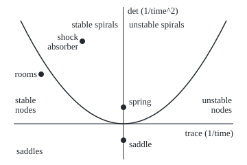
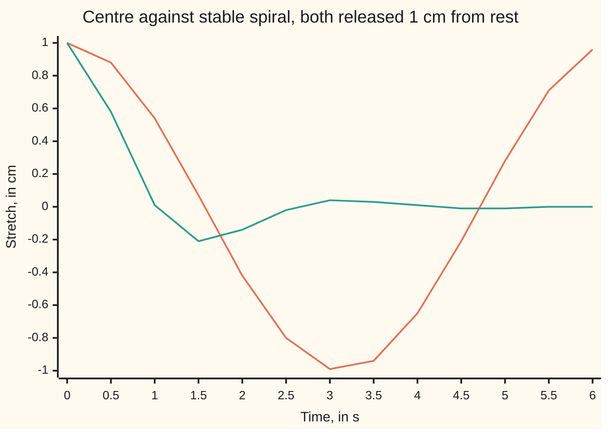

# Trace and determinant: two numbers sort every planar linear system into node, saddle, spiral or centre

[Syllabus](../../../SYLLABUS.md) → [Differential equations and dynamics](../README.md) → [Systems and the Matrix Exponential](../README.md#s04) → Trace and determinant

---

## General Overview

Two rooms share a wall, heating off. Room 1 starts 30 C above the outside air, room 2 starts 10 C above it. Both drift down to the outside temperature and stay there.

A car's shock absorber, pushed down 1 cm and released, bounces through its rest position with each swing smaller. A spring with no damper swings for ever at full size. A broom balanced upright on a palm falls at the first nudge.

Each is a pair of numbers changing by a fixed linear rule, with a resting state, an **equilibrium**. Two numbers read off the rule name the behaviour: the **trace**, the sum of its diagonal entries, and the **determinant**. Plot the pair on one chart; the region names the behaviour.

**For a two-variable system x' = Ax, the trace and determinant of A fix the eigenvalues' sum and product, and those two facts alone decide whether the equilibrium attracts, repels, spirals, or does some of each.**

**What kind of fact this is:** a theorem, proved on this card in Why it works; the words stable and asymptotically stable are definitions, given there.

### The picture: the trace-determinant chart

<p align="center"></p>

To scale: 30 units across per unit of trace, 24 up per unit of determinant. The curve is det = trace^2/4: spirals above it, nodes between it and the trace axis, saddles below that axis, centres on the upper determinant axis. Both checks print the coordinates.

---

## The formula

Reminder: x' = Ax says "the rate of the state x is the matrix A times the state" ([From one equation to a system](01-from-one-equation-to-a-system.md)). Here A has entries `[[a, b], [c, d]]`, row by row. The Greek letter $\tau$ (tau) names the trace, $\Delta$ (capital delta) the determinant.

$$\tau = a + d, \qquad \Delta = ad - bc, \qquad \lambda^2 - \tau\lambda + \Delta = 0$$

**Read it aloud:** the eigenvalues of A are the roots of a quadratic built from the trace and the determinant; they add to the trace and multiply to the determinant.

The quadratic formula gives them:

$$\lambda_1, \lambda_2 = \frac{\tau \pm \sqrt{\tau^2 - 4\Delta}}{2}$$

The chart reads: Δ < 0, a **saddle**, unstable. Δ > 0 with a discriminant of at least 0, a **node**; below 0, a **spiral**; either one stable when τ < 0 and unstable when τ > 0. Δ > 0 with τ = 0, a **centre**: stable, not asymptotically stable.

| Symbol | Plain meaning | In our example | Push it up and the answer… |
| --- | --- | --- | --- |
| $x$ | the state, two numbers | rooms' temperatures above outside, C | — |
| $t$ | time | hours (rooms), seconds (absorber) | — |
| $A$ | the rate matrix | rooms `[[-2, 1], [1, -2]]`, per hour | — |
| $a$, $b$, $c$, $d$ | the entries of A | −2, 1, 1, −2 | — |
| $\tau$ | trace, a + d: the eigenvalues' sum, per unit time | rooms −4, absorber −2 | past 0, attraction turns to repulsion |
| $\Delta$ | determinant, ad − bc: their product, per unit time^2 | rooms 3, absorber 5 | past 0, a saddle becomes a node or spiral |
| $\tau^2 - 4\Delta$ | the discriminant, under the root | rooms 4, absorber −16 | past 0, a spiral becomes a node |
| $\lambda$, $\lambda_1$, $\lambda_2$, $i$ | eigenvalues, the special motions' rates; i squares to −1 | rooms −1, −3; absorber $-1 \pm 2i$ | real part past 0, that motion grows |

### When it holds

- **Constant entries.** With time-varying ones, frozen-time eigenvalues can all be negative while the motion grows.
- **Two variables.** With three or more, the Routh–Hurwitz test takes over: it reads the same verdict from the coefficients of the eigenvalue equation ([Stability of a state-space model](../../13-Engineering%20mathematics/04-State%20Space%20and%20Optimal%20Control/05-hurwitz-schur-and-lyapunov-stability.md)).
- **Off the boundary lines.** On Δ = 0 a whole line of states sits still; on the parabola the eigenvalues repeat and the portrait changes shape.
- **Nonlinear systems** borrow the verdict from their linear part, except at a centre ([Linearisation](../06-Nonlinear%20Dynamics%20in%20the%20Plane/02-linearisation-and-the-jacobian.md)).

---

## Why it works

### Step 0: eigenvalues decide the motion, and two numbers decide the eigenvalues

Every solution of x' = Ax is built from special motions changing like e^(λt), one per eigenvalue ([The eigenvalue method](02-the-eigenvalue-method.md)). Each such motion keeps a fixed direction, its **eigenvector**. A negative real part dies out, a positive one grows, an imaginary part turns. A pair of numbers is fixed by its sum and product.

### Step 1: the sum is the trace, the product is the determinant

An eigenvalue makes A − λI squash some direction to zero (I is the identity matrix), which happens exactly when its determinant is zero:

$$(a - \lambda)(d - \lambda) - bc = \lambda^2 - (a + d)\lambda + (ad - bc) = 0.$$

It also factors as (λ − λ1)(λ − λ2) = λ^2 − (λ1 + λ2)λ + λ1λ2, so λ1 + λ2 = τ and λ1λ2 = Δ. For the rooms, the pair adding to −4 and multiplying to 3 is −1 and −3.

### Step 2: read the signs

- **Δ < 0.** A negative product needs real roots of opposite sign; complex roots come as a pair p ± iq whose product p^2 + q^2 is never negative. One motion grows, one dies: a saddle.
- **Δ > 0, real roots.** One sign for both, shown by their sum τ: a stable node if negative, unstable if positive.
- **Δ > 0, complex roots.** The roots are p ± iq with p = τ/2 and q = √(4Δ − τ^2)/2. Each motion is e^(pt) times a rotation at q radians per unit time ([Complex eigenvalues](03-complex-eigenvalues-and-spirals.md)). τ < 0: an inward spiral. τ > 0: outward. τ = 0: closed loops, a centre.

Real and complex roots meet where τ^2 − 4Δ = 0: the parabola on the chart.

### Step 3: what "stable" means

- **Stable:** starts close enough stay within any chosen distance for all later time.
- **Asymptotically stable:** stable, and starts close enough also return in the long run.
- **Unstable:** some starts, however close, get carried a fixed distance away.

The centre separates the first two. For the spring the state is the stretch x and the velocity v: x' = v and v' = −x, so x^2 + v^2 has rate 2xv − 2vx = 0. A start stays at exactly its starting distance from rest: stable. It never gets closer: not asymptotically stable. The absorber's paths shrink by e^(−π) = 0.0432 each turn of 3.1416 s.



Orange: the spring, x = cos t, a centre, at full size again after its period of 6.2832 s. Teal: the absorber, x = e^(−t)(cos 2t + 0.5 sin 2t), a stable spiral.

<details>
<summary>Detailed proof: the eigenvalue signs give the stability verdicts</summary>

Distinct eigenvalues λ1, λ2 have independent eigenvectors v1, v2, so x(t) = k1 e^(λ1 t) v1 + k2 e^(λ2 t) v2, with weights linear in the start x0. With p the larger real part, |x(t)| ≤ C e^(pt) |x0| for t ≥ 0, C fixed by A.

If p < 0: for a distance ε, starts within ε/C stay within ε, and e^(pt) → 0 brings them home. Asymptotically stable.

If p = 0 with λ = ±iq: |x(t)| ≤ C|x0| gives stability; in real eigen-coordinates the motion is a pure rotation, so no start returns.

If p > 0: a start of size ε in the growing motion grows by e^(pt) (exactly, in eigen-coordinates), past any fixed distance however small ε is. Unstable, saddles included.

A repeated eigenvalue λ adds the motion t e^(λt), which still tends to 0 when λ < 0, so the verdict stands.

</details>

A second route skips eigenvalues: compute e^(At) and watch its size ([The matrix exponential](04-the-matrix-exponential.md)).

---

## Worked numbers, by hand

The rooms: T1' = −2T1 + T2 and T2' = T1 − 2T2, in C above outside, rates per hour.

| Step | Arithmetic | Value |
| --- | --- | --- |
| trace | −2 + (−2) | −4 per hour |
| determinant | (−2)(−2) − (1)(1) | 3 per hour^2 |
| discriminant | (−4)^2 − 4 × 3 | 4, positive: real eigenvalues |
| eigenvalues | (−4 ± √4)/2 | −1 and −3 per hour |
| chart | Δ > 0, below the parabola, τ < 0 | **stable node** |
| check in the rooms | T1 = 20e^(−1) + 10e^(−3) after 1 h | 7.8555 C above outside |

| System | τ | Δ | τ^2 − 4Δ | Eigenvalues | Chart |
| --- | --- | --- | --- | --- | --- |
| shock absorber `[[0, 1], [-5, -2]]`, per s | −2 | 5 | −16 | −1 ± 2i | **stable spiral** |
| spring `[[0, 1], [-1, 0]]`, per s | 0 | 1 | −4 | ±i | **centre** |
| broom `[[1, 0], [0, -1]]` | 0 | −1 | 4 | 1 and −1 | **saddle** |

The rooms cool without overshoot; the absorber overshoots, then settles; the spring never settles; the broom falls unless exactly balanced.

### Sketching the portrait

The phase portrait, every path in the plane of the two numbers, takes three more readings.

- **Node:** paths arrive along the slower eigenvector: for the rooms, both rooms equally warm, fading like e^(−t), t in hours.
- **Spiral or centre:** with the first number across and the second up, c < 0 turns paths clockwise, as for the absorber and the spring.
- **Saddle:** paths come in along the negative eigenvalue's eigenvector and leave along the positive one's: for the broom, in along the second axis, out along the first.

### What breaks if you drop a piece

| Mistake | Comes out at | What went wrong |
| --- | --- | --- |
| Negative trace read as stable, `[[1, 0], [0, -2]]` | from (1, 1), x reaches 403.43 after 6 time units | Δ = −2: a saddle |
| Euler at h = 0.1 on the spring for 60 s, read as proof | radius 19.79, a false outward spiral | each step inflates the radius by √(1 + h^2) |
| Sign slip, λ^2 + τλ + Δ = 0, on the rooms | eigenvalues 3 and 1, a false unstable node | the eigenvalues' sum is +τ |
| Boundary ignored, `[[-1, 0], [0, 0]]` read as a stable node | from (0, 1) the state stays at (0, 1) for good | Δ = 0: a whole line of resting states; stable, not asymptotically stable |

The code prints all four.

---

## Code, from first principles, and it actually runs

Only `math` is imported. Road one reads the chart. Road two never mentions eigenvalues. It steps each system with Euler's rule, a small step h along the current rate, repeated ([Euler's method](../05-Numerical%20Evolution/01-eulers-method.md)). It runs from eight starts for 6 time units, counting starts that shrink below half or grow past double, and sign changes of the first number.

Asserts check that the roads agree, that each eigenvalue zeroes det(A − λI), that Euler's error on the rooms falls tenfold with h, and Euler's inflation of the spring.

### Python

```python
# Trace and determinant -- the check behind the card.  Only math is imported.  Four
# systems x' = Ax are classified twice: road one reads trace and determinant off the
# chart; road two steps the motion with Euler's rule from eight starts and watches it.
from math import sqrt, exp, cos, sin, pi
CASES = [("rooms", [[-2, 1], [1, -2]]), ("absorber", [[0, 1], [-5, -2]]),
         ("spring", [[0, 1], [-1, 0]]), ("saddle", [[1, 0], [0, -1]])]
STARTS = [(1, 0), (1, 1), (0, 1), (-1, 1), (-1, 0), (-1, -1), (0, -1), (1, -1)]
def eig(t, d):                           # roots of L^2 - tL + d = 0
    q = t * t - 4 * d
    if q >= 0: return (t + sqrt(q)) / 2, (t - sqrt(q)) / 2, 0.0
    return t / 2, t / 2, sqrt(-q) / 2
def chart(t, d):                         # road one: where (trace, det) sits
    if d < 0: return "saddle", "unstable"
    if t == 0: return "centre", "stable, not asymptotically stable"
    shape = "spiral" if t * t - 4 * d < 0 else "node"
    return ("stable " if t < 0 else "unstable ") + shape, ("asymptotically stable" if t < 0 else "unstable")
def euler(a, x, y, h, n):                # n small steps along the slope
    for _ in range(n):
        x, y = x + h * (a[0][0] * x + a[0][1] * y), y + h * (a[1][0] * x + a[1][1] * y)
    return x, y
def motion(a, h=0.001, n=6000):          # road two: eight starts, 6 time units
    ratios = [sqrt(sum(v * v for v in euler(a, x, y, h, n))) / sqrt(x * x + y * y) for x, y in STARTS]
    shrink, grow = sum(r < 0.5 for r in ratios), sum(r > 2 for r in ratios)
    x, y, turns = 1.0, 0.0, 0
    for _ in range(n):                   # count sign changes of x from (1, 0)
        nx, y = euler(a, x, y, h, 1)
        turns, x = turns + ((nx > 0) != (x > 0)), nx
    if shrink and grow: label = "saddle"
    elif shrink == 8 or grow == 8: label = ("stable " if shrink else "unstable ") + ("spiral" if turns >= 2 else "node")
    else: label = "centre"
    return shrink, grow, 8 - shrink - grow, turns, label
def px(t, d): return f"({180 + 30 * t:.0f}, {180 - 24 * d:.0f})"   # figure: 30 px per unit of trace, 24 per unit of det
figure = []
for name, a in CASES:
    t, d = a[0][0] + a[1][1], a[0][0] * a[1][1] - a[0][1] * a[1][0]
    l1, l2, im = eig(t, d)
    for lam in (complex(l1, im), complex(l2, -im)):          # det(A - L I) = 0, from the entries
        assert abs((a[0][0] - lam) * (a[1][1] - lam) - a[0][1] * a[1][0]) < 1e-12
    ev = f"{l1:.4f} +/- {im:.4f}i" if im else f"{l1:.4f} and {l2:.4f}"
    kind, stab = chart(t, d)
    s, g, st, turns, label = motion(a)
    print(f"{name} {a}: trace {t}, det {d}, trace^2 - 4det {t * t - 4 * d}, eigenvalues {ev} -> chart: {kind}, {stab}")
    print(f"  motion, 8 starts over 6 time units: shrink {s}, grow {g}, stay {st}, sign changes {turns} -> {label}")
    assert kind == label                                       # two roads, one verdict
    figure.append(f"{name} {px(t, d)}")
closed = 20 * exp(-1) + 10 * exp(-3)
errs = [abs(euler(CASES[0][1], 30.0, 10.0, h, n)[0] - closed) for h, n in ((0.01, 100), (0.001, 1000))]
print(f"rooms, room 1 after 1 h from (30, 10): closed form {closed:.4f} C; Euler error {errs[0]:.4f} at h = 0.01, {errs[1]:.4f} at h = 0.001")
print(f"periods: absorber 2pi/2 = {pi:.4f} s, shrinking by e^-pi = {exp(-pi):.4f} each turn; spring 2pi/1 = {2 * pi:.4f} s")
print("chart spring x(t):", ", ".join(f"{cos(k / 2):.2f}" for k in range(13)))
print("chart absorber x(t):", ", ".join(f"{exp(-k / 2) * (cos(k) + 0.5 * sin(k)):.2f}" for k in range(13)))
print(f"figure, {', '.join(figure)}, parabola ends {px(-5, 6.25)} and {px(5, 6.25)}, control {px(0, -6.25)}")
r, (b1, b2, _) = sqrt(sum(v * v for v in euler(CASES[2][1], 1.0, 0.0, 0.1, 600))), eig(4, 3)
print(f"mistake 1, trace -1 read as stable: [[1, 0], [0, -2]] has det -2, a saddle; from (1, 1) x reaches e^6 = {exp(6):.2f} after 6 units")
print(f"mistake 2, Euler at h = 0.1 on the spring for 60 s: radius {r:.2f} (1.01^300 = {1.01 ** 300:.2f}); the true radius stays 1")
print(f"hypothesis dropped, det 0: [[-1, 0], [0, 0]] reads {chart(-1, 0)[0]}, yet (0, 1) goes to {euler([[-1, 0], [0, 0]], 0.0, 1.0, 0.001, 6000)}: never returns")
print(f"mistake 3, sign slip L^2 + trace L + det on the rooms: eigenvalues {b1:.4f} and {b2:.4f}, a false unstable node")
assert 8 < errs[0] / errs[1] < 12 and errs[1] < 0.01          # Euler closes on the closed form at first order
assert abs(r - 1.01 ** 300) < 1e-9 * r                         # stepping agrees with (1 + h^2)^(n/2)
print("ALL CHECKS PASS")
```

**Ran 2026-09-28 on macOS, Python 3.14.6, standard library only. All checks passed. Output, pasted from the run:**

```
rooms [[-2, 1], [1, -2]]: trace -4, det 3, trace^2 - 4det 4, eigenvalues -1.0000 and -3.0000 -> chart: stable node, asymptotically stable
  motion, 8 starts over 6 time units: shrink 8, grow 0, stay 0, sign changes 0 -> stable node
absorber [[0, 1], [-5, -2]]: trace -2, det 5, trace^2 - 4det -16, eigenvalues -1.0000 +/- 2.0000i -> chart: stable spiral, asymptotically stable
  motion, 8 starts over 6 time units: shrink 8, grow 0, stay 0, sign changes 4 -> stable spiral
spring [[0, 1], [-1, 0]]: trace 0, det 1, trace^2 - 4det -4, eigenvalues 0.0000 +/- 1.0000i -> chart: centre, stable, not asymptotically stable
  motion, 8 starts over 6 time units: shrink 0, grow 0, stay 8, sign changes 2 -> centre
saddle [[1, 0], [0, -1]]: trace 0, det -1, trace^2 - 4det 4, eigenvalues 1.0000 and -1.0000 -> chart: saddle, unstable
  motion, 8 starts over 6 time units: shrink 2, grow 6, stay 0, sign changes 0 -> saddle
rooms, room 1 after 1 h from (30, 10): closed form 7.8555 C; Euler error 0.0593 at h = 0.01, 0.0059 at h = 0.001
periods: absorber 2pi/2 = 3.1416 s, shrinking by e^-pi = 0.0432 each turn; spring 2pi/1 = 6.2832 s
chart spring x(t): 1.00, 0.88, 0.54, 0.07, -0.42, -0.80, -0.99, -0.94, -0.65, -0.21, 0.28, 0.71, 0.96
chart absorber x(t): 1.00, 0.58, 0.01, -0.21, -0.14, -0.02, 0.04, 0.03, 0.01, -0.01, -0.01, -0.00, 0.00
figure, rooms (60, 108), absorber (120, 60), spring (180, 156), saddle (180, 204), parabola ends (30, 30) and (330, 30), control (180, 330)
mistake 1, trace -1 read as stable: [[1, 0], [0, -2]] has det -2, a saddle; from (1, 1) x reaches e^6 = 403.43 after 6 units
mistake 2, Euler at h = 0.1 on the spring for 60 s: radius 19.79 (1.01^300 = 19.79); the true radius stays 1
hypothesis dropped, det 0: [[-1, 0], [0, 0]] reads stable node, yet (0, 1) goes to (0.0, 1.0): never returns
mistake 3, sign slip L^2 + trace L + det on the rooms: eigenvalues 3.0000 and 1.0000, a false unstable node
ALL CHECKS PASS
```

### Rust

Same numbers, same labels, built with `rustc --edition 2021 -O`.

```rust
// Trace and determinant -- the same check as the Python, in Rust.  No crates.  Four
// systems x' = Ax are classified twice: road one reads trace and determinant off the
// chart; road two steps the motion with Euler's rule from eight starts and watches it.
use std::f64::consts::PI;
type M = [[i64; 2]; 2];
const STARTS: [(f64, f64); 8] = [(1.0, 0.0), (1.0, 1.0), (0.0, 1.0), (-1.0, 1.0), (-1.0, 0.0), (-1.0, -1.0), (0.0, -1.0), (1.0, -1.0)];

fn eig(t: i64, d: i64) -> (f64, f64, f64) {            // roots of L^2 - tL + d = 0
    let (tf, q) = (t as f64, (t * t - 4 * d) as f64);
    if q >= 0.0 { ((tf + q.sqrt()) / 2.0, (tf - q.sqrt()) / 2.0, 0.0) } else { (tf / 2.0, tf / 2.0, (-q).sqrt() / 2.0) }
}
fn chart(t: i64, d: i64) -> (String, &'static str) {  // road one: where (trace, det) sits
    if d < 0 { return ("saddle".into(), "unstable") }
    if t == 0 { return ("centre".into(), "stable, not asymptotically stable") }
    let shape = if t * t - 4 * d < 0 { "spiral" } else { "node" };
    if t < 0 { (format!("stable {}", shape), "asymptotically stable") } else { (format!("unstable {}", shape), "unstable") }
}
fn euler(a: &M, mut x: f64, mut y: f64, h: f64, n: usize) -> (f64, f64) {   // n small steps along the slope
    let [[p, q], [r, s]] = a.map(|row| row.map(|v| v as f64));
    for _ in 0..n { (x, y) = (x + h * (p * x + q * y), y + h * (r * x + s * y)) }
    (x, y)
}
fn motion(a: &M) -> (usize, usize, usize, usize, String) {   // road two: eight starts, 6 time units
    let (h, n) = (0.001, 6000);
    let ratios: Vec<f64> = STARTS.iter().map(|&(x, y)| { let (u, v) = euler(a, x, y, h, n); (u * u + v * v).sqrt() / (x * x + y * y).sqrt() }).collect();
    let shrink = ratios.iter().filter(|&&r| r < 0.5).count();
    let grow = ratios.iter().filter(|&&r| r > 2.0).count();
    let (mut x, mut y, mut turns) = (1.0, 0.0, 0);
    for _ in 0..n {                                     // count sign changes of x from (1, 0)
        let (nx, ny) = euler(a, x, y, h, 1);
        if (nx > 0.0) != (x > 0.0) { turns += 1 }
        (x, y) = (nx, ny);
    }
    let label = if shrink > 0 && grow > 0 { "saddle".to_string() }
        else if shrink == 8 || grow == 8 { format!("{} {}", if shrink > 0 { "stable" } else { "unstable" }, if turns >= 2 { "spiral" } else { "node" }) }
        else { "centre".to_string() };
    (shrink, grow, 8 - shrink - grow, turns, label)
}
fn px(t: f64, d: f64) -> String { format!("({:.0}, {:.0})", 180.0 + 30.0 * t, 180.0 - 24.0 * d) }   // figure: 30 px per unit of trace, 24 per unit of det

fn main() {
    let cases: [(&str, M); 4] = [("rooms", [[-2, 1], [1, -2]]), ("absorber", [[0, 1], [-5, -2]]),
        ("spring", [[0, 1], [-1, 0]]), ("saddle", [[1, 0], [0, -1]])];
    let mut figure: Vec<String> = Vec::new();
    for (name, a) in &cases {
        let (t, d) = (a[0][0] + a[1][1], a[0][0] * a[1][1] - a[0][1] * a[1][0]);
        let (l1, l2, im) = eig(t, d);
        for (re, ii) in [(l1, im), (l2, -im)] {         // det(A - L I) = 0, from the entries
            let (u, w, bc) = (a[0][0] as f64 - re, a[1][1] as f64 - re, (a[0][1] * a[1][0]) as f64);
            let (dr, di) = (u * w - ii * ii - bc, -ii * (u + w));
            assert!((dr * dr + di * di).sqrt() < 1e-12);
        }
        let ev = if im != 0.0 { format!("{:.4} +/- {:.4}i", l1, im) } else { format!("{:.4} and {:.4}", l1, l2) };
        let (kind, stab) = chart(t, d);
        let (s, g, st, turns, label) = motion(a);
        println!("{} {:?}: trace {}, det {}, trace^2 - 4det {}, eigenvalues {} -> chart: {}, {}", name, a, t, d, t * t - 4 * d, ev, kind, stab);
        println!("  motion, 8 starts over 6 time units: shrink {}, grow {}, stay {}, sign changes {} -> {}", s, g, st, turns, label);
        assert_eq!(kind, label);                        // two roads, one verdict
        figure.push(format!("{} {}", name, px(t as f64, d as f64)));
    }
    let closed = 20.0 * (-1.0f64).exp() + 10.0 * (-3.0f64).exp();
    let errs: Vec<f64> = [(0.01, 100), (0.001, 1000)].iter().map(|&(h, n)| (euler(&cases[0].1, 30.0, 10.0, h, n).0 - closed).abs()).collect();
    println!("rooms, room 1 after 1 h from (30, 10): closed form {:.4} C; Euler error {:.4} at h = 0.01, {:.4} at h = 0.001", closed, errs[0], errs[1]);
    println!("periods: absorber 2pi/2 = {:.4} s, shrinking by e^-pi = {:.4} each turn; spring 2pi/1 = {:.4} s", PI, (-PI).exp(), 2.0 * PI);
    let spring: Vec<String> = (0..13).map(|k| format!("{:.2}", (k as f64 / 2.0).cos())).collect();
    let absorber: Vec<String> = (0..13).map(|k| { let t = k as f64; format!("{:.2}", (-t / 2.0).exp() * (t.cos() + 0.5 * t.sin())) }).collect();
    println!("chart spring x(t): {}", spring.join(", "));
    println!("chart absorber x(t): {}", absorber.join(", "));
    println!("figure, {}, parabola ends {} and {}, control {}", figure.join(", "), px(-5.0, 6.25), px(5.0, 6.25), px(0.0, -6.25));
    let (u, v) = euler(&cases[2].1, 1.0, 0.0, 0.1, 600);
    let r = (u * u + v * v).sqrt();
    let (b1, b2, _) = eig(4, 3);
    println!("mistake 1, trace -1 read as stable: [[1, 0], [0, -2]] has det -2, a saddle; from (1, 1) x reaches e^6 = {:.2} after 6 units", 6.0f64.exp());
    println!("mistake 2, Euler at h = 0.1 on the spring for 60 s: radius {:.2} (1.01^300 = {:.2}); the true radius stays 1", r, 1.01f64.powi(300));
    println!("hypothesis dropped, det 0: [[-1, 0], [0, 0]] reads {}, yet (0, 1) goes to {:?}: never returns", chart(-1, 0).0, euler(&[[-1, 0], [0, 0]], 0.0, 1.0, 0.001, 6000));
    println!("mistake 3, sign slip L^2 + trace L + det on the rooms: eigenvalues {:.4} and {:.4}, a false unstable node", b1, b2);
    assert!(errs[0] / errs[1] > 8.0 && errs[0] / errs[1] < 12.0 && errs[1] < 0.01);   // Euler closes on the closed form at first order
    assert!((r - 1.01f64.powi(300)).abs() < 1e-9 * r);                                // stepping agrees with (1 + h^2)^(n/2)
    println!("ALL CHECKS PASS");
}
```

**Ran 2026-09-28 on macOS, rustc 1.98.1, no crates. All checks passed. Output, pasted from the run:**

```
rooms [[-2, 1], [1, -2]]: trace -4, det 3, trace^2 - 4det 4, eigenvalues -1.0000 and -3.0000 -> chart: stable node, asymptotically stable
  motion, 8 starts over 6 time units: shrink 8, grow 0, stay 0, sign changes 0 -> stable node
absorber [[0, 1], [-5, -2]]: trace -2, det 5, trace^2 - 4det -16, eigenvalues -1.0000 +/- 2.0000i -> chart: stable spiral, asymptotically stable
  motion, 8 starts over 6 time units: shrink 8, grow 0, stay 0, sign changes 4 -> stable spiral
spring [[0, 1], [-1, 0]]: trace 0, det 1, trace^2 - 4det -4, eigenvalues 0.0000 +/- 1.0000i -> chart: centre, stable, not asymptotically stable
  motion, 8 starts over 6 time units: shrink 0, grow 0, stay 8, sign changes 2 -> centre
saddle [[1, 0], [0, -1]]: trace 0, det -1, trace^2 - 4det 4, eigenvalues 1.0000 and -1.0000 -> chart: saddle, unstable
  motion, 8 starts over 6 time units: shrink 2, grow 6, stay 0, sign changes 0 -> saddle
rooms, room 1 after 1 h from (30, 10): closed form 7.8555 C; Euler error 0.0593 at h = 0.01, 0.0059 at h = 0.001
periods: absorber 2pi/2 = 3.1416 s, shrinking by e^-pi = 0.0432 each turn; spring 2pi/1 = 6.2832 s
chart spring x(t): 1.00, 0.88, 0.54, 0.07, -0.42, -0.80, -0.99, -0.94, -0.65, -0.21, 0.28, 0.71, 0.96
chart absorber x(t): 1.00, 0.58, 0.01, -0.21, -0.14, -0.02, 0.04, 0.03, 0.01, -0.01, -0.01, -0.00, 0.00
figure, rooms (60, 108), absorber (120, 60), spring (180, 156), saddle (180, 204), parabola ends (30, 30) and (330, 30), control (180, 330)
mistake 1, trace -1 read as stable: [[1, 0], [0, -2]] has det -2, a saddle; from (1, 1) x reaches e^6 = 403.43 after 6 units
mistake 2, Euler at h = 0.1 on the spring for 60 s: radius 19.79 (1.01^300 = 19.79); the true radius stays 1
hypothesis dropped, det 0: [[-1, 0], [0, 0]] reads stable node, yet (0, 1) goes to (0.0, 1.0): never returns
mistake 3, sign slip L^2 + trace L + det on the rooms: eigenvalues 3.0000 and 1.0000, a false unstable node
ALL CHECKS PASS
```

### Lean

Lean proves the chart's stability verdicts for every two-variable system with constant entries and Δ ≠ 0, and the eigenvalue steps behind them.

- The eigenvalue equation is λ^2 − τλ + Δ = 0. Its two roots add to the trace and multiply to the determinant.
- Δ < 0: both eigenvalues are real, of opposite sign, and the equilibrium is unstable. That is a saddle.
- Δ > 0 with a discriminant of at least 0: both eigenvalues are real, with the sign of τ.
- A discriminant below 0: the eigenvalues are p ± iq, with p = τ/2 and q = √(4Δ − τ^2)/2.
- Δ > 0 and τ < 0: asymptotically stable. Δ > 0 and τ > 0: unstable. Both hold on the parabola too.
- Δ > 0 and τ = 0: a centre, stable but not asymptotically stable.
- Stable, asymptotically stable and unstable mean exactly what Step 3 says.
- Each example's trace, determinant and discriminant come out exactly. So do the figure's points and the determinant of each matrix in the mistakes table.
- The eigenvalues −1 and −3, −1 ± 2i, and the spring's i solve their equations. So do the sign slip's roots 3 and 1.

Euler's runs, the rooms' 7.8555 C after 1 h, the 403.43, the periods and the plotted stretches are left to the Python and Rust checks.

```lean
-- Trace and determinant: for a two-variable linear system x' = Ax, the eigenvalues add to the trace and multiply to the determinant, their signs follow from those two numbers, and off the line det = 0 the equilibrium is a saddle (unstable) when det < 0, attracting when det > 0 and trace < 0, repelling when det > 0 and trace > 0, and a centre (stable but not asymptotically stable) when det > 0 and trace = 0.
import Mathlib.LinearAlgebra.Matrix.Charpoly.Coeff
import Mathlib.Analysis.Calculus.Deriv.Basic
import Mathlib.Analysis.SpecialFunctions.Sqrt
import Mathlib.Analysis.Complex.Basic
import Mathlib.Tactic.NormNum
import Mathlib.Tactic.Ring
import Mathlib.Analysis.Calculus.Deriv.MeanValue
import Mathlib.Analysis.Calculus.Deriv.Prod
import Mathlib.Analysis.Calculus.Deriv.Pow
import Mathlib.Analysis.SpecialFunctions.Trigonometric.Deriv
import Mathlib.Analysis.SpecialFunctions.ExpDeriv
import Mathlib.Analysis.Complex.Polynomial.Basic
import Mathlib.Tactic.LinearCombination
import Mathlib.Tactic.FieldSimp
import Mathlib.Tactic.Positivity
import Mathlib.Tactic.FinCases
import Mathlib.Tactic.Linarith

open Filter Topology Matrix Polynomial

/-! ### How the card's objects are written here

The state is a pair of real numbers, `Fin 2 → ℝ`, and the rule is a constant real 2 × 2 matrix
`A = !![a, b; c, d]`. Its trace `A.trace` is `a + d` and its determinant `A.det` is `ad - bc`.
Distances use the plane's usual sup length `‖x‖ = max |x 0| |x 1|`; any other length gives the
same verdicts.

A solution of `x' = A x` is a path `x : ℝ → (Fin 2 → ℝ)` whose rate at every time `t` is
`A` times its state, `A *ᵥ x t`. The equilibrium is the rest state `0`.

The eigenvalues are the two complex roots `l1`, `l2` of the characteristic polynomial
`det (X·I - A)`, written as the factorisation `(X - l1)(X - l2)` over `ℂ`. -/

/-- `x` solves `x' = A x`: at every time `t` its rate is `A` times its state. -/
def SolvesLinear (A : Matrix (Fin 2) (Fin 2) ℝ) (x : ℝ → Fin 2 → ℝ) : Prop :=
  ∀ t : ℝ, HasDerivAt x (A *ᵥ x t) t

/-- Stable: starts close enough to rest stay within any chosen distance for all later time. -/
def EquilibriumStable (A : Matrix (Fin 2) (Fin 2) ℝ) : Prop :=
  ∀ ε > 0, ∃ δ > 0, ∀ x : ℝ → Fin 2 → ℝ, SolvesLinear A x → ‖x 0‖ < δ →
    ∀ t ≥ 0, ‖x t‖ < ε

/-- Asymptotically stable: stable, and starts close enough also return to rest in the long run. -/
def EquilibriumAsymptoticallyStable (A : Matrix (Fin 2) (Fin 2) ℝ) : Prop :=
  EquilibriumStable A ∧
    ∃ δ > 0, ∀ x : ℝ → Fin 2 → ℝ, SolvesLinear A x → ‖x 0‖ < δ → Tendsto x atTop (𝓝 0)

/-- Unstable: some starts, however close to rest, get carried a fixed distance away. -/
def EquilibriumUnstable (A : Matrix (Fin 2) (Fin 2) ℝ) : Prop :=
  ∃ ε > 0, ∀ δ > 0, ∃ x : ℝ → Fin 2 → ℝ, SolvesLinear A x ∧ ‖x 0‖ < δ ∧
    ∃ t ≥ 0, ε ≤ ‖x t‖

lemma solves_coord {A : Matrix (Fin 2) (Fin 2) ℝ} {x : ℝ → Fin 2 → ℝ} (hx : SolvesLinear A x)
    (t : ℝ) :
    HasDerivAt (fun s => x s 0) (A 0 0 * x t 0 + A 0 1 * x t 1) t ∧
      HasDerivAt (fun s => x s 1) (A 1 0 * x t 0 + A 1 1 * x t 1) t := by
  have h := hasDerivAt_pi.1 (hx t)
  exact ⟨by simpa [Matrix.mulVec, dotProduct, Fin.sum_univ_two] using h 0,
    by simpa [Matrix.mulVec, dotProduct, Fin.sum_univ_two] using h 1⟩

lemma solves_of_coord {A : Matrix (Fin 2) (Fin 2) ℝ} {x : ℝ → Fin 2 → ℝ}
    (h0 : ∀ t, HasDerivAt (fun s => x s 0) (A 0 0 * x t 0 + A 0 1 * x t 1) t)
    (h1 : ∀ t, HasDerivAt (fun s => x s 1) (A 1 0 * x t 0 + A 1 1 * x t 1) t) :
    SolvesLinear A x := by
  intro t
  rw [hasDerivAt_pi]
  intro i
  fin_cases i
  · simpa [Matrix.mulVec, dotProduct, Fin.sum_univ_two] using h0 t
  · simpa [Matrix.mulVec, dotProduct, Fin.sum_univ_two] using h1 t

lemma lyap_hasDerivAt {A : Matrix (Fin 2) (Fin 2) ℝ} {x : ℝ → Fin 2 → ℝ} (hx : SolvesLinear A x)
    (t : ℝ) :
    HasDerivAt (fun s => A.det * (x s 0 ^ 2 + x s 1 ^ 2) + (A 0 0 * x s 0 + A 0 1 * x s 1) ^ 2
        + (A 1 0 * x s 0 + A 1 1 * x s 1) ^ 2)
      (2 * A.trace * ((A 0 0 * x t 0 + A 0 1 * x t 1) ^ 2
        + (A 1 0 * x t 0 + A 1 1 * x t 1) ^ 2)) t := by
  obtain ⟨hu, hw⟩ := solves_coord hx t
  have h := ((((hu.pow 2).add (hw.pow 2)).const_mul A.det).add
    (((hu.const_mul (A 0 0)).add (hw.const_mul (A 0 1))).pow 2)).add
    (((hu.const_mul (A 1 0)).add (hw.const_mul (A 1 1))).pow 2)
  convert h using 1
  rw [trace_fin_two, det_fin_two]
  norm_num
  ring

lemma ysq_le (a b c d u w : ℝ) :
    (a * u + b * w) ^ 2 + (c * u + d * w) ^ 2 ≤
      (a ^ 2 + b ^ 2 + c ^ 2 + d ^ 2) * (u ^ 2 + w ^ 2) := by
  nlinarith [sq_nonneg (a * w - b * u), sq_nonneg (c * w - d * u)]

lemma det_sq_le (a b c d u w : ℝ) :
    (a * d - b * c) ^ 2 * (u ^ 2 + w ^ 2) ≤
      (a ^ 2 + b ^ 2 + c ^ 2 + d ^ 2) * ((a * u + b * w) ^ 2 + (c * u + d * w) ^ 2) := by
  nlinarith [sq_nonneg (b * (a * u + b * w) + d * (c * u + d * w)),
    sq_nonneg (a * (a * u + b * w) + c * (c * u + d * w))]

lemma sq_add_sq_le_norm (v : Fin 2 → ℝ) : v 0 ^ 2 + v 1 ^ 2 ≤ 2 * ‖v‖ ^ 2 := by
  have h0 : |v 0| ≤ ‖v‖ := by simpa using norm_le_pi_norm v 0
  have h1 : |v 1| ≤ ‖v‖ := by simpa using norm_le_pi_norm v 1
  have e0 : v 0 ^ 2 ≤ ‖v‖ ^ 2 := by rw [← sq_abs]; exact pow_le_pow_left₀ (abs_nonneg _) h0 2
  have e1 : v 1 ^ 2 ≤ ‖v‖ ^ 2 := by rw [← sq_abs]; exact pow_le_pow_left₀ (abs_nonneg _) h1 2
  linarith

lemma norm_lt_of_sq {v : Fin 2 → ℝ} {ε : ℝ} (hε : 0 < ε) (h : v 0 ^ 2 + v 1 ^ 2 < ε ^ 2) :
    ‖v‖ < ε := by
  rw [pi_norm_lt_iff hε]
  intro i
  rw [Real.norm_eq_abs]
  apply abs_lt_of_sq_lt_sq _ hε.le
  fin_cases i <;> simp <;> nlinarith [sq_nonneg (v 0), sq_nonneg (v 1)]

lemma stable_of {A : Matrix (Fin 2) (Fin 2) ℝ} (hΔ : 0 < A.det) (hτ : A.trace ≤ 0) :
    EquilibriumStable A := by
  intro ε hε
  obtain ⟨M, hM⟩ : ∃ M, M = A 0 0 ^ 2 + A 0 1 ^ 2 + A 1 0 ^ 2 + A 1 1 ^ 2 := ⟨_, rfl⟩
  have hM0 : 0 ≤ M := by rw [hM]; positivity
  obtain ⟨K, hK⟩ : ∃ K, K = 2 * (A.det + M) / A.det := ⟨_, rfl⟩
  have hK0 : 0 ≤ K := by rw [hK]; positivity
  have hKΔ : K * A.det = 2 * (A.det + M) := by rw [hK]; field_simp
  refine ⟨ε / (K + 1), by positivity, fun x hx h0 t ht => ?_⟩
  have hanti := antitone_of_hasDerivAt_nonpos (lyap_hasDerivAt hx) (fun s => by
    have : 0 ≤ (A 0 0 * x s 0 + A 0 1 * x s 1) ^ 2 + (A 1 0 * x s 0 + A 1 1 * x s 1) ^ 2 := by
      positivity
    show 2 * A.trace * _ ≤ 0
    nlinarith)
  have hVt := hanti ht
  simp only at hVt
  have hY := ysq_le (A 0 0) (A 0 1) (A 1 0) (A 1 1) (x 0 0) (x 0 1)
  rw [← hM] at hY
  have hn := sq_add_sq_le_norm (x 0)
  have hn' := mul_le_mul_of_nonneg_left hn (by positivity : 0 ≤ A.det + M)
  have hYt : 0 ≤ (A 0 0 * x t 0 + A 0 1 * x t 1) ^ 2 + (A 1 0 * x t 0 + A 1 1 * x t 1) ^ 2 := by
    positivity
  have e : A.det * (K * ‖x 0‖ ^ 2) = 2 * (A.det + M) * ‖x 0‖ ^ 2 := by
    rw [← hKΔ]; ring
  have h1 : A.det * (x t 0 ^ 2 + x t 1 ^ 2) ≤ A.det * (K * ‖x 0‖ ^ 2) := by
    nlinarith
  have h2 : x t 0 ^ 2 + x t 1 ^ 2 ≤ K * ‖x 0‖ ^ 2 := le_of_mul_le_mul_left h1 hΔ
  apply norm_lt_of_sq hε
  have hδ : 0 < K + 1 := by linarith
  have hx0 : ‖x 0‖ ^ 2 < (ε / (K + 1)) ^ 2 := by
    have := norm_nonneg (x 0)
    exact pow_lt_pow_left₀ h0 this (by norm_num)
  have h3 : K * (ε / (K + 1)) ^ 2 < ε ^ 2 := by
    rw [div_pow, mul_div_assoc', div_lt_iff₀ (by positivity)]
    have : 0 < ε ^ 2 * (K ^ 2 + K + 1) := by positivity
    nlinarith
  nlinarith

lemma asymp_of {A : Matrix (Fin 2) (Fin 2) ℝ} (hΔ : 0 < A.det) (hτ : A.trace < 0) :
    EquilibriumAsymptoticallyStable A := by
  refine ⟨stable_of hΔ hτ.le, 1, one_pos, fun x hx _ => ?_⟩
  obtain ⟨M, hM⟩ : ∃ M, M = A 0 0 ^ 2 + A 0 1 ^ 2 + A 1 0 ^ 2 + A 1 1 ^ 2 := ⟨_, rfl⟩
  have hM0 : 0 ≤ M := by rw [hM]; positivity
  obtain ⟨κ, hκ⟩ : ∃ κ, κ = -2 * A.trace * A.det / (M + A.det) := ⟨_, rfl⟩
  have hκ0 : 0 < κ := by
    rw [hκ]; apply div_pos
    · nlinarith
    · linarith
  have hκM : κ * (M + A.det) = -2 * A.trace * A.det := by
    rw [hκ]; field_simp
  have hW : ∀ s, HasDerivAt
      (fun s => (A.det * (x s 0 ^ 2 + x s 1 ^ 2) + (A 0 0 * x s 0 + A 0 1 * x s 1) ^ 2
        + (A 1 0 * x s 0 + A 1 1 * x s 1) ^ 2) * Real.exp (κ * s))
      ((2 * A.trace * ((A 0 0 * x s 0 + A 0 1 * x s 1) ^ 2
        + (A 1 0 * x s 0 + A 1 1 * x s 1) ^ 2)) * Real.exp (κ * s) +
        (A.det * (x s 0 ^ 2 + x s 1 ^ 2) + (A 0 0 * x s 0 + A 0 1 * x s 1) ^ 2
        + (A 1 0 * x s 0 + A 1 1 * x s 1) ^ 2) * (Real.exp (κ * s) * (κ * 1))) s := fun s =>
    (lyap_hasDerivAt hx s).mul (((hasDerivAt_id' s).const_mul κ).exp)
  have hanti := antitone_of_hasDerivAt_nonpos hW (fun s => by
    have hdet := det_sq_le (A 0 0) (A 0 1) (A 1 0) (A 1 1) (x s 0) (x s 1)
    rw [← hM, ← det_fin_two] at hdet
    have key : A.det * (A.det * (x s 0 ^ 2 + x s 1 ^ 2) + ((A 0 0 * x s 0 + A 0 1 * x s 1) ^ 2
        + (A 1 0 * x s 0 + A 1 1 * x s 1) ^ 2)) ≤ (M + A.det) * ((A 0 0 * x s 0 + A 0 1 * x s 1) ^ 2
        + (A 1 0 * x s 0 + A 1 1 * x s 1) ^ 2) := by nlinarith
    have h3 : κ * (A.det * (x s 0 ^ 2 + x s 1 ^ 2) + ((A 0 0 * x s 0 + A 0 1 * x s 1) ^ 2
        + (A 1 0 * x s 0 + A 1 1 * x s 1) ^ 2)) * (M + A.det) ≤ (-2 * A.trace *
        ((A 0 0 * x s 0 + A 0 1 * x s 1) ^ 2 + (A 1 0 * x s 0 + A 1 1 * x s 1) ^ 2)) *
        (M + A.det) := by
      have := mul_le_mul_of_nonneg_left key (by linarith : (0 : ℝ) ≤ -2 * A.trace)
      linear_combination this + (A.det * (x s 0 ^ 2 + x s 1 ^ 2) + ((A 0 0 * x s 0 + A 0 1 * x s 1) ^ 2
        + (A 1 0 * x s 0 + A 1 1 * x s 1) ^ 2)) * hκM
    have h4 := le_of_mul_le_mul_right h3 (by linarith)
    have he := Real.exp_pos (κ * s)
    show _ ≤ 0
    nlinarith)
  -- bound for t ≥ 0
  set V0 := A.det * (x 0 0 ^ 2 + x 0 1 ^ 2) + (A 0 0 * x 0 0 + A 0 1 * x 0 1) ^ 2
        + (A 1 0 * x 0 0 + A 1 1 * x 0 1) ^ 2 with hV0
  have hbound : ∀ t ≥ 0, ∀ i, x t i ^ 2 ≤ V0 / A.det * Real.exp (-(κ * t)) := by
    intro t ht i
    have h := hanti ht
    simp only [mul_zero, Real.exp_zero, mul_one] at h
    have he := Real.exp_pos (κ * t)
    have hY : 0 ≤ (A 0 0 * x t 0 + A 0 1 * x t 1) ^ 2 + (A 1 0 * x t 0 + A 1 1 * x t 1) ^ 2 := by
      positivity
    have hxi : x t i ^ 2 ≤ x t 0 ^ 2 + x t 1 ^ 2 := by
      fin_cases i <;> simp <;> nlinarith [sq_nonneg (x t 0), sq_nonneg (x t 1)]
    rw [Real.exp_neg, div_mul_eq_mul_div, le_div_iff₀ hΔ, ← div_eq_mul_inv, le_div_iff₀ he]
    nlinarith [mul_le_mul_of_nonneg_right hxi (le_of_lt (mul_pos hΔ he))]
  have hlim : Tendsto (fun t => Real.sqrt (V0 / A.det * Real.exp (-(κ * t)))) atTop (𝓝 0) := by
    have h1 : Tendsto (fun t => Real.exp (-(κ * t))) atTop (𝓝 0) :=
      Real.tendsto_exp_neg_atTop_nhds_zero.comp (tendsto_id.const_mul_atTop hκ0)
    have h2 := (h1.const_mul (V0 / A.det)).sqrt
    simpa using h2
  rw [tendsto_pi_nhds]
  intro i
  apply squeeze_zero_norm' _ hlim
  filter_upwards [eventually_ge_atTop 0] with t ht
  rw [Real.norm_eq_abs]
  exact Real.abs_le_sqrt (hbound t ht i)

lemma unstable_of_unbounded {A : Matrix (Fin 2) (Fin 2) ℝ} (y : ℝ → Fin 2 → ℝ)
    (hy : SolvesLinear A y) (i : Fin 2) (hunb : ∀ M : ℝ, ∃ t ≥ 0, M ≤ |y t i|) :
    EquilibriumUnstable A := by
  refine ⟨1, one_pos, fun δ hδ => ?_⟩
  obtain ⟨c, hc⟩ : ∃ c, c = δ / (‖y 0‖ + 1) := ⟨_, rfl⟩
  have hc0 : 0 < c := by rw [hc]; positivity
  obtain ⟨t, ht, hM⟩ := hunb (1 / c)
  refine ⟨fun s => c • y s, fun s => ?_, ?_, t, ht, ?_⟩
  · have := (hy s).const_smul c
    rw [Matrix.mulVec_smul]; exact this
  · show ‖c • y 0‖ < δ
    rw [norm_smul, Real.norm_eq_abs, abs_of_pos hc0, hc,
      div_mul_eq_mul_div, div_lt_iff₀ (by positivity)]
    nlinarith [norm_nonneg (y 0)]
  · show 1 ≤ ‖c • y t‖
    calc (1 : ℝ) = c * (1 / c) := by field_simp
      _ ≤ c * |y t i| := mul_le_mul_of_nonneg_left hM hc0.le
      _ = ‖(c • y t) i‖ := by simp [abs_of_pos hc0]
      _ ≤ ‖c • y t‖ := norm_le_pi_norm _ i

lemma unstable_of_eig {A : Matrix (Fin 2) (Fin 2) ℝ} (r w0 w1 : ℝ) (hr : 0 < r)
    (hw : w0 ≠ 0 ∨ w1 ≠ 0)
    (h0 : A 0 0 * w0 + A 0 1 * w1 = r * w0) (h1 : A 1 0 * w0 + A 1 1 * w1 = r * w1) :
    EquilibriumUnstable A := by
  have hsol : SolvesLinear A (fun t => ![Real.exp (r * t) * w0, Real.exp (r * t) * w1]) := by
    apply solves_of_coord
    · intro t
      have := (((hasDerivAt_id' t).const_mul r).exp).mul_const w0
      simp only [Matrix.cons_val_zero, Matrix.cons_val_one]
      convert this using 1
      linear_combination Real.exp (r * t) * h0
    · intro t
      have := (((hasDerivAt_id' t).const_mul r).exp).mul_const w1
      simp only [Matrix.cons_val_zero, Matrix.cons_val_one]
      convert this using 1
      linear_combination Real.exp (r * t) * h1
  have key : ∀ w : ℝ, w ≠ 0 → ∀ M : ℝ, ∃ t ≥ 0, M ≤ |Real.exp (r * t) * w| := by
    intro w hw M
    have hwpos : 0 < |w| := abs_pos.2 hw
    refine ⟨|M| / (r * |w|), by positivity, ?_⟩
    have := Real.add_one_le_exp (r * (|M| / (r * |w|)))
    rw [abs_mul, abs_of_pos (Real.exp_pos _)]
    have e : r * (|M| / (r * |w|)) * |w| = |M| := by field_simp
    nlinarith [le_abs_self M, abs_nonneg M]
  rcases hw with hw | hw
  · exact unstable_of_unbounded _ hsol 0 (by simpa using key w0 hw)
  · exact unstable_of_unbounded _ hsol 1 (by simpa using key w1 hw)

lemma spiral_solves {A : Matrix (Fin 2) (Fin 2) ℝ} (p q v0 v1 : ℝ) (hp : 2 * p = A.trace)
    (hq2 : q ^ 2 = A.det - p ^ 2) :
    SolvesLinear A (fun t => ![Real.exp (p * t) * (q * v0 * Real.cos (q * t)
        + Real.sin (q * t) * ((A 0 0 - p) * v0 + A 0 1 * v1)),
      Real.exp (p * t) * (q * v1 * Real.cos (q * t)
        + Real.sin (q * t) * (A 1 0 * v0 + (A 1 1 - p) * v1))]) := by
  rw [trace_fin_two] at hp
  rw [det_fin_two] at hq2
  apply solves_of_coord
  · intro t
    have := (((hasDerivAt_id' t).const_mul p).exp).mul
      (((((hasDerivAt_id' t).const_mul q).cos).const_mul (q * v0)).add
        ((((hasDerivAt_id' t).const_mul q).sin).mul_const ((A 0 0 - p) * v0 + A 0 1 * v1)))
    simp only [Matrix.cons_val_zero, Matrix.cons_val_one]
    convert this using 1
    simp only [Pi.add_apply]
    linear_combination (-(Real.exp (p * t) * Real.sin (q * t))) *
      ((A 0 0 * v0 + A 0 1 * v1) * hp - v0 * hq2)
  · intro t
    have := (((hasDerivAt_id' t).const_mul p).exp).mul
      (((((hasDerivAt_id' t).const_mul q).cos).const_mul (q * v1)).add
        ((((hasDerivAt_id' t).const_mul q).sin).mul_const (A 1 0 * v0 + (A 1 1 - p) * v1)))
    simp only [Matrix.cons_val_zero, Matrix.cons_val_one]
    convert this using 1
    simp only [Pi.add_apply]
    linear_combination (-(Real.exp (p * t) * Real.sin (q * t))) *
      ((A 1 0 * v0 + A 1 1 * v1) * hp - v1 * hq2)

lemma unstable_of_spiral {A : Matrix (Fin 2) (Fin 2) ℝ} (p q : ℝ) (hp0 : 0 < p) (hq0 : 0 < q)
    (hp : 2 * p = A.trace) (hq2 : q ^ 2 = A.det - p ^ 2) : EquilibriumUnstable A := by
  refine unstable_of_unbounded _ (spiral_solves p q 1 0 hp hq2) 0 (fun M => ?_)
  obtain ⟨n, hn⟩ : ∃ n : ℕ, n = ⌈|M| / (2 * Real.pi * p)⌉₊ := ⟨_, rfl⟩
  have hn' : |M| / (2 * Real.pi * p) ≤ n := hn ▸ Nat.le_ceil _
  have hpi := Real.pi_pos
  refine ⟨2 * Real.pi * n / q, by positivity, ?_⟩
  have harg : q * (2 * Real.pi * n / q) = n * (2 * Real.pi) := by field_simp
  have hsin : Real.sin (n * (2 * Real.pi)) = 0 := by
    rw [show (n : ℝ) * (2 * Real.pi) = ((2 * n : ℕ) : ℝ) * Real.pi by push_cast; ring]
    exact Real.sin_nat_mul_pi _
  simp only [Matrix.cons_val_zero, harg, Real.cos_nat_mul_two_pi, hsin]
  have hexp := Real.add_one_le_exp (p * (2 * Real.pi * n / q))
  have e : p * (2 * Real.pi * n / q) * q = 2 * Real.pi * p * n := by field_simp
  have hM : |M| ≤ 2 * Real.pi * p * n := by
    rw [div_le_iff₀ (by positivity)] at hn'; linarith
  simp only [mul_one, zero_mul, add_zero]
  rw [abs_of_pos (by positivity)]
  nlinarith [le_abs_self M, abs_nonneg M, Real.exp_pos (p * (2 * Real.pi * n / q))]

lemma not_asymp_of_centre {A : Matrix (Fin 2) (Fin 2) ℝ} (hΔ : 0 < A.det) (hτ : A.trace = 0) :
    ¬ EquilibriumAsymptoticallyStable A := by
  rintro ⟨_, δ, hδ, hAS⟩
  obtain ⟨q, hq⟩ : ∃ q, q = Real.sqrt A.det := ⟨_, rfl⟩
  have hq0 : 0 < q := hq ▸ Real.sqrt_pos.2 hΔ
  have hq2 : q ^ 2 = A.det - 0 ^ 2 := by rw [hq, Real.sq_sqrt hΔ.le]; ring
  have hsol := spiral_solves (A := A) 0 q (δ / (2 * q)) 0 (by rw [hτ]; ring) hq2
  set x := (fun t => ![Real.exp (0 * t) * (q * (δ / (2 * q)) * Real.cos (q * t)
        + Real.sin (q * t) * ((A 0 0 - 0) * (δ / (2 * q)) + A 0 1 * 0)),
      Real.exp (0 * t) * (q * 0 * Real.cos (q * t)
        + Real.sin (q * t) * (A 1 0 * (δ / (2 * q)) + (A 1 1 - 0) * 0))]) with hx
  have hx00 : x 0 0 = δ / 2 := by
    simp [hx]; field_simp
  have hx01 : x 0 1 = 0 := by simp [hx]
  have hx0 : ‖x 0‖ < δ := by
    apply norm_lt_of_sq hδ
    rw [hx00, hx01]; nlinarith
  have hlim := hAS x hsol hx0
  let F : (Fin 2 → ℝ) → ℝ := fun y => A.det * (y 0 ^ 2 + y 1 ^ 2) + (A 0 0 * y 0 + A 0 1 * y 1) ^ 2
    + (A 1 0 * y 0 + A 1 1 * y 1) ^ 2
  have hFc : Continuous F := by fun_prop
  have h1 : Tendsto (fun t => F (x t)) atTop (𝓝 (F 0)) := (hFc.tendsto 0).comp hlim
  have hconst : ∀ t, F (x t) = F (x 0) := by
    have hd : ∀ t, HasDerivAt (fun t => F (x t)) 0 t := by
      intro t
      have := lyap_hasDerivAt hsol t
      rw [hτ] at this
      simpa using this
    intro t
    exact is_const_of_deriv_eq_zero (fun t => (hd t).differentiableAt)
      (fun t => (hd t).deriv) t 0
  have h2 : Tendsto (fun t => F (x t)) atTop (𝓝 (F (x 0))) := by
    simp only [hconst]; exact tendsto_const_nhds
  have heq := tendsto_nhds_unique h2 h1
  have hpos : 0 < F (x 0) := by
    simp only [F, hx00, hx01]
    have : 0 < A.det * ((δ / 2) ^ 2 + 0 ^ 2) := by positivity
    nlinarith [sq_nonneg (A 0 0 * (δ / 2) + A 0 1 * 0), sq_nonneg (A 1 0 * (δ / 2) + A 1 1 * 0)]
  have hF0 : F 0 = 0 := by simp [F]
  rw [hF0] at heq
  linarith

lemma unstable_of_real_roots {A : Matrix (Fin 2) (Fin 2) ℝ} (r1 r2 : ℝ) (hr1 : 0 < r1)
    (hsum : r1 + r2 = A.trace) (hprod : r1 * r2 = A.det)
    (hnot : ¬ (A 0 0 = r2 ∧ A 1 0 = 0 ∧ A 0 1 = 0 ∧ A 1 1 = r2)) : EquilibriumUnstable A := by
  rw [trace_fin_two] at hsum
  rw [det_fin_two] at hprod
  by_cases h : A 0 0 - r2 ≠ 0 ∨ A 1 0 ≠ 0
  · refine unstable_of_eig r1 (A 0 0 - r2) (A 1 0) hr1 h ?_ ?_
    · linear_combination (-(A 0 0)) * hsum + hprod
    · linear_combination (-(A 1 0)) * hsum
  · push Not at h
    by_cases h' : A 0 1 ≠ 0 ∨ A 1 1 - r2 ≠ 0
    · refine unstable_of_eig r1 (A 0 1) (A 1 1 - r2) hr1 h' ?_ ?_
      · linear_combination (-(A 0 1)) * hsum
      · linear_combination (-(A 1 1)) * hsum + hprod
    · push Not at h'
      exact absurd ⟨by linarith [h.1], h.2, h'.1, by linarith [h'.2]⟩ hnot

lemma vieta_two (A : Matrix (Fin 2) (Fin 2) ℝ) (l1 l2 : ℂ)
    (h : A.charpoly.map (algebraMap ℝ ℂ) = (X - C l1) * (X - C l2)) :
    l1 + l2 = (A.trace : ℂ) ∧ l1 * l2 = (A.det : ℂ) := by
  rw [charpoly_fin_two] at h
  have e : (X - C l1) * (X - C l2) = X ^ 2 - C (l1 + l2) * X + C (l1 * l2) := by
    rw [C_add, C_mul]; ring
  rw [e] at h
  have h0 := congrArg (coeff · 0) h
  have h1 := congrArg (coeff · 1) h
  simp [coeff_X, coeff_C] at h0 h1
  exact ⟨by linear_combination h1, h0.symm⟩

/-- The card's main claim, the trace-determinant chart. For a two-variable system `x' = A x` with
constant entries, off the boundary line `Δ = 0`, the trace `τ` and determinant `Δ` of `A` decide
the equilibrium's stability:
* `Δ < 0`: a saddle, unstable;
* `Δ > 0` and `τ < 0`: a stable node or spiral, asymptotically stable;
* `Δ > 0` and `τ > 0`: an unstable node or spiral, unstable;
* `Δ > 0` and `τ = 0`: a centre, stable but not asymptotically stable. -/
theorem trace_and_det_decide_stability (A : Matrix (Fin 2) (Fin 2) ℝ) :
    (A.det < 0 → EquilibriumUnstable A) ∧
      (0 < A.det → A.trace < 0 → EquilibriumAsymptoticallyStable A) ∧
      (0 < A.det → 0 < A.trace → EquilibriumUnstable A) ∧
      (0 < A.det → A.trace = 0 →
        EquilibriumStable A ∧ ¬ EquilibriumAsymptoticallyStable A) := by
  refine ⟨fun hΔ => ?_, fun hΔ hτ => asymp_of hΔ hτ, fun hΔ hτ => ?_,
    fun hΔ hτ => ⟨stable_of hΔ hτ.le, not_asymp_of_centre hΔ hτ⟩⟩
  · have hD : 0 < A.trace ^ 2 - 4 * A.det := by nlinarith [sq_nonneg A.trace]
    obtain ⟨s, hs⟩ : ∃ s, s = Real.sqrt (A.trace ^ 2 - 4 * A.det) := ⟨_, rfl⟩
    have hs2 : s ^ 2 = A.trace ^ 2 - 4 * A.det := by rw [hs, Real.sq_sqrt hD.le]
    have hs0 : 0 ≤ s := hs ▸ Real.sqrt_nonneg _
    have hr1 : 0 < (A.trace + s) / 2 := by nlinarith
    refine unstable_of_real_roots ((A.trace + s) / 2) ((A.trace - s) / 2) hr1 (by ring)
      (by linear_combination (-1 / 4 : ℝ) * hs2) ?_
    rintro ⟨h1, h2, h3, h4⟩
    rw [det_fin_two, h1, h2, h3, h4] at hΔ
    nlinarith [sq_nonneg ((A.trace - s) / 2)]
  · by_cases hD : 0 ≤ A.trace ^ 2 - 4 * A.det
    · obtain ⟨s, hs⟩ : ∃ s, s = Real.sqrt (A.trace ^ 2 - 4 * A.det) := ⟨_, rfl⟩
      have hs2 : s ^ 2 = A.trace ^ 2 - 4 * A.det := by rw [hs, Real.sq_sqrt hD]
      have hs0 : 0 ≤ s := hs ▸ Real.sqrt_nonneg _
      have hr1 : 0 < (A.trace + s) / 2 := by linarith
      have hr2 : 0 < (A.trace - s) / 2 := by nlinarith
      by_cases hn : A 0 0 = (A.trace - s) / 2 ∧ A 1 0 = 0 ∧ A 0 1 = 0 ∧ A 1 1 = (A.trace - s) / 2
      · exact unstable_of_eig ((A.trace - s) / 2) 1 0 hr2 (Or.inl one_ne_zero)
          (by simp [hn.1, hn.2.2.1]) (by simp [hn.2.1])
      · exact unstable_of_real_roots ((A.trace + s) / 2) ((A.trace - s) / 2) hr1 (by ring)
          (by linear_combination (-1 / 4 : ℝ) * hs2) hn
    · push Not at hD
      have hq : 0 < Real.sqrt (4 * A.det - A.trace ^ 2) := Real.sqrt_pos.2 (by linarith)
      exact unstable_of_spiral (A.trace / 2) (Real.sqrt (4 * A.det - A.trace ^ 2) / 2)
        (by linarith) (by positivity) (by ring)
        (by rw [div_pow, Real.sq_sqrt (by linarith)]; ring)

/-- Step 1: the eigenvalue equation is `λ² - τλ + Δ = 0`, and its two roots add to the trace and
multiply to the determinant. -/
theorem eigenvalues_add_to_trace_and_multiply_to_det (A : Matrix (Fin 2) (Fin 2) ℝ) :
    A.charpoly = X ^ 2 - C A.trace * X + C A.det ∧
      ∃ l1 l2 : ℂ, A.charpoly.map (algebraMap ℝ ℂ) = (X - C l1) * (X - C l2) ∧
        l1 + l2 = (A.trace : ℂ) ∧ l1 * l2 = (A.det : ℂ) := by
  refine ⟨charpoly_fin_two A, ?_⟩
  obtain ⟨s, hs⟩ := IsAlgClosed.isSquare ((A.trace : ℂ) ^ 2 - 4 * (A.det : ℂ))
  have h1 : (A.trace + s) / 2 + (A.trace - s) / 2 = (A.trace : ℂ) := by ring
  have h2 : (A.trace + s) / 2 * ((A.trace - s) / 2) = (A.det : ℂ) := by
    linear_combination (1/4 : ℂ) * hs
  refine ⟨(A.trace + s) / 2, (A.trace - s) / 2, ?_, h1, h2⟩
  have e : (X - C ((A.trace + s) / 2)) * (X - C ((A.trace - s) / 2)) =
      X ^ 2 - C ((A.trace + s) / 2 + (A.trace - s) / 2) * X
        + C ((A.trace + s) / 2 * ((A.trace - s) / 2)) := by
    rw [C_add, C_mul]; ring
  rw [e, h1, h2, charpoly_fin_two]
  simp

/-- Step 2: reading the signs. For the eigenvalues `l1`, `l2` of `A`:
* `Δ < 0`: both real, of opposite sign (a saddle);
* `Δ > 0` and `τ² - 4Δ ≥ 0`: both real, both with the sign of `τ` (a node);
* `τ² - 4Δ < 0`: a complex pair `p ± iq` with `p = τ/2` and `q = √(4Δ - τ²)/2` (a spiral, or a
  centre when `τ = 0`). -/
theorem eigenvalue_signs_from_trace_and_det (A : Matrix (Fin 2) (Fin 2) ℝ) (l1 l2 : ℂ)
    (h : A.charpoly.map (algebraMap ℝ ℂ) = (X - C l1) * (X - C l2)) :
    (A.det < 0 → l1.im = 0 ∧ l2.im = 0 ∧ l1.re * l2.re < 0) ∧
      (0 < A.det → 0 ≤ A.trace ^ 2 - 4 * A.det →
        l1.im = 0 ∧ l2.im = 0 ∧
          (A.trace < 0 → l1.re < 0 ∧ l2.re < 0) ∧ (0 < A.trace → 0 < l1.re ∧ 0 < l2.re)) ∧
      (A.trace ^ 2 - 4 * A.det < 0 →
        l1.re = A.trace / 2 ∧ l2.re = A.trace / 2 ∧ l2.im = -l1.im ∧
          |l1.im| = Real.sqrt (4 * A.det - A.trace ^ 2) / 2) := by
  obtain ⟨hs, hp⟩ := vieta_two A l1 l2 h
  have hs' := Complex.ext_iff.1 hs
  have hp' := Complex.ext_iff.1 hp
  simp only [Complex.add_re, Complex.add_im, Complex.mul_re, Complex.mul_im,
    Complex.ofReal_re, Complex.ofReal_im] at hs' hp'
  obtain ⟨sr, si⟩ := hs'
  obtain ⟨pr, pi⟩ := hp'
  set τ := A.trace
  set Δ := A.det
  set a := l1.re
  set b := l1.im
  set c := l2.re
  set e := l2.im
  clear_value a b c e τ Δ
  subst sr pr
  have he : e = -b := by linarith
  subst he
  have key : b * (c - a) = 0 := by linear_combination pi
  refine ⟨fun hΔ => ?_, fun hΔ hD => ?_, fun hD => ?_⟩
  · have hb : b = 0 := by
      rcases mul_eq_zero.1 key with hb | hca
      · exact hb
      · exfalso; have : c = a := by linarith
        subst this; nlinarith [sq_nonneg c, sq_nonneg b]
    subst hb
    refine ⟨rfl, by simp, by nlinarith⟩
  · have hb : b = 0 := by
      rcases mul_eq_zero.1 key with hb | hca
      · exact hb
      · have : c = a := by linarith
        subst this
        by_contra hb
        have : 0 < b ^ 2 := by positivity
        nlinarith
    subst hb
    refine ⟨rfl, by simp, fun ht => ?_, fun ht => ?_⟩
    · have hpr : 0 < a * c := by linarith
      constructor <;> nlinarith
    · have hpr : 0 < a * c := by linarith
      constructor <;> nlinarith
  · have hca : c = a := by
      rcases mul_eq_zero.1 key with hb | hca
      · exfalso; subst hb; nlinarith [sq_nonneg (a - c)]
      · linarith
    subst hca
    have hc : c = (c + c) / 2 := by ring
    refine ⟨hc, hc, rfl, ?_⟩
    have : 4 * (c * c - b * -b) - (c + c) ^ 2 = (2 * |b|) ^ 2 := by
      rw [mul_pow, sq_abs]; ring
    rw [this, Real.sqrt_sq (by positivity)]
    ring

/-! ### The card's worked numbers, checked exactly -/

/-- The rooms `[[-2, 1], [1, -2]]`: trace -4, determinant 3, discriminant 4. -/
example :
    (!![-2, 1; 1, -2] : Matrix (Fin 2) (Fin 2) ℝ).trace = -4 ∧
      (!![-2, 1; 1, -2] : Matrix (Fin 2) (Fin 2) ℝ).det = 3 ∧
      ((-4 : ℝ) ^ 2 - 4 * 3 = 4) := by
  norm_num [Matrix.trace_fin_two_of, Matrix.det_fin_two_of]

/-- The rooms' eigenvalues -1 and -3 add to -4, multiply to 3, and solve `λ² + 4λ + 3 = 0`. -/
example :
    ((-1 : ℝ) + -3 = -4) ∧ ((-1 : ℝ) * -3 = 3) ∧
      ((-1 : ℝ) ^ 2 - (-4) * (-1) + 3 = 0) ∧ ((-3 : ℝ) ^ 2 - (-4) * (-3) + 3 = 0) := by
  norm_num

/-- The shock absorber `[[0, 1], [-5, -2]]`: trace -2, determinant 5, discriminant -16. -/
example :
    (!![0, 1; -5, -2] : Matrix (Fin 2) (Fin 2) ℝ).trace = -2 ∧
      (!![0, 1; -5, -2] : Matrix (Fin 2) (Fin 2) ℝ).det = 5 ∧
      ((-2 : ℝ) ^ 2 - 4 * 5 = -16) := by
  norm_num [Matrix.trace_fin_two_of, Matrix.det_fin_two_of]

/-- The absorber's eigenvalues `-1 ± 2i` solve `λ² + 2λ + 5 = 0`. -/
example :
    ((-1 + 2 * Complex.I) ^ 2 - (-2) * (-1 + 2 * Complex.I) + 5 = 0) ∧
      ((-1 - 2 * Complex.I) ^ 2 - (-2) * (-1 - 2 * Complex.I) + 5 = 0) := by
  constructor <;> ring_nf <;> simp [Complex.I_sq] <;> ring_nf

/-- The spring `[[0, 1], [-1, 0]]`: trace 0, determinant 1, discriminant -4; eigenvalues `±i`. -/
example :
    (!![0, 1; -1, 0] : Matrix (Fin 2) (Fin 2) ℝ).trace = 0 ∧
      (!![0, 1; -1, 0] : Matrix (Fin 2) (Fin 2) ℝ).det = 1 ∧
      ((0 : ℝ) ^ 2 - 4 * 1 = -4) ∧ (Complex.I ^ 2 - 0 * Complex.I + 1 = 0) := by
  norm_num [Matrix.trace_fin_two_of, Matrix.det_fin_two_of]

/-- The broom (saddle) `[[1, 0], [0, -1]]`: trace 0, determinant -1, discriminant 4. -/
example :
    (!![1, 0; 0, -1] : Matrix (Fin 2) (Fin 2) ℝ).trace = 0 ∧
      (!![1, 0; 0, -1] : Matrix (Fin 2) (Fin 2) ℝ).det = -1 ∧
      ((0 : ℝ) ^ 2 - 4 * (-1) = 4) := by
  norm_num [Matrix.trace_fin_two_of, Matrix.det_fin_two_of]

/-- Mistake 1: `[[1, 0], [0, -2]]` has negative trace -1 but determinant -2, a saddle. -/
example :
    (!![1, 0; 0, -2] : Matrix (Fin 2) (Fin 2) ℝ).trace = -1 ∧
      (!![1, 0; 0, -2] : Matrix (Fin 2) (Fin 2) ℝ).det = -2 := by
  norm_num [Matrix.trace_fin_two_of, Matrix.det_fin_two_of]

/-- Mistake 3, the sign slip `λ² + τλ + Δ` on the rooms: `λ² - 4λ + 3` has roots 3 and 1. -/
example : ((3 : ℝ) ^ 2 + (-4) * 3 + 3 = 0) ∧ ((1 : ℝ) ^ 2 + (-4) * 1 + 3 = 0) := by
  norm_num

/-- The boundary case `[[-1, 0], [0, 0]]` has determinant 0. -/
example : (!![-1, 0; 0, 0] : Matrix (Fin 2) (Fin 2) ℝ).det = 0 := by
  norm_num [Matrix.det_fin_two_of]

/-- The figure's points, at 30 px per unit of trace and 24 per unit of determinant from (180, 180):
rooms (60, 108), absorber (120, 60), spring (180, 156), saddle (180, 204). -/
example :
    (180 + 30 * (-4) = (60 : ℤ)) ∧ (180 - 24 * 3 = (108 : ℤ)) ∧
      (180 + 30 * (-2) = (120 : ℤ)) ∧ (180 - 24 * 5 = (60 : ℤ)) ∧
      (180 + 30 * 0 = (180 : ℤ)) ∧ (180 - 24 * 1 = (156 : ℤ)) ∧
      (180 - 24 * (-1) = (204 : ℤ)) := by
  decide

#print axioms trace_and_det_decide_stability
#print axioms eigenvalues_add_to_trace_and_multiply_to_det
#print axioms eigenvalue_signs_from_trace_and_det
#print axioms solves_coord
#print axioms solves_of_coord
#print axioms lyap_hasDerivAt
#print axioms ysq_le
#print axioms det_sq_le
#print axioms sq_add_sq_le_norm
#print axioms norm_lt_of_sq
#print axioms stable_of
#print axioms asymp_of
#print axioms unstable_of_unbounded
#print axioms unstable_of_eig
#print axioms spiral_solves
#print axioms unstable_of_spiral
#print axioms not_asymp_of_centre
#print axioms unstable_of_real_roots
#print axioms vieta_two
```

**Checked 2026-11-12 on macOS, Lean 4.36.0-rc2, Mathlib v4.36.0-rc2. Every proof is complete and uses only Lean's standard axioms. Output, pasted from the run:**

```
'trace_and_det_decide_stability' depends on axioms: [propext, Classical.choice, Quot.sound]
'eigenvalues_add_to_trace_and_multiply_to_det' depends on axioms: [propext, Classical.choice, Quot.sound]
'eigenvalue_signs_from_trace_and_det' depends on axioms: [propext, Classical.choice, Quot.sound]
'solves_coord' depends on axioms: [propext, Classical.choice, Quot.sound]
'solves_of_coord' depends on axioms: [propext, Classical.choice, Quot.sound]
'lyap_hasDerivAt' depends on axioms: [propext, Classical.choice, Quot.sound]
'ysq_le' depends on axioms: [propext, Classical.choice, Quot.sound]
'det_sq_le' depends on axioms: [propext, Classical.choice, Quot.sound]
'sq_add_sq_le_norm' depends on axioms: [propext, Classical.choice, Quot.sound]
'norm_lt_of_sq' depends on axioms: [propext, Classical.choice, Quot.sound]
'stable_of' depends on axioms: [propext, Classical.choice, Quot.sound]
'asymp_of' depends on axioms: [propext, Classical.choice, Quot.sound]
'unstable_of_unbounded' depends on axioms: [propext, Classical.choice, Quot.sound]
'unstable_of_eig' depends on axioms: [propext, Classical.choice, Quot.sound]
'spiral_solves' depends on axioms: [propext, Classical.choice, Quot.sound]
'unstable_of_spiral' depends on axioms: [propext, Classical.choice, Quot.sound]
'not_asymp_of_centre' depends on axioms: [propext, Classical.choice, Quot.sound]
'unstable_of_real_roots' depends on axioms: [propext, Classical.choice, Quot.sound]
'vieta_two' depends on axioms: [propext, Classical.choice, Quot.sound]
```

> [!TIP]
> **Try changing**
> - **Stronger damping.** Guess first: change the absorber's −2 to −6. Both roads print stable node: no overshoot.
> - **Flip the spring.** Guess first: change the spring's −1 to 1, the broom in other coordinates. Both roads print saddle.
> - **Push energy in.** Guess first: change the absorber's −2 to 2. Both roads print unstable spiral.

---

## The usual mistake

> [!warning]
> **Reading stability from the trace alone.** A negative trace says the eigenvalues add to a negative number, not that both are negative. `[[1, 0], [0, -2]]` has trace −1 and determinant −2: a saddle, reaching 403.43 after 6 time units. Asymptotic stability needs τ < 0 and Δ > 0 together.
>
> - **Calling a centre asymptotically stable.** The spring stays near rest but never returns; after 6.2832 s it is back at full stretch.
> - **Trusting the plotted path.** Euler at h = 0.1 turns the spring's circle into a spiral of radius 19.79 after 60 s. A picture illustrates; the eigenvalues prove.

---

## Where you meet it in real life

- **Car suspension.** A stiffer damper moves the point down toward the parabola; on it, the body settles fastest without overshoot for a given spring ([Equations of motion of a vehicle](../../13-Engineering%20mathematics/07-Mechanics%20and%20Structures/05-vehicle-equations-of-motion.md)).
- **Control engineering.** A two-variable feedback loop is tuned to negative trace and positive determinant ([Stability of a state-space model](../../13-Engineering%20mathematics/04-State%20Space%20and%20Optimal%20Control/05-hurwitz-schur-and-lyapunov-stability.md)).
- **Predators and prey, pendulums.** Near each equilibrium the linear part goes on the chart ([Linearisation](../06-Nonlinear%20Dynamics%20in%20the%20Plane/02-linearisation-and-the-jacobian.md)).

> **Say it back**
> A two-variable linear system's eigenvalues add to the trace and multiply to the determinant. A negative determinant means a saddle. A positive determinant with a negative trace attracts; with a positive trace, repels. Trace squared minus four times the determinant splits nodes from spirals. Zero trace with positive determinant is a centre: stable, never returning.

---

## What this builds on

- [Complex eigenvalues](03-complex-eigenvalues-and-spirals.md): complex eigenvalues p ± iq as rotation times growth or decay.
- [Determinants](../../03-Algebra/05-Solving%20Systems/04-determinants.md): ad − bc, and why a zero determinant means a squashed direction.

## Where this goes next

- [Linearisation](../06-Nonlinear%20Dynamics%20in%20the%20Plane/02-linearisation-and-the-jacobian.md): the chart applied to the linear part of a curved rule, and where a centre fails to survive.
- [Stability of a state-space model](../../13-Engineering%20mathematics/04-State%20Space%20and%20Optimal%20Control/05-hurwitz-schur-and-lyapunov-stability.md): the same verdict in any number of variables, without solving for eigenvalues.
- [Equations of motion of a vehicle](../../13-Engineering%20mathematics/07-Mechanics%20and%20Structures/05-vehicle-equations-of-motion.md): the absorber's trace and determinant from mass, spring and damper.

The chart judges a system left alone; what the rooms do when a heater switches on, a steady push added to x' = Ax, is [Forced systems](06-forced-systems-and-variation-of-constants.md).

---

## Sources

Verified 2026-09-28: every link below resolves to the publisher's page.

- Strogatz, Steven H. *Nonlinear Dynamics and Chaos*, 3rd ed. Chapman & Hall, 2024. [Publisher page](https://www.routledge.com/Nonlinear-Dynamics-and-Chaos-With-Applications-to-Physics-Biology-Chemistry-and-Engineering/Strogatz/p/book/9780367026509). Section 5.2, "Classification of Linear Systems": the chart and the stability words.
- Boyce, William E., Richard C. DiPrima and Douglas B. Meade. *Elementary Differential Equations*, 12th ed. Wiley, 2021. [Publisher page](https://www.wiley.com/en-us/Elementary+Differential+Equations%2C+12th+Edition-p-9781119777755). Phase portraits of each linear type.
- Teschl, Gerald. *Ordinary Differential Equations and Dynamical Systems*. AMS Graduate Studies in Mathematics 140, 2012. [Author's text, posted with AMS permission](https://mat.univie.ac.at/~gerald/ftp/book-ode/). The linear stability theorem in full.
