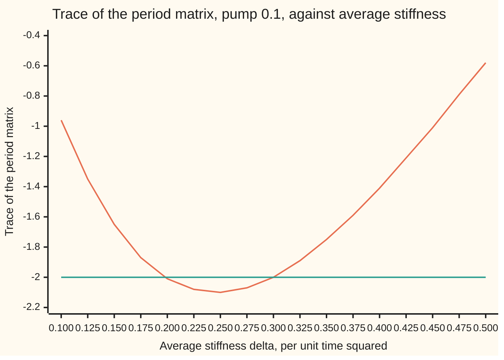
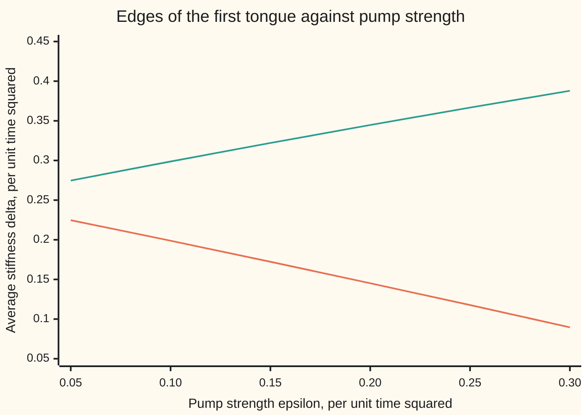

# Floquet theory: a system with periodic coefficients is a constant one seen through a periodic lens, and pumping at twice the natural rate makes it grow

[Syllabus](../../../SYLLABUS.md) → [Differential equations and dynamics](../README.md) → [Systems and the Matrix Exponential](../README.md#s04) → Floquet theory

---

## General Overview

A child on a swing gets higher with no push, by standing at the bottom and squatting near each end. That makes the swing's pull toward the bottom (its **stiffness**) rise and fall at twice the swing's frequency.

In scaled time, a model is $`x'' + (0.25 + 0.1\cos t)\,x = 0`$, with x the swing's distance from the bottom. The free swing turns at 0.5 radians per unit time. The pump moves the stiffness between 0.15 and 0.35 once every 2π units, at frequency 1: twice 0.5.

Watch the swing once per pump cycle, like a strobe light. Each look (position and speed) is the last one times one fixed 2 by 2 matrix. Its trace, the sum of its diagonal entries, is −2.0986, and that alone says the swing grows: 1.3671 times per cycle. With average stiffness 0.5 the trace is −0.5753, and the same pump does nothing lasting.

**A linear system whose rule repeats every period is run by one matrix, which carries any state across a period; its eigenvalues decide whether solutions grow, and every solution is a repeating factor times a constant-coefficient exponential.**

**What kind of fact this is:** a theorem (Floquet, 1883), proved in Why it works (fully for 2 by 2 systems); the swing equation is a model that a real swing only approximates.

### The picture: where pumping wins



Orange: the trace. Teal: −2. Where orange dips below teal, from stiffness 0.1988 to 0.2987, the swing grows. That window is the first **instability tongue**, named for its shape against pump strength (Step 5).

---

## The formula

As in [From one equation to a system](01-from-one-equation-to-a-system.md), the state $`\mathbf{x}`$ (position, velocity) changes at the rate A times itself. Here the matrix A repeats every period T:

```math
\mathbf{x}' = A(t)\,\mathbf{x}, \qquad A(t+T) = A(t), \qquad A(t) = \begin{pmatrix} 0 & 1 \\ -(\delta + \varepsilon\cos t) & 0 \end{pmatrix}, \quad T = 2\pi
```

**Hill's equation** is $`x'' + q(t)\,x = 0`$, with the stiffness q repeating every period. With q = δ + ε cos t it is the **Mathieu equation**, written above as a system.

The **fundamental matrix** $`\Phi(t)`$ has as columns the solutions starting at (1, 0) and (0, 1), so $`\Phi(0) = I`$, the identity. The **monodromy matrix** $`M = \Phi(T)`$ carries any start across one period. Its eigenvalues $`\mu`$ are the **Floquet multipliers**.

```math
\mathbf{x}(nT) = M^n \mathbf{x}_0, \qquad \Phi(t) = P(t)\,e^{Bt}, \quad P(t+T) = P(t), \quad e^{BT} = M
```

**Read it aloud:** after n periods the state is M applied n times to the start; every solution is a repeating matrix times a constant matrix's exponential.

For Hill's equation this gives the **trace test**:

```math
\mu^2 - (\mathrm{tr}\,M)\,\mu + 1 = 0, \qquad |\mathrm{tr}\,M| < 2 \Rightarrow \text{bounded}, \qquad |\mathrm{tr}\,M| > 2 \Rightarrow \text{grows like } |\mu_1|^n
```

**Read it aloud:** the multipliers multiply to 1 and add to the trace; a trace between −2 and 2 keeps solutions bounded, a trace outside makes one grow.

| Symbol | Plain meaning | In our example | Push it up and the answer… |
| --- | --- | --- | --- |
| $`x`$, $`x''`$, $`\mathbf{x}`$, $`\mathbf{x}_0`$, $`\mathbf{y}`$ | position, acceleration; the state (position, velocity), its start, and the state seen through the lens | start (1, 0): out 1 unit, at rest | every solution scales with it |
| $`t`$, $`T`$, $`n`$ | time in scaled units; the pump's period; a count of periods | $`T = 2\pi`$; n = 10 | — |
| $`\delta`$, $`\varepsilon`$, $`b`$ | average stiffness; pump strength; friction | 0.25, 0.1, b = 0 | ε widens the tongue; b shrinks it |
| $`A(t)`$, $`q(t)`$ | the rate matrix and the stiffness, both repeating | rows (0, 1) and (−q, 0); q = δ + ε cos t | — |
| $`\Phi(t)`$, $`\Psi(t)`$, $`I`$ | fundamental matrix; Ψ the same shifted one period; the identity | $`\Phi(0) = I`$ | — |
| $`M`$, $`\mathrm{tr}\,M`$ | monodromy (period) matrix and its trace, the sum of its diagonal | trace −2.0986 | past −2, growth stops |
| $`\mu`$, $`\mu_1`$, $`\mu_2`$, $`\theta`$, $`\varphi`$ | Floquet multipliers; θ, φ from tr M = 2 cos θ, or 2 cosh φ above 2 | −1.3671 and −0.7315; θ = 1.8625 at δ = 0.5 | size over 1: growth |
| $`P(t)`$, $`B`$, $`K`$ | the repeating factor; the constant matrix with $`e^{BT} = M`$; K a helper with K² = −I or +I | at δ = 0.5, B has entries −0.3393 and 0.2590 | — |

### When it holds

- **A(t) repeats with one fixed period.** If the pump's rhythm drifts, there is no single M.
- **Linear in x.** A real swing's pull is closer to sin x, so at large angles its frequency drops, it falls out of step, and growth stops.
- **No damping, for the 1 in the quadratic.** Friction b makes det M = $`e^{-bT}`$. The test becomes $`|\mathrm{tr}\,M| < 1 + \det M`$, and the pump must beat the friction.
- **Off the edges.** At $`|\mathrm{tr}\,M| = 2`$ both multipliers are 1 or both −1: a solution repeats every T or 2T, and the other usually grows in proportion to time.

---

## Why it works

### Step 0: a rule that repeats gives a map that repeats

The pump does the same thing every period, so each period repeats the first from wherever the swing now is. One matrix, M, holds it all, and its eigenvalues govern its powers ([Eigenvalues and eigenvectors](../../03-Algebra/07-Eigenvalues%20and%20Symmetric%20Matrices/02-eigenvalues-and-eigenvectors.md)).

### Step 1: one period later is the same matrix times M

Shift time by one period: $`\Psi(t) = \Phi(t+T)`$. Since A(t + T) = A(t), Ψ solves the same equation, starting at M. So does Φ(t)M. Two solutions with one start are one solution, so

```math
\Phi(t+T) = \Phi(t)\,M, \qquad \mathbf{x}(nT) = M^n \mathbf{x}_0 .
```

### Step 2: the multipliers multiply to 1

The determinant of Φ is the Wronskian of its solutions, and Abel's identity gives $`\det\Phi(t) = e^{\int_0^t \mathrm{tr}\,A}`$ ([The Wronskian](../03-Oscillators%20-%20Second-Order%20Linear%20Equations/04-wronskian-and-reduction-of-order.md)). Hill's A has zeros on its diagonal, so det M = 1.

Eigenvalues add to the trace and multiply to the determinant ([Trace and determinant](05-classifying-equilibria-by-trace-and-determinant.md)). So $`\mu_1\mu_2 = 1`$ and $`\mu_1 + \mu_2 = \mathrm{tr}\,M`$: the quadratic above.

### Step 3: the trace test

- **Trace between −2 and 2.** The roots are $`\cos\theta \pm i\sin\theta`$ with $`\cos\theta = \mathrm{tr}\,M / 2`$, both of size 1. Each period turns the state by a fixed angle, so nothing grows.
- **Trace beyond ±2.** The roots are real, $`\mu_1`$ and $`1/\mu_1`$. One has size above 1, and its part of the state multiplies by it every period: −1.3671 at δ = 0.25.

The minus sign means each pump period ends on the other side: it is half a swing.

### Step 4: the periodic lens

Pick B with $`e^{BT} = M`$, and set $`P(t) = \Phi(t)e^{-Bt}`$. Then P repeats:

```math
P(t+T) = \Phi(t)\,M\,e^{-BT}e^{-Bt} = \Phi(t)\,e^{-Bt} = P(t).
```

So $`\Phi(t) = P(t)e^{Bt}`$. In coordinates $`\mathbf{y} = P(t)^{-1}\mathbf{x}`$, which wobble but repeat, the system is the constant $`\mathbf{y}' = B\mathbf{y}`$ ([The matrix exponential](04-the-matrix-exponential.md)): the "periodic lens" of the title.

At δ = 0.5 the check builds B by the fold's formula; its series returns M, and P(1) equals P(1 + 2π).

<details>
<summary>Detailed proof: the logarithm of a 2 by 2 matrix with det 1</summary>

The eigenvalue equation holds for the matrix itself (Cayley–Hamilton): $`M^2 - (\mathrm{tr}\,M)M + I = 0`$. With $`\mathrm{tr}\,M = 2\cos\theta`$ and $`0 < \theta < \pi`$, set

$`\displaystyle K = \frac{M - \cos\theta\, I}{\sin\theta}.`$

Then $`K^2 = -I`$, so K acts like i. The exponential series splits into even and odd powers, $`e^{\theta K} = \cos\theta\, I + \sin\theta\, K = M`$. So

$`\displaystyle B = \frac{\theta}{T\sin\theta}\,(M - \cos\theta\, I).`$

For a trace above 2, use the hyperbolic cosine and sine, cosh φ and sinh φ, which are $`(e^{\varphi} \pm e^{-\varphi})/2`$. With tr M = 2 cosh φ and K = (M − cosh φ I)/sinh φ, now K² = +I and $`e^{\varphi K} = M`$. At trace exactly 2, (M − I)² = 0, so B = (M − I)/T.

Negative real multipliers, as at δ = 0.25, have no real B: use M², whose trace is at least 2, over the period 2T, so P repeats every 4π. Larger systems always have a complex B (Teschl, in Sources).

</details>

### Step 5: why twice the natural frequency

With no pump, the swing turns $`\sqrt{\delta}\,T`$ radians per period, and the trace is $`2\cos(\sqrt{\delta}\,T)`$. That reaches −2 at exactly half a turn per pump period: $`\sqrt{\delta} = 0.5`$, δ = 0.25, pump frequency 1 = 2 × 0.5.

There the two multipliers meet at −1, and a small pump can split them along the real line, one outside the unit circle. Away from ±2 a small pump only nudges a trace that stays inside. So the tongue grows out of δ = 1/4. Bisection on |trace| = 2 maps its edges: a **stability chart**, a map of which settings grow.



Orange: lower edge. Teal: upper edge. Between them the swing grows. Every edge lies within ε²/4 of the first-order estimate 1/4 ∓ ε/2 (0.2000 to 0.3000 at pump 0.1), and the tongue pinches shut at δ = 1/4.

Thinner tongues grow wherever the free trace reaches ±2 again: δ = 1 (trace +2, a whole turn), 9/4 (trace −2), and so on.

---

## Worked numbers, by hand

The swing $`x'' + (0.25 + 0.1\cos t)\,x = 0`$, started out 1 unit at rest.

| Step | Arithmetic | Value |
| --- | --- | --- |
| period matrix, from the check | solutions from (1, 0) and (0, 1) after 2π | M = `[[-1.0493, 0.6118], [0.1651, -1.0493]]` |
| trace | −1.0493 + (−1.0493) | −2.0986 |
| determinant | 1.0493² − 0.6118 × 0.1651 | 1.0000 |
| multipliers | roots of μ² + 2.0986μ + 1 = 0 | −1.3671 and −0.7315 |
| growth per pump cycle | size of the bigger multiplier | 1.3671 |
| growth over ten cycles | 1.3671 multiplied in 10 times | 22.8 |
| the swing after ten cycles | (μ1^10 + μ2^10) / 2 | **11.425** |
| growth rate | ln 1.3671 / 2π | 0.0498 per unit time |

After ten pump cycles the swing is out 11.425 units, not 1. The growing part multiplied by 22.8, but a start from rest puts half the swing in it: M's equal diagonal entries split (1, 0) evenly between its eigenvectors. At δ = 0.5 the trace, −0.5753, is inside (−2, 2): bounded.

### What breaks if you drop a piece

| Mistake | Comes out at | What went wrong |
| --- | --- | --- |
| Exponentiate the averaged rate matrix over 2π | trace −2.0000: the edge, no growth | Averaging deletes the pump |
| Freeze time and read A(t)'s eigenvalues | largest real part 0.0000: "a centre" | Stability belongs to the whole period, not to moments |
| Read growth per period as the trace's size | 1656.8 over ten cycles, not 22.8 | The trace is the multipliers' sum |

The code prints all three.

---

## Code, from first principles, and it actually runs

The code builds M by two independent roads: [Runge-Kutta four](../05-Numerical%20Evolution/04-runge-kutta-four.md) steps (a standard step-by-step integrator, from the next shelf) on both columns of Φ, and 20,000 exact steps with the stiffness frozen at each step's midpoint. The ten-period swing is found three ways: $`M^{10}`$, integration straight through, and the multipliers. It also checks $`e^{BT} = M`$ and that P repeats, maps the tongue by bisection, and measures the growth at δ = 1.

### Python

```python
# Floquet theory -- the check behind the card.  Standard library only.
# Hill's equation x'' + (d + 0.1 cos t) x = 0, a swing pumped at twice its natural frequency.
# Two roads to the monodromy matrix M over one period 2 pi: RK4, and exact frozen-coefficient steps.
import math, cmath, functools
T, EPS, I = 2 * math.pi, 0.1, [[1.0, 0.0], [0.0, 1.0]]
def add(Y, K, c): return [[Y[i][j] + c * K[i][j] for j in range(2)] for i in range(2)]
def mul(X, Y): return [[X[i][0] * Y[0][j] + X[i][1] * Y[1][j] for j in range(2)] for i in range(2)]
def rk4(d, t1, n=4000, e=EPS):     # columns: starts (1, 0) and (0, 1); rows x and x'
    h, t, Y = t1 / n, 0.0, I
    f = lambda t, Y: [Y[1], [-(d + e * math.cos(t)) * y for y in Y[0]]]
    for _ in range(n):
        k1 = f(t, Y); k2 = f(t + h / 2, add(Y, k1, h / 2))
        k3 = f(t + h / 2, add(Y, k2, h / 2)); k4 = f(t + h, add(Y, k3, h))
        Y = add(add(add(add(Y, k1, h / 6), k2, h / 3), k3, h / 3), k4, h / 6); t += h
    return Y
def frozen(d, n=20000):             # coefficient held at its mid-step value: exact cos/sin step
    h, M = T / n, I
    for k in range(n):
        w = cmath.sqrt(d + EPS * math.cos((k + 0.5) * h))
        c, s = cmath.cos(w * h).real, (cmath.sin(w * h) / w).real
        M = mul([[c, s], [-(w * w).real * s, c]], M)
    return M
def expm(B, t, terms=60):           # I + Bt + (Bt)^2/2! + ...
    S, term = I, I
    for k in range(1, terms): term = [[v * t / k for v in r] for r in mul(term, B)]; S = add(S, term, 1.0)
    return S
tr, det = lambda M: M[0][0] + M[1][1], lambda M: M[0][0] * M[1][1] - M[0][1] * M[1][0]
fm = lambda M: "[[" + "], [".join(", ".join(f"{round(v, 4) + 0.0:.4f}" for v in r) for r in M) + "]]"
gap = lambda X, Y: max(abs(X[i][j] - Y[i][j]) for i in range(2) for j in range(2))
M1, M2, M3 = rk4(0.25, T), rk4(0.5, T), rk4(1.0, T)
for d, M in ((0.25, M1), (0.5, M2)):
    print(f"delta {d}: M = {fm(M)}, trace {tr(M):.4f}, frozen-step trace {tr(frozen(d)):.4f}, det {det(M):.6f}")
mu1 = (tr(M1) - math.sqrt(tr(M1) ** 2 - 4)) / 2; mu2 = 1 / mu1; mu3 = (tr(M3) + math.sqrt(tr(M3) ** 2 - 4)) / 2
print(f"delta 0.25 multipliers {mu1:.4f} and {mu2:.4f}, sum {mu1 + mu2:.4f}; growth exponent {math.log(-mu1) / T:.4f} per unit time")
ten, direct = functools.reduce(mul, [M1] * 10), rk4(0.25, 10 * T, 40000)
print(f"x after 10 periods from x = 1 at rest: M^10 {ten[0][0]:.3f}, RK4 straight through {direct[0][0]:.3f}, "
      f"(mu1^10 + mu2^10)/2 = {(mu1 ** 10 + mu2 ** 10) / 2:.3f}")
th = math.acos(tr(M2) / 2); B = [[v * th / (math.sin(th) * T) for v in r] for r in add(M2, I, -math.cos(th))]   # log M / T
print(f"delta 0.5 multipliers cos {th:.4f} +- i sin {th:.4f}, size 1; B = {fm(B)}; e^(B 2pi) = {fm(expm(B, T))}")
Pa, Pb = mul(rk4(0.5, 1.0, 1000), expm(B, -1.0)), mul(rk4(0.5, 1 + T, 5000), expm(B, -1 - T))
print(f"P(1) = {fm(Pa)}, P(1 + 2pi) = {fm(Pb)}")
grows = lambda d, e: abs(tr(rk4(d, T, 1000, e))) > 2
def edge(lo, hi, e):                # bisection on |trace M| = 2
    for _ in range(30): lo, hi = ((lo + hi) / 2, hi) if grows((lo + hi) / 2, e) == grows(lo, e) else (lo, (lo + hi) / 2)
    return (lo + hi) / 2
tongue = [(e, edge(0.05, 0.25, e), edge(0.25, 0.45, e)) for e in (0.05, 0.1, 0.15, 0.2, 0.25, 0.3)]   # stability chart
print("tongue edges, pump", "; ".join(f"{e:.2f}: {lo:.4f} to {hi:.4f}" for e, lo, hi in tongue))
print("first-order guess 1/4 -+ pump/2:", "; ".join(f"{0.25 - e / 2:.4f} to {0.25 + e / 2:.4f}" for e, lo, hi in tongue))
ds = [0.1 + 0.025 * k for k in range(17)]
print("chart delta", " ".join(f"{d:.3f}" for d in ds))
print("chart trace", " ".join(f"{tr(rk4(d, T, 1000)):.2f}" for d in ds))
fr = max(cmath.sqrt(-(0.25 + EPS * math.cos(k * T / 100))).real for k in range(100))
print(f"mistake 1, e^(averaged A * 2pi): trace {tr(expm([[0.0, 1.0], [-0.25, 0.0]], T)):.4f}; mistake 2, frozen stiffness {0.25 - EPS:.2f} to {0.25 + EPS:.2f}, largest frozen real part {fr:.4f}")
print(f"mistake 3, growth over 10 periods read as |trace|^10 = {abs(tr(M1)) ** 10:.1f}, not |mu|^10 = {abs(mu1) ** 10:.1f}")
print(f"pump at the natural frequency, delta 1: trace {tr(M3):.6f}, growth {mu3:.4f} per period, {mu3 ** 10:.2f} over 10")
assert gap(M1, frozen(0.25)) < 1e-6 and gap(M2, frozen(0.5)) < 1e-6 and abs(det(M1) - 1) < 1e-9 and abs(tr(frozen(1.0)) - tr(M3)) < 1e-7
assert abs(tr(M1) + 2.0986) < 1e-4 and abs(tr(M2) + 0.5753) < 1e-4 and all(abs(lo - 0.25 + e / 2) < e * e / 4 and abs(hi - 0.25 - e / 2) < e * e / 4 for e, lo, hi in tongue)
assert abs(ten[0][0] - direct[0][0]) < 1e-6 * abs(direct[0][0]) and abs((mu1 ** 10 + mu2 ** 10) / 2 - direct[0][0]) < 1e-6 and abs(mu1) > 1
assert gap(expm(B, T), M2) < 1e-9 and gap(Pa, Pb) < 1e-8             # Floquet form P(t) e^(Bt)
print("ALL CHECKS PASS")
```

**Ran 2026-11-23 on macOS, Python 3.14.10, standard library only. All checks passed. Output, pasted from the run:**

```
delta 0.25: M = [[-1.0493, 0.6118], [0.1651, -1.0493]], trace -2.0986, frozen-step trace -2.0986, det 1.000000
delta 0.5: M = [[-0.2876, -1.0963], [0.8367, -0.2876]], trace -0.5753, frozen-step trace -0.5753, det 1.000000
delta 0.25 multipliers -1.3671 and -0.7315, sum -2.0986; growth exponent 0.0498 per unit time
x after 10 periods from x = 1 at rest: M^10 11.425, RK4 straight through 11.425, (mu1^10 + mu2^10)/2 = 11.425
delta 0.5 multipliers cos 1.8625 +- i sin 1.8625, size 1; B = [[0.0000, -0.3393], [0.2590, 0.0000]]; e^(B 2pi) = [[-0.2876, -1.0963], [0.8367, -0.2876]]
P(1) = [[0.4559, 1.1059], [-0.6911, 0.5170]], P(1 + 2pi) = [[0.4559, 1.1059], [-0.6911, 0.5170]]
tongue edges, pump 0.05: 0.2247 to 0.2747; 0.10: 0.1988 to 0.2987; 0.15: 0.1723 to 0.3221; 0.20: 0.1452 to 0.3447; 0.25: 0.1177 to 0.3667; 0.30: 0.0896 to 0.3879
first-order guess 1/4 -+ pump/2: 0.2250 to 0.2750; 0.2000 to 0.3000; 0.1750 to 0.3250; 0.1500 to 0.3500; 0.1250 to 0.3750; 0.1000 to 0.4000
chart delta 0.100 0.125 0.150 0.175 0.200 0.225 0.250 0.275 0.300 0.325 0.350 0.375 0.400 0.425 0.450 0.475 0.500
chart trace -0.96 -1.35 -1.65 -1.87 -2.01 -2.08 -2.10 -2.07 -2.00 -1.89 -1.75 -1.59 -1.41 -1.21 -1.01 -0.79 -0.58
mistake 1, e^(averaged A * 2pi): trace -2.0000; mistake 2, frozen stiffness 0.15 to 0.35, largest frozen real part 0.0000
mistake 3, growth over 10 periods read as |trace|^10 = 1656.8, not |mu|^10 = 22.8
pump at the natural frequency, delta 1: trace 2.000034, growth 1.0059 per period, 1.06 over 10
ALL CHECKS PASS
```

### Rust

Same numbers, same labels, built with `rustc --edition 2021 -O`.

```rust
// Floquet theory -- the same check as the Python, in Rust.  No crates.
// Hill's equation x'' + (d + 0.1 cos t) x = 0, a swing pumped at twice its natural frequency.
// Two roads to the monodromy matrix M over one period 2 pi: RK4, and exact frozen-coefficient steps.
use std::f64::consts::PI;
type Mat = [[f64; 2]; 2];
const T: f64 = 2.0 * PI; const EPS: f64 = 0.1; const I: Mat = [[1.0, 0.0], [0.0, 1.0]];
fn add(y: &Mat, k: &Mat, c: f64) -> Mat { [[y[0][0] + c * k[0][0], y[0][1] + c * k[0][1]], [y[1][0] + c * k[1][0], y[1][1] + c * k[1][1]]] }
fn mul(x: &Mat, y: &Mat) -> Mat { let e = |i: usize, j: usize| x[i][0] * y[0][j] + x[i][1] * y[1][j]; [[e(0, 0), e(0, 1)], [e(1, 0), e(1, 1)]] }
fn rk4(d: f64, t1: f64, n: usize, e: f64) -> Mat { // columns: starts (1, 0) and (0, 1); rows x and x'
    let (h, mut t, mut y) = (t1 / n as f64, 0.0, I);
    let f = |t: f64, y: &Mat| -> Mat { let q = d + e * t.cos(); [y[1], [-q * y[0][0], -q * y[0][1]]] };
    for _ in 0..n {
        let k1 = f(t, &y); let k2 = f(t + h / 2.0, &add(&y, &k1, h / 2.0));
        let k3 = f(t + h / 2.0, &add(&y, &k2, h / 2.0)); let k4 = f(t + h, &add(&y, &k3, h));
        y = add(&add(&add(&add(&y, &k1, h / 6.0), &k2, h / 3.0), &k3, h / 3.0), &k4, h / 6.0); t += h;
    }
    y
}
fn frozen(d: f64, n: usize) -> Mat {           // coefficient held at its mid-step value: exact cos/sin step
    let (h, mut m) = (T / n as f64, I);
    for k in 0..n {
        let q = d + EPS * ((k as f64 + 0.5) * h).cos();
        let w = q.abs().sqrt();
        let (c, s) = if q > 0.0 { ((w * h).cos(), (w * h).sin() / w) } else { ((w * h).cosh(), (w * h).sinh() / w) };
        m = mul(&[[c, s], [-q * s, c]], &m);
    }
    m
}
fn expm(b: &Mat, t: f64) -> Mat {              // I + Bt + (Bt)^2/2! + ...
    let (mut s, mut term) = (I, I);
    for k in 1..60 { term = add(&[[0.0; 2]; 2], &mul(&term, b), t / k as f64); s = add(&s, &term, 1.0); }
    s
}
fn tr(m: &Mat) -> f64 { m[0][0] + m[1][1] } fn det(m: &Mat) -> f64 { m[0][0] * m[1][1] - m[0][1] * m[1][0] }
fn fm(m: &Mat) -> String {
    let r = |v: f64| format!("{:.4}", (v * 1e4).round() / 1e4 + 0.0);
    format!("[[{}, {}], [{}, {}]]", r(m[0][0]), r(m[0][1]), r(m[1][0]), r(m[1][1]))
}
fn gap(x: &Mat, y: &Mat) -> f64 { (0..4).map(|k| (x[k / 2][k % 2] - y[k / 2][k % 2]).abs()).fold(0.0, f64::max) }
fn grows(d: f64, e: f64) -> bool { tr(&rk4(d, T, 1000, e)).abs() > 2.0 }
fn edge(mut lo: f64, mut hi: f64, e: f64) -> f64 { // bisection on |trace M| = 2
    for _ in 0..30 { let mid = (lo + hi) / 2.0; if grows(mid, e) == grows(lo, e) { lo = mid } else { hi = mid } }
    (lo + hi) / 2.0
}
fn main() {
    let (m1, m2, m3) = (rk4(0.25, T, 4000, EPS), rk4(0.5, T, 4000, EPS), rk4(1.0, T, 4000, EPS));
    for (d, m) in [(0.25, m1), (0.5, m2)] {
        println!("delta {}: M = {}, trace {:.4}, frozen-step trace {:.4}, det {:.6}", d, fm(&m), tr(&m), tr(&frozen(d, 20000)), det(&m));
    }
    let mu1 = (tr(&m1) - (tr(&m1).powi(2) - 4.0).sqrt()) / 2.0; let mu2 = 1.0 / mu1;
    let mu3 = (tr(&m3) + (tr(&m3).powi(2) - 4.0).sqrt()) / 2.0;
    println!("delta 0.25 multipliers {:.4} and {:.4}, sum {:.4}; growth exponent {:.4} per unit time", mu1, mu2, mu1 + mu2, (-mu1).ln() / T);
    let (mut ten, direct) = (I, rk4(0.25, 10.0 * T, 40000, EPS));
    for _ in 0..10 { ten = mul(&ten, &m1) }
    println!("x after 10 periods from x = 1 at rest: M^10 {:.3}, RK4 straight through {:.3}, (mu1^10 + mu2^10)/2 = {:.3}",
             ten[0][0], direct[0][0], (mu1.powi(10) + mu2.powi(10)) / 2.0);
    let th = (tr(&m2) / 2.0).acos(); let mut b = add(&m2, &I, -th.cos());
    b = add(&[[0.0; 2]; 2], &b, th / (th.sin() * T));                              // log M / T
    println!("delta 0.5 multipliers cos {:.4} +- i sin {:.4}, size 1; B = {}; e^(B 2pi) = {}", th, th, fm(&b), fm(&expm(&b, T)));
    let (pa, pb) = (mul(&rk4(0.5, 1.0, 1000, EPS), &expm(&b, -1.0)), mul(&rk4(0.5, 1.0 + T, 5000, EPS), &expm(&b, -1.0 - T)));
    println!("P(1) = {}, P(1 + 2pi) = {}", fm(&pa), fm(&pb));
    let tongue: Vec<(f64, f64, f64)> = [0.05, 0.1, 0.15, 0.2, 0.25, 0.3].iter().map(|&e| (e, edge(0.05, 0.25, e), edge(0.25, 0.45, e))).collect(); // stability chart
    println!("tongue edges, pump {}", tongue.iter().map(|(e, lo, hi)| format!("{:.2}: {:.4} to {:.4}", e, lo, hi)).collect::<Vec<_>>().join("; "));
    println!("first-order guess 1/4 -+ pump/2: {}", tongue.iter().map(|(e, _, _)| format!("{:.4} to {:.4}", 0.25 - e / 2.0, 0.25 + e / 2.0)).collect::<Vec<_>>().join("; "));
    let ds: Vec<f64> = (0..17).map(|k| 0.1 + 0.025 * k as f64).collect();
    println!("chart delta {}", ds.iter().map(|d| format!("{:.3}", d)).collect::<Vec<_>>().join(" "));
    println!("chart trace {}", ds.iter().map(|&d| format!("{:.2}", tr(&rk4(d, T, 1000, EPS)))).collect::<Vec<_>>().join(" "));
    let fr = (0..100).map(|k| { let q = -(0.25 + EPS * (k as f64 * T / 100.0).cos()); if q > 0.0 { q.sqrt() } else { 0.0 } }).fold(f64::MIN, f64::max);
    println!("mistake 1, e^(averaged A * 2pi): trace {:.4}; mistake 2, frozen stiffness {:.2} to {:.2}, largest frozen real part {:.4}", tr(&expm(&[[0.0, 1.0], [-0.25, 0.0]], T)), 0.25 - EPS, 0.25 + EPS, fr);
    println!("mistake 3, growth over 10 periods read as |trace|^10 = {:.1}, not |mu|^10 = {:.1}", tr(&m1).abs().powi(10), mu1.abs().powi(10));
    println!("pump at the natural frequency, delta 1: trace {:.6}, growth {:.4} per period, {:.2} over 10", tr(&m3), mu3, mu3.powi(10));
    assert!(gap(&m1, &frozen(0.25, 20000)) < 1e-6 && gap(&m2, &frozen(0.5, 20000)) < 1e-6 && (det(&m1) - 1.0).abs() < 1e-9 && (tr(&frozen(1.0, 20000)) - tr(&m3)).abs() < 1e-7);
    assert!((tr(&m1) + 2.0986).abs() < 1e-4 && (tr(&m2) + 0.5753).abs() < 1e-4 && tongue.iter().all(|&(e, lo, hi)| (lo - 0.25 + e / 2.0).abs() < e * e / 4.0 && (hi - 0.25 - e / 2.0).abs() < e * e / 4.0));
    assert!((ten[0][0] - direct[0][0]).abs() < 1e-6 * direct[0][0].abs() && ((mu1.powi(10) + mu2.powi(10)) / 2.0 - direct[0][0]).abs() < 1e-6 && mu1.abs() > 1.0);
    assert!(gap(&expm(&b, T), &m2) < 1e-9 && gap(&pa, &pb) < 1e-8);           // Floquet form P(t) e^(Bt)
    println!("ALL CHECKS PASS");
}
```

**Ran 2026-11-23 on macOS, rustc 1.98.1, no crates. All checks passed. Output, pasted from the run:**

```
delta 0.25: M = [[-1.0493, 0.6118], [0.1651, -1.0493]], trace -2.0986, frozen-step trace -2.0986, det 1.000000
delta 0.5: M = [[-0.2876, -1.0963], [0.8367, -0.2876]], trace -0.5753, frozen-step trace -0.5753, det 1.000000
delta 0.25 multipliers -1.3671 and -0.7315, sum -2.0986; growth exponent 0.0498 per unit time
x after 10 periods from x = 1 at rest: M^10 11.425, RK4 straight through 11.425, (mu1^10 + mu2^10)/2 = 11.425
delta 0.5 multipliers cos 1.8625 +- i sin 1.8625, size 1; B = [[0.0000, -0.3393], [0.2590, 0.0000]]; e^(B 2pi) = [[-0.2876, -1.0963], [0.8367, -0.2876]]
P(1) = [[0.4559, 1.1059], [-0.6911, 0.5170]], P(1 + 2pi) = [[0.4559, 1.1059], [-0.6911, 0.5170]]
tongue edges, pump 0.05: 0.2247 to 0.2747; 0.10: 0.1988 to 0.2987; 0.15: 0.1723 to 0.3221; 0.20: 0.1452 to 0.3447; 0.25: 0.1177 to 0.3667; 0.30: 0.0896 to 0.3879
first-order guess 1/4 -+ pump/2: 0.2250 to 0.2750; 0.2000 to 0.3000; 0.1750 to 0.3250; 0.1500 to 0.3500; 0.1250 to 0.3750; 0.1000 to 0.4000
chart delta 0.100 0.125 0.150 0.175 0.200 0.225 0.250 0.275 0.300 0.325 0.350 0.375 0.400 0.425 0.450 0.475 0.500
chart trace -0.96 -1.35 -1.65 -1.87 -2.01 -2.08 -2.10 -2.07 -2.00 -1.89 -1.75 -1.59 -1.41 -1.21 -1.01 -0.79 -0.58
mistake 1, e^(averaged A * 2pi): trace -2.0000; mistake 2, frozen stiffness 0.15 to 0.35, largest frozen real part 0.0000
mistake 3, growth over 10 periods read as |trace|^10 = 1656.8, not |mu|^10 = 22.8
pump at the natural frequency, delta 1: trace 2.000034, growth 1.0059 per period, 1.06 over 10
ALL CHECKS PASS
```

The two outputs match line for line.

### Lean

Lean proves the trace test for every 2 by 2 period matrix with determinant 1, Abel's $`\det M = 1`$, and the periodic lens.

- Suppose M is 2 by 2 with determinant 1 and trace between −2 and 2. Then every entry of every power $`M^n`$ stays bounded.
- Suppose instead the trace is beyond ±2. Then some nonzero start is multiplied by a real multiplier μ every period, and μ has size above 1.
- Take Hill's equation with any stiffness q(t), repeating or not. Then its fundamental matrix has $`\det\Phi(t) = 1`$ at every time, so $`\det M = 1`$.
- Take a system of any size with $`\Phi(t+T) = \Phi(t)M`$ and $`e^{BT} = M`$. Then $`P(t) = \Phi(t)e^{-Bt}`$ repeats every period T. So $`\Phi(t) = P(t)e^{Bt}`$.
- The matrix −I has trace −2 and determinant 1, so the swing with no pump sits on the edge.

Building M and B from the swing, and every decimal, chart and tongue edge, are left to the Python and Rust checks.

```lean
-- Floquet theory: for a 2 by 2 period matrix with determinant 1 the trace test decides boundedness or growth, Hill's equation has a period matrix of determinant 1, and every fundamental matrix is a periodic factor times a constant-matrix exponential.
import Mathlib.Analysis.Normed.Algebra.MatrixExponential
import Mathlib.Analysis.Calculus.Deriv.Basic
import Mathlib.Analysis.Calculus.MeanValue
import Mathlib.LinearAlgebra.Matrix.Trace
import Mathlib.LinearAlgebra.Matrix.Determinant.Basic

open Matrix

/-- The trace test. Let M be a real 2 by 2 period (monodromy) matrix with determinant 1,
as for Hill's equation with no damping. If its trace lies strictly between -2 and 2, every
entry of every power M^n stays bounded, so every solution sampled once per period stays
bounded. If the trace is beyond ±2, there is a real Floquet multiplier μ with |μ| > 1 and a
nonzero start v with M^n v = μ^n v, so that solution grows like |μ|^n. -/
theorem trace_test_bounded_or_grows (M : Matrix (Fin 2) (Fin 2) ℝ) (hdet : M.det = 1) :
    (|M.trace| < 2 → ∃ C : ℝ, ∀ n : ℕ, ∀ i j : Fin 2, |(M ^ n) i j| ≤ C) ∧
    (2 < |M.trace| → ∃ μ : ℝ, ∃ v : Fin 2 → ℝ, v ≠ 0 ∧ 1 < |μ| ∧
        ∀ n : ℕ, (M ^ n) *ᵥ v = μ ^ n • v) := by
  rw [Matrix.det_fin_two] at hdet
  rw [Matrix.trace_fin_two]
  set a := M 0 0 with ha
  set b := M 0 1 with hb
  set c := M 1 0 with hc
  set d := M 1 1 with hd
  -- step formula for powers
  have hstep : ∀ n : ℕ, ∀ j : Fin 2,
      (M ^ (n+1)) 0 j = a * (M ^ n) 0 j + b * (M ^ n) 1 j ∧
      (M ^ (n+1)) 1 j = c * (M ^ n) 0 j + d * (M ^ n) 1 j := by
    intro n j
    rw [pow_succ']
    simp [Matrix.mul_apply, Fin.sum_univ_two, ha, hb, hc, hd]
  refine ⟨fun ht => ?_, fun ht => ?_⟩
  · set t := a + d with htdef
    have ht2 : 0 < 4 - t ^ 2 := by
      have := abs_lt.mp ht; nlinarith
    let Q : ℝ → ℝ → ℝ := fun x y => 2*c*x^2 + 2*(d-a)*x*y - 2*b*y^2
    have hinv : ∀ n : ℕ, ∀ j : Fin 2,
        Q ((M ^ n) 0 j) ((M ^ n) 1 j) = Q ((1 : Matrix (Fin 2) (Fin 2) ℝ) 0 j)
          ((1 : Matrix (Fin 2) (Fin 2) ℝ) 1 j) := by
      intro n j
      induction n with
      | zero => simp
      | succ n ih =>
        rw [← ih, (hstep n j).1, (hstep n j).2]
        simp only [Q]
        linear_combination (2*c*((M ^ n) 0 j)^2 + 2*(d-a)*((M ^ n) 0 j)*((M ^ n) 1 j)
          - 2*b*((M ^ n) 1 j)^2) * hdet
    have hQ : ∀ j : Fin 2, |Q ((1 : Matrix (Fin 2) (Fin 2) ℝ) 0 j)
          ((1 : Matrix (Fin 2) (Fin 2) ℝ) 1 j)| ≤ |2*c| + |2*b| := by
      intro j
      fin_cases j <;> simp [Q, abs_mul, Matrix.one_apply]
    set K := (|2*c| + |2*b|) ^ 2 / (4 - t ^ 2)
    refine ⟨Real.sqrt K, fun n i j => ?_⟩
    apply Real.abs_le_sqrt
    rw [le_div_iff₀ ht2]
    have hq := hinv n j
    have hqb := hQ j
    set x := (M ^ n) 0 j
    set y := (M ^ n) 1 j
    set q := Q ((1 : Matrix (Fin 2) (Fin 2) ℝ) 0 j) ((1 : Matrix (Fin 2) (Fin 2) ℝ) 1 j)
    simp only [Q] at hq
    have hb' : |2*b| * |q| ≤ (|2*c| + |2*b|) ^ 2 := by
      have := abs_nonneg (2*c); have := abs_nonneg (2*b); have := abs_nonneg q; nlinarith
    have hc' : |2*c| * |q| ≤ (|2*c| + |2*b|) ^ 2 := by
      have := abs_nonneg (2*c); have := abs_nonneg (2*b); have := abs_nonneg q; nlinarith
    have e1 : -2*b*q ≤ |2*b| * |q| := by
      have := neg_le_abs (2*b*q); rw [abs_mul] at this; linarith
    have e2 : 2*c*q ≤ |2*c| * |q| := by
      rw [← abs_mul]; exact le_abs_self _
    -- identities
    have id1 : -2*b*q = ((d-a)*x - 2*b*y)^2 + (4 - t^2) * x^2 := by
      rw [← hq, htdef]; linear_combination (4*x^2) * hdet
    have id2 : 2*c*q = (2*c*x + (d-a)*y)^2 + (4 - t^2) * y^2 := by
      rw [← hq, htdef]; linear_combination (4*y^2) * hdet
    fin_cases i
    · show x ^ 2 * (4 - t^2) ≤ _
      nlinarith [sq_nonneg ((d-a)*x - 2*b*y)]
    · show y ^ 2 * (4 - t^2) ≤ _
      nlinarith [sq_nonneg (2*c*x + (d-a)*y)]
  · suffices h : ∃ μ : ℝ, ∃ v : Fin 2 → ℝ, v ≠ 0 ∧ 1 < |μ| ∧ M *ᵥ v = μ • v by
      obtain ⟨μ, v, hv, hμ, hMv⟩ := h
      refine ⟨μ, v, hv, hμ, fun n => ?_⟩
      induction n with
      | zero => simp
      | succ n ih =>
        rw [pow_succ, ← Matrix.mulVec_mulVec, hMv, Matrix.mulVec_smul, ih, smul_smul, ← pow_succ']
    by_cases hb0 : b = 0
    · have had : a * d = 1 := by rw [hb0] at hdet; linarith
      by_cases ha1 : 1 < |a|
      · have hne : a - d ≠ 0 := by
          intro h
          have hda : d = a := by linarith
          rw [hda] at had ht
          have h1 : |a| = 1 := by
            have : |a| ^ 2 = 1 := by rw [sq_abs]; nlinarith
            nlinarith [abs_nonneg a]
          linarith
        refine ⟨a, ![a - d, c], ?_, ha1, ?_⟩
        · intro h
          have := congrFun h 0
          simp at this
          exact hne (by linarith)
        · ext i
          fin_cases i
          · simp [Matrix.mulVec, dotProduct, Fin.sum_univ_two, ← ha, ← hb, hb0]
          · simp [Matrix.mulVec, dotProduct, Fin.sum_univ_two, ← hc, ← hd]
            ring
      · rw [not_lt] at ha1
        have hd1 : 1 < |d| := by
          by_contra hcon
          rw [not_lt] at hcon
          have := abs_add_le a d
          linarith
        refine ⟨d, ![0, 1], ?_, hd1, ?_⟩
        · intro h
          have := congrFun h 1
          simp at this
        · ext i
          fin_cases i
          · simp [Matrix.mulVec, dotProduct, Fin.sum_univ_two, ← hb, hb0]
          · simp [Matrix.mulVec, dotProduct, Fin.sum_univ_two, ← hd]
    · have hμ : ∃ μ : ℝ, μ ^ 2 - (a + d) * μ + 1 = 0 ∧ 1 < |μ| := by
        have h4 : 0 ≤ (a + d) ^ 2 - 4 := by
          have := sq_abs (a + d)
          nlinarith [abs_nonneg (a + d)]
        have hs := Real.sq_sqrt h4
        have hs0 := Real.sqrt_nonneg ((a + d) ^ 2 - 4)
        rcases lt_abs.mp ht with h | h
        · refine ⟨((a + d) + Real.sqrt ((a + d) ^ 2 - 4)) / 2, ?_, ?_⟩
          · nlinarith
          · rw [lt_abs]; left; linarith
        · refine ⟨((a + d) - Real.sqrt ((a + d) ^ 2 - 4)) / 2, ?_, ?_⟩
          · nlinarith
          · rw [lt_abs]; right; linarith
      obtain ⟨μ, hμq, hμ1⟩ := hμ
      refine ⟨μ, ![b, μ - a], ?_, hμ1, ?_⟩
      · intro h
        have := congrFun h 0
        simp at this
        exact hb0 this
      · ext i
        fin_cases i
        · simp [Matrix.mulVec, dotProduct, Fin.sum_univ_two, ← ha, ← hb]
          ring
        · simp [Matrix.mulVec, dotProduct, Fin.sum_univ_two, ← hc, ← hd]
          linear_combination (-1 : ℝ) * hμq - hdet

/-- Abel's identity for Hill's equation x'' + q(t) x = 0. Take the solution x₁ starting at
position 1, speed 0 and the solution x₂ starting at position 0, speed 1 (velocities v₁, v₂).
The fundamental matrix Φ(t), with these two solutions as its columns, has determinant 1 at
every time; in particular the period matrix M = Φ(T) has determinant 1. -/
theorem hill_fundamental_matrix_det_eq_one (q x₁ v₁ x₂ v₂ : ℝ → ℝ)
    (hx₁ : ∀ t, HasDerivAt x₁ (v₁ t) t) (hv₁ : ∀ t, HasDerivAt v₁ (-(q t * x₁ t)) t)
    (hx₂ : ∀ t, HasDerivAt x₂ (v₂ t) t) (hv₂ : ∀ t, HasDerivAt v₂ (-(q t * x₂ t)) t)
    (h₁ : x₁ 0 = 1 ∧ v₁ 0 = 0) (h₂ : x₂ 0 = 0 ∧ v₂ 0 = 1) :
    ∀ t, (!![x₁ t, x₂ t; v₁ t, v₂ t] : Matrix (Fin 2) (Fin 2) ℝ).det = 1 := by
  intro t
  rw [Matrix.det_fin_two_of]
  let W : ℝ → ℝ := fun s => x₁ s * v₂ s - x₂ s * v₁ s
  have hW : ∀ s, HasDerivAt W 0 s := by
    intro s
    have := ((hx₁ s).mul (hv₂ s)).sub ((hx₂ s).mul (hv₁ s))
    convert this using 1
    ring
  have hdW : Differentiable ℝ W := fun s => (hW s).differentiableAt
  have := is_const_of_deriv_eq_zero hdW (fun s => (hW s).deriv) t 0
  simp only [W] at this
  rw [this, h₁.1, h₁.2, h₂.1, h₂.2]
  ring

/-- The periodic lens (Floquet form). If the fundamental matrix satisfies
Φ(t + T) = Φ(t) M and B is a constant matrix with e^{BT} = M, then P(t) = Φ(t) e^{-Bt}
repeats every period T, and Φ(t) = P(t) e^{Bt}. -/
theorem floquet_periodic_factor {n : Type*} [Fintype n] [DecidableEq n]
    (Φ : ℝ → Matrix n n ℝ) (M B : Matrix n n ℝ) (T : ℝ)
    (hshift : ∀ t, Φ (t + T) = Φ t * M) (hB : NormedSpace.exp (T • B) = M) :
    (∀ t, Φ (t + T) * NormedSpace.exp (-((t + T) • B)) = Φ t * NormedSpace.exp (-(t • B))) ∧
    (∀ t, Φ t = (Φ t * NormedSpace.exp (-(t • B))) * NormedSpace.exp (t • B)) := by
  have hc : ∀ s r : ℝ, Commute (s • B) (r • B) := fun s r =>
    ((Commute.refl B).smul_left s).smul_right r
  constructor
  · intro t
    rw [hshift, show -((t + T) • B) = -(T • B) + -(t • B) by rw [add_smul]; abel,
      Matrix.exp_add_of_commute _ _ ((hc T t).neg_left.neg_right), ← hB, mul_assoc (Φ t),
      ← mul_assoc (NormedSpace.exp (T • B)),
      ← Matrix.exp_add_of_commute _ _ (hc T T).neg_right, add_neg_cancel, NormedSpace.exp_zero,
      one_mul]
  · intro t
    rw [mul_assoc, ← Matrix.exp_add_of_commute _ _ (hc t t).neg_left, neg_add_cancel,
      NormedSpace.exp_zero, mul_one]

/-- With no pump at average stiffness 1/4, the period matrix over 2π is -I:
trace -2 and determinant 1, on the edge of the trace test. -/
example : (-1 : Matrix (Fin 2) (Fin 2) ℝ).trace = -2 ∧ (-1 : Matrix (Fin 2) (Fin 2) ℝ).det = 1 := by
  norm_num [Matrix.trace_fin_two, Matrix.det_fin_two]

#print axioms trace_test_bounded_or_grows
#print axioms hill_fundamental_matrix_det_eq_one
#print axioms floquet_periodic_factor
```

**Checked 2026-11-23 on macOS, Lean 4.36.0-rc2, Mathlib v4.36.0-rc2. Every proof is complete and uses only Lean's standard axioms. Output, pasted from the run:**

```
'trace_test_bounded_or_grows' depends on axioms: [propext, Classical.choice, Quot.sound]
'hill_fundamental_matrix_det_eq_one' depends on axioms: [propext, Classical.choice, Quot.sound]
'floquet_periodic_factor' depends on axioms: [propext, Classical.choice, Quot.sound]
```

> [!TIP]
> **Try changing**
> Guess first, then run it. Asserts pinned to the card's numbers will stop the program.
> - **Pump twice as hard.** Set `EPS` to `0.2`. The trace falls to −2.3930, and ten cycles multiply the growing part by 478.4.
> - **Stop pumping.** Set `EPS` to `0.0`. M becomes −I, trace −2.0000: on the edge. The multiplier line stops on the square root of a tiny negative rounding error.
> - **Move toward the edge.** In the `M1` line, change `rk4(0.25, T)` to `rk4(0.21, T)`. The trace is −2.0426, still inside the tongue, and ten cycles multiply the growing part by only 7.8.

---

## The usual mistake

> [!warning]
> **Judging stability moment by moment.** At every instant the stiffness is between 0.15 and 0.35, so each frozen moment looks like a stable centre. Yet the swing grows by 1.3671 per pump cycle. Growth comes from timing across a whole period, which only M records.
>
> - Averaging the pump away gives trace −2.0000, the borderline, hiding the growth.
> - Reading the growth per cycle as the trace's size gives 1656.8 over ten cycles instead of 22.8.
> - Pumping at the swing's own frequency (δ = 1) lands in the thin second tongue: growth 1.0059 per cycle, 1.06 over ten instead of 22.8.

---

## Where you meet it in real life

- **Swings and pumped pendulums.** Standing and squatting changes the effective length at twice the swing's frequency: parametric resonance, growth from changing a parameter, not from a push.
- **Ion traps and mass filters.** An alternating electric field holds a charged particle; each direction of its motion obeys a Mathieu equation, and it stays trapped only for settings in a stable region.
- **Ships in waves.** A ship meeting waves at half its rolling period can roll heavily in moderate seas, as each crest changes its righting stiffness.

> **Say it back**
> When a linear system's rule repeats every period, one matrix M carries any state across a period, and its eigenvalues, the Floquet multipliers, decide growth. For Hill's equation they multiply to 1, so the trace decides: between −2 and 2 the motion stays bounded; beyond, it grows. A swing pumped at twice its natural rate has trace −2.0986 and grows 1.3671 times per cycle. Every solution is a repeating factor times a constant-coefficient exponential.

---

## What this builds on

- [The matrix exponential](04-the-matrix-exponential.md): $`e^{Bt}`$, the constant part of the Floquet form.
- [Forced systems](06-forced-systems-and-variation-of-constants.md): there an input is added to the system; here the pump changes A itself.
- [Trace and determinant](05-classifying-equilibria-by-trace-and-determinant.md): eigenvalues from trace and determinant, applied here to M.
- [The Wronskian](../03-Oscillators%20-%20Second-Order%20Linear%20Equations/04-wronskian-and-reduction-of-order.md): Abel's identity, which fixes det M = 1.
- [Resonance](../03-Oscillators%20-%20Second-Order%20Linear%20Equations/06-resonance-and-beats.md): a push at the natural frequency grows the swing in proportion to time; a pumped parameter grows it exponentially.
- [Eigenvalues and eigenvectors](../../03-Algebra/07-Eigenvalues%20and%20Symmetric%20Matrices/02-eigenvalues-and-eigenvectors.md): why M's eigenvalues govern its powers.

## Where this goes next

- [Limit cycles](../06-Nonlinear%20Dynamics%20in%20the%20Plane/08-limit-cycles-and-van-der-pol.md): linearised around a cycle, a nonlinear system becomes a periodic linear one, and its multipliers decide whether nearby motions are drawn onto the cycle.
- [Poincare maps](../11-Discrete%20Dynamics%20and%20Chaos/07-poincare-return-maps.md): the strobe idea for nonlinear flows; a periodic orbit becomes a fixed point.

Left open: once the swing grows, its pull is no longer linear, so what sets the height it settles at?

---

## Sources

Verified 2026-11-23: every link below resolves to the publisher's page.

- Floquet, G. "Sur les équations différentielles linéaires à coefficients périodiques." *Annales scientifiques de l'École normale supérieure* 12 (1883). [doi:10.24033/asens.220](https://doi.org/10.24033/asens.220). The original theorem.
- Teschl, G. *Ordinary Differential Equations and Dynamical Systems*. Graduate Studies in Mathematics 140, American Mathematical Society, 2012. [doi:10.1090/gsm/140](https://doi.org/10.1090/gsm/140). Sections 3.6 and 3.8: monodromy, multipliers, Hill's equation and the matrix logarithm.
- Magnus, W. and Winkler, S. *Hill's Equation*. Dover reprint of the 1966 Wiley edition. [Publisher's page](https://store.doverpublications.com/products/9780486150291). The standard monograph on Hill's equation.
- Paul, W. "Electromagnetic traps for charged and neutral particles." *Reviews of Modern Physics* 62 (1990). [doi:10.1103/RevModPhys.62.531](https://doi.org/10.1103/RevModPhys.62.531). Ion traps built on the Mathieu stability chart.
