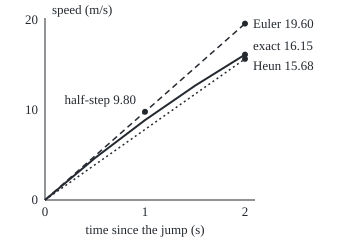
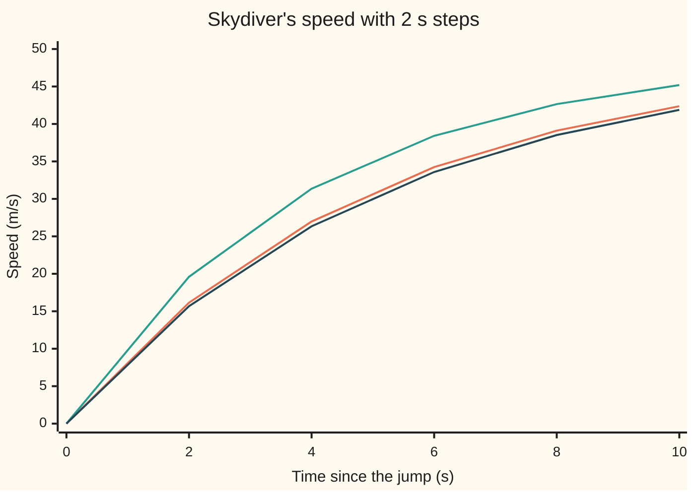

# Midpoint and Heun: sample the slope twice per step and the error shrinks four times faster

[Syllabus](../../../SYLLABUS.md) → [Differential equations and dynamics](../README.md) → [Numerical Evolution](../README.md#s05) → Midpoint and Heun

---

## General Overview

A skydiver leaves the plane at rest. Gravity adds 9.8 m/s of speed each second; drag removes a fifth of the current speed each second. The speed climbs towards 49 m/s, where the two balance, and at ten seconds is 42.37 m/s.

Euler's rule ([Euler's method](01-eulers-method.md)) steps forward using the slope at the start of each step. With two-second steps it reads 45.19 m/s at ten seconds, 2.82 too fast: drag grows with speed, so the slope falls during every step, and Euler uses its steepest point.

Two repairs read the slope a second time inside the step. The **midpoint method** walks half a step on the first slope and reads the slope there. **Heun's method**, or improved Euler, walks a whole step, reads the slope at the far end and averages the two. With the same steps both read 41.88 m/s. Halve the step and Euler's error halves; Heun's falls to a quarter.

**A second slope sample, placed so the step matches the true curve's bend, cancels Euler's leading error: the error at a fixed time falls with the square of the step.**

**What kind of fact this is:** a method; that both are second order is a theorem, proved in Why it works.

### The picture: one two-second step

<p align="center"></p>

To scale: 100 units across per second, 9 up per m/s. Solid: the true speed. Dashed: Euler's step. Dotted: the Heun step, whose slope 7.84 is also what midpoint reads at the half-step dot.

---

## The formula

Reminder: $v' = f(t, v)$ says the rate of the speed $v$ at time $t$ is given by the rule $f$; here $f(t, v) = 9.8 - 0.2v$. A step of length $h$ turns the method's speed $v_n$ after $n$ steps into $v_{n+1}$.

Both take a first sample $k_1 = f(t_n, v_n)$, Euler's slope, at time $t_n = nh$. They differ in the second.

$$\text{Midpoint:}\quad k_2 = f\!\left(t_n + \tfrac{h}{2},\ v_n + \tfrac{h}{2}k_1\right), \qquad v_{n+1} = v_n + h\,k_2$$

**Read it aloud:** walk half a step on the first slope, read the slope there, and use that slope for the whole step.

$$\text{Heun:}\quad k_2 = f\!\left(t_n + h,\ v_n + h\,k_1\right), \qquad v_{n+1} = v_n + \tfrac{h}{2}\left(k_1 + k_2\right)$$

**Read it aloud:** walk a whole step on the first slope, read the slope at the far end, and step with the average of the two slopes.

Both are members of one family, which the derivation fixes:

$$v_{n+1} = v_n + h\,(b_1 k_1 + b_2 k_2), \qquad k_2 = f(t_n + c\,h,\ v_n + c\,h\,k_1), \qquad b_1 + b_2 = 1,\quad b_2\,c = \tfrac12$$

| Symbol | Plain meaning | In our example | Push it up and the answer… |
| --- | --- | --- | --- |
| $t$, $h$ | time since the jump, and step length, s | 0 to 10; 2 | larger error |
| $v$, $v'$, $f$ | speed (m/s), its rate (m/s per s), the rule | 42.37 at 10 s; 9.8 − 0.2 × speed | — |
| $v_n$, $t_n$, $n$ | the method's speed and time after $n$ steps | 41.88 after 5 steps | — |
| $k_1$, $k_2$ | the two slope samples | Heun: 9.80, 5.88 | — |
| $b_1$, $b_2$, $c$ | sample weights; where in the step the second is read | Heun ½, ½, 1; midpoint 0, 1, ½ | — |
| $f_t$, $f_v$ | the rule's rate of change with time alone, with speed alone | 0; −0.2 per s | more bend |
| $e_n$, $C$, $L$, $N$, $T$ | folded proof: error after $n$ steps, local-error constant, bound on $f_v$ in size, step count, end time | $L$ = 0.2; $T$ = 10 s | old errors grow more |
| $q$, $x$ | one step's shrink factor on the gap to 49 m/s; $x = 0.2h$ | 0.68 at $x$ = 0.4 | past $h$ = 10 s the gap grows |

### When it holds

- **A smooth rule.** The derivation uses the rule's second rates of change. If the rule jumps, say a parachute opening mid-step, that one step errs in proportion to $h$, and the error at 10 s shrinks only as fast as Euler's.
- **A fixed end time, small steps.** "Second order" describes the error at a fixed time as $h$ shrinks; at large steps the pattern has not set in.
- **A step short against the rule's time scale.** One skydiver step multiplies the gap to 49 m/s by $q$; past $h$ = 10 s, $q$ exceeds 1 and the speed runs away. Very fast rules need [Stiff equations](06-stiff-equations-and-backward-euler.md).

---

## Why it works

### Step 0: a second sample estimates the average slope

Over one step the speed changes by $h$ times the step's average slope. Euler uses the starting slope, 9.80, though the slope falls throughout. A second reading tells the method how fast the slope is changing; placed well, it cancels Euler's leading error.

### Step 1: what the true curve does in one step

Expand the true speed around $t_n$ by [Taylor's theorem](../../06-Calculus%20and%20analysis/03-What%20Derivatives%20Tell%20You/05-taylors-theorem.md), which writes a smooth curve as its value plus its rates of change times powers of the step:

$$v(t_n + h) = v + h\,v' + \frac{h^2}{2}v'' + \frac{h^3}{6}v''' + \dots$$

Here $v' = f$, and the chain rule gives the bend: $v'' = f_t + f_v\,f$, since the rule changes as time moves and as the speed moves. For the skydiver, $f_t = 0$ and $f_v = -0.2$, so the bend is $-0.2$ times the slope: while the speed rises, the slope falls.

### Step 2: what a two-sample step does

Expand the second sample to first order in the step, using the two-variable Taylor rule:

$$k_2 = f + c\,h\,(f_t + f_v\,f) + (\text{terms in } h^2)$$

Put it into the family's update:

$$v_{n+1} = v + h\,(b_1 + b_2)\,f + h^2\,b_2\,c\,(f_t + f_v\,f) + (\text{terms in } h^3)$$

### Step 3: match the terms

The true curve has $h\,f$ and $\tfrac12 h^2 (f_t + f_v f)$. The step matches both, for every smooth rule, exactly when

$$b_1 + b_2 = 1, \qquad b_2\,c = \tfrac12.$$

Two conditions on three unknowns leave one free choice. Reading halfway, $c = \tfrac12$, forces $b_2 = 1$, $b_1 = 0$: midpoint. Reading at the far end, $c = 1$, forces $b_1 = b_2 = \tfrac12$: Heun.

Neither can match the $h^3$ term in general: it holds the rule's second rates of change. So each step misses by an amount proportional to $h^3$, the **local error**.

### Step 4: the skydiver makes it exact

The skydiver's rule is a straight line in speed. Each step the true gap to 49 m/s shrinks by the factor $e^{-0.2h}$. Both methods multiply it instead by

$$q = 1 - x + \frac{x^2}{2}, \qquad x = 0.2h,$$

the first three terms of the series for $e^{-x}$. At $h$ = 2 s, $q$ = 0.6800 against the true 0.6703, and five steps give $49\,(1 - q^5)$ = 41.8757, exactly what stepping gives.

### Step 5: local $h^3$ becomes global $h^2$

Reaching ten seconds takes $10/h$ steps. Each adds an error proportional to $h^3$, and earlier errors are carried along, grown by at most a fixed factor. The total is about $10/h$ times $h^3$: proportional to $h^2$. That is what "order 2" means ([Order of a method](02-local-and-global-error-and-order.md)): halving the step quarters the error.

<details>
<summary>Detailed proof: from local error to global error</summary>

Let $e_n$ be the gap between $v_n$ and the true speed at $t_n$, and let $L$ bound $\lvert f_v\rvert$ near the solution.

First, a step from the true value misses the true curve by at most $C h^3$; $C$ comes from the Taylor remainders of Steps 1 and 2.

Second, a step from two speeds $u$ and $z$ lands them at most $(1 + Lh + L^2h^2/2)\,\lvert u - z\rvert$ apart, since each sample differs by at most $L$ times the gap in its input. That factor is at most $e^{Lh}$.

So $e_{n+1} \le e^{Lh}\,e_n + C h^3$ with $e_0 = 0$, and after $N$ steps $e_N \le C h^3 \,(e^{NLh} - 1)/(e^{Lh} - 1)$. Since $e^{Lh} - 1 \ge Lh$ and $N h = T$, $e_N \le C h^2 (e^{LT} - 1)/L$, a constant times $h^2$.

</details>

A second road needs no exact solution: compare answers at $h$, $h/2$ and $h/4$ and read the order from the ratio of successive differences. Built into each step, it becomes [Adaptive steps](05-adaptive-step-size.md).

---

## Worked numbers, by hand

| Step | Arithmetic | Value |
| --- | --- | --- |
| first slope | 9.8 − 0.2 × 0 | $k_1$ = 9.80 |
| Heun: far end, slope there | 2 × 9.80 = 19.60; 9.8 − 0.2 × 19.60 | $k_2$ = 5.88 |
| Heun: step on the average | 2 × (9.80 + 5.88)/2 | 15.68 m/s |
| midpoint: half-step, slope there | 1 × 9.80; 9.8 − 0.2 × 9.80 | 7.84 |
| midpoint: step | 2 × 7.84 | 15.68 m/s |
| true speed at 2 s | 49 × (1 − e^(−0.4)) | 16.1543 m/s |
| five steps to 10 s | 49 × (1 − 0.68^5) | **41.8757 m/s** |

At ten seconds Heun reads 41.88 m/s against the true 42.37: 0.49 slow, where Euler was 2.82 fast. Errors at 10 s, with midpoint's identical to Heun's:

| Step $h$ | Euler error | Heun error |
| --- | --- | --- |
| 2 s | 2.8212 | 0.4928 |
| 1 s | 1.3701 | 0.1035 |
| 0.5 s | 0.6742 | 0.0239 |
| 0.25 s | 0.3343 | 0.0057 |

From 0.5 s to 0.25 s Euler's error falls by 2.02 times, Heun's by 4.16. Heun at 0.5 s costs as many slope readings as Euler at 0.25 s, yet errs by 0.0239 against 0.3343.

They agree only because the rule is a straight line in speed. With drag growing as the speed squared, $v' = 9.8 - 9.8\,(v/49)^2$, the exact speed at 10 s is 47.2374; 2 s steps give 46.6380 by midpoint and 46.3210 by Heun. Both stay second order: from 0.5 s to 0.25 s their errors fall by 4.27 and 4.29.



True speed (orange), Euler (green, above throughout), Heun (dark blue, just below).

### What breaks if you drop a piece

| Mistake | Comes out at | What went wrong |
| --- | --- | --- |
| Use the starting slope only | 45.19 m/s at 10 s, error 2.82 | This is Euler: the bend is ignored |
| Add the two Heun slopes without halving | 48.70 m/s, error 6.34 | The step moves twice as far as the average slope allows |
| Use the far-end slope alone | 36.58 m/s, error 5.79 | The end slope is too shallow, the mirror of Euler's error |

---

## Code, from first principles, and it actually runs

Two independent roads. Road one steps the rule with Euler, midpoint and Heun and compares each with the exact speed $49\,(1 - e^{-0.2t})$ at four step sizes. Road two never steps: the answer after $n$ steps is $49\,(1 - q^n)$, and the code asserts the roads agree at every step. Asserts also pin the local error near $49x^3/6$ and the error ratios near 4 and 2. The quadratic-drag case separates the two methods.

### Python

```python
# Midpoint and Heun -- the check behind the card.  Standard library only.
# The skydiver: v' = 9.8 - 0.2 v, v(0) = 0, exact v = 49 (1 - e^(-0.2 t)).
# Road one: step the rule and compare with the exact curve.  Road two: for this
# straight-line rule a two-stage step multiplies the gap to 49 m/s by
# q = 1 - x + x^2/2 with x = 0.2 h, so v_n = 49 (1 - q^n), no stepping at all.
import math

def f(t, v): return 9.8 - 0.2 * v                  # the rate rule, m/s per s
def drag(t, v): return 9.8 - 9.8 * (v / 49) ** 2   # second case: drag grows as v^2
def euler(f, t, v, h): return v + h * f(t, v)
def midpoint(f, t, v, h): return v + h * f(t + h / 2, v + h / 2 * f(t, v))
def heun(f, t, v, h): return v + h / 2 * (f(t, v) + f(t + h, v + h * f(t, v)))
def heun_no_half(f, t, v, h): return v + h * (f(t, v) + f(t + h, v + h * f(t, v)))
def slope_at_end(f, t, v, h): return v + h * f(t + h, v + h * f(t, v))

def run(step, rule, h, t_end=10.0):
    v, path = 0.0, [0.0]
    for n in range(round(t_end / h)):
        v = step(rule, n * h, v, h)
        path.append(v)
    return path

exact = lambda t: 49 * (1 - math.exp(-0.2 * t))
exact_drag = lambda t: 49 * (1 - math.exp(-0.4 * t)) / (1 + math.exp(-0.4 * t))
k1 = f(0, 0); k2 = f(2, 2 * k1); km = f(1, k1)
print(f"first step, h = 2: k1 = {k1:.2f}; Heun predicts {2 * k1:.2f}, slope there {k2:.2f}, "
      f"average {(k1 + k2) / 2:.2f}; midpoint half-step {k1:.2f}, slope there {km:.2f}")
print(f"first step lands at {heun(f, 0, 0, 2):.2f} (Heun) and {midpoint(f, 0, 0, 2):.2f} "
      f"(midpoint); exact {exact(2):.4f}; Euler {euler(f, 0, 0, 2):.2f}")
for name, path in (("exact", [exact(t) for t in range(0, 11, 2)]),
                   ("euler h = 2", run(euler, f, 2)), ("heun h = 2", run(heun, f, 2))):
    print(f"chart, {name}: " + ", ".join(f"{v:.2f}" for v in path))
x = 0.2 * 2; q = 1 - x + x * x / 2
print(f"shortcut, h = 2: q = {q:.4f} against e^(-0.4) = {math.exp(-x):.4f}; "
      f"49 (1 - q^5) = {49 * (1 - q ** 5):.4f}; q passes 1 at h = {2 / 0.2:.0f}")
hs, err = (2, 1, 0.5, 0.25), {}
for h in hs:
    err[h] = [abs(run(s, f, h)[-1] - exact(10)) for s in (euler, midpoint, heun)]
    print(f"h = {h}: v(10) Euler {run(euler, f, h)[-1]:.4f} error {err[h][0]:.4f}; "
          f"Heun {run(heun, f, h)[-1]:.4f} error {err[h][2]:.4f}; midpoint error {err[h][1]:.4f}")
print(f"error ratio when h halves, 0.5 to 0.25: Euler {err[0.5][0] / err[0.25][0]:.2f}, "
      f"Heun {err[0.5][2] / err[0.25][2]:.2f}")
dm, dh = run(midpoint, drag, 2)[-1], run(heun, drag, 2)[-1]
print(f"drag v^2, h = 2: midpoint {dm:.4f}, Heun {dh:.4f}, exact {exact_drag(10):.4f}")
de = {h: [abs(run(s, drag, h)[-1] - exact_drag(10)) for s in (midpoint, heun)] for h in (0.5, 0.25)}
print(f"drag v^2, error at h = 0.5 and 0.25: midpoint {de[0.5][0]:.5f} {de[0.25][0]:.5f} ratio "
      f"{de[0.5][0] / de[0.25][0]:.2f}; Heun {de[0.5][1]:.5f} {de[0.25][1]:.5f} ratio {de[0.5][1] / de[0.25][1]:.2f}")
for name, s in (("slope at start only (Euler)", euler), ("sum not averaged", heun_no_half),
                ("end slope alone", slope_at_end)):
    print(f"mistake, {name}: v(10) = {run(s, f, 2)[-1]:.2f}, error {abs(run(s, f, 2)[-1] - exact(10)):.2f}")
X = lambda t: 45 + 100 * t; Y = lambda v: 200 - 9 * v
print("figure, exact curve (x, y): " + ", ".join(f"({X(t):.1f}, {Y(exact(t)):.1f})" for t in (0, 0.5, 1, 1.5, 2))
      + f"; end x {X(2):.1f}: Euler y {Y(2 * k1):.1f}, Heun y {Y(heun(f, 0, 0, 2)):.1f}; half-step ({X(1):.1f}, {Y(k1):.1f})")
h = 0.1; x = 0.2 * h
assert all(abs(v - 49 * (1 - q ** n)) < 1e-9 for n, v in enumerate(run(heun, f, 2)))  # two roads agree
assert abs(exact(h) - heun(f, 0, 0, h) - 49 * x ** 3 / 6) < 49 * x ** 4 / 24          # local error ~ h^3
assert 3.8 < err[0.5][2] / err[0.25][2] < 4.2 and 1.8 < err[0.5][0] / err[0.25][0] < 2.2
assert dm != dh and 3.6 < de[0.5][0] / de[0.25][0] < 4.4 and 3.6 < de[0.5][1] / de[0.25][1] < 4.4
print("ALL CHECKS PASS")
```

**Ran 2026-09-28 on macOS, Python 3.14.6, standard library only. All checks passed. Output, pasted from the run:**

```
first step, h = 2: k1 = 9.80; Heun predicts 19.60, slope there 5.88, average 7.84; midpoint half-step 9.80, slope there 7.84
first step lands at 15.68 (Heun) and 15.68 (midpoint); exact 16.1543; Euler 19.60
chart, exact: 0.00, 16.15, 26.98, 34.24, 39.11, 42.37
chart, euler h = 2: 0.00, 19.60, 31.36, 38.42, 42.65, 45.19
chart, heun h = 2: 0.00, 15.68, 26.34, 33.59, 38.52, 41.88
shortcut, h = 2: q = 0.6800 against e^(-0.4) = 0.6703; 49 (1 - q^5) = 41.8757; q passes 1 at h = 10
h = 2: v(10) Euler 45.1898 error 2.8212; Heun 41.8757 error 0.4928; midpoint error 0.4928
h = 1: v(10) Euler 43.7387 error 1.3701; Heun 42.2650 error 0.1035; midpoint error 0.1035
h = 0.5: v(10) Euler 43.0427 error 0.6742; Heun 42.3447 error 0.0239; midpoint error 0.0239
h = 0.25: v(10) Euler 42.7029 error 0.3343; Heun 42.3628 error 0.0057; midpoint error 0.0057
error ratio when h halves, 0.5 to 0.25: Euler 2.02, Heun 4.16
drag v^2, h = 2: midpoint 46.6380, Heun 46.3210, exact 47.2374
drag v^2, error at h = 0.5 and 0.25: midpoint 0.02400 0.00562 ratio 4.27; Heun 0.03379 0.00787 ratio 4.29
mistake, slope at start only (Euler): v(10) = 45.19, error 2.82
mistake, sum not averaged: v(10) = 48.70, error 6.34
mistake, end slope alone: v(10) = 36.58, error 5.79
figure, exact curve (x, y): (45.0, 200.0), (95.0, 158.0), (145.0, 120.1), (195.0, 85.7), (245.0, 54.6); end x 245.0: Euler y 23.6, Heun y 58.9; half-step (145.0, 111.8)
ALL CHECKS PASS
```

### Rust

Same numbers, same labels, built with `rustc --edition 2021 -O`.

```rust
// Midpoint and Heun -- the same check as the Python, in Rust, std only.
// The skydiver: v' = 9.8 - 0.2 v, v(0) = 0, exact v = 49 (1 - e^(-0.2 t)).
// Road one: step the rule and compare with the exact curve.  Road two: for this
// straight-line rule a two-stage step multiplies the gap to 49 m/s by
// q = 1 - x + x^2/2 with x = 0.2 h, so v_n = 49 (1 - q^n), no stepping at all.
type Rule = fn(f64, f64) -> f64;
type Step = fn(Rule, f64, f64, f64) -> f64;

fn f(_t: f64, v: f64) -> f64 { 9.8 - 0.2 * v } // the rate rule, m/s per s
fn drag(_t: f64, v: f64) -> f64 { 9.8 - 9.8 * (v / 49.0).powi(2) } // drag grows as v^2
fn euler(f: Rule, t: f64, v: f64, h: f64) -> f64 { v + h * f(t, v) }
fn midpoint(f: Rule, t: f64, v: f64, h: f64) -> f64 { v + h * f(t + h / 2.0, v + h / 2.0 * f(t, v)) }
fn heun(f: Rule, t: f64, v: f64, h: f64) -> f64 { v + h / 2.0 * (f(t, v) + f(t + h, v + h * f(t, v))) }
fn heun_no_half(f: Rule, t: f64, v: f64, h: f64) -> f64 { v + h * (f(t, v) + f(t + h, v + h * f(t, v))) }
fn slope_at_end(f: Rule, t: f64, v: f64, h: f64) -> f64 { v + h * f(t + h, v + h * f(t, v)) }

fn run(step: Step, rule: Rule, h: f64) -> Vec<f64> {
    let mut path = vec![0.0];
    let mut v = 0.0;
    for n in 0..(10.0 / h).round() as usize { v = step(rule, n as f64 * h, v, h); path.push(v); }
    path
}
fn last(step: Step, rule: Rule, h: f64) -> f64 { *run(step, rule, h).last().unwrap() }
fn exact(t: f64) -> f64 { 49.0 * (1.0 - (-0.2 * t).exp()) }
fn exact_drag(t: f64) -> f64 { 49.0 * (1.0 - (-0.4 * t).exp()) / (1.0 + (-0.4 * t).exp()) }
fn join(p: &[f64]) -> String { p.iter().map(|v| format!("{:.2}", v)).collect::<Vec<_>>().join(", ") }

fn main() {
    let (k1, k2, km) = (f(0.0, 0.0), f(2.0, 2.0 * f(0.0, 0.0)), f(1.0, f(0.0, 0.0)));
    println!("first step, h = 2: k1 = {:.2}; Heun predicts {:.2}, slope there {:.2}, average {:.2}; midpoint half-step {:.2}, slope there {:.2}",
        k1, 2.0 * k1, k2, (k1 + k2) / 2.0, k1, km);
    println!("first step lands at {:.2} (Heun) and {:.2} (midpoint); exact {:.4}; Euler {:.2}",
        heun(f, 0.0, 0.0, 2.0), midpoint(f, 0.0, 0.0, 2.0), exact(2.0), euler(f, 0.0, 0.0, 2.0));
    let ex: Vec<f64> = (0..6).map(|i| exact(2.0 * i as f64)).collect();
    println!("chart, exact: {}", join(&ex));
    println!("chart, euler h = 2: {}", join(&run(euler, f, 2.0)));
    println!("chart, heun h = 2: {}", join(&run(heun, f, 2.0)));
    let x = 0.2 * 2.0;
    let q: f64 = 1.0 - x + x * x / 2.0;
    println!("shortcut, h = 2: q = {:.4} against e^(-0.4) = {:.4}; 49 (1 - q^5) = {:.4}; q passes 1 at h = {:.0}", q, (-x).exp(), 49.0 * (1.0 - q.powi(5)), 2.0 / 0.2);
    let hs = [2.0, 1.0, 0.5, 0.25];
    let steps: [Step; 3] = [euler, midpoint, heun];
    let err: Vec<Vec<f64>> = hs.iter().map(|&h| steps.iter().map(|&s| (last(s, f, h) - exact(10.0)).abs()).collect()).collect();
    for (i, &h) in hs.iter().enumerate() {
        println!("h = {}: v(10) Euler {:.4} error {:.4}; Heun {:.4} error {:.4}; midpoint error {:.4}",
            h, last(euler, f, h), err[i][0], last(heun, f, h), err[i][2], err[i][1]);
    }
    println!("error ratio when h halves, 0.5 to 0.25: Euler {:.2}, Heun {:.2}", err[2][0] / err[3][0], err[2][2] / err[3][2]);
    let (dm, dh) = (last(midpoint, drag, 2.0), last(heun, drag, 2.0));
    println!("drag v^2, h = 2: midpoint {:.4}, Heun {:.4}, exact {:.4}", dm, dh, exact_drag(10.0));
    let de: Vec<Vec<f64>> = [0.5, 0.25].iter().map(|&h| [midpoint as Step, heun].iter().map(|&s| (last(s, drag, h) - exact_drag(10.0)).abs()).collect()).collect();
    println!("drag v^2, error at h = 0.5 and 0.25: midpoint {:.5} {:.5} ratio {:.2}; Heun {:.5} {:.5} ratio {:.2}",
        de[0][0], de[1][0], de[0][0] / de[1][0], de[0][1], de[1][1], de[0][1] / de[1][1]);
    let wrong: [(&str, Step); 3] = [("slope at start only (Euler)", euler), ("sum not averaged", heun_no_half), ("end slope alone", slope_at_end)];
    for (name, s) in wrong {
        println!("mistake, {}: v(10) = {:.2}, error {:.2}", name, last(s, f, 2.0), (last(s, f, 2.0) - exact(10.0)).abs());
    }
    let (px, py) = (|t: f64| 45.0 + 100.0 * t, |v: f64| 200.0 - 9.0 * v);
    let pts: Vec<String> = [0.0, 0.5, 1.0, 1.5, 2.0].iter().map(|&t| format!("({:.1}, {:.1})", px(t), py(exact(t)))).collect();
    println!("figure, exact curve (x, y): {}; end x {:.1}: Euler y {:.1}, Heun y {:.1}; half-step ({:.1}, {:.1})",
        pts.join(", "), px(2.0), py(2.0 * k1), py(heun(f, 0.0, 0.0, 2.0)), px(1.0), py(k1));
    let (h, x) = (0.1, 0.02);
    assert!(run(heun, f, 2.0).iter().enumerate().all(|(n, v)| (v - 49.0 * (1.0 - q.powi(n as i32))).abs() < 1e-9)); // two roads agree
    assert!((exact(h) - heun(f, 0.0, 0.0, h) - 49.0 * x * x * x / 6.0).abs() < 49.0 * x.powi(4) / 24.0); // local error ~ h^3
    assert!(err[2][2] / err[3][2] > 3.8 && err[2][2] / err[3][2] < 4.2 && err[2][0] / err[3][0] > 1.8 && err[2][0] / err[3][0] < 2.2);
    assert!(dm != dh && de[0][0] / de[1][0] > 3.6 && de[0][0] / de[1][0] < 4.4 && de[0][1] / de[1][1] > 3.6 && de[0][1] / de[1][1] < 4.4);
    println!("ALL CHECKS PASS");
}
```

**Ran 2026-09-28 on macOS, rustc 1.98.1, no crates. All checks passed. Output, pasted from the run:**

```
first step, h = 2: k1 = 9.80; Heun predicts 19.60, slope there 5.88, average 7.84; midpoint half-step 9.80, slope there 7.84
first step lands at 15.68 (Heun) and 15.68 (midpoint); exact 16.1543; Euler 19.60
chart, exact: 0.00, 16.15, 26.98, 34.24, 39.11, 42.37
chart, euler h = 2: 0.00, 19.60, 31.36, 38.42, 42.65, 45.19
chart, heun h = 2: 0.00, 15.68, 26.34, 33.59, 38.52, 41.88
shortcut, h = 2: q = 0.6800 against e^(-0.4) = 0.6703; 49 (1 - q^5) = 41.8757; q passes 1 at h = 10
h = 2: v(10) Euler 45.1898 error 2.8212; Heun 41.8757 error 0.4928; midpoint error 0.4928
h = 1: v(10) Euler 43.7387 error 1.3701; Heun 42.2650 error 0.1035; midpoint error 0.1035
h = 0.5: v(10) Euler 43.0427 error 0.6742; Heun 42.3447 error 0.0239; midpoint error 0.0239
h = 0.25: v(10) Euler 42.7029 error 0.3343; Heun 42.3628 error 0.0057; midpoint error 0.0057
error ratio when h halves, 0.5 to 0.25: Euler 2.02, Heun 4.16
drag v^2, h = 2: midpoint 46.6380, Heun 46.3210, exact 47.2374
drag v^2, error at h = 0.5 and 0.25: midpoint 0.02400 0.00562 ratio 4.27; Heun 0.03379 0.00787 ratio 4.29
mistake, slope at start only (Euler): v(10) = 45.19, error 2.82
mistake, sum not averaged: v(10) = 48.70, error 6.34
mistake, end slope alone: v(10) = 36.58, error 5.79
figure, exact curve (x, y): (45.0, 200.0), (95.0, 158.0), (145.0, 120.1), (195.0, 85.7), (245.0, 54.6); end x 245.0: Euler y 23.6, Heun y 58.9; half-step (145.0, 111.8)
ALL CHECKS PASS
```

### Lean

Lean proves second order for every rule that is a straight line in speed, and the $h^3$ local error for every smooth rule.

- Take a rule that is a straight line in speed, $v' = a - k\,v$ with drag $k > 0$, and fix an end time. Heun and midpoint both err there by at most one constant times $h^2$, whatever the number of steps.
- For such a rule with $k$ not 0, the balance speed is $a/k$. One Heun step and one midpoint step both multiply the gap to it by $q = 1 - x + x^2/2$, where $x = kh$.
- Take a smooth rule, one whose second rates of change are continuous, and a true speed curve. With $b_1+b_2=1$ and $b_2c=\tfrac12$, one step from the true speed misses the curve by at most a constant times $h^3$ for small $h$.
- Midpoint and Heun are the family members with $b_1, b_2, c$ equal to 0, 1, ½ and ½, ½, 1.
- The hand arithmetic holds exactly: slopes 9.80, 5.88 and 7.84, first steps at 15.68, $q$ = 0.68, and $q$ = 1 at $x$ = 2.
- Five Heun steps of 2 s land exactly on $49\,(1 - q^5)$, which is 41.8757 to four places.

The error table, the ratios near 4 and 2, and the speed-squared drag are left to the Python and Rust checks.

```lean
-- Midpoint and Heun: for a rule that is a straight line in speed both methods shrink the gap to the balance speed by q = 1 - x + x²/2 and err by at most a constant times the step squared at a fixed end time, and for every smooth rule a two-sample step with b₁ + b₂ = 1 and b₂ c = 1/2 misses the true curve by a multiple of the step cubed.
import Mathlib.Analysis.SpecialFunctions.Exp
import Mathlib.Analysis.Calculus.ContDiff.Basic
import Mathlib.Analysis.Calculus.Deriv.Basic
import Mathlib.Analysis.Asymptotics.Defs
import Mathlib.Analysis.Calculus.MeanValue
import Mathlib.Analysis.Calculus.ContDiff.RCLike
import Mathlib.Analysis.Calculus.ContDiff.Comp
import Mathlib.Analysis.Calculus.Deriv.Shift
import Mathlib.Analysis.Calculus.Deriv.Pow
import Mathlib.Analysis.Calculus.Deriv.Mul
import Mathlib.Analysis.Asymptotics.Lemmas

open Asymptotics Filter Topology

/-! The rule `f t v` gives the rate of the speed `v` at time `t`. A step of length `h` turns the
speed `v` at time `t` into the next speed. -/

/-- Heun's step: walk a whole step on the first slope `k₁ = f t v`, read the slope `k₂` there,
and step with the average of the two. -/
noncomputable def heunStep (f : ℝ → ℝ → ℝ) (h t v : ℝ) : ℝ :=
  v + h / 2 * (f t v + f (t + h) (v + h * f t v))

/-- The midpoint step: walk half a step on the first slope, read the slope there, and use it
for the whole step. -/
noncomputable def midpointStep (f : ℝ → ℝ → ℝ) (h t v : ℝ) : ℝ :=
  v + h * f (t + h / 2) (v + h / 2 * f t v)

/-- The two-sample family: `k₂ = f (t + c h) (v + c h k₁)` and `v + h (b₁ k₁ + b₂ k₂)`. -/
noncomputable def twoSampleStep (b₁ b₂ c : ℝ) (f : ℝ → ℝ → ℝ) (h t v : ℝ) : ℝ :=
  v + h * (b₁ * f t v + b₂ * f (t + c * h) (v + c * h * f t v))

/-- Run a step rule from `v₀` with steps of length `h`: entry `n` is the speed after `n` steps,
the `n`-th step starting at time `t_n = n h`. -/
noncomputable def stepRun (step : ℝ → ℝ → ℝ) (h v₀ : ℝ) : ℕ → ℝ
  | 0 => v₀
  | n + 1 => step (n * h) (stepRun step h v₀ n)


/-- Helper: a function vanishing at `0` whose derivative is `O(s^n)` is `O(s^(n+1))`. -/
lemma mvh_isBigO_of_deriv {φ φ' : ℝ → ℝ} {n : ℕ} (h0 : φ 0 = 0)
    (hd : ∀ᶠ s in 𝓝 (0:ℝ), HasDerivAt φ (φ' s) s)
    (hb : φ' =O[𝓝 0] (fun s => s ^ n)) : φ =O[𝓝 0] (fun s => s ^ (n + 1)) := by
  obtain ⟨C, hC, hCw⟩ := hb.exists_pos
  have hev := hd.and hCw.bound
  obtain ⟨ε, hε, hball⟩ := Metric.eventually_nhds_iff.1 hev
  refine Asymptotics.IsBigO.of_bound C ?_
  filter_upwards [Metric.ball_mem_nhds (0:ℝ) hε] with h hh
  have hh' : |h| < ε := by simpa [Real.dist_eq] using hh
  have hsub : ∀ s ∈ Metric.closedBall (0:ℝ) |h|, dist s 0 < ε := fun s hs =>
    lt_of_le_of_lt (by simpa using hs) hh'
  have key := Convex.norm_image_sub_le_of_norm_hasDerivWithin_le (f := φ) (f' := φ')
    (C := C * |h| ^ n) (s := Metric.closedBall (0:ℝ) |h|) (x := 0) (y := h)
    (fun s hs => ((hball (hsub s hs)).1).hasDerivWithinAt)
    (fun s hs => by
      have h1 := (hball (hsub s hs)).2
      have hs' : |s| ≤ |h| := by simpa using hs
      calc ‖φ' s‖ ≤ C * ‖s ^ n‖ := h1
        _ ≤ C * |h| ^ n := by
          rw [norm_pow, Real.norm_eq_abs]
          exact mul_le_mul_of_nonneg_left (pow_le_pow_left₀ (abs_nonneg _) hs' n) hC.le)
    (convex_closedBall _ _) (by simp) (by simp)
  rw [h0, sub_zero, sub_zero] at key
  rw [norm_pow, Real.norm_eq_abs, pow_succ]
  calc ‖φ h‖ ≤ C * |h| ^ n * ‖h‖ := key
    _ = C * (|h| ^ n * |h|) := by rw [Real.norm_eq_abs]; ring

/-- Helper: second-order Taylor bound for a `C²` function of two variables. -/
lemma mvh_taylor2 {F : ℝ × ℝ → ℝ} (hF : ContDiff ℝ 2 F) (P : ℝ × ℝ) :
    (fun Δ => F (P + Δ) - F P - fderiv ℝ F P Δ) =O[𝓝 0] (fun Δ => ‖Δ‖ ^ 2) := by
  have hF1 : ContDiff ℝ 1 (fderiv ℝ F) := hF.fderiv_right (by norm_num)
  obtain ⟨K, U, hU, hL⟩ := (hF1.contDiffAt (x := P)).exists_lipschitzOnWith
  obtain ⟨r, hr, hrU⟩ := Metric.mem_nhds_iff.1 hU
  have hdiff : Differentiable ℝ F := hF.differentiable (by norm_num)
  refine Asymptotics.IsBigO.of_bound (K : ℝ) ?_
  filter_upwards [Metric.ball_mem_nhds (0 : ℝ × ℝ) hr] with Δ hΔ
  have hΔ' : ‖Δ‖ < r := by simpa using hΔ
  have hSU : Metric.closedBall P ‖Δ‖ ⊆ U := fun x hx =>
    hrU (Metric.mem_ball.2 (lt_of_le_of_lt (Metric.mem_closedBall.1 hx) hΔ'))
  have hPS : P ∈ Metric.closedBall P ‖Δ‖ := Metric.mem_closedBall_self (norm_nonneg _)
  have key := Convex.norm_image_sub_le_of_norm_hasFDerivWithin_le
    (f := fun x => F x - fderiv ℝ F P x)
    (f' := fun x => fderiv ℝ F x - fderiv ℝ F P) (C := K * ‖Δ‖)
    (s := Metric.closedBall P ‖Δ‖) (x := P) (y := P + Δ)
    (fun x _ => ((hdiff x).hasFDerivAt.sub (fderiv ℝ F P).hasFDerivAt).hasFDerivWithinAt)
    (fun x hx => by
      have := hL.dist_le_mul x (hSU hx) P (hSU hPS)
      rw [dist_eq_norm, dist_eq_norm] at this
      calc _ ≤ (K : ℝ) * ‖x - P‖ := this
        _ ≤ K * ‖Δ‖ := mul_le_mul_of_nonneg_left
            (by simpa [dist_eq_norm] using hx) K.coe_nonneg)
    (convex_closedBall _ _) hPS (by simp [dist_eq_norm])
  rw [norm_pow, norm_norm, sq]
  calc ‖F (P + Δ) - F P - fderiv ℝ F P Δ‖
      = ‖F (P + Δ) - fderiv ℝ F P (P + Δ) - (F P - fderiv ℝ F P P)‖ := by
        rw [map_add]; congr 1; ring
    _ ≤ K * ‖Δ‖ * ‖P + Δ - P‖ := key
    _ = K * (‖Δ‖ * ‖Δ‖) := by rw [add_sub_cancel_left]; ring

/-- Helper: `q = 1 - x + x²/2` is within `3 x³` of `e^(-x)` for `x ≥ 0`. -/
lemma mvh_q_close (x : ℝ) (hx : 0 ≤ x) : |(1 - x + x ^ 2 / 2) - Real.exp (-x)| ≤ 3 * x ^ 3 := by
  rcases le_or_gt x 1 with h1 | h1
  · have hb := Real.exp_bound (x := -x) (by rw [abs_neg, abs_of_nonneg hx]; exact h1)
      (n := 3) (by norm_num)
    simp [Finset.sum_range_succ, Nat.factorial, abs_neg, abs_of_nonneg hx] at hb
    rw [abs_sub_comm]
    calc _ = |Real.exp (-x) - (1 + -x + x ^ 2 / 2)| := by ring_nf
      _ ≤ x ^ 3 * (4 / 18) := by convert hb using 2 <;> norm_num
      _ ≤ 3 * x ^ 3 := by nlinarith [pow_nonneg hx 3]
  · have hr0 : 0 < Real.exp (-x) := Real.exp_pos _
    have hr1 : Real.exp (-x) ≤ 1 := Real.exp_le_one_iff.2 (by linarith)
    have hx2 : x ^ 2 ≤ x ^ 3 := by nlinarith
    have hx3 : 1 ≤ x ^ 3 := one_le_pow₀ h1.le
    rw [abs_le]; constructor <;> nlinarith

/-- Helper: `|q^n - r^n| ≤ n |q - r| M^n` when `0 ≤ q, r ≤ M` and `1 ≤ M`. -/
lemma mvh_pow_sub (q r M : ℝ) (hq : 0 ≤ q) (hr : 0 ≤ r) (hqM : q ≤ M) (hrM : r ≤ M)
    (hM : 1 ≤ M) (n : ℕ) : |q ^ n - r ^ n| ≤ n * |q - r| * M ^ n := by
  induction n with
  | zero => simp
  | succ n ih =>
    have hrn : r ^ n ≤ M ^ n := pow_le_pow_left₀ hr hrM n
    have hMn : M ^ n ≤ M ^ (n + 1) := pow_le_pow_right₀ hM (Nat.le_succ n)
    have hd : 0 ≤ |q - r| := abs_nonneg _
    have hpn : 0 ≤ |q ^ n - r ^ n| := abs_nonneg _
    calc |q ^ (n + 1) - r ^ (n + 1)| = |q * (q ^ n - r ^ n) + r ^ n * (q - r)| := by ring_nf
      _ ≤ |q * (q ^ n - r ^ n)| + |r ^ n * (q - r)| := abs_add_le _ _
      _ = q * |q ^ n - r ^ n| + r ^ n * |q - r| := by
        rw [abs_mul, abs_mul, abs_of_nonneg hq, abs_of_nonneg (pow_nonneg hr n)]
      _ ≤ M * (n * |q - r| * M ^ n) + M ^ (n + 1) * |q - r| := by
        gcongr
        exact hrn.trans hMn
      _ = (↑(n + 1)) * |q - r| * M ^ (n + 1) := by push_cast; ring

/-- Helper: the gap identity for both steps (same statement as Step 4 below). -/
lemma mvh_gap (a k h t v : ℝ) (hk : k ≠ 0) :
    heunStep (fun _ u => a - k * u) h t v - a / k
        = (1 - k * h + (k * h) ^ 2 / 2) * (v - a / k) ∧
      midpointStep (fun _ u => a - k * u) h t v - a / k
        = (1 - k * h + (k * h) ^ 2 / 2) * (v - a / k) := by
  unfold heunStep midpointStep
  constructor <;> field_simp <;> ring

/-- Helper: running a step that multiplies the gap by `q` multiplies it by `q^n`. -/
lemma mvh_run (step : ℝ → ℝ → ℝ) (b q h v₀ : ℝ) (hs : ∀ t v, step t v - b = q * (v - b))
    (n : ℕ) : stepRun step h v₀ n - b = q ^ n * (v₀ - b) := by
  induction n with
  | zero => simp [stepRun]
  | succ n ih =>
    rw [stepRun, hs, ih]; ring

/-- The card's main claim, for a rule that is a straight line in speed, `v' = a - k v` with drag
`k > 0` (the skydiver has `a = 9.8`, `k = 0.2`). The exact speed is
`a/k + (v₀ - a/k) e^(-k t)`. Fix the end time `T > 0` and reach it in `N` equal steps of length
`h = T/N`. Then there is one constant `C`, the same for every `N`, such that Heun's answer and the
midpoint answer at `T` are both within `C h²` of the exact speed: the error at a fixed time falls
with the square of the step, so halving the step quarters it. -/
theorem heun_and_midpoint_error_falls_with_step_squared (a k v₀ T : ℝ) (hk : 0 < k)
    (hT : 0 < T) :
    ∃ C : ℝ, ∀ N : ℕ, 0 < N →
      |stepRun (heunStep (fun _ v => a - k * v) (T / N)) (T / N) v₀ N
          - (a / k + (v₀ - a / k) * Real.exp (-k * T))| ≤ C * (T / N) ^ 2 ∧
      |stepRun (midpointStep (fun _ v => a - k * v) (T / N)) (T / N) v₀ N
          - (a / k + (v₀ - a / k) * Real.exp (-k * T))| ≤ C * (T / N) ^ 2 := by
  refine ⟨|v₀ - a / k| * (3 * k ^ 3 * T * Real.exp (k ^ 2 * T ^ 2 / 2)), fun N hN => ?_⟩
  have hNr : (0 : ℝ) < N := by exact_mod_cast hN
  have hN1 : (1 : ℝ) ≤ N := by exact_mod_cast hN
  set h := T / N with hh
  have hh0 : 0 ≤ h := div_nonneg hT.le hNr.le
  set x := k * h with hx
  have hx0 : 0 ≤ x := mul_nonneg hk.le hh0
  set q := 1 - x + x ^ 2 / 2 with hq
  have hexp : Real.exp (-k * T) = Real.exp (-x) ^ N := by
    rw [← Real.exp_nat_mul]; congr 1; rw [hx, hh]; field_simp
  have hbound : |v₀ - a / k| * |q ^ N - Real.exp (-x) ^ N|
      ≤ |v₀ - a / k| * (3 * k ^ 3 * T * Real.exp (k ^ 2 * T ^ 2 / 2)) * h ^ 2 := by
    have hq0 : 0 ≤ q := by nlinarith [sq_nonneg (1 - x)]
    set M := Real.exp (x ^ 2 / 2) with hM
    have hM1 : 1 ≤ M := Real.one_le_exp (by positivity)
    have hqM : q ≤ M := by
      have := Real.add_one_le_exp (x ^ 2 / 2)
      rw [hq]; nlinarith
    have hrM : Real.exp (-x) ≤ M := (Real.exp_le_one_iff.2 (by linarith)).trans hM1
    have hp := mvh_pow_sub q (Real.exp (-x)) M hq0 (Real.exp_pos _).le hqM hrM hM1 N
    have hc := mvh_q_close x hx0
    have hMN : M ^ N ≤ Real.exp (k ^ 2 * T ^ 2 / 2) := by
      rw [hM, ← Real.exp_nat_mul]
      apply Real.exp_le_exp.2
      have : (N : ℝ) * (x ^ 2 / 2) = k ^ 2 * T ^ 2 / 2 / N := by
        rw [hx, hh]; field_simp
      rw [this]
      exact div_le_self (by positivity) hN1
    have hNx : (N : ℝ) * x ^ 3 = k ^ 3 * T * h ^ 2 := by
      rw [hx, hh]; field_simp
    have hM0 : 0 ≤ M ^ N := by positivity
    calc |v₀ - a / k| * |q ^ N - Real.exp (-x) ^ N|
        ≤ |v₀ - a / k| * (N * (3 * x ^ 3) * Real.exp (k ^ 2 * T ^ 2 / 2)) := by
          gcongr
          calc _ ≤ N * |q - Real.exp (-x)| * M ^ N := hp
            _ ≤ _ := by gcongr
      _ = _ := by
        rw [show (N : ℝ) * (3 * x ^ 3) = 3 * (N * x ^ 3) by ring, hNx]; ring
  have hrun : ∀ step : ℝ → ℝ → ℝ, (∀ t v, step t v - a / k = q * (v - a / k)) →
      |stepRun step h v₀ N - (a / k + (v₀ - a / k) * Real.exp (-k * T))|
        ≤ |v₀ - a / k| * (3 * k ^ 3 * T * Real.exp (k ^ 2 * T ^ 2 / 2)) * h ^ 2 := by
    intro step hs
    have hr := mvh_run step (a / k) q h v₀ hs N
    rw [show stepRun step h v₀ N - (a / k + (v₀ - a / k) * Real.exp (-k * T))
        = (v₀ - a / k) * (q ^ N - Real.exp (-x) ^ N) by rw [hexp]; linear_combination hr,
      abs_mul]
    exact hbound
  exact ⟨hrun _ (fun t v => (mvh_gap a k h t v hk.ne').1),
    hrun _ (fun t v => (mvh_gap a k h t v hk.ne').2)⟩

/-- Step 4 of the card: for a rule that is a straight line in speed, `v' = a - k v` with `k ≠ 0`,
one Heun step and one midpoint step both multiply the gap to the balance speed `a/k` by
`q = 1 - x + x²/2`, where `x = k h`: the first three terms of the series for `e^(-x)`. -/
theorem heun_and_midpoint_multiply_gap_by_q (a k h t v : ℝ) (hk : k ≠ 0) :
    heunStep (fun _ u => a - k * u) h t v - a / k
        = (1 - k * h + (k * h) ^ 2 / 2) * (v - a / k) ∧
      midpointStep (fun _ u => a - k * u) h t v - a / k
        = (1 - k * h + (k * h) ^ 2 / 2) * (v - a / k) := by
  exact mvh_gap a k h t v hk

/-- Step 3 of the card: the local error. Take a smooth rule `f` (twice continuously
differentiable in time and speed together) and a true solution `y` of `y' = f t y` near the time
`t`. If the weights and the reading place satisfy `b₁ + b₂ = 1` and `b₂ c = 1/2` (midpoint:
`0, 1, 1/2`; Heun: `1/2, 1/2, 1`), then one two-sample step from the true speed `y t` misses the
true speed `y (t + h)` by at most a constant times `h³` as the step `h` shrinks. -/
theorem two_sample_step_local_error_cubic (f : ℝ → ℝ → ℝ)
    (hf : ContDiff ℝ 2 (Function.uncurry f)) (y : ℝ → ℝ) (t : ℝ)
    (hy : ∀ᶠ s in 𝓝 t, HasDerivAt y (f s (y s)) s) (b₁ b₂ c : ℝ)
    (hb : b₁ + b₂ = 1) (hc : b₂ * c = 1 / 2) :
    (fun h => y (t + h) - twoSampleStep b₁ b₂ c f h t (y t)) =O[𝓝 0] (fun h => h ^ 3) := by
  set F := Function.uncurry f with hFdef
  set P0 : ℝ × ℝ := (t, y t) with hP0
  set k₁ := f t (y t) with hk₁
  set D := fderiv ℝ F P0 with hD
  set v : ℝ × ℝ := (1, k₁) with hv
  set R : ℝ × ℝ → ℝ := fun Δ => F (P0 + Δ) - F P0 - D Δ with hR
  have hRO : R =O[𝓝 0] (fun Δ => ‖Δ‖ ^ 2) := mvh_taylor2 hf P0
  have hFP0 : F P0 = k₁ := rfl
  have ht : Tendsto (fun s : ℝ => t + s) (𝓝 0) (𝓝 t) := by
    simpa using (tendsto_const_nhds (x := t)).add (tendsto_id (x := 𝓝 (0:ℝ)))
  have hyd : ∀ᶠ s in 𝓝 (0:ℝ), HasDerivAt (fun s => y (t + s)) (f (t + s) (y (t + s))) s := by
    filter_upwards [ht.eventually hy] with s hs
    exact HasDerivAt.comp_const_add t s hs
  set Δ : ℝ → ℝ × ℝ := fun s => (s, y (t + s) - y t) with hΔ
  have hyO : (fun s => y (t + s) - y t) =O[𝓝 0] (fun s : ℝ => s) := by
    have h1 := (hy.self_of_nhds).isBigO_sub.comp_tendsto ht
    simpa [Function.comp_def] using h1
  have hΔO : Δ =O[𝓝 0] (fun s : ℝ => s) := (isBigO_refl _ _).prod_left hyO
  have hΔt : Tendsto Δ (𝓝 0) (𝓝 0) := hΔO.trans_tendsto tendsto_id
  have hFΔ : ∀ s, F (P0 + Δ s) = f (t + s) (y (t + s)) := by
    intro s; simp [P0, Δ, F]
  have hRΔ : (fun s => R (Δ s)) =O[𝓝 0] (fun s : ℝ => s ^ 2) :=
    (hRO.comp_tendsto hΔt).trans (hΔO.norm_left.pow 2)
  -- first order: e(s) = y(t+s) - y t - s k₁ is O(s²)
  have hF1 : (fun s => f (t + s) (y (t + s)) - k₁) =O[𝓝 0] (fun s : ℝ => s) := by
    have hFd : HasFDerivAt F D P0 :=
      ((hf.differentiable (by norm_num)) P0).hasFDerivAt
    have htP : Tendsto (fun s => P0 + Δ s) (𝓝 0) (𝓝 P0) := by
      simpa using (tendsto_const_nhds (x := P0)).add hΔt
    have h2 := hFd.isBigO_sub.comp_tendsto htP
    refine (h2.trans ?_).congr (fun s => ?_) (fun s => rfl)
    · exact hΔO.congr (fun s => by simp) (fun s => rfl)
    · simp only [Function.comp_def]; rw [hFΔ, hFP0]
  have heO : (fun s => y (t + s) - y t - s * k₁) =O[𝓝 0] (fun s : ℝ => s ^ 2) := by
    refine mvh_isBigO_of_deriv (n := 1) (φ' := fun s => f (t + s) (y (t + s)) - k₁)
      (by simp) ?_ (by simpa using hF1)
    filter_upwards [hyd] with s hs
    exact (hs.sub_const (y t)).sub (hasDerivAt_mul_const k₁)
  -- second order
  have hD2 : ∀ s, D (Δ s) = s * D v + (y (t + s) - y t - s * k₁) * D (0, 1) := by
    intro s
    have : Δ s = s • v + (y (t + s) - y t - s * k₁) • ((0 : ℝ), (1 : ℝ)) := by
      simp only [Δ, v, Prod.smul_mk, smul_eq_mul, Prod.mk_add_mk]
      ext <;> simp <;> ring
    rw [this, map_add, map_smul, map_smul, smul_eq_mul, smul_eq_mul]
  have hψ' : (fun s => f (t + s) (y (t + s)) - k₁ - s * D v) =O[𝓝 0] (fun s : ℝ => s ^ 2) := by
    refine ((heO.const_mul_left (D (0, 1))).add hRΔ).congr (fun s => ?_) (fun s => rfl)
    simp only [R]
    rw [hFΔ, hD2 s, hFP0]
    ring
  have hψ : (fun s => y (t + s) - y t - s * k₁ - s ^ 2 / 2 * D v) =O[𝓝 0]
      (fun s : ℝ => s ^ 3) := by
    refine mvh_isBigO_of_deriv (n := 2) (φ' := fun s => f (t + s) (y (t + s)) - k₁ - s * D v)
      (by simp) ?_ hψ'
    filter_upwards [hyd] with s hs
    have := ((hs.sub_const (y t)).sub (hasDerivAt_mul_const k₁)).sub
      (((hasDerivAt_pow 2 s).div_const 2).mul_const (D v))
    convert this using 1
    simp
  -- the step's own error term
  have hcv : (fun h : ℝ => (c * h) • v) =O[𝓝 0] (fun h : ℝ => h) := by
    refine isBigO_of_le' (c := |c| * ‖v‖) _ (fun h => ?_)
    rw [norm_smul, Real.norm_eq_abs, Real.norm_eq_abs, abs_mul]
    ring_nf; rfl
  have hR2 : (fun h : ℝ => R ((c * h) • v)) =O[𝓝 0] (fun h : ℝ => h ^ 2) :=
    (hRO.comp_tendsto (hcv.trans_tendsto tendsto_id)).trans (hcv.norm_left.pow 2)
  have hR3 : (fun h : ℝ => h * b₂ * R ((c * h) • v)) =O[𝓝 0] (fun h : ℝ => h ^ 3) :=
    (((isBigO_refl (fun h : ℝ => h) _).mul hR2).const_mul_left b₂).congr
      (fun h => by ring) (fun h => by ring)
  refine (hψ.sub hR3).congr (fun h => ?_) (fun h => rfl)
  have hstep : f (t + c * h) (y t + c * h * k₁) = k₁ + c * h * D v + R ((c * h) • v) := by
    have e1 : P0 + (c * h) • v = (t + c * h, y t + c * h * k₁) := by
      simp [P0, v, Prod.smul_mk, smul_eq_mul]
    simp only [R, e1, map_smul, smul_eq_mul]
    simp [F, P0, k₁]
  simp only [twoSampleStep]
  rw [← hk₁, hstep]
  linear_combination (h * k₁) * hb + (h ^ 2 * D v) * hc

/-! The card's worked numbers, in exact fractions: the skydiver `v' = 9.8 - 0.2 v`, `v(0) = 0`,
with 2 s steps. -/

-- Heun's first step: k₁ = 9.80, k₂ = 9.8 - 0.2 × 19.60 = 5.88, and 2 × (9.80 + 5.88)/2 = 15.68.
example : (49 / 5 : ℚ) - 1 / 5 * (2 * (49 / 5)) = 147 / 25 ∧
    (2 : ℚ) * ((49 / 5 + 147 / 25) / 2) = 392 / 25 := by norm_num

-- The midpoint's first step: slope 9.8 - 0.2 × 9.80 = 7.84 at the half step, and 2 × 7.84 = 15.68.
example : (49 / 5 : ℚ) - 1 / 5 * (49 / 5) = 196 / 25 ∧ (2 : ℚ) * (196 / 25) = 392 / 25 := by
  norm_num

-- One Heun step and one midpoint step, run on the rule itself, both land at 15.68.
example : heunStep (fun _ v => 49 / 5 - 1 / 5 * v) 2 0 0 = 392 / 25 ∧
    midpointStep (fun _ v => 49 / 5 - 1 / 5 * v) 2 0 0 = 392 / 25 := by
  constructor <;> norm_num [heunStep, midpointStep]

-- At h = 2 s, x = 0.4 and q = 1 - 0.4 + 0.08 = 0.68.
example : (1 : ℚ) - 2 / 5 + (2 / 5) ^ 2 / 2 = 17 / 25 := by norm_num

-- Five Heun steps of 2 s land exactly on 49 (1 - q⁵), which is 41.8757 to four places.
example : stepRun (heunStep (fun _ v => 49 / 5 - 1 / 5 * v) 2) 2 0 5
    = 49 * (1 - (17 / 25) ^ 5) := by
  norm_num [stepRun, heunStep]

example : (418757 / 10000 : ℚ) ≤ 49 * (1 - (17 / 25) ^ 5) ∧
    49 * (1 - (17 / 25) ^ 5) < (418758 / 10000 : ℚ) := by norm_num

-- Past h = 10 s the step stops shrinking the gap: at x = 2, q = 1 - 2 + 2 = 1.
example : (1 : ℚ) - 2 + 2 ^ 2 / 2 = 1 := by norm_num

-- Midpoint (b₁, b₂, c) = (0, 1, 1/2) and Heun (1/2, 1/2, 1) both meet b₁ + b₂ = 1, b₂ c = 1/2.
example : (0 : ℚ) + 1 = 1 ∧ (1 : ℚ) * (1 / 2) = 1 / 2 ∧
    (1 / 2 : ℚ) + 1 / 2 = 1 ∧ (1 / 2 : ℚ) * 1 = 1 / 2 := by norm_num

-- Midpoint and Heun are the family's members with those weights.
example (f : ℝ → ℝ → ℝ) (h t v : ℝ) :
    midpointStep f h t v = twoSampleStep 0 1 (1 / 2) f h t v ∧
      heunStep f h t v = twoSampleStep (1 / 2) (1 / 2) 1 f h t v := by
  unfold midpointStep heunStep twoSampleStep
  constructor
  · rw [show t + 1 / 2 * h = t + h / 2 by ring, show v + 1 / 2 * h * f t v = v + h / 2 * f t v by ring]
    ring
  · simp only [one_mul]; ring

#print axioms mvh_isBigO_of_deriv
#print axioms mvh_taylor2
#print axioms mvh_q_close
#print axioms mvh_pow_sub
#print axioms mvh_gap
#print axioms mvh_run
#print axioms heun_and_midpoint_error_falls_with_step_squared
#print axioms heun_and_midpoint_multiply_gap_by_q
#print axioms two_sample_step_local_error_cubic
```

**Checked 2026-11-12 on macOS, Lean 4.36.0-rc2, Mathlib v4.36.0-rc2. Every proof is complete and uses only Lean's standard axioms. Output, pasted from the run:**

```
'mvh_isBigO_of_deriv' depends on axioms: [propext, Classical.choice, Quot.sound]
'mvh_taylor2' depends on axioms: [propext, Classical.choice, Quot.sound]
'mvh_q_close' depends on axioms: [propext, Classical.choice, Quot.sound]
'mvh_pow_sub' depends on axioms: [propext, Classical.choice, Quot.sound]
'mvh_gap' depends on axioms: [propext, Classical.choice, Quot.sound]
'mvh_run' depends on axioms: [propext, Classical.choice, Quot.sound]
'heun_and_midpoint_error_falls_with_step_squared' depends on axioms: [propext, Classical.choice, Quot.sound]
'heun_and_midpoint_multiply_gap_by_q' depends on axioms: [propext, Classical.choice, Quot.sound]
'two_sample_step_local_error_cubic' depends on axioms: [propext, Classical.choice, Quot.sound]
```

> [!TIP]
> **Try changing**
> Guess first, then run it.
> - **Add 0.125 to `hs`.** Guess Heun's error: about a quarter of 0.0057.
> - **Drop the `/ 2` in midpoint's time argument.** Guess what changes. Nothing: neither rule reads the time, only the speed.
> - **In `heun`, change `h / 2` to `h`.** Guess the reading at 10 s with 2 s steps: 48.70, the second mistake row, and the first assert stops the run.

---

## The usual mistake

> [!warning]
> **Taking "second order" to mean four times better than Euler.** Four is what halving the step does to Heun's own error. Against Euler the gain depends on the step: 0.4928 against 2.8212 at 2 s, 0.0057 against 0.3343 at 0.25 s. It widens as the step shrinks, since one error falls as $h^2$, the other as $h$.
>
> - **Assuming midpoint and Heun are one method.** With drag as the speed squared they read 46.6380 and 46.3210.
> - **Reading the order off large steps.** From 2 s to 1 s Heun's error goes from 0.4928 to 0.1035, not yet a clean quarter.

---

## Where you meet it in real life

- **Integrating a plain function.** When the rule ignores the unknown, $f$ depends on $t$ alone and Heun's step is the trapezoidal rule for areas, while the midpoint step is the midpoint rule: both from [Numerical integration](../../06-Calculus%20and%20analysis/04-Integrals/08-numerical-integration.md).
- **Adaptive solvers.** Euler and Heun share their first sample, so running both gives a free estimate of Euler's error: the idea behind [Adaptive steps](05-adaptive-step-size.md).

> **Say it back**
> Euler steps on the starting slope and misses the curve's bend. A second sample, read halfway (midpoint) or at the predicted far end and averaged (Heun), matches the true curve through the step-squared term. The error at a fixed time then goes as the step squared. On the skydiver with 2 s steps Heun reads 41.88 m/s at ten seconds against the true 42.37; halving the step quarters the error.

---

## What this builds on

- [Euler's method](01-eulers-method.md): the one-sample step on the starting slope that both methods repair.
- [Order of a method](02-local-and-global-error-and-order.md): what local and global error are, and why a step-cubed local error gives a step-squared global one.

## Where this goes next

- [Runge-Kutta four](04-runge-kutta-four.md): four samples per step, matching the true curve through the fourth power of the step.

Left open: how many samples, placed where, buy a higher order than two?

---

## Sources

Verified 28 Sep 2026: every link below resolves to the author's or the university's own page.

- Lebl, Jiří. *Notes on Diffy Qs: Differential Equations for Engineers*, §1.7 "Numerical methods: Euler's method". [Author's free edition](https://www.jirka.org/diffyqs/html/numer_section.html). Euler's error, and the improved Euler (Heun) method quartering the error when the step halves.
- Dobrushkin, Vladimir. "Runge–Kutta 2", Part 1.3 of his differential-equations tutorial, Brown University. [Course page](https://www.cfm.brown.edu/people/dobrush/am33/python/p3/RK2.html). Matching Taylor terms for two-stage methods; Heun, midpoint and Ralston as one family.
