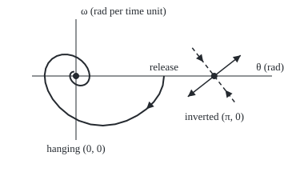

# Linearisation: near an equilibrium the system looks like its matrix of slopes, and usually that is enough

[Syllabus](../../../SYLLABUS.md) → [Differential equations and dynamics](../README.md) → [Nonlinear Dynamics in the Plane](../README.md#s06) → Linearisation

---

## General Overview

A playground swing can rest in two places. Hanging straight down, a push dies away in a few shrinking swings. Balanced straight up on rigid rods, the smallest breath of wind tips it over.

Gravity pulls with the sine of the angle: the law is not linear and has no formula solution. Close to either rest the sine curve is almost a straight line, and straight-line laws are solved in full ([Trace and determinant](../04-Systems%20and%20the%20Matrix%20Exponential/05-classifying-equilibria-by-trace-and-determinant.md)).

So near a rest, replace each rate by its straight-line version. The rates' slopes, in a two-by-two table, form the **Jacobian matrix**, after Carl Jacobi; the swap is **linearisation**. At the hanging rest the matrix says "spiral in"; at the upright rest, "saddle": one way in, one way out. Both verdicts are right.

**Near a rest the rates are the Jacobian times the offset, plus a leftover that shrinks faster; when no eigenvalue of the Jacobian has real part zero, the rest attracts, repels or is a saddle exactly as the matrix says.**

**What kind of fact this is:** a theorem. The attracting case is proved in Why it works, fully in a folded Detailed proof; the saddle case, the Hartman–Grobman theorem, is stated with its proof in the sources.

### The picture: the swing near its two rests

<p align="center"></p>

To scale, 55 px per unit both ways. The curve: the swing released at 2 rad, for 12 time units. At the upright rest, solid is the linear way out, dashed the way in. Both checks print the coordinates on `figure,` lines.

---

## The formula

The angle from hanging is $\theta$ (theta), in radians; the angular speed is $\omega$ (omega). Time $t$ runs in units of 0.5 s: the square root of rod length, 2.45 m, over gravity's 9.81 m/s^2. A prime is a rate. With damping 0.5 per time unit, the swing is $\theta'' + 0.5\theta' + \sin\theta = 0$, or as a pair:

$$\theta' = f(\theta, \omega) = \omega, \qquad \omega' = g(\theta, \omega) = -\sin\theta - 0.5\,\omega$$

Both rates are zero at the **rests**, hanging (0, 0) and inverted (π, 0). Call the rest's angle $\theta_e$ and the offsets from it $u = \theta - \theta_e$ and $v = \omega$. ∂f/∂θ is the slope of f when only θ moves ([Partial derivatives](../../06-Calculus%20and%20analysis/07-Several%20Variables/01-partial-derivatives.md)).

$$J = \begin{pmatrix} \partial f/\partial\theta & \partial f/\partial\omega \\ \partial g/\partial\theta & \partial g/\partial\omega \end{pmatrix}_{\text{at the rest}}, \qquad \begin{pmatrix} u \\ v \end{pmatrix}' = J\begin{pmatrix} u \\ v \end{pmatrix} + r$$

**Read it aloud:** near a rest, the offsets change at the matrix of slopes times the offsets, plus a leftover r that shrinks faster than the offsets.

For the swing the only slope that varies is that of $-\sin\theta$, which is $-\cos\theta$:

$$J = \begin{pmatrix} 0 & 1 \\ -\cos\theta_e & -0.5 \end{pmatrix}: \quad \text{hanging } \begin{pmatrix} 0 & 1 \\ -1 & -0.5 \end{pmatrix}, \quad \text{inverted } \begin{pmatrix} 0 & 1 \\ 1 & -0.5 \end{pmatrix}$$

Trace $\tau$ (the diagonal's sum) and determinant $\Delta$ (the diagonal's product minus the other two entries' product) sort the rest; eigenvalues $\lambda$ solve $\lambda^2 - \tau\lambda + \Delta = 0$. A rest is **hyperbolic** when no eigenvalue has real part zero.

| Symbol | Plain meaning | In our example | Push it up and the answer… |
| --- | --- | --- | --- |
| $\theta$, $\omega$ | angle from hanging, rad; angular speed, rad per time unit | released at 2 rad | past π, over the top |
| $t$ | time, in units of 0.5 s | one damped swing: 6.4892 units | — |
| $f$, $g$ | the rates of θ and ω | ω and −sin θ − 0.5ω | — |
| $\theta_e$, $u$, $v$, $r$ | rest angle; offsets; leftover | 0 or π; r at most u cubed over 6 | — |
| $J$ | the rates' slopes at the rest | `[[0, 1], [-1, -0.5]]` hanging | — |
| $\tau$, $\Delta$ | trace and determinant of J | −0.5; 1 hanging, −1 inverted | Δ below 0 means a saddle |
| $\lambda$ | eigenvalue: a special motion's rate | −0.25 ± 0.968246i; 0.780776, −1.280776 | real part above 0: it grows |
| $k$, $E$ | air-drag strength; energy | 0.5; 0.122417 from 0.5 rad | faster loss |

### When it holds

- **Smooth rates.** A swing hitting a stop at its rest has a kink; no one matrix fits both sides.
- **No eigenvalue with real part zero.** At a **centre** (a purely imaginary pair) or a zero eigenvalue, the leftover decides.
- **Near the rest only.** Released at 1 rad, not 0.01, the swing is a few per cent off the linear answer by t = 10.
- **A real rest.** At (π/2, 0) the rates are 0 and −1; the nonzero value swamps the slopes.

---

## Why it works

### Step 0: close up, a smooth curve is its tangent line

Zoomed in at 0 the sine curve is the line of slope 1; at π, of slope −1. A smooth rate near a point is its value, plus slopes times offsets, plus a leftover shrinking faster than the offset: Taylor's first-order statement.

### Step 1: at a rest, the value term vanishes

Both rates are zero at a rest, leaving $J$ times the offset, plus $r$. For the swing, $-\sin u = -u + (u - \sin u)$, and $u - \sin u$ is at most the cube of u over 6 in size. At π, $\sin(\pi + u) = -\sin u$: the slope's sign flips, the leftover's size does not.

### Step 2: solve the linear part and sort the rest

Linear motions are built from special motions changing like $e^{\lambda t}$.

- **Hanging:** τ = −0.5, Δ = 1, discriminant τ^2 − 4Δ = −3.75. Eigenvalues −0.25 ± 0.968246i: a **stable spiral**. Each swing takes 6.4892 units and keeps 0.1974 of its size.
- **Inverted:** Δ = −1, so the eigenvalues have opposite signs, 0.780776 and −1.280776: a **saddle**. A nudge along the way out, direction (1, 0.780776), doubles every 0.8878 units.

### Step 3: when every real part is negative, the leftover cannot win

At the hanging rest every linear motion shrinks like $e^{-0.25t}$. The leftover, relative to the offset, goes to zero with the offset, so near enough the rest it eats part of the 0.25 margin, never all. The true swing shrinks too, a little slower.

<details>
<summary>Detailed proof: all real parts negative means the rest attracts</summary>

Write x for the offset (u, v), |x| for its length. Then x' = Jx + r(x) with |r(x)| at most |u|^3/6, so at most (δ^2/6)|x| while |x| is below δ.

By variation of constants ([Forced systems](../04-Systems%20and%20the%20Matrix%20Exponential/06-forced-systems-and-variation-of-constants.md)): x(t) = e^(Jt) x(0) + the integral from 0 to t of e^(J(t − s)) r(x(s)) ds.

Both eigenvalues have real part −0.25, so some constant M gives |e^(Jt) y| at most M e^(−0.25t) |y| for all vectors y and all t from 0 on.

Put φ(t) = e^(0.25t)|x(t)|. While |x| is below δ, φ(t) is at most M|x(0)| + (Mδ^2/6) times the integral of φ from 0 to t. Gronwall's inequality ([Gronwall's inequality](../02-Existence%2C%20Uniqueness%20and%20Sensitivity/04-gronwall-and-continuous-dependence.md)) turns that into φ(t) at most M|x(0)| e^((Mδ^2/6)t), so

|x(t)| at most M|x(0)| e^(−(0.25 − Mδ^2/6)t).

Choose δ with Mδ^2/6 below 0.125 and |x(0)| below δ/M. The bound keeps |x| below δ, so the argument never stops, and the offset shrinks at rate at least 0.125. Any smooth system with all real parts negative runs the same way.

At a centre the margin is 0, no δ leaves anything over, and the leftover alone decides.

</details>

### Step 4: a saddle stays a saddle

The **Hartman–Grobman theorem** (Grobman 1959, Hartman 1960): at a hyperbolic rest, a continuous change of coordinates near the rest carries the linear paths onto the true ones, direction kept. So the true swing has one curve in and one out at the top. Their tangency to the pictured lines is a further result, the stable manifold theorem (Perko §2.7). The proof is in Hartman's paper and Perko §2.8.

### Step 5: at a centre the matrix says nothing

Replace friction by air drag, growing with speed squared: $\omega' = -\sin\theta - k\,\omega|\omega|$. Drag has slope 0 at ω = 0, so the hanging Jacobian is `[[0, 1], [-1, 0]]`: τ = 0, Δ = 1, a centre, for every k.

The energy is $E = \omega^2/2 + 1 - \cos\theta$, and the chain rule gives $E' = \omega\omega' + \sin\theta\,\theta' = -k|\omega|^3$. With k = 0 energy is fixed and the swing swings for ever ([The pendulum](03-the-nonlinear-pendulum.md)). With k above 0 energy falls whenever the swing moves: it spirals in. With k below 0, a child pumping, it spirals out. One matrix, three truths.

Released at 0.5 rad, energy 0.122417. At t = 60 the drag-free swing still holds 0.122417; with k = 0.5, 0.002308. Averaging the loss over each swing gives amplitude A(t) = A(0)/(1 + 4kA(0)t/(3π)), shrinking like one over time, not exponentially: energy 0.002303.

---

## Worked numbers, by hand

| Step | Arithmetic | Value |
| --- | --- | --- |
| hanging J | slope of −sin θ is −cos θ; −cos 0 = −1 | `[[0, 1], [-1, -0.5]]` |
| trace, determinant | 0 − 0.5; 0 − 1 × (−1) | −0.5; 1 |
| discriminant | 0.25 − 4 | −3.75 |
| eigenvalues | −0.25 ± i × (square root of 3.75)/2 | **−0.25 ± 0.968246i, stable spiral** |
| one swing | 2π/0.968246 | 6.4892 units = 3.2446 s |
| size kept per swing | e^(−0.25 × 6.4892) | 0.1974 |
| inverted J | −cos π = +1 | `[[0, 1], [1, -0.5]]` |
| determinant | 0 − 1 × 1 | −1 |
| eigenvalues | (−0.5 ± square root of 4.25)/2 | **0.780776 and −1.280776, saddle** |
| doubling time out | ln 2/0.780776 | 0.8878 units |

A push on the hanging swing shrinks to a fifth each 3.2446 s; a nudge on the balanced one doubles in under half a second.

### What breaks if you drop a piece

| Mistake | Comes out at | What went wrong |
| --- | --- | --- |
| cos π read as +1 | det 1, disc −3.75: a spiral | truly det −1, a saddle |
| Linearising at (π/2, 0) | rates 0 and −1 | not a rest |
| Trusting the centre, with drag | energy 0.122417 for ever | truly 0.002308 at t = 60 |

The code prints all three.

---

## Code, from first principles, and it actually runs

Road one: the Jacobian by hand, then its eigenvalues. Road two: the Jacobian by nudging each variable, and the true swing stepped by Runge–Kutta 4 ([Runge-Kutta four](../05-Numerical%20Evolution/04-runge-kutta-four.md)), step 0.01. Four asserts tie the roads together.

### Python

```python
# Linearisation and the Jacobian -- the check behind the card.  Standard library
# only.  The swing: theta'' + 0.5 theta' + sin theta = 0, written as the pair
# theta' = w, w' = -sin(theta) - 0.5 w; time in units of 0.5 s.  An optional
# air drag k w|w| makes the centre case.  Runge-Kutta 4 is written out here.
from math import sin, cos, sqrt, pi, exp, log
def rate(s, c=0.5, k=0.0):
    return (s[1], -sin(s[0]) - c * s[1] - k * s[1] * abs(s[1]))
def rk4(s, t, c=0.5, k=0.0, h=0.01):              # returns every state along the way
    path = [s]
    for _ in range(round(t / h)):
        a = rate(s, c, k); b = rate((s[0] + h/2*a[0], s[1] + h/2*a[1]), c, k)
        d = rate((s[0] + h/2*b[0], s[1] + h/2*b[1]), c, k); e = rate((s[0] + h*d[0], s[1] + h*d[1]), c, k)
        s = (s[0] + h/6*(a[0] + 2*b[0] + 2*d[0] + e[0]), s[1] + h/6*(a[1] + 2*b[1] + 2*d[1] + e[1]))
        path.append(s)
    return path
def nudged(p, e=1e-5):                            # road two: slopes by nudging each variable
    col = lambda j: [(rate((p[0] + e*(j == 0), p[1] + e*(j == 1)))[i]
                      - rate((p[0] - e*(j == 0), p[1] - e*(j == 1)))[i]) / (2*e) for i in (0, 1)]
    c0, c1 = col(0), col(1)
    return [[c0[0], c1[0]], [c0[1], c1[1]]]
def classify(J):                                  # road one: trace, determinant, eigenvalues
    tr, det = J[0][0] + J[1][1], J[0][0]*J[1][1] - J[0][1]*J[1][0]
    disc = tr*tr - 4*det
    return tr, det, disc, (tr/2, sqrt(-disc)/2) if disc < 0 else ((tr + sqrt(disc))/2, (tr - sqrt(disc))/2)
energy = lambda s: s[1]**2/2 + 1 - cos(s[0])
fmt = lambda J: "[[%g, %g], [%g, %g]]" % (J[0][0], J[0][1], J[1][0], J[1][1])
print("swing theta'' + 0.5 theta' + sin theta = 0, time unit 0.5 s; rests where w = 0 and sin theta = 0")
for name, th in (("hanging (0, 0)", 0.0), ("inverted (pi, 0)", pi)):
    J = [[0.0, 1.0], [-cos(th), -0.5]]                        # the partial derivatives, by hand
    tr, det, disc, (l1, l2) = classify(J)
    err = max(abs(J[i][j] - nudged((th, 0.0))[i][j]) for i in (0, 1) for j in (0, 1))
    assert err < 1e-8                                         # the two roads to J agree
    kind = "%.6f +/- %.6fi: stable spiral" % (l1, l2) if disc < 0 else "%.6f and %.6f: %s" % (l1, l2, "saddle" if det < 0 else "node")
    print(f"{name}: J = {fmt(J)}, trace {tr:g}, det {det:g}, disc {disc:g}; eigenvalues {kind}")
b = classify([[0.0, 1.0], [-1.0, -0.5]])[3][1]                # road one's eigenvalues, tested below
print(f"hanging: one swing {2*pi/b:.4f} units = {pi/b:.4f} s; amplitude kept per swing {exp(-0.25*2*pi/b):.4f}")
lin = 0.01*exp(-2.5)*(cos(10*b) + 0.25/b*sin(10*b))           # the linear model's exact answer
non = rk4((0.01, 0.0), 10)[-1][0]                             # the true swing, stepped
assert abs(non - lin) < 1e-3*abs(lin)
print(f"road two, hanging: released at 0.01 rad, theta at t = 10 in 1e-4 rad: swing {non*1e4:.6f}, linear {lin*1e4:.6f}")
lu = classify([[0.0, 1.0], [1.0, -0.5]])[3][0]
end = rk4((pi + 1e-6, 1e-6*lu), 10)[-1]
grow = log(sqrt((end[0] - pi)**2 + end[1]**2) / (1e-6*sqrt(1 + lu*lu))) / 10
assert abs(grow - lu) < 1e-3                                  # measured escape rate = eigenvalue
print(f"road two, inverted: nudged 1e-6 along the out-direction, escape rate {grow:.6f} per unit; "
      f"doubling time {log(2)/lu:.4f} units")
print("centre case, air drag k w|w|: its slope at w = 0 is 0, so J = [[0, 1], [-1, 0]], trace 0, det 1")
e0, ef = energy((0.5, 0.0)), energy(rk4((0.5, 0.0), 60, 0.0, 0.0)[-1])
ed, A = energy(rk4((0.5, 0.0), 60, 0.0, 0.5)[-1]), 0.5/(1 + 4*0.5*0.5*60/(3*pi))
assert abs(ed - (1 - cos(A))) < 0.01*ed                       # stepped drag swing vs averaged loss
print(f"released at 0.5 rad, energy {e0:.6f}; at t = 60: no drag {ef:.6f}, drag 0.5 {ed:.6f}, averaged estimate {1 - cos(A):.6f}")
print(f"mistake 1, cos(pi) read as +1: det {classify([[0, 1], [-1, -0.5]])[1]:g}, disc {classify([[0, 1], [-1, -0.5]])[2]:g}, a spiral, not the saddle")
print(f"mistake 2, linearising at (pi/2, 0): rates there are {rate((pi/2, 0.0))[0]:g} and {rate((pi/2, 0.0))[1]:g}, not a rest")
px = lambda p: "%.1f,%.1f" % (95 + 55*p[0], 95 - 55*p[1])
pts = rk4((2.0, 0.0), 12)[::25]
print("figure, rests " + px((0, 0)) + " " + px((pi, 0)) + "; out-line " + px((pi - 0.6, -0.6*lu)) + " " + px((pi + 0.6, 0.6*lu))
      + "; in-line " + px((pi - 0.5, 0.5*(lu + 0.5))) + " " + px((pi + 0.5, -0.5*(lu + 0.5))))
print("figure, path released at (2, 0), every 0.25 up to t = 12: " + " ".join(px(p) for p in pts))
print("ALL CHECKS PASS")
```

**Ran 2026-09-28 on macOS, Python 3.14.6, standard library only. All checks passed. Output, pasted from the run:**

```
swing theta'' + 0.5 theta' + sin theta = 0, time unit 0.5 s; rests where w = 0 and sin theta = 0
hanging (0, 0): J = [[0, 1], [-1, -0.5]], trace -0.5, det 1, disc -3.75; eigenvalues -0.250000 +/- 0.968246i: stable spiral
inverted (pi, 0): J = [[0, 1], [1, -0.5]], trace -0.5, det -1, disc 4.25; eigenvalues 0.780776 and -1.280776: saddle
hanging: one swing 6.4892 units = 3.2446 s; amplitude kept per swing 0.1974
road two, hanging: released at 0.01 rad, theta at t = 10 in 1e-4 rad: swing -8.477581, linear -8.477596
road two, inverted: nudged 1e-6 along the out-direction, escape rate 0.780776 per unit; doubling time 0.8878 units
centre case, air drag k w|w|: its slope at w = 0 is 0, so J = [[0, 1], [-1, 0]], trace 0, det 1
released at 0.5 rad, energy 0.122417; at t = 60: no drag 0.122417, drag 0.5 0.002308, averaged estimate 0.002303
mistake 1, cos(pi) read as +1: det 1, disc -3.75, a spiral, not the saddle
mistake 2, linearising at (pi/2, 0): rates there are 0 and -1, not a rest
figure, rests 95.0,95.0 267.8,95.0; out-line 234.8,120.8 300.8,69.2; in-line 240.3,59.8 295.3,130.2
figure, path released at (2, 0), every 0.25 up to t = 12: 205.0,95.0 203.5,106.8 199.2,117.5 192.3,127.3 183.1,136.3 171.7,144.3 158.5,150.9 144.0,155.3 128.6,157.0 113.2,155.5 98.6,150.9 85.5,143.6 74.5,134.3 65.9,124.0 60.0,113.4 56.7,103.2 55.8,93.9 57.2,85.6 60.4,78.8 65.1,73.6 71.0,70.0 77.5,68.2 84.2,68.1 90.8,69.5 96.9,72.2 102.1,76.0 106.3,80.4 109.4,85.2 111.2,89.9 112.0,94.4 111.6,98.3 110.3,101.7 108.3,104.2 105.8,105.9 102.9,106.8 99.9,107.0 97.0,106.4 94.3,105.2 92.0,103.5 90.1,101.6 88.7,99.5 87.8,97.4 87.5,95.4 87.6,93.6 88.2,92.1 89.1,90.9 90.2,90.1 91.5,89.7 92.8,89.7
ALL CHECKS PASS
```

### Rust

Same numbers, same labels.

```rust
// Linearisation and the Jacobian -- the same check as the Python, in Rust, no
// crates.  The swing: theta'' + 0.5 theta' + sin theta = 0, written as the pair
// theta' = w, w' = -sin(theta) - 0.5 w; time in units of 0.5 s.  An optional
// air drag k w|w| makes the centre case.  Runge-Kutta 4 is written out here.
use std::f64::consts::PI;
type S = (f64, f64);
fn rate(s: S, c: f64, k: f64) -> S { (s.1, -s.0.sin() - c * s.1 - k * s.1 * s.1.abs()) }
fn rk4(mut s: S, t: f64, c: f64, k: f64) -> Vec<S> {    // every state along the way
    let h = 0.01;
    let mut path = vec![s];
    for _ in 0..(t / h).round() as usize {
        let a = rate(s, c, k);
        let b = rate((s.0 + h / 2.0 * a.0, s.1 + h / 2.0 * a.1), c, k);
        let d = rate((s.0 + h / 2.0 * b.0, s.1 + h / 2.0 * b.1), c, k);
        let e = rate((s.0 + h * d.0, s.1 + h * d.1), c, k);
        s = (s.0 + h / 6.0 * (a.0 + 2.0 * b.0 + 2.0 * d.0 + e.0), s.1 + h / 6.0 * (a.1 + 2.0 * b.1 + 2.0 * d.1 + e.1));
        path.push(s);
    }
    path
}
fn nudged(p: S) -> [[f64; 2]; 2] {                       // road two: slopes by nudging each variable
    let e = 1e-5;
    let (fx, bx) = (rate((p.0 + e, p.1), 0.5, 0.0), rate((p.0 - e, p.1), 0.5, 0.0));
    let (fy, by) = (rate((p.0, p.1 + e), 0.5, 0.0), rate((p.0, p.1 - e), 0.5, 0.0));
    [[(fx.0 - bx.0) / (2.0 * e), (fy.0 - by.0) / (2.0 * e)], [(fx.1 - bx.1) / (2.0 * e), (fy.1 - by.1) / (2.0 * e)]]
}
fn classify(j: [[f64; 2]; 2]) -> (f64, f64, f64, f64, f64) {  // road one: trace, det, eigenvalues
    let (tr, det) = (j[0][0] + j[1][1], j[0][0] * j[1][1] - j[0][1] * j[1][0]);
    let disc = tr * tr - 4.0 * det;
    if disc < 0.0 { (tr, det, disc, tr / 2.0, (-disc).sqrt() / 2.0) }
    else { (tr, det, disc, (tr + disc.sqrt()) / 2.0, (tr - disc.sqrt()) / 2.0) }
}
fn energy(s: S) -> f64 { s.1 * s.1 / 2.0 + 1.0 - s.0.cos() }
fn px(p: S) -> String { format!("{:.1},{:.1}", 95.0 + 55.0 * p.0, 95.0 - 55.0 * p.1) }
fn main() {
    println!("swing theta'' + 0.5 theta' + sin theta = 0, time unit 0.5 s; rests where w = 0 and sin theta = 0");
    for (name, th) in [("hanging (0, 0)", 0.0), ("inverted (pi, 0)", PI)] {
        let j = [[0.0, 1.0], [-f64::cos(th), -0.5]];            // the partial derivatives, by hand
        let (tr, det, disc, l1, l2) = classify(j);
        let n = nudged((th, 0.0));
        let err = (0..4).map(|m| (j[m / 2][m % 2] - n[m / 2][m % 2]).abs()).fold(0.0, f64::max);
        assert!(err < 1e-8);                                     // the two roads to J agree
        let kind = if disc < 0.0 { format!("{:.6} +/- {:.6}i: stable spiral", l1, l2) } else { format!("{:.6} and {:.6}: {}", l1, l2, if det < 0.0 { "saddle" } else { "node" }) };
        println!("{}: J = [[{}, {}], [{}, {}]], trace {}, det {}, disc {}; eigenvalues {}", name, j[0][0], j[0][1], j[1][0], j[1][1], tr, det, disc, kind);
    }
    let b = classify([[0.0, 1.0], [-1.0, -0.5]]).4;             // road one's eigenvalues, tested below
    println!("hanging: one swing {:.4} units = {:.4} s; amplitude kept per swing {:.4}", 2.0 * PI / b, PI / b, (-0.25 * 2.0 * PI / b).exp());
    let lin = 0.01 * (-2.5f64).exp() * ((10.0 * b).cos() + 0.25 / b * (10.0 * b).sin());  // the linear model, exact
    let non = rk4((0.01, 0.0), 10.0, 0.5, 0.0).last().unwrap().0;                         // the true swing, stepped
    assert!((non - lin).abs() < 1e-3 * lin.abs());
    println!("road two, hanging: released at 0.01 rad, theta at t = 10 in 1e-4 rad: swing {:.6}, linear {:.6}", non * 1e4, lin * 1e4);
    let lu = classify([[0.0, 1.0], [1.0, -0.5]]).3;
    let end = *rk4((PI + 1e-6, 1e-6 * lu), 10.0, 0.5, 0.0).last().unwrap();
    let grow = (((end.0 - PI).powi(2) + end.1 * end.1).sqrt() / (1e-6 * (1.0 + lu * lu).sqrt())).ln() / 10.0;
    assert!((grow - lu).abs() < 1e-3);                           // measured escape rate = eigenvalue
    println!("road two, inverted: nudged 1e-6 along the out-direction, escape rate {:.6} per unit; doubling time {:.4} units", grow, 2f64.ln() / lu);
    println!("centre case, air drag k w|w|: its slope at w = 0 is 0, so J = [[0, 1], [-1, 0]], trace 0, det 1");
    let (e0, ef) = (energy((0.5, 0.0)), energy(*rk4((0.5, 0.0), 60.0, 0.0, 0.0).last().unwrap()));
    let ed = energy(*rk4((0.5, 0.0), 60.0, 0.0, 0.5).last().unwrap());
    let a = 0.5 / (1.0 + 4.0 * 0.5 * 0.5 * 60.0 / (3.0 * PI));
    assert!((ed - (1.0 - a.cos())).abs() < 0.01 * ed);          // stepped drag swing vs averaged loss
    println!("released at 0.5 rad, energy {:.6}; at t = 60: no drag {:.6}, drag 0.5 {:.6}, averaged estimate {:.6}", e0, ef, ed, 1.0 - a.cos());
    let m = classify([[0.0, 1.0], [-1.0, -0.5]]);
    println!("mistake 1, cos(pi) read as +1: det {}, disc {}, a spiral, not the saddle", m.1, m.2);
    let r = rate((PI / 2.0, 0.0), 0.5, 0.0);
    println!("mistake 2, linearising at (pi/2, 0): rates there are {} and {}, not a rest", r.0, r.1);
    println!("figure, rests {} {}; out-line {} {}; in-line {} {}", px((0.0, 0.0)), px((PI, 0.0)), px((PI - 0.6, -0.6 * lu)), px((PI + 0.6, 0.6 * lu)),
             px((PI - 0.5, 0.5 * (lu + 0.5))), px((PI + 0.5, -0.5 * (lu + 0.5))));
    let pts: Vec<String> = rk4((2.0, 0.0), 12.0, 0.5, 0.0).iter().step_by(25).map(|&p| px(p)).collect();
    println!("figure, path released at (2, 0), every 0.25 up to t = 12: {}", pts.join(" "));
    println!("ALL CHECKS PASS");
}
```

**Ran 2026-09-28 on macOS, rustc 1.98.1, no crates. All checks passed. Output, pasted from the run:**

```
swing theta'' + 0.5 theta' + sin theta = 0, time unit 0.5 s; rests where w = 0 and sin theta = 0
hanging (0, 0): J = [[0, 1], [-1, -0.5]], trace -0.5, det 1, disc -3.75; eigenvalues -0.250000 +/- 0.968246i: stable spiral
inverted (pi, 0): J = [[0, 1], [1, -0.5]], trace -0.5, det -1, disc 4.25; eigenvalues 0.780776 and -1.280776: saddle
hanging: one swing 6.4892 units = 3.2446 s; amplitude kept per swing 0.1974
road two, hanging: released at 0.01 rad, theta at t = 10 in 1e-4 rad: swing -8.477581, linear -8.477596
road two, inverted: nudged 1e-6 along the out-direction, escape rate 0.780776 per unit; doubling time 0.8878 units
centre case, air drag k w|w|: its slope at w = 0 is 0, so J = [[0, 1], [-1, 0]], trace 0, det 1
released at 0.5 rad, energy 0.122417; at t = 60: no drag 0.122417, drag 0.5 0.002308, averaged estimate 0.002303
mistake 1, cos(pi) read as +1: det 1, disc -3.75, a spiral, not the saddle
mistake 2, linearising at (pi/2, 0): rates there are 0 and -1, not a rest
figure, rests 95.0,95.0 267.8,95.0; out-line 234.8,120.8 300.8,69.2; in-line 240.3,59.8 295.3,130.2
figure, path released at (2, 0), every 0.25 up to t = 12: 205.0,95.0 203.5,106.8 199.2,117.5 192.3,127.3 183.1,136.3 171.7,144.3 158.5,150.9 144.0,155.3 128.6,157.0 113.2,155.5 98.6,150.9 85.5,143.6 74.5,134.3 65.9,124.0 60.0,113.4 56.7,103.2 55.8,93.9 57.2,85.6 60.4,78.8 65.1,73.6 71.0,70.0 77.5,68.2 84.2,68.1 90.8,69.5 96.9,72.2 102.1,76.0 106.3,80.4 109.4,85.2 111.2,89.9 112.0,94.4 111.6,98.3 110.3,101.7 108.3,104.2 105.8,105.9 102.9,106.8 99.9,107.0 97.0,106.4 94.3,105.2 92.0,103.5 90.1,101.6 88.7,99.5 87.8,97.4 87.5,95.4 87.6,93.6 88.2,92.1 89.1,90.9 90.2,90.1 91.5,89.7 92.8,89.7
ALL CHECKS PASS
```

The two outputs match line for line.

### Lean

Lean proves the attracting case for every smooth system, in any number of variables, and checks the swing's matrix numbers exactly.

- At a real rest with smooth rates, let every eigenvalue of the Jacobian have real part below zero. Then the rest attracts.
- That means a path that starts near enough stays as close to the rest as you like, and tends to the rest as time runs on.
- For every angle offset u, the leftover u − sin u is at most the cube of u over 6 in size.
- With air drag of strength k, the energy changes at rate $E' = -k|\omega|^3$, for every k: positive, zero or negative.
- The Jacobian at both rests, with traces, determinants and discriminants, the centre's matrix and the rates at (π/2, 0) match the card.

The eigenvalues, the saddle's escape rate and every number along a stepped swing are left to the Python and Rust checks.

```lean
-- Linearisation: a rest of a smooth system whose Jacobian has every eigenvalue with negative real part is stable and attracts every nearby path, the swing's leftover u - sin u is at most |u|^3/6 in size, and with air drag the swing's energy falls at rate k|ω|^3.
import Mathlib.Analysis.Calculus.ContDiff.Defs
import Mathlib.Analysis.Calculus.FDeriv.Basic
import Mathlib.Analysis.Calculus.Deriv.Basic
import Mathlib.Analysis.SpecialFunctions.Trigonometric.Basic
import Mathlib.Analysis.Complex.Basic
import Mathlib.LinearAlgebra.Matrix.ToLin
import Mathlib.LinearAlgebra.Matrix.Charpoly.Basic
import Mathlib.LinearAlgebra.Matrix.Trace
import Mathlib.LinearAlgebra.Matrix.Determinant.Basic
import Mathlib.LinearAlgebra.Matrix.Notation
import Mathlib.Tactic.NormNum
import Mathlib

open Filter Topology
open scoped ContDiff

section Helpers
open scoped RealInnerProductSpace NNReal ENNReal Matrix

/-- Helper: a quadratic Lyapunov form that strictly decreases along the linear part makes the rest
stable, with paths near the rest decaying at an exponential rate. -/
theorem lyap_core {E F : Type*} [NormedAddCommGroup E] [NormedSpace ℝ E]
    [NormedAddCommGroup F] [InnerProductSpace ℝ F]
    {f : E → E} {A : E →L[ℝ] E} {x₀ : E} (hfA : HasFDerivAt f A x₀) (hrest : f x₀ = 0)
    (s : Finset ℕ) (Φ : ℕ → E →L[ℝ] F) {c : ℝ} (hc : 0 < c)
    (hlow : ∀ y, ‖y‖ ^ 2 ≤ ∑ j ∈ s, ‖Φ j y‖ ^ 2)
    (hdiss : ∀ y, ∑ j ∈ s, ⟪Φ j y, Φ j (A y)⟫ ≤ -c * ∑ j ∈ s, ‖Φ j y‖ ^ 2) :
    ∀ ε > 0, ∃ δ > 0, ∃ C : ℝ, ∀ x : ℝ → E,
      (∀ t ≥ 0, HasDerivWithinAt x (f (x t)) (Set.Ici 0) t) →
      ‖x 0 - x₀‖ < δ → ∀ t ≥ 0, ‖x t - x₀‖ < ε ∧ ‖x t - x₀‖ ^ 2 ≤ C * Real.exp (-(c / 2) * t) := by
  intro ε hε
  set K : ℝ := ∑ j ∈ s, ‖Φ j‖ ^ 2 with hK
  have hK0 : 0 ≤ K := Finset.sum_nonneg (fun j _ => by positivity)
  have hup : ∀ y, ∑ j ∈ s, ‖Φ j y‖ ^ 2 ≤ K * ‖y‖ ^ 2 := by
    intro y
    rw [hK, Finset.sum_mul]
    refine Finset.sum_le_sum (fun j _ => ?_)
    rw [← mul_pow]
    exact pow_le_pow_left₀ (norm_nonneg _) ((Φ j).le_opNorm y) 2
  set η : ℝ := c / (2 * (K + 1)) with hη
  have hηpos : 0 < η := by positivity
  obtain ⟨ρ, hρ, hρf⟩ := Metric.eventually_nhds_iff.1 (hfA.isLittleO.def hηpos)
  set ρ' : ℝ := min ε ρ with hρ'
  have hρ'pos : 0 < ρ' := lt_min hε hρ
  set β : ℝ := ρ' ^ 2 / 2 with hβ
  have hβpos : 0 < β := by positivity
  refine ⟨min 1 (β / (K + 1)), by positivity, β, ?_⟩
  intro x hx hx0
  set V : ℝ → ℝ := fun t => ∑ j ∈ s, ‖Φ j (x t - x₀)‖ ^ 2 with hV
  set V' : ℝ → ℝ := fun t => ∑ j ∈ s, 2 * ⟪Φ j (x t - x₀), Φ j (f (x t))⟫ with hV'
  have hVd : ∀ t ≥ 0, HasDerivWithinAt V (V' t) (Set.Ici 0) t := by
    intro t ht
    have hy := (hx t ht).sub_const x₀
    have := HasDerivWithinAt.sum (u := s) (fun j _ =>
      (((Φ j).hasFDerivAt.comp_hasDerivWithinAt t hy).norm_sq))
    rw [show V = ∑ j ∈ s, fun u => ‖Φ j (x u - x₀)‖ ^ 2 by ext u; simp [hV, Finset.sum_apply]]
    exact this
  have hVcont : ContinuousOn V (Set.Ici 0) := fun t ht => (hVd t ht).continuousWithinAt
  -- the barrier
  set Bf : ℝ → ℝ := fun t => β * Real.exp (-(c / 2) * t) with hBf
  have hBd : ∀ t, HasDerivAt Bf (-(c / 2) * Bf t) t := by
    intro t
    have := ((hasDerivAt_id t).const_mul (-(c / 2))).exp.const_mul β
    refine this.congr_deriv ?_
    show _ = -(c / 2) * (β * Real.exp (-(c / 2) * t))
    simp only [id]; ring
  have hV0 : V 0 ≤ Bf 0 := by
    have h1 := hup (x 0 - x₀)
    have hn := norm_nonneg (x 0 - x₀)
    have hd1 : ‖x 0 - x₀‖ < 1 := lt_of_lt_of_le hx0 (min_le_left _ _)
    have hd2 : ‖x 0 - x₀‖ < β / (K + 1) := lt_of_lt_of_le hx0 (min_le_right _ _)
    have : ‖x 0 - x₀‖ ^ 2 ≤ ‖x 0 - x₀‖ := by nlinarith
    have h3 : (K + 1) * ‖x 0 - x₀‖ ≤ β := by
      rw [lt_div_iff₀ (by positivity)] at hd2; nlinarith
    simp only [hBf, mul_zero, Real.exp_zero, mul_one]
    nlinarith
  have key : ∀ T ≥ 0, V T ≤ Bf T := by
    intro T hT
    refine image_le_of_deriv_right_lt_deriv_boundary' (a := 0) (b := T)
      (hVcont.mono Set.Icc_subset_Ici_self)
      (fun t ht => (hVd t ht.1).mono (Set.Ici_subset_Ici.2 ht.1)) hV0
      (fun t _ => (hBd t).continuousAt.continuousWithinAt)
      (fun t _ => (hBd t).hasDerivWithinAt) ?_ ⟨hT, le_rfl⟩
    intro t ht hVB
    have ht0 : 0 ≤ t := ht.1
    set y := x t - x₀ with hy
    have hBpos : 0 < Bf t := by positivity
    have hBle : Bf t ≤ β := by
      have : Real.exp (-(c / 2) * t) ≤ 1 := Real.exp_le_one_iff.2 (by nlinarith)
      simp only [hBf]; nlinarith
    have hyV : ‖y‖ ^ 2 ≤ V t := hlow y
    have hyρ : ‖y‖ < ρ := by
      have h1 : ‖y‖ ^ 2 < ρ' ^ 2 := by
        have : ‖y‖ ^ 2 ≤ β := by linarith
        have : β < ρ' ^ 2 := by rw [hβ]; nlinarith
        linarith
      have h2 : ‖y‖ < ρ' := by
        exact lt_of_pow_lt_pow_left₀ 2 hρ'pos.le h1
      exact lt_of_lt_of_le h2 (min_le_right _ _)
    have hr := hρf (y := x t) (by rw [dist_eq_norm]; exact hyρ)
    rw [hrest, sub_zero] at hr
    set r := f (x t) - A y with hrdef
    have hfx : f (x t) = A y + r := by rw [hrdef]; abel
    -- estimate V'
    have hsplit : V' t = 2 * ∑ j ∈ s, ⟪Φ j y, Φ j (A y)⟫ + 2 * ∑ j ∈ s, ⟪Φ j y, Φ j r⟫ := by
      show ∑ j ∈ s, 2 * ⟪Φ j y, Φ j (f (x t))⟫ = _
      simp only [hfx, map_add, inner_add_right, mul_add, Finset.sum_add_distrib,
        Finset.mul_sum]
    have hrem : ∑ j ∈ s, ⟪Φ j y, Φ j r⟫ ≤ K * (‖y‖ * ‖r‖) := by
      rw [hK, Finset.sum_mul]
      refine Finset.sum_le_sum (fun j _ => ?_)
      calc ⟪Φ j y, Φ j r⟫ ≤ ‖Φ j y‖ * ‖Φ j r‖ := real_inner_le_norm _ _
        _ ≤ (‖Φ j‖ * ‖y‖) * (‖Φ j‖ * ‖r‖) :=
          mul_le_mul ((Φ j).le_opNorm y) ((Φ j).le_opNorm r) (norm_nonneg _)
            (by positivity)
        _ = ‖Φ j‖ ^ 2 * (‖y‖ * ‖r‖) := by ring
    have hr' : ‖y‖ * ‖r‖ ≤ η * ‖y‖ ^ 2 := by
      have := mul_le_mul_of_nonneg_left hr (norm_nonneg y); nlinarith
    have hKη : K * η ≤ c / 2 := by
      rw [hη, mul_div_assoc']
      rw [div_le_div_iff₀ (by positivity) (by norm_num)]
      nlinarith
    have hdi := hdiss y
    have hVt : V t = ∑ j ∈ s, ‖Φ j y‖ ^ 2 := rfl
    have : V' t ≤ -c * V t := by
      rw [hsplit, hVt]
      have h1 : K * (‖y‖ * ‖r‖) ≤ K * (η * ‖y‖ ^ 2) := mul_le_mul_of_nonneg_left hr' hK0
      have h2 : K * (η * ‖y‖ ^ 2) ≤ (c / 2) * ‖y‖ ^ 2 := by
        rw [← mul_assoc]; exact mul_le_mul_of_nonneg_right hKη (by positivity)
      rw [hVt] at hyV
      nlinarith
    rw [hVB] at this
    nlinarith
  intro t ht
  have hVt := key t ht
  have hyV : ‖x t - x₀‖ ^ 2 ≤ V t := hlow _
  refine ⟨?_, le_trans hyV hVt⟩
  have hBle : Bf t ≤ β := by
    have : Real.exp (-(c / 2) * t) ≤ 1 := Real.exp_le_one_iff.2 (by nlinarith)
    simp only [hBf]; nlinarith
  have h1 : ‖x t - x₀‖ ^ 2 < ρ' ^ 2 := by
    have : β < ρ' ^ 2 := by rw [hβ]; nlinarith
    linarith
  exact lt_of_lt_of_le (lt_of_pow_lt_pow_left₀ 2 hρ'pos.le h1) (min_le_left _ _)

#print axioms lyap_core

set_option synthInstance.maxHeartbeats 200000 in
/-- Helper: a real matrix whose eigenvalues all have negative real part has a sum-of-squares
quadratic form that strictly decreases along `y' = M y`. -/
theorem hurwitz_dissipative_form {n : ℕ} (M : Matrix (Fin n) (Fin n) ℝ)
    (heig : ∀ μ : ℂ, Polynomial.aeval μ M.charpoly = 0 → μ.re < 0) :
    ∃ (k : ℕ) (Φ : ℕ → (Fin n → ℝ) →L[ℝ] EuclideanSpace ℂ (Fin n)) (c : ℝ), 0 < c ∧
      (∀ y, ‖y‖ ^ 2 ≤ ∑ j ∈ Finset.range k, ‖Φ j y‖ ^ 2) ∧
      (∀ y, ∑ j ∈ Finset.range k, ⟪Φ j y, Φ j (M *ᵥ y)⟫ ≤
        -c * ∑ j ∈ Finset.range k, ‖Φ j y‖ ^ 2) := by
  set AC : Matrix (Fin n) (Fin n) ℂ := M.map (algebraMap ℝ ℂ) with hAC
  set T : EuclideanSpace ℂ (Fin n) →L[ℂ] EuclideanSpace ℂ (Fin n) :=
    Matrix.toEuclideanCLM (𝕜 := ℂ) (n := Fin n) AC with hT
  have hspecT : spectrum ℂ T = spectrum ℂ AC := AlgEquiv.spectrum_eq _ AC
  have hreT : ∀ μ ∈ spectrum ℂ T, μ.re < 0 := by
    intro μ hμ
    rw [hspecT, Matrix.mem_spectrum_iff_isRoot_charpoly, hAC, Matrix.charpoly_map,
      Polynomial.IsRoot, Polynomial.eval_map_algebraMap] at hμ
    exact heig μ hμ
  have hfin : (spectrum ℂ T).Finite := by rw [hspecT]; exact Matrix.finite_spectrum AC
  -- a step size h making every |1 + h μ| < 1
  have hev : ∀ μ ∈ spectrum ℂ T, ∀ᶠ h : ℝ in 𝓝[>] (0 : ℝ), ‖1 + (h : ℂ) * μ‖ < 1 := by
    intro μ hμ
    have hre := hreT μ hμ
    have hb : 0 < -μ.re / (‖μ‖ ^ 2 + 1) := div_pos (by linarith) (by positivity)
    filter_upwards [Ioo_mem_nhdsGT hb] with h hh
    obtain ⟨hh0, hh1⟩ := hh
    rw [lt_div_iff₀ (by positivity)] at hh1
    have hn : ‖μ‖ ^ 2 = μ.re ^ 2 + μ.im ^ 2 := by
      rw [Complex.sq_norm, Complex.normSq_apply]; ring
    have h1 : ‖1 + (h : ℂ) * μ‖ ^ 2 = (1 + h * μ.re) ^ 2 + (h * μ.im) ^ 2 := by
      rw [Complex.sq_norm, Complex.normSq_apply]; simp; ring
    have h2 : ‖1 + (h : ℂ) * μ‖ ^ 2 < 1 := by
      rw [h1]; rw [hn] at hh1; nlinarith
    have h3 := norm_nonneg (1 + (h : ℂ) * μ)
    nlinarith
  obtain ⟨h, hhμ, hh⟩ := (((Filter.eventually_all_finite hfin).2 hev).and
    self_mem_nhdsWithin).exists
  replace hh : (0 : ℝ) < h := hh
  set B : EuclideanSpace ℂ (Fin n) →L[ℂ] EuclideanSpace ℂ (Fin n) := 1 + (h : ℂ) • T with hB
  have hspecB : ∀ z ∈ spectrum ℂ B, ‖z‖ < 1 := by
    intro z hz
    set μ : ℂ := (z - 1) / h with hμ
    have hhC : (h : ℂ) ≠ 0 := by exact_mod_cast hh.ne'
    have hzμ : z = 1 + (h : ℂ) * μ := by rw [hμ]; field_simp; ring
    by_cases hμs : μ ∈ spectrum ℂ T
    · rw [hzμ]; exact hhμ μ hμs
    · exfalso
      rw [spectrum.mem_iff] at hz hμs
      apply hz
      have hu : IsUnit (algebraMap ℂ _ (h : ℂ) * (algebraMap ℂ _ μ - T)) :=
        (IsUnit.map _ (isUnit_iff_ne_zero.2 hhC)).mul (not_not.1 hμs)
      convert hu using 1
      rw [mul_sub, ← map_mul, ← Algebra.smul_def, hB, hzμ, map_add, map_one]
      abel
  have hρ : spectralRadius ℂ B < 1 := by
    by_cases hne : (spectrum ℂ B).Nonempty
    · have := spectrum.spectralRadius_lt_of_forall_lt_of_nonempty (r := 1) hne
        (fun z hz => by
          have := hspecB z hz
          rw [← NNReal.coe_lt_coe, coe_nnnorm, NNReal.coe_one]; exact this)
      simpa using this
    · rw [Set.not_nonempty_iff_eq_empty] at hne
      rw [spectralRadius_eq_of_unital]; simp [hne]
  have hG := spectrum.pow_nnnorm_pow_one_div_tendsto_nhds_spectralRadius B
  obtain ⟨k, hk, hk1⟩ := ((hG.eventually_lt_const hρ).and (eventually_ge_atTop 1)).exists
  have hq : ‖B ^ k‖ < 1 := by
    by_contra hge
    push Not at hge
    have h1 : (1 : ℝ≥0∞) ≤ (‖B ^ k‖₊ : ℝ≥0∞) := by
      rw [← ENNReal.coe_one, ENNReal.coe_le_coe, ← NNReal.coe_le_coe]; simpa using hge
    have := ENNReal.one_le_rpow h1 (by positivity : (0 : ℝ) < 1 / (k : ℝ))
    exact absurd hk (not_lt.2 this)
  set q : ℝ := ‖B ^ k‖ with hqdef
  have hq0 : 0 ≤ q := norm_nonneg _
  -- the embedding of real vectors
  let ιl : (Fin n → ℝ) →ₗ[ℝ] EuclideanSpace ℂ (Fin n) :=
    { toFun := fun y => WithLp.toLp 2 (fun i => algebraMap ℝ ℂ (y i))
      map_add' := by intro a b; ext i; simp
      map_smul' := by intro r a; ext i; simp }
  let ι : (Fin n → ℝ) →L[ℝ] EuclideanSpace ℂ (Fin n) := LinearMap.toContinuousLinearMap ιl
  have hι : ∀ y, ι y = WithLp.toLp 2 (fun i => algebraMap ℝ ℂ (y i)) := fun y => rfl
  have hιM : ∀ y, ι (M *ᵥ y) = T (ι y) := by
    intro y
    rw [hι, hι, hT, Matrix.toEuclideanCLM_toLp]
    congr 1
    funext i
    exact RingHom.map_mulVec (algebraMap ℝ ℂ) M y i
  have hιnorm : ∀ y, ‖y‖ ≤ ‖ι y‖ := by
    intro y
    refine (pi_norm_le_iff_of_nonneg (norm_nonneg _)).2 (fun i => ?_)
    have := PiLp.norm_apply_le (ι y) i
    simpa [hι] using this
  -- the quadratic form on complex vectors
  set K' : ℝ := ∑ j ∈ Finset.range k, ‖B ^ j‖ ^ 2 with hK'
  have hK'0 : 0 ≤ K' := Finset.sum_nonneg (fun j _ => by positivity)
  have hPup : ∀ w, ∑ j ∈ Finset.range k, ‖(B ^ j) w‖ ^ 2 ≤ K' * ‖w‖ ^ 2 := by
    intro w
    rw [hK', Finset.sum_mul]
    refine Finset.sum_le_sum (fun j _ => ?_)
    rw [← mul_pow]
    exact pow_le_pow_left₀ (norm_nonneg _) ((B ^ j).le_opNorm w) 2
  have hBw : ∀ w, B w = w + h • T w := by
    intro w
    rw [hB, ContinuousLinearMap.add_apply, ContinuousLinearMap.smul_apply,
      ContinuousLinearMap.one_apply, RCLike.real_smul_eq_coe_smul (K := ℂ)]
    rfl
  have htel : ∀ w, ∑ j ∈ Finset.range k, ‖(B ^ j) (B w)‖ ^ 2 + ‖w‖ ^ 2 =
      ∑ j ∈ Finset.range k, ‖(B ^ j) w‖ ^ 2 + ‖(B ^ k) w‖ ^ 2 := by
    intro w
    have e1 := Finset.sum_range_succ' (fun j => ‖(B ^ j) w‖ ^ 2) k
    have e2 := Finset.sum_range_succ (fun j => ‖(B ^ j) w‖ ^ 2) k
    simp only [pow_zero, ContinuousLinearMap.one_apply] at e1
    have e3 : ∀ j, (B ^ (j + 1)) w = (B ^ j) (B w) := by
      intro j; rw [pow_succ, ContinuousLinearMap.mul_apply]
    simp only [e3] at e1
    linarith
  have hexp : ∀ w, ∑ j ∈ Finset.range k, ‖(B ^ j) (B w)‖ ^ 2 =
      ∑ j ∈ Finset.range k, ‖(B ^ j) w‖ ^ 2 +
        2 * h * ∑ j ∈ Finset.range k, ⟪(B ^ j) w, (B ^ j) (T w)⟫ +
        h ^ 2 * ∑ j ∈ Finset.range k, ‖(B ^ j) (T w)‖ ^ 2 := by
    intro w
    rw [Finset.mul_sum, Finset.mul_sum, ← Finset.sum_add_distrib, ← Finset.sum_add_distrib]
    refine Finset.sum_congr rfl (fun j _ => ?_)
    rw [hBw, map_add, ContinuousLinearMap.map_smul_of_tower]
    rw [norm_add_sq_real, real_inner_smul_right, norm_smul, mul_pow, Real.norm_eq_abs, sq_abs]
    ring
  set c : ℝ := (1 - q ^ 2) / (2 * h * (K' + 1)) with hc
  have hcpos : 0 < c := by
    have : q ^ 2 < 1 := by nlinarith
    exact div_pos (by linarith) (by positivity)
  have hdissC : ∀ w, ∑ j ∈ Finset.range k, ⟪(B ^ j) w, (B ^ j) (T w)⟫ ≤
      -c * ∑ j ∈ Finset.range k, ‖(B ^ j) w‖ ^ 2 := by
    intro w
    have h1 := htel w
    rw [hexp w] at h1
    have h2 : ‖(B ^ k) w‖ ≤ q * ‖w‖ := (B ^ k).le_opNorm w
    have h3 : ‖(B ^ k) w‖ ^ 2 ≤ q ^ 2 * ‖w‖ ^ 2 := by
      rw [← mul_pow]; exact pow_le_pow_left₀ (norm_nonneg _) h2 2
    have h4 : 0 ≤ ∑ j ∈ Finset.range k, ‖(B ^ j) (T w)‖ ^ 2 :=
      Finset.sum_nonneg (fun j _ => by positivity)
    set D := ∑ j ∈ Finset.range k, ⟪(B ^ j) w, (B ^ j) (T w)⟫
    set P := ∑ j ∈ Finset.range k, ‖(B ^ j) w‖ ^ 2
    have h5 := hPup w
    have h6 : 2 * h * D ≤ (q ^ 2 - 1) * ‖w‖ ^ 2 := by nlinarith
    have hq2 : q ^ 2 < 1 := by nlinarith
    have hc2 : c * (2 * h * (K' + 1)) = 1 - q ^ 2 := by
      rw [hc]; field_simp
    have h7 : c * P * (2 * h * (K' + 1)) ≤ (1 - q ^ 2) * ‖w‖ ^ 2 * (K' + 1) := by
      have : c * P * (2 * h * (K' + 1)) = (1 - q ^ 2) * P := by rw [← hc2]; ring
      rw [this]
      have : (1 - q ^ 2) * P ≤ (1 - q ^ 2) * (K' * ‖w‖ ^ 2) :=
        mul_le_mul_of_nonneg_left h5 (by linarith)
      nlinarith [sq_nonneg ‖w‖]
    have h8 : c * P * (2 * h) ≤ (1 - q ^ 2) * ‖w‖ ^ 2 := by
      have hK1 : 0 < K' + 1 := by positivity
      have : c * P * (2 * h) * (K' + 1) ≤ (1 - q ^ 2) * ‖w‖ ^ 2 * (K' + 1) := by
        have e : c * P * (2 * h) * (K' + 1) = c * P * (2 * h * (K' + 1)) := by ring
        rw [e]; exact h7
      exact le_of_mul_le_mul_right this hK1
    have h9 : 2 * h * D ≤ 2 * h * (-c * P) := by nlinarith
    exact le_of_mul_le_mul_left h9 (by positivity)
  refine ⟨k, fun j => ((B ^ j).restrictScalars ℝ).comp ι, c, hcpos, ?_, ?_⟩
  · intro y
    have h0 : (0 : ℕ) ∈ Finset.range k := Finset.mem_range.2 (by omega)
    have := Finset.single_le_sum (f := fun j => ‖(((B ^ j).restrictScalars ℝ).comp ι) y‖ ^ 2)
      (fun j _ => by positivity) h0
    simp only [pow_zero, ContinuousLinearMap.comp_apply, ContinuousLinearMap.coe_restrictScalars',
      ContinuousLinearMap.one_apply] at this ⊢
    have h1 := hιnorm y
    nlinarith [norm_nonneg y]
  · intro y
    simp only [ContinuousLinearMap.comp_apply, ContinuousLinearMap.coe_restrictScalars', hιM]
    exact hdissC (ι y)

#print axioms hurwitz_dissipative_form

end Helpers

/-- **Linearisation, the attracting case.** Let `x' = f x` be a system with smooth rates
`f` on `ℝⁿ`, and let `x₀` be a real rest (`f x₀ = 0`). Let `J` be the Jacobian of `f`
at `x₀` (the matrix of slopes, `fderiv ℝ f x₀` written as a matrix). If every eigenvalue
`μ` of `J` (every complex root of its characteristic polynomial) has real part below
zero, then the rest attracts, exactly as the linear system `x' = J x` does:
* it is stable: a path that starts close enough to `x₀` stays within any chosen distance
  `ε` of it for all later times, and
* paths that start close enough to `x₀` tend to `x₀` as time runs on.
A path here is any `x : ℝ → ℝⁿ` with `x' (t) = f (x t)` for every time `t ≥ 0`. -/
theorem rest_attracts_of_jacobian_eigenvalues_re_neg {n : ℕ}
    {f : (Fin n → ℝ) → (Fin n → ℝ)} (hf : ContDiff ℝ ∞ f)
    {x₀ : Fin n → ℝ} (hrest : f x₀ = 0)
    (heig : ∀ μ : ℂ,
      Polynomial.aeval μ
        (LinearMap.toMatrix' (fderiv ℝ f x₀ : (Fin n → ℝ) →ₗ[ℝ] (Fin n → ℝ))).charpoly = 0 →
      μ.re < 0) :
    (∀ ε > 0, ∃ δ > 0, ∀ x : ℝ → (Fin n → ℝ),
        (∀ t ≥ 0, HasDerivWithinAt x (f (x t)) (Set.Ici 0) t) →
        ‖x 0 - x₀‖ < δ → ∀ t ≥ 0, ‖x t - x₀‖ < ε) ∧
    (∃ δ > 0, ∀ x : ℝ → (Fin n → ℝ),
        (∀ t ≥ 0, HasDerivWithinAt x (f (x t)) (Set.Ici 0) t) →
        ‖x 0 - x₀‖ < δ → Tendsto x atTop (𝓝 x₀)) := by
  have hd : Differentiable ℝ f := hf.differentiable (by simp)
  have hfA : HasFDerivAt f (fderiv ℝ f x₀) x₀ := (hd x₀).hasFDerivAt
  obtain ⟨k, Φ, c, hc, hlow, hdiss⟩ := hurwitz_dissipative_form
    (LinearMap.toMatrix' (fderiv ℝ f x₀ : (Fin n → ℝ) →ₗ[ℝ] (Fin n → ℝ))) heig
  have hdiss' : ∀ y, ∑ j ∈ Finset.range k, inner ℝ (Φ j y) (Φ j (fderiv ℝ f x₀ y)) ≤
      -c * ∑ j ∈ Finset.range k, ‖Φ j y‖ ^ 2 := by
    intro y
    have := hdiss y
    rwa [LinearMap.toMatrix'_mulVec] at this
  have core := lyap_core hfA hrest (Finset.range k) Φ hc hlow hdiss'
  refine ⟨fun ε hε => ?_, ?_⟩
  · obtain ⟨δ, hδ, C, hC⟩ := core ε hε
    exact ⟨δ, hδ, fun x hx hx0 t ht => (hC x hx hx0 t ht).1⟩
  · obtain ⟨δ, hδ, C, hC⟩ := core 1 one_pos
    refine ⟨δ, hδ, fun x hx hx0 => ?_⟩
    rw [tendsto_iff_norm_sub_tendsto_zero]
    have hlim : Tendsto (fun t => Real.sqrt (C * Real.exp (-(c / 2) * t))) atTop (𝓝 0) := by
      have h1 : Tendsto (fun t : ℝ => -(c / 2) * t) atTop atBot :=
        tendsto_id.const_mul_atTop_of_neg (by linarith)
      have h2 := (Real.tendsto_exp_atBot.comp h1).const_mul C
      rw [mul_zero] at h2
      have := (Real.continuous_sqrt.tendsto 0).comp h2
      rw [Real.sqrt_zero] at this
      exact this
    refine squeeze_zero' (Eventually.of_forall fun t => norm_nonneg _) ?_ hlim
    filter_upwards [eventually_ge_atTop 0] with t ht
    have := Real.abs_le_sqrt (hC x hx hx0 t ht).2
    simpa using this

/-- **The swing's leftover is small.** Near a rest the swing's rate `-sin u` is the straight
line `-u` plus a leftover `u - sin u`, and that leftover is at most the cube of `u` over 6
in size, for every angle offset `u`. -/
theorem abs_sub_sin_le_cube_div_six (u : ℝ) : |u - Real.sin u| ≤ |u| ^ 3 / 6 := by
  exact Real.abs_sub_sin_le u

/-- **At a centre the drag decides.** For the swing with air drag `k w|w|` (`w` is the angular speed ω),
`θ' = w`, `w' = -sin θ - k w|w|`, the energy `E = w²/2 + 1 - cos θ` changes at the rate
`E' = -k|w|³`, for every drag strength `k` (positive, zero or negative). -/
theorem drag_swing_energy_hasDerivAt (k : ℝ) {θ w : ℝ → ℝ} {t : ℝ}
    (hθ : HasDerivAt θ (w t) t)
    (hw : HasDerivAt w (-Real.sin (θ t) - k * w t * |w t|) t) :
    HasDerivAt (fun s => w s ^ 2 / 2 + 1 - Real.cos (θ s)) (-k * |w t| ^ 3) t := by
  have h1 := (((hw.pow 2).div_const 2).add_const 1).sub hθ.cos
  refine h1.congr_deriv ?_
  have : |w t| ^ 3 = w t ^ 2 * |w t| := by rw [pow_succ, sq_abs]
  rw [this]; push_cast; ring

-- The swing's Jacobian entry -cos θₑ at the hanging rest (θₑ = 0) and the inverted rest (θₑ = π).
example : -Real.cos 0 = -1 := by norm_num
example : -Real.cos Real.pi = 1 := by norm_num

-- Hanging rest: J = [[0, 1], [-1, -1/2]], trace -1/2, determinant 1, discriminant -15/4 (= -3.75).
example : Matrix.trace !![(0 : ℝ), 1; -1, -1/2] = -1/2 := by
  norm_num [Matrix.trace_fin_two_of]
example : Matrix.det !![(0 : ℝ), 1; -1, -1/2] = 1 := by
  norm_num [Matrix.det_fin_two_of]
example : (Matrix.trace !![(0 : ℝ), 1; -1, -1/2]) ^ 2 - 4 * Matrix.det !![(0 : ℝ), 1; -1, -1/2]
    = -15/4 := by
  norm_num [Matrix.trace_fin_two_of, Matrix.det_fin_two_of]

-- Inverted rest: J = [[0, 1], [1, -1/2]], determinant -1 (a saddle), discriminant 17/4 (= 4.25).
example : Matrix.det !![(0 : ℝ), 1; 1, -1/2] = -1 := by
  norm_num [Matrix.det_fin_two_of]
example : (Matrix.trace !![(0 : ℝ), 1; 1, -1/2]) ^ 2 - 4 * Matrix.det !![(0 : ℝ), 1; 1, -1/2]
    = 17/4 := by
  norm_num [Matrix.trace_fin_two_of, Matrix.det_fin_two_of]

-- Centre case with air drag: J = [[0, 1], [-1, 0]], trace 0, determinant 1.
example : Matrix.trace !![(0 : ℝ), 1; -1, 0] = 0 := by
  norm_num [Matrix.trace_fin_two_of]
example : Matrix.det !![(0 : ℝ), 1; -1, 0] = 1 := by
  norm_num [Matrix.det_fin_two_of]

-- Not a rest: at (π/2, 0) the rates are 0 and -1.
example : -Real.sin (Real.pi / 2) - 1/2 * (0 : ℝ) = -1 := by norm_num

#print axioms rest_attracts_of_jacobian_eigenvalues_re_neg
#print axioms abs_sub_sin_le_cube_div_six
#print axioms drag_swing_energy_hasDerivAt
```

**Checked 2026-11-12 on macOS, Lean 4.36.0-rc2, Mathlib v4.36.0-rc2. Every proof is complete and uses only Lean's standard axioms. Output, pasted from the run:**

```
'lyap_core' depends on axioms: [propext, Classical.choice, Quot.sound]
'hurwitz_dissipative_form' depends on axioms: [propext, Classical.choice, Quot.sound]
'rest_attracts_of_jacobian_eigenvalues_re_neg' depends on axioms: [propext, Classical.choice, Quot.sound]
'abs_sub_sin_le_cube_div_six' depends on axioms: [propext, Classical.choice, Quot.sound]
'drag_swing_energy_hasDerivAt' depends on axioms: [propext, Classical.choice, Quot.sound]
```

> [!TIP]
> **Try changing**
> Guess first, then run it.
> - **Release far out.** In road two, change `0.01` to `1.0` in both places. The two answers now differ by a few per cent and the assert stops the run: linearisation is local.
> - **Nudge along the way in.** Start the upright run at `(pi + 1e-6, -1e-6*(lu + 0.5))`. The measured rate turns negative, −1.244 (the in-eigenvalue is −1.280776), and the assert stops the run.
> - **Pump the swing.** Set the drag in `rk4((0.5, 0.0), 60, 0.0, 0.5)` to `-0.05`. Same Jacobian; the energy rises, and the last assert stops the run.

---

## The usual mistake

> [!warning]
> **Reading a centre in the matrix as a centre in the swing.** With purely imaginary eigenvalues the linear part neither pulls nor pushes, so the smallest nonlinear term decides. The drag swing and the frictionless swing share `[[0, 1], [-1, 0]]`; one keeps energy 0.122417, the other is at 0.002308 by t = 60.
>
> - **Slopes before the rest.** At (π/2, 0) the rates are 0 and −1; the matrix there says nothing about stillness.
> - **A dropped sign.** The slope of −sin θ at π is +1. Reading it as −1 gives a spiral at the top, not the saddle.
> - **Stretching the verdict.** "Stable spiral" is local. That the swing released at 2 rad settles needs [LaSalle's principle](05-lasalle-and-the-damped-pendulum.md), not the matrix.

---

## Where you meet it in real life

- **Balancing machines.** A self-balancing scooter is an inverted pendulum; feedback designed on its linearisation pushes the out-eigenvalue below zero ([Linearisation](../../13-Engineering%20mathematics/04-State%20Space%20and%20Optimal%20Control/02-linearisation-about-an-equilibrium.md)).
- **Populations.** Predator and prey numbers rest where births balance deaths, at a linear centre the matrix cannot settle ([Predator and prey](06-predator-prey.md)).
- **Epidemics.** An outbreak takes off when one eigenvalue at the disease-free rest is positive ([The SIR model](07-the-sir-epidemic-model.md)).

> **Say it back**
> Near a rest, each rate is slopes times offsets plus a leftover that shrinks faster. The slopes form the Jacobian; its eigenvalues sort the rest. With no real part zero, the leftover cannot change the verdict: the hanging swing is a stable spiral, the balanced one a saddle. At a centre the matrix is silent: drag or a pump decides.

---

## What this builds on

- [Phase portraits and nullclines](01-phase-portraits-and-nullclines.md): rests, and the phase plane.
- [Trace and determinant](../04-Systems%20and%20the%20Matrix%20Exponential/05-classifying-equilibria-by-trace-and-determinant.md): sorting a linear system by trace and determinant.
- [Partial derivatives](../../06-Calculus%20and%20analysis/07-Several%20Variables/01-partial-derivatives.md): slopes with one variable held.

## Where this goes next

- [The pendulum](03-the-nonlinear-pendulum.md): the whole swing, far from its rests.
- [Lyapunov functions](04-lyapunov-functions.md): verdicts where the matrix is silent.
- [Predator and prey](06-predator-prey.md): a linear centre that truly is one.
- [Limit cycles](08-limit-cycles-and-van-der-pol.md): an unstable rest whose paths settle on a loop.
- [Linearisation](../../13-Engineering%20mathematics/04-State%20Space%20and%20Optimal%20Control/02-linearisation-about-an-equilibrium.md): the same step with a control input.

Left open: at a centre the matrix is silent, so what else can prove whether the swing settles?

---

## Sources

Verified 28 Sep 2026: every link below resolves to the publisher's page.

- Strogatz, Steven H. *Nonlinear Dynamics and Chaos*. CRC Press / Routledge. [Publisher page](https://www.routledge.com/Nonlinear-Dynamics-and-Chaos-With-Applications-to-Physics-Biology-Chemistry-and-Engineering/Strogatz/p/book/9780367026509). Section 6.3: robust and borderline cases.
- Perko, Lawrence. *Differential Equations and Dynamical Systems*, 3rd ed. Springer, Texts in Applied Mathematics, 2001. [DOI](https://doi.org/10.1007/978-1-4613-0003-8). Section 2.8: Hartman–Grobman, proved.
- Hirsch, Morris W., Stephen Smale and Robert L. Devaney. *Differential Equations, Dynamical Systems, and an Introduction to Chaos*, 3rd ed. Academic Press (Elsevier). [Publisher page](https://shop.elsevier.com/books/differential-equations-dynamical-systems-and-an-introduction-to-chaos/hirsch/978-0-12-382010-5). Linearisation, and when to trust it.
- Hartman, Philip. "A lemma in the theory of structural stability of differential equations." *Proceedings of the American Mathematical Society* 11 (1960). [DOI](https://doi.org/10.1090/S0002-9939-1960-0121542-7). The original proof.
