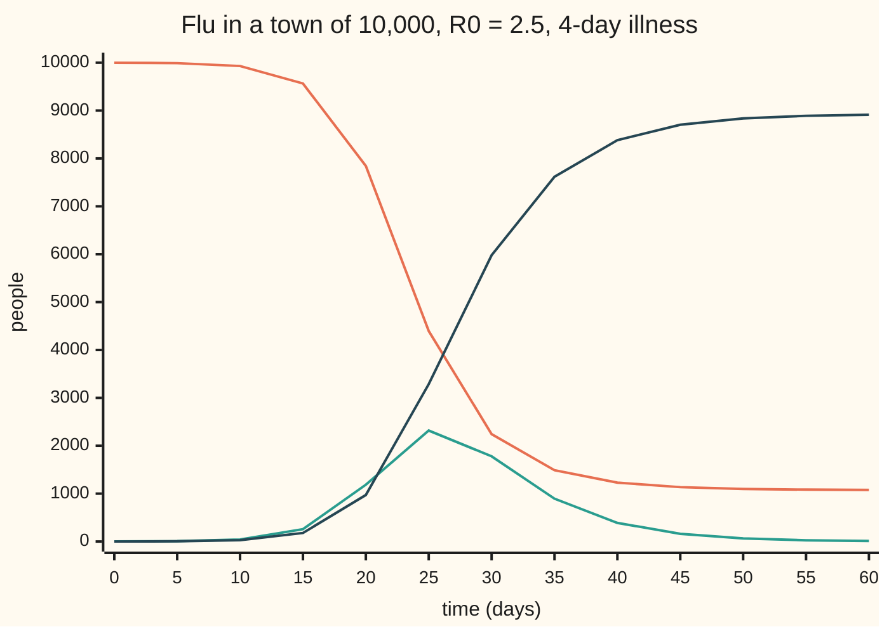
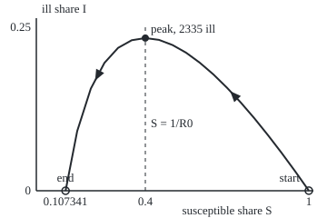

# The SIR model: an outbreak grows while each case infects more than one, and burns out before everyone is ill

[Syllabus](../../../SYLLABUS.md) → [Differential equations and dynamics](../README.md) → [Nonlinear Dynamics in the Plane](../README.md#s06) → The SIR model

---

## General Overview

A town of 10,000 people. On day 0 one resident comes home with flu, and nobody is immune. An ill person stays ill for 4 days on average and, while everyone around can still catch it, passes it to 0.625 people a day: 2.5 new cases per case, called the reproduction number.

Each resident sits in one of three boxes: susceptible (can still catch it), infected (ill and passing it on), removed (recovered and immune). Infection moves people from the first box to the second, time from the second to the third.

The number ill at once peaks at 2,335 on day 25.65, then falls, though 1,073 people never caught it: the flu ran out of carriers before it ran out of people. In all 8,927 residents, 89.3% of the town, fall ill.

**Cases multiply while each ill person infects more than one other; that stops once the susceptible share falls below one over the reproduction number, and the outbreak dies out with a fixed share of the town never infected.**

**What kind of fact this is:** a model, an assumption that the town mixes evenly and the rates stay fixed; inside it, the peak and the final size are theorems proved on this card in Why it works.

### The picture: the three boxes, day by day



Orange: susceptible. Green: ill at once. Dark blue: removed. The three add to 10,000.

---

## The formula

Notation from [A differential equation](../01-Rate%20Equations/01-what-a-differential-equation-says.md): $S'$ is the rate of $S$. Each box is measured as a share of the town, so $S + I + R = 1$. The SIR model is three rate laws:

$$S' = -bSI, \qquad I' = bSI - gI, \qquad R' = gI .$$

**Read it aloud:** meetings of susceptible and ill people turn the first into the second; a fixed fraction of the ill recover each day.

The **basic reproduction number** counts the new cases one ill person causes in a wholly susceptible town:

$$R_0 = \frac{b}{g} .$$

The **final size** $z$, the share ever infected, solves (for a tiny start)

$$z = 1 - e^{-R_0 z} .$$

| Symbol | Plain meaning | In our example | Push it up and the answer… |
| --- | --- | --- | --- |
| $t$ | time since the first case, in days | day 0 to 60 | the ill share rises, then falls |
| $S$, $S_0$ | share still susceptible; its value on day 0 | $S_0$ = 0.9999 | more fuel for the outbreak |
| $I$, $I_0$ | share ill and passing it on; its value on day 0 | $I_0$ = 0.0001, one person | more infections per day |
| $R$ | share removed: recovered and immune | 0 on day 0, 8,927 people at the end | — |
| $b$ | contact rate: infections per ill person per day, in a wholly susceptible town | 0.625 per day | earlier, higher peak |
| $g$ | recovery rate: fraction of the ill recovering each day; $1/g$ is the average illness | 0.25 per day, 4 days | smaller, later outbreak |
| $R_0$ | basic reproduction number, $b/g$ | 2.5 | larger final size |
| $S_\infty$ | the susceptible share left when the outbreak is over | 0.107341 | — |

The removed share $R$ and the number $R_0$ are unrelated; both names are standard.

### When it holds

- **The town mixes evenly.** Otherwise infections do not scale with $S$ times $I$; clustered contacts give a later, lower peak.
- **The rates stay fixed.** A school holiday lowers $b$ mid-outbreak; fixed $b$ then overstates the peak.
- **Immunity lasts.** If not, people flow from $R$ back to $S$ and the disease can settle at a steady level.
- **The town is closed and large.** No births or visitors, and smooth counts. Whether a lone first case passes it on at all is chance, which needs the probability wing.

---

## Why it works

### Step 0: infections need a meeting, recovery needs only time

A new case needs an ill person to meet a susceptible one; such meetings grow with both shares, so infections run at $b$ times $S$ times $I$. Recovery needs no meeting: a fixed fraction $g$ of the ill recover each day. The three rates add to zero, so the shares always add to 1, and the model lives in the plane of $S$ and $I$, with $R = 1 - S - I$.

### Step 1: R0 and the threshold

Factor the ill share's law:

$$I' = I\,(bS - g) .$$

The ill share grows exactly while $bS > g$, that is, $S > 1/R_0$. On day 0 $S$ is almost 1, so the early growth rate is $b - g$ = 0.375 per day, and cases double every ln 2 ÷ 0.375 = 1.85 days ([Logarithms](../../01-Foundations/03-Powers%2C%20Roots%20and%20Logarithms/05-logarithms.md)).

Why $b/g$ counts cases per case: infections come at $b$ per day for an illness of $1/g$ days, and 0.625 × 4 = 2.5. Below 1, $I'$ is negative from day 0 and nothing happens.

Every point with $I = 0$ is an equilibrium: a rest point, where nothing changes. [Linearisation](02-linearisation-and-the-jacobian.md) reads the motion near a rest point from the Jacobian, the 2×2 table of how each rate responds to a small change in $S$ and in $I$.

Its eigenvalues, the growth rates along its two special directions, are 0 and $bS - g$. That is +0.375 per day at the untouched town, so one case pushes the state away, and −0.1829 per day at the end state, so leftover illness decays.

### Step 2: the phase curve, a quantity the outbreak never changes

The path in the $S$-$I$ plane ([Phase portraits and nullclines](01-phase-portraits-and-nullclines.md)) needs no clock: while anyone is ill, $S$ falls steadily and can serve as one. Divide the two laws:

$$\frac{dI}{dS} = \frac{bSI - gI}{-bSI} = -1 + \frac{1}{R_0 S} .$$

Integrating in $S$:

$$I + S - \frac{\ln S}{R_0} = \text{constant} = I_0 + S_0 - \frac{\ln S_0}{R_0} .$$

The same trick gives the closed orbits of [Predator and prey](06-predator-prey.md); here the curve is open and runs down to $I = 0$.

### The picture: the outbreak in the S-I plane

<p align="center"></p>

Scale: 300 units per unit of $S$ across, 720 units per unit of $I$ up, one point every 0.05 of $S$. The state moves right to left, because $S$ only falls. The dashed line is the nullcline $S = 1/R_0$, where $I' = 0$.

### Step 3: the peak sits where S = 1/R0

The ill share peaks where $I' = 0$, at $S = 1/R_0$ = 0.4. On the phase curve:

$$I_{\max} = S_0 + I_0 - \frac{1}{R_0}\bigl(1 + \ln(R_0 S_0)\bigr) .$$

With $S_0$ = 0.9999 and $I_0$ = 0.0001 this is 0.233524: 2,335 ill at once. The date, day 25.65, needs the laws stepped through time.

### Step 4: the final size

The outbreak ends with $I = 0$. Put $I = 0$ into the phase curve and call the leftover susceptible share $S_\infty$:

$$S_\infty - \frac{\ln S_\infty}{R_0} = S_0 + I_0 - \frac{\ln S_0}{R_0} .$$

As the start shrinks to nothing, $S_0 \to 1$ and $I_0 \to 0$, leaving $\ln S_\infty = -R_0(1 - S_\infty)$; with $z = 1 - S_\infty$ that is $z = 1 - e^{-R_0 z}$, root 0.892645. With the actual single case the exact version gives $S_\infty$ = 0.107341: 8,927 fall ill.

The gap $1 - e^{-R_0 z} - z$ is 0 at $z = 0$, rises at first (slope $R_0 - 1 > 0$), is negative at $z = 1$ and bends downward throughout. So it crosses zero exactly once more. When $R_0 \le 1$ the only root is 0: no outbreak.

### Step 5: why it burns out before everyone is ill

Past the peak each case infects fewer than one other, so the ill share shrinks while susceptible people remain: the flu runs out of carriers, not fuel. The phase curve forbids $S$ reaching 0: $\ln S$ would fall to minus infinity and push $I$ to plus infinity.

<details>
<summary>Detailed proof: the outbreak ends, and ends with S above zero</summary>

$S$ never rises and never goes below 0, so it settles to a limit $S_\infty$; $R$ never falls and stays below 1, so it settles too, and so does $I = 1 - S - R$. If that limit were positive, $R' = gI$ would stay above a fixed positive amount and push $R$ past 1. So $I \to 0$.

The quantity $I + S - \ln(S)/R_0$ is constant along the path: its rate is $I' + S' - S'/(R_0 S) = -gI + gI = 0$, using $S'/(R_0 S) = -gI$. If $S$ tended to 0, $-\ln(S)/R_0$ would grow without bound while $I + S$ stays below 1, breaking the constant. So $S_\infty > 0$. It is the root of Step 4 below $1/R_0$: above it, $I' = I(bS - g)$ would stay positive and $I$ could not fall to 0.

</details>

A second road needs no phase curve: step the laws forward in time, as the code does.

---

## Worked numbers, by hand

| Step | Arithmetic | Value |
| --- | --- | --- |
| reproduction number | $R_0$ = 0.625 ÷ 0.25 | 2.5 |
| early growth | 0.625 − 0.25 per day; doubling ln 2 ÷ 0.375 | 0.375 per day, 1.85 days |
| peak threshold | $S$ = 1 ÷ 2.5 | 0.4 |
| peak height | 1 − 0.4 × (1 + ln(2.5 × 0.9999)) | 0.233524: **2,335 ill** |
| final size | root of $z$ = 1 − e^(−2.5z), by halving an interval | 0.892645 |
| exact end state | $S_\infty$ with the single case | 0.107341: **8,927 ever ill** |

On day 25.65, 2,335 residents are ill at once; 1,073 never catch it.

### What breaks if you drop a piece

| Mistake | Comes out at | What went wrong |
| --- | --- | --- |
| Pure growth e^(0.375t), no depletion | 15,044 ill on day 25.65, in a town of 10,000 | The growth rate is $bS - g$, not $b - g$ |
| Threshold 1 − 1/R0 read as the final size | 60%, not 89.3% | 2,927 more are infected after the peak |
| $g$ = 4 per day from a 4-day illness | $R_0$ = 0.1562, no outbreak | The illness lasts $1/g$ days |

---

## Code, from first principles, and it actually runs

Road one steps the laws with Runge-Kutta 4 (four slope samples per step, averaged; [Runge-Kutta four](../05-Numerical%20Evolution/04-runge-kutta-four.md)) to the peak and the end state; its error falls about sixteenfold as the step halves, the mark of a fourth-order rule. Road two never touches time: the peak from the phase curve at $S = 1/R_0$, the end by bisection (halving an interval that brackets a root) where the curve meets $I = 0$. The checks also build the Jacobian by differences and read its eigenvalues at both rests.

### Python

```python
# The SIR model -- the check behind the card.  Nothing is imported but math.exp
# and math.log.  A flu in a town of 10,000: S, I, R are the shares susceptible,
# ill and recovered; S' = -bSI, I' = bSI - gI, R' = gI, time in days, one case
# on day 0.  Road one steps the equations (Runge-Kutta 4, written out); road two
# is the phase curve I + S - ln(S)/R0 = constant, which needs no stepping at all.
from math import exp, log
N, B, G = 10000, 0.625, 0.25                     # town, contact rate, recovery rate
R0, S0, I0 = B / G, 1 - 1 / N, 1 / N
def f(s, i): return -B * s * i, B * s * i - G * i
def rk4(s, i, h):                                # one Runge-Kutta 4 step
    a = f(s, i); b = f(s + h / 2 * a[0], i + h / 2 * a[1])
    c = f(s + h / 2 * b[0], i + h / 2 * b[1]); d = f(s + h * c[0], i + h * c[1])
    return s + h / 6 * (a[0] + 2 * b[0] + 2 * c[0] + d[0]), i + h / 6 * (a[1] + 2 * b[1] + 2 * c[1] + d[1])
def run(h, days):                                # every step, as (t, S, I)
    s, i, out = S0, I0, [(0.0, S0, I0)]
    for k in range(1, round(days / h) + 1): s, i = rk4(s, i, h); out.append((k * h, s, i))
    return out
def phase_i(s): return S0 + I0 - s + (log(s) - log(S0)) / R0      # road two: I on the phase curve
def bisect(fn, lo, hi):                          # root finder, written out
    for _ in range(200):
        mid = (lo + hi) / 2
        lo, hi = (mid, hi) if fn(lo) * fn(mid) > 0 else (lo, mid)
    return (lo + hi) / 2
def eig(s, i, d=1e-6):                           # Jacobian by differences; 2x2 eigenvalues from trace and det
    j = [[(f(s + d, i)[r] - f(s - d, i)[r]) / (2 * d), (f(s, i + d)[r] - f(s, i - d)[r]) / (2 * d)] for r in (0, 1)]
    tr, det = j[0][0] + j[1][1], j[0][0] * j[1][1] - j[0][1] * j[1][0]
    q = (tr * tr / 4 - det) ** 0.5
    return tr / 2 - q, tr / 2 + q
path = run(0.01, 300)
k = max(range(len(path)), key=lambda n: path[n][2])
t_pk, s_pk, i_pk = path[k]
s_inf = bisect(lambda s: phase_i(s), 1e-9, 1 / R0)                # the phase curve meets I = 0
z = bisect(lambda z: 1 - exp(-R0 * z) - z, 0.5, 1)                 # vanishing-start form
err = [run(h, 300)[-1][1] - s_inf for h in (1, 0.5, 0.25)]
days = [row for row in path if abs(row[0] / 5 - round(row[0] / 5)) < 1e-6 and row[0] <= 60.001]
print(f"town {N}; b = {B}/day, g = {G}/day, illness 1/g = {1 / G:.0f} days; R0 = b/g = {R0}; one case on day 0")
print(f"early growth: I' = (b - g) I = {B - G:.3f} I per day; cases double every {log(2) / (B - G):.2f} days")
print("eigenvalues at (S, I) = (1, 0): {:+.4f} {:+.4f} per day".format(*eig(1, 0)))
print("eigenvalues at (S_inf, 0): {:+.4f} {:+.4f} per day".format(*eig(s_inf, 0)))
print(f"peak, phase curve at S = 1/R0 = {1 / R0}: I = {phase_i(1 / R0):.6f}, {N * phase_i(1 / R0):.0f} ill")
print(f"peak, Runge-Kutta h = 0.01: I = {i_pk:.6f}, {N * i_pk:.0f} ill on day {t_pk:.2f}, S there {s_pk:.4f}")
print(f"final size, phase curve meets I = 0: S_inf = {s_inf:.6f}; {N * (1 - s_inf):.0f} ever ill ({100 * (1 - s_inf):.1f}%), {N * s_inf:.0f} never")
print(f"final size, Runge-Kutta day 300: S = {path[-1][1]:.6f}; z = 1 - e^(-2.5 z) from a vanishing start: {z:.6f}")
print("Runge-Kutta error in never-ill people, day 300, h = 1, 0.5, 0.25: {:.7f} {:.7f} {:.7f}; ratios {:.1f} {:.1f}".format(*(N * e for e in err), err[0] / err[1], err[1] / err[2]))
print("chart days:", " ".join(f"{t:.0f}" for t, _, _ in days))
print("chart S:", " ".join(f"{N * s:.0f}" for _, s, _ in days))
print("chart I:", " ".join(f"{N * i:.0f}" for _, _, i in days))
print("chart R:", " ".join(f"{max(0.0, N * (1 - s - i)):.0f}" for _, s, i in days))
print(f"mistake 1, no depletion: e^({B - G} x {t_pk:.2f}) = {exp((B - G) * t_pk):.0f} ill at the peak day, in a town of {N}")
print(f"mistake 2, threshold 1 - 1/R0 = {1 - 1 / R0:.0%} read as the final size; overshoot {N * (1 - s_inf - (1 - 1 / R0)):.0f} people")
print(f"mistake 3, g = 4 per day (the period used as the rate): R0 = {B / 4:.4f}, no outbreak")
X = lambda s: 40 + 300 * s; Y = lambda i: 210 - 720 * i          # 300 units per unit S, 720 per unit I
print(f"figure, peak ({X(1 / R0):.1f}, {Y(phase_i(1 / R0)):.1f}); start x {X(S0):.1f}; end x {X(s_inf):.1f}")
print("figure, curve:", " ".join(f"{X(s):.1f},{Y(phase_i(s)):.1f}" for s in [S0] + [1 - 0.05 * n for n in range(1, 18)] + [s_inf]))
assert abs(i_pk - phase_i(1 / R0)) < 1e-6 and abs(s_pk - 1 / R0) < 0.002   # peak: stepping vs phase curve
assert abs(path[-1][1] - s_inf) < 1e-7                                     # final size: stepping vs root
assert 14 < err[0] / err[1] < 18                                            # fourth order: error / 16
assert abs(eig(1, 0)[1] - (B - G)) < 1e-6 and abs(eig(s_inf, 0)[0] - (B * s_inf - G)) < 1e-6   # vs hand Jacobian
print("ALL CHECKS PASS")
```

**Ran 2026-09-28 on macOS, Python 3.14.6, standard library only. All checks passed. Output, pasted from the run:**

```
town 10000; b = 0.625/day, g = 0.25/day, illness 1/g = 4 days; R0 = b/g = 2.5; one case on day 0
early growth: I' = (b - g) I = 0.375 I per day; cases double every 1.85 days
eigenvalues at (S, I) = (1, 0): +0.0000 +0.3750 per day
eigenvalues at (S_inf, 0): -0.1829 +0.0000 per day
peak, phase curve at S = 1/R0 = 0.4: I = 0.233524, 2335 ill
peak, Runge-Kutta h = 0.01: I = 0.233524, 2335 ill on day 25.65, S there 0.4000
final size, phase curve meets I = 0: S_inf = 0.107341; 8927 ever ill (89.3%), 1073 never
final size, Runge-Kutta day 300: S = 0.107341; z = 1 - e^(-2.5 z) from a vanishing start: 0.892645
Runge-Kutta error in never-ill people, day 300, h = 1, 0.5, 0.25: 0.0051171 0.0003118 0.0000193; ratios 16.4 16.1
chart days: 0 5 10 15 20 25 30 35 40 45 50 55 60
chart S: 9999 9990 9930 9565 7843 4397 2243 1489 1230 1135 1098 1083 1077
chart I: 1 7 42 258 1186 2317 1779 894 389 161 65 26 11
chart R: 0 4 28 178 972 3286 5978 7617 8381 8704 8837 8891 8912
mistake 1, no depletion: e^(0.375 x 25.65) = 15044 ill at the peak day, in a town of 10000
mistake 2, threshold 1 - 1/R0 = 60% read as the final size; overshoot 2927 people
mistake 3, g = 4 per day (the period used as the rate): R0 = 0.1562, no outbreak
figure, peak (160.0, 41.9); start x 340.0; end x 72.2
figure, curve: 340.0,209.9 325.0,188.7 310.0,168.3 295.0,148.8 280.0,130.2 265.0,112.8 250.0,96.7 235.0,82.0 220.0,69.1 205.0,58.1 190.0,49.6 175.0,43.9 160.0,41.9 145.0,44.3 130.0,52.7 115.0,69.2 100.0,97.5 85.0,144.3 72.2,210.0
ALL CHECKS PASS
```

### Rust

Same numbers, same labels, built with `rustc --edition 2021 -O`.

```rust
// The SIR model -- the same check as the Python, in Rust.  No crates.  A flu
// in a town of 10,000: S, I, R are the shares susceptible, ill and recovered;
// S' = -bSI, I' = bSI - gI, R' = gI, time in days, one case on day 0.  Road one
// steps the equations (Runge-Kutta 4, written out); road two is the phase
// curve I + S - ln(S)/R0 = constant, which needs no stepping at all.
const N: f64 = 10000.0;
const B: f64 = 0.625; const G: f64 = 0.25;          // contact rate and recovery rate, per day
const R0: f64 = B / G;
const I0: f64 = 1.0 / N;
const S0: f64 = 1.0 - I0;

fn f(s: f64, i: f64) -> [f64; 2] { [-B * s * i, B * s * i - G * i] }

fn rk4(s: f64, i: f64, h: f64) -> (f64, f64) {             // one Runge-Kutta 4 step
    let a = f(s, i);
    let b = f(s + h / 2.0 * a[0], i + h / 2.0 * a[1]);
    let c = f(s + h / 2.0 * b[0], i + h / 2.0 * b[1]);
    let d = f(s + h * c[0], i + h * c[1]);
    (s + h / 6.0 * (a[0] + 2.0 * b[0] + 2.0 * c[0] + d[0]), i + h / 6.0 * (a[1] + 2.0 * b[1] + 2.0 * c[1] + d[1]))
}

fn run(h: f64, days: f64) -> Vec<(f64, f64, f64)> {         // every step, as (t, S, I)
    let (mut s, mut i, mut out) = (S0, I0, vec![(0.0, S0, I0)]);
    for k in 1..=(days / h).round() as usize { let n = rk4(s, i, h); s = n.0; i = n.1; out.push((k as f64 * h, s, i)); }
    out
}

fn phase_i(s: f64) -> f64 { S0 + I0 - s + (s.ln() - S0.ln()) / R0 }   // road two: I on the phase curve

fn bisect(fun: &dyn Fn(f64) -> f64, mut lo: f64, mut hi: f64) -> f64 {   // root finder, written out
    for _ in 0..200 { let mid = (lo + hi) / 2.0; if fun(lo) * fun(mid) > 0.0 { lo = mid } else { hi = mid } }
    (lo + hi) / 2.0
}

fn eig(s: f64, i: f64) -> (f64, f64) {       // Jacobian by differences; 2x2 eigenvalues from trace and det
    let d = 1e-6;
    let j: Vec<[f64; 2]> = (0..2).map(|r| [(f(s + d, i)[r] - f(s - d, i)[r]) / (2.0 * d), (f(s, i + d)[r] - f(s, i - d)[r]) / (2.0 * d)]).collect();
    let (tr, det) = (j[0][0] + j[1][1], j[0][0] * j[1][1] - j[0][1] * j[1][0]);
    let q = (tr * tr / 4.0 - det).sqrt();
    (tr / 2.0 - q, tr / 2.0 + q)
}

fn join(v: Vec<String>) -> String { v.join(" ") }

fn main() {
    let path = run(0.01, 300.0);
    let (t_pk, s_pk, i_pk) = *path.iter().max_by(|a, b| a.2.partial_cmp(&b.2).unwrap()).unwrap();
    let s_inf = bisect(&|s| phase_i(s), 1e-9, 1.0 / R0);                  // the phase curve meets I = 0
    let z = bisect(&|z| 1.0 - (-R0 * z).exp() - z, 0.5, 1.0);             // vanishing-start form
    let err: Vec<f64> = [1.0, 0.5, 0.25].iter().map(|&h| run(h, 300.0).last().unwrap().1 - s_inf).collect();
    let days: Vec<&(f64, f64, f64)> = path.iter().filter(|r| (r.0 / 5.0 - (r.0 / 5.0).round()).abs() < 1e-6 && r.0 <= 60.001).collect();
    let s_end = path.last().unwrap().1;
    let (e1, e2) = (eig(1.0, 0.0), eig(s_inf, 0.0));
    println!("town {}; b = {}/day, g = {}/day, illness 1/g = {:.0} days; R0 = b/g = {}; one case on day 0", N, B, G, 1.0 / G, R0);
    println!("early growth: I' = (b - g) I = {:.3} I per day; cases double every {:.2} days", B - G, 2f64.ln() / (B - G));
    println!("eigenvalues at (S, I) = (1, 0): {:+.4} {:+.4} per day", e1.0, e1.1);
    println!("eigenvalues at (S_inf, 0): {:+.4} {:+.4} per day", e2.0, e2.1);
    println!("peak, phase curve at S = 1/R0 = {}: I = {:.6}, {:.0} ill", 1.0 / R0, phase_i(1.0 / R0), N * phase_i(1.0 / R0));
    println!("peak, Runge-Kutta h = 0.01: I = {:.6}, {:.0} ill on day {:.2}, S there {:.4}", i_pk, N * i_pk, t_pk, s_pk);
    println!("final size, phase curve meets I = 0: S_inf = {:.6}; {:.0} ever ill ({:.1}%), {:.0} never", s_inf, N * (1.0 - s_inf), 100.0 * (1.0 - s_inf), N * s_inf);
    println!("final size, Runge-Kutta day 300: S = {:.6}; z = 1 - e^(-2.5 z) from a vanishing start: {:.6}", s_end, z);
    println!("Runge-Kutta error in never-ill people, day 300, h = 1, 0.5, 0.25: {:.7} {:.7} {:.7}; ratios {:.1} {:.1}", N * err[0], N * err[1], N * err[2], err[0] / err[1], err[1] / err[2]);
    println!("chart days: {}", join(days.iter().map(|r| format!("{:.0}", r.0)).collect()));
    println!("chart S: {}", join(days.iter().map(|r| format!("{:.0}", N * r.1)).collect()));
    println!("chart I: {}", join(days.iter().map(|r| format!("{:.0}", N * r.2)).collect()));
    println!("chart R: {}", join(days.iter().map(|r| format!("{:.0}", (N * (1.0 - r.1 - r.2)).max(0.0))).collect()));
    println!("mistake 1, no depletion: e^({} x {:.2}) = {:.0} ill at the peak day, in a town of {}", B - G, t_pk, ((B - G) * t_pk).exp(), N);
    println!("mistake 2, threshold 1 - 1/R0 = {:.0}% read as the final size; overshoot {:.0} people", 100.0 * (1.0 - 1.0 / R0), N * (1.0 - s_inf - (1.0 - 1.0 / R0)));
    println!("mistake 3, g = 4 per day (the period used as the rate): R0 = {:.4}, no outbreak", B / 4.0);
    let x = |s: f64| 40.0 + 300.0 * s;                       // 300 units per unit S
    let y = |i: f64| 210.0 - 720.0 * i;                      // 720 units per unit I
    println!("figure, peak ({:.1}, {:.1}); start x {:.1}; end x {:.1}", x(1.0 / R0), y(phase_i(1.0 / R0)), x(S0), x(s_inf));
    let mut ss = vec![S0]; ss.extend((1..18).map(|n| 1.0 - 0.05 * n as f64)); ss.push(s_inf);
    println!("figure, curve: {}", join(ss.iter().map(|&s| format!("{:.1},{:.1}", x(s), y(phase_i(s)))).collect()));
    assert!((i_pk - phase_i(1.0 / R0)).abs() < 1e-6 && (s_pk - 1.0 / R0).abs() < 0.002);   // peak: stepping vs phase curve
    assert!((s_end - s_inf).abs() < 1e-7);                                                  // final size: stepping vs root
    assert!(err[0] / err[1] > 14.0 && err[0] / err[1] < 18.0);                               // fourth order: error / 16
    assert!((e1.1 - (B - G)).abs() < 1e-6 && (e2.0 - (B * s_inf - G)).abs() < 1e-6);         // vs hand Jacobian
    println!("ALL CHECKS PASS");
}
```

**Ran 2026-09-28 on macOS, rustc 1.98.1, no crates. All checks passed. Output, pasted from the run:**

```
town 10000; b = 0.625/day, g = 0.25/day, illness 1/g = 4 days; R0 = b/g = 2.5; one case on day 0
early growth: I' = (b - g) I = 0.375 I per day; cases double every 1.85 days
eigenvalues at (S, I) = (1, 0): +0.0000 +0.3750 per day
eigenvalues at (S_inf, 0): -0.1829 +0.0000 per day
peak, phase curve at S = 1/R0 = 0.4: I = 0.233524, 2335 ill
peak, Runge-Kutta h = 0.01: I = 0.233524, 2335 ill on day 25.65, S there 0.4000
final size, phase curve meets I = 0: S_inf = 0.107341; 8927 ever ill (89.3%), 1073 never
final size, Runge-Kutta day 300: S = 0.107341; z = 1 - e^(-2.5 z) from a vanishing start: 0.892645
Runge-Kutta error in never-ill people, day 300, h = 1, 0.5, 0.25: 0.0051171 0.0003118 0.0000193; ratios 16.4 16.1
chart days: 0 5 10 15 20 25 30 35 40 45 50 55 60
chart S: 9999 9990 9930 9565 7843 4397 2243 1489 1230 1135 1098 1083 1077
chart I: 1 7 42 258 1186 2317 1779 894 389 161 65 26 11
chart R: 0 4 28 178 972 3286 5978 7617 8381 8704 8837 8891 8912
mistake 1, no depletion: e^(0.375 x 25.65) = 15044 ill at the peak day, in a town of 10000
mistake 2, threshold 1 - 1/R0 = 60% read as the final size; overshoot 2927 people
mistake 3, g = 4 per day (the period used as the rate): R0 = 0.1562, no outbreak
figure, peak (160.0, 41.9); start x 340.0; end x 72.2
figure, curve: 340.0,209.9 325.0,188.7 310.0,168.3 295.0,148.8 280.0,130.2 265.0,112.8 250.0,96.7 235.0,82.0 220.0,69.1 205.0,58.1 190.0,49.6 175.0,43.9 160.0,41.9 145.0,44.3 130.0,52.7 115.0,69.2 100.0,97.5 85.0,144.3 72.2,210.0
ALL CHECKS PASS
```

The two outputs match line for line.

### Lean

Lean proves the threshold, the peak and the final size for any positive rates b and g, starting with $S_0$ and $I_0$ above 0.

- Under the laws $S' = -bSI$ and $I' = bSI - gI$, both shares stay above 0 and the susceptible share only falls.
- The ill share rises between two times whenever $S$ is still above $1/R_0$ at the later time.
- Once $S$ is at or below $1/R_0$, the ill share falls from then on.
- The outbreak dies out: $I$ tends to 0.
- $S$ settles at a share $S_\infty$ between 0 and $1/R_0$, so a fixed share of the town is never infected.
- That $S_\infty$ solves the Step 4 equation $S_\infty - \ln(S_\infty)/R_0 = S_0 + I_0 - \ln(S_0)/R_0$.
- If $S_0$ is above $1/R_0$, then on some day $S$ equals $1/R_0$. There the ill share reaches its largest value, $I_{\max} = S_0 + I_0 - \frac{1}{R_0}\bigl(1 + \ln(R_0 S_0)\bigr)$.
- For $R_0 > 1$, $z = 1 - e^{-R_0 z}$ has exactly one root above 0, and it lies below 1. For $R_0 \le 1$ the only root at or above 0 is 0.
- The flu: $R_0$ = 0.625 ÷ 0.25 = 0.625 × 4 = 2.5, an illness of 4 days and early growth of 0.375 per day.
- The threshold $1/R_0$ is 0.4, the vaccination target is 60%, and $S_0 + I_0 = 1$.
- The Jacobian at the untouched town has trace 0.375 and determinant 0, so its eigenvalues are 0 and +0.375 per day.
- Of 10,000 people, 8,927 ever ill leaves 1,073 never ill, and 2,927 more than the 60% are infected.
- Using 4 as the rate gives $R_0$ = 0.625 ÷ 4 = 0.15625, below 1.

The decimals, the peak day 25.65, the Runge-Kutta steps, the chart and the figure are left to the Python and Rust checks.

```lean
-- The SIR model: in S' = -bSI, I' = bSI - gI with positive rates, the ill share grows while S is above 1/R0 = g/b and falls once S is at or below it, the outbreak dies out with a positive share never infected that solves the final-size equation, the peak height is S0 + I0 - (1/R0)(1 + ln(R0 S0)), and z = 1 - e^(-R0 z) has one positive root exactly when R0 > 1.
import Mathlib.Analysis.SpecialFunctions.Log.Deriv
import Mathlib.Analysis.SpecialFunctions.Exp
import Mathlib.Analysis.Calculus.Deriv.Basic
import Mathlib.Order.Filter.AtTopBot.Basic
import Mathlib.Tactic.NormNum
import Mathlib.Analysis.ODE.ExistUnique
import Mathlib.Analysis.Calculus.Deriv.MeanValue
import Mathlib.Analysis.Convex.SpecificFunctions.Basic
import Mathlib.Topology.Order.MonotoneConvergence
import Mathlib.Topology.Order.IntermediateValue

open Filter Topology

/-- A positive solution of a linear equation f' = c·f with continuous c stays positive. -/
theorem sir_pos_of_linear {f c : ℝ → ℝ} (hc : ContinuousOn c (Set.Ici 0))
    (hf : ∀ t, 0 ≤ t → HasDerivAt f (c t * f t) t) (h0 : 0 < f 0) :
    ∀ t, 0 ≤ t → 0 < f t := by
  intro t ht
  by_contra hneg
  push Not at hneg
  have hfc : ContinuousOn f (Set.Icc 0 t) := fun x hx =>
    (hf x hx.1).continuousAt.continuousWithinAt
  obtain ⟨τ, hτ, hfτ⟩ : ∃ τ ∈ Set.Icc 0 t, f τ = 0 :=
    intermediate_value_Icc' ht hfc ⟨hneg, h0.le⟩
  obtain ⟨C, hC⟩ := (isCompact_Icc (a := (0:ℝ)) (b := τ)).exists_bound_of_continuousOn
    (hc.mono (fun x hx => (hx.1 : (0:ℝ) ≤ x)))
  have heq : Set.EqOn f (fun _ => (0:ℝ)) (Set.Icc 0 τ) := by
    apply ODE_solution_unique_of_mem_Icc_left (v := fun s x => c s * x) (s := fun _ => Set.univ)
      (K := Real.toNNReal C)
    · intro s hs
      apply LipschitzWith.lipschitzOnWith
      apply LipschitzWith.of_dist_le_mul
      intro x y
      rw [Real.dist_eq, Real.dist_eq, ← mul_sub, abs_mul]
      have := hC s (Set.Ioc_subset_Icc_self hs)
      rw [Real.norm_eq_abs] at this
      exact mul_le_mul_of_nonneg_right (this.trans (Real.le_coe_toNNReal C)) (abs_nonneg _)
    · exact hfc.mono (Set.Icc_subset_Icc_right hτ.2)
    · intro s hs
      exact (hf s hs.1.le).hasDerivWithinAt
    · intro s hs; trivial
    · exact continuousOn_const
    · intro s hs
      simpa using (hasDerivAt_const s (0:ℝ)).hasDerivWithinAt
    · intro s hs; trivial
    · simpa using hfτ
  have := heq (Set.left_mem_Icc.2 hτ.1)
  simp at this
  linarith

/-- In the SIR laws, both shares stay positive. -/
theorem sir_pos {b g : ℝ} {S I : ℝ → ℝ}
    (hS : ∀ t, 0 ≤ t → HasDerivAt S (-b * S t * I t) t)
    (hI : ∀ t, 0 ≤ t → HasDerivAt I (b * S t * I t - g * I t) t)
    (hS0 : 0 < S 0) (hI0 : 0 < I 0) : ∀ t, 0 ≤ t → 0 < S t ∧ 0 < I t := by
  have hSc : ContinuousOn S (Set.Ici 0) := fun t ht => (hS t ht).continuousAt.continuousWithinAt
  have hIc : ContinuousOn I (Set.Ici 0) := fun t ht => (hI t ht).continuousAt.continuousWithinAt
  intro t ht
  constructor
  · refine sir_pos_of_linear (c := fun t => -b * I t) (continuousOn_const.mul hIc)
      (fun s hs => ?_) hS0 t ht
    convert hS s hs using 1
    ring
  · refine sir_pos_of_linear (c := fun t => b * S t - g)
      ((continuousOn_const.mul hSc).sub continuousOn_const) (fun s hs => ?_) hI0 t ht
    convert hI s hs using 1
    ring

/-- In the SIR laws, S + I - ln(S)/R0 stays constant. -/
theorem sir_conserved {b g : ℝ} (hb : 0 < b) (_hg : 0 < g) {S I : ℝ → ℝ}
    (hS : ∀ t, 0 ≤ t → HasDerivAt S (-b * S t * I t) t)
    (hI : ∀ t, 0 ≤ t → HasDerivAt I (b * S t * I t - g * I t) t)
    (hS0 : 0 < S 0) (hI0 : 0 < I 0) :
    ∀ t, 0 ≤ t → S t + I t - Real.log (S t) / (b / g) =
      S 0 + I 0 - Real.log (S 0) / (b / g) := by
  have hpos := sir_pos hS hI hS0 hI0
  have hH : ∀ t, 0 ≤ t →
      HasDerivAt (fun t => S t + I t - Real.log (S t) / (b / g)) 0 t := by
    intro t ht
    have h := ((hS t ht).add (hI t ht)).sub
      (((hS t ht).log (hpos t ht).1.ne').div_const (b / g))
    convert h using 1
    have := (hpos t ht).1.ne'
    field_simp
    ring
  intro t ht
  have := constant_of_has_deriv_right_zero
    (f := fun t => S t + I t - Real.log (S t) / (b / g)) (a := 0) (b := t)
    (fun x hx => (hH x hx.1).continuousAt.continuousWithinAt)
    (fun x hx => (hH x hx.1).hasDerivWithinAt) t ⟨ht, le_refl t⟩
  exact this

#print axioms sir_pos_of_linear
#print axioms sir_pos
#print axioms sir_conserved

/-- **Threshold and burn-out.** Take a contact rate b > 0 and a recovery rate g > 0, fixed in
time, so the reproduction number is R0 = b/g. Let the susceptible share S(t) and the ill share
I(t) follow the SIR laws S' = -b·S·I and I' = b·S·I - g·I for every time t ≥ 0, starting with
some people susceptible and some ill (S(0) > 0, I(0) > 0). Then:
1. both shares stay positive, and the susceptible share only falls;
2. cases multiply while S is above 1/R0: between two times, I rises whenever S is still above
   1/R0 at the later time;
3. once S is at or below 1/R0, the ill share falls from then on;
4. the outbreak dies out (I tends to 0) and S settles at a share S∞ with 0 < S∞ < 1/R0, so a
   fixed share of the town is never infected; that share solves the final-size equation
   S∞ - ln(S∞)/R0 = S0 + I0 - ln(S0)/R0. -/
theorem sir_outbreak_grows_above_threshold_and_burns_out
    {b g : ℝ} (hb : 0 < b) (hg : 0 < g) {S I : ℝ → ℝ}
    (hS : ∀ t, 0 ≤ t → HasDerivAt S (-b * S t * I t) t)
    (hI : ∀ t, 0 ≤ t → HasDerivAt I (b * S t * I t - g * I t) t)
    (hS0 : 0 < S 0) (hI0 : 0 < I 0) :
    (∀ t, 0 ≤ t → 0 < S t ∧ 0 < I t) ∧
    StrictAntiOn S (Set.Ici 0) ∧
    (∀ t₁ t₂, 0 ≤ t₁ → t₁ < t₂ → 1 / (b / g) < S t₂ → I t₁ < I t₂) ∧
    (∀ t₀, 0 ≤ t₀ → S t₀ ≤ 1 / (b / g) → StrictAntiOn I (Set.Ici t₀)) ∧
    Tendsto I atTop (𝓝 0) ∧
    ∃ Sinf, 0 < Sinf ∧ Sinf < 1 / (b / g) ∧ Tendsto S atTop (𝓝 Sinf) ∧
      Sinf - Real.log Sinf / (b / g) = S 0 + I 0 - Real.log (S 0) / (b / g) := by
  have hpos := sir_pos hS hI hS0 hI0
  have hcons := sir_conserved hb hg hS hI hS0 hI0
  have hSc : ContinuousOn S (Set.Ici 0) := fun t ht => (hS t ht).continuousAt.continuousWithinAt
  have hIc : ContinuousOn I (Set.Ici 0) := fun t ht => (hI t ht).continuousAt.continuousWithinAt
  have hR : 0 < b / g := div_pos hb hg
  have hanti : StrictAntiOn S (Set.Ici 0) := by
    apply strictAntiOn_of_deriv_neg (convex_Ici 0) hSc
    intro t ht
    rw [interior_Ici] at ht
    have ht' : 0 ≤ t := le_of_lt ht
    rw [(hS t ht').deriv]
    have := mul_pos (mul_pos hb (hpos t ht').1) (hpos t ht').2
    linarith
  have hgrow : ∀ t₁ t₂, 0 ≤ t₁ → t₁ < t₂ → 1 / (b / g) < S t₂ → I t₁ < I t₂ := by
    intro t₁ t₂ ht₁ ht₁₂ hSt₂
    have hmono : StrictMonoOn I (Set.Icc t₁ t₂) := by
      apply strictMonoOn_of_deriv_pos (convex_Icc t₁ t₂)
        (hIc.mono (fun x hx => le_trans ht₁ hx.1))
      intro t ht
      rw [interior_Icc] at ht
      have ht0 : 0 ≤ t := by linarith [ht.1]
      rw [(hI t ht0).deriv]
      have hlt : S t₂ < S t := hanti (Set.mem_Ici.2 ht0) (Set.mem_Ici.2 (by linarith [ht.2])) ht.2
      have h1 : 1 / (b / g) < S t := lt_trans hSt₂ hlt
      rw [one_div_div, div_lt_iff₀ hb] at h1
      have := mul_pos (sub_pos.2 h1) (hpos t ht0).2
      nlinarith
    exact hmono (Set.left_mem_Icc.2 ht₁₂.le) (Set.right_mem_Icc.2 ht₁₂.le) ht₁₂
  have hshrink : ∀ t₀, 0 ≤ t₀ → S t₀ ≤ 1 / (b / g) → StrictAntiOn I (Set.Ici t₀) := by
    intro t₀ ht₀ hSt₀
    apply strictAntiOn_of_deriv_neg (convex_Ici t₀)
      (hIc.mono (fun x hx => le_trans ht₀ (Set.mem_Ici.1 hx)))
    intro t ht
    rw [interior_Ici] at ht
    have ht0 : 0 ≤ t := le_trans ht₀ (le_of_lt ht)
    rw [(hI t ht0).deriv]
    have hlt : S t < S t₀ := hanti (Set.mem_Ici.2 ht₀) (Set.mem_Ici.2 ht0) ht
    have h1 : S t < 1 / (b / g) := lt_of_lt_of_le hlt hSt₀
    rw [one_div_div, lt_div_iff₀ hb] at h1
    have := mul_pos (sub_pos.2 h1) (hpos t ht0).2
    nlinarith
  set C := S 0 + I 0 - Real.log (S 0) / (b / g) with hC
  have hlow : ∀ t, 0 ≤ t → Real.exp (-(C * (b / g))) < S t := by
    intro t ht
    have h1 := hcons t ht
    have hSt := (hpos t ht).1
    have hIt := (hpos t ht).2
    rw [← Real.lt_log_iff_exp_lt hSt]
    have h2 : -C < Real.log (S t) / (b / g) := by linarith
    have h3 := (lt_div_iff₀ hR).1 h2
    linarith
  set m := Real.exp (-(C * (b / g))) with hm
  have hmpos : 0 < m := Real.exp_pos _
  have hS'anti : Antitone (fun t => S (max t 0)) := by
    intro x y hxy
    exact hanti.antitoneOn (Set.mem_Ici.2 (le_max_right x 0)) (Set.mem_Ici.2 (le_max_right y 0))
      (max_le_max hxy le_rfl)
  have hS'bdd : BddBelow (Set.range (fun t => S (max t 0))) :=
    ⟨m, by rintro _ ⟨t, rfl⟩; exact (hlow _ (le_max_right t 0)).le⟩
  have hS'lim := tendsto_atTop_ciInf hS'anti hS'bdd
  set Sinf := ⨅ t, S (max t 0) with hSinf
  have hSlim : Tendsto S atTop (𝓝 Sinf) := by
    refine Tendsto.congr' ?_ hS'lim
    filter_upwards [eventually_ge_atTop 0] with t ht
    show S (max t 0) = S t
    rw [max_eq_left ht]
  have hSinf_le : ∀ t, 0 ≤ t → Sinf ≤ S t := by
    intro t ht
    have : Sinf ≤ S (max t 0) := ciInf_le hS'bdd t
    rwa [max_eq_left ht] at this
  have hm_le : m ≤ Sinf := le_ciInf (fun t => (hlow _ (le_max_right t 0)).le)
  have hSinfpos : 0 < Sinf := lt_of_lt_of_le hmpos hm_le
  set Iinf := C - Sinf + Real.log Sinf / (b / g) with hIinf
  have hIlim : Tendsto I atTop (𝓝 Iinf) := by
    have h : Tendsto (fun t => C - S t + Real.log (S t) / (b / g)) atTop (𝓝 Iinf) :=
      (tendsto_const_nhds.sub hSlim).add
        (((Real.continuousAt_log hSinfpos.ne').tendsto.comp hSlim).div_const _)
    refine h.congr' ?_
    filter_upwards [eventually_ge_atTop 0] with t ht
    have := hcons t ht
    show C - S t + Real.log (S t) / (b / g) = I t
    linarith
  have hIinf_nonneg : 0 ≤ Iinf := ge_of_tendsto hIlim (by
    filter_upwards [eventually_ge_atTop 0] with t ht
    exact (hpos t ht).2.le)
  have hIinf0 : Iinf = 0 := by
    by_contra hne
    have hIp : 0 < Iinf := lt_of_le_of_ne hIinf_nonneg (Ne.symm hne)
    obtain ⟨T, hT⟩ := eventually_atTop.1 (hIlim.eventually (lt_mem_nhds (half_lt_self hIp)))
    set T' := max T 0 with hT'
    have hT'0 : 0 ≤ T' := le_max_right _ _
    set k := b * m * (Iinf / 2) with hk
    have hkpos : 0 < k := by positivity
    have hd : ∀ t, T' ≤ t → HasDerivAt (fun t => S t + k * t) (-b * S t * I t + k) t := by
      intro t ht
      exact ((hS t (le_trans hT'0 ht)).add ((hasDerivAt_id' t).const_mul k)).congr_deriv
        (by ring)
    have hFanti : AntitoneOn (fun t => S t + k * t) (Set.Ici T') := by
      apply antitoneOn_of_deriv_nonpos (convex_Ici T')
      · intro t ht
        exact (hd t ht).continuousAt.continuousWithinAt
      · intro t ht
        rw [interior_Ici] at ht
        exact (hd t (le_of_lt ht)).differentiableAt.differentiableWithinAt
      · intro t ht
        rw [interior_Ici] at ht
        have ht' : T' ≤ t := le_of_lt ht
        have ht0 : 0 ≤ t := le_trans hT'0 ht'
        rw [(hd t ht').deriv]
        have h1 : Iinf / 2 < I t := hT t (le_trans (le_max_left _ _) ht')
        have h2 : m < S t := hlow t ht0
        have h3 : m * (Iinf / 2) ≤ S t * I t :=
          mul_le_mul h2.le h1.le (by positivity) (hpos t ht0).1.le
        have h4 : b * (m * (Iinf / 2)) ≤ b * (S t * I t) := mul_le_mul_of_nonneg_left h3 hb.le
        rw [hk]
        nlinarith
    have hST'pos := (hpos T' hT'0).1
    have hdiv : 0 ≤ (S T' + 1) / k := div_nonneg (by linarith) hkpos.le
    have htT : T' ≤ T' + (S T' + 1) / k := by linarith
    have hF := hFanti (Set.mem_Ici.2 le_rfl) (Set.mem_Ici.2 htT) htT
    simp only at hF
    have hkt : k * (T' + (S T' + 1) / k) = k * T' + (S T' + 1) := by
      rw [mul_add, mul_div_cancel₀ _ hkpos.ne']
    have := (hpos (T' + (S T' + 1) / k) (le_trans hT'0 htT)).1
    linarith
  have hSinf_lt : Sinf < 1 / (b / g) := by
    by_contra hge
    push Not at hge
    have hgrowall : ∀ t, 1 ≤ t → I 0 < I t := by
      intro t ht
      apply hgrow 0 t le_rfl (by linarith)
      have h1 : S (t + 1) < S t :=
        hanti (Set.mem_Ici.2 (by linarith)) (Set.mem_Ici.2 (by linarith)) (by linarith)
      have h2 := hSinf_le (t + 1) (by linarith)
      linarith
    have : I 0 ≤ Iinf := ge_of_tendsto hIlim (by
      filter_upwards [eventually_ge_atTop 1] with t ht
      exact (hgrowall t ht).le)
    linarith [hpos 0 le_rfl]
  refine ⟨hpos, hanti, hgrow, hshrink, ?_, Sinf, hSinfpos, hSinf_lt, hSlim, ?_⟩
  · rw [hIinf0] at hIlim
    exact hIlim
  · linarith [hIinf, hIinf0]

/-- **The peak (Step 3).** Under the same laws, with positive rates and a start S(0) > 0,
I(0) > 0, if the town starts above the threshold (S(0) > 1/R0), then there is a time when S
reaches exactly 1/R0, the ill share there is the largest it ever gets, and its value is
I_max = S0 + I0 - (1/R0)(1 + ln(R0·S0)). -/
theorem sir_peak_at_threshold
    {b g : ℝ} (hb : 0 < b) (hg : 0 < g) {S I : ℝ → ℝ}
    (hS : ∀ t, 0 ≤ t → HasDerivAt S (-b * S t * I t) t)
    (hI : ∀ t, 0 ≤ t → HasDerivAt I (b * S t * I t - g * I t) t)
    (hS0 : 0 < S 0) (hI0 : 0 < I 0) (habove : 1 / (b / g) < S 0) :
    ∃ tp, 0 ≤ tp ∧ S tp = 1 / (b / g) ∧
      I tp = S 0 + I 0 - 1 / (b / g) * (1 + Real.log (b / g * S 0)) ∧
      ∀ t, 0 ≤ t → I t ≤ I tp := by
  obtain ⟨hpos, hanti, hgrow, hshrink, hIlim, Sinf, hSinfpos, hSinf_lt, hSlim, hfinal⟩ :=
    sir_outbreak_grows_above_threshold_and_burns_out hb hg hS hI hS0 hI0
  have hSc : ContinuousOn S (Set.Ici 0) := fun t ht => (hS t ht).continuousAt.continuousWithinAt
  have hIc : ContinuousOn I (Set.Ici 0) := fun t ht => (hI t ht).continuousAt.continuousWithinAt
  obtain ⟨T, hT⟩ := eventually_atTop.1 (hSlim.eventually (gt_mem_nhds hSinf_lt))
  have hT'0 : 0 ≤ max T 0 := le_max_right _ _
  have hST' : S (max T 0) < 1 / (b / g) := hT (max T 0) (le_max_left _ _)
  obtain ⟨tp, htp, hStp⟩ := intermediate_value_Icc' hT'0
    (hSc.mono (fun x hx => Set.mem_Ici.2 hx.1)) ⟨hST'.le, habove.le⟩
  have htp0 : 0 ≤ tp := htp.1
  refine ⟨tp, htp0, hStp, ?_, ?_⟩
  · have hc := sir_conserved hb hg hS hI hS0 hI0 tp htp0
    rw [hStp] at hc
    have hR : 0 < b / g := div_pos hb hg
    have hlog1 : Real.log (1 / (b / g)) = - Real.log (b / g) := by rw [one_div, Real.log_inv]
    have hlog2 : Real.log (b / g * S 0) = Real.log (b / g) + Real.log (S 0) :=
      Real.log_mul hR.ne' hS0.ne'
    rw [hlog1] at hc
    rw [hlog2]
    linear_combination hc
  · intro t ht
    rcases le_or_gt t tp with h | h
    · have hmono : StrictMonoOn I (Set.Icc 0 tp) := by
        apply strictMonoOn_of_deriv_pos (convex_Icc 0 tp) (hIc.mono (fun x hx => Set.mem_Ici.2 hx.1))
        intro x hx
        rw [interior_Icc] at hx
        have hx0 : 0 ≤ x := hx.1.le
        rw [(hI x hx0).deriv]
        have h1 : S tp < S x := hanti (Set.mem_Ici.2 hx0) (Set.mem_Ici.2 htp0) hx.2
        rw [hStp, one_div_div, div_lt_iff₀ hb] at h1
        have := mul_pos (sub_pos.2 h1) (hpos x hx0).2
        nlinarith
      exact hmono.monotoneOn ⟨ht, h⟩ ⟨htp0, le_rfl⟩ h
    · exact (hshrink tp htp0 hStp.le).antitoneOn (Set.mem_Ici.2 le_rfl) (Set.mem_Ici.2 h.le) h.le

/-- **The final-size equation (Step 4).** For a reproduction number R0 > 0, the equation
z = 1 - e^(-R0·z) has exactly one root z > 0 when R0 > 1, and that root lies below 1 (some
people are never infected); when R0 ≤ 1 its only root with z ≥ 0 is z = 0: no outbreak. -/
theorem final_size_equation_root {R0 : ℝ} (hR0 : 0 < R0) :
    (1 < R0 → ∃ z, 0 < z ∧ z < 1 ∧ z = 1 - Real.exp (-R0 * z) ∧
      ∀ w, 0 < w → w = 1 - Real.exp (-R0 * w) → w = z) ∧
    (R0 ≤ 1 → ∀ z, 0 ≤ z → z = 1 - Real.exp (-R0 * z) → z = 0) := by
  have key : ∀ u v, 0 < u → u < v → u = 1 - Real.exp (-R0 * u) →
      v = 1 - Real.exp (-R0 * v) → False := by
    intro u v hu huv hu' hv'
    have hv : 0 < v := hu.trans huv
    obtain ⟨l, hl⟩ : ∃ l, l = u / v := ⟨_, rfl⟩
    have hl0 : 0 < l := by rw [hl]; exact div_pos hu hv
    have hl1 : l < 1 := by rw [hl]; exact (div_lt_one hv).2 huv
    have hne : -R0 * v ≠ 0 := by
      have : 0 < R0 * v := mul_pos hR0 hv
      intro h
      linarith
    have h := strictConvexOn_exp.2 (Set.mem_univ (-R0 * v)) (Set.mem_univ 0) hne hl0
      (sub_pos.2 hl1) (by ring)
    simp only [smul_eq_mul, mul_zero, add_zero, Real.exp_zero, mul_one] at h
    have hlv : l * v = u := by rw [hl]; exact div_mul_cancel₀ u hv.ne'
    have hlu : l * (-R0 * v) = -R0 * u := by rw [← hlv]; ring
    rw [hlu] at h
    have he1 : Real.exp (-R0 * u) = 1 - u := by linarith
    have he2 : Real.exp (-R0 * v) = 1 - v := by linarith
    rw [he1, he2] at h
    nlinarith
  constructor
  · intro h1
    obtain ⟨ε, hε⟩ : ∃ ε, ε = (R0 - 1) / (2 * R0) := ⟨_, rfl⟩
    have hεpos : 0 < ε := by rw [hε]; exact div_pos (by linarith) (by linarith)
    have hε1 : ε < 1 := by rw [hε, div_lt_one (by linarith)]; linarith
    have hx : R0 * ε = (R0 - 1) / 2 := by
      rw [hε]
      field_simp
    have hexp : Real.exp (-R0 * ε) * (1 + R0 * ε) ≤ 1 := by
      have := Real.add_one_le_exp (R0 * ε)
      calc Real.exp (-R0 * ε) * (1 + R0 * ε) ≤ Real.exp (-R0 * ε) * Real.exp (R0 * ε) :=
            mul_le_mul_of_nonneg_left (by linarith) (Real.exp_pos _).le
        _ = 1 := by rw [← Real.exp_add]; simp
    have hprod : 1 < (1 - ε) * (1 + R0 * ε) := by
      have : (1 - ε) * (1 + R0 * ε) - 1 = (R0 - 1) ^ 2 / (4 * R0) := by
        rw [hx, hε]
        field_simp
        ring
      have : 0 < (R0 - 1) ^ 2 / (4 * R0) := by
        have : 0 < R0 - 1 := by linarith
        positivity
      linarith
    have hfε : 0 < 1 - Real.exp (-R0 * ε) - ε := by
      by_contra hcon
      push Not at hcon
      have hpos1 : 0 < 1 + R0 * ε := by rw [hx]; linarith
      have : (1 - ε) * (1 + R0 * ε) ≤ Real.exp (-R0 * ε) * (1 + R0 * ε) :=
        mul_le_mul_of_nonneg_right (by linarith) hpos1.le
      linarith
    have hfc : ContinuousOn (fun z => 1 - Real.exp (-R0 * z) - z) (Set.Icc ε 1) := by
      fun_prop
    have hf1 : 1 - Real.exp (-R0 * 1) - 1 < 0 := by
      have := Real.exp_pos (-R0 * 1)
      linarith
    obtain ⟨z, hz, hfz⟩ := intermediate_value_Icc' hε1.le hfc ⟨hf1.le, hfε.le⟩
    have hz0 : 0 < z := lt_of_lt_of_le hεpos hz.1
    have hzeq : z = 1 - Real.exp (-R0 * z) := by
      simp only at hfz
      linarith
    refine ⟨z, hz0, ?_, hzeq, ?_⟩
    · have := Real.exp_pos (-R0 * z)
      linarith
    · intro w hw hweq
      rcases lt_trichotomy w z with h | h | h
      · exact (key w z hw h hweq hzeq).elim
      · exact h
      · exact (key z w hz0 h hzeq hweq).elim
  · intro h1 z hz hzeq
    by_contra hne
    have hzpos : 0 < z := lt_of_le_of_ne hz (Ne.symm hne)
    have hne' : -R0 * z ≠ 0 := by
      have := mul_pos hR0 hzpos
      intro h
      linarith
    have := Real.add_one_lt_exp hne'
    nlinarith [mul_nonneg (sub_nonneg.2 h1) hz]

-- The card's flu, in exact fractions: b = 0.625 = 5/8 per day, g = 0.25 = 1/4 per day.
-- R0 = b/g = 5/2, and also b times the 4-day illness: (5/8)·4 = 5/2.
example : (5/8 : ℚ) / (1/4) = 5/2 ∧ (5/8 : ℚ) * 4 = 5/2 := by norm_num
-- The illness lasts 1/g = 4 days.
example : 1 / (1/4 : ℚ) = 4 := by norm_num
-- Early growth rate b - g = 3/8 = 0.375 per day.
example : (5/8 : ℚ) - 1/4 = 3/8 := by norm_num
-- The peak threshold S = 1/R0 = 2/5 = 0.4, and the vaccination target 1 - 1/R0 = 3/5 = 60%.
example : 1 / (5/2 : ℚ) = 2/5 ∧ 1 - 1 / (5/2 : ℚ) = 3/5 := by norm_num
-- One case in a town of 10,000: S0 = 9999/10000, I0 = 1/10000, and the shares add to 1.
example : (9999/10000 : ℚ) + 1/10000 = 1 := by norm_num
-- Jacobian at the untouched town (S, I) = (1, 0): [[-bI, -bS], [bI, bS - g]] = [[0, -5/8], [0, 3/8]];
-- trace 3/8 and determinant 0, so the eigenvalues are 0 and +3/8 = +0.375 per day.
example : (0 : ℚ) + (5/8 * 1 - 1/4) = 3/8 ∧ (0 : ℚ) * (5/8 * 1 - 1/4) - (-(5/8) * 1) * 0 = 0 := by
  norm_num
-- Final count: 8,927 ever ill leaves 1,073 never ill; 60% of the town is 6,000, so 2,927 more
-- are infected after the threshold.
example : (10000 : ℕ) - 8927 = 1073 ∧ 10000 * 60 / 100 = 6000 ∧ (8927 : ℕ) - 6000 = 2927 := by decide
-- Mistake 3: using the period 4 as the rate gives R0 = (5/8)/4 = 5/32 = 0.15625, below 1.
example : (5/8 : ℚ) / 4 = 5/32 ∧ (5/32 : ℚ) < 1 := by norm_num

#print axioms sir_outbreak_grows_above_threshold_and_burns_out
#print axioms sir_peak_at_threshold
#print axioms final_size_equation_root
```

**Checked 2026-11-12 on macOS, Lean 4.36.0-rc2, Mathlib v4.36.0-rc2. Every proof is complete and uses only Lean's standard axioms. Output, pasted from the run:**

```
'sir_pos_of_linear' depends on axioms: [propext, Classical.choice, Quot.sound]
'sir_pos' depends on axioms: [propext, Classical.choice, Quot.sound]
'sir_conserved' depends on axioms: [propext, Classical.choice, Quot.sound]
'sir_outbreak_grows_above_threshold_and_burns_out' depends on axioms: [propext, Classical.choice, Quot.sound]
'sir_peak_at_threshold' depends on axioms: [propext, Classical.choice, Quot.sound]
'final_size_equation_root' depends on axioms: [propext, Classical.choice, Quot.sound]
```

> [!TIP]
> **Try changing**
> Guess first, then run it.
> - **Halve the contact rate.** Set `B` to `0.3125`, so $R_0$ = 1.25. The peak drops to 216 ill on day 109.60 and 37.2% are ever ill; unfinished by day 300, so the final-size assert stops the run.
> - **Push R0 below 1.** Set `B` to `0.2`. Growth prints −0.050 per day and 5 people are ever ill; $S = 1/R_0$ = 1.25 lies outside the town, so the peak assert stops the run.
> - **Start with 10 cases.** Change `1 / N` to `10 / N` twice on the `R0, S0, I0` line. The peak comes on day 19.49; its height (2,339) and the final size barely move.

---

## The usual mistake

> [!warning]
> **Believing an outbreak ends when everyone has had it.** It ends when the ill can no longer replace themselves, once $S$ is below $1/R_0$: here 1,073 of 10,000 are never infected.
>
> - **Stopping at the threshold.** Herd immunity, $S = 1/R_0$, is where cases start falling; the 2,335 still ill infect 2,927 more, 89.3% in all, not 60%.
> - **Mixing the rate and the period.** A 4-day illness means $g$ = 0.25 per day; using 4 gives $R_0$ = 0.1562.
> - **Reading $R$ as $R_0$.** The removed box climbs to 8,927 people; the reproduction number stays 2.5.

---

## Where you meet it in real life

- **Hospital planning.** Beds are sized by the peak formula; distancing lowers $b$ and the peak.
- **Vaccination targets.** Vaccinating a share $1 - 1/R_0$ beforehand puts $S$ at the threshold on day 0, so cases cannot grow: 60% for a flu with $R_0$ = 2.5.
- **Computer worms and rumours.** Anything passed on by contact and dropped after a while fits the same boxes; with nobody recovering it reduces to [Logistic growth](../01-Rate%20Equations/07-logistic-growth.md).

> **Say it back**
> The SIR model splits a town into susceptible, infected and removed; infection needs a meeting, recovery only time. Each case infects $R_0 = b/g$ others in a fresh town, and cases grow while $S$ is above $1/R_0$. Dividing the laws drops time and gives a curve on which $I + S - \ln(S)/R_0$ never changes. The peak is on that curve at $S = 1/R_0$, and the end is where it meets $I = 0$. For the flu that is 2,335 ill at the peak and 89.3% ill in all.

---

## What this builds on

- [Phase portraits and nullclines](01-phase-portraits-and-nullclines.md): the $S$-$I$ plane, the nullcline $S = 1/R_0$, and a line of rests.
- [Logarithms](../../01-Foundations/03-Powers%2C%20Roots%20and%20Logarithms/05-logarithms.md): the $\ln S$ that integrates $1/S$ and sets the final size.

## Where this goes next

- [Epidemics on a network](../../14-Applied%20and%20computational/07-Network%20Science%20and%20Spectral%20Graphs/05-epidemics-on-networks.md): the same boxes when people meet only their neighbours.

The question this card leaves open: what changes when the town does not mix evenly, and some people meet far more others than the rest?

---

## Sources

Verified 2026-09-28: every link below resolves to the publisher's page.

- Kermack, W. O., and A. G. McKendrick. "A contribution to the mathematical theory of epidemics." *Proceedings of the Royal Society A* 115 (1927), 700–721. [DOI](https://doi.org/10.1098/rspa.1927.0118). The original model, threshold and final size.
- Hethcote, Herbert W. "The Mathematics of Infectious Diseases." *SIAM Review* 42(4) (2000), 599–653. [DOI](https://doi.org/10.1137/S0036144500371907). $R_0$, the phase plane and the peak.
- Brauer, Fred, and Carlos Castillo-Chavez. *Mathematical Models in Population Biology and Epidemiology*, 2nd ed. Springer, 2012. [Publisher page](https://doi.org/10.1007/978-1-4614-1686-9). The final-size equation and its root.
- Strogatz, Steven H. *Nonlinear Dynamics and Chaos*, 2nd ed. CRC Press. [Publisher page](https://www.routledge.com/Nonlinear-Dynamics-and-Chaos-With-Applications-to-Physics-Biology-Chemistry-and-Engineering/Strogatz/p/book/9780367026509). Epidemic models read as systems in the plane.
