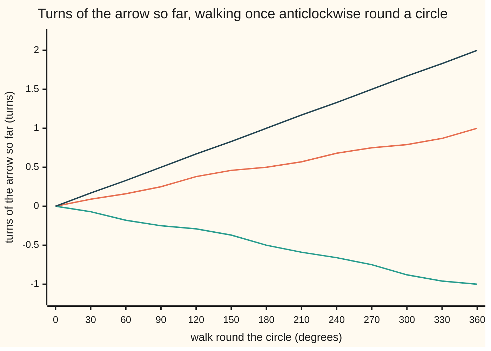

# Index theory: count how often the arrows turn as you walk round a loop, and a closed orbit must enclose rests whose counts add to one

[Syllabus](../../../SYLLABUS.md) → [Differential equations and dynamics](../README.md) → [Nonlinear Dynamics in the Plane](../README.md#s06) → Index theory

---

## General Overview

A fenced reserve holds gazelles and cheetahs ([Predator and prey](06-predator-prey.md)). Their counts cycle round a closed loop every 6.6085 years, circling the balance point of 100 gazelles and 10 cheetahs. Could a cycle circle the empty reserve instead?

Index theory answers without solving anything. Walk once round a loop in the plane and watch the system's arrow (the direction the state moves) at each point. Its net number of full turns is the loop's **index**.

Round the balance point the arrow turns once with the walk: index +1. Round the empty reserve it turns once against it: index −1. A loop the system travels always has index +1, so no cycle circles the empty reserve alone, or both points (−1 + 1 = 0).

**The index of a loop is the net number of turns the arrows make as you walk once round it; it depends only on the resting points inside, a saddle counts −1 and a node, spiral or centre counts +1, and a closed orbit always counts +1, so it must enclose resting points whose counts add to one.**

**What kind of fact this is:** theorems, proved on this card in Why it works, with Hopf's turning theorem in outline; the index is a definition.

### The picture: the arrow's turns, walked round three loops



Orange: predator-prey, radius 0.5 round (1, 1), ending at +1. Green: radius 0.5 round (0, 0), ending at −1. Dark blue: the field $`(x^2 - y^2,\ 2xy)`$, radius 1 round (0, 0), ending at 2.

---

## The formula

Notation from [Phase portraits and nullclines](01-phase-portraits-and-nullclines.md): a planar system $`x' = f(x, y)`$, $`y' = g(x, y)`$ puts an arrow $`F = (f, g)`$ at every point. A **rest** (equilibrium) is a point where $`f = g = 0`$. Let $`C`$ be a closed loop through no rest, and $`\varphi`$ (phi) the angle of the arrow, measured anticlockwise from due east.

```math
I(C) = \frac{1}{2\pi}\oint_C d\varphi = \frac{1}{2\pi}\oint_C \frac{f\,dg - g\,df}{f^2 + g^2}
```

**Read it aloud:** the index of $`C`$ is the total change in the arrow's angle, walking once anticlockwise round $`C`$, divided by one full turn.

The second form writes out the change in the angle of $`(f, g)`$. In the language of [Deforming a loop](../../07-Complex%20analysis/03-Contour%20Integrals%20and%20Cauchy%27s%20Theorem/04-deforming-contours-and-winding-numbers.md), $`I(C)`$ is the winding number of the arrow tips $`f + ig`$ round 0.

The index of a rest $`p`$ is the index of any small circle round it. When the Jacobian $`J`$ (the table of the four slopes of $`f`$ and $`g`$, [Linearisation](02-linearisation-and-the-jacobian.md)) has $`\det J \ne 0`$:

```math
I(p) = \mathrm{sign}\,\det J(p), \qquad I(C) = \sum_{p \text{ inside } C} I(p), \qquad I(\text{closed orbit}) = +1
```

**Read it aloud:** a rest counts the sign of its determinant; a loop sums the rests inside; an orbit counts one.

Predator-prey, with every rate 1: $`x' = x - xy`$, $`y' = -y + xy`$. Its rests are (0, 0), a saddle with $`\det J = -1`$, and (1, 1), a centre with $`\det J = +1`$.

| Symbol | Plain meaning | In our example | Push it up and the answer… |
| --- | --- | --- | --- |
| $`x`$, $`y`$, $`\theta`$ | the two states: gazelles in hundreds, cheetahs in tens; for the swing, $`x = \theta`$, its angle in radians | balance (1, 1); orbit through (2, 1) | — |
| $`f`$, $`g`$, $`F`$ | the rates of $`x`$ and $`y`$; together the arrow at each point | $`F(1.5, 1) = (0, 0.5)`$ | — |
| $`C`$, $`\Gamma`$, $`r`$; $`s`$, $`L`$ | a closed loop through no rest; a closed orbit; a circle's radius; arc length, loop length (fold) | circles of radius 0.5, 1, 3 | no change, until a rest is crossed |
| $`\varphi`$ | the arrow's angle from due east, in radians | rises by $`2\pi`$ round (1, 1) | — |
| $`I(C)`$, $`I(p)`$ | index of a loop; of a rest $`p`$: net anticlockwise turns | +1, −1, 0, 2 | — |
| $`J`$, $`A`$, $`\det`$; $`M`$, $`m_1`$, $`m_2`$ | Jacobian, the four slopes at a rest; any 2 × 2 matrix, with entries $`a, b, c, d`$; the determinant; $`A^{\mathsf T} A`$, its eigenvalues (fold) | (0, 0): −1; (1, 1): +1 | its sign alone sets $`I(p)`$ |
| $`z`$, $`i`$, $`n`$ | the point as one complex number $`x + iy`$; $`i^2 = -1`$; a whole-number power; $`\bar z`$, the conjugate | $`z^2 = (x^2 - y^2) + i\,2xy`$ | power $`n`$ gives index $`n`$ |
| $`t`$, $`u`$ | the walk's clock round a unit circle; the point $`u = (\cos t, \sin t)`$ | 0 to $`2\pi`$ | — |

### When it holds

- **No rest on the loop.** There the arrow has no direction.
- **Walk anticlockwise.** Walk clockwise and every index flips sign: round (1, 1) it reads −1.
- **A whole lap.** Stop halfway round (1, 1) and the count is 0.5, not a whole number.
- **$`\det J \ne 0`$ for the sign rule.** The field $`z^2`$ has $`J = 0`$ at the origin, so the rule gives 0; the true index is 2.
- **The plane.** The orbit rule uses Hopf's theorem on plane loops that do not cross themselves. On a doughnut-shaped surface (a torus), an orbit can wind round the hole with no rest at all.

---

## Why it works

### Step 0: a count of whole turns cannot change by a little

After a lap the arrow points where it started, so it has turned a whole number of times. Slide the loop a little and the total turning changes only a little; a whole number cannot change by a little. Everything below follows.

### Step 1: only the rests inside matter

Slide or shrink $`C`$ without crossing a rest and, by Step 0, $`I(C)`$ stays fixed. A loop round no rest shrinks to a tiny loop where the arrow is nearly constant: index 0. The circle of radius 1 round (3, 3) gives 0.

Cut the inside of $`C`$ by a line between its rests. Walking each piece anticlockwise covers the cut once each way, so its turns cancel and the pieces' indices add to $`I(C)`$. Shrink each piece round its rest: $`I(C)`$ is the sum of the rests' indices.

### Step 2: a rest counts the sign of its determinant

Close to $`p`$ the field is its linear part, $`J`$ times the step from $`p`$, plus a much smaller error. When $`\det J \ne 0`$ the linear part is zero only at $`p`$. On a small enough circle it is longer than the error, so it and the field never point opposite ways. Blending one into the other never makes a zero arrow, so by Step 0 they share an index.

For the linear field $`A u`$ on the unit circle, $`u = (\cos t, \sin t)`$, the top of the formula is $`\det A`$ at every point. So

```math
I = \frac{\det A}{2\pi}\int_0^{2\pi} \frac{dt}{\lvert A u\rvert^2} = \mathrm{sign}\,\det A .
```

The integral is positive and equals $`2\pi / \lvert\det A\rvert`$.

<details>
<summary>Detailed proof: the top is the determinant, and the integral is 2π over its size</summary>

Write $`A`$ with rows $`(a, b)`$ and $`(c, d)`$. On the circle, $`f = a\cos t + b\sin t`$ and $`g = c\cos t + d\sin t`$, so $`f' = -a\sin t + b\cos t`$ and $`g' = -c\sin t + d\cos t`$. Multiply out:

$`\displaystyle f g' - g f' = (ad - bc)(\cos^2 t + \sin^2 t) = \det A .`$

For the integral, $`\lvert A u\rvert^2 = u^{\mathsf T} M u`$ with $`M = A^{\mathsf T} A`$ ($`A^{\mathsf T}`$ is $`A`$ with rows and columns swapped, its transpose), whose eigenvalues $`m_1, m_2`$ are positive with product $`(\det A)^2`$. Turning the axes onto $`M`$'s eigenvectors only shifts $`t`$, and

$`\displaystyle \int_0^{2\pi}\frac{dt}{m_1\cos^2 t + m_2 \sin^2 t} = \frac{2\pi}{\sqrt{m_1 m_2}} = \frac{2\pi}{\lvert\det A\rvert}`$

by changing the variable to $`\tan t`$. So $`I = \det A / \lvert\det A\rvert`$.

</details>

So by [Trace and determinant](../04-Systems%20and%20the%20Matrix%20Exponential/05-classifying-equilibria-by-trace-and-determinant.md), a saddle ($`\det J < 0`$) counts −1, and a node, spiral or centre ($`\det J > 0`$) +1.

### Step 3: a closed orbit counts +1

On a closed orbit $`\Gamma`$ (gamma) the arrow is the loop's own tangent, so $`I(\Gamma)`$ counts the tangent's turns in one lap. Heinz Hopf's turning theorem (a different Hopf from the Hopf bifurcation) says a loop that never crosses itself, as an orbit cannot, turns its tangent exactly once ([Turning and winding numbers](../../23-Differential%20geometry%20and%20Lie%20groups/01-Curves/08-turning-number-and-winding-number.md)).

A clockwise orbit gives minus the anticlockwise tangent, which turns the same way: still +1.

<details>
<summary>Detailed proof in outline: Hopf's theorem, by chords</summary>

Start the loop at its lowest point and measure arc length $`s`$ from 0 to $`L`$. For each pair $`s_1 \le s_2`$, take the direction of the chord from the point at $`s_1`$ to the point at $`s_2`$ (the tangent when they are equal). The pairs fill a triangle with no hole, so the turn along its diagonal equals the turn along its other two sides.

Chords from the lowest point all point upward, sweeping from east to west: half a turn. Chords back to it all point downward, sweeping from west to east: another half. So the tangent, on the diagonal, turns once.

</details>

### Step 4: rule loops out

By Steps 1 to 3, a closed orbit encloses rests whose indices add to +1, so at least one rest. Round the predator-prey saddle alone the sum is −1, round both it is 0: no orbit does either. Round the centre alone it is +1: the orbit through (2, 1) circles just that. The check follows that orbit for one lap of 6.6085 years: the arrow turns 1.000000 times.

The axes, being paths, also block such loops here; index theory needs no such luck.

---

## Worked numbers, by hand

| Step | Arithmetic | Value |
| --- | --- | --- |
| arrow at E, N, W, S of the circle round (1, 1), radius 0.5 | $`F = (x(1 - y),\ y(x - 1))`$ at (1.5, 1), (1, 1.5), (0.5, 1), (1, 0.5) | (0, 0.5), (−0.5, 0), (0, −0.5), (0.5, 0) |
| the arrow's path | up, west, down, east: anticlockwise | **+1** |
| arrow at E, N, W, S round (0, 0), radius 0.5 | at (0.5, 0), (0, 0.5), (−0.5, 0), (0, −0.5) | (0.5, 0), (0, −0.5), (−0.5, 0), (0, 0.5) |
| the arrow's path | east, south, west, north: clockwise | **−1** |
| Jacobians | `[[1 - y, -x], [y, x - 1]]` at (0, 0) and (1, 1) | det −1 and +1 |
| loop round both rests | −1 + 1 | **0** |
| $`z^2`$ round (0, 0), radius 1 | at E, N, W, S: (1, 0), (−1, 0), (1, 0), (−1, 0); $`(\cos t + i\sin t)^2 = \cos 2t + i\sin 2t`$: the arrow's angle is $`2t`$ | **2** |

The wing's swing, $`\theta'' + 0.5\,\theta' + \sin\theta = 0`$ with $`x = \theta`$, $`y = \theta'`$, splits the same way: hanging, $`\det J = +1`$; upside down at $`\theta = \pi`$, $`\det J = -1`$.

### What breaks if you drop a piece

| Mistake | Comes out at | What went wrong |
| --- | --- | --- |
| Walking clockwise round (1, 1) | −1 | The index is defined for an anticlockwise lap |
| Stopping halfway round (1, 1) | 0.5 | Only a closed lap brings the arrow back, so only a lap gives a whole number |
| Sign of $`\det J`$ for $`z^2`$ at (0, 0) | 0, true index 2 | $`J = 0`$: a degenerate rest, so count the turns directly |

---

## Code, from first principles, and it actually runs

Both programs walk 3,600 steps round each circle and take four independent roads: two to each loop's index, three to each rest's: (1) add the arrow's small changes of angle; (2) count, with sign, the arrow's passes through due east, using signs only; (3) the sign of $`\det J`$, with slopes found by differences; (4) Step 2's integral by the midpoint rule. A Runge-Kutta 4 run (four slope samples per step) follows the orbit for one lap.

### Python

```python
# Index theory in the plane -- the check behind the card.  Only math is imported.
# The index of a loop is the net number of turns the field's arrow makes while a
# point walks once anticlockwise round the loop.  Roads: (1) add up the arrow's
# small turns, (2) count signed passes of the arrow through "due east",
# (3) the sign of the Jacobian's determinant, (4) the linear-field integral.
import math
TAU = 2 * math.pi
def pp(x, y): return (x - x * y, -y + x * y)                 # predator-prey, rates 1
def sq(x, y): return (x * x - y * y, 2 * x * y)              # the field z^2
def swing(x, y): return (y, -0.5 * y - math.sin(x))          # the damped swing
def circle(cx, cy, r, n=3600, off=0.25):                     # off 0.25: starts just past due east
    return [(cx + r * math.cos(TAU * (k + off) / n), cy + r * math.sin(TAU * (k + off) / n))
            for k in range(n + 1)]
def turns(F, pts):                                           # road 1
    ang = [math.atan2(F(*p)[1], F(*p)[0]) for p in pts]
    return sum((b - a + math.pi) % TAU - math.pi for a, b in zip(ang, ang[1:])) / TAU
def passes(F, pts):                                          # road 2
    v = [F(*p) for p in pts]
    return sum((g1 < 0 <= g2) - (g2 < 0 <= g1) for (f1, g1), (f2, g2) in zip(v, v[1:]) if f1 > 0 and f2 > 0)
def jac(F, x, y, e=1e-6):                                    # the Jacobian, by differences
    fx = [(a - b) / (2 * e) for a, b in zip(F(x + e, y), F(x - e, y))]
    fy = [(a - b) / (2 * e) for a, b in zip(F(x, y + e), F(x, y - e))]
    return fx[0], fy[0], fx[1], fy[1]
def det_sign(a, b, c, d): return (a * d - b * c > 1e-9) - (a * d - b * c < -1e-9)   # road 3
def linear_index(a, b, c, d, n=20000):                       # road 4, midpoint rule
    ts = [TAU * (k + 0.5) / n for k in range(n)]
    return (a * d - b * c) / n * sum(1 / ((a * math.cos(t) + b * math.sin(t)) ** 2
                                          + (c * math.cos(t) + d * math.sin(t)) ** 2) for t in ts)
def lap(h=0.001):                                            # RK4 once round the orbit from (2, 1)
    p, t, pts = (2.0, 1.0), 0.0, [(2.0, 1.0)]
    while True:
        k1 = pp(*p); k2 = pp(p[0] + h / 2 * k1[0], p[1] + h / 2 * k1[1])
        k3 = pp(p[0] + h / 2 * k2[0], p[1] + h / 2 * k2[1]); k4 = pp(p[0] + h * k3[0], p[1] + h * k3[1])
        q = tuple(p[i] + h / 6 * (k1[i] + 2 * k2[i] + 2 * k3[i] + k4[i]) for i in range(2))
        if t > 1 and p[1] < 1 <= q[1]:
            return t + h * (1 - p[1]) / (q[1] - p[1]), pts + [(2.0, 1.0)]
        p, t = q, t + h; pts.append(p)
for name, F, cx, cy, r, want in [("z^2 field, r 1 round (0, 0)", sq, 0, 0, 1, 2),
        ("predator-prey, r 0.5 round (1, 1)", pp, 1, 1, 0.5, 1), ("predator-prey, r 0.5 round (0, 0)", pp, 0, 0, 0.5, -1),
        ("predator-prey, r 3 round both rests", pp, 0.5, 0.5, 3, 0), ("predator-prey, r 1 round (3, 3)", pp, 3, 3, 1, 0)]:
    t1, t2 = turns(F, circle(cx, cy, r)), passes(F, circle(cx, cy, r))
    arrows = " ".join(f"({F(cx + r * c, cy + r * d)[0] + 0.0:.2f}, {F(cx + r * c, cy + r * d)[1] + 0.0:.2f})"
                      for c, d in [(1, 0), (0, 1), (-1, 0), (0, -1)])
    print(f"{name}: arrows at E N W S {arrows}; turns {t1:.6f}, passes due east {t2}")
    assert abs(t1 - want) < 1e-6 and t2 == want                 # roads 1 and 2 agree
for name, F, x, y, want in [("predator-prey (0, 0)", pp, 0, 0, -1), ("predator-prey (1, 1)", pp, 1, 1, 1),
        ("swing hanging (0, 0)", swing, 0, 0, 1), ("swing upside down (pi, 0)", swing, math.pi, 0, -1)]:
    J = jac(F, x, y); s, t1, v = det_sign(*J), turns(F, circle(x, y, 0.01)), linear_index(*J)
    print(f"{name}: sign of det J {s:+d}; turns on a circle of radius 0.01 {t1:.6f}; linear integral {v:.6f}")
    assert s == want and abs(t1 - s) < 1e-6 and abs(v - s) < 1e-6   # roads 3, 1 and 4 agree
T, orbit = lap()
print(f"orbit from (2, 1): lap {T:.4f} years, {len(orbit) - 1} points; arrow turns {turns(pp, orbit):.6f}")
assert abs(turns(pp, orbit) - 1) < 1e-6 and abs(T - 6.6085) < 1e-4
print("chart, turns so far after every 30 degrees of the walk:")
for name, F, cx, cy, r in [("round (1, 1)", pp, 1, 1, 0.5), ("round (0, 0)", pp, 0, 0, 0.5), ("z^2, round (0, 0)", sq, 0, 0, 1)]:
    print(f"  {name}: " + " ".join(f"{turns(F, circle(cx, cy, r)[:300 * k + 1]):.2f}" for k in range(13)))
print("mistake 1, walking clockwise round (1, 1): turns %.6f" % turns(pp, circle(1, 1, 0.5)[::-1]))
print("mistake 2, stopping halfway round (1, 1), due east to due west: turns %.6f" % turns(pp, circle(1, 1, 0.5, off=0)[:1801]))
print("mistake 3, sign of det J for z^2 at (0, 0): %d, true index 2" % det_sign(*jac(sq, 0, 0)))
print("ALL CHECKS PASS")
```

**Ran 2026-11-23 on macOS, Python 3.14.10, standard library only. All checks passed. Output, pasted from the run:**

```
z^2 field, r 1 round (0, 0): arrows at E N W S (1.00, 0.00) (-1.00, 0.00) (1.00, 0.00) (-1.00, 0.00); turns 2.000000, passes due east 2
predator-prey, r 0.5 round (1, 1): arrows at E N W S (0.00, 0.50) (-0.50, 0.00) (0.00, -0.50) (0.50, 0.00); turns 1.000000, passes due east 1
predator-prey, r 0.5 round (0, 0): arrows at E N W S (0.50, 0.00) (0.00, -0.50) (-0.50, 0.00) (0.00, 0.50); turns -1.000000, passes due east -1
predator-prey, r 3 round both rests: arrows at E N W S (1.75, 1.25) (-1.25, -1.75) (-1.25, -1.75) (1.75, 1.25); turns 0.000000, passes due east 0
predator-prey, r 1 round (3, 3): arrows at E N W S (-8.00, 9.00) (-9.00, 8.00) (-4.00, 3.00) (-3.00, 4.00); turns 0.000000, passes due east 0
predator-prey (0, 0): sign of det J -1; turns on a circle of radius 0.01 -1.000000; linear integral -1.000000
predator-prey (1, 1): sign of det J +1; turns on a circle of radius 0.01 1.000000; linear integral 1.000000
swing hanging (0, 0): sign of det J +1; turns on a circle of radius 0.01 1.000000; linear integral 1.000000
swing upside down (pi, 0): sign of det J -1; turns on a circle of radius 0.01 -1.000000; linear integral -1.000000
orbit from (2, 1): lap 6.6085 years, 6609 points; arrow turns 1.000000
chart, turns so far after every 30 degrees of the walk:
  round (1, 1): 0.00 0.09 0.16 0.25 0.38 0.46 0.50 0.57 0.68 0.75 0.79 0.87 1.00
  round (0, 0): 0.00 -0.07 -0.18 -0.25 -0.29 -0.37 -0.50 -0.59 -0.66 -0.75 -0.88 -0.96 -1.00
  z^2, round (0, 0): 0.00 0.17 0.33 0.50 0.67 0.83 1.00 1.17 1.33 1.50 1.67 1.83 2.00
mistake 1, walking clockwise round (1, 1): turns -1.000000
mistake 2, stopping halfway round (1, 1), due east to due west: turns 0.500000
mistake 3, sign of det J for z^2 at (0, 0): 0, true index 2
ALL CHECKS PASS
```

### Rust

Same numbers, same labels, built with `rustc --edition 2021 -O`.

```rust
// Index theory in the plane -- the same check as the Python, in Rust.  No crates.
// The index of a loop is the net number of turns the field's arrow makes while a
// point walks once anticlockwise round the loop.  Roads: (1) add up the arrow's
// small turns, (2) count signed passes of the arrow through "due east",
// (3) the sign of the Jacobian's determinant, (4) the linear-field integral.
use std::f64::consts::PI;
const TAU: f64 = 2.0 * PI;
type P = (f64, f64);
fn pp(x: f64, y: f64) -> P { (x - x * y, -y + x * y) }                  // predator-prey, rates 1
fn sq(x: f64, y: f64) -> P { (x * x - y * y, 2.0 * x * y) }             // the field z^2
fn swing(x: f64, y: f64) -> P { (y, -0.5 * y - x.sin()) }               // the damped swing
fn circle(cx: f64, cy: f64, r: f64, off: f64) -> Vec<P> {               // off 0.25: starts just past due east
    (0..=3600).map(|k| { let t = TAU * (k as f64 + off) / 3600.0; (cx + r * t.cos(), cy + r * t.sin()) }).collect()
}
fn turns(f: fn(f64, f64) -> P, pts: &[P]) -> f64 {                      // road 1
    let ang: Vec<f64> = pts.iter().map(|p| { let v = f(p.0, p.1); v.1.atan2(v.0) }).collect();
    ang.windows(2).map(|w| (w[1] - w[0] + PI).rem_euclid(TAU) - PI).sum::<f64>() / TAU + 0.0
}
fn passes(f: fn(f64, f64) -> P, pts: &[P]) -> i64 {                     // road 2
    let v: Vec<P> = pts.iter().map(|p| f(p.0, p.1)).collect();
    v.windows(2).filter(|w| w[0].0 > 0.0 && w[1].0 > 0.0)
        .map(|w| (w[0].1 < 0.0 && 0.0 <= w[1].1) as i64 - (w[1].1 < 0.0 && 0.0 <= w[0].1) as i64).sum()
}
fn jac(f: fn(f64, f64) -> P, x: f64, y: f64) -> [f64; 4] {             // the Jacobian, by differences
    let e = 1e-6;
    let (a, b, c, d) = (f(x + e, y), f(x - e, y), f(x, y + e), f(x, y - e));
    [(a.0 - b.0) / (2.0 * e), (c.0 - d.0) / (2.0 * e), (a.1 - b.1) / (2.0 * e), (c.1 - d.1) / (2.0 * e)]
}
fn det_sign(j: [f64; 4]) -> i64 { let d = j[0] * j[3] - j[1] * j[2]; (d > 1e-9) as i64 - (d < -1e-9) as i64 }  // road 3
fn linear_index(j: [f64; 4]) -> f64 {                                   // road 4, midpoint rule
    let n = 20000;
    let s: f64 = (0..n).map(|k| { let t = TAU * (k as f64 + 0.5) / n as f64;
        1.0 / ((j[0] * t.cos() + j[1] * t.sin()).powi(2) + (j[2] * t.cos() + j[3] * t.sin()).powi(2)) }).sum();
    (j[0] * j[3] - j[1] * j[2]) / n as f64 * s
}
fn lap(h: f64) -> (f64, Vec<P>) {                                       // RK4 once round the orbit from (2, 1)
    let (mut p, mut t, mut pts) = ((2.0, 1.0), 0.0, vec![(2.0, 1.0)]);
    loop {
        let k1 = pp(p.0, p.1); let k2 = pp(p.0 + h / 2.0 * k1.0, p.1 + h / 2.0 * k1.1);
        let k3 = pp(p.0 + h / 2.0 * k2.0, p.1 + h / 2.0 * k2.1); let k4 = pp(p.0 + h * k3.0, p.1 + h * k3.1);
        let q = (p.0 + h / 6.0 * (k1.0 + 2.0 * k2.0 + 2.0 * k3.0 + k4.0), p.1 + h / 6.0 * (k1.1 + 2.0 * k2.1 + 2.0 * k3.1 + k4.1));
        if t > 1.0 && p.1 < 1.0 && 1.0 <= q.1 { pts.push((2.0, 1.0)); return (t + h * (1.0 - p.1) / (q.1 - p.1), pts); }
        p = q; t += h; pts.push(p);
    }
}
fn main() {
    let loops: [(&str, fn(f64, f64) -> P, f64, f64, f64, i64); 5] = [("z^2 field, r 1 round (0, 0)", sq, 0.0, 0.0, 1.0, 2),
        ("predator-prey, r 0.5 round (1, 1)", pp, 1.0, 1.0, 0.5, 1), ("predator-prey, r 0.5 round (0, 0)", pp, 0.0, 0.0, 0.5, -1),
        ("predator-prey, r 3 round both rests", pp, 0.5, 0.5, 3.0, 0), ("predator-prey, r 1 round (3, 3)", pp, 3.0, 3.0, 1.0, 0)];
    for (name, f, cx, cy, r, want) in loops {
        let (t1, t2) = (turns(f, &circle(cx, cy, r, 0.25)), passes(f, &circle(cx, cy, r, 0.25)));
        let arrows: Vec<String> = [(1.0, 0.0), (0.0, 1.0), (-1.0, 0.0), (0.0, -1.0)].iter()
            .map(|&(c, d)| { let v = f(cx + r * c, cy + r * d); format!("({:.2}, {:.2})", v.0 + 0.0, v.1 + 0.0) }).collect();
        println!("{}: arrows at E N W S {}; turns {:.6}, passes due east {}", name, arrows.join(" "), t1, t2);
        assert!((t1 - want as f64).abs() < 1e-6 && t2 == want);         // roads 1 and 2 agree
    }
    let rests: [(&str, fn(f64, f64) -> P, f64, f64, i64); 4] = [("predator-prey (0, 0)", pp, 0.0, 0.0, -1), ("predator-prey (1, 1)", pp, 1.0, 1.0, 1),
        ("swing hanging (0, 0)", swing, 0.0, 0.0, 1), ("swing upside down (pi, 0)", swing, PI, 0.0, -1)];
    for (name, f, x, y, want) in rests {
        let j = jac(f, x, y); let (s, t1, v) = (det_sign(j), turns(f, &circle(x, y, 0.01, 0.25)), linear_index(j));
        println!("{}: sign of det J {:+}; turns on a circle of radius 0.01 {:.6}; linear integral {:.6}", name, s, t1, v);
        assert!(s == want && (t1 - s as f64).abs() < 1e-6 && (v - s as f64).abs() < 1e-6);  // roads 3, 1 and 4 agree
    }
    let (t, orbit) = lap(0.001);
    println!("orbit from (2, 1): lap {:.4} years, {} points; arrow turns {:.6}", t, orbit.len() - 1, turns(pp, &orbit));
    assert!((turns(pp, &orbit) - 1.0).abs() < 1e-6 && (t - 6.6085).abs() < 1e-4);
    println!("chart, turns so far after every 30 degrees of the walk:");
    let charts: [(&str, fn(f64, f64) -> P, f64, f64, f64); 3] = [("round (1, 1)", pp, 1.0, 1.0, 0.5), ("round (0, 0)", pp, 0.0, 0.0, 0.5), ("z^2, round (0, 0)", sq, 0.0, 0.0, 1.0)];
    for (name, f, cx, cy, r) in charts {
        let c = circle(cx, cy, r, 0.25);
        println!("  {}: {}", name, (0..13).map(|k| format!("{:.2}", turns(f, &c[..300 * k + 1]))).collect::<Vec<_>>().join(" "));
    }
    let c = circle(1.0, 1.0, 0.5, 0.25);
    let rev: Vec<P> = c.iter().rev().cloned().collect();
    println!("mistake 1, walking clockwise round (1, 1): turns {:.6}", turns(pp, &rev));
    println!("mistake 2, stopping halfway round (1, 1), due east to due west: turns {:.6}", turns(pp, &circle(1.0, 1.0, 0.5, 0.0)[..1801]));
    println!("mistake 3, sign of det J for z^2 at (0, 0): {}, true index 2", det_sign(jac(sq, 0.0, 0.0)));
    println!("ALL CHECKS PASS");
}
```

**Ran 2026-11-23 on macOS, rustc 1.98.1, no crates. All checks passed. Output, pasted from the run:**

```
z^2 field, r 1 round (0, 0): arrows at E N W S (1.00, 0.00) (-1.00, 0.00) (1.00, 0.00) (-1.00, 0.00); turns 2.000000, passes due east 2
predator-prey, r 0.5 round (1, 1): arrows at E N W S (0.00, 0.50) (-0.50, 0.00) (0.00, -0.50) (0.50, 0.00); turns 1.000000, passes due east 1
predator-prey, r 0.5 round (0, 0): arrows at E N W S (0.50, 0.00) (0.00, -0.50) (-0.50, 0.00) (0.00, 0.50); turns -1.000000, passes due east -1
predator-prey, r 3 round both rests: arrows at E N W S (1.75, 1.25) (-1.25, -1.75) (-1.25, -1.75) (1.75, 1.25); turns 0.000000, passes due east 0
predator-prey, r 1 round (3, 3): arrows at E N W S (-8.00, 9.00) (-9.00, 8.00) (-4.00, 3.00) (-3.00, 4.00); turns 0.000000, passes due east 0
predator-prey (0, 0): sign of det J -1; turns on a circle of radius 0.01 -1.000000; linear integral -1.000000
predator-prey (1, 1): sign of det J +1; turns on a circle of radius 0.01 1.000000; linear integral 1.000000
swing hanging (0, 0): sign of det J +1; turns on a circle of radius 0.01 1.000000; linear integral 1.000000
swing upside down (pi, 0): sign of det J -1; turns on a circle of radius 0.01 -1.000000; linear integral -1.000000
orbit from (2, 1): lap 6.6085 years, 6609 points; arrow turns 1.000000
chart, turns so far after every 30 degrees of the walk:
  round (1, 1): 0.00 0.09 0.16 0.25 0.38 0.46 0.50 0.57 0.68 0.75 0.79 0.87 1.00
  round (0, 0): 0.00 -0.07 -0.18 -0.25 -0.29 -0.37 -0.50 -0.59 -0.66 -0.75 -0.88 -0.96 -1.00
  z^2, round (0, 0): 0.00 0.17 0.33 0.50 0.67 0.83 1.00 1.17 1.33 1.50 1.67 1.83 2.00
mistake 1, walking clockwise round (1, 1): turns -1.000000
mistake 2, stopping halfway round (1, 1), due east to due west: turns 0.500000
mistake 3, sign of det J for z^2 at (0, 0): 0, true index 2
ALL CHECKS PASS
```

### Lean

Lean proves the index exactly on circles round the origin, for linear fields and for the fields $`z^n`$.

- Suppose $`\det A \ne 0`$ and $`r > 0`$. Then the linear field $`A u`$ has index $`\mathrm{sign}\,\det A`$ on the circle of radius $`r`$ round the rest.
- Take the linear field $`A u`$ on the unit circle $`u = (\cos t, \sin t)`$. Then the top of the formula, $`f g' - g f'`$, equals $`\det A`$ at every $`t`$.
- Take a whole-number power $`n`$ and any circle round the origin. Then the field $`z^n`$ has index $`n`$, so $`(x^2 - y^2,\ 2xy)`$ has index 2.
- The hand arithmetic holds exactly. That covers the predator-prey arrows at E, N, W, S and the determinants −1 and +1, adding to 0. It covers the $`z^2`$ arrows and the swing's determinants +1 and −1.

The predator-prey and swing circles, the loop round both rests and the orbit's lap are left to the Python and Rust checks.

```lean
-- Index theory: a linear field round a rest turns its arrow sign(det A) times, its key integrand is det A, and the field z^n turns n times.
import Mathlib.MeasureTheory.Integral.IntervalIntegral.Basic
import Mathlib.Analysis.SpecialFunctions.Trigonometric.Deriv
import Mathlib.LinearAlgebra.Matrix.Determinant.Basic
import Mathlib.Basic.Real.Sign
import Mathlib.Analysis.SpecialFunctions.Complex.LogDeriv
import Mathlib.MeasureTheory.Integral.IntervalIntegral.FundThmCalculus
import Mathlib.Analysis.Complex.RealDeriv

open Real

/-- The index of a planar field `F = (f, g)` on the circle of centre `c` and radius `r`, walked
once anticlockwise: `I = (1 / 2π) ∫₀^{2π} (f g' - g f') / (f² + g²) dt`, where `f` and `g` are the
field's two parts read along the walk `t ↦ c + r (cos t, sin t)` and `'` is the rate in `t`. -/
noncomputable def circleIndex (F : ℝ × ℝ → ℝ × ℝ) (c : ℝ × ℝ) (r : ℝ) : ℝ :=
  let f : ℝ → ℝ := fun t => (F (c.1 + r * cos t, c.2 + r * sin t)).1
  let g : ℝ → ℝ := fun t => (F (c.1 + r * cos t, c.2 + r * sin t)).2
  (1 / (2 * π)) * ∫ t in (0 : ℝ)..(2 * π),
    (f t * deriv g t - g t * deriv f t) / (f t ^ 2 + g t ^ 2)

/-- The linear field `u ↦ A u` of a 2 × 2 matrix `A`. -/
def linearField (A : Matrix (Fin 2) (Fin 2) ℝ) (p : ℝ × ℝ) : ℝ × ℝ :=
  (A 0 0 * p.1 + A 0 1 * p.2, A 1 0 * p.1 + A 1 1 * p.2)

theorem hasDerivAt_re_of_complex {Ψ : ℝ → ℂ} {Ψ' : ℂ} {t : ℝ} (h : HasDerivAt Ψ Ψ' t) :
    HasDerivAt (fun s => (Ψ s).re) Ψ'.re t := by
  exact Complex.reCLM.hasFDerivAt.comp_hasDerivAt t h

theorem hasDerivAt_im_of_complex {Ψ : ℝ → ℂ} {Ψ' : ℂ} {t : ℝ} (h : HasDerivAt Ψ Ψ' t) :
    HasDerivAt (fun s => (Ψ s).im) Ψ'.im t := by
  exact Complex.imCLM.hasFDerivAt.comp_hasDerivAt t h

theorem hasDerivAt_expI (m : ℤ) (t : ℝ) :
    HasDerivAt (fun s : ℝ => Complex.exp (((m * s : ℝ) : ℂ) * Complex.I))
      (Complex.exp (((m * t : ℝ) : ℂ) * Complex.I) * ((m : ℂ) * Complex.I)) t := by
  have h1 : HasDerivAt (fun s : ℝ => ((m * s : ℝ) : ℂ)) ((m : ℝ) : ℂ) t := by
    simpa using ((hasDerivAt_id t).const_mul (m : ℝ)).ofReal_comp
  have h2 := (h1.mul_const Complex.I).cexp
  simpa using h2

theorem expI_mul (m n : ℤ) (t : ℝ) :
    Complex.exp (((m * t : ℝ) : ℂ) * Complex.I) * Complex.exp ((((n - m : ℤ) * t : ℝ) : ℂ) * Complex.I)
      = Complex.exp (((n * t : ℝ) : ℂ) * Complex.I) := by
  rw [← Complex.exp_add]; congr 1; push_cast; ring

theorem expI_period (k : ℤ) :
    Complex.exp (((k * (2 * π) : ℝ) : ℂ) * Complex.I) = 1 := by
  have : (((k * (2 * π) : ℝ) : ℂ) * Complex.I) = (k : ℂ) * (2 * π * Complex.I) := by
    push_cast; ring
  rw [this, Complex.exp_int_mul_two_pi_mul_I]

theorem winding_core (f g : ℝ → ℝ) (κ β : ℂ) (m n : ℤ) (hβ : ‖β‖ < ‖κ‖)
    (hw : ∀ t, ((f t : ℂ) + (g t : ℂ) * Complex.I)
      = κ * Complex.exp (((m * t : ℝ) : ℂ) * Complex.I) + β * Complex.exp (((n * t : ℝ) : ℂ) * Complex.I)) :
    ∫ t in (0 : ℝ)..(2 * π), (f t * deriv g t - g t * deriv f t) / (f t ^ 2 + g t ^ 2)
      = 2 * π * m := by
  have hκ : κ ≠ 0 := by
    intro h; rw [h, norm_zero] at hβ; exact absurd hβ (not_lt.2 (norm_nonneg _))
  set γ : ℂ := β / κ with hγdef
  have hγ : ‖γ‖ < 1 := by
    rw [hγdef, norm_div, div_lt_one (norm_pos_iff.2 hκ)]; exact hβ
  let k : ℤ := n - m
  let E : ℝ → ℂ := fun s => Complex.exp (((m * s : ℝ) : ℂ) * Complex.I)
  let Ek : ℝ → ℂ := fun s => Complex.exp (((k * s : ℝ) : ℂ) * Complex.I)
  let h : ℝ → ℂ := fun s => 1 + γ * Ek s
  let Ψ : ℝ → ℂ := fun s => κ * E s * h s
  have hΨ : ∀ t, Ψ t = (f t : ℂ) + (g t : ℂ) * Complex.I := by
    intro t
    rw [hw t]
    simp only [Ψ, h, E, Ek, k]
    rw [← expI_mul m n t, hγdef]
    field_simp
  have hf : ∀ t, f t = (Ψ t).re := by intro t; rw [hΨ t]; simp
  have hg : ∀ t, g t = (Ψ t).im := by intro t; rw [hΨ t]; simp
  have hEk : ∀ t, ‖Ek t‖ = 1 := fun t => Complex.norm_exp_ofReal_mul_I _
  have hE0 : ∀ t, E t ≠ 0 := fun t => Complex.exp_ne_zero _
  have hslit : ∀ t, h t ∈ Complex.slitPlane := by
    intro t
    rw [Complex.mem_slitPlane_iff]; left
    have h1 : -(γ * Ek t).re ≤ ‖γ * Ek t‖ := by
      exact (neg_le_abs _).trans (Complex.abs_re_le_norm _)
    rw [norm_mul, hEk, mul_one] at h1
    simp only [h, Complex.add_re, Complex.one_re]
    linarith
  have hh0 : ∀ t, h t ≠ 0 := fun t => Complex.slitPlane_ne_zero (hslit t)
  let h' : ℝ → ℂ := fun s => γ * (Ek s * ((k : ℂ) * Complex.I))
  have hhd : ∀ t, HasDerivAt h (h' t) t := by
    intro t
    have := ((hasDerivAt_expI k t).const_mul γ).const_add 1
    exact this
  let Ψ' : ℝ → ℂ := fun s => κ * (E s * ((m : ℂ) * Complex.I)) * h s + κ * E s * h' s
  have hΨd : ∀ t, HasDerivAt Ψ (Ψ' t) t := by
    intro t
    have := ((hasDerivAt_expI m t).const_mul κ).mul (hhd t)
    exact this
  have hfd : ∀ t, deriv f t = (Ψ' t).re := by
    intro t
    have : f = fun s => (Ψ s).re := funext hf
    rw [this]; exact (hasDerivAt_re_of_complex (hΨd t)).deriv
  have hgd : ∀ t, deriv g t = (Ψ' t).im := by
    intro t
    have : g = fun s => (Ψ s).im := funext hg
    rw [this]; exact (hasDerivAt_im_of_complex (hΨd t)).deriv
  let θ' : ℝ → ℝ := fun s => (m : ℝ) + (h' s / h s).im
  have hint : ∀ t, (f t * deriv g t - g t * deriv f t) / (f t ^ 2 + g t ^ 2) = θ' t := by
    intro t
    have hΨ0 : Ψ t ≠ 0 := mul_ne_zero (mul_ne_zero hκ (hE0 t)) (hh0 t)
    have hq : Ψ' t / Ψ t = (m : ℂ) * Complex.I + h' t / h t := by
      simp only [Ψ', Ψ]
      field_simp [hE0 t, hh0 t, hκ]
    have hq2 : (f t * deriv g t - g t * deriv f t) / (f t ^ 2 + g t ^ 2) = (Ψ' t / Ψ t).im := by
      rw [hfd, hgd, hf, hg, Complex.div_im, Complex.normSq_apply]
      have : (Ψ t).re * (Ψ t).re + (Ψ t).im * (Ψ t).im ≠ 0 := by
        rw [← Complex.normSq_apply]; exact (Complex.normSq_pos.2 hΨ0).ne'
      field_simp
    rw [hq2, hq]
    simp [θ']
  let θ : ℝ → ℝ := fun s => (m : ℝ) * s + (Complex.log (h s)).im
  have hθ : ∀ t, HasDerivAt θ (θ' t) t := by
    intro t
    have h1 := hasDerivAt_im_of_complex ((hhd t).clog_real (hslit t))
    have h2 := ((hasDerivAt_id t).const_mul (m : ℝ)).add h1
    rw [mul_one] at h2
    exact h2
  have hcont : Continuous θ' := by
    have hc1 : Continuous h' := by simp only [h', Ek]; fun_prop
    have hc2 : Continuous h := by simp only [h, Ek]; fun_prop
    exact continuous_const.add (Complex.continuous_im.comp (hc1.div hc2 hh0))
  rw [intervalIntegral.integral_congr (g := θ') (fun t _ => hint t)]
  rw [intervalIntegral.integral_eq_sub_of_hasDerivAt (fun t _ => hθ t)
    (hcont.intervalIntegrable _ _)]
  have hper : h (2 * π) = h 0 := by
    simp only [h, Ek]
    rw [expI_period]; simp
  simp only [θ]
  rw [hper]
  ring

theorem circleIndex_of_winding (F : ℝ × ℝ → ℝ × ℝ) (c : ℝ × ℝ) (r : ℝ) (κ β : ℂ) (m n : ℤ)
    (hβ : ‖β‖ < ‖κ‖)
    (hw : ∀ t, (((F (c.1 + r * cos t, c.2 + r * sin t)).1 : ℝ) : ℂ)
        + (((F (c.1 + r * cos t, c.2 + r * sin t)).2 : ℝ) : ℂ) * Complex.I
      = κ * Complex.exp (((m * t : ℝ) : ℂ) * Complex.I)
        + β * Complex.exp (((n * t : ℝ) : ℂ) * Complex.I)) :
    circleIndex F c r = m := by
  have key := winding_core (fun t => (F (c.1 + r * cos t, c.2 + r * sin t)).1)
    (fun t => (F (c.1 + r * cos t, c.2 + r * sin t)).2) κ β m n hβ hw
  unfold circleIndex
  simp only [] at key ⊢
  rw [key]
  field_simp

#print axioms hasDerivAt_re_of_complex
#print axioms hasDerivAt_im_of_complex
#print axioms hasDerivAt_expI
#print axioms expI_mul
#print axioms expI_period
#print axioms winding_core
#print axioms circleIndex_of_winding

/-- A rest counts the sign of its determinant: when `det A ≠ 0`, the linear field `A u` turns its
arrow `sign (det A)` times on any circle round the rest at the origin, walked once anticlockwise.
So a saddle (`det A < 0`) counts −1 and a node, spiral or centre (`det A > 0`) counts +1. -/
theorem circleIndex_linear_eq_sign_det (A : Matrix (Fin 2) (Fin 2) ℝ) (hA : A.det ≠ 0)
    (r : ℝ) (hr : 0 < r) :
    circleIndex (linearField A) (0, 0) r = Real.sign A.det := by
  set α : ℂ := ⟨(A 0 0 + A 1 1) / 2, (A 1 0 - A 0 1) / 2⟩ with hα
  set β : ℂ := ⟨(A 0 0 - A 1 1) / 2, (A 1 0 + A 0 1) / 2⟩ with hβ
  have hexp : ∀ t : ℝ, (((linearField A (((0, 0) : ℝ × ℝ).1 + r * cos t,
        ((0, 0) : ℝ × ℝ).2 + r * sin t)).1 : ℝ) : ℂ)
      + (((linearField A (((0, 0) : ℝ × ℝ).1 + r * cos t,
        ((0, 0) : ℝ × ℝ).2 + r * sin t)).2 : ℝ) : ℂ) * Complex.I
      = (r * α) * Complex.exp ((((1 : ℤ) * t : ℝ) : ℂ) * Complex.I)
        + (r * β) * Complex.exp ((((-1 : ℤ) * t : ℝ) : ℂ) * Complex.I) := by
    intro t
    have e1 : Complex.exp ((((1 : ℤ) * t : ℝ) : ℂ) * Complex.I)
        = ((cos t : ℝ) : ℂ) + ((sin t : ℝ) : ℂ) * Complex.I := by
      apply Complex.ext
      · rw [Complex.exp_ofReal_mul_I_re]; simp [Complex.cos_ofReal_re, Complex.sin_ofReal_re]
      · rw [Complex.exp_ofReal_mul_I_im]; simp [Complex.cos_ofReal_re, Complex.sin_ofReal_re]
    have e2 : Complex.exp ((((-1 : ℤ) * t : ℝ) : ℂ) * Complex.I)
        = ((cos t : ℝ) : ℂ) - ((sin t : ℝ) : ℂ) * Complex.I := by
      apply Complex.ext
      · rw [Complex.exp_ofReal_mul_I_re]; simp [Complex.cos_ofReal_re, Complex.sin_ofReal_re]
      · rw [Complex.exp_ofReal_mul_I_im]; simp [Complex.cos_ofReal_re, Complex.sin_ofReal_re]
    rw [e1, e2]
    apply Complex.ext <;> simp [linearField, hα, hβ] <;> ring
  have hdiff : ‖(r : ℂ) * α‖ ^ 2 - ‖(r : ℂ) * β‖ ^ 2 = r ^ 2 * A.det := by
    rw [Complex.sq_norm, Complex.sq_norm, Matrix.det_fin_two A]
    simp [Complex.normSq_apply, hα, hβ]
    ring
  rcases lt_or_gt_of_ne hA with hneg | hpos
  · have hlt : ‖(r : ℂ) * α‖ < ‖(r : ℂ) * β‖ := by
      apply lt_of_pow_lt_pow_left₀ 2 (norm_nonneg _)
      nlinarith [mul_pos (pow_pos hr 2) (neg_pos.2 hneg)]
    have := circleIndex_of_winding (linearField A) (0, 0) r (r * β) (r * α) (-1) 1 hlt
      (fun t => by rw [hexp t, add_comm])
    rw [this, Real.sign_of_neg hneg]; simp
  · have hlt : ‖(r : ℂ) * β‖ < ‖(r : ℂ) * α‖ := by
      apply lt_of_pow_lt_pow_left₀ 2 (norm_nonneg _)
      nlinarith [mul_pos (pow_pos hr 2) hpos]
    have := circleIndex_of_winding (linearField A) (0, 0) r (r * α) (r * β) 1 (-1) hlt hexp
    rw [this, Real.sign_of_pos hpos]; simp

/-- Step 2's key line: for the linear field on the unit circle `u = (cos t, sin t)`, the top of the
index formula, `f g' - g f'`, equals `det A` at every point of the walk. -/
theorem linear_numerator_eq_det (A : Matrix (Fin 2) (Fin 2) ℝ) (t : ℝ) :
    let f : ℝ → ℝ := fun s => (linearField A (cos s, sin s)).1
    let g : ℝ → ℝ := fun s => (linearField A (cos s, sin s)).2
    f t * deriv g t - g t * deriv f t = A.det := by
  intro f g
  have hf : HasDerivAt f (A 0 0 * -sin t + A 0 1 * cos t) t :=
    ((hasDerivAt_cos t).const_mul (A 0 0)).add ((hasDerivAt_sin t).const_mul (A 0 1))
  have hg : HasDerivAt g (A 1 0 * -sin t + A 1 1 * cos t) t :=
    ((hasDerivAt_cos t).const_mul (A 1 0)).add ((hasDerivAt_sin t).const_mul (A 1 1))
  rw [hf.deriv, hg.deriv, Matrix.det_fin_two A]
  simp only [f, g, linearField]
  linear_combination (A 0 0 * A 1 1 - A 0 1 * A 1 0) * sin_sq_add_cos_sq t

/-- The field `z ↦ zⁿ` (the point as `z = x + iy`) turns its arrow `n` times on any circle round
the origin; for `z²`, the field `(x² − y², 2xy)`, the index is 2. -/
theorem circleIndex_pow_eq (n : ℕ) (r : ℝ) (hr : 0 < r) :
    circleIndex (fun p => ((((p.1 : ℂ) + p.2 * Complex.I) ^ n).re,
                           (((p.1 : ℂ) + p.2 * Complex.I) ^ n).im)) (0, 0) r = n := by
  have hlt : ‖(0 : ℂ)‖ < ‖((r : ℂ) ^ n)‖ := by
    rw [norm_zero, norm_pow, Complex.norm_real, Real.norm_eq_abs, abs_of_pos hr]
    positivity
  have := circleIndex_of_winding (fun p => ((((p.1 : ℂ) + p.2 * Complex.I) ^ n).re,
      (((p.1 : ℂ) + p.2 * Complex.I) ^ n).im)) (0, 0) r ((r : ℂ) ^ n) 0 (n : ℤ) 0 hlt (by
    intro t
    simp only [Complex.re_add_im, zero_mul, add_zero]
    have hz : (((0 : ℝ) + r * cos t : ℝ) : ℂ) + (((0 : ℝ) + r * sin t : ℝ) : ℂ) * Complex.I
        = r * Complex.exp ((t : ℂ) * Complex.I) := by
      rw [Complex.exp_mul_I]; push_cast; ring
    rw [hz, mul_pow, ← Complex.exp_nat_mul]
    congr 2
    push_cast; ring)
  rw [this]; simp

/-- Predator-prey with every rate 1: the arrow `(x - x y, -y + x y)`. -/
def predPrey (p : ℝ × ℝ) : ℝ × ℝ := (p.1 - p.1 * p.2, -p.2 + p.1 * p.2)

/-- Its Jacobian, the four slopes `[[1 - y, -x], [y, x - 1]]`. -/
def predPreyJac (p : ℝ × ℝ) : Matrix (Fin 2) (Fin 2) ℝ := !![1 - p.2, -p.1; p.2, p.1 - 1]

-- The arrow at E, N, W, S of the circle of radius 1/2 round (1, 1): up, west, down, east.
example : predPrey (3/2, 1) = (0, 1/2) := by norm_num [predPrey]
example : predPrey (1, 3/2) = (-1/2, 0) := by norm_num [predPrey]
example : predPrey (1/2, 1) = (0, -1/2) := by norm_num [predPrey]
example : predPrey (1, 1/2) = (1/2, 0) := by norm_num [predPrey]

-- The arrow at E, N, W, S of the circle of radius 1/2 round (0, 0): east, south, west, north.
example : predPrey (1/2, 0) = (1/2, 0) := by norm_num [predPrey]
example : predPrey (0, 1/2) = (0, -1/2) := by norm_num [predPrey]
example : predPrey (-1/2, 0) = (-1/2, 0) := by norm_num [predPrey]
example : predPrey (0, -1/2) = (0, 1/2) := by norm_num [predPrey]

-- det J is −1 at the saddle (0, 0) and +1 at the centre (1, 1); a loop round both counts −1 + 1 = 0.
example : (predPreyJac (0, 0)).det = -1 := by norm_num [predPreyJac, Matrix.det_fin_two_of]
example : (predPreyJac (1, 1)).det = 1 := by norm_num [predPreyJac, Matrix.det_fin_two_of]
example : (predPreyJac (0, 0)).det + (predPreyJac (1, 1)).det = 0 := by
  norm_num [predPreyJac, Matrix.det_fin_two_of]

-- The field z², `(x² − y², 2xy)`, at E, N, W, S of the unit circle: (1, 0), (−1, 0), (1, 0), (−1, 0).
example : ((1 : ℝ) ^ 2 - 0 ^ 2, 2 * 1 * 0) = ((1 : ℝ), (0 : ℝ)) := by norm_num
example : ((0 : ℝ) ^ 2 - 1 ^ 2, 2 * 0 * 1) = ((-1 : ℝ), (0 : ℝ)) := by norm_num
example : ((-1 : ℝ) ^ 2 - 0 ^ 2, 2 * (-1) * 0) = ((1 : ℝ), (0 : ℝ)) := by norm_num
example : ((0 : ℝ) ^ 2 - (-1) ^ 2, 2 * 0 * (-1)) = ((-1 : ℝ), (0 : ℝ)) := by norm_num

-- The swing `θ'' + θ'/2 + sin θ = 0`, Jacobian `[[0, 1], [-cos θ, -1/2]]`: hanging det +1,
-- upside down (θ = π) det −1.
example : Matrix.det !![(0 : ℝ), 1; -cos 0, -1/2] = 1 := by
  norm_num [Matrix.det_fin_two_of]
example : Matrix.det !![(0 : ℝ), 1; -cos π, -1/2] = -1 := by
  norm_num [Matrix.det_fin_two_of]

#print axioms circleIndex_linear_eq_sign_det
#print axioms linear_numerator_eq_det
#print axioms circleIndex_pow_eq
```

**Checked 2026-11-23 on macOS, Lean 4.36.0-rc2, Mathlib v4.36.0-rc2. Every proof is complete and uses only Lean's standard axioms. Output, pasted from the run:**

```
'hasDerivAt_re_of_complex' depends on axioms: [propext, Classical.choice, Quot.sound]
'hasDerivAt_im_of_complex' depends on axioms: [propext, Classical.choice, Quot.sound]
'hasDerivAt_expI' depends on axioms: [propext, Classical.choice, Quot.sound]
'expI_mul' depends on axioms: [propext, Classical.choice, Quot.sound]
'expI_period' depends on axioms: [propext, Classical.choice, Quot.sound]
'winding_core' depends on axioms: [propext, Classical.choice, Quot.sound]
'circleIndex_of_winding' depends on axioms: [propext, Classical.choice, Quot.sound]
'circleIndex_linear_eq_sign_det' depends on axioms: [propext, Classical.choice, Quot.sound]
'linear_numerator_eq_det' depends on axioms: [propext, Classical.choice, Quot.sound]
'circleIndex_pow_eq' depends on axioms: [propext, Classical.choice, Quot.sound]
```

> [!TIP]
> **Try changing**
> - **Guess first: what does $`z^3`$ give?** Change `sq` to return `(x**3 - 3*x*y*y, 3*x*x*y - y**3)`. Answer: 3 turns, and the first assert stops the run, since it still expects 2.
> - **Guess first: what does the conjugate $`\bar z`$ give?** Make `sq` return `(x, -y)`. Answer: −1, like a saddle: the arrow turns against the walk, and the first assert stops the run.
> - **Guess first: does damping change the count?** Change the swing's 0.5 to 3. Answer: no; the hanging rest becomes a node instead of a spiral, still +1.

---

## The usual mistake

> [!warning]
> **Reading "index +1" as "a closed orbit exists".** Index theory only rules loops out: a loop round the centre is allowed, not promised. Proving one exists takes [Poincare-Bendixson](09-poincare-bendixson-and-bendixsons-criterion.md) or Liénard's theorem ([Limit cycles](08-limit-cycles-and-van-der-pol.md)).
>
> - **Walking the wrong way.** A clockwise lap round (1, 1) reads −1.
> - **Trusting the determinant at a degenerate rest.** For $`z^2`$ the sign rule gives 0; the true index is 2.
> - **Adding sizes, not signs.** Round both predator-prey rests the count is −1 + 1 = 0, not 2.

---

## Where you meet it in real life

- **Population models.** A predator-prey cycle must circle a coexistence point, never the empty reserve, a saddle.
- **Chemical clocks and circuits.** A two-variable model whose only rests are saddles cannot oscillate, so modellers check the rests' determinants before hunting a cycle.
- **Fingerprint reading.** Software finds a print's core and delta points by counting how the ridge direction turns round small loops.

> **Say it back**
> The index is the arrow's net turns in one anticlockwise lap of a loop. It changes only when the loop crosses a rest, so it sums the rests inside. A saddle counts −1, a node, spiral or centre +1, by the sign of the determinant. Along a closed orbit the arrow is the tangent, which turns once, so an orbit counts +1. So a predator-prey cycle circles the balance point, never the empty reserve alone.

---

## What this builds on

- [Poincare-Bendixson](09-poincare-bendixson-and-bendixsons-criterion.md): the other tools for proving loops exist or ruling them out.
- [Trace and determinant](../04-Systems%20and%20the%20Matrix%20Exponential/05-classifying-equilibria-by-trace-and-determinant.md): the sign of the determinant, separating saddles from nodes, spirals and centres.
- [Predator and prey](06-predator-prey.md): the system, its saddle, its centre and the orbit through (2, 1).
- [Phase portraits and nullclines](01-phase-portraits-and-nullclines.md): the arrow at every point of the plane.
- [Deforming a loop](../../07-Complex%20analysis/03-Contour%20Integrals%20and%20Cauchy%27s%20Theorem/04-deforming-contours-and-winding-numbers.md): the winding number, and why it survives sliding.

## Where this goes next

- [Invariant manifolds](12-stable-unstable-and-centre-manifolds.md): the paths into and out of a saddle.
- [The Hopf bifurcation](13-hopf-bifurcation.md): a cycle born round a spiral, its index +1 rest.
- [Turning and winding numbers](../../23-Differential%20geometry%20and%20Lie%20groups/01-Curves/08-turning-number-and-winding-number.md): Hopf's turning theorem in full.
- [Hairy ball theorem](../../23-Differential%20geometry%20and%20Lie%20groups/06-Lie%20Groups/09-vector-field-zeros-and-the-hairy-ball.md): on a sphere the indices add to 2, so a rest must exist.

Index theory says which rests a cycle may enclose, not how many cycles exist; for polynomial systems that is Hilbert's sixteenth problem, open as of 2026-11-23.

---

## Sources

Verified 2026-11-23: every link below resolves to the publisher's page.

- Strogatz, Steven H. *Nonlinear Dynamics and Chaos*, 3rd ed. CRC Press, 2024. [Publisher page](https://www.routledge.com/Nonlinear-Dynamics-and-Chaos-With-Applications-to-Physics-Biology-Chemistry-and-Engineering/Strogatz/p/book/9780367026509). Section 6.8: the index of a curve, of a rest, and of a closed orbit.
- Perko, Lawrence. *Differential Equations and Dynamical Systems*, 3rd ed. Springer, 2001. [Publisher page](https://doi.org/10.1007/978-1-4613-0003-8). Chapter 3: index theory with full proofs.
- Hopf, Heinz. "Über die Drehung der Tangenten und Sehnen ebener Kurven." *Compositio Mathematica* 2 (1935), 50–62. [NUMDAM](https://www.numdam.org/item/CM_1935__2__50_0/). The chord proof that a loop's tangent turns once.
