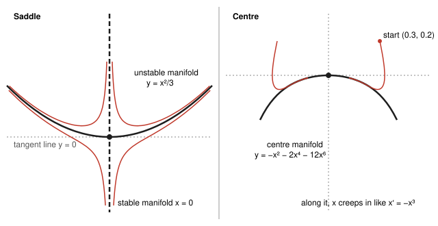

# Invariant manifolds: the curves into and out of a saddle, and the slow curve that decides when the linear part is silent

[Syllabus](../../../SYLLABUS.md) → [Differential equations and dynamics](../README.md) → [Nonlinear Dynamics in the Plane](../README.md#s06) → Invariant manifolds

---

## General Overview

A playground swing on rigid rods can rest balanced straight up. Push it from the bottom too gently and it falls back; too hard and it goes over. With this shelf's swing, damping 0.5, one exact speed at the bottom, 3.0885 rad per time unit (a time unit is 0.5 s), creeps up to balance on top, never quite arriving.

That knife-edge speed is one point of a curve. Every state on it ends balanced at the top. [Linearisation](02-linearisation-and-the-jacobian.md) draws this curve as a straight line through the rest. The true curve bends: this card computes the bend for two model systems, and traces the swing's curve numerically.

Such a curve is an **invariant manifold**: a curve that a path never leaves once it is on it. A saddle has two of them, a **stable manifold** (paths that come in) and an **unstable manifold** (paths that go out). When an eigenvalue of the Jacobian (the matrix of slopes at the rest) is zero, a third kind, the **centre manifold**, carries the slow motion, and decides whether the rest attracts.

**Near a rest, the stable, unstable and centre directions of the Jacobian bend into curves that paths never leave; each curve is found as a power series from one rule, that the flow moves along it, and on the centre curve a one-variable equation decides stability.**

**What kind of fact this is:** two theorems, the stable manifold and centre manifold theorems, stated here and proved in the sources (Perko §2.7, Carr ch. 2). Both examples' curves are computed and checked here; the saddle's is proved exact.

### The picture: two rests and their curves

<p align="center"></p>

To scale: left 100 px per unit, right 250. Dotted lines: eigenvector lines; red: paths. Both checks print the coordinates on `figure,` lines.

---

## The formula

Write a planar system as $`x' = f(x, y)`$, $`y' = g(x, y)`$, with a rest at the origin. A prime is a rate in time $`t`$. Suppose a manifold is a graph $`y = h(x)`$ through the origin. On it, $`y(t) = h(x(t))`$, so the chain rule gives $`y' = h'(x)\,x'`$. That is the one rule:

```math
h'(x)\, f\big(x, h(x)\big) = g\big(x, h(x)\big)
```

**Read it aloud:** the slope of the curve times the sideways speed equals the up-and-down speed, so the velocity points along the curve.

This is the **invariance equation**. Put in $`h(x) = a_2 x^2 + a_3 x^3 + \dots`$ and match powers of $`x`$: each power gives one coefficient $`a_k`$.

On a centre manifold, the motion is the **reduced equation**: one variable, with $`y`$ replaced by the curve.

```math
x' = f\big(x, h(x)\big)
```

**Read it aloud:** along the slow curve, x moves at the rate f with y set to h of x.

| Symbol | Plain meaning | In our example | Push it up and the answer… |
| --- | --- | --- | --- |
| $`x`$, $`y`$; $`f`$, $`g`$; $`x_0`$ | the two state variables; their rates; a starting value of $`x`$ | saddle: $`f = x`$, $`g = -y + x^2`$; $`x_0 = 0.3`$ | — |
| $`t`$ | time | $`\ln 100 = 4.605170`$ from 0.01 to 1 | paths hug the curve more closely |
| $`J`$, $`\lambda`$ | the Jacobian (matrix of slopes at the rest); its eigenvalues | saddle 1 and −1; centre 0 and −1 | a zero eigenvalue silences the linear test |
| $`h(x)`$; $`z`$ | the manifold as a graph, $`y = h(x)`$; the gap $`y - h(x)`$ above it | $`x^2/3`$; $`-x^2 - 2x^4 - 12x^6`$ | — |
| $`a_k`$; $`k`$, $`q`$ | coefficient of $`x^k`$ in $`h`$; powers of $`x`$ | 1/3; −1, −2, −12, −112 | higher terms matter further from the rest |
| $`W^s`$, $`W^u`$, $`W^c`$; $`C`$ | stable, unstable and centre manifolds; a free constant picking one centre curve (fold) | $`x = 0`$; $`y = x^2/3`$; $`y = h(x)`$ | — |
| $`V`$ | a Lyapunov function: a score that only falls | $`x^2/2`$ on the centre curve | — |
| $`\theta`$, $`\omega`$ | swing angle from hanging, rad; angular speed, rad per time unit | stable manifold meets $`\theta = 0`$ at $`\omega = 3.0885`$ | more damping needs a harder push |

### When it holds

- **Smooth rates.** The curves are as smooth as $`f`$ and $`g`$; a kink leaves no series to match.
- **Near the rest only.** The theorems are local, and so is every cut-off series.
- **A hyperbolic rest for the stable manifold theorem:** no eigenvalue has real part zero. A direction with real part zero is a centre direction instead.
- **The other eigenvalues negative for the reduction.** Then nearby paths fall onto the centre curve. If any eigenvalue is positive, the rest is unstable anyway.

---

## Why it works

### Step 0: a curve is invariant when the velocity is tangent to it

Solve $`x' = f(x, h(x))`$ and set $`y = h(x)`$; the invariance equation makes this a solution. By uniqueness ([The flow](../02-Existence%2C%20Uniqueness%20and%20Sensitivity/05-the-flow-of-an-equation.md)), a path starting on the curve is that solution, so it never leaves.

### Step 1: the saddle's way out, power by power

For $`x' = x`$, $`y' = -y + x^2`$ the invariance equation reads $`x\,h'(x) = -h(x) + x^2`$. The power $`x^k`$ gives $`k\,a_k = -a_k`$, plus 1 when $`k = 2`$:

```math
(k + 1)\,a_k = \begin{cases} 1 & k = 2 \\ 0 & \text{otherwise} \end{cases}
```

So $`a_2 = 1/3`$, every other coefficient is 0, and the curve is exactly $`y = x^2/3`$. The case $`k = 1`$ gives $`a_1 = 0`$: the curve leaves along the x-axis, the eigenvector of eigenvalue 1 ([The eigenvalue method](../04-Systems%20and%20the%20Matrix%20Exponential/02-the-eigenvalue-method.md)).

A one-line proof shows the curve also attracts. Let $`z = y - x^2/3`$, the gap above the curve. Then $`z' = (-y + x^2) - \tfrac{2x}{3}\cdot x = -z`$, so the gap shrinks like $`e^{-t}`$. Every path off the line $`x = 0`$ falls onto $`W^u`$ as it heads out.

### Step 2: the saddle's way in

On the line $`x = 0`$ the rate of $`x`$ is 0, so a path stays there and $`y' = -y`$ carries it in. Off that line $`x`$ grows like $`e^{t}`$. So $`W^s`$ is exactly $`x = 0`$.

The **stable manifold theorem** says this shape is general. At a saddle (one negative and one positive eigenvalue), the points whose paths tend to the rest form a smooth curve, tangent there to the eigenvector of the negative eigenvalue. The points whose paths came out of the rest form a second curve, tangent to the other eigenvector. Linearisation gives the tangent lines; the theorem guarantees the curves.

### Step 3: the centre curve, power by power

For $`x' = xy`$, $`y' = -y - x^2`$ the Jacobian is `[[0, 0], [0, -1]]`, with eigenvalues 0 and −1. The x-axis is the centre direction. The linear test is silent: it sees $`x' = 0`$.

Swapping $`x`$ for $`-x`$ leaves the system unchanged, so $`h`$ has even powers only. The invariance equation is $`h'(x)\cdot x\,h(x) = -h(x) - x^2`$. Match powers:

1. $`x^2`$: the left side has no $`x^2`$ term, so $`0 = -a_2 - 1`$ and $`a_2 = -1`$.
2. $`x^4`$: the left side gives $`2a_2 \cdot a_2 = 2`$, so $`2 = -a_4`$ and $`a_4 = -2`$.
3. $`x^6`$: the left side gives $`2a_2 a_4 + 4a_4 a_2 = 12`$, so $`a_6 = -12`$.

The centre manifold is $`y = -x^2 - 2x^4 - 12x^6 - \dots`$, and the reduced equation is

```math
x' = x\,h(x) = -x^3 - 2x^5 - 12x^7 - \dots
```

### Step 4: the reduced equation decides

The **centre manifold theorem** has three parts:

1. A smooth invariant curve tangent to the centre direction exists near the rest.
2. A series that satisfies the invariance equation up to $`x^q`$ matches the curve up to $`x^q`$.
3. When the other eigenvalues are negative, nearby paths fall onto the curve, here like $`e^{-t}`$, so the rest is stable exactly when the reduced equation's rest is.

The reduced equation is one variable, so [Lyapunov functions](04-lyapunov-functions.md) settle it. Take $`V = x^2/2`$. Then $`V' = x\,x' = -x^4 - 2x^6 - \dots`$, negative near 0 for every $`x \ne 0`$. The origin attracts. Paths approach slowly, like $`x' = -x^3`$, whose solution is $`x_0/\sqrt{1 + 2x_0^2 t}`$.

The twin system $`y' = -y + x^2`$ has the same Jacobian. Its curve starts $`y = x^2 - 2x^4`$, so $`x' = +x^3 - 2x^5`$ and its origin repels. Equal eigenvalues, opposite verdicts.

<details>
<summary>Why the curve need not be unique, but its series is</summary>

Take $`x' = x^2`$, $`y' = -y`$, so along a path $`dy/dx = -y/x^2`$. For any constant $`C`$, the curve $`C e^{1/x}`$ for $`x < 0`$, joined to 0 for $`x \ge 0`$, solves this: each is a centre manifold. All share the series zero, since $`e^{1/x}`$ falls faster than any power as $`x`$ rises to 0. So the verdict does not depend on the choice (Carr, ch. 2).

</details>

---

## Worked numbers, by hand

| Step | Arithmetic | Value |
| --- | --- | --- |
| saddle: unstable curve | $`(2 + 1)a_2 = 1`$ | $`a_2 = 1/3`$, others 0 |
| start (0.01, 0), run to $`x = 1`$ | $`t = \ln 100`$ | 4.605170 |
| y there | on the curve: $`1^2/3`$ | 0.333333 |
| start (0.01, 1) instead | gap shrinks 100-fold | y = 0.343333 |
| stable line: start (0, 1) | $`y = e^{-5}`$ at $`t = 5`$ | 0.006738 |
| centre curve | match $`x^2`$, $`x^4`$, $`x^6`$ | −1, −2, −12 |
| start (0.3, 0.2): gap above the curve | at t = 0, 2, 4, 8 | 0.314948, 0.070034, 0.009257, −0.000635 |
| x over the same 8 units | slow creep | 0.3 to 0.209998 |
| x at t = 100 from 0.3, by $`x' = -x^3`$ alone | $`0.3/\sqrt{1 + 2 \cdot 0.09 \cdot 100}`$ | 0.068825 |
| the same, by the reduced equation | $`x' = -x^3 - 2x^5 - 12x^7`$, stepped | 0.067793 |
| full system, same start | Runge–Kutta 4 | **0.067711: the rest attracts** |

By t = 8 the gap is down to the series' own error, while x has moved a third: the fast direction dies first, then the curve carries the slow motion.

### What breaks if you drop a piece

| Mistake | Comes out at | What went wrong |
| --- | --- | --- |
| Tangent line $`y = 0`$ as the way out | y = 0 at x = 1 | truly 0.333333: the curve bends |
| Centre curve taken as $`y = 0`$ | $`x' = 0`$, x stays 0.3 | truly 0.067711 at t = 100 |
| Eigenvalues 0 and −1 read as "stable" | twin from 0.3 should settle | twin reaches 0.806586 by t = 6 |

---

## Code, from first principles, and it actually runs

Two independent roads. Road one solves the invariance equation power by power in exact fractions. Road two runs the full system with [Runge-Kutta four](../05-Numerical%20Evolution/04-runge-kutta-four.md) and checks that paths land on the series curves and move as the reduced equation says. The saddle's exact solution is a third road. The swing's speed comes from running time backward from the top.

### Python

```python
# Invariant manifolds -- the check behind the card.  Standard library only.
# Saddle: x' = x, y' = -y + x^2.  Centre: x' = xy, y' = -y - x^2, and its twin
# y' = -y + x^2.  Road one: power series that the flow must leave unchanged.
# Road two: Runge-Kutta 4, written out here, run on the full system.
from fractions import Fraction as F
from math import pi, log, sqrt, sin
def rk4(f, s, t, h=0.001):
    n = max(1, round(abs(t) / h)); k = t / n          # n equal steps, landing exactly on t
    for _ in range(n):
        a = f(s); b = f((s[0] + k/2*a[0], s[1] + k/2*a[1]))
        c = f((s[0] + k/2*b[0], s[1] + k/2*b[1])); d = f((s[0] + k*c[0], s[1] + k*c[1]))
        s = (s[0] + k/6*(a[0] + 2*b[0] + 2*c[0] + d[0]), s[1] + k/6*(a[1] + 2*b[1] + 2*c[1] + d[1]))
    return s
def centre(sign, n=4):                # y = h(x) = sum a[k] x^k, with h'(x) x h(x) = -h(x) + sign x^2
    a = [F(0)] * (2*n + 1)
    for k in range(2, 2*n + 1, 2):
        a[k] = sign * int(k == 2) - sum(i * a[i] * a[k - i] for i in range(2, k - 1))
    return a
saddle, sad = (lambda s: (s[0], -s[1] + s[0]**2)), [F(int(k == 2), k + 1) for k in range(9)]   # Step 1: (k + 1) a_k = [k = 2]
hs, dhs = (lambda x: sum(c * x**k for k, c in enumerate(sad))), (lambda x: sum(k * c * x**(k - 1) for k, c in enumerate(sad) if k))
print("saddle x' = x, y' = -y + x^2: J = [[1, 0], [0, -1]], eigenvalues 1 and -1")
print("unstable manifold y = a2 x^2 + ... + a8 x^8: " + ", ".join(str(sad[k]) for k in range(2, 9)))
assert all(dhs(x) * saddle((x, hs(x)))[0] == saddle((x, hs(x)))[1] for x in map(F, range(-4, 5)))   # h' f = g at 9 points: degree 8, so everywhere
for y0 in (0.0, 1.0):
    x1, y1 = rk4(saddle, (0.01, y0), log(100))
    assert abs(y1 - (1/3 + (y0 - 0.01**2/3) / 100)) < 1e-9    # exact: gap y - x^2/3 falls like e^-t
    print(f"start (0.01, {y0:g}), t = ln 100 = {log(100):.6f}: x = {x1:.6f}, y = {y1:.6f}, curve x^2/3 = {x1**2/3:.6f}")
print(f"stable manifold x = 0: start (0, 1), y at t = 5: {rk4(saddle, (0.0, 1.0), 5)[1]:.6f} = e^-5")
a, b = centre(-1), centre(+1)
print("centre x' = xy, y' = -y - x^2: J = [[0, 0], [0, -1]], eigenvalues 0 and -1")
print("centre manifold y = h(x), coefficients of x^2, x^4, x^6, x^8: " + ", ".join(str(a[k]) for k in (2, 4, 6, 8)))
assert [a[k] for k in (2, 4, 6, 8)] == [-1, -2, -12, -112]
h = lambda x: sum(float(a[k]) * x**k for k in (2, 4, 6))
full = lambda s: (s[0] * s[1], -s[1] - s[0]**2)
gaps = [(t, rk4(full, (0.3, 0.2), t)) for t in (0, 2, 4, 8)]
print("start (0.3, 0.2): gap y - h(x) at t = 0, 2, 4, 8: " + ", ".join(f"{s[1] - h(s[0]):.6f}" for t, s in gaps)
      + f"; x at t = 8: {gaps[-1][1][0]:.6f}")
assert abs(gaps[-1][1][1] - h(gaps[-1][1][0])) < 0.01 * abs(0.2 - h(0.3))
xf = rk4(full, (0.3, h(0.3)), 100, 0.01)[0]
xr, x3 = rk4(lambda s: (s[0] * h(s[0]), 0.0), (0.3, 0.0), 100, 0.01)[0], 0.3 / sqrt(1 + 2*0.09*100)
assert abs(xf - xr) < 0.1 * abs(xf - x3)        # the x^5 term earns its place
print(f"from x = 0.3 on the curve, x at t = 100: full system {xf:.6f}, reduced x' = x h(x) {xr:.6f}, x' = -x^3 alone {x3:.6f}")
xg = rk4(lambda s: (s[0] * s[1], -s[1] + s[0]**2), (0.3, sum(float(b[k]) * 0.3**k for k in (2, 4, 6))), 6)[0]
assert b[2] == 1 and b[4] == -2 and xg > 0.6
print(f"twin y' = -y + x^2, same J: coefficients {b[2]}, {b[4]}, so x' = +x^3 - 2x^5; from 0.3, x at t = 6: {xg:.6f}")
print(f"mistake 1, tangent line y = 0 as the way out of the saddle: y = 0 at x = 1, truly {float(sad[2]):.6f}")
print(f"mistake 2, centre curve taken as y = 0: x' = 0, x stays 0.3; truly {xf:.6f} at t = 100")
swing, ls, tops = lambda s: (s[1], -sin(s[0]) - 0.5 * s[1]), 0.5 * (-0.5 - sqrt(4.25)), []
for e in (1e-5, 1e-7):                  # start on the swing's stable line at the top, run back
    s = p = (pi - e, -ls * e)
    while s[0] > 0:
        p, s = s, rk4(swing, s, -0.001)
    tops.append(p[1] + (s[1] - p[1]) * p[0] / (p[0] - s[0]))
assert abs(tops[0] - tops[1]) < 1e-6 and tops[0] > 2
print(f"swing, upright rest: stable manifold meets theta = 0 at speed {tops[0]:.4f} rad per unit (2 without damping)")
P = lambda x, y, X, Y, k: f"{X + k*x:.1f},{Y - k*y:.1f}"
print("figure, saddle curve: " + " ".join(P(x/2, x*x/12, 160, 200, 100) for x in range(-3, 4)))
print("figure, centre curve: " + " ".join(P(x/10, h(x/10), 480, 110, 250) for x in range(-4, 5, 2))
      + "; path at t = 0, 2, 4, 8: " + " ".join(P(*s, 480, 110, 250) for t, s in gaps))
print("ALL CHECKS PASS")
```

**Ran 2026-11-23 on macOS, Python 3.14.10, standard library only. All checks passed. Output, pasted from the run:**

```
saddle x' = x, y' = -y + x^2: J = [[1, 0], [0, -1]], eigenvalues 1 and -1
unstable manifold y = a2 x^2 + ... + a8 x^8: 1/3, 0, 0, 0, 0, 0, 0
start (0.01, 0), t = ln 100 = 4.605170: x = 1.000000, y = 0.333333, curve x^2/3 = 0.333333
start (0.01, 1), t = ln 100 = 4.605170: x = 1.000000, y = 0.343333, curve x^2/3 = 0.333333
stable manifold x = 0: start (0, 1), y at t = 5: 0.006738 = e^-5
centre x' = xy, y' = -y - x^2: J = [[0, 0], [0, -1]], eigenvalues 0 and -1
centre manifold y = h(x), coefficients of x^2, x^4, x^6, x^8: -1, -2, -12, -112
start (0.3, 0.2): gap y - h(x) at t = 0, 2, 4, 8: 0.314948, 0.070034, 0.009257, -0.000635; x at t = 8: 0.209998
from x = 0.3 on the curve, x at t = 100: full system 0.067711, reduced x' = x h(x) 0.067793, x' = -x^3 alone 0.068825
twin y' = -y + x^2, same J: coefficients 1, -2, so x' = +x^3 - 2x^5; from 0.3, x at t = 6: 0.806586
mistake 1, tangent line y = 0 as the way out of the saddle: y = 0 at x = 1, truly 0.333333
mistake 2, centre curve taken as y = 0: x' = 0, x stays 0.3; truly 0.067711 at t = 100
swing, upright rest: stable manifold meets theta = 0 at speed 3.0885 rad per unit (2 without damping)
figure, saddle curve: 10.0,125.0 60.0,166.7 110.0,191.7 160.0,200.0 210.0,191.7 260.0,166.7 310.0,125.0
figure, centre curve: 380.0,175.1 430.0,121.0 480.0,110.0 530.0,121.0 580.0,175.1; path at t = 0, 2, 4, 8: 555.0,60.0 559.3,125.8 547.8,130.0 532.5,122.4
ALL CHECKS PASS
```

### Rust

Same numbers, same labels, built with `rustc --edition 2021 -O`.

```rust
// Invariant manifolds -- the same check as the Python, in Rust, no crates.
// Saddle: x' = x, y' = -y + x^2.  Centre: x' = xy, y' = -y - x^2, and its twin
// y' = -y + x^2.  Road one: power series that the flow must leave unchanged.
// Road two: Runge-Kutta 4, written out here, run on the full system.
use std::f64::consts::PI;
type S = (f64, f64);
fn rk4(f: &dyn Fn(S) -> S, mut s: S, t: f64, h: f64) -> S {
    let n = ((t.abs() / h).round() as usize).max(1); let k = t / n as f64;   // n equal steps, landing exactly on t
    for _ in 0..n {
        let a = f(s);
        let b = f((s.0 + k / 2.0 * a.0, s.1 + k / 2.0 * a.1));
        let c = f((s.0 + k / 2.0 * b.0, s.1 + k / 2.0 * b.1));
        let d = f((s.0 + k * c.0, s.1 + k * c.1));
        s = (s.0 + k / 6.0 * (a.0 + 2.0 * b.0 + 2.0 * c.0 + d.0), s.1 + k / 6.0 * (a.1 + 2.0 * b.1 + 2.0 * c.1 + d.1));
    }
    s
}
fn centre(sign: i64) -> Vec<i64> {      // y = h(x) = sum a[k] x^k, with h'(x) x h(x) = -h(x) + sign x^2
    let mut a = vec![0i64; 9];
    for k in (2..9).step_by(2) {
        a[k] = sign * (k == 2) as i64 - (2..k - 1).map(|i| i as i64 * a[i] * a[k - i]).sum::<i64>();
    }
    a
}
fn ev(a: &[i64], x: f64) -> f64 { [2, 4, 6].iter().map(|&k| a[k] as f64 * x.powi(k as i32)).sum() }
fn p(s: S, x0: f64, y0: f64, k: f64) -> String { format!("{:.1},{:.1}", x0 + k * s.0, y0 - k * s.1) }
fn main() {
    let saddle = |s: S| (s.0, -s.1 + s.0 * s.0);
    let sad: Vec<(i64, i64)> = (0..9).map(|k| ((k == 2) as i64, k + 1)).collect(); // Step 1: (k + 1) a_k = [k = 2]
    let hs = |x: f64| (0..9).map(|k| sad[k].0 as f64 / sad[k].1 as f64 * x.powi(k as i32)).sum::<f64>();
    let dhs = |x: f64| (1..9).map(|k| (k as i64 * sad[k].0) as f64 / sad[k].1 as f64 * x.powi(k as i32 - 1)).sum::<f64>();
    let txt = |c: (i64, i64)| if c.0 == 0 { "0".to_string() } else { format!("{}/{}", c.0, c.1) };
    println!("saddle x' = x, y' = -y + x^2: J = [[1, 0], [0, -1]], eigenvalues 1 and -1");
    println!("unstable manifold y = a2 x^2 + ... + a8 x^8: {}", (2..9).map(|k| txt(sad[k])).collect::<Vec<_>>().join(", "));
    assert!((-4..5).all(|i| { let x = i as f64; (dhs(x) * saddle((x, hs(x))).0 - saddle((x, hs(x))).1).abs() < 1e-9 })); // h' f = g at 9 points
    let tl = 100f64.ln();
    for y0 in [0.0, 1.0] {
        let (x1, y1) = rk4(&saddle, (0.01, y0), tl, 0.001);
        assert!((y1 - (1.0 / 3.0 + (y0 - 0.0001 / 3.0) / 100.0)).abs() < 1e-9); // exact: gap falls like e^-t
        println!("start (0.01, {}), t = ln 100 = {:.6}: x = {:.6}, y = {:.6}, curve x^2/3 = {:.6}", y0, tl, x1, y1, x1 * x1 / 3.0);
    }
    println!("stable manifold x = 0: start (0, 1), y at t = 5: {:.6} = e^-5", rk4(&saddle, (0.0, 1.0), 5.0, 0.001).1);
    let (a, b) = (centre(-1), centre(1));
    println!("centre x' = xy, y' = -y - x^2: J = [[0, 0], [0, -1]], eigenvalues 0 and -1");
    println!("centre manifold y = h(x), coefficients of x^2, x^4, x^6, x^8: {}, {}, {}, {}", a[2], a[4], a[6], a[8]);
    assert!([a[2], a[4], a[6], a[8]] == [-1, -2, -12, -112]);
    let h = |x: f64| ev(&a, x);
    let full = |s: S| (s.0 * s.1, -s.1 - s.0 * s.0);
    let gaps: Vec<S> = [0.0, 2.0, 4.0, 8.0].iter().map(|&t| rk4(&full, (0.3, 0.2), t, 0.001)).collect();
    println!("start (0.3, 0.2): gap y - h(x) at t = 0, 2, 4, 8: {}; x at t = 8: {:.6}",
             gaps.iter().map(|s| format!("{:.6}", s.1 - h(s.0))).collect::<Vec<_>>().join(", "), gaps[3].0);
    assert!((gaps[3].1 - h(gaps[3].0)).abs() < 0.01 * (0.2 - h(0.3)).abs());
    let xf = rk4(&full, (0.3, h(0.3)), 100.0, 0.01).0;
    let xr = rk4(&|s: S| (s.0 * h(s.0), 0.0), (0.3, 0.0), 100.0, 0.01).0;
    let x3 = 0.3 / (1.0f64 + 2.0 * 0.09 * 100.0).sqrt();
    assert!((xf - xr).abs() < 0.1 * (xf - x3).abs());       // the x^5 term earns its place
    println!("from x = 0.3 on the curve, x at t = 100: full system {:.6}, reduced x' = x h(x) {:.6}, x' = -x^3 alone {:.6}", xf, xr, x3);
    let xg = rk4(&|s: S| (s.0 * s.1, -s.1 + s.0 * s.0), (0.3, ev(&b, 0.3)), 6.0, 0.001).0;
    assert!(b[2] == 1 && b[4] == -2 && xg > 0.6);
    println!("twin y' = -y + x^2, same J: coefficients {}, {}, so x' = +x^3 - 2x^5; from 0.3, x at t = 6: {:.6}", b[2], b[4], xg);
    println!("mistake 1, tangent line y = 0 as the way out of the saddle: y = 0 at x = 1, truly {:.6}", 1.0 / 3.0);
    println!("mistake 2, centre curve taken as y = 0: x' = 0, x stays 0.3; truly {:.6} at t = 100", xf);
    let swing = |s: S| (s.1, -s.0.sin() - 0.5 * s.1);
    let ls = 0.5 * (-0.5 - 4.25f64.sqrt());
    let mut tops = vec![];
    for e in [1e-5, 1e-7] {                                  // start on the swing's stable line at the top, run back
        let (mut s, mut q) = ((PI - e, -ls * e), (PI - e, -ls * e));
        while s.0 > 0.0 { q = s; s = rk4(&swing, s, -0.001, 0.001); }
        tops.push(q.1 + (s.1 - q.1) * q.0 / (q.0 - s.0));
    }
    assert!((tops[0] - tops[1]).abs() < 1e-6 && tops[0] > 2.0);
    println!("swing, upright rest: stable manifold meets theta = 0 at speed {:.4} rad per unit (2 without damping)", tops[0]);
    let sc: Vec<String> = (-3..4).map(|x| p((x as f64 / 2.0, (x * x) as f64 / 12.0), 160.0, 200.0, 100.0)).collect();
    println!("figure, saddle curve: {}", sc.join(" "));
    let cc: Vec<String> = (-4..5).step_by(2).map(|x| { let u = x as f64 / 10.0; p((u, h(u)), 480.0, 110.0, 250.0) }).collect();
    let pc: Vec<String> = gaps.iter().map(|&s| p(s, 480.0, 110.0, 250.0)).collect();
    println!("figure, centre curve: {}; path at t = 0, 2, 4, 8: {}", cc.join(" "), pc.join(" "));
    println!("ALL CHECKS PASS");
}
```

**Ran 2026-11-23 on macOS, rustc 1.98.1, no crates. All checks passed. Output, pasted from the run:**

```
saddle x' = x, y' = -y + x^2: J = [[1, 0], [0, -1]], eigenvalues 1 and -1
unstable manifold y = a2 x^2 + ... + a8 x^8: 1/3, 0, 0, 0, 0, 0, 0
start (0.01, 0), t = ln 100 = 4.605170: x = 1.000000, y = 0.333333, curve x^2/3 = 0.333333
start (0.01, 1), t = ln 100 = 4.605170: x = 1.000000, y = 0.343333, curve x^2/3 = 0.333333
stable manifold x = 0: start (0, 1), y at t = 5: 0.006738 = e^-5
centre x' = xy, y' = -y - x^2: J = [[0, 0], [0, -1]], eigenvalues 0 and -1
centre manifold y = h(x), coefficients of x^2, x^4, x^6, x^8: -1, -2, -12, -112
start (0.3, 0.2): gap y - h(x) at t = 0, 2, 4, 8: 0.314948, 0.070034, 0.009257, -0.000635; x at t = 8: 0.209998
from x = 0.3 on the curve, x at t = 100: full system 0.067711, reduced x' = x h(x) 0.067793, x' = -x^3 alone 0.068825
twin y' = -y + x^2, same J: coefficients 1, -2, so x' = +x^3 - 2x^5; from 0.3, x at t = 6: 0.806586
mistake 1, tangent line y = 0 as the way out of the saddle: y = 0 at x = 1, truly 0.333333
mistake 2, centre curve taken as y = 0: x' = 0, x stays 0.3; truly 0.067711 at t = 100
swing, upright rest: stable manifold meets theta = 0 at speed 3.0885 rad per unit (2 without damping)
figure, saddle curve: 10.0,125.0 60.0,166.7 110.0,191.7 160.0,200.0 210.0,191.7 260.0,166.7 310.0,125.0
figure, centre curve: 380.0,175.1 430.0,121.0 480.0,110.0 530.0,121.0 580.0,175.1; path at t = 0, 2, 4, 8: 555.0,60.0 559.3,125.8 547.8,130.0 532.5,122.4
ALL CHECKS PASS
```

### Lean

Lean proves the invariance rule for every curve, the saddle's gap law, and attraction for the cut-off reduced equation.

- Suppose a curve $`y = h(x)`$ satisfies the invariance equation, and $`x(t)`$ solves $`x' = f(x, h(x))`$. Then $`y = h(x(t))`$ solves $`y' = g(x, y)`$, so the path stays on the curve.
- Take any path of the saddle $`x' = x`$, $`y' = -y + x^2`$. Then the gap $`y - x^2/3`$ at time $`t`$ equals its starting value times $`e^{-t}`$.
- Take any solution of $`x' = -x^3 - 2x^5`$ that runs for all $`t \ge 0`$. Then $`x`$ tends to 0, so the rest attracts.
- The hand arithmetic holds exactly. That covers $`a_2 = 1/3`$ and the centre coefficients −1, −2, −12, −112. It covers the twin's 1 and −2.

The stepped paths, the full centre system, the twin's escape and the swing's speed are left to the Python and Rust checks.

```lean
-- Invariant manifolds: a graph y = h(x) that satisfies the invariance equation h' f = g carries paths of the system, the saddle's gap y - x^2/3 shrinks like e^-t, and the centre curve's reduced equation x' = -x^3 - 2x^5 drives x to 0.
import Mathlib.Analysis.SpecialFunctions.Exp
import Mathlib.Analysis.Calculus.Deriv.Basic
import Mathlib.Analysis.Calculus.Deriv.Comp
import Mathlib.Analysis.Calculus.Deriv.MeanValue
import Mathlib.Analysis.Calculus.MeanValue
import Mathlib.Topology.Order.DenselyOrdered
import Mathlib.Analysis.Calculus.Deriv.Pow
import Mathlib.Analysis.SpecialFunctions.ExpDeriv
import Mathlib.Tactic.Linarith
import Mathlib.Tactic.Positivity

open Filter Topology

/-- The invariance equation. For the planar system x' = f(x, y), y' = g(x, y), if the
smooth curve y = h(x) satisfies h'(x) f(x, h(x)) = g(x, h(x)) for every x, then solving
x' = f(x, h(x)) and setting y = h(x) gives a solution of the full system: the velocity
points along the curve, so the path moves along it. -/
theorem graph_solves_system_of_invariance_equation
    (f g : ℝ → ℝ → ℝ) (h h' : ℝ → ℝ)
    (hh : ∀ x, HasDerivAt h (h' x) x)
    (hinv : ∀ x, h' x * f x (h x) = g x (h x))
    (X : ℝ → ℝ) (hX : ∀ t, HasDerivAt X (f (X t) (h (X t))) t) :
    ∀ t, HasDerivAt (fun s => h (X s)) (g (X t) (h (X t))) t := by
  intro t
  have := (hh (X t)).comp t (hX t)
  rw [hinv] at this
  exact this

/-- The saddle x' = x, y' = -y + x^2. Along every path, the gap z = y - x^2/3 above the
unstable manifold y = x^2/3 obeys z' = -z, so z(t) = z(0) e^(-t): a path on the curve
stays on it, and every other path falls onto it. -/
theorem saddle_gap_decays_exponentially
    (x y : ℝ → ℝ)
    (hx : ∀ t, HasDerivAt x (x t) t)
    (hy : ∀ t, HasDerivAt y (-(y t) + (x t) ^ 2) t) (t : ℝ) :
    y t - (x t) ^ 2 / 3 = (y 0 - (x 0) ^ 2 / 3) * Real.exp (-t) := by
  have hF : ∀ s, HasDerivAt (fun s => (y s - (x s) ^ 2 / 3) * Real.exp s) 0 s := by
    intro s
    have h1 := (((hy s).sub (((hx s).pow 2).div_const 3)).mul (Real.hasDerivAt_exp s))
    convert h1 using 1
    simp only [Pi.sub_apply, Pi.pow_apply]
    push_cast
    ring
  have hc := is_const_of_deriv_eq_zero (fun s => (hF s).differentiableAt)
    (fun s => (hF s).deriv) t 0
  simp only [Real.exp_zero, mul_one] at hc
  rw [← hc, mul_assoc, ← Real.exp_add, add_neg_cancel, Real.exp_zero, mul_one]

/-- The reduced equation on the centre curve of x' = xy, y' = -y - x^2, cut off after the
x^5 term: x' = -x^3 - 2x^5. Every solution that runs for all t ≥ 0 tends to 0, so the
rest attracts (the Lyapunov score V = x^2/2 only falls). -/
theorem reduced_centre_equation_attracts
    (x : ℝ → ℝ)
    (hx : ∀ t, 0 ≤ t → HasDerivAt x (-(x t) ^ 3 - 2 * (x t) ^ 5) t) :
    Tendsto x atTop (𝓝 0) := by
  -- V = x^2 is antitone on [0, ∞)
  have hV : ∀ s, 0 ≤ s → HasDerivAt (fun s => (x s) ^ 2)
      (2 * (x s) * (-(x s) ^ 3 - 2 * (x s) ^ 5)) s := by
    intro s hs
    have := (hx s hs).pow 2
    convert this using 1
    push_cast
    ring
  have hanti : AntitoneOn (fun s => (x s) ^ 2) (Set.Ici 0) := by
    apply antitoneOn_of_deriv_nonpos (convex_Ici 0)
    · intro s hs
      exact (hV s hs).continuousAt.continuousWithinAt
    · intro s hs
      rw [interior_Ici] at hs
      exact (hV s (le_of_lt hs)).differentiableAt.differentiableWithinAt
    · intro s hs
      rw [interior_Ici] at hs
      rw [(hV s (le_of_lt hs)).deriv]
      nlinarith [pow_two_nonneg ((x s) ^ 2), pow_two_nonneg ((x s) ^ 3)]
  rw [Metric.tendsto_atTop]
  intro ε hε
  set e := ε ^ 2 with he
  have hepos : 0 < e := by positivity
  refine ⟨(x 0) ^ 2 / (2 * e ^ 2) + 1, ?_⟩
  intro n hn
  have hN0 : 0 ≤ (x 0) ^ 2 / (2 * e ^ 2) := by positivity
  have hn0 : 0 ≤ n := by linarith
  have hlt : (x n) ^ 2 < e := by
    by_contra hcon'
    have hcon := not_lt.mp hcon'
    have hge : ∀ s ∈ Set.Icc (0 : ℝ) n, e ≤ (x s) ^ 2 := by
      intro s hs
      exact le_trans hcon (hanti hs.1 hn0 hs.2)
    have hG : ∀ s, 0 ≤ s → HasDerivAt (fun s => (x s) ^ 2 + 2 * e ^ 2 * s)
        (2 * (x s) * (-(x s) ^ 3 - 2 * (x s) ^ 5) + 2 * e ^ 2) s := by
      intro s hs
      have := (hV s hs).add ((hasDerivAt_id s).const_mul (2 * e ^ 2))
      convert this using 1
      · funext u
        simp
      · ring
    have hGanti : AntitoneOn (fun s => (x s) ^ 2 + 2 * e ^ 2 * s) (Set.Icc 0 n) := by
      apply antitoneOn_of_deriv_nonpos (convex_Icc 0 n)
      · intro s hs
        exact (hG s hs.1).continuousAt.continuousWithinAt
      · intro s hs
        rw [interior_Icc] at hs
        exact (hG s (le_of_lt hs.1)).differentiableAt.differentiableWithinAt
      · intro s hs
        rw [interior_Icc] at hs
        rw [(hG s (le_of_lt hs.1)).deriv]
        have h1 := hge s ⟨le_of_lt hs.1, le_of_lt hs.2⟩
        have h2 : e ^ 2 ≤ ((x s) ^ 2) ^ 2 := by
          exact pow_le_pow_left₀ (le_of_lt hepos) h1 2
        nlinarith [pow_two_nonneg ((x s) ^ 3)]
    have key := hGanti ⟨le_refl 0, hn0⟩ ⟨hn0, le_refl n⟩ hn0
    simp only [mul_zero, add_zero] at key
    have h3 : (x 0) ^ 2 / (2 * e ^ 2) * (2 * e ^ 2) = (x 0) ^ 2 := by
      field_simp
    have h4 : 0 < 2 * e ^ 2 := by positivity
    nlinarith
  rw [Real.dist_eq, sub_zero]
  rw [he] at hlt
  exact abs_lt_of_sq_lt_sq' hlt (le_of_lt hε) |> fun h => abs_lt.mpr h

-- Saddle, Step 1: (2 + 1) a_2 = 1 gives a_2 = 1/3.
example : ((2 : ℚ) + 1) * (1 / 3) = 1 := by norm_num

-- Saddle: y = x^2/3 satisfies the invariance equation x h'(x) = -h(x) + x^2 exactly.
example (x : ℚ) : x * (2 * x / 3) = -(x ^ 2 / 3) + x ^ 2 := by ring

-- Centre curve, Step 3: matching powers gives a_2 = -1, a_4 = -2, a_6 = -12, a_8 = -112.
-- x^2: 0 = -a_2 - 1
example : (0 : ℤ) = -(-1) - 1 := by norm_num
-- x^4: 2 a_2 a_2 = -a_4
example : (2 : ℤ) * (-1) * (-1) = -(-2) := by norm_num
-- x^6: 2 a_2 a_4 + 4 a_4 a_2 = -a_6
example : (2 : ℤ) * (-1) * (-2) + 4 * (-2) * (-1) = -(-12) := by norm_num
-- x^8: 2 a_2 a_6 + 4 a_4 a_4 + 6 a_6 a_2 = -a_8
example : (2 : ℤ) * (-1) * (-12) + 4 * (-2) * (-2) + 6 * (-12) * (-1) = -(-112) := by norm_num

-- The twin y' = -y + x^2: x^2 gives 0 = -a_2 + 1, so a_2 = 1; x^4 gives 2 a_2 a_2 = -a_4, so a_4 = -2.
example : (0 : ℤ) = -1 + 1 := by norm_num
example : (2 : ℤ) * 1 * 1 = -(-2) := by norm_num

#print axioms graph_solves_system_of_invariance_equation
#print axioms saddle_gap_decays_exponentially
#print axioms reduced_centre_equation_attracts
```

**Checked 2026-11-23 on macOS, Lean 4.36.0-rc2, Mathlib v4.36.0-rc2. Every proof is complete and uses only Lean's standard axioms. Output, pasted from the run:**

```
'graph_solves_system_of_invariance_equation' depends on axioms: [propext, Classical.choice, Quot.sound]
'saddle_gap_decays_exponentially' depends on axioms: [propext, Classical.choice, Quot.sound]
'reduced_centre_equation_attracts' depends on axioms: [propext, Classical.choice, Quot.sound]
```

> [!TIP]
> **Try changing**
> - **Guess first: faster decay, flatter curve?** Make the saddle's rate `-2*s[1] + s[0]**2` and the series line `F(int(k == 2), k + 2)`. The curve becomes $`y = x^2/4`$, and the assert pinned to 1/3 stops the run.
> - **Guess first: does a start closer in snap on faster?** Change the start `(0.3, 0.2)` in the `gaps` line to `(0.1, 0.2)`. The gaps read 0.210212, 0.029985, 0.004300, 0.000085: the same $`e^{-t}`$ fall, less series error.
> - **Guess first: a frictionless swing?** Set the swing's damping `0.5 * s[1]` to `0.0 * s[1]`. The assert `tops[0] > 2` stops the run: the speed is now 2.0000, what energy alone gives (print it before the assert to see it).

---

## The usual mistake

> [!warning]
> **Reading stability off the eigenvalues when one of them is zero.** Eigenvalues 0 and −1 say nothing. The system with $`y' = -y - x^2`$ settles; its twin with $`y' = -y + x^2`$ runs from 0.3 to 0.806586 by t = 6, then blows up.
>
> - **Taking the tangent line for the manifold.** The saddle's way out is $`y = x^2/3`$, not $`y = 0`$: at x = 1 the true height is 0.333333.
> - **Setting the fast variable to zero.** With $`y = 0`$, $`x' = 0`$ and x would stay at 0.3; in fact it reaches 0.067711 by t = 100.
> - **Trusting the series far out.** The coefficients −1, −2, −12, −112 grow fast; far from the rest a cut-off series is wrong.

---

## Where you meet it in real life

- **Balancing the swing.** The upright rest is a saddle; its stable manifold holds the exact pushes that end balanced. From hanging: 3.0885 rad per time unit, against 2 with no damping.
- **Spacecraft paths.** Missions to the balance points between Sun and Earth coast in along the stable manifolds of orbits there, saving fuel.
- **Chemical kinetics.** A fast reaction step settles at once while a slow one runs on. The quasi-steady-state rule, "set the fast rate to zero", is the leading term of the slow curve.
- **Bifurcation theory in many variables.** At a bifurcation an eigenvalue crosses zero ([Bifurcations](10-bifurcations-of-equilibria.md)). The centre manifold cuts a large system down to the one or two variables where the change happens.

> **Say it back**
> An invariant manifold is a curve that paths never leave. A saddle has a stable curve coming in and an unstable curve going out, tangent to the Jacobian's eigenvectors but bent. Each curve is a power series found by making the velocity point along it. When an eigenvalue is zero, the centre curve decides: here the motion along it is $`x' = -x^3 - 2x^5`$, so the rest attracts. A twin with the same eigenvalues repels.

---

## What this builds on

- [Linearisation](02-linearisation-and-the-jacobian.md): the Jacobian, hyperbolic rests, and the straight lines this card bends.
- [Lyapunov functions](04-lyapunov-functions.md): the score $`V = x^2/2`$ that proves the reduced equation settles.
- [Bifurcations](10-bifurcations-of-equilibria.md): the one-variable normal forms a centre manifold reduces to.
- [The eigenvalue method](../04-Systems%20and%20the%20Matrix%20Exponential/02-the-eigenvalue-method.md): eigenvectors as the straight directions that only stretch.
- [The flow](../02-Existence%2C%20Uniqueness%20and%20Sensitivity/05-the-flow-of-an-equation.md): one start gives one path, so a path on an invariant curve stays on it.

## Where this goes next

- [The Hopf bifurcation](13-hopf-bifurcation.md): the centre manifold carries the Hopf analysis into more than two variables.
- [Global bifurcations](14-homoclinic-and-heteroclinic-bifurcations.md): a saddle's unstable curve looping round to join a stable curve.

This card computes the curves only near the rest; what happens where a stable and an unstable curve meet far away is left open.

---

## Sources

Verified 2026-11-23: every link below resolves to the publisher's page.

- Perko, Lawrence. *Differential Equations and Dynamical Systems*, 3rd ed. Springer, Texts in Applied Mathematics 7, 2001. [DOI](https://doi.org/10.1007/978-1-4613-0003-8). Section 2.7 states and proves the stable manifold theorem; section 2.12 covers centre manifolds.
- Carr, Jack. *Applications of Centre Manifold Theory*. Springer, Applied Mathematical Sciences 35, 1981. [DOI](https://doi.org/10.1007/978-1-4612-5929-9). Chapters 1 and 2: existence, the reduction to the centre curve, and the series approximation theorem.
- Guckenheimer, John, and Philip Holmes. *Nonlinear Oscillations, Dynamical Systems, and Bifurcations of Vector Fields*. Springer, Applied Mathematical Sciences 42, 1983. [DOI](https://doi.org/10.1007/978-1-4612-1140-2). Section 3.2: centre manifolds computed as series and used to decide stability.
