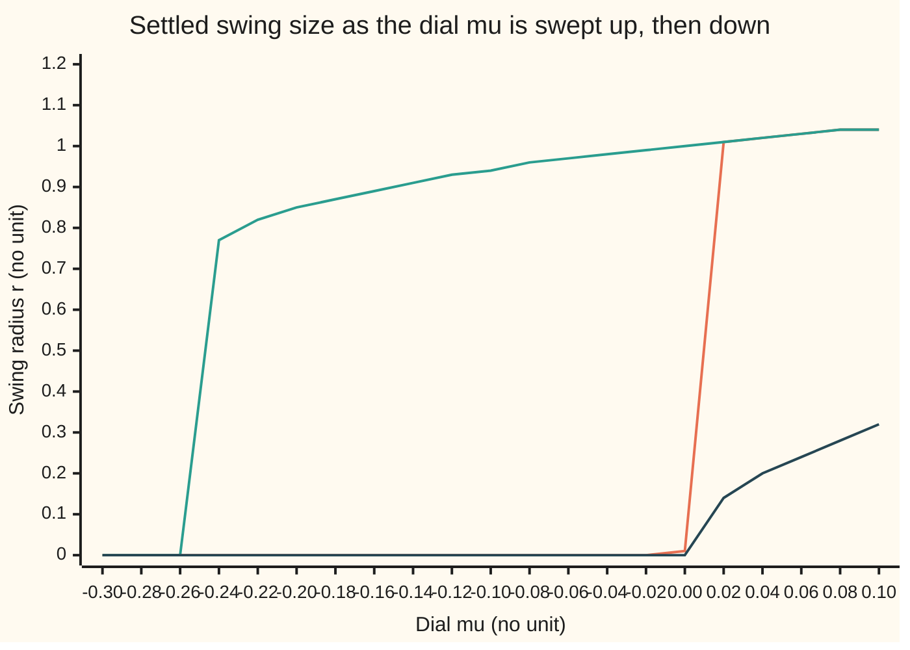

# The Hopf bifurcation: a spiral turns unstable and a cycle is born gently, or a big swing appears all at once

[Syllabus](../../../SYLLABUS.md) → [Differential equations and dynamics](../README.md) → [Nonlinear Dynamics in the Plane](../README.md#s06) → The Hopf bifurcation

---

## General Overview

A stirred tank is fed two chemicals at steady rates. In the Brusselator, a standard model of a chemical clock, two products have concentrations x and y. The mix rests at x = 1, y = B, where B is the feed rate of the second chemical.

Raise B slowly. Below 2 a small stir dies away in a spiral. Above 2 the rest turns unstable and the concentrations cycle. At B = 2.04 the swing in x is about ±0.23; at B = 2.01, about ±0.12. The cycle is born at zero size. This is a **supercritical** Hopf bifurcation: the gentle kind.

Other systems give the dangerous kind, **subcritical**. Take a model with a dial μ (mu, the setting being turned, as B is above) whose swing is held only by a fifth-power term. Once the dial passes zero, the state jumps straight to a swing of size about 1. Turn the dial back and the swing stays until the dial is below −1/4. A way down that differs from the way up is **hysteresis**.

**When a spiral rest turns unstable because the growth rate of its pair of complex eigenvalues passes zero (the pair crosses the imaginary axis), one number, the cubic coefficient a, decides the outcome: a < 0 gives a small stable cycle whose radius grows like √μ, a > 0 gives a jump to a large swing with hysteresis.**

**What kind of fact this is:** a theorem (the Hopf bifurcation theorem). The claims about the normal form (the simplest form every typical Hopf point reduces to) are proved on this card; the reduction of a general system to the normal form and the coefficient formula are stated, with the proof in Guckenheimer and Holmes, section 3.4.

### The picture: gentle birth against a sudden jump



Orange: the subcritical model swept up; it jumps between 0.00 and 0.02. Green: swept down; it holds the big swing to −0.24, then drops. Dark blue: the supercritical model, radius √μ. Each dial value runs 1000 time units with a noise floor of 0.01.

---

## The formula

Near the rest, write the state in polar form: $`r`$ is the distance from the rest and $`\theta`$ the angle around it. A dash means a rate, as across this wing. The **Hopf point** is the dial setting where the eigenvalues' growth rate is zero. After a smooth change of coordinates, and dropping smaller terms that do not change the picture, every typical Hopf point looks like

```math
r' = d\,\mu\,r + a\,r^3, \qquad \theta' = \omega
```

**Read it aloud:** the swing grows at a rate set by the dial, the cubic term then brakes it or boosts it, and the state turns at a steady rate.

For a system whose linear part at the crossing is a pure turn, $`u' = -\omega w + f(u, w)`$, $`w' = \omega u + g(u, w)`$, the coefficient is

```math
16\,a = f_{uuu} + f_{uww} + g_{uuw} + g_{www} + \frac{1}{\omega}\big[f_{uw}(f_{uu} + f_{ww}) - g_{uw}(g_{uu} + g_{ww}) - f_{uu}\,g_{uu} + f_{ww}\,g_{ww}\big]
```

**Read it aloud:** sixteen times a is the sum of four third derivatives, plus a correction from products of second derivatives, divided by the turning rate.

| Symbol | Plain meaning | In our example | Push it up and the answer… |
| --- | --- | --- | --- |
| $`r`$, $`\theta`$, $`t`$ | distance from the rest, angle around it (radians), and time (model units) | cycle radius 0.2 at $`\mu`$ = 0.04 | — |
| $`\mu`$ | the dial: the parameter's distance past the Hopf point | 0.04; for the Brusselator $`\mu = B - 2`$ | the stable cycle grows like $`\sqrt{\mu}`$ |
| $`a`$ | the cubic coefficient (first Lyapunov coefficient) | −1 and +1 in the normal forms; −0.375 for the Brusselator | above 0, the birth turns sudden |
| $`d`$ | dial speed: how fast the eigenvalues' real part moves per unit of dial | 1 in the normal forms; 1/2 for the Brusselator | the cycle is larger for the same dial |
| $`\omega`$ | turning rate: the eigenvalues' imaginary part at the crossing | 1 | the correction term shrinks |
| $`f`$, $`g`$; $`f_{uw}`$ | the nonlinear parts of the two rates; a subscript means a derivative at the rest, here once in $`u`$ and once in $`w`$ | $`f = -2uw - u^2w - u^3`$, $`g = 0`$ | — |
| $`x`$, $`y`$; $`u`$, $`w`$ | Brusselator concentrations; shifted coordinates $`u = x - 1`$, $`w = 3 - x - y`$ | rest (1, 2) at B = 2 | — |
| $`B`$ | feed rate of the second chemical | Hopf point at 2; runs at 2.04 and 2.01 | the mix starts to oscillate past 2 |

### When it holds

- **A complex pair with a nonzero turning rate.** If a real eigenvalue crosses zero instead, rests appear or vanish: [Bifurcations](10-bifurcations-of-equilibria.md).
- **d ≠ 0.** If the real part only touches zero and turns back, the rest never turns unstable, and the cycle-birth picture above can fail.
- **a ≠ 0.** Otherwise higher terms decide. A pendulum whose damping passes zero is such a case: at zero damping every swing is a closed loop.
- **Near the crossing.** The square-root law is a first approximation: simulated over predicted radius is 1.018 at B = 2.04, 1.004 at B = 2.01.
- **Other directions attract.** A larger system then collapses onto a two-dimensional surface, the centre manifold ([Invariant manifolds](12-stable-unstable-and-centre-manifolds.md)), and the formula applies there.

---

## Why it works

### Step 0: at the crossing the linear test is silent, so the cubic decides

At $`\mu = 0`$ the linear part is a pure turn: no growth, no decay. As in the honey bowl of [Lyapunov functions](04-lyapunov-functions.md), a zero slope hands the verdict to the next term. Quadratic terms push out on one side of a turn and in on the other, and cancel. The first term that survives averaging over a turn is cubic, $`a r^3`$.

### Step 1: the gentle case, a < 0

Take $`r' = \mu r - r^3`$ ($`d = 1`$, $`a = -1`$). A cycle is a radius $`r > 0`$ where $`r' = 0`$: $`r^2 = \mu`$, so only for $`\mu > 0`$. The rate's slope there is $`\mu - 3r^2 = -2\mu`$, negative, so nearby swings settle onto it. In general the radius is $`\sqrt{-d\mu/a}`$ and the slope is $`-2d\mu`$.

At $`\mu = 0.04`$ the radius is 0.2. At $`\mu = 0`$ the rate is $`-r^3`$: the swing still dies, but slowly, like $`1/\sqrt{2t}`$, from 0.2 to 0.0222 in 1000 time units.

### Step 2: the sudden case, a > 0

Take $`r' = \mu r + r^3 - r^5`$. Now the cubic pushes out. Cycles solve $`\mu + r^2 - r^4 = 0`$, a quadratic in $`r^2`$:

```math
r^2 = \frac{1 \pm \sqrt{1 + 4\mu}}{2}
```

**Read it aloud:** a big cycle (plus sign), stable, and a small one (minus sign), unstable, which exists only below zero on the dial.

- For $`\mu < 0`$ the rest is stable, fenced by the small cycle (radius 0.2043 at $`\mu = -0.04`$). A push past the fence sends the state to the big swing.
- At $`\mu = 0`$ the small cycle shrinks onto the rest. The rest turns unstable and the nearest attractor is the big cycle, radius 1.
- Lowering the dial, the big cycle shrinks to $`r^2 = 1/2`$ at $`\mu = -1/4`$, meets the small cycle, and both vanish: the saddle-node of [Bifurcations](10-bifurcations-of-equilibria.md), applied to radii.

Between −1/4 and 0 the state rests or swings big, depending on its history: the hysteresis in the picture.

### Step 3: the coefficient of a real system

1. Find the rest and its Jacobian (the table of the rates' slopes, [Linearisation](02-linearisation-and-the-jacobian.md)). The Hopf point is where its trace is 0 and its determinant is positive; then $`\omega`$ is the square root of the determinant ([Complex eigenvalues](../04-Systems%20and%20the%20Matrix%20Exponential/03-complex-eigenvalues-and-spirals.md)).
2. The eigenvalues' real part is trace/2; $`d`$ is its rate of change with the dial.
3. Change coordinates so the linear part reads $`u' = -\omega w`$, $`w' = \omega u`$. What is left over is $`f`$ and $`g`$.
4. Take the derivatives at the rest and apply the formula.

<details>
<summary>Where the 16 comes from: one cubic term worked by hand</summary>

Take $`u' = -w - u^3`$, $`w' = u`$. With $`u = r\cos\theta`$, $`w = r\sin\theta`$, the rate of $`r^2/2`$ is $`u u' + w w' = -u^4`$, so $`r' = -r^3\cos^4\theta`$.

Over one turn, $`\cos^4\theta`$ averages to 3/8. So the averaged law is $`r' = -\tfrac38 r^3`$, and $`a = -3/8`$.

The formula agrees: $`f_{uuu} = -6`$ and $`-6/16 = -3/8`$. The other third-derivative terms average in the same way. The bracket collects the quadratic terms: they cancel over one turn, but first bend the path, and the bent path meets them again at third order. Full proof: Guckenheimer and Holmes, section 3.4.

</details>

### Step 4: the Brusselator worked through

The law, with the first feed at 1, is $`x' = 1 - (B + 1)x + x^2 y`$, $`y' = Bx - x^2 y`$ (Prigogine and Lefever).

- The rest is (1, B). The Jacobian there is `[[B - 1, 1], [-B, -1]]`: trace $`B - 2`$, determinant 1.
- So the Hopf point is $`B = 2`$, with $`\omega = 1`$ and $`d = 1/2`$.
- At $`B = 2`$ put $`u = x - 1`$ and $`w = 3 - x - y`$. Expanding $`x^2 y`$ gives $`u' = -w - 2uw - u^2 w - u^3`$ and $`w' = u`$ exactly.
- So $`f = -2uw - u^2w - u^3`$ and $`g = 0`$.

---

## Worked numbers, by hand

| Step | Arithmetic | Value |
| --- | --- | --- |
| Hopf point | trace $`B - 2 = 0`$, determinant 1 | B = 2, $`\omega`$ = 1 |
| dial speed | real part $`(B - 2)/2`$ | d = 1/2 |
| third derivatives | $`-u^3`$ gives $`f_{uuu} = -6`$; $`f_{uww}`$, $`g`$ terms 0 | −6 |
| correction | $`f_{uw}(f_{uu} + f_{ww}) = -2 \times (0 + 0)`$ | 0 |
| coefficient | $`a = -6/16`$ | −0.375: supercritical |
| radius at B = 2.04 | $`\sqrt{(0.04/2)/0.375}`$ | **0.2309** |

At B = 2.04 the concentration x swings about 1 ± 0.23; the simulation gives a half-swing of 0.2351.

### What breaks if you drop a piece

| Mistake | Comes out at | What went wrong |
| --- | --- | --- |
| Trust the eigenvalues alone at $`\mu`$ = 0.04, from 0.01: growth $`e^{0.04 t}`$ | 4.0343 at t = 150 (true 0.1998) | the cubic brakes the growth at radius 0.2 |
| Drop the dial speed d = 1/2 for the Brusselator | radius 0.3266 at B = 2.04 | the real part moves half as fast as B |
| Drop the 1/16 (use 16a as a) | radius 0.0577 at B = 2.04 | the coefficient is 16 times too big |
| Lower the subcritical dial back to −0.10 to stop the swing | swing still 0.9420 | hysteresis: the big cycle survives to −0.25 |

---

## Code, from first principles, and it actually runs

The code takes three roads. Cycle radii come from the formulas and from RK4 ([Runge-Kutta four](../05-Numerical%20Evolution/04-runge-kutta-four.md)), in polar form and in the x-y plane. Hysteresis comes from a slow sweep of the dial. The Brusselator's $`a`$ comes from the formula, with derivatives by finite differences (exact for cubics), and from simulation at B = 2, where $`1/r^2`$ grows at rate $`-2a`$. That second road gives −0.3659 against −0.375; the small gap comes from the swing's finite size. The Brusselator's bracket is zero, so only the formula's third-derivative half is tested.

### Python

```python
# Hopf bifurcation -- the check behind the card.  Normal forms r' = mu r + a r^3 (+ ...), and the
# Brusselator x' = 1 - (B + 1) x + x^2 y, y' = B x - x^2 y, whose Hopf point is B = 2.
from math import sqrt, exp
def rk4(F, s, dt, n):                         # n Runge-Kutta 4 steps of s' = F(s)
    for _ in range(n):
        k1 = F(s); k2 = F([a + dt / 2 * b for a, b in zip(s, k1)])
        k3 = F([a + dt / 2 * b for a, b in zip(s, k2)]); k4 = F([a + dt * b for a, b in zip(s, k3)])
        s = [a + dt / 6 * (p + 2 * q + 2 * u + v) for a, p, q, u, v in zip(s, k1, k2, k3, k4)]
    return s
sup = lambda mu: lambda s: [mu * s[0] - s[0] ** 3]                     # r' = mu r - r^3
sub = lambda mu: lambda s: [mu * s[0] + s[0] ** 3 - s[0] ** 5]         # r' = mu r + r^3 - r^5
plane = lambda mu: lambda s: [mu * s[0] - s[1] - s[0] * (s[0] ** 2 + s[1] ** 2), s[0] + mu * s[1] - s[1] * (s[0] ** 2 + s[1] ** 2)]
r1, r2, xy = rk4(sup(0.04), [0.01], 0.05, 8000)[0], rk4(sup(0.04), [0.5], 0.05, 8000)[0], rk4(plane(0.04), [0.01, 0.0], 0.05, 8000)
print(f"super mu 0.04: radius sqrt(mu) {sqrt(0.04):.4f}; RK4 from 0.01 {r1:.4f}, from 0.5 {r2:.4f}; x-y plane {sqrt(xy[0]**2 + xy[1]**2):.4f}")
assert abs(r1 - 0.2) < 1e-6 and abs(r2 - 0.2) < 1e-6 and abs(sqrt(xy[0] ** 2 + xy[1] ** 2) - 0.2) < 1e-6
lin, r150 = 0.01 * exp(0.04 * 150), rk4(sup(0.04), [0.01], 0.05, 3000)[0]
print(f"super mu 0.04 from 0.01 at t 150: linear guess {lin:.4f}, true {r150:.4f}; mu 0 at t 1000 from 0.2: {rk4(sup(0), [0.2], 0.05, 20000)[0]:.4f} (1/sqrt(25 + 2000) = {1 / sqrt(2025):.4f})")
big, small = (lambda mu: sqrt((1 + sqrt(1 + 4 * mu)) / 2)), (lambda mu: sqrt((1 - sqrt(1 + 4 * mu)) / 2))
print(f"sub: big cycle at mu 0 {big(0):.4f}, at 0.04 {big(0.04):.4f}, at -0.10 {big(-0.1):.4f}, at -0.25 {big(-0.25):.4f}; small unstable at -0.04 {small(-0.04):.4f}")
for mu in (-0.1, -0.04):                      # both cycles are rests of r' found by RK4: start just off each
    assert abs(rk4(sub(mu), [big(mu) + 0.05], 0.05, 4000)[0] - big(mu)) < 1e-6 and rk4(sub(mu), [small(mu) - 0.01], 0.05, 4000)[0] < 1e-3
mus, r, up, down = [round(-0.30 + 0.02 * i, 2) for i in range(21)], 0.0, [], []
for path, order in ((up, mus), (down, mus[::-1])):
    for mu in order:                          # settle 1000 time units at each dial value; noise floor 0.01
        r = rk4(sub(mu), [max(r, 0.01)], 0.05, 20000)[0]; path.append(r)
down = down[::-1]
for name, row in (("mu", mus), ("sweep up", up), ("sweep down", down), ("super sqrt(mu)", [sqrt(max(m, 0)) for m in mus])):
    print(f"chart {name}:", " ".join(f"{v:.2f}" for v in row))
jump, drop = min(m for m, v in zip(mus, up) if v > 0.5), max(m for m, v in zip(mus, down) if v < 0.5)
print(f"hysteresis: up-sweep jumps at mu {jump:.2f}, down-sweep drops at mu {drop:.2f}")
assert jump == 0.02 and drop == -0.26 and all(abs(v - big(m)) < 1e-3 for m, v in zip(mus, down) if m > -0.25)
def F(B): return lambda s: [1 - (B + 1) * s[0] + s[0] ** 2 * s[1], B * s[0] - s[0] ** 2 * s[1]]
def fg(u, w):                                 # nonlinear parts in u = x - 1, w = -(u + y - 2), at B = 2
    x, y = F(2)([1 + u, 2 - w - u]); return x + w, -(x + y) - u       # u' = -w + f, w' = u + g
def D(k, ax, p=(0.0, 0.0), h=0.01):           # nested central differences: exact for cubics
    if not ax: return fg(*p)[k]
    e = (h, 0) if ax[0] == 0 else (0, h)
    return (D(k, ax[1:], (p[0] + e[0], p[1] + e[1])) - D(k, ax[1:], (p[0] - e[0], p[1] - e[1]))) / (2 * h)
f, g = (lambda *ax: D(0, ax)), (lambda *ax: D(1, ax))                  # f_uw is f(0, 1), and so on
cubic = f(0, 0, 0) + f(0, 1, 1) + g(0, 0, 1) + g(1, 1, 1)
quad = f(0, 1) * (f(0, 0) + f(1, 1)) - g(0, 1) * (g(0, 0) + g(1, 1)) - f(0, 0) * g(0, 0) + f(1, 1) * g(1, 1)
a = (cubic + quad) / 16
print(f"Brusselator B 2: f_uuu {f(0, 0, 0):.3f}, f_uw {f(0, 1):.3f}, others 0; 16a = {cubic:.3f} + {quad:.3f}; a = {a:.4f}")
s, t, laps, dt = [1.05, 1.95], 0.0, [], 0.01  # start u = 0.05, w = 0; time each pass up through w = 0
while t < 1000:
    n = rk4(F(2), s, dt, 1); w0, w1 = -(s[0] + s[1] - 3), -(n[0] + n[1] - 3)
    if w0 < 0 <= w1 and n[0] > 1: laps.append((t, s[0] - 1 + (n[0] - s[0]) * (-w0) / (w1 - w0)))
    s, t = n, t + dt
(tl, ul), = laps[-1:]; a_sim = -(1 / ul ** 2 - 400) / (2 * tl)      # 1/r^2 grows at rate -2a
print(f"simulated at B 2: {len(laps)} laps, u from 0.05 to {ul:.4f}; a from 1/r^2 growth {a_sim:.4f}")
assert abs(a_sim - a) < 0.01 and abs(a + 0.375) < 1e-6
for beta in (0.04, 0.01):                     # dial d = 1/2 per unit of B: radius sqrt(-(beta/2)/a)
    s = rk4(F(2 + beta), [1.01, 2 + beta], 0.01, 300000); xs = [s[0]]
    for _ in range(700): s = rk4(F(2 + beta), s, 0.01, 1); xs.append(s[0])
    pred, half = sqrt(-(beta / 2) / a), (max(xs) - min(xs)) / 2
    print(f"B {2 + beta:.2f}: predicted radius {pred:.4f}, simulated half-swing of x {half:.4f}, ratio {half / pred:.3f}")
    assert abs(half / pred - 1) < 0.08 * beta / 0.04
print(f"mistakes: no 1/2 dial speed {sqrt(-0.04 / a):.4f}; no 1/16 {sqrt(-0.02 / (16 * a)):.4f}; sub back at mu -0.10 swing {down[mus.index(-0.1)]:.4f}")
print("ALL CHECKS PASS")
```

**Ran 2026-11-23 on macOS, Python 3.14.10, standard library only. All checks passed. Output, pasted from the run:**

```
super mu 0.04: radius sqrt(mu) 0.2000; RK4 from 0.01 0.2000, from 0.5 0.2000; x-y plane 0.2000
super mu 0.04 from 0.01 at t 150: linear guess 4.0343, true 0.1998; mu 0 at t 1000 from 0.2: 0.0222 (1/sqrt(25 + 2000) = 0.0222)
sub: big cycle at mu 0 1.0000, at 0.04 1.0191, at -0.10 0.9420, at -0.25 0.7071; small unstable at -0.04 0.2043
chart mu: -0.30 -0.28 -0.26 -0.24 -0.22 -0.20 -0.18 -0.16 -0.14 -0.12 -0.10 -0.08 -0.06 -0.04 -0.02 0.00 0.02 0.04 0.06 0.08 0.10
chart sweep up: 0.00 0.00 0.00 0.00 0.00 0.00 0.00 0.00 0.00 0.00 0.00 0.00 0.00 0.00 0.00 0.01 1.01 1.02 1.03 1.04 1.04
chart sweep down: 0.00 0.00 0.00 0.77 0.82 0.85 0.87 0.89 0.91 0.93 0.94 0.96 0.97 0.98 0.99 1.00 1.01 1.02 1.03 1.04 1.04
chart super sqrt(mu): 0.00 0.00 0.00 0.00 0.00 0.00 0.00 0.00 0.00 0.00 0.00 0.00 0.00 0.00 0.00 0.00 0.14 0.20 0.24 0.28 0.32
hysteresis: up-sweep jumps at mu 0.02, down-sweep drops at mu -0.26
Brusselator B 2: f_uuu -6.000, f_uw -2.000, others 0; 16a = -6.000 + 0.000; a = -0.3750
simulated at B 2: 159 laps, u from 0.05 to 0.0297; a from 1/r^2 growth -0.3659
B 2.04: predicted radius 0.2309, simulated half-swing of x 0.2351, ratio 1.018
B 2.01: predicted radius 0.1155, simulated half-swing of x 0.1160, ratio 1.004
mistakes: no 1/2 dial speed 0.3266; no 1/16 0.0577; sub back at mu -0.10 swing 0.9420
ALL CHECKS PASS
```

### Rust

Same numbers, same labels, built with `rustc --edition 2021 -O`.

```rust
// Hopf bifurcation -- the same check as the Python, in Rust, std only.  Normal forms
// r' = mu r + a r^3 (+ ...), and the Brusselator x' = 1 - (B + 1) x + x^2 y, y' = B x - x^2 y.
type V = Vec<f64>;
fn rk4(f: &dyn Fn(&V) -> V, s0: &V, dt: f64, n: usize) -> V { // n Runge-Kutta 4 steps of s' = f(s)
    let mut s = s0.clone();
    let add = |a: &V, b: &V, h: f64| -> V { a.iter().zip(b).map(|(x, y)| x + h * y).collect() };
    for _ in 0..n {
        let k1 = f(&s); let k2 = f(&add(&s, &k1, dt / 2.0)); let k3 = f(&add(&s, &k2, dt / 2.0)); let k4 = f(&add(&s, &k3, dt));
        s = (0..s.len()).map(|i| s[i] + dt / 6.0 * (k1[i] + 2.0 * k2[i] + 2.0 * k3[i] + k4[i])).collect();
    }
    s
}
fn sup(mu: f64) -> impl Fn(&V) -> V { move |s: &V| vec![mu * s[0] - s[0].powi(3)] } // r' = mu r - r^3
fn sub(mu: f64) -> impl Fn(&V) -> V { move |s: &V| vec![mu * s[0] + s[0].powi(3) - s[0].powi(5)] }
fn plane(mu: f64) -> impl Fn(&V) -> V {
    move |s: &V| { let q = s[0] * s[0] + s[1] * s[1]; vec![mu * s[0] - s[1] - s[0] * q, s[0] + mu * s[1] - s[1] * q] }
}
fn big(mu: f64) -> f64 { ((1.0 + (1.0 + 4.0 * mu).sqrt()) / 2.0).sqrt() }
fn small(mu: f64) -> f64 { ((1.0 - (1.0 + 4.0 * mu).sqrt()) / 2.0).sqrt() }
fn bf(b: f64) -> impl Fn(&V) -> V { move |s: &V| vec![1.0 - (b + 1.0) * s[0] + s[0] * s[0] * s[1], b * s[0] - s[0] * s[0] * s[1]] }
fn fg(u: f64, w: f64) -> [f64; 2] { // nonlinear parts in u = x - 1, w = -(u + y - 2), at B = 2: u' = -w + f, w' = u + g
    let d = bf(2.0)(&vec![1.0 + u, 2.0 - w - u]); [d[0] + w, -(d[0] + d[1]) - u]
}
fn dd(k: usize, ax: &[usize], p: (f64, f64)) -> f64 { // nested central differences: exact for cubics
    if ax.is_empty() { return fg(p.0, p.1)[k]; }
    let h = 0.01; let e = if ax[0] == 0 { (h, 0.0) } else { (0.0, h) };
    (dd(k, &ax[1..], (p.0 + e.0, p.1 + e.1)) - dd(k, &ax[1..], (p.0 - e.0, p.1 - e.1))) / (2.0 * h)
}
fn main() {
    let (r1, r2, xy) = (rk4(&sup(0.04), &vec![0.01], 0.05, 8000)[0], rk4(&sup(0.04), &vec![0.5], 0.05, 8000)[0], rk4(&plane(0.04), &vec![0.01, 0.0], 0.05, 8000));
    let rxy = (xy[0] * xy[0] + xy[1] * xy[1]).sqrt();
    println!("super mu 0.04: radius sqrt(mu) {:.4}; RK4 from 0.01 {:.4}, from 0.5 {:.4}; x-y plane {:.4}", 0.04f64.sqrt(), r1, r2, rxy);
    assert!((r1 - 0.2).abs() < 1e-6 && (r2 - 0.2).abs() < 1e-6 && (rxy - 0.2).abs() < 1e-6);
    let (lin, r150) = (0.01 * (0.04f64 * 150.0).exp(), rk4(&sup(0.04), &vec![0.01], 0.05, 3000)[0]);
    println!("super mu 0.04 from 0.01 at t 150: linear guess {:.4}, true {:.4}; mu 0 at t 1000 from 0.2: {:.4} (1/sqrt(25 + 2000) = {:.4})",
             lin, r150, rk4(&sup(0.0), &vec![0.2], 0.05, 20000)[0], 1.0 / 2025f64.sqrt());
    println!("sub: big cycle at mu 0 {:.4}, at 0.04 {:.4}, at -0.10 {:.4}, at -0.25 {:.4}; small unstable at -0.04 {:.4}",
             big(0.0), big(0.04), big(-0.1), big(-0.25), small(-0.04));
    for mu in [-0.1, -0.04] { // both cycles are rests of r' found by RK4: start just off each
        assert!((rk4(&sub(mu), &vec![big(mu) + 0.05], 0.05, 4000)[0] - big(mu)).abs() < 1e-6 && rk4(&sub(mu), &vec![small(mu) - 0.01], 0.05, 4000)[0] < 1e-3);
    }
    let mus: Vec<f64> = (0..21).map(|i| ((-0.30 + 0.02 * i as f64) * 100.0).round() / 100.0).collect();
    let (mut r, mut up, mut down) = (0.0f64, vec![], vec![]);
    for &mu in &mus { r = rk4(&sub(mu), &vec![r.max(0.01)], 0.05, 20000)[0]; up.push(r); } // settle 1000 time units; noise floor 0.01
    for &mu in mus.iter().rev() { r = rk4(&sub(mu), &vec![r.max(0.01)], 0.05, 20000)[0]; down.push(r); }
    down.reverse();
    let sq: V = mus.iter().map(|m| m.max(0.0).sqrt()).collect();
    for (name, row) in [("mu", &mus), ("sweep up", &up), ("sweep down", &down), ("super sqrt(mu)", &sq)] {
        println!("chart {}: {}", name, row.iter().map(|v| format!("{:.2}", v)).collect::<Vec<_>>().join(" "));
    }
    let jump = mus.iter().zip(&up).filter(|(_, v)| **v > 0.5).map(|(m, _)| *m).fold(f64::MAX, f64::min);
    let drop = mus.iter().zip(&down).filter(|(_, v)| **v < 0.5).map(|(m, _)| *m).fold(f64::MIN, f64::max);
    println!("hysteresis: up-sweep jumps at mu {:.2}, down-sweep drops at mu {:.2}", jump, drop);
    assert!(jump == 0.02 && drop == -0.26 && mus.iter().zip(&down).all(|(m, v)| *m <= -0.25 || (v - big(*m)).abs() < 1e-3));
    let f = |ax: &[usize]| dd(0, ax, (0.0, 0.0)); let g = |ax: &[usize]| dd(1, ax, (0.0, 0.0)); // f_uw is f(&[0, 1])
    let cubic = f(&[0, 0, 0]) + f(&[0, 1, 1]) + g(&[0, 0, 1]) + g(&[1, 1, 1]);
    let quad = f(&[0, 1]) * (f(&[0, 0]) + f(&[1, 1])) - g(&[0, 1]) * (g(&[0, 0]) + g(&[1, 1])) - f(&[0, 0]) * g(&[0, 0]) + f(&[1, 1]) * g(&[1, 1]);
    let a = (cubic + quad) / 16.0;
    println!("Brusselator B 2: f_uuu {:.3}, f_uw {:.3}, others 0; 16a = {:.3} + {:.3}; a = {:.4}", f(&[0, 0, 0]), f(&[0, 1]), cubic, quad, a);
    let (mut s, mut t, mut laps, dt) = (vec![1.05, 1.95], 0.0, vec![], 0.01); // start u = 0.05, w = 0; time each pass up through w = 0
    while t < 1000.0 {
        let n = rk4(&bf(2.0), &s, dt, 1); let (w0, w1) = (-(s[0] + s[1] - 3.0), -(n[0] + n[1] - 3.0));
        if w0 < 0.0 && 0.0 <= w1 && n[0] > 1.0 { laps.push((t, s[0] - 1.0 + (n[0] - s[0]) * (-w0) / (w1 - w0))); }
        s = n; t += dt;
    }
    let (tl, ul) = laps[laps.len() - 1]; let a_sim = -(1.0 / (ul * ul) - 400.0) / (2.0 * tl); // 1/r^2 grows at rate -2a
    println!("simulated at B 2: {} laps, u from 0.05 to {:.4}; a from 1/r^2 growth {:.4}", laps.len(), ul, a_sim);
    assert!((a_sim - a).abs() < 0.01 && (a + 0.375).abs() < 1e-6);
    for beta in [0.04, 0.01] { // dial d = 1/2 per unit of B: radius sqrt(-(beta/2)/a)
        let mut s = rk4(&bf(2.0 + beta), &vec![1.01, 2.0 + beta], 0.01, 300000); let mut xs = vec![s[0]];
        for _ in 0..700 { s = rk4(&bf(2.0 + beta), &s, 0.01, 1); xs.push(s[0]); }
        let (mx, mn) = (xs.iter().cloned().fold(f64::MIN, f64::max), xs.iter().cloned().fold(f64::MAX, f64::min));
        let (pred, half) = ((-(beta / 2.0) / a).sqrt(), (mx - mn) / 2.0);
        println!("B {:.2}: predicted radius {:.4}, simulated half-swing of x {:.4}, ratio {:.3}", 2.0 + beta, pred, half, half / pred);
        assert!((half / pred - 1.0).abs() < 0.08 * beta / 0.04);
    }
    println!("mistakes: no 1/2 dial speed {:.4}; no 1/16 {:.4}; sub back at mu -0.10 swing {:.4}", (-0.04 / a).sqrt(), (-0.02 / (16.0 * a)).sqrt(), down[10]);
    println!("ALL CHECKS PASS");
}
```

**Ran 2026-11-23 on macOS, rustc 1.98.1, no crates. All checks passed. Output, pasted from the run:**

```
super mu 0.04: radius sqrt(mu) 0.2000; RK4 from 0.01 0.2000, from 0.5 0.2000; x-y plane 0.2000
super mu 0.04 from 0.01 at t 150: linear guess 4.0343, true 0.1998; mu 0 at t 1000 from 0.2: 0.0222 (1/sqrt(25 + 2000) = 0.0222)
sub: big cycle at mu 0 1.0000, at 0.04 1.0191, at -0.10 0.9420, at -0.25 0.7071; small unstable at -0.04 0.2043
chart mu: -0.30 -0.28 -0.26 -0.24 -0.22 -0.20 -0.18 -0.16 -0.14 -0.12 -0.10 -0.08 -0.06 -0.04 -0.02 0.00 0.02 0.04 0.06 0.08 0.10
chart sweep up: 0.00 0.00 0.00 0.00 0.00 0.00 0.00 0.00 0.00 0.00 0.00 0.00 0.00 0.00 0.00 0.01 1.01 1.02 1.03 1.04 1.04
chart sweep down: 0.00 0.00 0.00 0.77 0.82 0.85 0.87 0.89 0.91 0.93 0.94 0.96 0.97 0.98 0.99 1.00 1.01 1.02 1.03 1.04 1.04
chart super sqrt(mu): 0.00 0.00 0.00 0.00 0.00 0.00 0.00 0.00 0.00 0.00 0.00 0.00 0.00 0.00 0.00 0.00 0.14 0.20 0.24 0.28 0.32
hysteresis: up-sweep jumps at mu 0.02, down-sweep drops at mu -0.26
Brusselator B 2: f_uuu -6.000, f_uw -2.000, others 0; 16a = -6.000 + 0.000; a = -0.3750
simulated at B 2: 159 laps, u from 0.05 to 0.0297; a from 1/r^2 growth -0.3659
B 2.04: predicted radius 0.2309, simulated half-swing of x 0.2351, ratio 1.018
B 2.01: predicted radius 0.1155, simulated half-swing of x 0.1160, ratio 1.004
mistakes: no 1/2 dial speed 0.3266; no 1/16 0.0577; sub back at mu -0.10 swing 0.9420
ALL CHECKS PASS
```

### Lean

Lean proves the normal-form claims for every dial $`\mu`$ and every nonzero d and a, and the Brusselator's Hopf point for every B.

- Take the normal form $`r' = d\mu r + a r^3`$. Then a cycle exists exactly when $`-d\mu/a > 0`$, with the single radius $`\sqrt{-d\mu/a}`$. There the rate's slope is $`-2d\mu`$.
- Suppose $`a < 0`$ and $`d\mu > 0`$. Then smaller swings grow and larger swings shrink: the cycle is stable.
- Suppose $`a < 0`$ and $`d\mu \le 0`$. Then every swing dies away.
- Suppose $`a > 0`$ and $`d\mu > 0`$. Then there is no cycle, and every swing grows.
- Suppose $`a > 0`$ and $`d\mu < 0`$. Then the cycle repels swings on both sides.
- Take $`r' = \mu r + r^3 - r^5`$ with $`\mu < -1/4`$. Then every swing dies away.
- Suppose $`\mu \ge -1/4`$. Then the big cycle exists, and every larger swing shrinks onto it.
- Suppose $`\mu > -1/4`$. Then the rate's slope at the big cycle is negative, so it is stable.
- Suppose $`-1/4 < \mu < 0`$. Then the small cycle lies inside the big one. Swings below it die; swings between the two grow to the big cycle.
- Suppose $`\mu > 0`$. Then every swing below the big cycle grows to it: the jump.
- Take any feed rate B. Then the Brusselator rests at (1, B), and its Jacobian has trace $`B - 2`$ and determinant 1.
- Take $`B = 2`$ and the shifted coordinates u and w. Then the law is exactly the pure turn plus the f and g found above.
- The hand arithmetic holds exactly: radius 0.2 at $`\mu`$ = 0.04, and a swing of 1/45, about 0.0222, at t = 1000.
- So do radius 1 at $`\mu`$ = 0, $`r^2 = 1/2`$ at $`\mu = -1/4`$, $`a = -6/16 = -3/8`$, and radius squared 4/75 at B = 2.04.

The derivatives of f, the dial speed, the decimals and every simulation are left to the Python and Rust checks.

```lean
-- The Hopf bifurcation: in the normal form r' = d mu r + a r^3 the sign of a decides between a stable cycle of radius sqrt(-d mu / a) and runaway growth, the model r' = mu r + r^3 - r^5 has a stable big cycle from mu = -1/4 on (hysteresis), and the Brusselator's Hopf point is B = 2 with the exact cubic form used for a.
import Mathlib.Analysis.SpecialFunctions.Sqrt
import Mathlib.Analysis.SpecialFunctions.Pow.Real
import Mathlib.Analysis.Calculus.Deriv.Pow
import Mathlib.Analysis.Calculus.Deriv.Mul
import Mathlib.Analysis.Calculus.Deriv.Add
import Mathlib.LinearAlgebra.Matrix.Trace
import Mathlib.LinearAlgebra.Matrix.Determinant.Basic
import Mathlib.LinearAlgebra.Matrix.Notation

open Real

/-- The quadratic `μ + t - t^2` factors through its two roots `(1 ± √(1 + 4μ))/2`. -/
theorem quintic_factor (μ t : ℝ) (hμ : -1 / 4 ≤ μ) :
    μ + t - t ^ 2 = -((t - (1 + √(1 + 4 * μ)) / 2) * (t - (1 - √(1 + 4 * μ)) / 2)) := by
  have hq2 := Real.sq_sqrt (show (0 : ℝ) ≤ 1 + 4 * μ by linarith)
  linear_combination (-1 / 4 : ℝ) * hq2

#print axioms quintic_factor

/-- The cubic coefficient decides. Take the normal form `r' = d μ r + a r^3` with dial speed
`d ≠ 0` and cubic coefficient `a ≠ 0`. A cycle is a radius `s > 0` where the rate is zero.
1. A cycle exists exactly when `-d μ / a > 0`, and then it is the single radius `√(-d μ / a)`.
2. There the rate's slope is `-2 d μ`.
3. If `a < 0` (supercritical) and `d μ > 0`, smaller swings grow and larger swings shrink, so
   every swing settles onto the cycle: a stable cycle of radius `√(-d μ / a)`, growing like `√μ`.
   If `a < 0` and `d μ ≤ 0`, every swing dies away.
4. If `a > 0` (subcritical) and `d μ > 0`, there is no cycle and every swing grows: nothing small
   holds the state. If `a > 0` and `d μ < 0`, the cycle repels on both sides (unstable). -/
theorem hopf_cubic_coefficient_decides (d μ a : ℝ) (hd : d ≠ 0) (ha : a ≠ 0) :
    (∀ s : ℝ, 0 < s →
      (d * μ * s + a * s ^ 3 = 0 ↔ 0 < -(d * μ) / a ∧ s = √(-(d * μ) / a))) ∧
    (0 < -(d * μ) / a →
      HasDerivAt (fun r : ℝ => d * μ * r + a * r ^ 3) (-2 * (d * μ)) (√(-(d * μ) / a))) ∧
    (a < 0 → 0 < d * μ →
      (∀ s : ℝ, 0 < s → s < √(-(d * μ) / a) → 0 < d * μ * s + a * s ^ 3) ∧
      (∀ s : ℝ, √(-(d * μ) / a) < s → d * μ * s + a * s ^ 3 < 0)) ∧
    (a < 0 → d * μ ≤ 0 → ∀ s : ℝ, 0 < s → d * μ * s + a * s ^ 3 < 0) ∧
    (0 < a → 0 < d * μ → ∀ s : ℝ, 0 < s → 0 < d * μ * s + a * s ^ 3) ∧
    (0 < a → d * μ < 0 →
      (∀ s : ℝ, 0 < s → s < √(-(d * μ) / a) → d * μ * s + a * s ^ 3 < 0) ∧
      (∀ s : ℝ, √(-(d * μ) / a) < s → 0 < d * μ * s + a * s ^ 3)) := by
  have hac : a * (-(d * μ) / a) = -(d * μ) := by field_simp
  have key : ∀ s : ℝ, d * μ * s + a * s ^ 3 = a * s * (s ^ 2 - (-(d * μ) / a)) := by
    intro s; linear_combination s * hac
  refine ⟨?_, ?_, ?_, ?_, ?_, ?_⟩
  · intro s hs
    rw [key]
    constructor
    · intro h
      have h1 : s ^ 2 - (-(d * μ) / a) = 0 := by
        rcases mul_eq_zero.mp h with h2 | h2
        · exact absurd h2 (mul_ne_zero ha hs.ne')
        · exact h2
      have hc0 : 0 < -(d * μ) / a := by nlinarith [pow_pos hs 2]
      refine ⟨hc0, ?_⟩
      rw [← Real.sqrt_sq hs.le]; congr 1; linarith
    · rintro ⟨hc0, rfl⟩
      rw [Real.sq_sqrt hc0.le]; ring
  · intro hc0
    have hs2 := Real.sq_sqrt hc0.le
    obtain ⟨r, hr⟩ : ∃ r, r = √(-(d * μ) / a) := ⟨_, rfl⟩
    rw [← hr] at hs2 ⊢
    refine HasDerivAt.congr_deriv (HasDerivAt.add (HasDerivAt.const_mul (d * μ) (hasDerivAt_id' r))
      (HasDerivAt.const_mul a (hasDerivAt_pow 3 r))) ?_
    norm_num
    rw [hs2]
    linear_combination 3 * hac
  · intro ha' hdm
    have hc0 : 0 < -(d * μ) / a := div_pos_of_neg_of_neg (by linarith) ha'
    constructor
    · intro s hs hlt
      have ht : s ^ 2 < -(d * μ) / a := (Real.lt_sqrt hs.le).mp hlt
      rw [key]
      exact mul_pos_of_neg_of_neg (mul_neg_of_neg_of_pos ha' hs) (by linarith)
    · intro s hlt
      have hs : 0 < s := lt_of_le_of_lt (Real.sqrt_nonneg _) hlt
      have ht : -(d * μ) / a < s ^ 2 := (Real.sqrt_lt' hs).mp hlt
      rw [key]
      exact mul_neg_of_neg_of_pos (mul_neg_of_neg_of_pos ha' hs) (by linarith)
  · intro ha' hdm s hs
    have h1 : d * μ * s ≤ 0 := mul_nonpos_of_nonpos_of_nonneg hdm hs.le
    have h2 : a * s ^ 3 < 0 := mul_neg_of_neg_of_pos ha' (pow_pos hs 3)
    linarith
  · intro ha' hdm s hs
    have h1 : 0 < d * μ * s := mul_pos hdm hs
    have h2 : 0 < a * s ^ 3 := mul_pos ha' (pow_pos hs 3)
    linarith
  · intro ha' hdm
    have hc0 : 0 < -(d * μ) / a := div_pos (by linarith) ha'
    constructor
    · intro s hs hlt
      have ht : s ^ 2 < -(d * μ) / a := (Real.lt_sqrt hs.le).mp hlt
      rw [key]
      exact mul_neg_of_pos_of_neg (mul_pos ha' hs) (by linarith)
    · intro s hlt
      have hs : 0 < s := lt_of_le_of_lt (Real.sqrt_nonneg _) hlt
      have ht : -(d * μ) / a < s ^ 2 := (Real.sqrt_lt' hs).mp hlt
      rw [key]
      exact mul_pos (mul_pos ha' hs) (by linarith)

/-- The sudden case and its hysteresis. For `r' = μ r + r^3 - r^5` put
`R₊ = (1 + √(1 + 4μ))/2` and `R₋ = (1 - √(1 + 4μ))/2` (the two roots of `μ + R - R^2 = 0`).
1. Below `μ = -1/4` there is no cycle: every swing dies away.
2. From `μ = -1/4` on, the big cycle of radius `√R₊` exists and every larger swing shrinks onto it;
   for `μ > -1/4` the slope there is `2 R₊ (1 - 2 R₊) < 0`, so it is stable.
3. For `-1/4 < μ < 0` the rest is fenced by the small cycle `√R₋`, which lies inside the big one:
   swings below it die, swings between the two grow to the big cycle. So the rest and the big
   swing are both stable there, and which one the state shows depends on its history.
4. For `μ > 0` every swing below the big cycle grows to it: the state jumps to the big swing. -/
theorem subcritical_quintic_hysteresis (μ : ℝ) :
    (μ < -1 / 4 → ∀ s : ℝ, 0 < s → μ * s + s ^ 3 - s ^ 5 < 0) ∧
    (-1 / 4 ≤ μ →
      0 < √((1 + √(1 + 4 * μ)) / 2) ∧
      μ * √((1 + √(1 + 4 * μ)) / 2) + √((1 + √(1 + 4 * μ)) / 2) ^ 3
        - √((1 + √(1 + 4 * μ)) / 2) ^ 5 = 0 ∧
      ∀ s : ℝ, √((1 + √(1 + 4 * μ)) / 2) < s → μ * s + s ^ 3 - s ^ 5 < 0) ∧
    (-1 / 4 < μ →
      HasDerivAt (fun r : ℝ => μ * r + r ^ 3 - r ^ 5)
        (2 * ((1 + √(1 + 4 * μ)) / 2) * (1 - 2 * ((1 + √(1 + 4 * μ)) / 2)))
        (√((1 + √(1 + 4 * μ)) / 2)) ∧
      2 * ((1 + √(1 + 4 * μ)) / 2) * (1 - 2 * ((1 + √(1 + 4 * μ)) / 2)) < 0) ∧
    (-1 / 4 < μ → μ < 0 →
      0 < √((1 - √(1 + 4 * μ)) / 2) ∧
      √((1 - √(1 + 4 * μ)) / 2) < √((1 + √(1 + 4 * μ)) / 2) ∧
      μ * √((1 - √(1 + 4 * μ)) / 2) + √((1 - √(1 + 4 * μ)) / 2) ^ 3
        - √((1 - √(1 + 4 * μ)) / 2) ^ 5 = 0 ∧
      (∀ s : ℝ, 0 < s → s < √((1 - √(1 + 4 * μ)) / 2) → μ * s + s ^ 3 - s ^ 5 < 0) ∧
      (∀ s : ℝ, √((1 - √(1 + 4 * μ)) / 2) < s → s < √((1 + √(1 + 4 * μ)) / 2) →
        0 < μ * s + s ^ 3 - s ^ 5)) ∧
    (0 < μ → ∀ s : ℝ, 0 < s → s < √((1 + √(1 + 4 * μ)) / 2) → 0 < μ * s + s ^ 3 - s ^ 5) := by
  have hf : ∀ s : ℝ, μ * s + s ^ 3 - s ^ 5 = s * (μ + s ^ 2 - (s ^ 2) ^ 2) := fun s => by ring
  refine ⟨?_, ?_, ?_, ?_, ?_⟩
  · intro hμ s hs
    rw [hf]
    apply mul_neg_of_pos_of_neg hs
    nlinarith [sq_nonneg (s ^ 2 - 1 / 2)]
  · intro hμ
    have hq0 : 0 ≤ √(1 + 4 * μ) := Real.sqrt_nonneg _
    have hRp : 0 < (1 + √(1 + 4 * μ)) / 2 := by linarith
    have hs2 := Real.sq_sqrt hRp.le
    refine ⟨Real.sqrt_pos.mpr hRp, ?_, ?_⟩
    · rw [hf, hs2, quintic_factor μ _ hμ]; ring
    · intro s hlt
      have hs : 0 < s := lt_of_le_of_lt (Real.sqrt_nonneg _) hlt
      have ht : (1 + √(1 + 4 * μ)) / 2 < s ^ 2 := (Real.sqrt_lt' hs).mp hlt
      rw [hf, quintic_factor μ _ hμ]
      apply mul_neg_of_pos_of_neg hs
      have : 0 < (s ^ 2 - (1 + √(1 + 4 * μ)) / 2) * (s ^ 2 - (1 - √(1 + 4 * μ)) / 2) :=
        mul_pos (by linarith) (by linarith)
      linarith
  · intro hμ
    have hq0 : 0 < √(1 + 4 * μ) := Real.sqrt_pos.mpr (by linarith)
    have hRp : 0 < (1 + √(1 + 4 * μ)) / 2 := by linarith
    have hs2 := Real.sq_sqrt hRp.le
    have hz := quintic_factor μ ((1 + √(1 + 4 * μ)) / 2) hμ.le
    have hz' : μ + (1 + √(1 + 4 * μ)) / 2 - ((1 + √(1 + 4 * μ)) / 2) ^ 2 = 0 := by
      rw [hz]; ring
    refine ⟨?_, ?_⟩
    · obtain ⟨r, hr⟩ : ∃ r, r = √((1 + √(1 + 4 * μ)) / 2) := ⟨_, rfl⟩
      rw [← hr] at hs2 ⊢
      obtain ⟨R, hR⟩ : ∃ R, R = (1 + √(1 + 4 * μ)) / 2 := ⟨_, rfl⟩
      rw [← hR] at hs2 hz' ⊢
      refine HasDerivAt.congr_deriv
        (HasDerivAt.sub (HasDerivAt.add (HasDerivAt.const_mul μ (hasDerivAt_id' r)) (hasDerivAt_pow 3 r))
          (hasDerivAt_pow 5 r)) ?_
      norm_num
      have e4 : r ^ 4 = (r ^ 2) ^ 2 := by ring
      rw [e4, hs2]
      linear_combination hz'
    · apply mul_neg_of_pos_of_neg (by linarith)
      linarith
  · intro hμ hμ0
    have hq0 : 0 < √(1 + 4 * μ) := Real.sqrt_pos.mpr (by linarith)
    have hq1 : √(1 + 4 * μ) < 1 := (Real.sqrt_lt' one_pos).mpr (by linarith)
    have hRm : 0 < (1 - √(1 + 4 * μ)) / 2 := by linarith
    have hs2 := Real.sq_sqrt hRm.le
    refine ⟨Real.sqrt_pos.mpr hRm, Real.sqrt_lt_sqrt hRm.le (by linarith), ?_, ?_, ?_⟩
    · rw [hf, hs2, quintic_factor μ _ hμ.le]; ring
    · intro s hs hlt
      have ht : s ^ 2 < (1 - √(1 + 4 * μ)) / 2 := (Real.lt_sqrt hs.le).mp hlt
      rw [hf, quintic_factor μ _ hμ.le]
      apply mul_neg_of_pos_of_neg hs
      have : 0 < (s ^ 2 - (1 + √(1 + 4 * μ)) / 2) * (s ^ 2 - (1 - √(1 + 4 * μ)) / 2) :=
        mul_pos_of_neg_of_neg (by linarith) (by linarith)
      linarith
    · intro s hlt1 hlt2
      have hs : 0 < s := lt_of_le_of_lt (Real.sqrt_nonneg _) hlt1
      have ht1 : (1 - √(1 + 4 * μ)) / 2 < s ^ 2 := (Real.sqrt_lt' hs).mp hlt1
      have ht2 : s ^ 2 < (1 + √(1 + 4 * μ)) / 2 := (Real.lt_sqrt hs.le).mp hlt2
      rw [hf, quintic_factor μ _ hμ.le]
      apply mul_pos hs
      have : (s ^ 2 - (1 + √(1 + 4 * μ)) / 2) * (s ^ 2 - (1 - √(1 + 4 * μ)) / 2) < 0 :=
        mul_neg_of_neg_of_pos (by linarith) (by linarith)
      linarith
  · intro hμ s hs hlt
    have hq1 : 1 < √(1 + 4 * μ) := (Real.lt_sqrt zero_le_one).mpr (by linarith)
    have ht : s ^ 2 < (1 + √(1 + 4 * μ)) / 2 := (Real.lt_sqrt hs.le).mp hlt
    have ht0 : 0 < s ^ 2 := pow_pos hs 2
    rw [hf, quintic_factor μ _ (by linarith)]
    apply mul_pos hs
    have : (s ^ 2 - (1 + √(1 + 4 * μ)) / 2) * (s ^ 2 - (1 - √(1 + 4 * μ)) / 2) < 0 :=
      mul_neg_of_neg_of_pos (by linarith) (by linarith)
    linarith

/-- The Brusselator `x' = 1 - (B + 1) x + x^2 y`, `y' = B x - x^2 y`. For every feed rate `B`,
the mix rests at `(1, B)`; the rates' slopes there are `B - 1`, `1`, `-B`, `-1`, so the Jacobian
has trace `B - 2` and determinant `1` (the Hopf point is `B = 2`, turning rate 1). At `B = 2`, in
the shifted coordinates `u = x - 1`, `w = 3 - x - y`, the law is exactly
`u' = -w + (-2uw - u^2 w - u^3)` and `w' = u`: the pure turn plus `f = -2uw - u^2 w - u^3`, `g = 0`. -/
theorem brusselator_hopf_point (B : ℝ) :
    (1 - (B + 1) * 1 + 1 ^ 2 * B = 0 ∧ B * 1 - 1 ^ 2 * B = 0) ∧
    HasDerivAt (fun x : ℝ => 1 - (B + 1) * x + x ^ 2 * B) (B - 1) 1 ∧
    HasDerivAt (fun y : ℝ => 1 - (B + 1) * 1 + 1 ^ 2 * y) 1 B ∧
    HasDerivAt (fun x : ℝ => B * x - x ^ 2 * B) (-B) 1 ∧
    HasDerivAt (fun y : ℝ => B * 1 - 1 ^ 2 * y) (-1) B ∧
    Matrix.trace !![B - 1, 1; -B, -1] = B - 2 ∧
    Matrix.det !![B - 1, 1; -B, -1] = 1 ∧
    (B = 2 → ∀ u w : ℝ,
      1 - (B + 1) * (1 + u) + (1 + u) ^ 2 * (2 - u - w) = -w + (-2 * u * w - u ^ 2 * w - u ^ 3) ∧
      -(1 - (B + 1) * (1 + u) + (1 + u) ^ 2 * (2 - u - w))
        - (B * (1 + u) - (1 + u) ^ 2 * (2 - u - w)) = u) := by
  refine ⟨⟨by ring, by ring⟩, ?_, ?_, ?_, ?_, ?_, ?_, ?_⟩
  · refine HasDerivAt.congr_deriv (HasDerivAt.add
      (HasDerivAt.const_sub 1 (HasDerivAt.const_mul (B + 1) (hasDerivAt_id' (1 : ℝ))))
      (HasDerivAt.mul_const (hasDerivAt_pow 2 (1 : ℝ)) B)) ?_
    norm_num; ring
  · refine HasDerivAt.congr_deriv (HasDerivAt.const_add (1 - (B + 1) * 1)
      (HasDerivAt.const_mul ((1 : ℝ) ^ 2) (hasDerivAt_id' B))) ?_
    norm_num
  · refine HasDerivAt.congr_deriv (HasDerivAt.sub (HasDerivAt.const_mul B (hasDerivAt_id' (1 : ℝ)))
      (HasDerivAt.mul_const (hasDerivAt_pow 2 (1 : ℝ)) B)) ?_
    norm_num; ring
  · refine HasDerivAt.congr_deriv (HasDerivAt.const_sub (B * 1)
      (HasDerivAt.const_mul ((1 : ℝ) ^ 2) (hasDerivAt_id' B))) ?_
    norm_num
  · rw [Matrix.trace_fin_two_of]; ring
  · rw [Matrix.det_fin_two_of]; ring
  · intro hB u w
    subst hB
    constructor <;> ring

-- Supercritical normal form r' = mu r - r^3 at mu = 1/25: the cycle radius is 1/5.
example : √((1 : ℝ) / 25) = 1 / 5 := by
  rw [show (1 : ℝ) / 25 = (1 / 5) ^ 2 by norm_num]
  exact Real.sqrt_sq (by norm_num)
example : (1 / 25 : ℚ) * (1 / 5) - (1 / 5) ^ 3 = 0 ∧ (1 / 25 - 3 * (1 / 5) ^ 2 : ℚ) = -2 * (1 / 25) := by
  norm_num
-- At mu = 0 the swing from 1/5 follows 1/sqrt(25 + 2t); at t = 1000 that is 1/45.
example : √((25 : ℝ) + 2 * 1000) = 45 := by
  rw [show (25 : ℝ) + 2 * 1000 = 45 ^ 2 by norm_num]
  exact Real.sqrt_sq (by norm_num)
-- Subcritical model: at mu = 0 the big cycle has radius 1; at mu = -1/4 it has r^2 = 1/2.
example : √((1 + √(1 + 4 * (0 : ℝ))) / 2) = 1 := by norm_num
example : (1 + √(1 + 4 * (-1 / 4 : ℝ))) / 2 = 1 / 2 := by norm_num
example : (-1 / 4 : ℚ) + 1 / 2 - (1 / 2) ^ 2 = 0 := by norm_num
-- Brusselator: f = -2uw - u^2 w - u^3 has f_uuu = -6, f_uw = -2, the rest 0, so 16a = -6 and a = -3/8.
example : ((-6 : ℚ) + 0 + 0 + 0 + (1 / 1) * ((-2) * (0 + 0) - 0 * (0 + 0) - 0 * 0 + 0 * 0)) / 16 = -3 / 8 := by
  norm_num
-- Brusselator at B = 2.04: dial mu = 1/25 at speed d = 1/2, so radius^2 = (1/50)/(3/8) = 4/75.
example : ((1 / 2 : ℚ) * (1 / 25)) / (3 / 8) = 4 / 75 := by norm_num

#print axioms hopf_cubic_coefficient_decides
#print axioms subcritical_quintic_hysteresis
#print axioms brusselator_hopf_point
```

**Checked 2026-11-23 on macOS, Lean 4.36.0-rc2, Mathlib v4.36.0-rc2. Every proof is complete and uses only Lean's standard axioms. Output, pasted from the run:**

```
'quintic_factor' depends on axioms: [propext, Classical.choice, Quot.sound]
'hopf_cubic_coefficient_decides' depends on axioms: [propext, Classical.choice, Quot.sound]
'subcritical_quintic_hysteresis' depends on axioms: [propext, Classical.choice, Quot.sound]
'brusselator_hopf_point' depends on axioms: [propext, Classical.choice, Quot.sound]
```

> [!TIP]
> **Try changing**
> - **Supercritical, dial 0, for longer.** Change the `20000` after `sup(0)` to `200000`. Guess first: is the swing of 0.2 gone by t = 10,000? Answer: not quite: 0.0071.
> - **Brusselator, a bigger dial.** Change beta `0.01` to `0.16`. Guess first: four times the dial, twice the radius? Answer: 0.4619 predicted, 0.4959 simulated; the law drifts far out.
> - **Subcritical, start outside the small cycle.** Change `small(mu) - 0.01` to `small(mu) + 0.01`. Guess first: back to rest? Answer: no, it climbs to the big cycle, 0.9420 at −0.10, and the assert stops the run.

---

## The usual mistake

> [!warning]
> **Assuming a spiral that turns unstable always gives a small, safe oscillation.** That holds only when a < 0. When a > 0 the state jumps to a swing of size about 1 at once, and the eigenvalues give no warning.
>
> - **Trusting the linear growth rate.** At $`\mu`$ = 0.04 it predicts 4.0343 by t = 150; the true swing is 0.1998.
> - **Forgetting the dial speed d.** For the Brusselator at B = 2.04 that gives 0.3266, not 0.2309.
> - **Reversing the dial to stop a subcritical swing.** At −0.10 the swing is still 0.9420; the dial must go below −1/4.

---

## Where you meet it in real life

- **Chemical clocks.** Stirred reactions such as the Belousov–Zhabotinsky reaction start to oscillate at a Hopf point as a feed rate rises.
- **Aircraft wings.** Flutter, a self-sustained twisting oscillation, begins at a Hopf point as airspeed rises; a subcritical case starts at large size.
- **Nerve cells.** In the Hodgkin–Huxley model of a squid nerve fibre, firing begins at a subcritical Hopf point: it starts abruptly and stops at a lower current.
- **Machine tools.** Subcritical cutting chatter persists after the cutting depth is reduced.

> **Say it back**
> A Hopf bifurcation happens when a spiral rest's complex eigenvalues cross the imaginary axis. There the linear test is silent and the cubic coefficient a decides. If a < 0, a small stable cycle of radius √(−dμ/a) is born, 0.2309 for the Brusselator at B = 2.04. If a > 0, the state jumps to a large swing, and turning the dial back does not stop it. The coefficient comes from a formula in the second and third derivatives at the rest.

---

## What this builds on

- [Bifurcations](10-bifurcations-of-equilibria.md): the dial, the normal forms, and the fold that ends the subcritical big cycle; it stated the Hopf case in words.
- [Limit cycles](08-limit-cycles-and-van-der-pol.md): the isolated closed loop, and the polar model given a dial here.
- [Complex eigenvalues](../04-Systems%20and%20the%20Matrix%20Exponential/03-complex-eigenvalues-and-spirals.md): the growth rate and turning rate of a spiral; the growth rate crosses zero here.
- [Invariant manifolds](12-stable-unstable-and-centre-manifolds.md): the centre manifold that reduces a larger system to the plane where the formula applies.
- [Lyapunov functions](04-lyapunov-functions.md): the honey bowl, where a zero slope hands the verdict to the cubic term, as at a Hopf point.

## Where this goes next

- [Global bifurcations](14-homoclinic-and-heteroclinic-bifurcations.md): cycles that are born or die far from any rest, when a loop touches a saddle.
- [Reaction-diffusion](../../19-Partial%20differential%20equations/07-Nonlinear%20PDE%20and%20Fluids/05-reaction-diffusion-and-pattern-formation.md): when a real eigenvalue crosses at one wavelength in space, a steady mix forms stripes instead of a clock.

This card leaves open what happens to the cycle far from the Hopf point, where the cubic approximation fails.

---

## Sources

Verified 2026-11-23: every link below resolves to the publisher's page.

- Strogatz, Steven H. *Nonlinear Dynamics and Chaos*, 3rd ed. CRC Press, 2024. [Publisher page](https://www.routledge.com/Nonlinear-Dynamics-and-Chaos-With-Applications-to-Physics-Biology-Chemistry-and-Engineering/Strogatz/p/book/9780367026509). Section 8.2: supercritical and subcritical Hopf, with the polar normal forms used here.
- Guckenheimer, John, and Philip Holmes. *Nonlinear Oscillations, Dynamical Systems, and Bifurcations of Vector Fields*. Springer, 1983. [DOI](https://doi.org/10.1007/978-1-4612-1140-2). Section 3.4: the Hopf theorem and the coefficient formula.
- Kuznetsov, Yuri A. *Elements of Applied Bifurcation Theory*, 4th ed. Springer, 2023. [DOI](https://doi.org/10.1007/978-3-031-22007-4). Chapter 3: the normal form and the first Lyapunov coefficient.
- Prigogine, I., and R. Lefever. "Symmetry breaking instabilities in dissipative systems. II." *The Journal of Chemical Physics* 48, 1695–1700 (1968). [DOI](https://doi.org/10.1063/1.1668896). The Brusselator model.
