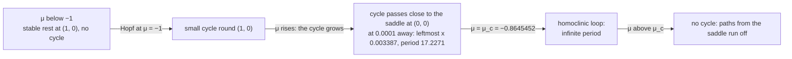
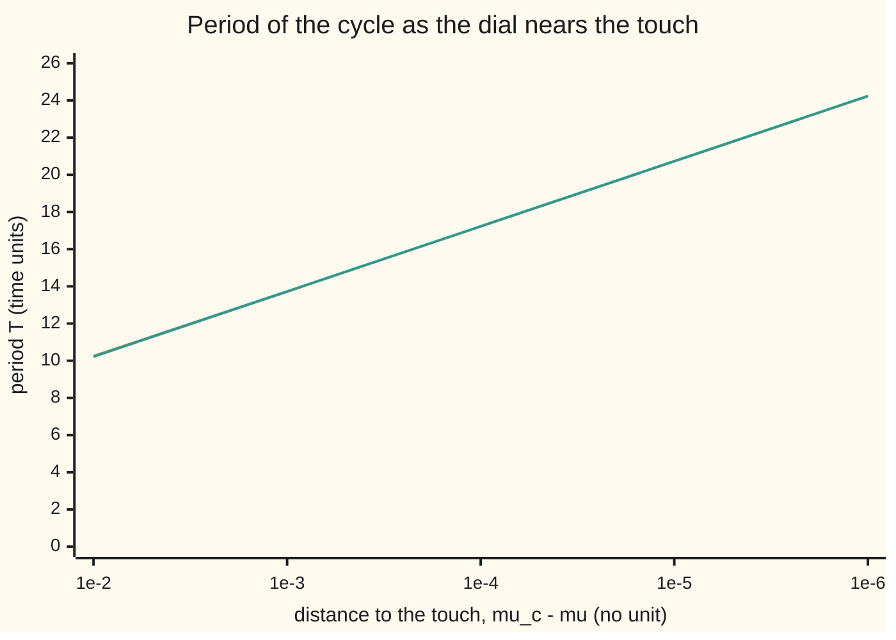

# Global bifurcations: a cycle can die by touching a saddle, and its period grows without bound on the way

[Syllabus](../../../SYLLABUS.md) → [Differential equations and dynamics](../README.md) → [Nonlinear Dynamics in the Plane](../README.md#s06) → Global bifurcations

---

## General Overview

A playground swing on rigid rods can balance exactly upside down. Tip it 0.000001 radians off the top. Without friction it falls, swings through the bottom and climbs to 179.9999 degrees on the far side: back to upside down. With the swing's real damping (friction proportional to speed, strength 0.5) the same start climbs only to 45.9601 degrees.

The frictionless path is the separatrix of [The pendulum](03-the-nonlinear-pendulum.md); a little friction destroys it. Paths that leave a **saddle** (a rest point with one way in and one way out) and arrive exactly at a saddle are rare and fragile, which is why they matter.

They mark **global bifurcations**: changes in the whole picture that no rest point shows. A rhythm (a limit cycle) can grow as a dial turns until it touches a saddle. At that dial value the cycle becomes a loop from the saddle back to itself, and past it the rhythm is gone. On the way the rhythm slows: in the example below, every tenfold step closer to the touch adds 3.5039 time units to the period.

**A limit cycle that grows into a saddle spends longer and longer creeping past it, so its period grows like the logarithm of one over the distance to the bifurcation, divided by the saddle's outgoing eigenvalue (its rate of escape); at the bifurcation the cycle becomes a loop of infinite period and then vanishes.**

**What kind of fact this is:** a theorem for a typical saddle in the plane (Andronov and Leontovich's homoclinic bifurcation theorem), argued in outline in Why it works and checked by two roads in the code. The bifurcation value −0.8645452 is a numerical result, not a closed formula.

### The picture: the life of one cycle as the dial rises



---

## The formula

A **homoclinic orbit** leaves a saddle and returns to the same saddle. A **heteroclinic orbit** leaves one saddle and arrives at a different one.

The standard example (Strogatz, section 8.4) is a position $`x`$ with rate $`y`$, and a dial $`\mu`$:

```math
x' = y, \qquad y' = \mu y + x - x^2 + x y
```

**Read it aloud:** position changes at rate y; the rate changes by the dial times y, plus x, minus x squared, plus x times y.

It has two rests. At $`(1, 0)`$ the trace (sum of the diagonal entries) of the Jacobian (the table of slopes, [Linearisation](02-linearisation-and-the-jacobian.md)) is $`\mu + 1`$, so a cycle is born there by the Hopf bifurcation at $`\mu = -1`$. At $`(0, 0)`$ sits a saddle with eigenvalues $`\lambda = (\mu \pm \sqrt{\mu^2 + 4})/2`$. The cycle grows until it touches that saddle at $`\mu_c`$. Just before, its period is

```math
T \approx C + \frac{1}{\lambda_u}\,\ln\frac{1}{\mu_c - \mu}
```

**Read it aloud:** the period is a fixed travel time plus the natural log of one over the distance to the touch, divided by the saddle's outgoing rate.

| Symbol | Plain meaning | In our example | Push it up and the answer… |
| --- | --- | --- | --- |
| $`x`$, $`y`$ | position and its rate | saddle at (0, 0), spiral at (1, 0) | — |
| $`t`$, $`T`$ | time; $`T`$ the period, one lap of the cycle | $`T`$ = 17.2271 at 0.0001 from $`\mu_c`$ | — |
| $`\mu`$, $`\mu_c`$ | the dial; its value where the cycle touches the saddle | $`\mu_c`$ = −0.8645452 | $`\mu`$ nearer $`\mu_c`$: longer period |
| $`\lambda_u`$, $`\lambda_s`$ | the saddle's eigenvalues: growth rate along the way out, shrink rate along the way in | 0.657158 and −1.521703 | larger $`\lambda_u`$: smaller gain per tenfold step |
| $`C`$ | the time spent away from the saddle, fitted once | 3.2107 | every period longer |
| $`\theta`$, $`b`$ | swing angle from straight down; damping strength | $`b`$ = 0.5 | larger $`b`$: lower far-side climb |
| $`\mathrm{sech}`$ | hyperbolic secant: $`\mathrm{sech}(t/2) = 2/(e^{t/2} + e^{-t/2})`$ | loop $`x = \mathrm{sech}^2(t/2)`$ | — |
| $`h`$, $`k`$, $`A`$ | gap between a path and the saddle's way in; two fixed constants of the return map (fold only) | — | larger $`h`$: shorter pass |

### When it holds

- **A plane and a smooth law that ignores the clock.** In three dimensions a broken loop can leave chaos instead of one cycle.
- **A true saddle: real eigenvalues, one positive, one negative.** The rate in the formula is the outgoing one, $`\lambda_u`$. Use $`\lambda_s`$ and the gain comes out wrong.
- **The two eigenvalues do not cancel.** Their sum here is $`\mu_c`$ = −0.8645, below zero, so the cycle attracts. Above zero the cycle repels. At exactly zero several cycles can appear.
- **The loop breaks cleanly as the dial passes $`\mu_c`$.** Otherwise the gap need not grow in proportion to $`\mu_c - \mu`$, and the log's coefficient changes.
- **Close to the touch only.** At 0.01 from $`\mu_c`$ the formula gives 10.2184 against a timed 10.2505.

---

## Why it works

### Step 0: passing a saddle takes a time set by a logarithm

Near a saddle the motion is nearly linear. The distance along the way out grows like $`e^{\lambda_u t}`$. A path that arrives at gap $`h`$ from the way in needs time $`(1/\lambda_u)\ln(1/h)`$, up to a constant, to get clear. At zero gap the path never gets clear.

### Step 1: a homoclinic loop takes infinite time

Take $`x'' = x - 1.5x^2`$. Near 0 it is $`x'' \approx x`$, so 0 is a saddle with eigenvalues +1 and −1. Multiply by $`x'`$ and integrate: the energy identity $`(x')^2 = x^2 - x^3`$ holds on the path that starts at 0.

That path is $`x = \mathrm{sech}^2(t/2)`$. It leaves 0, rises to 1 at $`t = 0`$, and falls back toward 0. From the top to 0.001 takes 8.2935 time units; to 0.0001 takes 10.5966. The tenfold step adds 2.3030, close to $`\ln 10/1`$ = 2.3026. That is the way in, at rate $`\lambda_s = -1`$; since $`x(-t) = x(t)`$, leaving takes as long, as Step 0 predicts with $`\lambda_u = 1`$. The loop reaches 0 only after infinite time.

### Step 2: connections need an exact balance

The pendulum's separatrix runs from upside down at $`-\pi`$ to upside down at $`\pi`$. On the line of angles those are two saddles: a heteroclinic orbit. On the circle they are one position: a homoclinic loop.

The damped swing obeys $`\theta'' + b\theta' + \sin\theta = 0`$ with $`b`$ = 0.5. A connection needs the way out of one saddle to land exactly on the way in of another. That is one condition, met at single values of one dial. Damping 0.5 breaks it: the swing falls short at 45.9601 degrees and spirals to rest ([LaSalle's principle](05-lasalle-and-the-damped-pendulum.md)). A dial that crosses the balance value is a global bifurcation.

### Step 3: the cycle's gap shrinks in proportion to the dial

Just before $`\mu_c`$, the saddle's way out nearly lands on its way in. The miss is proportional to $`\mu_c - \mu`$. The cycle runs through this narrow channel, so its gap at the saddle is proportional to $`\mu_c - \mu`$ too.

<details>
<summary>Detailed argument: one lap as a map of the gap</summary>

Measure a path by its gap $`h`$ from the saddle's way in, just as it arrives. Passing the saddle turns a gap $`h`$ into a gap from the way out of size about $`h^{\lvert\lambda_s\rvert/\lambda_u}`$, since the in-distance shrinks like $`e^{\lambda_s t}`$ while the out-distance grows like $`e^{\lambda_u t}`$. The trip round the far side is smooth and adds the miss distance, $`k(\mu_c - \mu)`$ for some constant $`k`$.

So one lap sends $`h`$ to about $`k(\mu_c - \mu) + A h^{\lvert\lambda_s\rvert/\lambda_u}`$. Here $`\lvert\lambda_s\rvert/\lambda_u`$ is above 1 (1.521703 against 0.657158), so the second term is tiny for small $`h`$. The return map has one fixed point, the cycle, at $`h \approx k(\mu_c - \mu)`$. Its slope there is close to 0, so the cycle attracts. When the ratio is below 1 the same argument gives a cycle that repels. Kuznetsov (chapter 6) gives the full proof.

</details>

### Step 4: add up the lap

One lap is the fixed trip round the far side, $`C`$, plus the saddle pass of Step 0 at the gap of Step 3:

```math
T \approx C + \frac{1}{\lambda_u}\ln\frac{1}{\mu_c - \mu}
```

At $`\mu_c`$ the saddle's outgoing rate is 0.657158. Each tenfold step closer therefore adds $`\ln 10/0.657158`$ = 3.5039. The stepped laps add 3.4784, 3.4982, 3.5030 and 3.5038.

### Step 5: where the cycle lives

The cycle is born at $`\mu = -1`$ ([The Hopf bifurcation](13-hopf-bifurcation.md)). It lives for $`-1 < \mu < \mu_c`$ and grows across that range: its leftmost point nears the saddle, from $`x`$ = 0.086999 at 0.01 below $`\mu_c`$ to 0.003387 at 0.0001 below. The eigenvalue sum $`\lambda_u + \lambda_s`$ is the saddle's trace, $`\mu`$, negative up to $`\mu_c`$, so the cycle attracts to the end. Past $`\mu_c`$ the saddle's way out passes outside its way in and runs off.

A different global death, the saddle-node on a cycle, slows a rhythm like $`1/\sqrt{\text{distance}}`$ instead.

---

## Worked numbers, by hand

| Step | Arithmetic | Value |
| --- | --- | --- |
| the touch, by bisection | which side the saddle's way out falls | $`\mu_c`$ = −0.8645452 |
| saddle eigenvalues at $`\mu_c`$ | $`(-0.8645452 \pm \sqrt{0.8645452^2 + 4})/2`$ | 0.657158 and −1.521703 |
| their sum | 0.657158 − 1.521703 | −0.864545: the cycle attracts |
| time per tenfold step | 2.3026 / 0.657158 | 3.5039 |
| the constant, from the lap at 0.000001 away | 24.2338 − ln(10^6) / 0.657158 | 3.2107 |
| predicted period at 0.0001 away | 3.2107 + 4 × 3.5039 | 17.226 |
| stepped period at 0.0001 away | one lap, timed | **17.2271** |

Two numbers, the saddle's rate and one fitted constant, predict a timed lap to within 0.001.



Orange: the timed lap; green: the formula. On this log axis both climb about 3.5039 per step.

### What breaks if you drop a piece

| Mistake | Comes out at | What went wrong |
| --- | --- | --- |
| Base-10 log in the formula | 1.5217 per tenfold step, not 3.5039 | the pass time is a natural log |
| A square-root law, scaled from 0.01 away | 1025.05 at 0.000001 away; true 24.2338 | that law belongs to a saddle-node on a cycle |
| Looking for the cycle past the touch, at $`\mu_c`$ + 0.01 | no cycle; the path crosses $`x = 0`$ at $`t`$ = 29.86 and runs off | the cycle lives only below $`\mu_c`$ |

---

## Code, from first principles, and it actually runs

Both programs step the laws with the fourth-order Runge–Kutta method and take two roads. Road one finds $`\mu_c`$ by bisection on which side of the saddle its way out falls; twice the step is a convergence check, the published −0.8645 an outside one. Road two times the cycle's laps and compares the gain per tenfold step with $`\ln 10/\lambda_u`$ from the eigenvalue formula. The loop $`x = \mathrm{sech}^2(t/2)`$ is checked against its closed-form timing.

### Python

```python
# Homoclinic bifurcation: the check behind the card.  Standard library only.
# 1: the loop of x'' = x - 1.5x^2.  2: damping breaks the swing's top-to-top orbit.
# 3: in x' = y, y' = mu*y + x - x^2 + x*y a cycle grows until it touches the saddle.
from math import sqrt, log, acosh, sin, pi
def rk4(f, x, y, h):                                    # one Runge-Kutta step
    a1, b1 = f(x, y); a2, b2 = f(x + h / 2 * a1, y + h / 2 * b1)
    a3, b3 = f(x + h / 2 * a2, y + h / 2 * b2); a4, b4 = f(x + h * a3, y + h * b3)
    return x + h / 6 * (a1 + 2 * a2 + 2 * a3 + a4), y + h / 6 * (b1 + 2 * b2 + 2 * b3 + b4)
H, loop = 0.002, lambda x, y: (y, x - 1.5 * x * x)
x, y, t, worst, at = 1.0, 0.0, 0.0, 0.0, {}             # part 1: start at the loop's top
while x > 1e-4 and t < 30:
    px = x; x, y = rk4(loop, x, y, H); t += H
    worst = max(worst, abs(y * y - x * x + x ** 3))     # energy identity along the way
    for d in (1e-3, 1e-4):
        if px >= d > x: at[d] = t - H * (d - x) / (px - x)
def top(b):                                             # part 2: leave the top, 1e-6 off
    th, w = pi - 1e-6, 0.0
    while True:
        pw = w; th, w = rk4(lambda p, q: (q, -b * q - sin(p)), th, w, H)
        if pw < 0 <= w: return -th * 180 / pi           # far-side height, in degrees
eig = lambda mu: ((mu + sqrt(mu * mu + 4)) / 2, (mu - sqrt(mu * mu + 4)) / 2)
field = lambda mu: (lambda x, y: (y, mu * y + x - x * x + x * y))
def leave(mu, h, laps=0):                # follow the saddle's outgoing path
    x, y, t, cr, lo = 1e-7, 1e-7 * eig(mu)[0], 0.0, [], 1.0
    while t < 400:
        py = y; x, y = rk4(field(mu), x, y, h); t += h; lo = min(lo, x)
        if not laps and x < 0: return +1, t             # passes outside the saddle
        if not laps and py < 0 <= y and x < 1: return -1, t   # turns back inside
        if laps and py > 0 >= y and x > 1:              # one lap = right-side crossings
            cr.append(t - h * y / (y - py)); last, lo = lo, 1.0     # leftmost x of the lap just done
            if len(cr) == laps: return cr[-1] - cr[-2], last
def critical(h):                         # bisection on which side the path falls
    lo, hi = -0.87, -0.86
    for _ in range(34):
        mid = (lo + hi) / 2
        lo, hi = (mid, hi) if leave(mid, h)[0] < 0 else (lo, mid)
    return (lo + hi) / 2
mc, mc2 = critical(H), critical(2 * H); lu, ls = eig(mc); gain = log(10) / lu
print("loop x = sech^2(t/2): saddle eigenvalues +1 and -1, top x = 1 at t = 0")
for d in (1e-3, 1e-4):
    print(f"time from the top to x = {d:g}: by steps {at[d]:.4f}, closed form {2 * acosh(d ** -0.5):.4f}")
print(f"tenfold closer adds {at[1e-4] - at[1e-3]:.4f}, near ln(10)/1 = {log(10):.4f}; energy identity (x')^2 = x^2 - x^3 kept to {worst:.1e}")
print(f"swing leaving the top climbs on the far side to: undamped {top(0):.4f} deg, damping 0.5 {top(0.5):.4f} deg")
print(f"cycle born by Hopf at mu = -1; touches the saddle at mu_c = {mc:.7f} (step {H}), {mc2:.7f} (step {2 * H})")
print(f"saddle at mu_c: lambda_u = {lu:.6f}, lambda_s = {ls:.6f}, sum {lu + ls:.6f} < 0, so the cycle attracts")
print(f"predicted extra time per tenfold step closer: ln(10)/lambda_u = {gain:.4f}")
L = {k: leave(mc - 10.0 ** -k, H, 6) for k in range(2, 7)}; T = {k: L[k][0] for k in L}   # 6th lap: settled
C = T[6] - log(1e6) / lu
for k in range(2, 7):
    print(f"mu_c - mu = 1e-{k}: period {T[k]:.4f}, formula {C + k * gain:.4f}, leftmost x {L[k][1]:.6f}" + (f", gain {T[k] - T[k - 1]:.4f}" if k > 2 else ""))
print(f"formula: period = {C:.4f} + ln(1/(mu_c - mu))/lambda_u")
print(f"mistake 1, base-10 log: 1/lambda_u = {1 / lu:.4f} per tenfold step, not {gain:.4f}")
print(f"mistake 2, square-root law from 1e-2: {T[2] * 100:.2f} at 1e-6, true {T[6]:.4f}")
print(f"mistake 3, looking past mu_c at mu = mu_c + 0.01: no cycle, the path crosses x = 0 at t = {leave(mc + 0.01, H)[1]:.2f} and runs off")
assert all(abs(at[d] - 2 * acosh(d ** -0.5)) < 1e-4 for d in (1e-3, 1e-4))  # steps vs closed form
assert worst < 1e-9 and abs(top(0) - 180) < 1e-3 and top(0.5) < 120   # energy kept; damping breaks it
assert abs(mc - mc2) < 1e-8 and abs(mc + 0.8645) < 1e-4              # published value -0.8645
assert abs((T[6] - T[5]) - gain) < 1e-3 and abs(T[4] - (C + 4 * gain)) < 1e-2   # log law
assert L[2][1] > L[4][1] > L[6][1] > 0 and L[6][1] < 1e-3            # the cycle closes on the saddle at x = 0
print("ALL CHECKS PASS")
```

**Ran 2026-11-23 on macOS, Python 3.14.10, standard library only. All checks passed. Output, pasted from the run:**

```
loop x = sech^2(t/2): saddle eigenvalues +1 and -1, top x = 1 at t = 0
time from the top to x = 0.001: by steps 8.2935, closed form 8.2935
time from the top to x = 0.0001: by steps 10.5966, closed form 10.5966
tenfold closer adds 2.3030, near ln(10)/1 = 2.3026; energy identity (x')^2 = x^2 - x^3 kept to 4.2e-14
swing leaving the top climbs on the far side to: undamped 179.9999 deg, damping 0.5 45.9601 deg
cycle born by Hopf at mu = -1; touches the saddle at mu_c = -0.8645452 (step 0.002), -0.8645452 (step 0.004)
saddle at mu_c: lambda_u = 0.657158, lambda_s = -1.521703, sum -0.864545 < 0, so the cycle attracts
predicted extra time per tenfold step closer: ln(10)/lambda_u = 3.5039
mu_c - mu = 1e-2: period 10.2505, formula 10.2184, leftmost x 0.086999
mu_c - mu = 1e-3: period 13.7289, formula 13.7223, leftmost x 0.016988, gain 3.4784
mu_c - mu = 1e-4: period 17.2271, formula 17.2261, leftmost x 0.003387, gain 3.4982
mu_c - mu = 1e-5: period 20.7301, formula 20.7300, leftmost x 0.000678, gain 3.5030
mu_c - mu = 1e-6: period 24.2338, formula 24.2338, leftmost x 0.000136, gain 3.5038
formula: period = 3.2107 + ln(1/(mu_c - mu))/lambda_u
mistake 1, base-10 log: 1/lambda_u = 1.5217 per tenfold step, not 3.5039
mistake 2, square-root law from 1e-2: 1025.05 at 1e-6, true 24.2338
mistake 3, looking past mu_c at mu = mu_c + 0.01: no cycle, the path crosses x = 0 at t = 29.86 and runs off
ALL CHECKS PASS
```

### Rust

Same numbers, same labels, built with `rustc --edition 2021 -O`.

```rust
// Homoclinic bifurcation: the same check as the Python, in Rust.  No crates.
// 1: the loop of x'' = x - 1.5x^2.  2: damping breaks the swing's top-to-top orbit.
// 3: in x' = y, y' = mu*y + x - x^2 + x*y a cycle grows until it touches the saddle.
use std::f64::consts::PI;
const H: f64 = 0.002;

fn rk4<F: Fn(f64, f64) -> (f64, f64)>(f: &F, x: f64, y: f64, h: f64) -> (f64, f64) {
    let (a1, b1) = f(x, y); let (a2, b2) = f(x + h / 2.0 * a1, y + h / 2.0 * b1);
    let (a3, b3) = f(x + h / 2.0 * a2, y + h / 2.0 * b2); let (a4, b4) = f(x + h * a3, y + h * b3);
    (x + h / 6.0 * (a1 + 2.0 * a2 + 2.0 * a3 + a4), y + h / 6.0 * (b1 + 2.0 * b2 + 2.0 * b3 + b4))
}
fn top(b: f64) -> f64 {                                  // part 2: leave the top, 1e-6 off
    let (mut th, mut w) = (PI - 1e-6, 0.0);
    loop {
        let pw = w; (th, w) = rk4(&|p: f64, q: f64| (q, -b * q - p.sin()), th, w, H);
        if pw < 0.0 && 0.0 <= w { return -th * 180.0 / PI }   // far-side height, in degrees
    }
}
fn eig(mu: f64) -> (f64, f64) { let r = (mu * mu + 4.0).sqrt(); ((mu + r) / 2.0, (mu - r) / 2.0) }
fn leave(mu: f64, h: f64, laps: usize) -> (f64, f64) {   // follow the saddle's outgoing path
    let f = |x: f64, y: f64| (y, mu * y + x - x * x + x * y);
    let (mut x, mut y, mut t, mut cr, mut lo) = (1e-7, 1e-7 * eig(mu).0, 0.0, Vec::new(), 1.0f64);
    while t < 400.0 {
        let py = y; (x, y) = rk4(&f, x, y, h); t += h; lo = lo.min(x);
        if laps == 0 && x < 0.0 { return (1.0, t) }                       // passes outside
        if laps == 0 && py < 0.0 && 0.0 <= y && x < 1.0 { return (-1.0, t) } // turns back inside
        if laps > 0 && py > 0.0 && 0.0 >= y && x > 1.0 {                  // right-side crossings
            cr.push(t - h * y / (y - py)); let last = lo; lo = 1.0;          // leftmost x of the lap just done
            if cr.len() == laps { return (cr[laps - 1] - cr[laps - 2], last) }
        }
    }
    panic!("no event within 400 time units")
}
fn critical(h: f64) -> f64 {                             // bisection on which side the path falls
    let (mut lo, mut hi) = (-0.87, -0.86);
    for _ in 0..34 {
        let mid = (lo + hi) / 2.0;
        if leave(mid, h, 0).0 < 0.0 { lo = mid } else { hi = mid }
    }
    (lo + hi) / 2.0
}
fn main() {
    let lp = |x: f64, y: f64| (y, x - 1.5 * x * x);
    let (mut x, mut y, mut t, mut worst) = (1.0f64, 0.0f64, 0.0, 0.0f64);
    let ds = [1e-3, 1e-4]; let mut at = [f64::NAN; 2];      // part 1: start at the loop's top
    while x > 1e-4 && t < 30.0 {
        let px = x; (x, y) = rk4(&lp, x, y, H); t += H;
        worst = worst.max((y * y - x * x + x.powi(3)).abs());   // energy identity along the way
        for i in 0..2 { if px >= ds[i] && ds[i] > x { at[i] = t - H * (ds[i] - x) / (px - x) } }
    }
    let (mc, mc2) = (critical(H), critical(2.0 * H)); let (lu, ls) = eig(mc); let gain = 10f64.ln() / lu;
    println!("loop x = sech^2(t/2): saddle eigenvalues +1 and -1, top x = 1 at t = 0");
    for i in 0..2 {
        println!("time from the top to x = {}: by steps {:.4}, closed form {:.4}", ds[i], at[i], 2.0 * (ds[i].powf(-0.5)).acosh());
    }
    println!("tenfold closer adds {:.4}, near ln(10)/1 = {:.4}; energy identity (x')^2 = x^2 - x^3 kept to {:.1e}", at[1] - at[0], 10f64.ln(), worst);
    println!("swing leaving the top climbs on the far side to: undamped {:.4} deg, damping 0.5 {:.4} deg", top(0.0), top(0.5));
    println!("cycle born by Hopf at mu = -1; touches the saddle at mu_c = {:.7} (step {}), {:.7} (step {})", mc, H, mc2, 2.0 * H);
    println!("saddle at mu_c: lambda_u = {:.6}, lambda_s = {:.6}, sum {:.6} < 0, so the cycle attracts", lu, ls, lu + ls);
    println!("predicted extra time per tenfold step closer: ln(10)/lambda_u = {:.4}", gain);
    let lv: Vec<(f64, f64)> = (0..7).map(|k| if k < 2 { (0.0, 0.0) } else { leave(mc - 10f64.powi(-k), H, 6) }).collect(); // 6th lap: settled
    let tp: Vec<f64> = lv.iter().map(|v| v.0).collect();
    let c = tp[6] - 1e6f64.ln() / lu;
    for k in 2..7 {
        let g = if k > 2 { format!(", gain {:.4}", tp[k] - tp[k - 1]) } else { String::new() };
        println!("mu_c - mu = 1e-{}: period {:.4}, formula {:.4}, leftmost x {:.6}{}", k, tp[k], c + k as f64 * gain, lv[k].1, g);
    }
    println!("formula: period = {:.4} + ln(1/(mu_c - mu))/lambda_u", c);
    println!("mistake 1, base-10 log: 1/lambda_u = {:.4} per tenfold step, not {:.4}", 1.0 / lu, gain);
    println!("mistake 2, square-root law from 1e-2: {:.2} at 1e-6, true {:.4}", tp[2] * 100.0, tp[6]);
    println!("mistake 3, looking past mu_c at mu = mu_c + 0.01: no cycle, the path crosses x = 0 at t = {:.2} and runs off", leave(mc + 0.01, H, 0).1);
    assert!(at.iter().zip(ds.iter()).all(|(a, d)| (a - 2.0 * d.powf(-0.5).acosh()).abs() < 1e-4));
    assert!(worst < 1e-9 && (top(0.0) - 180.0).abs() < 1e-3 && top(0.5) < 120.0);
    assert!((mc - mc2).abs() < 1e-8 && (mc + 0.8645).abs() < 1e-4);          // published value -0.8645
    assert!(((tp[6] - tp[5]) - gain).abs() < 1e-3 && (tp[4] - (c + 4.0 * gain)).abs() < 1e-2);
    assert!(lv[2].1 > lv[4].1 && lv[4].1 > lv[6].1 && lv[6].1 > 0.0 && lv[6].1 < 1e-3);   // the cycle closes on the saddle at x = 0
    println!("ALL CHECKS PASS");
}
```

**Ran 2026-11-23 on macOS, rustc 1.98.1, no crates. All checks passed. Output, pasted from the run:**

```
loop x = sech^2(t/2): saddle eigenvalues +1 and -1, top x = 1 at t = 0
time from the top to x = 0.001: by steps 8.2935, closed form 8.2935
time from the top to x = 0.0001: by steps 10.5966, closed form 10.5966
tenfold closer adds 2.3030, near ln(10)/1 = 2.3026; energy identity (x')^2 = x^2 - x^3 kept to 4.2e-14
swing leaving the top climbs on the far side to: undamped 179.9999 deg, damping 0.5 45.9601 deg
cycle born by Hopf at mu = -1; touches the saddle at mu_c = -0.8645452 (step 0.002), -0.8645452 (step 0.004)
saddle at mu_c: lambda_u = 0.657158, lambda_s = -1.521703, sum -0.864545 < 0, so the cycle attracts
predicted extra time per tenfold step closer: ln(10)/lambda_u = 3.5039
mu_c - mu = 1e-2: period 10.2505, formula 10.2184, leftmost x 0.086999
mu_c - mu = 1e-3: period 13.7289, formula 13.7223, leftmost x 0.016988, gain 3.4784
mu_c - mu = 1e-4: period 17.2271, formula 17.2261, leftmost x 0.003387, gain 3.4982
mu_c - mu = 1e-5: period 20.7301, formula 20.7300, leftmost x 0.000678, gain 3.5030
mu_c - mu = 1e-6: period 24.2338, formula 24.2338, leftmost x 0.000136, gain 3.5038
formula: period = 3.2107 + ln(1/(mu_c - mu))/lambda_u
mistake 1, base-10 log: 1/lambda_u = 1.5217 per tenfold step, not 3.5039
mistake 2, square-root law from 1e-2: 1025.05 at 1e-6, true 24.2338
mistake 3, looking past mu_c at mu = mu_c + 0.01: no cycle, the path crosses x = 0 at t = 29.86 and runs off
ALL CHECKS PASS
```

### Lean

Lean proves the loop facts for $`x = \mathrm{sech}^2(t/2)`$ and the saddle's eigenvalues for every dial value $`\mu`$.

- Take $`x = \mathrm{sech}^2(t/2)`$. Then $`x'' = x - 1.5x^2`$ at every time, and $`x = 1`$ at $`t = 0`$.
- Take the same $`x`$. Then it tends to 0 as $`t`$ runs forward and backward: a homoclinic loop that leaves the saddle at 0 and returns.
- Take the same loop. Then $`(x')^2 = x^2 - x^3`$ at every time: the energy identity.
- Take any dial value $`\mu`$. The Jacobian at the saddle $`(0, 0)`$ has rows $`(0, 1)`$ and $`(1, \mu)`$.
- Then its two eigenvalues are $`\lambda = (\mu \pm \sqrt{\mu^2 + 4})/2`$. The plus root $`\lambda_u`$ is positive and the minus root $`\lambda_s`$ is negative.
- So $`(0, 0)`$ is a true saddle for every $`\mu`$. The sum $`\lambda_u + \lambda_s`$ is $`\mu`$, the trace.

The touch value $`\mu_c`$, the cycle's periods, the log law and the damped swing are left to the Python and Rust checks.

```lean
-- Global bifurcations: x = sech^2(t/2) is a homoclinic loop of x'' = x - 1.5x^2 that keeps the energy identity (x')^2 = x^2 - x^3, and the saddle of x' = y, y' = mu y + x - x^2 + xy has eigenvalues (mu ± sqrt(mu^2 + 4))/2, one positive and one negative, summing to mu.
import Mathlib.Analysis.SpecialFunctions.Trigonometric.DerivHyp
import Mathlib.Analysis.SpecialFunctions.Sqrt
import Mathlib.LinearAlgebra.Matrix.Determinant.Basic
import Mathlib.LinearAlgebra.Matrix.Notation

open Real Filter Topology

lemma sechsq_hasDerivAt (t : ℝ) :
    HasDerivAt (fun t : ℝ => 1 / Real.cosh (t / 2) ^ 2)
      (-(Real.sinh (t / 2) / Real.cosh (t / 2) ^ 3)) t := by
  have hc : Real.cosh (t / 2) ≠ 0 := (Real.cosh_pos _).ne'
  have h1 : HasDerivAt (fun t : ℝ => t / 2) (1 / 2) t := by
    simpa using (hasDerivAt_id t).div_const 2
  have h2 := (h1.cosh).pow 2
  have h3 := h2.inv (pow_ne_zero 2 hc)
  have : (fun t : ℝ => 1 / Real.cosh (t / 2) ^ 2) = fun t => (Real.cosh (t / 2) ^ 2)⁻¹ := by
    funext s; simp
  rw [this]
  convert h3 using 1
  simp only [Pi.pow_apply]
  field_simp
  ring

lemma sechsq_deriv :
    deriv (fun t : ℝ => 1 / Real.cosh (t / 2) ^ 2) =
      fun t => -(Real.sinh (t / 2) / Real.cosh (t / 2) ^ 3) := by
  funext t; exact (sechsq_hasDerivAt t).deriv

lemma sechsq_hasDerivAt2 (t : ℝ) :
    HasDerivAt (fun t : ℝ => -(Real.sinh (t / 2) / Real.cosh (t / 2) ^ 3))
      (-((Real.cosh (t / 2) * (1 / 2) * Real.cosh (t / 2) ^ 3 -
        Real.sinh (t / 2) * (3 * Real.cosh (t / 2) ^ 2 * (Real.sinh (t / 2) * (1 / 2)))) /
        (Real.cosh (t / 2) ^ 3) ^ 2)) t := by
  have hc : Real.cosh (t / 2) ≠ 0 := (Real.cosh_pos _).ne'
  have h1 : HasDerivAt (fun t : ℝ => t / 2) (1 / 2) t := by
    simpa using (hasDerivAt_id t).div_const 2
  have h3 := ((h1.sinh).div ((h1.cosh).pow 3) (pow_ne_zero 3 hc)).neg
  convert h3 using 2

lemma sechsq_bound (t : ℝ) : 1 / Real.cosh (t / 2) ^ 2 ≤ 4 * Real.exp (-t) := by
  have hc := Real.cosh_pos (t / 2)
  rw [Real.cosh_eq]
  have e1 : Real.exp (t / 2) * Real.exp (-(t / 2)) = 1 := by
    rw [← Real.exp_add]; simp
  have e2 : Real.exp (-t) = Real.exp (-(t / 2)) ^ 2 := by
    rw [← Real.exp_nat_mul]; congr 1; ring
  have p1 := Real.exp_pos (t / 2)
  have p2 := Real.exp_pos (-(t / 2))
  rw [e2, div_le_iff₀ (by positivity)]
  nlinarith [sq_nonneg (Real.exp (-(t / 2))), mul_pos p1 p2, sq_nonneg (Real.exp (-(t / 2)) ^ 2)]

#print axioms sechsq_hasDerivAt
#print axioms sechsq_deriv
#print axioms sechsq_hasDerivAt2
#print axioms sechsq_bound

/-- The path x(t) = sech^2(t/2), written as 1 / cosh(t/2)^2, solves x'' = x - 1.5 x^2 at every
time, sits at the top x = 1 at t = 0, and tends to the saddle at 0 both as t runs forward and as
t runs backward: it is a homoclinic loop that leaves the saddle and returns to it. -/
theorem sech_sq_is_homoclinic_loop :
    let x : ℝ → ℝ := fun t => 1 / Real.cosh (t / 2) ^ 2
    (∀ t : ℝ, deriv (deriv x) t = x t - 3 / 2 * x t ^ 2) ∧
    x 0 = 1 ∧
    Tendsto x atTop (𝓝 0) ∧
    Tendsto x atBot (𝓝 0) := by
  intro x
  refine ⟨?_, ?_, ?_, ?_⟩
  · intro t
    show deriv (deriv (fun t : ℝ => 1 / Real.cosh (t / 2) ^ 2)) t = _
    rw [sechsq_deriv, (sechsq_hasDerivAt2 t).deriv]
    have hc : Real.cosh (t / 2) ≠ 0 := (Real.cosh_pos _).ne'
    have hs : Real.sinh (t / 2) ^ 2 = Real.cosh (t / 2) ^ 2 - 1 := by
      rw [Real.cosh_sq]; ring
    simp only [x]
    field_simp
    rw [hs]
    ring
  · simp [x]
  · have hx : ∀ t, x t = 1 / Real.cosh (t / 2) ^ 2 := fun t => rfl
    have h4 : Tendsto (fun t : ℝ => 4 * Real.exp (-t)) atTop (𝓝 0) := by
      simpa using (Real.tendsto_exp_neg_atTop_nhds_zero).const_mul 4
    refine tendsto_of_tendsto_of_tendsto_of_le_of_le tendsto_const_nhds h4 ?_ ?_
    · intro t; rw [hx]; positivity
    · intro t; rw [hx]; exact sechsq_bound t
  · have hx : ∀ t, x t = 1 / Real.cosh (t / 2) ^ 2 := fun t => rfl
    have h4 : Tendsto (fun t : ℝ => 4 * Real.exp t) atBot (𝓝 0) := by
      simpa using (Real.tendsto_exp_atBot).const_mul 4
    refine tendsto_of_tendsto_of_tendsto_of_le_of_le tendsto_const_nhds h4 ?_ ?_
    · intro t; rw [hx]; positivity
    · intro t
      rw [hx]
      have := sechsq_bound (-t)
      rw [neg_neg, neg_div, Real.cosh_neg] at this
      exact this

/-- Along the loop x(t) = sech^2(t/2) the energy identity (x')^2 = x^2 - x^3 holds at every
time. -/
theorem sech_sq_loop_energy_identity :
    let x : ℝ → ℝ := fun t => 1 / Real.cosh (t / 2) ^ 2
    ∀ t : ℝ, deriv x t ^ 2 = x t ^ 2 - x t ^ 3 := by
  intro x t
  show deriv (fun t : ℝ => 1 / Real.cosh (t / 2) ^ 2) t ^ 2 = _
  rw [sechsq_deriv]
  have hc : Real.cosh (t / 2) ≠ 0 := (Real.cosh_pos _).ne'
  have hs : Real.sinh (t / 2) ^ 2 = Real.cosh (t / 2) ^ 2 - 1 := by
    rw [Real.cosh_sq]; ring
  simp only [x]
  field_simp
  rw [hs]

/-- For every dial value mu, the Jacobian of x' = y, y' = mu y + x - x^2 + xy at the rest
(0, 0) is the table [[0, 1], [1, mu]]. Its eigenvalues are (mu + sqrt(mu^2 + 4))/2 and
(mu - sqrt(mu^2 + 4))/2: the first is positive (the way out), the second negative (the way in),
so (0, 0) is a true saddle, and their sum is mu, the trace. -/
theorem saddle_eigenvalues_real_opposite_sign_sum_mu (μ : ℝ) :
    let J : Matrix (Fin 2) (Fin 2) ℝ := !![0, 1; 1, μ]
    let lu := (μ + Real.sqrt (μ ^ 2 + 4)) / 2
    let ls := (μ - Real.sqrt (μ ^ 2 + 4)) / 2
    (lu • (1 : Matrix (Fin 2) (Fin 2) ℝ) - J).det = 0 ∧
    (ls • (1 : Matrix (Fin 2) (Fin 2) ℝ) - J).det = 0 ∧
    0 < lu ∧ ls < 0 ∧ lu + ls = μ := by
  intro J lu ls
  have hpos : (0:ℝ) ≤ μ ^ 2 + 4 := by positivity
  have hsq := Real.sq_sqrt hpos
  have hgt : |μ| < Real.sqrt (μ ^ 2 + 4) := by
    rw [← Real.sqrt_sq_eq_abs]
    exact Real.sqrt_lt_sqrt (sq_nonneg _) (by linarith)
  have ha := abs_lt.mp hgt
  refine ⟨?_, ?_, ?_, ?_, ?_⟩
  · simp only [J, lu, Matrix.det_fin_two]
    simp [Matrix.smul_apply]
    nlinarith [hsq]
  · simp only [J, ls, Matrix.det_fin_two]
    simp [Matrix.smul_apply]
    nlinarith [hsq]
  · simp only [lu]; linarith [ha.1, ha.2, le_abs_self μ, neg_abs_le μ]
  · simp only [ls]; linarith [ha.1, ha.2, le_abs_self μ, neg_abs_le μ]
  · simp only [lu, ls]; ring

#print axioms sech_sq_is_homoclinic_loop
#print axioms sech_sq_loop_energy_identity
#print axioms saddle_eigenvalues_real_opposite_sign_sum_mu
```

**Checked 2026-11-23 on macOS, Lean 4.36.0-rc2, Mathlib v4.36.0-rc2. Every proof is complete and uses only Lean's standard axioms. Output, pasted from the run:**

```
'sechsq_hasDerivAt' depends on axioms: [propext, Classical.choice, Quot.sound]
'sechsq_deriv' depends on axioms: [propext, Classical.choice, Quot.sound]
'sechsq_hasDerivAt2' depends on axioms: [propext, Classical.choice, Quot.sound]
'sechsq_bound' depends on axioms: [propext, Classical.choice, Quot.sound]
'sech_sq_is_homoclinic_loop' depends on axioms: [propext, Classical.choice, Quot.sound]
'sech_sq_loop_energy_identity' depends on axioms: [propext, Classical.choice, Quot.sound]
'saddle_eigenvalues_real_opposite_sign_sum_mu' depends on axioms: [propext, Classical.choice, Quot.sound]
```

> [!TIP]
> **Try changing**
> - **Guess first: one step closer.** Change `range(2, 7)` to `range(2, 8)` in both places. A row for 1e-7 appears: period 27.7377, gain 3.5038.
> - **Guess first: less friction.** Change `top(0.5)` to `top(0.1)` everywhere. The swing climbs to 111.8298 degrees, still short of 180: any damping breaks the connection. The label still reads 0.5.
> - **Guess first: a cruder start.** Change the start `1e-7, 1e-7` in `leave` to `1e-5, 1e-5`. The touch stays at −0.8645452: the start's size does not move it.

---

## The usual mistake

> [!warning]
> **Reading a slowing rhythm as one that has grown bigger.** The period grows because the cycle creeps past the saddle, not because the loop is longer. The period climbs 3.5039 per tenfold step without bound.
>
> - **Base-10 logarithm.** It gives 1.5217 per tenfold step instead of 3.5039.
> - **A square-root law.** Scaled from 10.2505 at 0.01 away, it predicts 1025.05 at 0.000001 away; the true period is 24.2338.
> - **Looking past the touch.** At $`\mu_c`$ + 0.01 there is no cycle: the saddle's way out crosses $`x = 0`$ at $`t`$ = 29.86 and runs off.

---

## Where you meet it in real life

- **Nerve cells.** In some neuron models repeated firing starts or stops through a homoclinic bifurcation, and near the threshold the gap between spikes stretches like this card's logarithm.
- **Driven pendulums and Josephson junctions.** A damped pendulum driven by a steady twist, the model of a superconducting junction, loses its spinning motion through a homoclinic bifurcation (Strogatz, section 8.5).
- **Warning signs.** A rhythm whose period grows in equal steps per tenfold step suggests a saddle ahead; growth like one over a square root points to a saddle-node instead.

> **Say it back**
> A homoclinic orbit leaves a saddle and returns to it; a heteroclinic orbit joins two saddles. They need an exact balance, so they appear at single dial values and any change such as damping breaks them. A cycle growing into a saddle creeps past it ever more slowly: its period is a constant plus the log of one over the distance to the touch, divided by the saddle's outgoing eigenvalue. At the touch the cycle becomes a loop of infinite period, and past it the cycle is gone.

---

## What this builds on

- [The Hopf bifurcation](13-hopf-bifurcation.md): how the cycle in this card is born at $`\mu = -1`$.
- [Invariant manifolds](12-stable-unstable-and-centre-manifolds.md): the saddle's way in and way out, whose meeting is the homoclinic loop.
- [Limit cycles](08-limit-cycles-and-van-der-pol.md): the isolated closed loop that grows and dies here, and the return map.
- [The pendulum](03-the-nonlinear-pendulum.md): the separatrix, the first connection between saddles, and its own logarithmic period.
- [Bifurcations](10-bifurcations-of-equilibria.md): the local bifurcations of rest points that this card's global ones complete.

## Where this goes next

- [Phase locking](../13-Rhythms%20and%20Synchronisation/02-flows-on-the-circle-and-phase-locking.md): the saddle-node on a cycle, where the period grows like one over a square root.
- Melnikov's method: predicts where a connection between saddles breaks, without stepping the law.

This card leaves open what happens when a connection breaks in three dimensions or under a periodic push, where one broken loop can leave chaos behind.

---

## Sources

Verified 2026-11-23: every link below resolves to the publisher's page.

- Strogatz, Steven H. *Nonlinear Dynamics and Chaos*, 3rd ed. CRC Press, 2024. [Publisher page](https://www.routledge.com/Nonlinear-Dynamics-and-Chaos-With-Applications-to-Physics-Biology-Chemistry-and-Engineering/Strogatz/p/book/9780367026509). Section 8.4: the example system, the touch near −0.8645 and the logarithmic period; section 8.5: the driven pendulum.
- Kuznetsov, Yuri A. *Elements of Applied Bifurcation Theory*, 4th ed. Springer, 2023. [DOI](https://doi.org/10.1007/978-3-031-22007-4). Chapter 6: the Andronov–Leontovich theorem and the role of the eigenvalue sum.
- Perko, Lawrence. *Differential Equations and Dynamical Systems*, 3rd ed. Springer, 2001. [DOI](https://doi.org/10.1007/978-1-4613-0003-8). Sections 4.8 and 4.9: homoclinic bifurcations in the plane and Melnikov's method.
- Guckenheimer, John, and Philip Holmes. *Nonlinear Oscillations, Dynamical Systems, and Bifurcations of Vector Fields*. Springer, 1983. [DOI](https://doi.org/10.1007/978-1-4612-1140-2). Chapter 6: global bifurcations, including loops in three dimensions.
