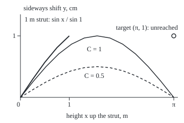

# Boundary value problems: conditions at both ends instead of one start, so there may be one answer, none or infinitely many

[Syllabus](../../../SYLLABUS.md) → [Differential equations and dynamics](../README.md) → [Series Solutions and Boundary Problems](../README.md#s07) → Boundary value problems

---

## General Overview

A slender steel strut stands upright with a weight on top and its foot pinned to the floor. Where it bends, the weight bends it further and its stiffness pulls back. For small bends, with load over stiffness at 1 per m^2, the sideways shift y (in cm) at height x (in m) obeys y'' + y = 0: the curvature at each height is minus the shift there.

The starting slope is unknown; the two ends are known. An initial-value problem gives value and slope at one point. A **boundary value problem** gives one condition at each end of an interval and asks for the solution in between.

Three struts, one law. A 1 m strut with its top pushed 1 cm sideways takes exactly one shape. A π m strut (about 3.14 m) with both ends on the line takes any shape C sin x, for any amount C: this load buckles it. With its top pushed 1 cm it has no small-bend shape at all.

**A boundary value problem fits the general solution's two free amounts to conditions at two ends; the fit is two linear equations, so it has one answer, none, or infinitely many, and one number decides which.**

**What kind of fact this is:** a theorem, proved on this card in Why it works; the names Dirichlet, Neumann and Robin are a convention.

### The picture: three struts, one law

<p align="center"></p>

To scale: 95.49 px per m across, 120 px per cm up. Solid and dashed humps: C sin x for C = 1 and 0.5, back on the line at π m. Thick curve: the 1 m strut's one shape. Hollow dot: the 1 cm target at π m, unreached.

---

## The formula

Notation first, in words. An end condition pins a value, a slope, or a mix of the two to a target. At the foot, x = 0:

$$\alpha_0\,y(0) + \beta_0\,y'(0) = \gamma_0,$$

and at the top, x = L, the same with subscript L. **Read it aloud:** so much value plus so much slope must equal the target.

- **Dirichlet:** value only, β = 0. The pinned foot, y(0) = 0.
- **Neumann:** slope only, α = 0. A top held upright but free to slide: y'(L) = 0.
- **Robin:** both nonzero. An end held by a spring.

With a value given at each end:

$$y = A\cos x + B\sin x, \qquad A = y_0, \qquad A\cos L + B\sin L = y_L.$$

**Read it aloud:** every solution mixes cos and sin; the foot fixes the cos amount, the top constrains the sin amount.

The **determinant** is the number that must be nonzero for two linear equations to have exactly one answer; for coefficients 1, 0 and cos L, sin L it is

$$D = \sin L.$$

**Read it aloud:** the top steers B only through sin L. If D is not 0, one answer: B = (y_L − y_0 cos L) / sin L. If D = 0, every B works when y_L = y_0 cos L, and none otherwise.

| Symbol | Plain meaning | In our example | Push it up and the answer… |
| --- | --- | --- | --- |
| $x$ | height, in m | 0 to 1, or 0 to π | — |
| $y$, $y'$, $y''$ | shift in cm, slope in cm per m, curvature | y(0) = 0 | — |
| $L$ | strut length, in m | 1 or π | near π, B grows huge |
| $A$, $B$, $C$ | amounts of cos and sin; C free | A = 0, B = 1.188395 | — |
| $y_0$, $y_L$ | targets at foot and top, in cm | 0 and 1 | B grows with $y_L$ |
| $D$ | determinant | sin 1 = 0.841471 | — |
| $\alpha$, $\beta$, $\gamma$ | weights on value and slope, and the target | Robin top: 1, 1 m, 1 cm | — |
| $u$, $v$ | solutions of the equation with nothing on the right, starting at value 1, slope 0 and value 0, slope 1 | cos x, sin x | — |

### When it holds

- **A linear equation:** y and its rates never squared or multiplied. The large-bend strut law is not, and past buckling it has three shapes: straight, bent left, bent right.
- **Linear end conditions.** Squaring one on the 1 m strut, y(1)^2 = 1, gives exactly two answers.
- **A genuine condition at each end:** α and β not both 0, or that end reads 0 = target and says nothing.
- **A regular equation on a finite interval:** coefficients continuous, the one on y'' never 0; singular points are different ([Frobenius](02-frobenius-and-regular-singular-points.md)).

---

## Why it works

### Step 0: two free amounts, two equations

The general solution has two free amounts. Linear end conditions make two linear equations for them, and such a pair has one answer, none, or a whole line of answers.

### Step 1: the strut's general solution

The characteristic equation of y'' + y = 0 is r^2 + 1 = 0 ([The characteristic equation](../03-Oscillators%20-%20Second-Order%20Linear%20Equations/02-the-characteristic-equation.md)), roots ±i (i is the square root of −1), whose real solutions are cos x and sin x ([Complex roots](../03-Oscillators%20-%20Second-Order%20Linear%20Equations/03-complex-roots-and-damped-oscillation.md)). A solution is fixed by its value and slope at 0, and A cos x + B sin x matches any pair, so every solution has this form.

### Step 2: the 1 m strut has one shape

The foot gives A = 0, the top B sin 1 = 1. Since sin 1 = 0.841471 is not 0, B = 1.188395: the shape sin x / sin 1, 0.569747 cm off the line at mid-height.

### Step 3: the π m strut loses its top condition

The foot gives A = 0. At the top, cos π = −1 and sin π = 0, so y(π) = −A = 0 whatever B is: the top has stopped listening to B. A top target of 0 is met by every B, the family C sin x; a target of 1 cm demands −A = 1 against A = 0, and nothing fits. The length, not the count of conditions, changed.

### Step 4: the general theorem

For y'' + p y' + q y = g, with p, q, g given continuous functions of x, every solution is one particular solution plus c1 u + c2 v, for amounts c1 and c2. Each end condition becomes one linear equation in c1 and c2, and the 2-by-2 system's determinant decides. So D is not 0 exactly when the zero-end problem (g = 0, every target 0) has only the solution y = 0.

<details>
<summary>Detailed proof: one, none, or infinitely many</summary>

Let y_p solve the equation, and u, v solve it with g = 0 from the starts above. For a solution y, both y − y_p and c1 u + c2 v, with c1 = y(0) − y_p(0) and c2 = y'(0) − y_p'(0), solve the g = 0 equation from the same start, so they agree everywhere (existence and uniqueness): y = y_p + c1 u + c2 v, with c1, c2 unique.

Write B_0(y) = α_0 y(0) + β_0 y'(0), and B_L the same at L; both respect sums and multiples. The conditions become M c = d, where M has rows (B_0(u), B_0(v)) and (B_L(u), B_L(v)), and d = (γ_0 − B_0(y_p), γ_L − B_L(y_p)).

If det M is not 0, c = M^(−1) d is the one answer. If det M = 0, the nonzero first row (α_0, β_0) gives M rank 1: its range is a line, and it sends the multiples of some nonzero w to 0. If d is off that line, nothing works; if c* works, so does c* + s w for every real s, each a different curve: infinitely many.

</details>

### Step 5: the three kinds of condition do not choose the outcome

Neumann ends on the π m strut, y'(0) = y'(π) = 0: the slope −A sin x + B cos x gives B = 0 and −B = 0, so A is free and every C cos x works. A Neumann top on the 1 m strut, y'(1) = 1, gives B cos 1 = 1, one answer B = 1.850816. A Robin top, y(1) + (1 m) y'(1) = 1 cm, gives B (sin 1 + cos 1) = 1, so B = 0.723708. The kind sets a row; the determinant decides.

[Shooting](06-the-shooting-method.md) and [Finite differences](07-finite-differences-for-boundary-problems.md) reach the same answers numerically. Stretched onto [0, 1] as −y'' = lambda y, with lambda a number to be found, the π m strut is lambda = π^2 = 9.869604, the first special value of [Eigenvalue problems](08-eigenvalues-and-eigenfunctions.md).

---

## Worked numbers, by hand

| Step | Arithmetic | Value |
| --- | --- | --- |
| 1 m strut | A = 0; B sin 1 = 1, sin 1 = 0.841471 | B = 1.188395 |
| mid-height shift | sin 0.5 / sin 1 | **0.569747 cm** |
| π m strut, top | y(π) = −A = 0 whatever B | D = sin π = 0 |
| ends 0 and 0 | every B fits | **infinitely many: C sin x** |
| ends 0 and 1 | −A = 1 and A = 0 | **none** |
| Neumann top, 1 m | B cos 1 = 1 | B = 1.850816 |
| Robin top, 1 m | B (sin 1 + cos 1) = 1 | B = 0.723708 |

The 1 m strut sits 0.569747 cm off the line at mid-height; the π m strut, at its buckling length, has no small-bend answer.

### What breaks if you drop a piece

| Mistake | Comes out at | What went wrong |
| --- | --- | --- |
| "Two conditions, one answer": π m, ends 0, 0 | C = 0.5, 1, 2 all fit | the top ignores B |
| Dividing by a computed D: π m, ends 0, 1 | B = 8.17e15 (floating sin π), 3.81e9 (stepping) | D is exactly 0 |
| Robin sign flipped: y(1) − y'(1) = 1 | B = 3.3204, not 0.7237 | spring pushing the wrong way |
| Condition squared: y(1)^2 = 1 | B = ±1.188395, exactly two | nonlinear condition |

The code prints all four.

---

## Code, from first principles, and it actually runs

Two roads to every answer. Road one fits A and B with sin and cos. Road two never calls them: Runge-Kutta 4 ([Runge-Kutta four](../05-Numerical%20Evolution/04-runge-kutta-four.md)), sampling the slope four times per step, carries v to the far end, and B is the target over what v gives there. Halving the step h cuts the error about 16 times: fourth order.

### Python

```python
# Two-point boundary value problems -- the check behind the card.  Standard
# library only.  The strut y'' + y = 0 (x in m, y in cm) has every solution
# A cos x + B sin x.  Road one fits A and B to both ends with sin and cos.
# Road two never calls them: RK4 steps v, the solution with v(0) = 0 and
# v'(0) = 1, to the far end, and fits B from its value and slope there.
# u, with u(0) = 1 and u'(0) = 0, is stepped for the Neumann case.
import math

def rk4(L, n, y=0.0, p=1.0):         # step (y, y') across [0, L] in n steps
    h = L / n
    for _ in range(n):
        k1 = (p, -y); k2 = (p + h / 2 * k1[1], -(y + h / 2 * k1[0]))
        k3 = (p + h / 2 * k2[1], -(y + h / 2 * k2[0])); k4 = (p + h * k3[1], -(y + h * k3[0]))
        y += h / 6 * (k1[0] + 2 * k2[0] + 2 * k3[0] + k4[0])
        p += h / 6 * (k1[1] + 2 * k2[1] + 2 * k3[1] + k4[1])
    return y, p

def sci(x, d):                       # 7.16e-7, the way Rust prints {:.2e}
    e = math.floor(math.log10(abs(x)))
    return f"{x / 10 ** e:.{d}f}e{e}"

s1, c1, pi = math.sin(1), math.cos(1), math.pi
v1, dv1 = rk4(1, 100)                # road two at x = 1 m, h = 0.01
vpi, dvpi = rk4(pi, 314)             # road two at x = pi m
upi, dupi = rk4(pi, 314, 1.0, 0.0)   # u at x = pi m
B, Bn, Br = 1 / s1, 1 / c1, 1 / (s1 + c1)
errs = [abs(1 / rk4(1, n)[0] - B) for n in (10, 20, 40)]
pts = lambda f, xs: " ".join(f"{40 + 300 / pi * x:.1f},{190 - 120 * f(x):.1f}" for x in xs)
print("strut y'' + y = 0, every solution y = A cos x + B sin x; x in m, y in cm")
print(f"[0, 1], ends 0 and 1: D = sin 1 = {s1:.6f}; A = 0, B = 1/sin 1 = {B:.6f}")
print(f"  road two, stepped v(1) = {v1:.6f}, B = {1 / v1:.6f}; midpoint y(0.5) = {math.sin(0.5) * B:.6f} cm")
print(f"  RK4 error in B at h = 0.1 0.05 0.025: {sci(errs[0], 2)} {sci(errs[1], 2)} {sci(errs[2], 2)}; ratios {errs[0] / errs[1]:.1f} {errs[1] / errs[2]:.1f}")
print(f"[0, pi], ends 0 and 0: D = sin pi = 0 exactly (floating sin(pi) = {sci(math.sin(pi), 2)}, stepped v(pi) = {sci(vpi, 2)})")
fam = [rk4(pi, 314, 0.0, c)[0] for c in (0.5, 1, 2)]
print(f"  C sin x for C = 0.5 1 2, stepped y(pi): {sci(fam[0], 1)} {sci(fam[1], 1)} {sci(fam[2], 1)}: every C fits, infinitely many")
print(f"[0, pi], ends 0 and 1: y(pi) = -A = 1 but A = 0: none; naive B = 1/sin(pi) = {sci(1 / math.sin(pi), 2)}, 1/v(pi) = {sci(1 / vpi, 2)}")
print(f"house form -y'' = lambda y on [0, 1]: L = pi is lambda = pi^2 = {pi * pi:.6f}, the first eigenvalue")
print(f"Neumann [0, pi], y'(0) = y'(pi) = 0: B = 0 and -B = 0, A free: y = C cos x; stepped u'(pi) = {sci(dupi, 1)}")
print(f"Dirichlet-Neumann [0, 1], y(0) = 0, y'(1) = 1: B = 1/cos 1 = {Bn:.6f}; stepped 1/v'(1) = {1 / dv1:.6f}")
print(f"Robin [0, 1], y(0) = 0, y(1) + y'(1) = 1: B = 1/(sin 1 + cos 1) = {Br:.6f}; stepped {1 / (v1 + dv1):.6f}")
print(f"mistake, Robin sign flipped, y(1) - y'(1) = 1: B = {1 / (s1 - c1):.4f}, not {Br:.4f}")
print(f"hypothesis dropped, condition squared y(1)^2 = 1: B = +{B:.6f} or -{B:.6f}, exactly two; stepped y(1)^2 = {(B * v1) ** 2:.6f}")
print("figure, scale 95.49 px per m across, 120 px per cm up, origin (40, 190)")
print(f"figure, sin x on [0, pi]: {pts(math.sin, [pi * k / 12 for k in range(13)])}")
print(f"figure, 0.5 sin x: {pts(lambda x: 0.5 * math.sin(x), [pi * k / 12 for k in range(13)])}")
print(f"figure, sin x / sin 1 on [0, 1]: {pts(lambda x: math.sin(x) * B, [k / 4 for k in range(5)])}; target (pi, 1) at {pts(lambda x: 1, [pi])}")
assert abs(1 / v1 - B) < 1e-8 and abs(1 / dv1 - Bn) < 1e-8     # stepping meets the sine fit
assert 12 < errs[0] / errs[1] < 20 and abs(1 / (v1 + dv1) - Br) < 1e-8  # fourth order; Robin by both roads
assert max(abs(f) for f in fam) < 1e-8 and abs(dvpi + 1) < 1e-8 and abs(dupi) < 1e-8  # at pi: v = 0, v' = -1, u' = 0
print("ALL CHECKS PASS")
```

**Ran 2026-09-28 on macOS, Python 3.14.6, standard library only. All checks passed. Output, pasted from the run:**

```
strut y'' + y = 0, every solution y = A cos x + B sin x; x in m, y in cm
[0, 1], ends 0 and 1: D = sin 1 = 0.841471; A = 0, B = 1/sin 1 = 1.188395
  road two, stepped v(1) = 0.841471, B = 1.188395; midpoint y(0.5) = 0.569747 cm
  RK4 error in B at h = 0.1 0.05 0.025: 7.16e-7 4.23e-8 2.56e-9; ratios 16.9 16.5
[0, pi], ends 0 and 0: D = sin pi = 0 exactly (floating sin(pi) = 1.22e-16, stepped v(pi) = 2.62e-10)
  C sin x for C = 0.5 1 2, stepped y(pi): 1.3e-10 2.6e-10 5.2e-10: every C fits, infinitely many
[0, pi], ends 0 and 1: y(pi) = -A = 1 but A = 0: none; naive B = 1/sin(pi) = 8.17e15, 1/v(pi) = 3.81e9
house form -y'' = lambda y on [0, 1]: L = pi is lambda = pi^2 = 9.869604, the first eigenvalue
Neumann [0, pi], y'(0) = y'(pi) = 0: B = 0 and -B = 0, A free: y = C cos x; stepped u'(pi) = -2.6e-10
Dirichlet-Neumann [0, 1], y(0) = 0, y'(1) = 1: B = 1/cos 1 = 1.850816; stepped 1/v'(1) = 1.850816
Robin [0, 1], y(0) = 0, y(1) + y'(1) = 1: B = 1/(sin 1 + cos 1) = 0.723708; stepped 0.723708
mistake, Robin sign flipped, y(1) - y'(1) = 1: B = 3.3204, not 0.7237
hypothesis dropped, condition squared y(1)^2 = 1: B = +1.188395 or -1.188395, exactly two; stepped y(1)^2 = 1.000000
figure, scale 95.49 px per m across, 120 px per cm up, origin (40, 190)
figure, sin x on [0, pi]: 40.0,190.0 65.0,158.9 90.0,130.0 115.0,105.1 140.0,86.1 165.0,74.1 190.0,70.0 215.0,74.1 240.0,86.1 265.0,105.1 290.0,130.0 315.0,158.9 340.0,190.0
figure, 0.5 sin x: 40.0,190.0 65.0,174.5 90.0,160.0 115.0,147.6 140.0,138.0 165.0,132.0 190.0,130.0 215.0,132.0 240.0,138.0 265.0,147.6 290.0,160.0 315.0,174.5 340.0,190.0
figure, sin x / sin 1 on [0, 1]: 40.0,190.0 63.9,154.7 87.7,121.6 111.6,92.8 135.5,70.0; target (pi, 1) at 340.0,70.0
ALL CHECKS PASS
```

### Rust

Same numbers, same labels, built with `rustc --edition 2021 -O`.

```rust
// Two-point boundary value problems -- the same check as the Python, in Rust.
// No crates.  The strut y'' + y = 0 (x in m, y in cm) has every solution
// A cos x + B sin x.  Road one fits A and B to both ends with sin and cos.
// Road two never calls them: RK4 steps v, the solution with v(0) = 0 and
// v'(0) = 1, to the far end, and fits B from its value and slope there.
// u, with u(0) = 1 and u'(0) = 0, is stepped for the Neumann case.
use std::f64::consts::PI;

fn rk4(l: f64, n: usize, mut y: f64, mut p: f64) -> (f64, f64) { // step (y, y') across [0, L]
    let h = l / n as f64;
    for _ in 0..n {
        let k1 = (p, -y);
        let k2 = (p + h / 2.0 * k1.1, -(y + h / 2.0 * k1.0));
        let k3 = (p + h / 2.0 * k2.1, -(y + h / 2.0 * k2.0));
        let k4 = (p + h * k3.1, -(y + h * k3.0));
        y += h / 6.0 * (k1.0 + 2.0 * k2.0 + 2.0 * k3.0 + k4.0);
        p += h / 6.0 * (k1.1 + 2.0 * k2.1 + 2.0 * k3.1 + k4.1);
    }
    (y, p)
}

fn pts(f: &dyn Fn(f64) -> f64, xs: &[f64]) -> String {
    xs.iter().map(|&x| format!("{:.1},{:.1}", 40.0 + 300.0 / PI * x, 190.0 - 120.0 * f(x))).collect::<Vec<_>>().join(" ")
}

fn main() {
    let (s1, c1) = (1f64.sin(), 1f64.cos());
    let (v1, dv1) = rk4(1.0, 100, 0.0, 1.0);     // road two at x = 1 m, h = 0.01
    let (vpi, dvpi) = rk4(PI, 314, 0.0, 1.0);    // road two at x = pi m
    let (_upi, dupi) = rk4(PI, 314, 1.0, 0.0);   // u at x = pi m
    let (b, bn, br) = (1.0 / s1, 1.0 / c1, 1.0 / (s1 + c1));
    let errs: Vec<f64> = [10, 20, 40].iter().map(|&n| (1.0 / rk4(1.0, n, 0.0, 1.0).0 - b).abs()).collect();
    let fam: Vec<f64> = [0.5, 1.0, 2.0].iter().map(|&c| rk4(PI, 314, 0.0, c).0).collect();
    let half: Vec<f64> = (0..13).map(|k| PI * k as f64 / 12.0).collect();
    let unit: Vec<f64> = (0..5).map(|k| k as f64 / 4.0).collect();
    println!("strut y'' + y = 0, every solution y = A cos x + B sin x; x in m, y in cm");
    println!("[0, 1], ends 0 and 1: D = sin 1 = {:.6}; A = 0, B = 1/sin 1 = {:.6}", s1, b);
    println!("  road two, stepped v(1) = {:.6}, B = {:.6}; midpoint y(0.5) = {:.6} cm", v1, 1.0 / v1, 0.5f64.sin() * b);
    println!("  RK4 error in B at h = 0.1 0.05 0.025: {:.2e} {:.2e} {:.2e}; ratios {:.1} {:.1}", errs[0], errs[1], errs[2], errs[0] / errs[1], errs[1] / errs[2]);
    println!("[0, pi], ends 0 and 0: D = sin pi = 0 exactly (floating sin(pi) = {:.2e}, stepped v(pi) = {:.2e})", PI.sin(), vpi);
    println!("  C sin x for C = 0.5 1 2, stepped y(pi): {:.1e} {:.1e} {:.1e}: every C fits, infinitely many", fam[0], fam[1], fam[2]);
    println!("[0, pi], ends 0 and 1: y(pi) = -A = 1 but A = 0: none; naive B = 1/sin(pi) = {:.2e}, 1/v(pi) = {:.2e}", 1.0 / PI.sin(), 1.0 / vpi);
    println!("house form -y'' = lambda y on [0, 1]: L = pi is lambda = pi^2 = {:.6}, the first eigenvalue", PI * PI);
    println!("Neumann [0, pi], y'(0) = y'(pi) = 0: B = 0 and -B = 0, A free: y = C cos x; stepped u'(pi) = {:.1e}", dupi);
    println!("Dirichlet-Neumann [0, 1], y(0) = 0, y'(1) = 1: B = 1/cos 1 = {:.6}; stepped 1/v'(1) = {:.6}", bn, 1.0 / dv1);
    println!("Robin [0, 1], y(0) = 0, y(1) + y'(1) = 1: B = 1/(sin 1 + cos 1) = {:.6}; stepped {:.6}", br, 1.0 / (v1 + dv1));
    println!("mistake, Robin sign flipped, y(1) - y'(1) = 1: B = {:.4}, not {:.4}", 1.0 / (s1 - c1), br);
    println!("hypothesis dropped, condition squared y(1)^2 = 1: B = +{:.6} or -{:.6}, exactly two; stepped y(1)^2 = {:.6}", b, b, (b * v1).powi(2));
    println!("figure, scale 95.49 px per m across, 120 px per cm up, origin (40, 190)");
    println!("figure, sin x on [0, pi]: {}", pts(&|x: f64| x.sin(), &half));
    println!("figure, 0.5 sin x: {}", pts(&|x: f64| 0.5 * x.sin(), &half));
    println!("figure, sin x / sin 1 on [0, 1]: {}; target (pi, 1) at {}", pts(&|x: f64| x.sin() * b, &unit), pts(&|_x: f64| 1.0, &[PI]));
    assert!((1.0 / v1 - b).abs() < 1e-8 && (1.0 / dv1 - bn).abs() < 1e-8);          // stepping meets the sine fit
    assert!(errs[0] / errs[1] > 12.0 && errs[0] / errs[1] < 20.0 && (1.0 / (v1 + dv1) - br).abs() < 1e-8); // order 4; Robin
    assert!(fam.iter().all(|f| f.abs() < 1e-8) && (dvpi + 1.0).abs() < 1e-8 && dupi.abs() < 1e-8); // at pi: v = 0, v' = -1, u' = 0
    println!("ALL CHECKS PASS");
}
```

**Ran 2026-09-28 on macOS, rustc 1.98.1, no crates. All checks passed. Output, pasted from the run:**

```
strut y'' + y = 0, every solution y = A cos x + B sin x; x in m, y in cm
[0, 1], ends 0 and 1: D = sin 1 = 0.841471; A = 0, B = 1/sin 1 = 1.188395
  road two, stepped v(1) = 0.841471, B = 1.188395; midpoint y(0.5) = 0.569747 cm
  RK4 error in B at h = 0.1 0.05 0.025: 7.16e-7 4.23e-8 2.56e-9; ratios 16.9 16.5
[0, pi], ends 0 and 0: D = sin pi = 0 exactly (floating sin(pi) = 1.22e-16, stepped v(pi) = 2.62e-10)
  C sin x for C = 0.5 1 2, stepped y(pi): 1.3e-10 2.6e-10 5.2e-10: every C fits, infinitely many
[0, pi], ends 0 and 1: y(pi) = -A = 1 but A = 0: none; naive B = 1/sin(pi) = 8.17e15, 1/v(pi) = 3.81e9
house form -y'' = lambda y on [0, 1]: L = pi is lambda = pi^2 = 9.869604, the first eigenvalue
Neumann [0, pi], y'(0) = y'(pi) = 0: B = 0 and -B = 0, A free: y = C cos x; stepped u'(pi) = -2.6e-10
Dirichlet-Neumann [0, 1], y(0) = 0, y'(1) = 1: B = 1/cos 1 = 1.850816; stepped 1/v'(1) = 1.850816
Robin [0, 1], y(0) = 0, y(1) + y'(1) = 1: B = 1/(sin 1 + cos 1) = 0.723708; stepped 0.723708
mistake, Robin sign flipped, y(1) - y'(1) = 1: B = 3.3204, not 0.7237
hypothesis dropped, condition squared y(1)^2 = 1: B = +1.188395 or -1.188395, exactly two; stepped y(1)^2 = 1.000000
figure, scale 95.49 px per m across, 120 px per cm up, origin (40, 190)
figure, sin x on [0, pi]: 40.0,190.0 65.0,158.9 90.0,130.0 115.0,105.1 140.0,86.1 165.0,74.1 190.0,70.0 215.0,74.1 240.0,86.1 265.0,105.1 290.0,130.0 315.0,158.9 340.0,190.0
figure, 0.5 sin x: 40.0,190.0 65.0,174.5 90.0,160.0 115.0,147.6 140.0,138.0 165.0,132.0 190.0,130.0 215.0,132.0 240.0,138.0 265.0,147.6 290.0,160.0 315.0,174.5 340.0,190.0
figure, sin x / sin 1 on [0, 1]: 40.0,190.0 63.9,154.7 87.7,121.6 111.6,92.8 135.5,70.0; target (pi, 1) at 340.0,70.0
ALL CHECKS PASS
```

### Lean

Lean proves the general theorem for y'' + p y' + q y = g on a finite interval, and the three struts exactly.

- With p, q and g continuous and a genuine linear condition at each end, there is no solution, exactly one, or infinitely many.
- Take u and v as in the table. If the determinant D is not 0, every pair of targets gives exactly one solution.
- If D = 0, every pair of targets gives none or infinitely many.
- The 1 m strut with its top pushed 1 cm has exactly one shape, sin x / sin 1.
- The π m strut with both ends on the line takes exactly the shapes C sin x, one for every C.
- The π m strut with its top pushed 1 cm has no shape at all.
- For value conditions D = sin L, and at π the top gives y(π) = −A and y'(π) = −B.

The decimal values, such as B = 1.188395, the Runge-Kutta steps and the figure points are left to the Python and Rust checks.

```lean
-- Boundary value problems: for y'' + p y' + q y = g on [0, L] with one linear condition at each end, the solutions number exactly one, none or infinitely many, the determinant D of the end conditions applied to the two standard solutions decides which, and the strut y'' + y = 0 has one shape at L = 1, a whole family at L = π with ends 0 and 0, and none at L = π with ends 0 and 1.
import Mathlib.Analysis.SpecialFunctions.Trigonometric.Basic
import Mathlib.Analysis.SpecialFunctions.Trigonometric.Deriv
import Mathlib.Analysis.Calculus.Deriv.Basic
import Mathlib.Data.Set.Card
import Mathlib.LinearAlgebra.Matrix.Determinant.Basic
import Mathlib.Tactic.NormNum
import Mathlib.Analysis.ODE.ExistUnique
import Mathlib.MeasureTheory.Integral.IntervalIntegral.FundThmCalculus
import Mathlib.Analysis.SpecialFunctions.ExpDeriv
import Mathlib.Analysis.Calculus.MeanValue
import Mathlib.Topology.Order.ProjIcc
import Mathlib.Analysis.Calculus.TangentCone.Real

open Set Real

/-- The solutions of the two-point boundary value problem
`y'' + p y' + q y = g` on `[0, L]`, with end conditions
`α₀ y(0) + β₀ y'(0) = γ₀` at the foot and `α_L y(L) + β_L y'(L) = γ_L` at the top.
A solution is a function `y` with slope `y'` on `[0, L]` (one-sided at the ends) whose slope
`y'` has slope `g - p y' - q y` there. Each solution is recorded by its values on `[0, L]`,
so two solutions count as the same exactly when they agree at every point of the interval. -/
def bvpSolutions (L : ℝ) (p q g : ℝ → ℝ) (α₀ β₀ γ₀ αL βL γL : ℝ) : Set (Icc (0 : ℝ) L → ℝ) :=
  {f | ∃ y y' : ℝ → ℝ,
    (∀ x ∈ Icc (0 : ℝ) L, HasDerivWithinAt y (y' x) (Icc 0 L) x ∧
      HasDerivWithinAt y' (g x - p x * y' x - q x * y x) (Icc 0 L) x) ∧
    α₀ * y 0 + β₀ * y' 0 = γ₀ ∧ αL * y L + βL * y' L = γL ∧
    ∀ x : Icc (0 : ℝ) L, f x = y x}

open Filter Topology NNReal

/-- Combining two solutions linearly. -/
theorem bvp_lin {L : ℝ} {p q g₁ g₂ y₁ y₁' y₂ y₂' : ℝ → ℝ}
    (h₁ : ∀ x ∈ Icc (0 : ℝ) L, HasDerivWithinAt y₁ (y₁' x) (Icc 0 L) x ∧
      HasDerivWithinAt y₁' (g₁ x - p x * y₁' x - q x * y₁ x) (Icc 0 L) x)
    (h₂ : ∀ x ∈ Icc (0 : ℝ) L, HasDerivWithinAt y₂ (y₂' x) (Icc 0 L) x ∧
      HasDerivWithinAt y₂' (g₂ x - p x * y₂' x - q x * y₂ x) (Icc 0 L) x) (a b : ℝ) :
    ∀ x ∈ Icc (0 : ℝ) L,
      HasDerivWithinAt (fun t => a * y₁ t + b * y₂ t) (a * y₁' x + b * y₂' x) (Icc 0 L) x ∧
      HasDerivWithinAt (fun t => a * y₁' t + b * y₂' t)
        ((a * g₁ x + b * g₂ x) - p x * (a * y₁' x + b * y₂' x) - q x * (a * y₁ x + b * y₂ x))
        (Icc 0 L) x := by
  intro x hx
  obtain ⟨h1a, h1b⟩ := h₁ x hx
  obtain ⟨h2a, h2b⟩ := h₂ x hx
  refine ⟨(h1a.const_mul a).add (h2a.const_mul b), ?_⟩
  convert (h1b.const_mul a).add (h2b.const_mul b) using 1
  ring

/-- `Icc 0 L` is a right neighbourhood of each point of `Ico 0 L`. -/
theorem icc_mem_nhdsGE_of_mem {L x : ℝ} (hx : x ∈ Ico (0 : ℝ) L) :
    Icc (0 : ℝ) L ∈ 𝓝[≥] x :=
  mem_of_superset (Icc_mem_nhdsGE hx.2) (Icc_subset_Icc hx.1 le_rfl)

/-- Uniqueness for the homogeneous initial value problem with zero data. -/
theorem hom_unique {L : ℝ} {p q : ℝ → ℝ} (hp : ContinuousOn p (Icc 0 L))
    (hq : ContinuousOn q (Icc 0 L)) (z z' : ℝ → ℝ)
    (hz : ∀ x ∈ Icc (0 : ℝ) L, HasDerivWithinAt z (z' x) (Icc 0 L) x ∧
      HasDerivWithinAt z' (-(p x * z' x) - q x * z x) (Icc 0 L) x)
    (h0 : z 0 = 0) (h0' : z' 0 = 0) : ∀ x ∈ Icc (0 : ℝ) L, z x = 0 ∧ z' x = 0 := by
  obtain ⟨Cp, hCp⟩ := isCompact_Icc.exists_bound_of_continuousOn hp
  obtain ⟨Cq, hCq⟩ := isCompact_Icc.exists_bound_of_continuousOn hq
  have hK : ((Real.toNNReal (1 + |Cp| + |Cq|) : ℝ≥0) : ℝ) = 1 + |Cp| + |Cq| :=
    Real.coe_toNNReal _ (by positivity)
  have key := ODE_solution_unique_of_mem_Icc_right
    (v := fun t (w : ℝ × ℝ) => (w.2, -(p t * w.2) - q t * w.1)) (s := fun _ => univ)
    (K := Real.toNNReal (1 + |Cp| + |Cq|)) (f := fun t => (z t, z' t)) (g := fun _ => 0)
    (a := 0) (b := L) ?_ ?_ ?_ ?_ ?_ ?_ ?_ ?_
  · intro x hx
    have := key hx
    simpa [Prod.ext_iff] using this
  · intro t ht
    have ht' : t ∈ Icc (0 : ℝ) L := Ico_subset_Icc_self ht
    have hp' : |p t| ≤ |Cp| := (hCp t ht').trans (le_abs_self _)
    have hq' : |q t| ≤ |Cq| := (hCq t ht').trans (le_abs_self _)
    apply LipschitzOnWith.of_dist_le_mul
    intro x _ y _
    rw [dist_eq_norm, dist_eq_norm, hK]
    simp only [Prod.mk_sub_mk, Prod.norm_def, Real.norm_eq_abs, Prod.fst_sub, Prod.snd_sub]
    set m := max |x.1 - y.1| |x.2 - y.2|
    have h1 : |x.1 - y.1| ≤ m := le_max_left _ _
    have h2 : |x.2 - y.2| ≤ m := le_max_right _ _
    have hm : 0 ≤ m := (abs_nonneg _).trans h1
    have e : -(p t * x.2) - q t * x.1 - (-(p t * y.2) - q t * y.1)
        = -(p t * (x.2 - y.2)) - q t * (x.1 - y.1) := by ring
    rw [e]
    have hb : |-(p t * (x.2 - y.2)) - q t * (x.1 - y.1)| ≤ |Cp| * m + |Cq| * m := by
      calc |-(p t * (x.2 - y.2)) - q t * (x.1 - y.1)|
          ≤ |-(p t * (x.2 - y.2))| + |q t * (x.1 - y.1)| := abs_sub _ _
        _ = |p t| * |x.2 - y.2| + |q t| * |x.1 - y.1| := by rw [abs_neg, abs_mul, abs_mul]
        _ ≤ |Cp| * m + |Cq| * m := by
          gcongr
    apply max_le
    · nlinarith [abs_nonneg Cp, abs_nonneg Cq]
    · nlinarith [abs_nonneg Cp, abs_nonneg Cq]
  · exact ContinuousOn.prodMk (fun x hx => (hz x hx).1.continuousWithinAt)
      (fun x hx => (hz x hx).2.continuousWithinAt)
  · intro t ht
    have ht' : t ∈ Icc (0 : ℝ) L := Ico_subset_Icc_self ht
    exact ((hz t ht').1.prodMk (hz t ht').2).mono_of_mem_nhdsWithin (icc_mem_nhdsGE_of_mem ht)
  · intro t _; exact mem_univ _
  · exact continuousOn_const
  · intro t _
    convert hasDerivWithinAt_const t (Ici t) (0 : ℝ × ℝ) using 1
    simp
  · intro t _; exact mem_univ _
  · simp [h0, h0']

/-- A primitive of a function continuous on `[0, L]`. -/
theorem prim_exists {L : ℝ} (hL : 0 ≤ L) {h : ℝ → ℝ} (hh : ContinuousOn h (Icc 0 L)) :
    ∃ H : ℝ → ℝ, H 0 = 0 ∧ ∀ x ∈ Icc (0 : ℝ) L, HasDerivWithinAt H (h x) (Icc 0 L) x := by
  let e : ℝ → ℝ := IccExtend hL (fun t : Icc (0 : ℝ) L => h t)
  have hc : Continuous e := continuous_IccExtend_iff.2 hh.domRestrict
  refine ⟨fun x => ∫ t in (0 : ℝ)..x, e t, by simp, fun x hx => ?_⟩
  have hex : e x = h x := IccExtend_of_mem hL _ hx
  have := (hc.integral_hasStrictDerivAt 0 x).hasDerivAt.hasDerivWithinAt (s := Icc 0 L)
  rwa [hex] at this

/-- The Wronskian of two homogeneous solutions starting at 1 never vanishes. -/
theorem wronskian_ne {L : ℝ} (hL : 0 ≤ L) {p q u u' v v' : ℝ → ℝ}
    (hp : ContinuousOn p (Icc 0 L))
    (hu : ∀ x ∈ Icc (0 : ℝ) L, HasDerivWithinAt u (u' x) (Icc 0 L) x ∧
      HasDerivWithinAt u' (-(p x * u' x) - q x * u x) (Icc 0 L) x)
    (hv : ∀ x ∈ Icc (0 : ℝ) L, HasDerivWithinAt v (v' x) (Icc 0 L) x ∧
      HasDerivWithinAt v' (-(p x * v' x) - q x * v x) (Icc 0 L) x)
    (hW0 : u 0 * v' 0 - u' 0 * v 0 = 1) :
    ∀ x ∈ Icc (0 : ℝ) L, u x * v' x - u' x * v x ≠ 0 := by
  obtain ⟨P, hP0, hP⟩ := prim_exists hL hp
  have hF : ∀ x ∈ Icc (0 : ℝ) L, HasDerivWithinAt
      (fun t => (u t * v' t - u' t * v t) * exp (P t)) 0 (Icc 0 L) x := by
    intro x hx
    obtain ⟨hu1, hu2⟩ := hu x hx
    obtain ⟨hv1, hv2⟩ := hv x hx
    convert ((hu1.mul hv2).sub (hu2.mul hv1)).mul (hP x hx).exp using 1
    simp only [Pi.mul_apply, Pi.sub_apply]
    ring
  have hconst := constant_of_has_deriv_right_zero
    (f := fun t => (u t * v' t - u' t * v t) * exp (P t)) (a := 0) (b := L)
    (fun x hx => (hF x hx).continuousWithinAt)
    (fun x hx => (hF x (Ico_subset_Icc_self hx)).mono_of_mem_nhdsWithin
      (icc_mem_nhdsGE_of_mem hx))
  intro x hx hW
  have := hconst x hx
  simp only [hW, zero_mul, hW0, hP0, exp_zero, one_mul] at this
  norm_num at this

/-- A solution of the strut equation `y'' + y = 0` is `y(0) cos x + y'(0) sin x`. -/
theorem strut_shape {L : ℝ} (y y' : ℝ → ℝ)
    (hy : ∀ x ∈ Icc (0 : ℝ) L, HasDerivWithinAt y (y' x) (Icc 0 L) x ∧
      HasDerivWithinAt y' ((0 : ℝ → ℝ) x - (0 : ℝ → ℝ) x * y' x - (1 : ℝ → ℝ) x * y x)
        (Icc 0 L) x) :
    ∀ x ∈ Icc (0 : ℝ) L, y x = y 0 * cos x + y' 0 * sin x := by
  have key := hom_unique (L := L) (p := fun _ => 0) (q := fun _ => 1) continuousOn_const
    continuousOn_const (fun t => y t - y 0 * cos t - y' 0 * sin t)
    (fun t => y' t + y 0 * sin t - y' 0 * cos t) ?_ (by simp) (by simp)
  · intro x hx
    have := (key x hx).1
    linarith
  · intro x hx
    obtain ⟨h1, h2⟩ := hy x hx
    constructor
    · convert (h1.sub ((hasDerivAt_cos x).hasDerivWithinAt.const_mul (y 0))).sub
        ((hasDerivAt_sin x).hasDerivWithinAt.const_mul (y' 0)) using 1
      ring
    · convert (h2.add ((hasDerivAt_sin x).hasDerivWithinAt.const_mul (y 0))).sub
        ((hasDerivAt_cos x).hasDerivWithinAt.const_mul (y' 0)) using 1
      simp only [Pi.zero_apply, Pi.one_apply]
      ring

#print axioms bvp_lin
#print axioms icc_mem_nhdsGE_of_mem
#print axioms hom_unique
#print axioms prim_exists
#print axioms wronskian_ne
#print axioms strut_shape

/-- One answer, none, or infinitely many. Take a linear second-order equation
`y'' + p y' + q y = g` on a finite interval `[0, L]` with `p`, `q`, `g` continuous there, and one
linear condition at each end, `α₀ y(0) + β₀ y'(0) = γ₀` and `α_L y(L) + β_L y'(L) = γ_L`, each a
genuine condition (its two weights not both 0). Then the problem has no solution, exactly one
solution, or infinitely many solutions; never exactly two, three or any other finite number. -/
theorem boundary_problem_one_none_or_infinitely_many (L : ℝ) (hL : 0 < L) (p q g : ℝ → ℝ)
    (hp : ContinuousOn p (Icc 0 L)) (hq : ContinuousOn q (Icc 0 L)) (hg : ContinuousOn g (Icc 0 L))
    (α₀ β₀ γ₀ αL βL γL : ℝ) (h₀ : α₀ ≠ 0 ∨ β₀ ≠ 0) (hLc : αL ≠ 0 ∨ βL ≠ 0) :
    bvpSolutions L p q g α₀ β₀ γ₀ αL βL γL = ∅ ∨
      (∃ f, bvpSolutions L p q g α₀ β₀ γ₀ αL βL γL = {f}) ∨
      (bvpSolutions L p q g α₀ β₀ γ₀ αL βL γL).Infinite := by
  by_cases hE : bvpSolutions L p q g α₀ β₀ γ₀ αL βL γL = ∅
  · exact Or.inl hE
  right
  obtain ⟨f₁, hf₁⟩ := nonempty_iff_ne_empty.2 hE
  by_cases hU : ∀ f ∈ bvpSolutions L p q g α₀ β₀ γ₀ αL βL γL, f = f₁
  · exact Or.inl ⟨f₁, eq_singleton_iff_unique_mem.2 ⟨hf₁, hU⟩⟩
  right
  push Not at hU
  obtain ⟨f₂, hf₂, hne⟩ := hU
  obtain ⟨y₁, y₁', h₁, hb₁, hL₁, hy₁⟩ := hf₁
  obtain ⟨y₂, y₂', h₂, hb₂, hL₂, hy₂⟩ := hf₂
  obtain ⟨x₀, hx₀⟩ := Function.ne_iff.1 hne
  refine infinite_of_injective_forall_mem
    (f := fun t : ℝ => fun x : Icc (0 : ℝ) L => (1 - t) * y₁ x + t * y₂ x) ?_ ?_
  · intro s t hst
    have h := congrFun hst x₀
    simp only at h
    have hd : y₂ x₀ - y₁ x₀ ≠ 0 := by
      rw [← hy₁, ← hy₂]; exact sub_ne_zero.2 hx₀
    have : (s - t) * (y₂ x₀ - y₁ x₀) = 0 := by linear_combination h
    exact sub_eq_zero.1 ((mul_eq_zero.1 this).resolve_right hd)
  · intro t
    have hc := bvp_lin h₁ h₂ (1 - t) t
    refine ⟨fun x => (1 - t) * y₁ x + t * y₂ x, fun x => (1 - t) * y₁' x + t * y₂' x,
      fun x hx => ⟨(hc x hx).1, (hc x hx).2.congr_deriv (by ring)⟩, ?_, ?_, fun x => rfl⟩
    · linear_combination (1 - t) * hb₁ + t * hb₂
    · linear_combination (1 - t) * hL₁ + t * hL₂

/-- One number decides which. With the same setting, let `u` and `v` solve the equation with
nothing on the right (`g = 0`), `u` starting at value 1 and slope 0, `v` at value 0 and slope 1.
Let `D` be the determinant of the end conditions applied to `u` and `v`:
`D = B₀(u) B_L(v) − B₀(v) B_L(u)`, where `B₀(y) = α₀ y(0) + β₀ y'(0)` and
`B_L(y) = α_L y(L) + β_L y'(L)`. If `D ≠ 0`, then for every pair of targets `γ₀`, `γ_L` the
problem has exactly one solution. If `D = 0`, then for every pair of targets it has none or
infinitely many. -/
theorem determinant_decides (L : ℝ) (hL : 0 < L) (p q g : ℝ → ℝ)
    (hp : ContinuousOn p (Icc 0 L)) (hq : ContinuousOn q (Icc 0 L)) (hg : ContinuousOn g (Icc 0 L))
    (α₀ β₀ αL βL : ℝ) (h₀ : α₀ ≠ 0 ∨ β₀ ≠ 0) (hLc : αL ≠ 0 ∨ βL ≠ 0)
    (u u' v v' : ℝ → ℝ)
    (hu : ∀ x ∈ Icc (0 : ℝ) L, HasDerivWithinAt u (u' x) (Icc 0 L) x ∧
      HasDerivWithinAt u' (-(p x * u' x) - q x * u x) (Icc 0 L) x)
    (hv : ∀ x ∈ Icc (0 : ℝ) L, HasDerivWithinAt v (v' x) (Icc 0 L) x ∧
      HasDerivWithinAt v' (-(p x * v' x) - q x * v x) (Icc 0 L) x)
    (hu0 : u 0 = 1) (hu'0 : u' 0 = 0) (hv0 : v 0 = 0) (hv'0 : v' 0 = 1) :
    let D := (α₀ * u 0 + β₀ * u' 0) * (αL * v L + βL * v' L) -
      (α₀ * v 0 + β₀ * v' 0) * (αL * u L + βL * u' L)
    (D ≠ 0 → ∀ γ₀ γL, ∃ f, bvpSolutions L p q g α₀ β₀ γ₀ αL βL γL = {f}) ∧
      (D = 0 → ∀ γ₀ γL, bvpSolutions L p q g α₀ β₀ γ₀ αL βL γL = ∅ ∨
        (bvpSolutions L p q g α₀ β₀ γ₀ αL βL γL).Infinite) := by
  intro D
  have hDdef : D = α₀ * (αL * v L + βL * v' L) - β₀ * (αL * u L + βL * u' L) := by
    show (α₀ * u 0 + β₀ * u' 0) * (αL * v L + βL * v' L) -
      (α₀ * v 0 + β₀ * v' 0) * (αL * u L + βL * u' L) = _
    rw [hu0, hu'0, hv0, hv'0]; ring
  have hu₀ : ∀ x ∈ Icc (0 : ℝ) L, HasDerivWithinAt u (u' x) (Icc 0 L) x ∧
      HasDerivWithinAt u' ((fun _ => (0 : ℝ)) x - p x * u' x - q x * u x) (Icc 0 L) x :=
    fun x hx => ⟨(hu x hx).1, (hu x hx).2.congr_deriv (by ring)⟩
  have hv₀ : ∀ x ∈ Icc (0 : ℝ) L, HasDerivWithinAt v (v' x) (Icc 0 L) x ∧
      HasDerivWithinAt v' ((fun _ => (0 : ℝ)) x - p x * v' x - q x * v x) (Icc 0 L) x :=
    fun x hx => ⟨(hv x hx).1, (hv x hx).2.congr_deriv (by ring)⟩
  refine ⟨fun hD γ₀ γL => ?_, fun hD γ₀ γL => ?_⟩
  · rw [hDdef] at hD
    -- uniqueness
    have huniq : ∀ f₁ ∈ bvpSolutions L p q g α₀ β₀ γ₀ αL βL γL,
        ∀ f₂ ∈ bvpSolutions L p q g α₀ β₀ γ₀ αL βL γL, f₁ = f₂ := by
      rintro f₁ ⟨y₁, y₁', h₁, hb₁, hL₁, hy₁⟩ f₂ ⟨y₂, y₂', h₂, hb₂, hL₂, hy₂⟩
      have hz : ∀ x ∈ Icc (0 : ℝ) L,
          HasDerivWithinAt (fun t => y₁ t - y₂ t - (y₁ 0 - y₂ 0) * u t - (y₁' 0 - y₂' 0) * v t)
            (y₁' x - y₂' x - (y₁ 0 - y₂ 0) * u' x - (y₁' 0 - y₂' 0) * v' x) (Icc 0 L) x ∧
          HasDerivWithinAt
            (fun t => y₁' t - y₂' t - (y₁ 0 - y₂ 0) * u' t - (y₁' 0 - y₂' 0) * v' t)
            (-(p x * (y₁' x - y₂' x - (y₁ 0 - y₂ 0) * u' x - (y₁' 0 - y₂' 0) * v' x)) -
              q x * (y₁ x - y₂ x - (y₁ 0 - y₂ 0) * u x - (y₁' 0 - y₂' 0) * v x)) (Icc 0 L) x := by
        intro x hx
        obtain ⟨h1a, h1b⟩ := h₁ x hx
        obtain ⟨h2a, h2b⟩ := h₂ x hx
        obtain ⟨hua, hub⟩ := hu x hx
        obtain ⟨hva, hvb⟩ := hv x hx
        refine ⟨((h1a.sub h2a).sub (hua.const_mul _)).sub (hva.const_mul _), ?_⟩
        convert ((h1b.sub h2b).sub (hub.const_mul (y₁ 0 - y₂ 0))).sub
          (hvb.const_mul (y₁' 0 - y₂' 0)) using 1
        ring
      have key := hom_unique hp hq _ _ hz (by rw [hu0, hv0]; ring)
        (by rw [hu'0, hv'0]; ring)
      have hkL := key L (right_mem_Icc.2 hL.le)
      obtain ⟨hzL, hz'L⟩ := hkL
      have e1 : α₀ * (y₁ 0 - y₂ 0) + β₀ * (y₁' 0 - y₂' 0) = 0 := by
        linear_combination hb₁ - hb₂
      have e2 : (αL * u L + βL * u' L) * (y₁ 0 - y₂ 0) +
          (αL * v L + βL * v' L) * (y₁' 0 - y₂' 0) = 0 := by
        linear_combination hL₁ - hL₂ - αL * hzL - βL * hz'L
      have ha : y₁ 0 - y₂ 0 = 0 := by
        have : (α₀ * (αL * v L + βL * v' L) - β₀ * (αL * u L + βL * u' L)) *
            (y₁ 0 - y₂ 0) = 0 := by
          linear_combination (αL * v L + βL * v' L) * e1 - β₀ * e2
        exact (mul_eq_zero.1 this).resolve_left hD
      have hb : y₁' 0 - y₂' 0 = 0 := by
        have : (α₀ * (αL * v L + βL * v' L) - β₀ * (αL * u L + βL * u' L)) *
            (y₁' 0 - y₂' 0) = 0 := by
          linear_combination α₀ * e2 - (αL * u L + βL * u' L) * e1
        exact (mul_eq_zero.1 this).resolve_left hD
      funext x
      have := (key x x.2).1
      rw [ha, hb] at this
      rw [hy₁, hy₂]
      linarith
    -- existence
    have hcu : ContinuousOn u (Icc 0 L) := fun x hx => (hu x hx).1.continuousWithinAt
    have hcv : ContinuousOn v (Icc 0 L) := fun x hx => (hv x hx).1.continuousWithinAt
    have hcu' : ContinuousOn u' (Icc 0 L) := fun x hx => (hu x hx).2.continuousWithinAt
    have hcv' : ContinuousOn v' (Icc 0 L) := fun x hx => (hv x hx).2.continuousWithinAt
    have hW := wronskian_ne hL.le hp hu hv (by rw [hu0, hu'0, hv0, hv'0]; ring)
    have hcW : ContinuousOn (fun x => u x * v' x - u' x * v x) (Icc 0 L) :=
      (hcu.mul hcv').sub (hcu'.mul hcv)
    obtain ⟨H1, -, hH1⟩ := prim_exists hL.le
      (h := fun x => v x * g x / (u x * v' x - u' x * v x)) ((hcv.mul hg).div hcW hW)
    obtain ⟨H2, -, hH2⟩ := prim_exists hL.le
      (h := fun x => u x * g x / (u x * v' x - u' x * v x)) ((hcu.mul hg).div hcW hW)
    obtain ⟨yp, yp', hyp⟩ : ∃ yp yp' : ℝ → ℝ, ∀ x ∈ Icc (0 : ℝ) L,
        HasDerivWithinAt yp (yp' x) (Icc 0 L) x ∧
        HasDerivWithinAt yp' (g x - p x * yp' x - q x * yp x) (Icc 0 L) x := by
      refine ⟨fun t => -u t * H1 t + v t * H2 t, fun t => -u' t * H1 t + v' t * H2 t,
        fun x hx => ?_⟩
      obtain ⟨hu1, hu2⟩ := hu x hx
      obtain ⟨hv1, hv2⟩ := hv x hx
      have hWx := hW x hx
      constructor
      · convert (hu1.neg.mul (hH1 x hx)).add (hv1.mul (hH2 x hx)) using 1
        simp only [Pi.neg_apply]
        ring
      · convert (hu2.neg.mul (hH1 x hx)).add (hv2.mul (hH2 x hx)) using 1
        simp only [Pi.neg_apply]
        have e : -u' x * (v x * g x / (u x * v' x - u' x * v x)) +
            v' x * (u x * g x / (u x * v' x - u' x * v x)) = g x := by
          field_simp
          ring
        linear_combination -e
    obtain ⟨a, b, hab1, hab2⟩ : ∃ a b : ℝ,
        α₀ * a + β₀ * b = γ₀ - (α₀ * yp 0 + β₀ * yp' 0) ∧
        (αL * u L + βL * u' L) * a + (αL * v L + βL * v' L) * b =
          γL - (αL * yp L + βL * yp' L) := by
      have cramer : ∀ A B C E c₀ c₁ : ℝ, A * E - B * C ≠ 0 →
          ∃ a b : ℝ, A * a + B * b = c₀ ∧ C * a + E * b = c₁ := by
        intro A B C E c₀ c₁ h
        refine ⟨(c₀ * E - B * c₁) / (A * E - B * C), (A * c₁ - c₀ * C) / (A * E - B * C), ?_, ?_⟩
        · rw [mul_div_assoc', mul_div_assoc', ← add_div, div_eq_iff h]; ring
        · rw [mul_div_assoc', mul_div_assoc', ← add_div, div_eq_iff h]; ring
      exact cramer _ _ _ _ _ _ hD
    have hc1 := bvp_lin hu₀ hv₀ a b
    have hc2 := bvp_lin hyp hc1 1 1
    refine ⟨fun x => yp x + (a * u x + b * v x),
      eq_singleton_iff_unique_mem.2 ⟨?_, fun f hf => huniq f hf _ ?_⟩⟩ <;>
    · refine ⟨fun t => 1 * yp t + 1 * (a * u t + b * v t),
        fun t => 1 * yp' t + 1 * (a * u' t + b * v' t),
        fun x hx => ⟨(hc2 x hx).1, (hc2 x hx).2.congr_deriv (by ring)⟩, ?_, ?_,
        fun x => by simp⟩
      · beta_reduce; rw [hu0, hu'0, hv0, hv'0]; linear_combination hab1
      · beta_reduce; linear_combination hab2
  · rw [hDdef] at hD
    rcases boundary_problem_one_none_or_infinitely_many L hL p q g hp hq hg α₀ β₀ γ₀ αL βL γL
      h₀ hLc with h | ⟨f, hf⟩ | h
    · exact Or.inl h
    · exfalso
      have hmem : f ∈ bvpSolutions L p q g α₀ β₀ γ₀ αL βL γL := hf ▸ mem_singleton f
      obtain ⟨y, y', hy, hb0, hbL, hfy⟩ := hmem
      have hc1 := bvp_lin hu₀ hv₀ β₀ (-α₀)
      have hc2 := bvp_lin hy hc1 1 1
      have hmem2 : (fun x : Icc (0 : ℝ) L => 1 * y x + 1 * (β₀ * u x + -α₀ * v x)) ∈
          bvpSolutions L p q g α₀ β₀ γ₀ αL βL γL := by
        refine ⟨fun t => 1 * y t + 1 * (β₀ * u t + -α₀ * v t),
          fun t => 1 * y' t + 1 * (β₀ * u' t + -α₀ * v' t),
          fun x hx => ⟨(hc2 x hx).1, (hc2 x hx).2.congr_deriv (by ring)⟩, ?_, ?_,
          fun x => rfl⟩
        · beta_reduce; rw [hu0, hu'0, hv0, hv'0]; linear_combination hb0
        · beta_reduce; linear_combination hbL - hD
      rw [hf, mem_singleton_iff] at hmem2
      have hw : ∀ x ∈ Icc (0 : ℝ) L, β₀ * u x + -α₀ * v x = 0 := by
        intro x hx
        have h1 := congrFun hmem2 ⟨x, hx⟩
        rw [hfy] at h1
        simp only at h1
        linarith
      have hβ : β₀ = 0 := by
        have := hw 0 (left_mem_Icc.2 hL.le)
        rw [hu0, hv0] at this; linarith
      have hα : α₀ = 0 := by
        have hd1 := (hc1 0 (left_mem_Icc.2 hL.le)).1
        have hd2 : HasDerivWithinAt (fun t => β₀ * u t + -α₀ * v t) 0 (Icc 0 L) 0 :=
          (hasDerivWithinAt_const (0 : ℝ) (Icc 0 L) (0 : ℝ)).congr_of_mem hw
            (left_mem_Icc.2 hL.le)
        have := (uniqueDiffOn_Icc hL 0 (left_mem_Icc.2 hL.le)).eq_deriv _ hd1 hd2
        rw [hu'0, hv'0] at this; linarith
      rcases h₀ with h | h <;> contradiction
    · exact Or.inr h

/-- Three struts, one law `y'' + y = 0`, foot pinned at `y(0) = 0`. The 1 m strut with its top
pushed 1 cm has exactly one shape, `sin x / sin 1`. The π m strut with both ends on the line
takes exactly the shapes `C sin x`, one for every real `C`. The π m strut with its top pushed
1 cm has no shape at all. -/
theorem three_struts :
    bvpSolutions 1 0 1 0 1 0 0 1 0 1 = {fun x : Icc (0 : ℝ) 1 => sin (x : ℝ) / sin 1} ∧
      bvpSolutions π 0 1 0 1 0 0 1 0 0 =
        range (fun C : ℝ => fun x : Icc (0 : ℝ) π => C * sin (x : ℝ)) ∧
      bvpSolutions π 0 1 0 1 0 0 1 0 1 = ∅ := by
  refine ⟨?_, ?_, ?_⟩
  · have hs1 : sin 1 ≠ 0 := (sin_pos_of_pos_of_lt_pi one_pos (by linarith [two_le_pi])).ne'
    have key := determinant_decides 1 one_pos 0 1 0 continuousOn_const continuousOn_const
      continuousOn_const 1 0 1 0 (Or.inl one_ne_zero) (Or.inl one_ne_zero)
      cos (fun x => -sin x) sin cos
      (fun x _ => ⟨(hasDerivAt_cos x).hasDerivWithinAt,
        (hasDerivAt_sin x).neg.hasDerivWithinAt.congr_deriv (by simp)⟩)
      (fun x _ => ⟨(hasDerivAt_sin x).hasDerivWithinAt,
        (hasDerivAt_cos x).hasDerivWithinAt.congr_deriv (by simp)⟩)
      cos_zero (by simp) sin_zero cos_zero
    obtain ⟨f, hf⟩ := key.1 (by simpa using hs1) 0 1
    have hmem : (fun x : Icc (0 : ℝ) 1 => sin (x : ℝ) / sin 1) ∈
        bvpSolutions 1 0 1 0 1 0 0 1 0 1 := by
      refine ⟨fun x => sin x / sin 1, fun x => cos x / sin 1, fun x _ =>
        ⟨((hasDerivAt_sin x).div_const _).hasDerivWithinAt,
          ((hasDerivAt_cos x).div_const _).hasDerivWithinAt.congr_deriv (by simp; ring)⟩,
        by simp, by simp [hs1], fun x => rfl⟩
    rw [hf] at hmem ⊢
    rw [mem_singleton_iff.1 hmem]
  · ext f
    constructor
    · rintro ⟨y, y', hy, hb0, -, hfy⟩
      have hs := strut_shape y y' hy
      have hy0 : y 0 = 0 := by simpa using hb0
      refine ⟨y' 0, funext fun x => ?_⟩
      rw [hfy, hs x x.2, hy0]
      simp
    · rintro ⟨C, rfl⟩
      exact ⟨fun x => C * sin x, fun x => C * cos x, fun x _ =>
        ⟨((hasDerivAt_sin x).const_mul C).hasDerivWithinAt,
          ((hasDerivAt_cos x).const_mul C).hasDerivWithinAt.congr_deriv (by simp)⟩,
        by simp, by simp, fun x => rfl⟩
  · ext f
    simp only [mem_empty_iff_false, iff_false]
    rintro ⟨y, y', hy, hb0, hbL, -⟩
    have hs := strut_shape y y' hy π (right_mem_Icc.2 Real.pi_pos.le)
    have hy0 : y 0 = 0 := by simpa using hb0
    rw [hy0, cos_pi, sin_pi] at hs
    simp [hs] at hbL

-- The determinant for value conditions on y = A cos x + B sin x: rows (1, 0) and (cos L, sin L) give D = sin L.
example (L : ℝ) : Matrix.det !![1, 0; cos L, sin L] = sin L := by
  simp [Matrix.det_fin_two]

-- Step 3: at the π m top, cos π = −1 and sin π = 0, so y(π) = −A whatever B is.
example : cos π = -1 ∧ sin π = 0 := by norm_num

-- Step 5, Neumann ends on the π m strut: the slope −A sin x + B cos x is B at 0 and −B at π.
example (A B : ℝ) : -A * sin 0 + B * cos 0 = B ∧ -A * sin π + B * cos π = -B := by norm_num

#print axioms boundary_problem_one_none_or_infinitely_many
#print axioms determinant_decides
#print axioms three_struts
```

**Checked 2026-11-12 on macOS, Lean 4.36.0-rc2, Mathlib v4.36.0-rc2. Every proof is complete and uses only Lean's standard axioms. Output, pasted from the run:**

```
'bvp_lin' depends on axioms: [propext, Classical.choice, Quot.sound]
'icc_mem_nhdsGE_of_mem' depends on axioms: [propext, Classical.choice, Quot.sound]
'hom_unique' depends on axioms: [propext, Classical.choice, Quot.sound]
'prim_exists' depends on axioms: [propext, Classical.choice, Quot.sound]
'wronskian_ne' depends on axioms: [propext, Classical.choice, Quot.sound]
'strut_shape' depends on axioms: [propext, Classical.choice, Quot.sound]
'boundary_problem_one_none_or_infinitely_many' depends on axioms: [propext, Classical.choice, Quot.sound]
'determinant_decides' depends on axioms: [propext, Classical.choice, Quot.sound]
'three_struts' depends on axioms: [propext, Classical.choice, Quot.sound]
```

> [!TIP]
> **Try changing**
> - **Make the strut 3 m.** Guess first: one answer or none? One, since sin 3 is not 0; but sin 3 is small, so B is large.
> - **Give the π m strut Neumann ends y'(0) = 0 and y'(π) = 1.** Guess first: B = 0 and −B = 1. None.
> - **Run the error sweep at h = 0.2, 0.1 and 0.05.** Guess first: the ratios stay near 16, the mark of fourth order.

---

## The usual mistake

> [!warning]
> **Carrying over "two conditions fix one solution" from initial-value problems.** That holds when both sit at one point. Spread over two ends they can depend on each other: on the π m strut, C = 0.5, 1 and 2 all meet both ends, and no curve reaches a 1 cm push.
>
> - **Trusting a tiny computed determinant.** Floating sin π is 1.22e-16, not 0, and dividing by it gives B = 8.17e15. Decide D = 0 from the exact fact sin π = 0.
> - **Flipping the Robin sign.** y(1) − y'(1) = 1 gives B = 3.3204 instead of 0.7237.

---

## Where you meet it in real life

- **Buckling columns.** A pinned strut of length L buckles at π^2 times its stiffness over L^2, where the zero-end problem gains bent answers ([Stress, strain and bending](../../13-Engineering%20mathematics/07-Mechanics%20and%20Structures/07-stress-strain-and-beam-bending.md)).
- **Heat in a rod.** Set end temperature: Dirichlet. Insulated end: Neumann. End cooling into air: Robin (Boundary conditions).
- **Flow in a pipe.** Fluid at the wall does not slip, a Dirichlet condition of zero speed ([Viscosity](../../13-Engineering%20mathematics/08-Fluids%20and%20Heat/02-viscosity-and-pipe-flow.md)).

> **Say it back**
> A boundary value problem sets one condition at each end instead of two at the start. Linear conditions become two linear equations for the two free amounts. A nonzero determinant gives one answer; a zero one gives none or infinitely many. For y'' + y = 0 it is sin L: the 1 m strut has one shape, the π m strut a family or nothing. Dirichlet, Neumann and Robin name what an end fixes, not how many answers there are.

---

## What this builds on

- [The characteristic equation](../03-Oscillators%20-%20Second-Order%20Linear%20Equations/02-the-characteristic-equation.md): the general solution with two free amounts, found from r^2 + 1 = 0.

## Where this goes next

- [Shooting](06-the-shooting-method.md): aim the missing slope when no formula exists.
- [Finite differences](07-finite-differences-for-boundary-problems.md): grid values and one linear system.
- [Eigenvalue problems](08-eigenvalues-and-eigenfunctions.md): the special lengths where D = 0.
- [Green's function](10-greens-function-for-a-boundary-problem.md): the one answer as an integral.
- [A partial differential equation](../10-The%20Classical%20PDEs/01-what-a-pde-says.md): conditions on the edge of a region.
- [The Euler-Lagrange equation](../12-Calculus%20of%20Variations%20and%20Optimal%20Control/01-functionals-and-the-euler-lagrange-equation.md): best paths between two fixed ends.
- [Boundary layers](../../13-Engineering%20mathematics/01-Units%20and%20Modelling/06-boundary-layers-and-singular-perturbation.md): a tiny coefficient on y'' makes a thin end layer.
- [Stress, strain and bending](../../13-Engineering%20mathematics/07-Mechanics%20and%20Structures/07-stress-strain-and-beam-bending.md): the beam law behind the strut.
- [Viscosity](../../13-Engineering%20mathematics/08-Fluids%20and%20Heat/02-viscosity-and-pipe-flow.md): flow fixed at two walls.
- Lax-Milgram: one answer from an energy argument.
- Weak solutions: answers without a second derivative.
- Boundary conditions: the three types on a surface.
- Jacobi field: zero-end solutions on curved surfaces.

The question this card leaves open: when no formula like A cos x + B sin x exists, how do you find the one answer, and at which lengths does D become 0?

---

## Sources

Verified 2026-09-28: every link below resolves to the publisher's or author's page.

- Teschl, Gerald. *Ordinary Differential Equations and Dynamical Systems*. Graduate Studies in Mathematics 140, American Mathematical Society, 2012. [Author's page, with the free text](https://www.mat.univie.ac.at/~gerald/ftp/book-ode/). Chapter 5: boundary value problems with value and slope conditions.
- Timoshenko, Stephen P., and James M. Gere. *Theory of Elastic Stability*, 2nd ed. Dover, 2009. [Publisher page](https://store.doverpublications.com/products/9780486472072). Chapter 2: the strut equation and its buckling load.
