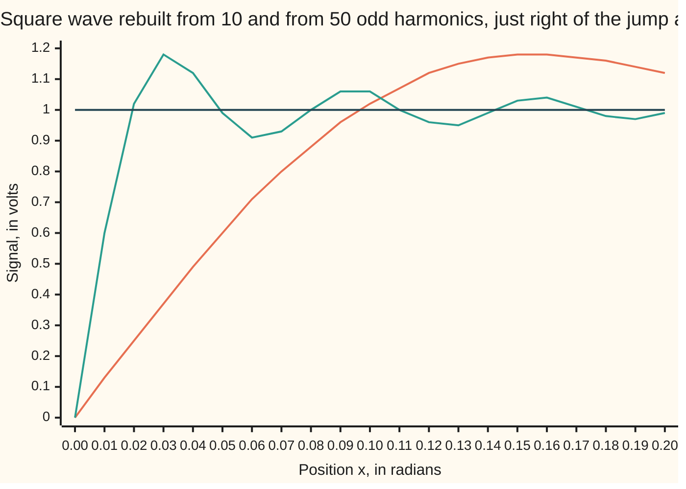

# Convergence: the series lands on the function where it is smooth, on the midpoint at a jump, and overshoots by 9% beside it

[Syllabus](../../../SYLLABUS.md) → [Differential equations and dynamics](../README.md) → [Fourier Series](../README.md#s09) → Convergence

---

## General Overview

A synthesiser's square wave sits at +1 volt for half a cycle, then flips to −1 volt. Measure position through the cycle as an angle x in radians, 2π per cycle: +1 for x between 0 and π, −1 between −π and 0, repeating.

The shelf's first card built it from pure tones ([Fourier series](01-fourier-series-and-orthogonality.md)): 4/π times sin x + sin 3x/3 + sin 5x/5 and so on, odd harmonics only. A real synthesiser plays finitely many. What does a finite stack do?

Mid-top, at x = π/2, it homes in on 1. At the flip, x = 0, every tone is zero, so it gives 0: halfway between −1 and +1. Just beside the flip it rises past the top: with 50 tones, to 1.179013 volts. More tones do not pull that peak back to 1; it settles near 1.179 and squeezes closer to the flip. That overshoot is the **Gibbs phenomenon**.

**A Fourier series of a piecewise-smooth function settles on the function where it is smooth and on the midpoint at a jump; beside a jump it overshoots by about 9% of the jump, however many terms are kept.**

**What kind of fact this is:** a theorem, Dirichlet's, with Gibbs's overshoot limit beside it; Why it works argues both for the square wave, and a folded Detailed proof covers any piecewise-smooth wave.

### The picture: two stacks of tones just after the flip



The slow line is 10 harmonics, peaking at 1.18 near x = 0.15. The fast line is 50 harmonics, reaching 1.18 at x = 0.03, then ringing around 1. The flat line is the wave. Five times the tones: nearly the same peak, five times closer to the jump.

---

## The formula

Notation first, in words. $S_N(x)$ is the stack of the first $N$ odd harmonics at position $x$, the **partial sum**. A sigma, Σ, means "add the terms as the counter $k$ runs over the range shown". $f(x^-)$ is the value the wave approaches from the left of $x$, $f(x^+)$ from the right.

For the square wave:

$$S_N(x) = \frac{4}{\pi}\sum_{k=1}^{N}\frac{\sin\big((2k-1)x\big)}{2k-1}$$

**Read it aloud:** add the first N odd tones, each sized one over its frequency, times 4 over pi.

Dirichlet's theorem, for any periodic function made of finitely many smooth pieces per cycle:

$$\lim_{N\to\infty} S_N(x) = \tfrac{1}{2}\big(f(x^-) + f(x^+)\big)$$

**Read it aloud:** with more tones, the stack at x settles on the average of the values just left and just right of x.

The overshoot beside a jump, for the square wave:

$$\max_{0<x<\pi} S_N(x) \;\to\; \frac{2}{\pi}\,\mathrm{Si}(\pi), \qquad \mathrm{Si}(\pi) = \int_0^{\pi}\frac{\sin u}{u}\,du$$

**Read it aloud:** the stack's peak tends to 2 over pi times the area under sin u over u from 0 to pi: 1.178980.

| Symbol | Plain meaning | In our example | Push it up and the answer… |
| --- | --- | --- | --- |
| $x$ | position through the cycle, in radians | 0 at the flip, π/2 mid-top | — |
| $f$ | the square wave, in volts | +1 top, −1 bottom | — |
| $N$ | how many odd harmonics are kept | 10, 50, 250 | smooth points settle closer; the peak moves in and stays near 1.179 |
| $S_N$ | the partial sum | 1.179013 at x = 0.03142, N = 50 | — |
| $k$, Σ | the counter and the sum; tone $k$ has frequency $2k-1$ | 1, 2, 3, … | — |
| $f(x^-)$, $f(x^+)$ | values approached from left and right | −1 and +1 at x = 0 | a bigger jump, a proportionally bigger overshoot |
| $t$, $u$ | stand-in positions inside an integral | — | — |
| $\mathrm{Si}$ | the sine integral: area under sin u/u from 0 | gives the limit 1.178980 | — |

### When it holds

- **Periodic, finitely many smooth pieces per cycle, jumps allowed.** Without smoothness, even some continuous functions have series that fail to settle.
- **Both one-sided values exist.** Without them there is no midpoint to land on.
- **The value at the jump is invisible.** Coefficients are areas, and one point has no area: define the wave as +1 at x = 0 and the series still gives 0.00.
- **Same accuracy everywhere only without jumps.** The triangle wave |x| has none; its worst error is 0.031805, 0.006366, 0.001273 for N = 10, 50, 250, about 1/(πN). With a jump the overshoot sits at 0.1798, 0.1790, 0.1790.

---

## Why it works

### Step 0: a partial sum is a weighted average of the wave near x

Each coefficient is an area under the wave times a tone. Adding N tones back gives an average of the wave, weighted by a bump that sharpens around x as N grows. Where the wave is flat near x, the average is that value. At a jump, half the weight falls each side: the midpoint.

### Step 1: the square wave's stack has a closed-form slope

The slope of $S_N$ is (4/π) times cos x + cos 3x + … + cos((2N−1)x). Multiply that sum by 2 sin x. Each product 2 sin x cos((2k−1)x) equals sin(2kx) − sin((2k−2)x), so the sum telescopes, each term cancelling part of the next, down to sin(2Nx). Hence

$$S_N'(x) = \frac{2}{\pi}\,\frac{\sin(2Nx)}{\sin x}, \qquad S_N(x) = \frac{2}{\pi}\int_0^{x}\frac{\sin(2Nt)}{\sin t}\,dt,$$

the second because $S_N$ starts from 0 at x = 0. This fraction is the weighting bump of Step 0, written out for this wave.

### Step 2: at the jump, every tone is zero

At x = 0 every sine is 0, so $S_N(0) = 0$ for every N: the midpoint of −1 and +1. Nothing else was possible. The wave is odd (flipping x flips the sign), so each partial sum is odd, and an odd function is 0 at 0.

### Step 3: at a smooth point, the stack tends to 1

Fix x between 0 and π. In Step 1's integral, sin(2Nt) swings faster as N grows, and away from t = 0 its positive and negative lobes nearly cancel against the slowly changing 1/sin t. Only the tall lobe near t = 0 survives, with area tending to π/2. So $S_N(x)$ tends to (2/π)(π/2) = 1. At x = π/2 the error is −0.031752, −0.006366, −0.001273 for N = 10, 50, 250: about 1/(πN), falling fivefold each time N grows fivefold.

### Step 4: the peak settles at 1.179 and moves in

Step 1's slope is first zero where sin(2Nx) returns to 0: x = π/(2N), the first peak, 0.03142 for N = 50. Substitute u = 2Nt:

$$S_N\!\left(\frac{\pi}{2N}\right) = \frac{2}{\pi}\int_0^{\pi}\frac{\sin u}{2N\sin\!\big(u/(2N)\big)}\,du.$$

As N grows, 2N sin(u/(2N)) tends to u, since sin of a small angle is nearly the angle. The limit, (2/π) Si(π) = 1.178980, has no N in it: only the peak's place depends on N. The excess 0.178980 is 8.95% of the jump.

### Step 5: a point of the series sums a number series

At x = π/2, sin((2k−1)π/2) runs +1, −1, +1, … and the wave is smoothly 1 there. Step 3 then says

$$1 = \frac{4}{\pi}\Big(1 - \tfrac13 + \tfrac15 - \tfrac17 + \cdots\Big), \qquad \text{so} \qquad \frac{\pi}{4} = 1 - \tfrac13 + \tfrac15 - \cdots,$$

Leibniz's formula for π, read off a square wave.

<details>
<summary>Detailed proof: Dirichlet's theorem for any piecewise-smooth wave</summary>

Let n count every harmonic. From the coefficient formulas, $S_n(x) = \frac{1}{2\pi}\int_{-\pi}^{\pi} f(x+t)\,D_n(t)\,dt$ with the Dirichlet kernel $D_n(t) = \frac{\sin((n+\frac12)t)}{\sin(t/2)} = 1 + 2\sum_{j=1}^{n}\cos(jt)$.

The cosine form gives $\frac{1}{2\pi}\int_0^{\pi} D_n = \frac12$, and the same over $(-\pi, 0)$. So $S_n(x) - \tfrac12\big(f(x^+) + f(x^-)\big) = \frac{1}{2\pi}\int_0^{\pi} g_+(t)\sin((n+\tfrac12)t)\,dt + \frac{1}{2\pi}\int_{-\pi}^{0} g_-(t)\sin((n+\tfrac12)t)\,dt$, where $g_+(t) = \frac{f(x+t) - f(x^+)}{\sin(t/2)}$ and $g_-$ uses $f(x^-)$.

A one-sided slope at x keeps $g_\pm$ bounded near t = 0, and they are piecewise smooth elsewhere.

Riemann–Lebesgue: integrating by parts on each piece, $\int g(t)\sin(mt)\,dt = \big[-g\cos(mt)/m\big] + \frac1m\int g'(t)\cos(mt)\,dt$, so for every ε > 0 (any small positive number) there is M with the integral below ε once m > M.

With m = n + ½ both integrals vanish in the limit: $S_n(x)$ tends to the midpoint, which is f(x) at a smooth point.

</details>

Another road removes the overshoot instead of measuring it: average the partial sums rather than taking the last. That is Fejér's method, in The Gibbs overshoot and the cure.

---

## Worked numbers, by hand

| Step | Arithmetic | Value |
| --- | --- | --- |
| one tone at x = π/2 | 4/π × 1 | 1.2732 |
| two tones | 4/π × (1 − 1/3) | 0.8488 |
| three tones | 4/π × (1 − 1/3 + 1/5) | 1.1035 |
| at the jump, any N | every sin(0) is 0 | **0** |
| where the first peak sits, N = 50 | π/(2 × 50) = π/100 | 0.03142 |
| the peak, N = 50 | the sum of 50 tones there | 1.179013 |
| the limit | (2/π) Si(π) | **1.178980** |
| the overshoot as a share of the jump | 0.178980 / 2 | **8.95%** |

A speaker fed 50 tones gets 0 volts at each flip and 1.179 volts just after, where the ideal wave gives 1.

### What breaks if you drop a piece

| Mistake | Comes out at | What went wrong |
| --- | --- | --- |
| Expecting f(0) = 1 at the jump | 0.00, off by 1 | Coefficients are areas; one point carries none |
| Reading 9% as of the height 1 | peak 1.09 | It is 8.95% of the jump, 2 volts: peak 1.179 |
| Adding tones to remove the overshoot | 0.1798, 0.1790, 0.1790 for N = 10, 50, 250 | A jump's peak only narrows; the jump-free triangle's error falls to 0.001273 |
| Stopping Leibniz at 50 terms | 4 × sum = 3.121595 | The tail is about half the next term; averaging 50 and 51 terms gives 3.141397 |

The code prints all four.

---

## Code, from first principles, and it actually runs

Only sin and π are imported. Two roads reach each peak: adding the tones, and integrating Step 1's slope with the script's own Simpson's rule. Two reach the limit: Simpson on sin u/u, and the sine integral's power series. Leibniz's sum is checked against the area under 4/(1 + t^2) from 0 to 1. The triangle wave |x| is the jump-free case.

### Python

```python
# Convergence, jumps and Gibbs -- the check behind the card.  Nothing is imported
# but math's sin and pi.  Square wave: -1 on (-pi, 0), +1 on (0, pi), period 2 pi.
# S(N, x) = (4/pi)(sin x + sin 3x/3 + ... + sin((2N-1)x)/(2N-1)), N odd harmonics.
from math import sin, pi

def S(N, x):                                  # road one: add the terms
    return 4 / pi * sum(sin((2 * k - 1) * x) / (2 * k - 1) for k in range(1, N + 1))

def simpson(g, a, b, n=4000):                 # our own integrator, n even
    h = (b - a) / n
    return h / 3 * sum(g(a + i * h) * (1 if i in (0, n) else 4 if i % 2 else 2) for i in range(n + 1))

def S_kernel(N, x):                           # road two: S' = (2/pi) sin(2Nt)/sin t, from S(0) = 0
    return 2 / pi * simpson(lambda t: 2 * N if t == 0 else sin(2 * N * t) / sin(t), 0, x)

def tri_err(N):                               # |x| minus its N-harmonic series, at x = 0 (its worst point)
    return abs(pi / 2 - 4 / pi * sum(1 / (2 * k - 1) ** 2 for k in range(1, N + 1)))

Ns = (10, 50, 250)
print("square wave: -1 on (-pi, 0), +1 on (0, pi); N = number of odd harmonics")
print("at the jump x = 0: " + ", ".join(f"S_{N} = {S(N, 0):.6f}" for N in Ns) + "; midpoint of -1 and 1 = 0")
print("at x = pi/2 by hand: " + ", ".join(f"S_{N} = {S(N, pi / 2):.4f}" for N in (1, 2, 3)))
print("at x = pi/2, error S_N - 1: " + ", ".join(f"N = {N}: {S(N, pi / 2) - 1:+.6f}" for N in Ns))
part = [sum((-1) ** (k - 1) / (2 * k - 1) for k in range(1, n + 1)) for n in (50, 51)]
pi_int = simpson(lambda t: 4 / (1 + t * t), 0, 1)
print(f"Leibniz: 4 x (1 - 1/3 + ... 50 terms) = {4 * part[0]:.6f}; 4 x mean of 50 and 51 terms = "
      f"{2 * (part[0] + part[1]):.6f}; pi as area under 4/(1+t^2) = {pi_int:.6f}")
peaks = {}
for N in Ns:
    x = pi / (2 * N)                          # first place S' is zero: sin(2Nx) = 0
    peaks[N] = (S(N, x), S_kernel(N, x))
    print(f"peak N = {N}: at x = pi/{2 * N} = {x:.5f}; by the terms {peaks[N][0]:.6f}; by the kernel {peaks[N][1]:.6f}")
si_int = simpson(lambda u: 1 if u == 0 else sin(u) / u, 0, pi)
si_ser, term = 0.0, pi                        # Si(pi) = sum (-1)^n pi^(2n+1) / ((2n+1)(2n+1)!)
for n in range(30):
    si_ser += term / (2 * n + 1)
    term *= -pi * pi / ((2 * n + 2) * (2 * n + 3))
lim = 2 / pi * si_ser
print(f"limit (2/pi) Si(pi): by Simpson {2 / pi * si_int:.6f}; by power series {lim:.6f}")
print(f"overshoot {lim - 1:.6f} above 1 = {100 * (lim - 1) / 2:.2f}% of the jump 2; read as % of the height 1: peak {1 + (lim - 1) / 2:.2f}, wrong")
print("square-wave overshoot, N = 10, 50, 250: " + ", ".join(f"{peaks[N][0] - 1:.4f}" for N in Ns))
print("triangle |x| worst error, N = 10, 50, 250: " + ", ".join(f"{tri_err(N):.6f}" for N in Ns)
      + "; times pi N: " + ", ".join(f"{tri_err(N) * pi * N:.4f}" for N in Ns))
xs = [i / 100 for i in range(21)]
print("figure, x: " + ", ".join(f"{x:.2f}" for x in xs))
print("figure, S_10: " + ", ".join(f"{S(10, x):.2f}" for x in xs))
print("figure, S_50: " + ", ".join(f"{S(50, x):.2f}" for x in xs))
print(f"mistake, value at the jump taken as f(0) = 1: series gives {S(50, 0):.2f}, off by 1")
assert all(abs(a - b) < 1e-9 for a, b in peaks.values())             # two roads to each peak
assert abs(si_int - si_ser) < 1e-9 and abs(peaks[250][0] - lim) < 1e-4  # peak -> (2/pi) Si(pi)
assert abs(2 * (part[0] + part[1]) - pi_int) < 5e-4 < abs(4 * part[0] - pi_int)  # Leibniz, and averaging helps
assert abs(tri_err(250) * pi * 250 - 1) < 0.01                     # no jump: error dies like 1/(pi N)
assert min(t for t, _ in peaks.values()) - 1 > 0.178               # a jump: the overshoot stays
print("ALL CHECKS PASS")
```

**Ran 2026-09-28 on macOS, Python 3.14.6, standard library only. All checks passed. Output, pasted from the run:**

```
square wave: -1 on (-pi, 0), +1 on (0, pi); N = number of odd harmonics
at the jump x = 0: S_10 = 0.000000, S_50 = 0.000000, S_250 = 0.000000; midpoint of -1 and 1 = 0
at x = pi/2 by hand: S_1 = 1.2732, S_2 = 0.8488, S_3 = 1.1035
at x = pi/2, error S_N - 1: N = 10: -0.031752, N = 50: -0.006366, N = 250: -0.001273
Leibniz: 4 x (1 - 1/3 + ... 50 terms) = 3.121595; 4 x mean of 50 and 51 terms = 3.141397; pi as area under 4/(1+t^2) = 3.141593
peak N = 10: at x = pi/20 = 0.15708; by the terms 1.179814; by the kernel 1.179814
peak N = 50: at x = pi/100 = 0.03142; by the terms 1.179013; by the kernel 1.179013
peak N = 250: at x = pi/500 = 0.00628; by the terms 1.178981; by the kernel 1.178981
limit (2/pi) Si(pi): by Simpson 1.178980; by power series 1.178980
overshoot 0.178980 above 1 = 8.95% of the jump 2; read as % of the height 1: peak 1.09, wrong
square-wave overshoot, N = 10, 50, 250: 0.1798, 0.1790, 0.1790
triangle |x| worst error, N = 10, 50, 250: 0.031805, 0.006366, 0.001273; times pi N: 0.9992, 1.0000, 1.0000
figure, x: 0.00, 0.01, 0.02, 0.03, 0.04, 0.05, 0.06, 0.07, 0.08, 0.09, 0.10, 0.11, 0.12, 0.13, 0.14, 0.15, 0.16, 0.17, 0.18, 0.19, 0.20
figure, S_10: 0.00, 0.13, 0.25, 0.37, 0.49, 0.60, 0.71, 0.80, 0.88, 0.96, 1.02, 1.07, 1.12, 1.15, 1.17, 1.18, 1.18, 1.17, 1.16, 1.14, 1.12
figure, S_50: 0.00, 0.60, 1.02, 1.18, 1.12, 0.99, 0.91, 0.93, 1.00, 1.06, 1.06, 1.00, 0.96, 0.95, 0.99, 1.03, 1.04, 1.01, 0.98, 0.97, 0.99
mistake, value at the jump taken as f(0) = 1: series gives 0.00, off by 1
ALL CHECKS PASS
```

### Rust

Same numbers, same labels, built with `rustc --edition 2021 -O`.

```rust
// Convergence, jumps and Gibbs -- the same check as the Python, in Rust.  No crates.
// Square wave: -1 on (-pi, 0), +1 on (0, pi), period 2 pi.
// S(N, x) = (4/pi)(sin x + sin 3x/3 + ... + sin((2N-1)x)/(2N-1)), N odd harmonics.
use std::f64::consts::PI;

fn s(n: usize, x: f64) -> f64 {                   // road one: add the terms
    4.0 / PI * (1..=n).map(|k| ((2 * k - 1) as f64 * x).sin() / (2 * k - 1) as f64).sum::<f64>()
}

fn simpson(g: &dyn Fn(f64) -> f64, a: f64, b: f64) -> f64 {   // our own integrator
    let n = 4000;
    let h = (b - a) / n as f64;
    let w = |i: usize| if i == 0 || i == n { 1.0 } else if i % 2 == 1 { 4.0 } else { 2.0 };
    h / 3.0 * (0..=n).map(|i| g(a + i as f64 * h) * w(i)).sum::<f64>()
}

fn s_kernel(n: usize, x: f64) -> f64 {            // road two: S' = (2/pi) sin(2Nt)/sin t, from S(0) = 0
    let m = 2.0 * n as f64;
    2.0 / PI * simpson(&|t: f64| if t == 0.0 { m } else { (m * t).sin() / t.sin() }, 0.0, x)
}

fn tri_err(n: usize) -> f64 {                     // |x| minus its N-harmonic series, at x = 0
    (PI / 2.0 - 4.0 / PI * (1..=n).map(|k| 1.0 / ((2 * k - 1) as f64).powi(2)).sum::<f64>()).abs()
}

fn join(v: Vec<String>) -> String { v.join(", ") }

fn main() {
    let ns = [10usize, 50, 250];
    println!("square wave: -1 on (-pi, 0), +1 on (0, pi); N = number of odd harmonics");
    println!("at the jump x = 0: {}; midpoint of -1 and 1 = 0", join(ns.iter().map(|&n| format!("S_{} = {:.6}", n, s(n, 0.0))).collect()));
    println!("at x = pi/2 by hand: {}", join([1usize, 2, 3].iter().map(|&n| format!("S_{} = {:.4}", n, s(n, PI / 2.0))).collect()));
    println!("at x = pi/2, error S_N - 1: {}", join(ns.iter().map(|&n| format!("N = {}: {:+.6}", n, s(n, PI / 2.0) - 1.0)).collect()));
    let part: Vec<f64> = [50usize, 51].iter()
        .map(|&m| (1..=m).map(|k| if k % 2 == 1 { 1.0 } else { -1.0 } / (2 * k - 1) as f64).sum()).collect();
    let pi_int = simpson(&|t: f64| 4.0 / (1.0 + t * t), 0.0, 1.0);
    println!("Leibniz: 4 x (1 - 1/3 + ... 50 terms) = {:.6}; 4 x mean of 50 and 51 terms = {:.6}; pi as area under 4/(1+t^2) = {:.6}",
             4.0 * part[0], 2.0 * (part[0] + part[1]), pi_int);
    let mut peaks = Vec::new();
    for &n in &ns {
        let x = PI / (2 * n) as f64;              // first place S' is zero: sin(2Nx) = 0
        let (a, b) = (s(n, x), s_kernel(n, x));
        println!("peak N = {}: at x = pi/{} = {:.5}; by the terms {:.6}; by the kernel {:.6}", n, 2 * n, x, a, b);
        peaks.push((a, b));
    }
    let si_int = simpson(&|u: f64| if u == 0.0 { 1.0 } else { u.sin() / u }, 0.0, PI);
    let (mut si_ser, mut term) = (0.0, PI);       // Si(pi) = sum (-1)^n pi^(2n+1) / ((2n+1)(2n+1)!)
    for n in 0..30 {
        si_ser += term / (2 * n + 1) as f64;
        term *= -PI * PI / ((2 * n + 2) * (2 * n + 3)) as f64;
    }
    let lim = 2.0 / PI * si_ser;
    println!("limit (2/pi) Si(pi): by Simpson {:.6}; by power series {:.6}", 2.0 / PI * si_int, lim);
    println!("overshoot {:.6} above 1 = {:.2}% of the jump 2; read as % of the height 1: peak {:.2}, wrong",
             lim - 1.0, 100.0 * (lim - 1.0) / 2.0, 1.0 + (lim - 1.0) / 2.0);
    println!("square-wave overshoot, N = 10, 50, 250: {}", join(peaks.iter().map(|p| format!("{:.4}", p.0 - 1.0)).collect()));
    println!("triangle |x| worst error, N = 10, 50, 250: {}; times pi N: {}",
             join(ns.iter().map(|&n| format!("{:.6}", tri_err(n))).collect()),
             join(ns.iter().map(|&n| format!("{:.4}", tri_err(n) * PI * n as f64)).collect()));
    let xs: Vec<f64> = (0..21).map(|i| i as f64 / 100.0).collect();
    println!("figure, x: {}", join(xs.iter().map(|x| format!("{:.2}", x)).collect()));
    println!("figure, S_10: {}", join(xs.iter().map(|&x| format!("{:.2}", s(10, x))).collect()));
    println!("figure, S_50: {}", join(xs.iter().map(|&x| format!("{:.2}", s(50, x))).collect()));
    println!("mistake, value at the jump taken as f(0) = 1: series gives {:.2}, off by 1", s(50, 0.0));
    assert!(peaks.iter().all(|p| (p.0 - p.1).abs() < 1e-9));                  // two roads to each peak
    assert!((si_int - si_ser).abs() < 1e-9 && (peaks[2].0 - lim).abs() < 1e-4); // peak -> (2/pi) Si(pi)
    let avg_err = (2.0 * (part[0] + part[1]) - pi_int).abs();
    assert!(avg_err < 5e-4 && 5e-4 < (4.0 * part[0] - pi_int).abs());         // Leibniz, and averaging helps
    assert!((tri_err(250) * PI * 250.0 - 1.0).abs() < 0.01);                  // no jump: error dies like 1/(pi N)
    assert!(peaks.iter().map(|p| p.0).fold(f64::MAX, f64::min) - 1.0 > 0.178); // a jump: the overshoot stays
    println!("ALL CHECKS PASS");
}
```

**Ran 2026-09-28 on macOS, rustc 1.98.1, no crates. All checks passed. Output, pasted from the run:**

```
square wave: -1 on (-pi, 0), +1 on (0, pi); N = number of odd harmonics
at the jump x = 0: S_10 = 0.000000, S_50 = 0.000000, S_250 = 0.000000; midpoint of -1 and 1 = 0
at x = pi/2 by hand: S_1 = 1.2732, S_2 = 0.8488, S_3 = 1.1035
at x = pi/2, error S_N - 1: N = 10: -0.031752, N = 50: -0.006366, N = 250: -0.001273
Leibniz: 4 x (1 - 1/3 + ... 50 terms) = 3.121595; 4 x mean of 50 and 51 terms = 3.141397; pi as area under 4/(1+t^2) = 3.141593
peak N = 10: at x = pi/20 = 0.15708; by the terms 1.179814; by the kernel 1.179814
peak N = 50: at x = pi/100 = 0.03142; by the terms 1.179013; by the kernel 1.179013
peak N = 250: at x = pi/500 = 0.00628; by the terms 1.178981; by the kernel 1.178981
limit (2/pi) Si(pi): by Simpson 1.178980; by power series 1.178980
overshoot 0.178980 above 1 = 8.95% of the jump 2; read as % of the height 1: peak 1.09, wrong
square-wave overshoot, N = 10, 50, 250: 0.1798, 0.1790, 0.1790
triangle |x| worst error, N = 10, 50, 250: 0.031805, 0.006366, 0.001273; times pi N: 0.9992, 1.0000, 1.0000
figure, x: 0.00, 0.01, 0.02, 0.03, 0.04, 0.05, 0.06, 0.07, 0.08, 0.09, 0.10, 0.11, 0.12, 0.13, 0.14, 0.15, 0.16, 0.17, 0.18, 0.19, 0.20
figure, S_10: 0.00, 0.13, 0.25, 0.37, 0.49, 0.60, 0.71, 0.80, 0.88, 0.96, 1.02, 1.07, 1.12, 1.15, 1.17, 1.18, 1.18, 1.17, 1.16, 1.14, 1.12
figure, S_50: 0.00, 0.60, 1.02, 1.18, 1.12, 0.99, 0.91, 0.93, 1.00, 1.06, 1.06, 1.00, 0.96, 0.95, 0.99, 1.03, 1.04, 1.01, 0.98, 0.97, 0.99
mistake, value at the jump taken as f(0) = 1: series gives 0.00, off by 1
ALL CHECKS PASS
```

The two outputs match line for line.

### Lean

Lean proves Dirichlet's theorem for every piecewise-smooth wave, Gibbs's peak limit for the square wave, and Leibniz's formula.

- Take a wave repeating every 2π, with finitely many smooth pieces per cycle, approaching L left of x and R right of x. Then its partial sums at x, counting every harmonic, tend to the midpoint (L + R)/2.
- Where the wave is smooth, L and R both equal its value there. The wave's own value at a jump plays no part.
- Take the square wave's stack $S_N$ of N odd harmonics. Then its highest value between 0 and π tends to (2/π) Si(π) as N grows.
- Take the first peak, x = π/(2N). Then $S_N$ there tends to the same limit, (2/π) Si(π).
- Take the alternating sum 1 − 1/3 + 1/5 − 1/7 + …, stopped after any number of terms. Then it tends to π/4 as terms are added.
- Take one, two and three tones at x = π/2. Then the stack is exactly 4/π, 4/π × 2/3 and 4/π × 13/15.
- Take 50 tones. Then the stack at the jump is exactly 0, and the first peak sits at π/100.

The decimals, the 8.95% share, the triangle wave, the figure and the mistake table are left to the Python and Rust checks.

```lean
-- Convergence: for every 2π-periodic wave made of finitely many smooth pieces per cycle, the Fourier partial sums at each point tend to the midpoint of the left and right values; the square wave's peak beside its jump tends to (2/π) Si(π) however many tones are kept; and the square wave at π/2 gives Leibniz's π/4 = 1 − 1/3 + 1/5 − ⋯.
import Mathlib.Analysis.SpecialFunctions.Trigonometric.Basic
import Mathlib.Analysis.Calculus.ContDiff.Defs
import Mathlib.MeasureTheory.Integral.IntervalIntegral.Basic
import Mathlib.Tactic.NormNum
import Mathlib

open Real Filter Topology Finset

/-- The Fourier partial sum with every harmonic up to n:
`a_0/2 + ∑_{k=1}^{n} (a_k cos(kx) + b_k sin(kx))`, with the coefficients
`a_k = (1/π) ∫_{−π}^{π} f(t) cos(kt) dt` and `b_k = (1/π) ∫_{−π}^{π} f(t) sin(kt) dt`. -/
noncomputable def fourierPartialSum (f : ℝ → ℝ) (n : ℕ) (x : ℝ) : ℝ :=
  (1 / π) * (∫ t in (-π)..π, f t) / 2 +
    ∑ k ∈ Icc 1 n,
      ((1 / π) * (∫ t in (-π)..π, f t * cos (k * t)) * cos (k * x) +
        (1 / π) * (∫ t in (-π)..π, f t * sin (k * t)) * sin (k * x))

/-- The card's square-wave stack of the first N odd harmonics:
`S_N(x) = (4/π) ∑_{k=1}^{N} sin((2k−1)x)/(2k−1)`. -/
noncomputable def squareWavePartialSum (N : ℕ) (x : ℝ) : ℝ :=
  4 / π * ∑ k ∈ Icc 1 N, sin ((2 * k - 1) * x) / (2 * k - 1)

noncomputable def dk (n : ℕ) (u : ℝ) : ℝ := 1 / 2 + ∑ k ∈ Icc 1 n, cos (k * u)

lemma dk_continuous (n : ℕ) : Continuous (dk n) := by
  unfold dk; fun_prop

lemma dk_periodic (n : ℕ) : Function.Periodic (dk n) (2 * π) := by
  intro u
  simp only [dk]
  congr 1
  apply sum_congr rfl
  intro k _
  rw [mul_add, cos_add_nat_mul_two_pi]

lemma dk_neg (n : ℕ) (u : ℝ) : dk n (-u) = dk n u := by
  simp [dk, mul_neg, cos_neg]

lemma dk_mul_sin (n : ℕ) (u : ℝ) : dk n u * (2 * sin (u / 2)) = sin ((n + 1 / 2) * u) := by
  induction n with
  | zero => simp [dk]; ring_nf
  | succ n ih =>
    rw [dk, Finset.sum_Icc_succ_top (by omega), ← add_assoc]
    rw [dk] at ih
    rw [add_mul, ih]
    push_cast
    have e1 : ((n:ℝ) + 1 + 1 / 2) * u = (n + 1) * u + u / 2 := by ring
    have e2 : ((n:ℝ) + 1 / 2) * u = (n + 1) * u - u / 2 := by ring
    rw [e1, e2, sin_add, sin_sub]
    ring

lemma dk_integral (n : ℕ) : ∫ u in (0:ℝ)..π, dk n u = π / 2 := by
  unfold dk
  rw [intervalIntegral.integral_add intervalIntegrable_const
      ((by fun_prop : Continuous fun u : ℝ => ∑ k ∈ Icc 1 n, cos (k * u)).intervalIntegrable _ _),
    intervalIntegral.integral_finsetSum (fun k _ => by
      exact (by fun_prop : Continuous fun u : ℝ => cos (k * u)).intervalIntegrable _ _)]
  have h : ∀ k ∈ Icc 1 n, ∫ u in (0:ℝ)..π, cos (k * u) = 0 := by
    intro k hk
    have hk0 : (k:ℝ) ≠ 0 := by
      have := (mem_Icc.mp hk).1
      exact_mod_cast (by omega : k ≠ 0)
    rw [intervalIntegral.integral_comp_mul_left (fun u => cos u) hk0, integral_cos]
    simp [sin_nat_mul_pi]
  rw [sum_congr rfl h]
  simp
  ring

/-- Riemann–Lebesgue for a sine on `[0, π]`. -/
lemma rl_sin (φ : ℝ → ℝ) (hφ : MeasureTheory.IntegrableOn φ (Set.Ioc 0 π)) :
    Tendsto (fun lam : ℝ => ∫ u in (0:ℝ)..π, φ u * sin (lam * u)) atTop (𝓝 0) := by
  set G : ℝ → ℂ := Set.indicator (Set.Ioc 0 π) (fun u => (φ u : ℂ)) with hGdef
  have hG : MeasureTheory.Integrable G :=
    (MeasureTheory.integrable_indicator_iff measurableSet_Ioc).mpr hφ.ofReal
  have h := Real.tendsto_integral_exp_smul_cocompact G
  have h2 : Tendsto (fun lam : ℝ => lam / (2 * π)) atTop (cocompact ℝ) :=
    (tendsto_id.atTop_div_const (by positivity)).mono_right atTop_le_cocompact
  have h3 := (Complex.continuous_im.tendsto 0).comp (h.comp h2)
  simp only [Complex.zero_im] at h3
  have key : ∀ lam : ℝ, ∫ u in (0:ℝ)..π, φ u * sin (lam * u) =
      -(Complex.im (∫ v : ℝ, Real.fourierChar (-(v * (lam / (2 * π)))) • G v)) := by
    intro lam
    have hint : MeasureTheory.Integrable (fun v : ℝ => Real.fourierChar (-(v * (lam / (2 * π)))) • G v) := by
      have := (Real.fourierIntegral_convergent_iff (μ := MeasureTheory.volume) (f := G)
        (lam / (2 * π))).mpr hG
      simpa [mul_comm] using this
    have him := integral_im hint
    simp only [RCLike.im_to_complex] at him
    rw [← him, intervalIntegral.integral_of_le pi_pos.le,
      ← MeasureTheory.integral_neg, ← MeasureTheory.integral_indicator measurableSet_Ioc]
    congr 1
    ext v
    by_cases hv : v ∈ Set.Ioc 0 π
    · simp only [Set.indicator_of_mem hv, hGdef, Circle.smul_def, Real.fourierChar_apply]
      rw [show ((2 * π * -(v * (lam / (2 * π))) : ℝ) : ℂ) = ((-(lam * v) : ℝ) : ℂ) by
        congr 1; field_simp]
      rw [smul_eq_mul, Complex.mul_im, Complex.exp_ofReal_mul_I_im, Complex.exp_ofReal_mul_I_re]
      simp [sin_neg, mul_comm]
    · simp [Set.indicator_of_notMem hv, hGdef]
  simp_rw [key]
  have := h3.neg
  simpa [Function.comp_def] using this

lemma exists_piece_Ico {m : ℕ} (a : Fin (m + 1) → ℝ) {z : ℝ} (h0 : a 0 ≤ z)
    (h1 : z < a (Fin.last m)) : ∃ i : Fin m, a i.castSucc ≤ z ∧ z < a i.succ := by
  by_contra hcon
  simp only [not_exists, not_and, not_lt] at hcon
  have key : ∀ j (hj : j ≤ m), a ⟨j, by omega⟩ ≤ z := by
    intro j
    induction j with
    | zero => intro _; simpa using h0
    | succ j ih =>
      intro hj
      exact hcon ⟨j, by omega⟩ (ih (by omega))
  exact absurd (key m le_rfl) (not_le.mpr h1)

lemma exists_piece_Ioc {m : ℕ} (a : Fin (m + 1) → ℝ) {z : ℝ} (h0 : a 0 < z)
    (h1 : z ≤ a (Fin.last m)) : ∃ i : Fin m, a i.castSucc < z ∧ z ≤ a i.succ := by
  by_contra hcon
  simp only [not_exists, not_and, not_le] at hcon
  have key : ∀ j (hj : j ≤ m), a ⟨j, by omega⟩ < z := by
    intro j
    induction j with
    | zero => intro _; simpa using h0
    | succ j ih =>
      intro hj
      exact hcon ⟨j, by omega⟩ (ih (by omega))
  exact absurd (key m le_rfl) (not_lt.mpr h1)

lemma right_piece (f : ℝ → ℝ) (hper : Function.Periodic f (2 * π)) {m : ℕ}
    {a : Fin (m + 1) → ℝ} (hlast : a (Fin.last m) = a 0 + 2 * π)
    (hg : ∀ i : Fin m, ∃ g : ℝ → ℝ, ContDiff ℝ 1 g ∧ Set.EqOn f g (Set.Ioo (a i.castSucc) (a i.succ)))
    (y : ℝ) : ∃ δ > 0, ∃ g : ℝ → ℝ, ContDiff ℝ 1 g ∧ Set.EqOn f g (Set.Ioo y (y + δ)) := by
  have hp : (0:ℝ) < 2 * π := by positivity
  have hz := toIcoMod_mem_Ico hp (a 0) y
  have hyz := self_sub_toIcoDiv_zsmul hp (a 0) y
  set k := toIcoDiv hp (a 0) y
  set z := toIcoMod hp (a 0) y
  obtain ⟨i, hi1, hi2⟩ := exists_piece_Ico a hz.1 (by rw [hlast]; exact hz.2)
  obtain ⟨g, hgc, hgeq⟩ := hg i
  refine ⟨a i.succ - z, by linarith, fun t => g (t - k • (2 * π)), ?_, ?_⟩
  · exact hgc.comp (contDiff_id.sub contDiff_const)
  · intro t ht
    have hmem : t - k • (2 * π) ∈ Set.Ioo (a i.castSucc) (a i.succ) := by
      constructor <;> linarith [ht.1, ht.2]
    show f t = g (t - k • (2 * π))
    rw [← hgeq hmem, hper.sub_zsmul_eq]

lemma left_piece (f : ℝ → ℝ) (hper : Function.Periodic f (2 * π)) {m : ℕ}
    {a : Fin (m + 1) → ℝ} (hlast : a (Fin.last m) = a 0 + 2 * π)
    (hg : ∀ i : Fin m, ∃ g : ℝ → ℝ, ContDiff ℝ 1 g ∧ Set.EqOn f g (Set.Ioo (a i.castSucc) (a i.succ)))
    (y : ℝ) : ∃ δ > 0, ∃ g : ℝ → ℝ, ContDiff ℝ 1 g ∧ Set.EqOn f g (Set.Ioo (y - δ) y) := by
  have hp : (0:ℝ) < 2 * π := by positivity
  have hz := toIocMod_mem_Ioc hp (a 0) y
  have hyz := self_sub_toIocDiv_zsmul hp (a 0) y
  set k := toIocDiv hp (a 0) y
  set z := toIocMod hp (a 0) y
  obtain ⟨i, hi1, hi2⟩ := exists_piece_Ioc a hz.1 (by rw [hlast]; exact hz.2)
  obtain ⟨g, hgc, hgeq⟩ := hg i
  refine ⟨z - a i.castSucc, by linarith, fun t => g (t - k • (2 * π)), ?_, ?_⟩
  · exact hgc.comp (contDiff_id.sub contDiff_const)
  · intro t ht
    have hmem : t - k • (2 * π) ∈ Set.Ioo (a i.castSucc) (a i.succ) := by
      constructor <;> linarith [ht.1, ht.2]
    show f t = g (t - k • (2 * π))
    rw [← hgeq hmem, hper.sub_zsmul_eq]

lemma piecewise_intervalIntegrable (f : ℝ → ℝ) (hper : Function.Periodic f (2 * π)) {m : ℕ}
    {a : Fin (m + 1) → ℝ} (ha : StrictMono a) (hlast : a (Fin.last m) = a 0 + 2 * π)
    (hg : ∀ i : Fin m, ∃ g : ℝ → ℝ, ContDiff ℝ 1 g ∧ Set.EqOn f g (Set.Ioo (a i.castSucc) (a i.succ)))
    (b c : ℝ) : IntervalIntegrable f MeasureTheory.volume b c := by
  have hstep : ∀ i : Fin m, IntervalIntegrable f MeasureTheory.volume (a i.castSucc) (a i.succ) := by
    intro i
    obtain ⟨g, hgc, hgeq⟩ := hg i
    have hle : a i.castSucc ≤ a i.succ := ha.monotone (Fin.castSucc_lt_succ (i := i)).le
    rw [intervalIntegrable_iff_integrableOn_Ioo_of_le hle]
    exact ((hgc.continuous.integrableOn_Icc).mono_set Set.Ioo_subset_Icc_self).congr_fun
      hgeq.symm measurableSet_Ioo
  have hchain : ∀ j (hj : j ≤ m),
      IntervalIntegrable f MeasureTheory.volume (a 0) (a ⟨j, by omega⟩) := by
    intro j
    induction j with
    | zero => intro _; simp
    | succ j ih =>
      intro hj
      exact (ih (by omega)).trans (hstep ⟨j, by omega⟩)
  have hper_int : IntervalIntegrable f MeasureTheory.volume (a 0) (a 0 + 2 * π) := by
    rw [← hlast]; exact hchain m le_rfl
  exact hper.intervalIntegrable (by positivity) hper_int b c

lemma fourierPartialSum_eq_kernel (f : ℝ → ℝ) (hper : Function.Periodic f (2 * π))
    (hfi : ∀ b c, IntervalIntegrable f MeasureTheory.volume b c) (n : ℕ) (x : ℝ) :
    fourierPartialSum f n x = (1 / π) * ∫ u in (0:ℝ)..π, (f (x + u) + f (x - u)) * dk n u := by
  have hc : ∀ k : ℕ, IntervalIntegrable (fun t => f t * cos (k * t)) MeasureTheory.volume (-π) π :=
    fun k => (hfi _ _).mul_continuousOn (by fun_prop : Continuous fun t : ℝ => cos (k * t)).continuousOn
  have hs : ∀ k : ℕ, IntervalIntegrable (fun t => f t * sin (k * t)) MeasureTheory.volume (-π) π :=
    fun k => (hfi _ _).mul_continuousOn (by fun_prop : Continuous fun t : ℝ => sin (k * t)).continuousOn
  have hterm : ∀ k : ℕ, IntervalIntegrable
      (fun t => f t * cos (k * t) * cos (k * x) + f t * sin (k * t) * sin (k * x))
      MeasureTheory.volume (-π) π := fun k => ((hc k).mul_const _).add ((hs k).mul_const _)
  have step1 : fourierPartialSum f n x = (1 / π) * ∫ t in (-π)..π, f t * dk n (t - x) := by
    have h1 : (fun t => f t * dk n (t - x)) = fun t => f t * (1 / 2) + ∑ k ∈ Icc 1 n,
        (f t * cos (k * t) * cos (k * x) + f t * sin (k * t) * sin (k * x)) := by
      ext t
      simp only [dk, mul_add, Finset.mul_sum]
      congr 1
      apply sum_congr rfl
      intro k _
      rw [mul_sub, cos_sub]
      ring
    have hsum : IntervalIntegrable (fun t => ∑ k ∈ Icc 1 n,
        (f t * cos (k * t) * cos (k * x) + f t * sin (k * t) * sin (k * x)))
        MeasureTheory.volume (-π) π := by
      have := IntervalIntegrable.sum (Icc 1 n) (fun k _ => hterm k)
      convert this using 1
      ext t
      simp [Finset.sum_apply]
    rw [h1, intervalIntegral.integral_add ((hfi _ _).mul_const _) hsum,
      intervalIntegral.integral_finsetSum (fun k _ => hterm k)]
    rw [sum_congr rfl (fun k _ => intervalIntegral.integral_add ((hc k).mul_const _)
      ((hs k).mul_const _))]
    simp only [intervalIntegral.integral_mul_const, fourierPartialSum]
    rw [mul_add, Finset.mul_sum]
    congr 1
    · ring
    · apply sum_congr rfl
      intro k _
      ring
  have hh : Function.Periodic (fun u => f (x + u) * dk n u) (2 * π) := by
    intro u
    simp only
    rw [← add_assoc, hper, dk_periodic]
  have step2 : ∫ t in (-π)..π, f t * dk n (t - x) = ∫ u in (-π)..π, f (x + u) * dk n u := by
    have e1 := intervalIntegral.integral_comp_sub_right (a := -π) (b := π)
      (fun u => f (x + u) * dk n u) x
    simp only [show ∀ t, x + (t - x) = t from fun t => by ring] at e1
    rw [e1]
    have := hh.intervalIntegral_add_eq (-π - x) (-π)
    rw [show -π - x + 2 * π = π - x by ring, show -π + 2 * π = π by ring] at this
    exact this
  have hp1 : ∀ b c, IntervalIntegrable (fun u => f (x + u)) MeasureTheory.volume b c := by
    intro b c
    simpa using (hfi (x + b) (x + c)).comp_add_left x
  have hp2 : ∀ b c, IntervalIntegrable (fun u => f (x - u)) MeasureTheory.volume b c := by
    intro b c
    simpa using (hfi (x - b) (x - c)).comp_sub_left x
  have hint : ∀ b c, IntervalIntegrable (fun u => f (x + u) * dk n u) MeasureTheory.volume b c :=
    fun b c => (hp1 b c).mul_continuousOn (dk_continuous n).continuousOn
  have hint2 : ∀ b c, IntervalIntegrable (fun u => f (x - u) * dk n u) MeasureTheory.volume b c :=
    fun b c => (hp2 b c).mul_continuousOn (dk_continuous n).continuousOn
  have step3 : ∫ u in (-π)..π, f (x + u) * dk n u =
      ∫ u in (0:ℝ)..π, (f (x + u) + f (x - u)) * dk n u := by
    rw [← intervalIntegral.integral_add_adjacent_intervals (hint (-π) 0) (hint 0 π)]
    have e := intervalIntegral.integral_comp_neg (a := 0) (b := π) (fun u => f (x + u) * dk n u)
    simp only [neg_zero, dk_neg, ← sub_eq_add_neg] at e
    rw [← e, ← intervalIntegral.integral_add (hint2 0 π) (hint 0 π)]
    congr 1
    ext u
    ring
  rw [step1, step2, step3]

noncomputable def oddCosSum (N : ℕ) (x : ℝ) : ℝ := ∑ k ∈ Icc 1 N, cos ((2 * k - 1) * x)

lemma oddCosSum_mul (N : ℕ) (x : ℝ) : oddCosSum N x * (2 * sin x) = sin (2 * N * x) := by
  induction N with
  | zero => simp [oddCosSum]
  | succ N ih =>
    rw [oddCosSum, Finset.sum_Icc_succ_top (by omega), ← oddCosSum, add_mul, ih]
    push_cast
    have e1 : 2 * ((N:ℝ) + 1) * x = (2 * N + 1) * x + x := by ring
    have e2 : 2 * (N:ℝ) * x = (2 * N + 1) * x - x := by ring
    have e3 : (2 * ((N:ℝ) + 1) - 1) = 2 * N + 1 := by ring
    rw [e1, e2, e3, sin_add, sin_sub]
    ring

lemma oddCosSum_continuous (N : ℕ) : Continuous (oddCosSum N) := by
  unfold oddCosSum
  fun_prop

lemma abs_oddCosSum_le (N : ℕ) (x : ℝ) : |oddCosSum N x| ≤ N := by
  unfold oddCosSum
  calc |∑ k ∈ Icc 1 N, cos ((2 * k - 1) * x)| ≤ ∑ k ∈ Icc 1 N, |cos ((2 * (k:ℝ) - 1) * x)| :=
        Finset.abs_sum_le_sum_abs _ _
    _ ≤ ∑ k ∈ Icc 1 N, (1:ℝ) := Finset.sum_le_sum (fun k _ => abs_cos_le_one _)
    _ = N := by simp

lemma hasDerivAt_squareWave (N : ℕ) (x : ℝ) :
    HasDerivAt (squareWavePartialSum N) (4 / π * oddCosSum N x) x := by
  unfold oddCosSum
  have h : ∀ k ∈ Icc 1 N, HasDerivAt (fun y : ℝ => sin ((2 * (k:ℝ) - 1) * y) / (2 * k - 1))
      (cos ((2 * (k:ℝ) - 1) * x)) x := by
    intro k hk
    have hk1 : (1:ℝ) ≤ k := by exact_mod_cast (mem_Icc.mp hk).1
    have hne : (2 * (k:ℝ) - 1) ≠ 0 := by linarith
    have := (((hasDerivAt_id' x).const_mul (2 * (k:ℝ) - 1)).sin).div_const (2 * (k:ℝ) - 1)
    convert this using 1
    field_simp
  have := (HasDerivAt.sum (u := Icc 1 N)
    (A := fun (k : ℕ) (y : ℝ) => sin ((2 * (k:ℝ) - 1) * y) / (2 * k - 1)) h).const_mul (4 / π)
  convert this using 1
  ext y
  simp only [squareWavePartialSum, Finset.sum_apply]

lemma squareWave_pi_sub (N : ℕ) (x : ℝ) :
    squareWavePartialSum N (π - x) = squareWavePartialSum N x := by
  unfold squareWavePartialSum
  congr 1
  apply sum_congr rfl
  intro k hk
  obtain ⟨j, rfl⟩ : ∃ j, k = j + 1 := ⟨k - 1, by have := (mem_Icc.mp hk).1; omega⟩
  push_cast
  rw [show (2 * ((j:ℝ) + 1) - 1) * (π - x) = (π - (2 * ((j:ℝ) + 1) - 1) * x) + (j:ℝ) * (2 * π) by
    ring, sin_add_nat_mul_two_pi, sin_pi_sub]

lemma squareWave_le_peak_half (N : ℕ) (hN : 1 ≤ N) (x : ℝ) (hx0 : 0 < x) (hx : x ≤ π / 2) :
    squareWavePartialSum N x ≤ squareWavePartialSum N (π / (2 * N)) := by
  have hN' : (1:ℝ) ≤ N := by exact_mod_cast hN
  set a := π / (2 * N) with ha_def
  have ha0 : 0 < a := div_pos pi_pos (by linarith)
  have ha2 : a ≤ π / 2 := by
    rw [ha_def]; apply div_le_div_of_nonneg_left pi_pos.le (by norm_num) (by linarith)
  have hNa : 2 * (N:ℝ) * a = π := by rw [ha_def]; field_simp
  rcases le_total x a with hxa | hxa
  · -- increasing part
    have hmono : MonotoneOn (squareWavePartialSum N) (Set.Icc 0 a) := by
      apply monotoneOn_of_hasDerivWithinAt_nonneg (convex_Icc 0 a)
        (fun t _ => (hasDerivAt_squareWave N t).continuousAt.continuousWithinAt)
        (fun t _ => (hasDerivAt_squareWave N t).hasDerivWithinAt)
      intro t ht
      rw [interior_Icc] at ht
      have hs : 0 < sin t := sin_pos_of_pos_of_lt_pi ht.1 (by linarith [ht.2])
      have h2 : 0 ≤ sin (2 * N * t) := by
        apply sin_nonneg_of_nonneg_of_le_pi (mul_nonneg (by positivity) ht.1.le)
        have : 2 * (N:ℝ) * t ≤ 2 * N * a := by
          apply mul_le_mul_of_nonneg_left ht.2.le (by positivity)
        linarith
      have hC : 0 ≤ oddCosSum N t := by
        have := oddCosSum_mul N t
        by_contra hneg
        have hneg := not_le.mp hneg
        nlinarith [mul_neg_of_neg_of_pos hneg (by linarith : (0:ℝ) < 2 * sin t)]
      exact mul_nonneg (by positivity) hC
    exact hmono ⟨hx0.le, hxa⟩ ⟨ha0.le, le_rfl⟩ hxa
  · -- decreasing part, through an auxiliary function
    set Ψ : ℝ → ℝ := fun t => squareWavePartialSum N t + 2 / π * (1 + cos (2 * N * t)) / (2 * N * sin t)
      with hΨ
    have hderiv : ∀ t, sin t ≠ 0 → HasDerivAt Ψ
        (-(2 / π * (1 + cos (2 * N * t)) * cos t / (2 * N * sin t ^ 2))) t := by
      intro t hst
      have h1 : HasDerivAt (fun y : ℝ => 2 * (N:ℝ) * y) (2 * N) t := by
        simpa using (hasDerivAt_id t).const_mul (2 * (N:ℝ))
      have hc : HasDerivAt (fun y => 2 / π * (1 + cos (2 * N * y)))
          (2 / π * (-sin (2 * N * t) * (2 * N))) t := ((h1.cos).const_add 1).const_mul (2 / π)
      have hd : HasDerivAt (fun y => 2 * (N:ℝ) * sin y) (2 * N * cos t) t :=
        (hasDerivAt_sin t).const_mul _
      have hne : 2 * (N:ℝ) * sin t ≠ 0 := by positivity
      have := (hasDerivAt_squareWave N t).add (hc.div hd hne)
      convert this using 1
      have hC := oddCosSum_mul N t
      rw [← hC]
      field_simp
      ring
    have hanti : AntitoneOn Ψ (Set.Icc a (π / 2)) := by
      have hsin : ∀ t ∈ Set.Icc a (π / 2), sin t ≠ 0 := fun t ht =>
        (sin_pos_of_pos_of_lt_pi (by linarith [ht.1]) (by linarith [ht.2, pi_pos])).ne'
      apply antitoneOn_of_hasDerivWithinAt_nonpos (convex_Icc a (π / 2))
        (fun t ht => (hderiv t (hsin t ht)).continuousAt.continuousWithinAt)
        (fun t ht => (hderiv t (hsin t (interior_subset ht))).hasDerivWithinAt)
      intro t ht
      rw [interior_Icc] at ht
      have hc1 : 0 ≤ 1 + cos (2 * N * t) := by linarith [neg_one_le_cos (2 * N * t)]
      have hc2 : 0 ≤ cos t := cos_nonneg_of_mem_Icc ⟨by linarith [ht.1, pi_pos], ht.2.le⟩
      have hs : 0 < sin t := sin_pos_of_pos_of_lt_pi (by linarith [ht.1]) (by linarith [ht.2, pi_pos])
      rw [neg_nonpos]
      apply div_nonneg (mul_nonneg (mul_nonneg (by positivity) hc1) hc2) (by positivity)
    have hsx : 0 < sin x := sin_pos_of_pos_of_lt_pi hx0 (by linarith [pi_pos])
    have h1 : squareWavePartialSum N x ≤ Ψ x := by
      simp only [hΨ]
      have : 0 ≤ 2 / π * (1 + cos (2 * N * x)) / (2 * N * sin x) := by
        apply div_nonneg (mul_nonneg (by positivity) (by linarith [neg_one_le_cos (2 * N * x)]))
          (by positivity)
      linarith
    have h2 : Ψ x ≤ Ψ a := hanti ⟨le_rfl, ha2⟩ ⟨hxa, hx⟩ hxa
    have h3 : Ψ a = squareWavePartialSum N a := by
      simp only [hΨ, hNa, cos_pi]; simp
    linarith

lemma squareWave_le_peak (N : ℕ) (hN : 1 ≤ N) (x : ℝ) (hx : x ∈ Set.Ioo 0 π) :
    squareWavePartialSum N x ≤ squareWavePartialSum N (π / (2 * N)) := by
  rcases le_total x (π / 2) with h | h
  · exact squareWave_le_peak_half N hN x hx.1 h
  · rw [← squareWave_pi_sub N x]
    exact squareWave_le_peak_half N hN (π - x) (by linarith [hx.2]) (by linarith)

lemma squareWave_sSup (N : ℕ) (hN : 1 ≤ N) :
    sSup (squareWavePartialSum N '' Set.Ioo 0 π) = squareWavePartialSum N (π / (2 * N)) := by
  have hN' : (1:ℝ) ≤ N := by exact_mod_cast hN
  have ha0 : 0 < π / (2 * N) := div_pos pi_pos (by linarith)
  have ha : π / (2 * N) < π := by
    rw [div_lt_iff₀ (by positivity)]; nlinarith [pi_pos]
  apply IsGreatest.csSup_eq
  refine ⟨⟨π / (2 * N), ⟨ha0, ha⟩, rfl⟩, ?_⟩
  rintro _ ⟨x, hx, rfl⟩
  exact squareWave_le_peak N hN x hx

lemma squareWave_peak_eq_integral (N : ℕ) (hN : 1 ≤ N) :
    squareWavePartialSum N (π / (2 * N)) =
      ∫ u in (0:ℝ)..π, 4 / π * oddCosSum N (u / (2 * N)) / (2 * N) := by
  have hN' : (1:ℝ) ≤ N := by exact_mod_cast hN
  have h2N : (2 * (N:ℝ)) ≠ 0 := by positivity
  have hftc := intervalIntegral.integral_eq_sub_of_hasDerivAt (a := 0) (b := π / (2 * N))
    (fun t _ => hasDerivAt_squareWave N t)
    ((continuous_const.mul (oddCosSum_continuous N)).intervalIntegrable _ _)
  have h0 : squareWavePartialSum N 0 = 0 := by simp [squareWavePartialSum]
  rw [intervalIntegral.integral_div,
    intervalIntegral.integral_comp_div (fun t => 4 / π * oddCosSum N t) h2N]
  simp only [zero_div, smul_eq_mul]
  rw [hftc, h0, sub_zero]
  field_simp

lemma squareWave_peak_tendsto :
    Tendsto (fun N : ℕ => squareWavePartialSum N (π / (2 * N))) atTop
        (𝓝 (2 / π * ∫ u in (0 : ℝ)..π, sin u / u)) := by
  have hlim := intervalIntegral.tendsto_integral_filter_of_dominated_convergence
    (μ := MeasureTheory.volume) (a := 0) (b := π) (l := atTop)
    (F := fun (N : ℕ) (u : ℝ) => 4 / π * oddCosSum N (u / (2 * N)) / (2 * N))
    (f := fun u => 2 / π * (sin u / u)) (fun _ => 2 / π) ?meas ?bound intervalIntegrable_const ?lim
  · rw [intervalIntegral.integral_const_mul] at hlim
    refine hlim.congr' ?_
    filter_upwards [eventually_ge_atTop 1] with N hN
    exact (squareWave_peak_eq_integral N hN).symm
  · refine Eventually.of_forall (fun N => ?_)
    apply Continuous.aestronglyMeasurable
    have := oddCosSum_continuous N
    fun_prop
  · filter_upwards [eventually_ge_atTop 1] with N hN
    refine MeasureTheory.ae_of_all _ (fun u _ => ?_)
    have hN' : (1:ℝ) ≤ N := by exact_mod_cast hN
    rw [Real.norm_eq_abs, abs_div, abs_mul, abs_of_pos (by positivity : (0:ℝ) < 4 / π),
      abs_of_pos (by positivity : (0:ℝ) < 2 * N), div_le_iff₀ (by positivity)]
    have := abs_oddCosSum_le N (u / (2 * N))
    have h4 : (0:ℝ) < 4 / π := by positivity
    calc 4 / π * |oddCosSum N (u / (2 * N))| ≤ 4 / π * N := by gcongr
      _ = 2 / π * (2 * N) := by ring
  · refine MeasureTheory.ae_of_all _ (fun u hu => ?_)
    rw [Set.uIoc_of_le pi_pos.le] at hu
    have hu0 : 0 < u := hu.1
    have hv : Tendsto (fun N : ℕ => u / (2 * (N:ℝ))) atTop (𝓝 0) :=
      tendsto_const_nhds.div_atTop (Tendsto.const_mul_atTop two_pos tendsto_natCast_atTop_atTop)
    have hs : Tendsto (fun N : ℕ => sinc (u / (2 * (N:ℝ)))) atTop (𝓝 1) := by
      have := (continuous_sinc.tendsto 0).comp hv
      simpa [sinc_zero, Function.comp_def] using this
    have hlim2 : Tendsto (fun N : ℕ => 2 / π * (sin u / (u * sinc (u / (2 * (N:ℝ)))))) atTop
        (𝓝 (2 / π * (sin u / (u * 1)))) :=
      (tendsto_const_nhds.div (tendsto_const_nhds.mul hs) (by simpa using hu0.ne')).const_mul _
    rw [mul_one] at hlim2
    refine hlim2.congr' ?_
    filter_upwards [eventually_ge_atTop 1] with N hN
    have hN' : (1:ℝ) ≤ N := by exact_mod_cast hN
    have hv0 : 0 < u / (2 * N) := by positivity
    have hvpi : u / (2 * N) < π := by
      rw [div_lt_iff₀ (by positivity)]; nlinarith [hu.2]
    have hsv : 0 < sin (u / (2 * N)) := sin_pos_of_pos_of_lt_pi hv0 hvpi
    have hC := oddCosSum_mul N (u / (2 * N))
    have e : 2 * (N:ℝ) * (u / (2 * N)) = u := by field_simp
    rw [e] at hC
    rw [sinc_of_ne_zero hv0.ne']
    have hC' : oddCosSum N (u / (2 * N)) = sin u / (2 * sin (u / (2 * N))) := by
      field_simp; linarith
    rw [hC']
    field_simp
    ring

/-- **Dirichlet's theorem: the series lands on the midpoint.** Let f repeat every 2π and be made
of finitely many smooth pieces per cycle, jumps allowed: there are break points
a_0 < a_1 < ⋯ < a_m = a_0 + 2π, and on each open piece (a_i, a_(i+1)) f agrees with a
continuously differentiable function. Let x be any point where f has a value L approached from
the left and a value R approached from the right. Then the Fourier partial sums at x tend to the
midpoint (L + R)/2. Where f is smooth, L = R = f(x), so the series lands on the function; the
value of f at a jump itself plays no part. -/
theorem fourier_partial_sums_tend_to_midpoint (f : ℝ → ℝ) (hper : Function.Periodic f (2 * π))
    (hpieces : ∃ (m : ℕ) (a : Fin (m + 1) → ℝ), StrictMono a ∧ a (Fin.last m) = a 0 + 2 * π ∧
      ∀ i : Fin m, ∃ g : ℝ → ℝ, ContDiff ℝ 1 g ∧ Set.EqOn f g (Set.Ioo (a i.castSucc) (a i.succ)))
    (x L R : ℝ) (hL : Tendsto f (𝓝[<] x) (𝓝 L)) (hR : Tendsto f (𝓝[>] x) (𝓝 R)) :
    Tendsto (fun n : ℕ => fourierPartialSum f n x) atTop (𝓝 ((L + R) / 2)) := by
  obtain ⟨m, a, ha, hlast, hpc⟩ := hpieces
  have hfi := piecewise_intervalIntegrable f hper ha hlast hpc
  obtain ⟨δR, hδR, gR, hgR, hfR⟩ := right_piece f hper hlast hpc x
  obtain ⟨δL, hδL, gL, hgL, hfL⟩ := left_piece f hper hlast hpc x
  have hRx : R = gR x := by
    have h1 : Tendsto f (𝓝[>] x) (𝓝 (gR x)) := by
      have : Tendsto gR (𝓝[>] x) (𝓝 (gR x)) :=
        hgR.continuous.continuousAt.tendsto.mono_left nhdsWithin_le_nhds
      apply this.congr'
      filter_upwards [Ioo_mem_nhdsGT (by linarith : x < x + δR)] with t ht using (hfR ht).symm
    exact tendsto_nhds_unique hR h1
  have hLx : L = gL x := by
    have h1 : Tendsto f (𝓝[<] x) (𝓝 (gL x)) := by
      have : Tendsto gL (𝓝[<] x) (𝓝 (gL x)) :=
        hgL.continuous.continuousAt.tendsto.mono_left nhdsWithin_le_nhds
      apply this.congr'
      filter_upwards [Ioo_mem_nhdsLT (by linarith : x - δL < x)] with t ht using (hfL ht).symm
    exact tendsto_nhds_unique hL h1
  have hp1 : ∀ b c, IntervalIntegrable (fun u => f (x + u)) MeasureTheory.volume b c := by
    intro b c
    simpa using (hfi (x + b) (x + c)).comp_add_left x
  have hp2 : ∀ b c, IntervalIntegrable (fun u => f (x - u)) MeasureTheory.volume b c := by
    intro b c
    simpa using (hfi (x - b) (x - c)).comp_sub_left x
  set φ : ℝ → ℝ := fun u => (f (x + u) + f (x - u) - (L + R)) / (2 * sin (u / 2)) with hφdef
  -- the key identity
  have key : ∀ n : ℕ, fourierPartialSum f n x - (L + R) / 2 =
      (1 / π) * ∫ u in (0:ℝ)..π, φ u * sin (((n:ℝ) + 1 / 2) * u) := by
    intro n
    have hA : IntervalIntegrable (fun u => (f (x + u) + f (x - u)) * dk n u)
        MeasureTheory.volume 0 π :=
      ((hp1 0 π).add (hp2 0 π)).mul_continuousOn (dk_continuous n).continuousOn
    have hB : IntervalIntegrable (fun u => (L + R) * dk n u) MeasureTheory.volume 0 π :=
      (continuous_const.mul (dk_continuous n)).intervalIntegrable _ _
    have e : ∫ u in (0:ℝ)..π, φ u * sin (((n:ℝ) + 1 / 2) * u) =
        (∫ u in (0:ℝ)..π, (f (x + u) + f (x - u)) * dk n u) - (L + R) * (π / 2) := by
      rw [← dk_integral n, ← intervalIntegral.integral_const_mul,
        ← intervalIntegral.integral_sub hA hB]
      apply intervalIntegral.integral_congr_ae
      refine Eventually.of_forall (fun u hu => ?_)
      rw [Set.uIoc_of_le pi_pos.le] at hu
      have hs : 0 < sin (u / 2) :=
        sin_pos_of_pos_of_lt_pi (by linarith [hu.1]) (by linarith [hu.2, pi_pos])
      rw [← dk_mul_sin n u]
      simp only [hφdef]
      field_simp
    rw [fourierPartialSum_eq_kernel f hper hfi n x, e]
    field_simp
  -- integrability of φ on (0, π]
  set δ := min (min δR δL) 1 with hδ
  have hδ0 : 0 < δ := lt_min (lt_min hδR hδL) one_pos
  have hδ1 : δ ≤ 1 := min_le_right _ _
  have hδR' : δ ≤ δR := le_trans (min_le_left _ _) (min_le_left _ _)
  have hδL' : δ ≤ δL := le_trans (min_le_left _ _) (min_le_right _ _)
  have hdR : Differentiable ℝ gR := hgR.differentiable (by norm_num)
  have hdL : Differentiable ℝ gL := hgL.differentiable (by norm_num)
  set G : ℝ → ℝ := fun u => gR (x + u) + gL (x - u) - (L + R) with hGdef
  have hGd : Differentiable ℝ G := by
    rw [hGdef]; fun_prop
  have hG0 : G 0 = 0 := by simp [hGdef, hRx, hLx]; ring
  set ψ : ℝ → ℝ := fun u => dslope G 0 u / sinc (u / 2) with hψdef
  have hψc : ContinuousOn ψ (Set.Icc 0 δ) := by
    have hd : Continuous (dslope G 0) := continuous_iff_continuousAt.mpr (fun b => by
      by_cases hb : b = 0
      · subst hb; exact continuousAt_dslope_same.mpr (hGd 0)
      · exact (continuousAt_dslope_of_ne hb).mpr hGd.continuous.continuousAt)
    apply ContinuousOn.div hd.continuousOn
      (continuous_sinc.comp (continuous_id.div_const 2)).continuousOn
    intro u hu
    apply (sinc_pos _).ne'
    show |u / 2| < π
    rw [abs_lt]
    constructor <;> linarith [hu.1, hu.2, pi_gt_three]
  have hEq1 : Set.EqOn φ ψ (Set.Ioo 0 δ) := by
    intro u hu
    have hfr : f (x + u) = gR (x + u) := hfR ⟨by linarith [hu.1], by linarith [hu.2]⟩
    have hfl : f (x - u) = gL (x - u) := hfL ⟨by linarith [hu.2], by linarith [hu.1]⟩
    have hs : 0 < sin (u / 2) :=
      sin_pos_of_pos_of_lt_pi (by linarith [hu.1]) (by linarith [hu.2, pi_gt_three])
    have hu0 : u ≠ 0 := hu.1.ne'
    simp only [hφdef, hψdef]
    rw [dslope_of_ne _ hu0, slope_def_field, hG0, sinc_of_ne_zero (by positivity : u / 2 ≠ 0)]
    simp only [hGdef, hfr, hfl]
    field_simp
    ring
  have hI1 : MeasureTheory.IntegrableOn φ (Set.Ioo 0 δ) :=
    ((hψc.integrableOn_Icc).mono_set Set.Ioo_subset_Icc_self).congr_fun hEq1.symm measurableSet_Ioo
  have hI2 : MeasureTheory.IntegrableOn φ (Set.Icc δ π) := by
    have hF : MeasureTheory.IntegrableOn (fun u => f (x + u) + f (x - u) - (L + R))
        (Set.Icc δ π) := by
      rw [integrableOn_Icc_iff_integrableOn_Ioc]
      exact (((hp1 δ π).add (hp2 δ π)).sub intervalIntegrable_const).1
    have hcont : ContinuousOn (fun u => 1 / (2 * sin (u / 2))) (Set.Icc δ π) := by
      apply continuousOn_const.div (by fun_prop)
      intro u hu
      have : 0 < sin (u / 2) :=
        sin_pos_of_pos_of_lt_pi (by linarith [hu.1]) (by linarith [hu.2, pi_pos])
      positivity
    exact (hF.mul_continuousOn hcont isCompact_Icc).congr_fun
      (fun u _ => by simp only [hφdef]; ring) measurableSet_Icc
  have hφ : MeasureTheory.IntegrableOn φ (Set.Ioc 0 π) := by
    apply (hI1.union hI2).mono_set
    intro u hu
    rcases lt_or_ge u δ with h | h
    · exact Or.inl ⟨hu.1, h⟩
    · exact Or.inr ⟨h, hu.2⟩
  have hlim0 : Tendsto (fun n : ℕ => (1 / π) * ∫ u in (0:ℝ)..π, φ u * sin (((n:ℝ) + 1 / 2) * u))
      atTop (𝓝 0) := by
    have h1 : Tendsto (fun n : ℕ => (n:ℝ) + 1 / 2) atTop atTop :=
      tendsto_atTop_add_const_right _ _ tendsto_natCast_atTop_atTop
    have := ((rl_sin φ hφ).comp h1).const_mul (1 / π)
    simpa [Function.comp_def] using this
  have := hlim0.add_const ((L + R) / 2)
  simp only [← key, sub_add_cancel, zero_add] at this
  exact this

/-- **Gibbs: the overshoot beside the jump does not go away.** For the square wave (−1 then +1,
jumping at x = 0), the highest value of the stack of N odd harmonics on (0, π), and its value
at the first peak x = π/(2N), both tend to (2/π) Si(π) = (2/π) ∫_0^π (sin u)/u du as N grows:
a fixed height above 1 (about 9% of the jump 2), whose place moves in towards the jump. -/
theorem square_wave_peak_tends_to_gibbs_limit :
    Tendsto (fun N : ℕ => sSup (squareWavePartialSum N '' Set.Ioo 0 π)) atTop
        (𝓝 (2 / π * ∫ u in (0 : ℝ)..π, sin u / u)) ∧
      Tendsto (fun N : ℕ => squareWavePartialSum N (π / (2 * N))) atTop
        (𝓝 (2 / π * ∫ u in (0 : ℝ)..π, sin u / u)) := by
  refine ⟨?_, squareWave_peak_tendsto⟩
  refine squareWave_peak_tendsto.congr' ?_
  filter_upwards [eventually_ge_atTop 1] with N hN
  exact (squareWave_sSup N hN).symm

/-- **Leibniz's formula, read off the square wave at π/2.** The partial sums of
1 − 1/3 + 1/5 − 1/7 + ⋯ tend to π/4. -/
theorem leibniz_sum_tends_to_pi_div_four :
    Tendsto (fun n : ℕ => ∑ k ∈ range n, (-1 : ℝ) ^ k / (2 * k + 1)) atTop (𝓝 (π / 4)) := by
  exact Real.tendsto_sum_pi_div_four

-- One tone at x = π/2: 4/π × 1.
example : squareWavePartialSum 1 (π / 2) = 4 / π := by
  simp [squareWavePartialSum]; norm_num
-- Two tones at x = π/2: 4/π × (1 − 1/3) = 4/π × 2/3.
example : squareWavePartialSum 2 (π / 2) = 4 / π * (2 / 3) := by
  have h1 : sin (3 * (π / 2)) = -1 := by
    rw [show 3 * (π / 2) = π / 2 + π by ring, sin_add_pi, sin_pi_div_two]
  simp only [squareWavePartialSum, Finset.sum_Icc_succ_top, Nat.reduceLeDiff, Finset.Icc_self,
    Finset.sum_singleton, Nat.cast_one]
  norm_num
  rw [h1]; norm_num
-- Three tones at x = π/2: 4/π × (1 − 1/3 + 1/5) = 4/π × 13/15.
example : squareWavePartialSum 3 (π / 2) = 4 / π * (13 / 15) := by
  have h1 : sin (3 * (π / 2)) = -1 := by
    rw [show 3 * (π / 2) = π / 2 + π by ring, sin_add_pi, sin_pi_div_two]
  have h2 : sin (5 * (π / 2)) = 1 := by
    rw [show 5 * (π / 2) = π / 2 + ((1 : ℕ) : ℝ) * (2 * π) by push_cast; ring,
      sin_add_nat_mul_two_pi, sin_pi_div_two]
  simp only [squareWavePartialSum, Finset.sum_Icc_succ_top, Nat.reduceLeDiff, Finset.Icc_self,
    Finset.sum_singleton, Nat.cast_one]
  norm_num
  rw [h1, h2]; norm_num
-- At the jump every tone is zero: the stack of 50 tones gives 0, the midpoint of −1 and +1.
example : squareWavePartialSum 50 0 = 0 := by simp [squareWavePartialSum]
-- Where the first peak sits for N = 50: π/(2 × 50) = π/100.
example : π / (2 * (50 : ℕ)) = π / 100 := by push_cast; ring

#print axioms fourier_partial_sums_tend_to_midpoint
#print axioms square_wave_peak_tends_to_gibbs_limit
#print axioms leibniz_sum_tends_to_pi_div_four
#print axioms dk_continuous
#print axioms dk_periodic
#print axioms dk_neg
#print axioms dk_mul_sin
#print axioms dk_integral
#print axioms rl_sin
#print axioms exists_piece_Ico
#print axioms exists_piece_Ioc
#print axioms right_piece
#print axioms left_piece
#print axioms piecewise_intervalIntegrable
#print axioms fourierPartialSum_eq_kernel
#print axioms oddCosSum_mul
#print axioms oddCosSum_continuous
#print axioms abs_oddCosSum_le
#print axioms hasDerivAt_squareWave
#print axioms squareWave_pi_sub
#print axioms squareWave_le_peak_half
#print axioms squareWave_le_peak
#print axioms squareWave_sSup
#print axioms squareWave_peak_eq_integral
#print axioms squareWave_peak_tendsto
```

**Checked 2026-11-13 on macOS, Lean 4.36.0-rc2, Mathlib v4.36.0-rc2. Every proof is complete and uses only Lean's standard axioms. Output, pasted from the run:**

```
'fourier_partial_sums_tend_to_midpoint' depends on axioms: [propext, Classical.choice, Quot.sound]
'square_wave_peak_tends_to_gibbs_limit' depends on axioms: [propext, Classical.choice, Quot.sound]
'leibniz_sum_tends_to_pi_div_four' depends on axioms: [propext, Classical.choice, Quot.sound]
'dk_continuous' depends on axioms: [propext, Classical.choice, Quot.sound]
'dk_periodic' depends on axioms: [propext, Classical.choice, Quot.sound]
'dk_neg' depends on axioms: [propext, Classical.choice, Quot.sound]
'dk_mul_sin' depends on axioms: [propext, Classical.choice, Quot.sound]
'dk_integral' depends on axioms: [propext, Classical.choice, Quot.sound]
'rl_sin' depends on axioms: [propext, Classical.choice, Quot.sound]
'exists_piece_Ico' depends on axioms: [propext, Classical.choice, Quot.sound]
'exists_piece_Ioc' depends on axioms: [propext, Classical.choice, Quot.sound]
'right_piece' depends on axioms: [propext, Classical.choice, Quot.sound]
'left_piece' depends on axioms: [propext, Classical.choice, Quot.sound]
'piecewise_intervalIntegrable' depends on axioms: [propext, Classical.choice, Quot.sound]
'fourierPartialSum_eq_kernel' depends on axioms: [propext, Classical.choice, Quot.sound]
'oddCosSum_mul' depends on axioms: [propext, Classical.choice, Quot.sound]
'oddCosSum_continuous' depends on axioms: [propext, Classical.choice, Quot.sound]
'abs_oddCosSum_le' depends on axioms: [propext, Classical.choice, Quot.sound]
'hasDerivAt_squareWave' depends on axioms: [propext, Classical.choice, Quot.sound]
'squareWave_pi_sub' depends on axioms: [propext, Classical.choice, Quot.sound]
'squareWave_le_peak_half' depends on axioms: [propext, Classical.choice, Quot.sound]
'squareWave_le_peak' depends on axioms: [propext, Classical.choice, Quot.sound]
'squareWave_sSup' depends on axioms: [propext, Classical.choice, Quot.sound]
'squareWave_peak_eq_integral' depends on axioms: [propext, Classical.choice, Quot.sound]
'squareWave_peak_tendsto' depends on axioms: [propext, Classical.choice, Quot.sound]
```

> [!TIP]
> **Try changing**
> Guess first, then run it.
> - **Shift the kernel.** In `S_kernel`, change `2 * N * t` to `(2 * N + 1) * t`. The kernel now describes a different stack; the first assert stops the run.
> - **Give the triangle a jump's coefficients.** In `tri_err`, change `** 2` to `** 1`. The sum 1 + 1/3 + 1/5 + … grows without limit, and the 1/(πN) assert stops it.
> - **Stop averaging.** In the Leibniz assert, swap the mean of 50 and 51 terms for `4 * part[0]`. Guess: 3.121595 is nowhere near 3.141593, and the assert fails.

---

## The usual mistake

> [!warning]
> **Believing more terms remove the overshoot.** With 10, 50 and 250 tones it stays at 0.1798, 0.1790, 0.1790; only its place moves, to 0.15708, 0.03142, 0.00628. Each fixed point converges; closeness everywhere at once fails.
>
> - **The series equals the wave at the jump.** It gives the midpoint, 0.00, whatever the wave's value there.
> - **9% of the height.** It is 8.95% of the jump: a peak of 1.179, not 1.09.
> - **Leibniz as a way to compute π.** Fifty terms give 3.121595; the error falls only like one over the number of terms.

---

## Where you meet it in real life

- **Synthesisers and audio.** A band-limited digital square wave holds only tones below half the sample rate, so it is a partial sum and rings after each flip. Tapering the top harmonics softens it ([Windows](../../13-Engineering%20mathematics/05-Signals/03-windows-and-spectral-leakage.md)).
- **Images and scans.** Halos beside sharp edges in compressed photographs, and ripples beside tissue boundaries in MRI scans, are Gibbs overshoot.
- **Heat and strings.** Where a starting temperature or plucked shape jumps, this card says what its Fourier series does; series on half an interval are in [Half-range series](04-half-range-sine-and-cosine-series.md).

> **Say it back**
> A partial sum is a weighted average of the function near the point. Where the function is smooth, it settles on the value; at a jump, on the midpoint. Beside a jump it overshoots by 8.95% of the jump, and more terms move the overshoot closer without lowering it. At x = π/2 the square wave gives Leibniz's π/4 = 1 − 1/3 + 1/5 − …

---

## What this builds on

- [Fourier series](01-fourier-series-and-orthogonality.md): the coefficients of the square wave, 4/π over each odd frequency.
- [Sequences](../../06-Calculus%20and%20analysis/01-Limits%20and%20Continuity/03-sequences-and-limits.md): what "the stack tends to 1" means, and why a limit at each point is weaker than closeness everywhere at once.

## Where this goes next

- [Parseval's identity](03-parsevals-identity.md): the energy in the error, which does shrink to 0 even with a jump.
- [Windows](../../13-Engineering%20mathematics/05-Signals/03-windows-and-spectral-leakage.md): tapering the top harmonics to tame the ringing.
- Dirichlet's theorem: the two kinds of convergence this card contrasts, made exact.
- The Gibbs overshoot and the cure: averaging the partial sums, which removes the overshoot entirely.

The overshoot never falls toward 0, but it lives in a sliver of width about π/(2N); whether the total error, measured as energy, still goes to zero is what Parseval's identity answers.

---

## Sources

Verified 2026-09-28: every link below resolves to the publisher's page.

- Tolstov, Georgi P. *Fourier Series*. Dover. [Publisher page](https://store.doverpublications.com/products/9780486633176). Dirichlet's theorem for piecewise-smooth functions, and number series summed from point values.
- Stein, Elias M., and Rami Shakarchi. *Fourier Analysis: An Introduction*. Princeton University Press, 2003. [Publisher page](https://press.princeton.edu/books/hardcover/9780691113845/fourier-analysis). The Dirichlet kernel, the Riemann–Lebesgue step, and Fejér's averaging.
- Gibbs, J. Willard. "Fourier's Series." *Nature* 59 (1899): 606. [DOI](https://doi.org/10.1038/059606a0). Gibbs's letter on the partial sums' limiting shape at a jump.
- Hewitt, Edwin, and Robert E. Hewitt. "The Gibbs-Wilbraham phenomenon: an episode in Fourier analysis." *Archive for History of Exact Sciences* 21 (1979): 129–160. [DOI](https://doi.org/10.1007/BF00330404). The overshoot's history, from Wilbraham's first account to Gibbs.
