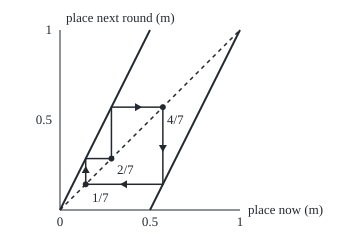

# The doubling map: doubling and dropping the whole part shifts the binary digits, which is why chaos can be proved

[Syllabus](../../../SYLLABUS.md) → [Differential equations and dynamics](../README.md) → [Discrete Dynamics and Chaos](../README.md#s11) → The doubling map

---

## General Overview

A strip of dough is 1 m long, with a raisin 0.7 m from its left end. Stretch the strip evenly to 2 m: the raisin moves to 1.4 m. Cut at the 1 m mark and lay the right-hand piece over the left. The raisin now sits at 0.4 m. Repeat: 0.8 m, 0.6 m, 0.2 m, then 0.4 m again.

Each round doubles the distance and throws away any whole metre: from here on, the **doubling map**, with the list of places called the **orbit**. In binary (base two, each place worth half the one before), 0.7 is 0.1011001100…. Doubling moves every digit one place left, and dropping the whole metre deletes the digit that crossed the point.

That makes chaos provable, not just observed: two raisins 0.612 nm apart, sharing 30 binary digits, are 0.657 m apart after 30 rounds.

**Doubling and dropping the whole part deletes the first binary digit, so after n rounds the place is the start's digits from place n + 1 on: errors double every round, cycles are repeating digit blocks, and one orbit can visit every stretch of the strip.**

**What kind of fact this is:** a theorem, proved on this card in Why it works; "period three implies chaos" is a theorem stated here and proved in Li and Yorke's 1975 paper, listed in Sources.

### The picture: the map and its three-round cycle

<p align="center"></p>

Drawn to scale: 1 m on either axis is 180 units. Solid lines: the map, broken at the cut. Dashed: next place equals current place. The cobweb ([Iteration](01-iteration-and-cobweb-plots.md)) runs 1/7 → 2/7 → 4/7 and drops back to 1/7 m.

---

## The formula

Reminder: a map $x_{n+1} = g(x_n)$ gives the place after round n + 1 from the place after round n. "mod 1" means drop the whole part ([Division with a remainder](../../02-Number%20theory/01-Divisibility%20and%20Primes/04-division-with-remainder.md)).

$$x_{n+1} = 2x_n \bmod 1$$

**Read it aloud:** the next place is twice the current place, with any whole metre thrown away.

Write the start in binary as $x_0 = 0.b_1 b_2 b_3 \ldots$. The theorem:

$$x_n = 0.b_{n+1} b_{n+2} b_{n+3} \ldots \quad\text{(base two)}$$

**Read it aloud:** after n rounds the place is the start's binary digits with the first n deleted.

Deleting the first symbol of an endless string is the **shift**, $\sigma$; studying a map through the strings it shifts is **symbolic dynamics**. A start $y_0$ sharing N digits with $x_0$ stays within $2^{-(N-n)}$ of it for rounds n ≤ N, then parts; and the places back after n rounds are exactly

$$x = \frac{k}{2^n - 1}, \qquad k = 0, 1, \ldots, 2^n - 2.$$

| Symbol | Plain meaning | In our example | Push it up and the answer… |
| --- | --- | --- | --- |
| $x_n$ ($x_0$, $x_1$, $x_N$, $x$) | place after round n, in metres; $x_0$ or $x$ the start | 0.7, 0.4, 0.8 | first digit 1 from 0.5 m |
| $n$ | the round count | 30 | n digits used up |
| $b_k$ ($b_1$) | the start's k-th binary digit | $b_1 = 1$ | — |
| $\sigma$ | the shift: delete the first digit | 1011… becomes 011… | — |
| $y_n$ ($y_0$, $y_N$, $y$) | a second raisin's place | 1/7 m at round 30 | — |
| $N$ | leading digits two starts share | 30 | later parting |
| $k$ | labels the returning places | 1 gives 1/7 | — |
| $w$, $z$, $T$ | a digit block; the number listing every block; the tent map | 0110; 98 digits; 2/7 → 4/7 | — |

### When it holds

- **Exact numbers.** Floating point keeps finitely many digits, and the map eats one per round.
- **The whole part dropped.** Without "mod 1" nothing is shifted off and the raisin leaves the strip.
- **No strings ending in endless 1s.** 0.0111… and 0.1000… are both 0.5; the card uses the second form.
- **"Period three implies chaos" needs a continuous map of an interval.** The doubling map jumps at the cut, so the theorem is shown on the tent map; on a loop, rotation by a third has three-round cycles and no chaos.

---

## Why it works

### Step 0: doubling is a shift in base two

In base ten, multiplying by ten moves every digit one place left. In base two, doubling does the same ([Place value](../../01-Foundations/01-Everyday%20Arithmetic/01-place-value.md)). The digit that crosses the point is the whole part, and "mod 1" deletes it. One round is one shift.

<details>
<summary>Detailed proof</summary>

Write $x_0 = \sum_{k \ge 1} b_k 2^{-k}$, not ending in endless 1s. Then $2x_0 = b_1 + \sum_{k \ge 2} b_k 2^{-(k-1)}$ with the tail in [0, 1), so $x_1 = 0.b_2 b_3 \ldots$; induction does the rest.

**Sensitivity.** Flip digit N + 1 of $x$ to get $y$. Then $|x - y| = 2^{-(N+1)}$, and $x_N$, $y_N$ differ only in their first digit, so $|x_N - y_N| = 1/2$.

**Dense cycles.** Let $w$ be the first N digits of $x$. The point $0.www\ldots$ returns after N rounds and lies within $2^{-N}$ of $x$.

**Returning places.** $x_n = x_0$ means $2^n x_0 - x_0$ is a whole number $k$, so $x_0 = k/(2^n - 1)$ with $0 \le k < 2^n - 1$.

**A dense orbit.** Let $z$ list every binary word, shortest first. A stretch of width $2^{-N}$ holds the numbers starting with some word $w$ of length N. If $w$ starts at place m + 1 of $z$, round m puts $z$ in that stretch.

</details>

### Step 1: follow 0.7 digit by digit

0.7 is 0.1011001100110011… in binary: a 1, then 0110 forever. The places 0.7, 0.4, 0.8, 0.6, 0.2 have first digits 1, 0, 1, 1, 0: a 1 exactly when the place is 0.5 m or more. From round 1 the orbit cycles through four places: the block 0110 read aloud.

### Step 2: small errors double every round

A second raisin shares 0.7's first 30 digits and then carries the digits of 1/7. The two start 0.612 nm apart, a few atoms. Doubling doubles differences, so the gap doubles each round. After 30 rounds 0.7 is at 0.8 m and the neighbour at 1/7 m, 0.657 m apart. Digit 31 of each start (1 against 0) now decides which half each lies in.

The Lyapunov exponent, the average separation rate per round in natural logarithms ([The Lyapunov exponent](04-chaos-and-the-lyapunov-exponent.md)), is ln 2 = 0.693147 at every start. This is **sensitive dependence**: beside any start sits another that ends up far away. Flipping digit 31 alone gives 0.8 m and 0.3 m after 30 rounds, 0.5 m apart.

### Step 3: cycles are repeating blocks, and they are everywhere

A place returns after n rounds exactly when its digits repeat every n places. 1/7 is 0.001001001…, so 1/7 → 2/7 → 4/7 → 1/7. The block 011 gives 3/7 → 6/7 → 5/7 → 3/7. With 0, which never moves, that is 2^3 − 1 = 7 places back after three rounds; after four there are 15.

Repeating any start's first 30 digits forever gives a cycle within 2^−30 m of it: **periodic points are dense**. Periodic points are places on a cycle; dense means there is one in every stretch, however short.

### Step 4: one orbit that visits everywhere

Write every binary word in a row, shortest first: 0, 1, 00, 01, 10, 11, 000, … . Words of length 1 to 4 fill 98 digits. Shifting through them, the first four digits run over all 16 patterns, so the raisin enters every stretch of width 1/16 m. The full list enters every stretch of every width: **a dense orbit**.

### Step 5: Devaney's three conditions

Robert Devaney calls a map **chaotic** when it has sensitive dependence (Step 2), dense periodic points (Step 3) and a dense orbit (Step 4; his word is **transitive**). The doubling map has all three, proved from the digits alone.

<details>
<summary>One of the three is redundant</summary>

Banks and co-authors showed in 1992 that for a continuous map on an infinite set, dense cycles and a dense orbit force sensitivity. Glue the strip's ends into a loop and the doubling map qualifies.

</details>

### Step 6: period three implies chaos

Li and Yorke proved in 1975: if a continuous map of an interval to itself has a point that returns after exactly three rounds, it has cycles of every length. It also has uncountably many starts (too many to list one by one) whose orbits keep drawing close and parting forever. Sharkovskii had proved the first half in 1964.

The doubling map jumps at the cut, so the theorem is shown on the **tent map** $T$: stretch to 2 m and fold back instead of cutting. It has the cycle 2/7 → 4/7 → 6/7 → 2/7, so the conclusion applies. The logistic map of [The logistic map](03-the-logistic-map-and-period-doubling.md) has a window of three-round cycles, so every cycle length appears there.

---

## Worked numbers, by hand

| Step | Arithmetic | Value |
| --- | --- | --- |
| round 1 | 2 × 0.7 = 1.4, drop the 1 | 0.4 m |
| round 2 | 2 × 0.4 = 0.8 | 0.8 m |
| round 3 | 2 × 0.8 = 1.6, drop the 1 | 0.6 m |
| round 4 | 2 × 0.6 = 1.2, drop the 1; next, 0.4 again | 0.2 m |
| digits read off | 1 where the place is 0.5 m or more | 0.10110… |
| the three-round cycle | 2 × 1/7, 2 × 2/7, 2 × 4/7 with the 1 dropped | **1/7 → 2/7 → 4/7 → 1/7** |
| sensitivity | 0.612 nm doubled 30 times | **0.657 m** |

The place after 30 rounds is set by digits no kneader could measure.

### What breaks if you drop a piece

| Mistake | Comes out at | What went wrong |
| --- | --- | --- |
| Iterate 0.7 in floating point | exactly 0 after 52 steps | stored digits stop at place 52; one deleted per round |
| Double without dropping the whole part | 751619276.8 m after 30 rounds | nothing shifted off; the raisin leaves the strip |
| Rotation by a third, on a loop | three-round cycles everywhere; gap stays 0.612 nm | not an interval map, nothing stretched |

---

## Code, from first principles, and it actually runs

Road one keeps each place as an exact fraction p/q, so a round is p → 2p mod q, with no rounding. Road two writes binary digits by long division and shifts them. The roads must agree for 30 rounds; then the code measures the gap, counts returning places by brute force against the formula, and checks the dense orbit both ways.

### Python

```python
# The doubling map -- the check behind the card.  Only math.log is imported.  A place
# on the 1 m strip is an exact fraction p/q, so "double, drop the whole metre" is
# p -> 2p mod q (road one); road two shifts the binary digits.  They must agree.
import math
def digits(p, q, k):                  # road two: first k binary digits of p/q
    out = []
    for _ in range(k):
        out.append(2 * p // q)
        p = 2 * p % q
    return out
def orbit(p, q, n):                   # road one: n exact steps of p -> 2p mod q
    for _ in range(n):
        p = 2 * p % q
    return p

def gcd(a, b): return gcd(b, a % b) if b else a    # Euclid, written out
def returners(n):                     # every fraction p/q, q <= 64, back after n steps
    return {(p // gcd(p, q), q // gcd(p, q)) for q in range(1, 65) for p in range(q) if orbit(p, q, n) == p}

M, d = 2 ** 30, digits(7, 10, 70)
agree = all(digits(orbit(7, 10, n), 10, 40) == d[n:n + 40] for n in range(31))
bp, bq = 7 * (7 * M // 10) + 1, 7 * M        # neighbour: 0.7's first 30 digits, then 1/7's
g0n, g0d = 49 * M - 10 * bp, 70 * M          # gap at the start, exact: 0.7 - neighbour
p30, b30 = orbit(7, 10, 30), orbit(bp, bq, 30)
g30n, g30d = p30 * bq - 10 * b30, 10 * bq    # gap after 30 steps, exact
words = "".join(format(w, "0%db" % L) for L in range(1, 5) for w in range(2 ** L))
cells_digits = {int(words[m:m + 4], 2) for m in range(len(words) - 3)}
cells_exact = {16 * orbit(int(words, 2), 2 ** len(words), m) // 2 ** len(words) for m in range(len(words) - 3)}
x, drop = 0.7, 0
while x != 0.0:
    x, drop = 2 * x % 1.0, drop + 1
ra, rb = 147 * M, 30 * bp                    # rotation by a third, over the denominator 210 M
for _ in range(30):
    ra, rb = (ra + 70 * M) % (210 * M), (rb + 70 * M) % (210 * M)
print("0.7 m in binary: 0." + "".join(map(str, d[:16])) + "...")
print("orbit of 0.7 m, steps 0 to 8:", " ".join(f"{orbit(7, 10, n) / 10:.1f}" for n in range(9)))
print("doubled, before the cut, rounds 1 to 5:", " ".join(f"{2 * orbit(7, 10, n) / 10:.1f}" for n in range(5)))
print("half it lands in (1 = right), steps 0 to 8:", " ".join(str(b) for b in d[:9]))
print("exact fractions and shifted digits agree for 30 steps:", "yes" if agree else "no")
print(f"neighbour: 0.7's first 30 digits, then 1/7's; gap at the start {g0n / g0d * 1e9:.3f} nm")
print(f"digit 31: 0.7 has {d[30]}, the neighbour has {digits(bp, bq, 31)[30]}")
print(f"after 30 steps: 0.7 -> {p30 / 10:.1f}, neighbour -> {b30 / bq:.6f} = 1/7; gap {g30n / g30d:.3f} m")
print(f"flip digit 31 alone: after 30 steps 0.7 -> {p30 / 10:.1f}, flipped -> {orbit(7 * 2 * M - 10, 20 * M, 30) / (20 * M):.1f}; gap {p30 / 10 - orbit(7 * 2 * M - 10, 20 * M, 30) / (20 * M):.1f} m")
print(f"gap multiplied per step: {((g30n / g30d) / (g0n / g0d)) ** (1 / 30):.6f}; Lyapunov exponent ln 2 = {math.log((g30n / g30d) / (g0n / g0d)) / 30:.6f}")
print("period-3 orbit: 1/7 -> 2/7 -> 4/7 ->", f"{orbit(4, 7, 1)}/7, binary 0." + "".join(map(str, digits(1, 7, 9))) + "...;",
      f"the other: 3/7 -> {orbit(3, 7, 1)}/7 -> {orbit(3, 7, 2)}/7 -> {orbit(3, 7, 3)}/7")
print(*(f"points back after {n} steps, brute force over q <= 64: {len(returners(n))}; formula 2^{n} - 1 = {2 ** n - 1}" for n in (3, 4)), sep="\n")
print(f"all words of length 1 to 4 in a row: {len(words)} digits; 1/16 m cells visited: {len(cells_digits)} by digits, {len(cells_exact)} by fractions")
tent = [2]                                   # tent map on sevenths: 2x left of 1/2, 2 - 2x right
while len(tent) < 4: tent.append(2 * tent[-1] if 2 * tent[-1] <= 7 else 14 - 2 * tent[-1])
print("tent map period 3:", " -> ".join(f"{t}/7" for t in tent))
print(f"mistake 1, floating point: 0.7 as a double reaches exactly 0 after {drop} steps")
print(f"mistake 2, no mod 1: 0.7 m doubled 30 times = {7 * M / 10:.1f} m")
print(f"mistake 3, rotation by a third: period 3 everywhere, gap after 30 steps {(ra - rb) % (210 * M) / (210 * M) * 1e9:.3f} nm")
print("figure, 1 m = 180 units, (x, y) of 1/7 2/7 4/7:", *(f"({60 + 180 * k / 7:.2f}, {210 - 180 * k / 7:.2f})" for k in (1, 2, 4)))
assert agree and int("".join(map(str, d[:40])), 2) == 7 * 2 ** 40 // 10   # digits right, roads agree
assert g30n * g0d == M * g0n * g30d and digits(bp, bq, 60)[30:] == digits(1, 7, 30)
assert [len(returners(n)) for n in (3, 4)] == [2 ** 3 - 1, 2 ** 4 - 1]
assert cells_digits == cells_exact == set(range(16))
print("ALL CHECKS PASS")
```

**Ran 2026-09-28 on macOS, Python 3.14.6, standard library only. All checks passed. Output, pasted from the run:**

```
0.7 m in binary: 0.1011001100110011...
orbit of 0.7 m, steps 0 to 8: 0.7 0.4 0.8 0.6 0.2 0.4 0.8 0.6 0.2
doubled, before the cut, rounds 1 to 5: 1.4 0.8 1.6 1.2 0.4
half it lands in (1 = right), steps 0 to 8: 1 0 1 1 0 0 1 1 0
exact fractions and shifted digits agree for 30 steps: yes
neighbour: 0.7's first 30 digits, then 1/7's; gap at the start 0.612 nm
digit 31: 0.7 has 1, the neighbour has 0
after 30 steps: 0.7 -> 0.8, neighbour -> 0.142857 = 1/7; gap 0.657 m
flip digit 31 alone: after 30 steps 0.7 -> 0.8, flipped -> 0.3; gap 0.5 m
gap multiplied per step: 2.000000; Lyapunov exponent ln 2 = 0.693147
period-3 orbit: 1/7 -> 2/7 -> 4/7 -> 1/7, binary 0.001001001...; the other: 3/7 -> 6/7 -> 5/7 -> 3/7
points back after 3 steps, brute force over q <= 64: 7; formula 2^3 - 1 = 7
points back after 4 steps, brute force over q <= 64: 15; formula 2^4 - 1 = 15
all words of length 1 to 4 in a row: 98 digits; 1/16 m cells visited: 16 by digits, 16 by fractions
tent map period 3: 2/7 -> 4/7 -> 6/7 -> 2/7
mistake 1, floating point: 0.7 as a double reaches exactly 0 after 52 steps
mistake 2, no mod 1: 0.7 m doubled 30 times = 751619276.8 m
mistake 3, rotation by a third: period 3 everywhere, gap after 30 steps 0.612 nm
figure, 1 m = 180 units, (x, y) of 1/7 2/7 4/7: (85.71, 184.29) (111.43, 158.57) (162.86, 107.14)
ALL CHECKS PASS
```

### Rust

Same numbers, same labels, built with `rustc --edition 2021 -O`.

```rust
// The doubling map -- the same check as the Python, in Rust.  No crates.  A place
// on the 1 m strip is an exact fraction p/q, so "double, drop the whole metre" is
// p -> 2p mod q (road one); road two shifts the binary digits.  They must agree.
use std::collections::BTreeSet;

fn digits(mut p: u128, q: u128, k: usize) -> Vec<u128> {   // road two: first k binary digits of p/q
    let mut out = Vec::new();
    for _ in 0..k { out.push(2 * p / q); p = 2 * p % q }
    out
}
fn orbit(mut p: u128, q: u128, n: usize) -> u128 {          // road one: n exact steps of p -> 2p mod q
    for _ in 0..n { p = 2 * p % q }
    p
}
fn gcd(a: u128, b: u128) -> u128 { if b == 0 { a } else { gcd(b, a % b) } }   // Euclid, written out
fn returners(n: usize) -> usize {                           // every fraction p/q, q <= 64, back after n steps
    let mut s = BTreeSet::new();
    for q in 1..65u128 { for p in 0..q { if orbit(p, q, n) == p { s.insert((p / gcd(p, q), q / gcd(p, q))); } } }
    s.len()
}
fn join(v: &[u128]) -> String { v.iter().map(|b| b.to_string()).collect::<String>() }

fn main() {
    let m: u128 = 1 << 30;
    let d = digits(7, 10, 70);
    let agree = (0..31).all(|n| digits(orbit(7, 10, n), 10, 40) == d[n..n + 40].to_vec());
    let (bp, bq) = (7 * (7 * m / 10) + 1, 7 * m);          // neighbour: 0.7's first 30 digits, then 1/7's
    let (g0n, g0d) = (49 * m - 10 * bp, 70 * m);            // gap at the start, exact: 0.7 - neighbour
    let (p30, b30) = (orbit(7, 10, 30), orbit(bp, bq, 30));
    let (g30n, g30d) = (p30 * bq - 10 * b30, 10 * bq);      // gap after 30 steps, exact
    let (g0, g30) = (g0n as f64 / g0d as f64, g30n as f64 / g30d as f64);
    let words: String = (1..5usize).flat_map(|l| (0..(1u32 << l)).map(move |w| format!("{:0width$b}", w, width = l))).collect();
    let len = words.len();
    let cells_digits: BTreeSet<u128> = (0..len - 3).map(|i| u128::from_str_radix(&words[i..i + 4], 2).unwrap()).collect();
    let (big_p, big_q) = (u128::from_str_radix(&words, 2).unwrap(), 1u128 << len);
    let cells_exact: BTreeSet<u128> = (0..len - 3).map(|i| orbit(big_p, big_q, i) / (big_q / 16)).collect();
    let (mut x, mut drop) = (0.7f64, 0);
    while x != 0.0 { x = (2.0 * x) % 1.0; drop += 1 }
    let (mut ra, mut rb) = (147 * m, 30 * bp);              // rotation by a third, over the denominator 210 m
    for _ in 0..30 { ra = (ra + 70 * m) % (210 * m); rb = (rb + 70 * m) % (210 * m) }
    println!("0.7 m in binary: 0.{}...", join(&d[..16]));
    let orb: Vec<String> = (0..9).map(|n| format!("{:.1}", orbit(7, 10, n) as f64 / 10.0)).collect();
    println!("orbit of 0.7 m, steps 0 to 8: {}", orb.join(" "));
    let dbl: Vec<String> = (0..5).map(|n| format!("{:.1}", 2.0 * orbit(7, 10, n) as f64 / 10.0)).collect();
    println!("doubled, before the cut, rounds 1 to 5: {}", dbl.join(" "));
    let halves: Vec<String> = d[..9].iter().map(|b| b.to_string()).collect();
    println!("half it lands in (1 = right), steps 0 to 8: {}", halves.join(" "));
    println!("exact fractions and shifted digits agree for 30 steps: {}", if agree { "yes" } else { "no" });
    println!("neighbour: 0.7's first 30 digits, then 1/7's; gap at the start {:.3} nm", g0 * 1e9);
    println!("digit 31: 0.7 has {}, the neighbour has {}", d[30], digits(bp, bq, 31)[30]);
    println!("after 30 steps: 0.7 -> {:.1}, neighbour -> {:.6} = 1/7; gap {:.3} m", p30 as f64 / 10.0, b30 as f64 / bq as f64, g30);
    let flip = orbit(7 * 2 * m - 10, 20 * m, 30) as f64 / (20 * m) as f64;   // 0.7 with digit 31 flipped from 1 to 0
    println!("flip digit 31 alone: after 30 steps 0.7 -> {:.1}, flipped -> {:.1}; gap {:.1} m", p30 as f64 / 10.0, flip, p30 as f64 / 10.0 - flip);
    println!("gap multiplied per step: {:.6}; Lyapunov exponent ln 2 = {:.6}", (g30 / g0).powf(1.0 / 30.0), (g30 / g0).ln() / 30.0);
    println!("period-3 orbit: 1/7 -> 2/7 -> 4/7 -> {}/7, binary 0.{}...; the other: 3/7 -> {}/7 -> {}/7 -> {}/7",
             orbit(4, 7, 1), join(&digits(1, 7, 9)), orbit(3, 7, 1), orbit(3, 7, 2), orbit(3, 7, 3));
    for n in [3usize, 4] {
        println!("points back after {} steps, brute force over q <= 64: {}; formula 2^{} - 1 = {}", n, returners(n), n, (1 << n) - 1);
    }
    println!("all words of length 1 to 4 in a row: {} digits; 1/16 m cells visited: {} by digits, {} by fractions",
             len, cells_digits.len(), cells_exact.len());
    let mut tent: Vec<u128> = vec![2];                      // tent map on sevenths: 2x left of 1/2, 2 - 2x right
    while tent.len() < 4 { let t = tent[tent.len() - 1]; tent.push(if 2 * t <= 7 { 2 * t } else { 14 - 2 * t }) }
    let tv: Vec<String> = tent.iter().map(|t| format!("{}/7", t)).collect();
    println!("tent map period 3: {}", tv.join(" -> "));
    println!("mistake 1, floating point: 0.7 as a double reaches exactly 0 after {} steps", drop);
    println!("mistake 2, no mod 1: 0.7 m doubled 30 times = {:.1} m", 7.0 * m as f64 / 10.0);
    println!("mistake 3, rotation by a third: period 3 everywhere, gap after 30 steps {:.3} nm",
             ((ra + 210 * m - rb) % (210 * m)) as f64 / (210 * m) as f64 * 1e9);
    let fig: Vec<String> = [1.0, 2.0, 4.0].iter().map(|k: &f64| format!("({:.2}, {:.2})", 60.0 + 180.0 * k / 7.0, 210.0 - 180.0 * k / 7.0)).collect();
    println!("figure, 1 m = 180 units, (x, y) of 1/7 2/7 4/7: {}", fig.join(" "));
    assert!(agree && u128::from_str_radix(&join(&d[..40]), 2).unwrap() == 7 * (1u128 << 40) / 10);   // digits right, roads agree
    assert!(g30n * g0d == m * g0n * g30d && digits(bp, bq, 60)[30..].to_vec() == digits(1, 7, 30));
    assert!([returners(3), returners(4)] == [(1 << 3) - 1, (1 << 4) - 1]);
    assert!(cells_digits == cells_exact && cells_exact == (0..16u128).collect::<BTreeSet<u128>>());
    println!("ALL CHECKS PASS");
}
```

**Ran 2026-09-28 on macOS, rustc 1.98.1, no crates. All checks passed. Output, pasted from the run:**

```
0.7 m in binary: 0.1011001100110011...
orbit of 0.7 m, steps 0 to 8: 0.7 0.4 0.8 0.6 0.2 0.4 0.8 0.6 0.2
doubled, before the cut, rounds 1 to 5: 1.4 0.8 1.6 1.2 0.4
half it lands in (1 = right), steps 0 to 8: 1 0 1 1 0 0 1 1 0
exact fractions and shifted digits agree for 30 steps: yes
neighbour: 0.7's first 30 digits, then 1/7's; gap at the start 0.612 nm
digit 31: 0.7 has 1, the neighbour has 0
after 30 steps: 0.7 -> 0.8, neighbour -> 0.142857 = 1/7; gap 0.657 m
flip digit 31 alone: after 30 steps 0.7 -> 0.8, flipped -> 0.3; gap 0.5 m
gap multiplied per step: 2.000000; Lyapunov exponent ln 2 = 0.693147
period-3 orbit: 1/7 -> 2/7 -> 4/7 -> 1/7, binary 0.001001001...; the other: 3/7 -> 6/7 -> 5/7 -> 3/7
points back after 3 steps, brute force over q <= 64: 7; formula 2^3 - 1 = 7
points back after 4 steps, brute force over q <= 64: 15; formula 2^4 - 1 = 15
all words of length 1 to 4 in a row: 98 digits; 1/16 m cells visited: 16 by digits, 16 by fractions
tent map period 3: 2/7 -> 4/7 -> 6/7 -> 2/7
mistake 1, floating point: 0.7 as a double reaches exactly 0 after 52 steps
mistake 2, no mod 1: 0.7 m doubled 30 times = 751619276.8 m
mistake 3, rotation by a third: period 3 everywhere, gap after 30 steps 0.612 nm
figure, 1 m = 180 units, (x, y) of 1/7 2/7 4/7: (85.71, 184.29) (111.43, 158.57) (162.86, 107.14)
ALL CHECKS PASS
```

### Lean

Lean proves the digit shift, the places back after n rounds, and Devaney's three conditions, for every start on the strip.

- Take a start whose binary digits do not end in endless 1s. Then after n rounds the place is those digits with the first n deleted.
- Take n of 1 or more. Then a place is back after n rounds exactly when it equals $k/(2^n - 1)$, with k from 0 to $2^n - 2$.
- Sensitive dependence: beside every start, as close as you like, sits another that is at least 0.5 m away after some round.
- Dense periodic points: as close as you like to every start lies a place on a cycle.
- A dense orbit: one start's orbit comes as close as you like to every place on the strip.
- The worked numbers hold exactly: the orbit of 0.7, its first 16 binary digits, both three-round cycles, and the tent map's cycle. So do the 7 and 15 places back after three and four rounds, and the 98 digits.

The 0.612 nm gap, the Lyapunov exponent and floating point are left to the Python and Rust checks; Li and Yorke's theorem is not checked.

```lean
-- The doubling map: doubling and dropping the whole part deletes the first binary digit, so after n rounds the place is the start's digits from place n + 1 on, the places back after n rounds are exactly k/(2^n - 1), and the map is chaotic in Devaney's sense.
import Mathlib.Algebra.Order.Floor.Ring
import Mathlib.Analysis.SpecificLimits.Basic
import Mathlib.Dynamics.PeriodicPts.Defs
import Mathlib.Tactic.LinearCombination

/-- The doubling map on the 1 m strip: twice the place, with the whole part dropped
(`2x mod 1`). -/
noncomputable def doubling (x : ℝ) : ℝ := Int.fract (2 * x)

/-- The number with binary digits `b 0, b 1, b 2, …` after the point:
`0.b₁b₂b₃…` in the card's numbering, so the card's `b_k` is `b (k - 1)` here. -/
noncomputable def binVal (b : ℕ → Fin 2) : ℝ := ∑' k : ℕ, ((b k : ℕ) : ℝ) / 2 ^ (k + 1)

lemma binVal_term_le (b : ℕ → Fin 2) (k : ℕ) :
    ((b k : ℕ) : ℝ) / 2 ^ (k + 1) ≤ 1 / 2 / 2 ^ k := by
  have h : ((b k : ℕ) : ℝ) ≤ 1 := by exact_mod_cast Nat.lt_succ_iff.mp (b k).isLt
  rw [div_div, ← pow_succ']
  exact div_le_div_of_nonneg_right h (by positivity)

lemma binVal_term_nonneg (b : ℕ → Fin 2) (k : ℕ) :
    0 ≤ ((b k : ℕ) : ℝ) / 2 ^ (k + 1) := by positivity

lemma binVal_summable (b : ℕ → Fin 2) :
    Summable (fun k : ℕ => ((b k : ℕ) : ℝ) / 2 ^ (k + 1)) :=
  Summable.of_nonneg_of_le (binVal_term_nonneg b) (binVal_term_le b) (summable_geometric_two' 1)

lemma binVal_nonneg (b : ℕ → Fin 2) : 0 ≤ binVal b :=
  tsum_nonneg (binVal_term_nonneg b)

lemma binVal_lt_one (b : ℕ → Fin 2) (h : ∃ k, b k = 0) : binVal b < 1 := by
  obtain ⟨k, hk⟩ := h
  have := Summable.tsum_lt_tsum_of_nonneg (i := k) (binVal_term_nonneg b) (binVal_term_le b)
    (by rw [hk]; simp) (summable_geometric_two' 1)
  rw [tsum_geometric_two'] at this
  exact this

lemma binVal_split (b : ℕ → Fin 2) :
    2 * binVal b = ((b 0 : ℕ) : ℝ) + binVal (fun k => b (k + 1)) := by
  unfold binVal
  rw [(binVal_summable b).tsum_eq_zero_add]
  have : ∀ k : ℕ, ((b (k + 1) : ℕ) : ℝ) / 2 ^ (k + 1 + 1)
      = (((b (k + 1) : ℕ) : ℝ) / 2 ^ (k + 1)) / 2 := by
    intro k; rw [pow_succ]; ring
  simp only [this, tsum_div_const]
  ring

lemma doubling_binVal (b : ℕ → Fin 2) (h : ∃ k, b (k + 1) = 0) :
    doubling (binVal b) = binVal (fun k => b (k + 1)) := by
  unfold doubling
  rw [binVal_split, Int.fract_natCast_add, Int.fract_eq_self]
  exact ⟨binVal_nonneg _, binVal_lt_one _ h⟩

/-- The card's main theorem: write the start in binary as `0.b₁b₂b₃…`, with the string not
ending in endless 1s. After `n` rounds of "double and drop the whole part", the place is
`0.b_{n+1}b_{n+2}…`: the start's binary digits with the first `n` deleted (the shift). -/
theorem doubling_iterate_shifts_binary_digits (b : ℕ → Fin 2)
    (hb : ∀ N : ℕ, ∃ k ≥ N, b k = 0) (n : ℕ) :
    doubling^[n] (binVal b) = binVal (fun k => b (k + n)) := by
  induction n generalizing b with
  | zero => rfl
  | succ n ih =>
    rw [Function.iterate_succ_apply, doubling_binVal b]
    · rw [ih (fun k => b (k + 1))]
      · congr 1
      · intro N
        obtain ⟨k, hk, hk0⟩ := hb (N + 1)
        exact ⟨k - 1, by omega, by rw [Nat.sub_add_cancel (by omega)]; exact hk0⟩
    · obtain ⟨k, hk, hk0⟩ := hb 1
      exact ⟨k - 1, by rw [Nat.sub_add_cancel (by omega)]; exact hk0⟩

lemma fract_two_mul_fract (y : ℝ) : Int.fract (2 * Int.fract y) = Int.fract (2 * y) := by
  have : 2 * Int.fract y = 2 * y - ((2 * ⌊y⌋ : ℤ) : ℝ) := by rw [Int.fract]; push_cast; ring
  rw [this, Int.fract_sub_intCast]

lemma doubling_iterate_eq (n : ℕ) (x : ℝ) (hx : x ∈ Set.Ico (0 : ℝ) 1) :
    doubling^[n] x = Int.fract (2 ^ n * x) := by
  induction n with
  | zero =>
    simp only [Function.iterate_zero, id_eq, pow_zero, one_mul]
    exact (Int.fract_eq_self.mpr hx).symm
  | succ n ih =>
    rw [Function.iterate_succ_apply', ih, doubling, fract_two_mul_fract, pow_succ, mul_comm _ 2,
      mul_assoc]

/-- Returning places: for `n ≥ 1` rounds, a place `x` on the strip `[0, 1)` is back after
`n` rounds exactly when `x = k / (2^n - 1)` for some whole number `k = 0, 1, …, 2^n - 2`. -/
theorem doubling_returns_iff (n : ℕ) (hn : 1 ≤ n) (x : ℝ) (hx : x ∈ Set.Ico (0 : ℝ) 1) :
    doubling^[n] x = x ↔ ∃ k : ℕ, k < 2 ^ n - 1 ∧ x = (k : ℝ) / (2 ^ n - 1) := by
  have h2 : (2 : ℝ) ≤ 2 ^ n := by
    calc (2 : ℝ) = 2 ^ 1 := by norm_num
      _ ≤ 2 ^ n := pow_le_pow_right₀ (by norm_num) hn
  have hM : (0 : ℝ) < 2 ^ n - 1 := by linarith
  have hcast : (((2 ^ n - 1 : ℕ)) : ℝ) = 2 ^ n - 1 := by
    rw [Nat.cast_sub (Nat.one_le_two_pow), Nat.cast_pow]; norm_num
  rw [doubling_iterate_eq n x hx, Int.fract_eq_iff]
  constructor
  · rintro ⟨-, -, z, hz⟩
    have hz' : (z : ℝ) = x * (2 ^ n - 1) := by rw [← hz]; ring
    have hz0 : (0 : ℝ) ≤ z := by rw [hz']; exact mul_nonneg hx.1 hM.le
    have hz1 : (z : ℝ) < 2 ^ n - 1 := by
      rw [hz']; nlinarith [hx.2]
    have hz0' : 0 ≤ z := by exact_mod_cast hz0
    refine ⟨z.toNat, ?_, ?_⟩
    · have : ((z.toNat : ℕ) : ℝ) < ((2 ^ n - 1 : ℕ) : ℝ) := by
        rw [hcast]
        have : ((z.toNat : ℕ) : ℝ) = (z : ℝ) := by exact_mod_cast Int.toNat_of_nonneg hz0'
        rw [this]; exact hz1
      exact_mod_cast this
    · have : ((z.toNat : ℕ) : ℝ) = (z : ℝ) := by exact_mod_cast Int.toNat_of_nonneg hz0'
      rw [this, hz']; field_simp
  · rintro ⟨k, -, rfl⟩
    refine ⟨hx.1, hx.2, k, ?_⟩
    push_cast
    field_simp

lemma half_le_abs_fract_sub_fract_add_half (a : ℝ) :
    (1 : ℝ) / 2 ≤ |Int.fract a - Int.fract (a + 1 / 2)| := by
  have h0 := Int.fract_nonneg a
  have h1 := Int.fract_lt_one a
  rcases lt_or_ge (Int.fract a) (1 / 2) with h | h
  · have e : Int.fract (a + 1 / 2) = Int.fract a + 1 / 2 := by
      rw [Int.fract_eq_iff]
      refine ⟨by linarith, by linarith, ⌊a⌋, ?_⟩
      rw [Int.fract]; ring
    rw [e, abs_of_neg (by linarith)]; linarith
  · have e : Int.fract (a + 1 / 2) = Int.fract a - 1 / 2 := by
      rw [Int.fract_eq_iff]
      refine ⟨by linarith, by linarith, ⌊a⌋ + 1, ?_⟩
      rw [Int.fract]; push_cast; ring
    rw [e, abs_of_nonneg (by linarith)]; linarith

/-- Block `i` of the dense-orbit start has length `blkL i` and holds the whole number `blkJ i`. -/
def blkL (i : ℕ) : ℕ := (Nat.unpair i).1
def blkJ (i : ℕ) : ℕ := (Nat.unpair i).2 % 2 ^ blkL i
/-- Where block `i` starts: each block is followed by two zero digits. -/
def blkS (i : ℕ) : ℕ := ∑ l ∈ Finset.range i, (blkL l + 2)

/-- The value of the blocks from block `i` on, read from where block `i` starts. -/
noncomputable def tailVal (i : ℕ) : ℝ :=
  ∑' t : ℕ, (blkJ (i + t) : ℝ) * (1 / 2 : ℝ) ^ (blkS (i + t) - blkS i + blkL (i + t))

lemma blkS_succ (i : ℕ) : blkS (i + 1) = blkS i + blkL i + 2 := by
  simp [blkS, Finset.sum_range_succ, add_assoc]

lemma blkS_add (i t : ℕ) : blkS i + 2 * t ≤ blkS (i + t) := by
  induction t with
  | zero => simp
  | succ t ih => rw [← add_assoc, blkS_succ]; omega

lemma blkJ_bound (i : ℕ) :
    (blkJ i : ℝ) * (1 / 2 : ℝ) ^ blkL i + (1 / 2 : ℝ) ^ blkL i ≤ 1 := by
  have hlt : blkJ i < 2 ^ blkL i := Nat.mod_lt _ (by positivity)
  have hle : ((blkJ i : ℝ) + 1) ≤ 2 ^ blkL i := by exact_mod_cast hlt
  have hp : (2 : ℝ) ^ blkL i * (1 / 2) ^ blkL i = 1 := by rw [← mul_pow]; norm_num
  have hq : (0 : ℝ) ≤ (1 / 2) ^ blkL i := by positivity
  nlinarith

lemma tail_term_nonneg (i t : ℕ) :
    0 ≤ (blkJ (i + t) : ℝ) * (1 / 2 : ℝ) ^ (blkS (i + t) - blkS i + blkL (i + t)) := by
  positivity

lemma tail_term_le (i t : ℕ) :
    (blkJ (i + t) : ℝ) * (1 / 2 : ℝ) ^ (blkS (i + t) - blkS i + blkL (i + t)) ≤ (1 / 2) ^ t := by
  have hb := blkJ_bound (i + t)
  have hq : (0 : ℝ) ≤ (1 / 2) ^ blkL (i + t) := by positivity
  have hd : (1 / 2 : ℝ) ^ (blkS (i + t) - blkS i) ≤ (1 / 2) ^ t :=
    pow_le_pow_of_le_one (by norm_num) (by norm_num) (by have := blkS_add i t; omega)
  have hd0 : (0 : ℝ) ≤ (1 / 2) ^ (blkS (i + t) - blkS i) := by positivity
  have hj0 : (0 : ℝ) ≤ blkJ (i + t) := by positivity
  rw [pow_add]
  have hjq : (blkJ (i + t) : ℝ) * (1 / 2) ^ blkL (i + t) ≤ 1 := by linarith
  calc (blkJ (i + t) : ℝ) * ((1 / 2) ^ (blkS (i + t) - blkS i) * (1 / 2) ^ blkL (i + t))
      = ((blkJ (i + t) : ℝ) * (1 / 2) ^ blkL (i + t)) * (1 / 2) ^ (blkS (i + t) - blkS i) := by
        ring
    _ ≤ 1 * (1 / 2) ^ t := mul_le_mul hjq hd hd0 zero_le_one
    _ = (1 / 2) ^ t := one_mul _

lemma tail_summable (i : ℕ) :
    Summable (fun t : ℕ => (blkJ (i + t) : ℝ) * (1 / 2 : ℝ) ^ (blkS (i + t) - blkS i + blkL (i + t))) :=
  Summable.of_nonneg_of_le (tail_term_nonneg i) (tail_term_le i) summable_geometric_two

lemma tailVal_nonneg (i : ℕ) : 0 ≤ tailVal i := tsum_nonneg (tail_term_nonneg i)

lemma tailVal_le_two (i : ℕ) : tailVal i ≤ 2 := by
  calc tailVal i ≤ ∑' t : ℕ, (1 / 2 : ℝ) ^ t :=
        (tail_summable i).tsum_le_tsum (tail_term_le i) summable_geometric_two
    _ = 2 := tsum_geometric_two

lemma tailVal_succ (i : ℕ) :
    tailVal i = (blkJ i : ℝ) * (1 / 2 : ℝ) ^ blkL i + (1 / 2 : ℝ) ^ (blkL i + 2) * tailVal (i + 1) := by
  rw [tailVal, (tail_summable i).tsum_eq_zero_add, tailVal, ← tsum_mul_left]
  congr 1
  · simp
  · congr 1
    funext t
    have e1 : i + (t + 1) = i + 1 + t := by omega
    have e : blkS (i + 1 + t) - blkS i + blkL (i + 1 + t)
        = (blkL i + 2) + (blkS (i + 1 + t) - blkS (i + 1) + blkL (i + 1 + t)) := by
      have := blkS_add (i + 1) t; have := blkS_succ i; omega
    rw [e1, e, pow_add]; ring

lemma tailVal_bounds (i : ℕ) :
    (blkJ i : ℝ) * (1 / 2 : ℝ) ^ blkL i ≤ tailVal i ∧
      tailVal i ≤ (blkJ i : ℝ) * (1 / 2 : ℝ) ^ blkL i + (1 / 2 : ℝ) ^ blkL i / 2 ∧
      tailVal i < 1 := by
  have h0 := tailVal_nonneg (i + 1)
  have h2 := tailVal_le_two (i + 1)
  have hb := blkJ_bound i
  have hq : (0 : ℝ) < (1 / 2) ^ blkL i := by positivity
  have e : (1 / 2 : ℝ) ^ (blkL i + 2) = (1 / 2) ^ blkL i / 4 := by rw [pow_add]; ring
  rw [tailVal_succ, e]
  refine ⟨?_, ?_, ?_⟩
  · have : 0 ≤ (1 / 2 : ℝ) ^ blkL i / 4 * tailVal (i + 1) := by positivity
    linarith
  · nlinarith
  · nlinarith

lemma tailVal_mem (i : ℕ) : tailVal i ∈ Set.Ico (0 : ℝ) 1 :=
  ⟨tailVal_nonneg i, (tailVal_bounds i).2.2⟩

lemma tailVal_shift (i : ℕ) : ∃ N : ℤ, (2 : ℝ) ^ blkS i * tailVal 0 = N + tailVal i := by
  induction i with
  | zero => exact ⟨0, by simp [blkS]⟩
  | succ i ih =>
    obtain ⟨N, hN⟩ := ih
    refine ⟨2 ^ (blkL i + 2) * N + 4 * blkJ i, ?_⟩
    have hp : (2 : ℝ) ^ blkL i * (1 / 2) ^ blkL i = 1 := by rw [← mul_pow]; norm_num
    have h : (2 : ℝ) ^ (blkS i + blkL i + 2) * tailVal 0
        = 2 ^ blkL i * 2 ^ 2 * (2 ^ blkS i * tailVal 0) := by rw [pow_add, pow_add]; ring
    rw [blkS_succ, h, hN, tailVal_succ i, pow_add]
    push_cast
    linear_combination (4 * (blkJ i : ℝ) + tailVal (i + 1)) * hp

lemma dense_orbit :
    (∃ z ∈ Set.Ico (0 : ℝ) 1, ∀ x ∈ Set.Ico (0 : ℝ) 1, ∀ ε > 0,
        ∃ m : ℕ, |doubling^[m] z - x| < ε) := by
  refine ⟨tailVal 0, tailVal_mem 0, ?_⟩
  intro x hx ε hε
  obtain ⟨L, hL⟩ := exists_pow_lt_of_lt_one hε (by norm_num : (1 / 2 : ℝ) < 1)
  set j := ⌊x * 2 ^ L⌋₊ with hj
  have hx2 : 0 ≤ x * 2 ^ L := mul_nonneg hx.1 (by positivity)
  have hjlt : j < 2 ^ L := by
    rw [hj, Nat.floor_lt hx2]; push_cast
    have : (0 : ℝ) < 2 ^ L := by positivity
    nlinarith [hx.2]
  have hjle : (j : ℝ) ≤ x * 2 ^ L := Nat.floor_le hx2
  have hjgt : x * 2 ^ L < j + 1 := Nat.lt_floor_add_one _
  set i := Nat.pair L j
  have hLi : blkL i = L := by simp [i, blkL, Nat.unpair_pair]
  have hJi : blkJ i = j := by simp [i, blkJ, blkL, Nat.unpair_pair, Nat.mod_eq_of_lt hjlt]
  refine ⟨blkS i, ?_⟩
  obtain ⟨N, hN⟩ := tailVal_shift i
  rw [doubling_iterate_eq _ _ (tailVal_mem 0), hN, Int.fract_intCast_add,
    Int.fract_eq_self.mpr (tailVal_mem i)]
  obtain ⟨b1, b2, -⟩ := tailVal_bounds i
  rw [hLi, hJi] at b1 b2
  have hp : (2 : ℝ) ^ L * (1 / 2) ^ L = 1 := by rw [← mul_pow]; norm_num
  have hq : (0 : ℝ) < (1 / 2) ^ L := by positivity
  have c1 : (j : ℝ) * (1 / 2) ^ L ≤ x := by
    have := mul_le_mul_of_nonneg_right hjle hq.le
    calc (j : ℝ) * (1 / 2) ^ L ≤ x * 2 ^ L * (1 / 2) ^ L := this
      _ = x := by rw [mul_assoc, hp, mul_one]
  have c2 : x < (j : ℝ) * (1 / 2) ^ L + (1 / 2) ^ L := by
    have := mul_lt_mul_of_pos_right hjgt hq
    calc x = x * 2 ^ L * (1 / 2) ^ L := by rw [mul_assoc, hp, mul_one]
      _ < ((j : ℝ) + 1) * (1 / 2) ^ L := this
      _ = (j : ℝ) * (1 / 2) ^ L + (1 / 2) ^ L := by ring
  rw [abs_sub_lt_iff]
  constructor <;> linarith

lemma sensitive_dependence :
    ∀ x ∈ Set.Ico (0 : ℝ) 1, ∀ ε > 0, ∃ y ∈ Set.Ico (0 : ℝ) 1, |x - y| < ε ∧
        ∃ n : ℕ, (1 : ℝ) / 2 ≤ |doubling^[n] x - doubling^[n] y| := by
  intro x hx ε hε
  obtain ⟨n, hn⟩ := exists_pow_lt_of_lt_one hε (by norm_num : (1 / 2 : ℝ) < 1)
  set δ : ℝ := (1 / 2) ^ (n + 1) with hδ
  have hδ0 : 0 < δ := by positivity
  have hδε : δ < ε := by
    have : δ = (1 / 2) ^ n / 2 := by rw [hδ, pow_succ]; ring
    have : (0 : ℝ) < (1 / 2) ^ n := by positivity
    linarith
  have hδh : δ ≤ 1 / 2 := by
    rw [hδ, pow_succ]
    have : (1 / 2 : ℝ) ^ n ≤ 1 := pow_le_one₀ (by norm_num) (by norm_num)
    nlinarith
  have hscale : (2 : ℝ) ^ n * δ = 1 / 2 := by
    rw [hδ, pow_succ, ← mul_assoc, ← mul_pow]; norm_num
  rcases lt_or_ge (x + δ) 1 with h | h
  · refine ⟨x + δ, ⟨by linarith [hx.1], h⟩, ?_, n, ?_⟩
    · rw [show x - (x + δ) = -δ by ring, abs_neg, abs_of_pos hδ0]; exact hδε
    · rw [doubling_iterate_eq n x hx, doubling_iterate_eq n (x + δ) ⟨by linarith [hx.1], h⟩,
        mul_add, hscale]
      exact half_le_abs_fract_sub_fract_add_half _
  · have hy : x - δ ∈ Set.Ico (0 : ℝ) 1 := ⟨by linarith, by linarith [hx.2]⟩
    refine ⟨x - δ, hy, ?_, n, ?_⟩
    · rw [show x - (x - δ) = δ by ring, abs_of_pos hδ0]; exact hδε
    · rw [doubling_iterate_eq n x hx, doubling_iterate_eq n (x - δ) hy, mul_sub, hscale,
        abs_sub_comm]
      have := half_le_abs_fract_sub_fract_add_half (2 ^ n * x - 1 / 2)
      rwa [sub_add_cancel] at this

lemma dense_periodic_points :
    ∀ x ∈ Set.Ico (0 : ℝ) 1, ∀ ε > 0, ∃ y ∈ Set.Ico (0 : ℝ) 1, |x - y| < ε ∧
        ∃ n : ℕ, 0 < n ∧ Function.IsPeriodicPt doubling n y := by
  intro x hx ε hε
  obtain ⟨N, hN⟩ := exists_nat_gt (1 / ε)
  set n := N + 1
  have hNn : N + 2 ≤ 2 ^ n := by
    have := Nat.lt_two_pow_self (n := n); omega
  have hNnR : (N : ℝ) + 2 ≤ 2 ^ n := by exact_mod_cast hNn
  set M : ℝ := 2 ^ n - 1 with hMdef
  have hM : 0 < M := by
    have : (0 : ℝ) ≤ N := by positivity
    linarith
  have hεM : 1 / M < ε := by
    rw [div_lt_iff₀ hM]
    have := (div_lt_iff₀ hε).mp hN
    nlinarith
  set y : ℝ := (⌊x * M⌋ : ℝ) / M with hy
  have hxM : 0 ≤ x * M := mul_nonneg hx.1 hM.le
  have hfl0 : (0 : ℝ) ≤ (⌊x * M⌋ : ℝ) := by exact_mod_cast Int.floor_nonneg.mpr hxM
  have hyx : y ≤ x := by
    rw [hy, div_le_iff₀ hM]; exact Int.floor_le _
  have hxy : x - y < 1 / M := by
    have h1 := Int.lt_floor_add_one (x * M)
    have : x - y = (x * M - ⌊x * M⌋) / M := by rw [hy]; field_simp
    rw [this]
    exact div_lt_div_of_pos_right (by linarith) hM
  have hyI : y ∈ Set.Ico (0 : ℝ) 1 := ⟨div_nonneg hfl0 hM.le, by linarith [hx.2]⟩
  refine ⟨y, hyI, ?_, n, Nat.succ_pos N, ?_⟩
  · rw [abs_of_nonneg (by linarith)]; linarith
  · show doubling^[n] y = y
    rw [doubling_iterate_eq n y hyI, Int.fract_eq_iff]
    refine ⟨hyI.1, hyI.2, ⌊x * M⌋, ?_⟩
    have : (2 : ℝ) ^ n = M + 1 := by rw [hMdef]; ring
    rw [this, hy]; field_simp; ring

/-- Devaney's three conditions hold on the strip `[0, 1)`.
Sensitive dependence: beside every start, as close as you like, is another start that is
1/2 m away from it after some number of rounds.
Dense periodic points: as close as you like to every start is a place on a cycle.
A dense orbit: one start whose orbit comes as close as you like to every place. -/
theorem doubling_is_chaotic :
    (∀ x ∈ Set.Ico (0 : ℝ) 1, ∀ ε > 0, ∃ y ∈ Set.Ico (0 : ℝ) 1, |x - y| < ε ∧
        ∃ n : ℕ, (1 : ℝ) / 2 ≤ |doubling^[n] x - doubling^[n] y|) ∧
    (∀ x ∈ Set.Ico (0 : ℝ) 1, ∀ ε > 0, ∃ y ∈ Set.Ico (0 : ℝ) 1, |x - y| < ε ∧
        ∃ n : ℕ, 0 < n ∧ Function.IsPeriodicPt doubling n y) ∧
    (∃ z ∈ Set.Ico (0 : ℝ) 1, ∀ x ∈ Set.Ico (0 : ℝ) 1, ∀ ε > 0,
        ∃ m : ℕ, |doubling^[m] z - x| < ε) := by
  exact ⟨sensitive_dependence, dense_periodic_points, dense_orbit⟩

-- The raisin at 0.7 m: 0.7, 0.4, 0.8, 0.6, 0.2, then 0.4 again.
example : doubling (7 / 10) = 2 / 5 := by norm_num [doubling, Int.fract_eq_iff]
example : doubling (2 / 5) = 4 / 5 := by norm_num [doubling, Int.fract_eq_iff]
example : doubling (4 / 5) = 3 / 5 := by norm_num [doubling, Int.fract_eq_iff]
example : doubling (3 / 5) = 1 / 5 := by norm_num [doubling, Int.fract_eq_iff]
example : doubling (1 / 5) = 2 / 5 := by norm_num [doubling, Int.fract_eq_iff]

-- 0.7 in binary starts 0.1011001100110011: the first 16 digits are ⌊0.7 × 2^16⌋.
example : 7 * 2 ^ 16 / 10 = 0b1011001100110011 := by decide

-- The three-round cycle 1/7 → 2/7 → 4/7 → 1/7, and the other one 3/7 → 6/7 → 5/7 → 3/7.
example : doubling (1 / 7) = 2 / 7 := by norm_num [doubling, Int.fract_eq_iff]
example : doubling (2 / 7) = 4 / 7 := by norm_num [doubling, Int.fract_eq_iff]
example : doubling (4 / 7) = 1 / 7 := by norm_num [doubling, Int.fract_eq_iff]
example : doubling (3 / 7) = 6 / 7 := by norm_num [doubling, Int.fract_eq_iff]
example : doubling (6 / 7) = 5 / 7 := by norm_num [doubling, Int.fract_eq_iff]
example : doubling (5 / 7) = 3 / 7 := by norm_num [doubling, Int.fract_eq_iff]

-- Places back after 3 rounds: k/7 for k = 0, …, 6, seven places (2^3 - 1 = 7);
-- after 4 rounds: k/15, fifteen places. In whole numbers, 2^n k leaves remainder k.
example : ∀ k < 2 ^ 3 - 1, 2 ^ 3 * k % 7 = k := by decide
example : ∀ k < 2 ^ 4 - 1, 2 ^ 4 * k % 15 = k := by decide

-- Every binary word of length 1 to 4, written in a row, fills 98 digits.
example : ∑ L ∈ Finset.Icc 1 4, L * 2 ^ L = 98 := by decide

-- The tent map (stretch to 2 m and fold back) has the cycle 2/7 → 4/7 → 6/7 → 2/7.
example : (2 : ℚ) / 7 ≤ 1 / 2 ∧ 2 * (2 / 7 : ℚ) = 4 / 7 := by norm_num
example : ¬ ((4 : ℚ) / 7 ≤ 1 / 2) ∧ 2 - 2 * (4 / 7 : ℚ) = 6 / 7 := by norm_num
example : ¬ ((6 : ℚ) / 7 ≤ 1 / 2) ∧ 2 - 2 * (6 / 7 : ℚ) = 2 / 7 := by norm_num

#print axioms binVal_term_le
#print axioms binVal_term_nonneg
#print axioms binVal_summable
#print axioms binVal_nonneg
#print axioms binVal_lt_one
#print axioms binVal_split
#print axioms doubling_binVal
#print axioms fract_two_mul_fract
#print axioms doubling_iterate_eq
#print axioms half_le_abs_fract_sub_fract_add_half
#print axioms blkS_succ
#print axioms blkS_add
#print axioms blkJ_bound
#print axioms tail_term_nonneg
#print axioms tail_term_le
#print axioms tail_summable
#print axioms tailVal_nonneg
#print axioms tailVal_le_two
#print axioms tailVal_succ
#print axioms tailVal_bounds
#print axioms tailVal_mem
#print axioms tailVal_shift
#print axioms dense_orbit
#print axioms sensitive_dependence
#print axioms dense_periodic_points
#print axioms doubling_iterate_shifts_binary_digits
#print axioms doubling_returns_iff
#print axioms doubling_is_chaotic
```

**Checked 2026-11-13 on macOS, Lean 4.36.0-rc2, Mathlib v4.36.0-rc2. Every proof is complete and uses only Lean's standard axioms. Output, pasted from the run:**

```
'binVal_term_le' depends on axioms: [propext, Classical.choice, Quot.sound]
'binVal_term_nonneg' depends on axioms: [propext, Classical.choice, Quot.sound]
'binVal_summable' depends on axioms: [propext, Classical.choice, Quot.sound]
'binVal_nonneg' depends on axioms: [propext, Classical.choice, Quot.sound]
'binVal_lt_one' depends on axioms: [propext, Classical.choice, Quot.sound]
'binVal_split' depends on axioms: [propext, Classical.choice, Quot.sound]
'doubling_binVal' depends on axioms: [propext, Classical.choice, Quot.sound]
'fract_two_mul_fract' depends on axioms: [propext, Classical.choice, Quot.sound]
'doubling_iterate_eq' depends on axioms: [propext, Classical.choice, Quot.sound]
'half_le_abs_fract_sub_fract_add_half' depends on axioms: [propext, Classical.choice, Quot.sound]
'blkS_succ' depends on axioms: [propext, Classical.choice, Quot.sound]
'blkS_add' depends on axioms: [propext, Classical.choice, Quot.sound]
'blkJ_bound' depends on axioms: [propext, Classical.choice, Quot.sound]
'tail_term_nonneg' depends on axioms: [propext, Classical.choice, Quot.sound]
'tail_term_le' depends on axioms: [propext, Classical.choice, Quot.sound]
'tail_summable' depends on axioms: [propext, Classical.choice, Quot.sound]
'tailVal_nonneg' depends on axioms: [propext, Classical.choice, Quot.sound]
'tailVal_le_two' depends on axioms: [propext, Classical.choice, Quot.sound]
'tailVal_succ' depends on axioms: [propext, Classical.choice, Quot.sound]
'tailVal_bounds' depends on axioms: [propext, Classical.choice, Quot.sound]
'tailVal_mem' depends on axioms: [propext, Classical.choice, Quot.sound]
'tailVal_shift' depends on axioms: [propext, Classical.choice, Quot.sound]
'dense_orbit' depends on axioms: [propext, Classical.choice, Quot.sound]
'sensitive_dependence' depends on axioms: [propext, Classical.choice, Quot.sound]
'dense_periodic_points' depends on axioms: [propext, Classical.choice, Quot.sound]
'doubling_iterate_shifts_binary_digits' depends on axioms: [propext, Classical.choice, Quot.sound]
'doubling_returns_iff' depends on axioms: [propext, Classical.choice, Quot.sound]
'doubling_is_chaotic' depends on axioms: [propext, Classical.choice, Quot.sound]
```

> [!TIP]
> **Try changing**
> - **Start at 1/7.** Guess the places first. In the orbit line, replace `orbit(7, 10, n) / 10` by `orbit(1, 7, n) / 7`. Answer: the three places of the cycle, over and over.
> - **Triple instead of double.** Change 2 to 3 in the exact step. Guess first: do the roads agree? Answer: no, the first assert fails; tripling shifts base-three digits.
> - **Words up to length 5.** Guess first: still every 1/16 m stretch? Answer: yes, 16 of 16; finer cells need the 16 changed too.

---

## The usual mistake

> [!warning]
> **Trusting a computer's orbit.** A double stores 0.7 as a fraction whose binary digits stop at place 52, and the map deletes one per round. So the computed orbit hits exactly 0 after 52 steps; the true one cycles forever.
>
> - **Sensitivity taken for chaos.** Doubling without "mod 1" doubles gaps too, but sends 0.7 m to 751619276.8 m, with no cycles.
> - **A three-round cycle taken for chaos anywhere.** Rotation by a third has one at every point, and a 0.612 nm gap stays 0.612 nm.
> - **Every start taken as wandering.** 0.7 is a fraction, so from round 1 its orbit repeats a cycle of four. Chaos describes all starts together.

---

## Where you meet it in real life

- **Kneading and mixing.** Stretch-and-fold is the tent map: each pass pulls neighbouring particles apart, which is why dough and mixers mix.
- **Simulation and forecasting.** A chaotic orbit uses up the start's digits at a steady rate, so extra precision buys few rounds. [The Lorenz system](06-the-lorenz-system-and-strange-attractors.md) shows it in a weather model.
- **Labelling orbits by symbols.** Recording "left or right half" each round turns an orbit into 0s and 1s, as for the logistic map's cycles in [The logistic map](03-the-logistic-map-and-period-doubling.md).

> **Say it back**
> Doubling a place on a 1 m strip and dropping the whole metre deletes its first binary digit. So the orbit reads the start's digits aloud, and starts sharing 30 digits part after 30 rounds. Cycles are repeating blocks, found in every stretch, and one orbit built from all binary words visits every stretch: Devaney's chaos. For continuous maps of an interval, one three-round cycle forces chaos.

---

## What this builds on

- [The Lyapunov exponent](04-chaos-and-the-lyapunov-exponent.md): the separation rate, here ln 2 per round at every start.
- [Place value](../../01-Foundations/01-Everyday%20Arithmetic/01-place-value.md): digits each worth a fixed fraction of the one before, here in base two.
- [Division with a remainder](../../02-Number%20theory/01-Divisibility%20and%20Primes/04-division-with-remainder.md): "mod 1" keeps the remainder.

## Where this goes next

- [The Lorenz system](06-the-lorenz-system-and-strange-attractors.md): stretching and folding inside three smooth rate equations.

Left open: where are the stretch, the fold and the symbols in a smooth flow that has no digits built in, such as the Lorenz system?

---

## Sources

Verified 2026-09-28: every link below resolves to the publisher's page.

- Devaney, Robert L. *A First Course in Chaotic Dynamical Systems: Theory and Experiment*, 2nd ed. CRC Press. [Publisher page](https://www.routledge.com/An-Introduction-to-Chaotic-Dynamical-Systems/Devaney/p/book/9780367235994). The doubling map, the shift, the definition of chaos.
- Strogatz, Steven H. *Nonlinear Dynamics and Chaos*, 2nd ed. CRC Press. [Publisher page](https://www.routledge.com/Nonlinear-Dynamics-and-Chaos-With-Applications-to-Physics-Biology-Chemistry-and-Engineering/Strogatz/p/book/9780367026509). One-dimensional maps and the Lorenz system.
- Li, Tien-Yien, and James A. Yorke. "Period Three Implies Chaos." *The American Mathematical Monthly* 82 (1975), 985–992. [DOI](https://doi.org/10.1080/00029890.1975.11994008). The theorem in Step 6.
- Banks, J., J. Brooks, G. Cairns, G. Davis, and P. Stacey. "On Devaney's Definition of Chaos." *The American Mathematical Monthly* 99 (1992), 332–334. [DOI](https://doi.org/10.1080/00029890.1992.11995856). Dense cycles and a dense orbit imply sensitivity.
