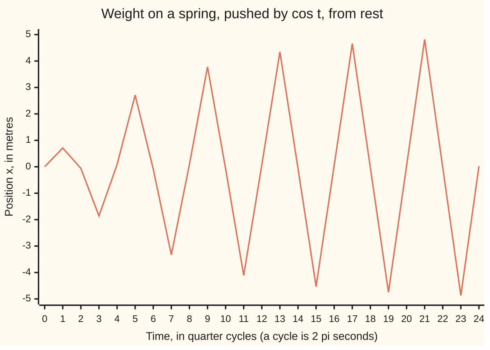

# Poincare maps: watch a flow only when it crosses a wall, and a periodic orbit becomes a fixed point

[Syllabus](../../../SYLLABUS.md) → [Differential equations and dynamics](../README.md) → [Discrete Dynamics and Chaos](../README.md#s11) → Poincare maps

---

## General Overview

A 1 kg weight hangs on a spring of stiffness 1 newton per metre. A damper (a friction pad) resists with 0.2 newtons per metre per second of speed. A motor pushes with cos t newtons at time t seconds, repeating every 2π seconds: exactly the spring's own undamped period, so only the damper limits the swing.

Started at rest, the weight swings wider each cycle and settles into a steady swing 5 metres each way.

Now flash a strobe light once per motor cycle, always at the same point of the push. Each flash shows one state: position and velocity. Snapshot n decides snapshot n + 1 by a fixed rule, because the law and the push look the same at every flash.

That rule is a **Poincare map** (say "pwan-ka-ray"): watch a flow only when it crosses a chosen wall, or a chosen moment of the cycle. The steady swing shows the same snapshot at every flash: a fixed point of the map. Any other start's distance from it shrinks by about 0.5335 each cycle.

**A Poincare map records a flow once per crossing of a wall, so a periodic orbit becomes a fixed point, and the orbit is stable when every eigenvalue of the map's derivative there, its Floquet multipliers, is smaller than 1 in size.**

**What kind of fact this is:** a construction (the map is a definition), plus two theorems proved on this card in Why it works: periodic orbits are exactly fixed points, and the multipliers set the stability.

### The picture: the weight from rest, seen every quarter cycle



Orange: the position, growing toward 5 metres each way. Every fourth point is a strobe flash, where the position stays near 0 while the speed grows toward 5 m/s.

---

## The formula

The state is $`z = (x, v)`$: position $`x`$ in metres and velocity $`v`$ in metres per second. The law is

```math
x'' + 0.2\,x' + x = \cos t
```

As a first-order system ([Forced systems](../04-Systems%20and%20the%20Matrix%20Exponential/06-forced-systems-and-variation-of-constants.md)) it reads $`z' = Az + b(t)`$, with $`A`$ = `[[0, 1], [-1, -0.2]]` and push $`b(t) = (0, \cos t)`$.

The strobe map $`P`$ sends the state at one flash to the state one period $`T = 2\pi`$ later. For this linear law it is **affine**: a matrix step plus a fixed shift:

```math
P(z) = Mz + c, \qquad M = e^{2\pi A}, \qquad c = \int_0^{2\pi} e^{A(2\pi - s)}\,b(s)\,ds
```

**Read it aloud:** the next snapshot is the old one carried one period by the free motion, plus what one period of pushing adds.

A fixed point $`z^* = P(z^*)`$ is a periodic orbit. Its stability is read from the eigenvalues of $`M`$, the **Floquet multipliers** $`\mu`$:

```math
z^* = (I - M)^{-1}c, \qquad \mu = e^{2\pi\lambda} = e^{2\pi(-0.1 \pm 0.994987\,i)}, \qquad |\mu| = e^{-0.2\pi} = 0.5335
```

**Read it aloud:** the steady swing solves "snapshot equals next snapshot", and each cycle shrinks a disturbance by 0.5335 and turns it slightly.

| Symbol | Plain meaning | In our example | Push it up and the answer… |
| --- | --- | --- | --- |
| $`x`$, $`v`$, $`z`$, $`t`$ | position (m), velocity (m/s), the state $`(x, v)`$, time (s) | start $`z`$ = (0, 0) | — |
| $`A`$, $`N`$, $`b(t)`$ | the free law's matrix, and $`N = A + 0.1I`$; the motor's push | `[[0, 1], [-1, -0.2]]`; $`(0, \cos t)`$ | — |
| $`\lambda`$, $`\omega`$, $`u`$ | eigenvalues of $`A`$, $`-0.1 \pm \omega i`$; $`\omega`$ the free turning rate; $`u`$ an eigenvector | $`\omega`$ = 0.994987 | more damping: real part more negative |
| $`T`$, $`\varphi_t`$ | the push's period; the flow, the state moved forward by time $`t`$ | $`T = 2\pi`$ s | — |
| $`P`$, $`M`$, $`c`$, $`I`$ | strobe map; its matrix part (its derivative); its shift; the identity matrix | $`c`$ = (0.0844, 2.3254) | — |
| $`z^*`$, $`e_n`$ | fixed point of $`P`$: the steady swing at a flash; the gap $`z_n - z^*`$ after $`n`$ cycles | (0, 5) | more damping: smaller swing, $`1/0.2`$ |
| $`\mu`$ | Floquet multipliers: eigenvalues of $`M`$ | size 0.5335, angle ±0.0315 rad | size 1 or more: the orbit lets go |
| $`\Sigma`$, $`\tau`$, $`\theta`$ | a wall cut across the flow; the time to come back to it; the phase, time counted round the cycle | for the strobe, wall $`\theta = 0`$, $`\tau = T`$ | — |

### When it holds

- **The strobe uses the law's period $`T`$.** At another interval the rule changes from flash to flash: no single map.
- **For a wall, the flow crosses it cleanly and comes back.** A path that grazes the wall (touches without crossing), or never returns, has no next crossing.
- **The law is linear.** Otherwise $`Mz + c`$ is only the map's straight-line approximation near the fixed point.
- **No multiplier has size exactly 1** (after setting aside the autonomous one, Step 5). If one does, the straight-line test is silent, and a nonlinear orbit may drift either way.

---

## Why it works

### Step 0: the same moment of the cycle removes the clock

The law at time $`t + 2\pi`$ is the law at $`t`$. So every trip from one flash to the next obeys the same rule, and a rule that is the same every step is a map ([Iteration](01-iteration-and-cobweb-plots.md)). An autonomous flow (one whose law never looks at the clock) needs a wall instead: each crossing is the next snapshot.

### Step 1: one period of a linear law is affine

The forced-system formula gives the state after time $`t`$ as the start carried forward by $`e^{At}`$, plus every past push carried forward. Put $`t = 2\pi`$: that is $`Mz + c`$. The code steps the law over one period to read off $`c`$ and the columns of $`M`$; the fold's hand formula agrees to six decimals.

### Step 2: fixed points are periodic orbits

If $`P(z^*) = z^*`$, the path from $`z^*`$ is back at $`z^*`$ after $`2\pi`$ with the push at the same phase, so by uniqueness of solutions it repeats ([The flow](../02-Existence%2C%20Uniqueness%20and%20Sensitivity/05-the-flow-of-an-equation.md)). Conversely, a $`2\pi`$-periodic path shows the same state at every flash.

Here $`(I - M)z^* = c`$ gives $`z^*`$ = (0, 5). Second road: put $`x = a\cos t + b\sin t`$ in the law. The $`x''`$ and $`x`$ terms cancel, leaving $`0.2\,b\cos t - 0.2\,a\sin t = \cos t`$, so $`a = 0`$ and $`b = 1/0.2 = 5`$. The swing $`5\sin t`$ is at $`x = 0`$, $`v = 5`$ at every flash.

### Step 3: the gap obeys the matrix step

Write the gap as $`e_n = z_n - z^*`$. Then $`e_{n+1} = Mz_n + c - (Mz^* + c) = M e_n`$, exactly. By the test of [Fixed points of a map](02-fixed-points-of-a-map.md) in two dimensions, the gap dies exactly when every eigenvalue of $`M`$ is smaller than 1 in size.

### Step 4: the eigenvalues of M are e to the 2π λ

If $`Au = \lambda u`$, each power of $`A`$ multiplies $`u`$ by that power of $`\lambda`$, so $`e^{2\pi A}u = e^{2\pi\lambda}u`$. The size is $`e^{-0.2\pi}`$ = 0.5335; the angle $`2\pi \times 0.994987`$ falls 0.0315 rad short of a full turn. The code gets the same size from $`M`$'s determinant, 0.284610 = $`e^{-0.4\pi}`$.

From rest the gaps run 5.0000, 2.6759, 1.4321, 0.7664: each about 0.5335 times the last. They sit slightly above $`5 \times 0.5335^n`$. In these units $`M`$ squeezes a little unevenly as it turns the gap, so the one-cycle ratio wobbles slowly round 0.5335; only the long-run average equals it.

<details>
<summary>Detailed proof: the hand formula for M, and why M is the Floquet matrix</summary>

Write $`A + 0.1I`$ as $`N`$. A direct product gives $`N^2 = -\omega^2 I`$ with $`\omega^2 = 1 - 0.01 = 0.99`$. So the series for $`e^{tN}`$ splits into even and odd powers, which are the cosine and sine series:

$`\displaystyle e^{tA} = e^{-0.1t}\left(\cos(\omega t)\, I + \frac{\sin(\omega t)}{\omega}\, N\right)`$

At $`t = 2\pi`$ this is the code's "M by formula".

For any law with period $`T`$ and a periodic solution, a small gap from it obeys a linear law whose matrix (the law's partial slopes along the solution) also has period $`T`$. Its solution matrix after one period, the **monodromy matrix**, is the strobe map's derivative there; its eigenvalues are by definition the Floquet multipliers. Here the law is linear, so that matrix is $`A`$ at every $`t`$, and the monodromy matrix is $`e^{2\pi A} = M`$.

</details>

### Step 5: autonomous flows, walls and a multiplier of 1

For a periodic orbit of an autonomous flow, one multiplier is always exactly 1: a push along the orbit stays on it, a little ahead, for ever.

A wall $`\Sigma`$ cut across the orbit removes it. The **return map** sends a point on $`\Sigma`$ to the flow's next crossing, $`P(z) = \varphi_{\tau(z)}(z)`$, where $`\tau(z)`$ is the time taken to come back. Its eigenvalues at the fixed point are the other multipliers. [Limit cycles](../06-Nonlinear%20Dynamics%20in%20the%20Plane/08-limit-cycles-and-van-der-pol.md) computes one such slope for van der Pol's heart model; [The Lorenz system](06-the-lorenz-system-and-strange-attractors.md) maps each top of a chaotic flow to the next.

The strobe is a special case: add the phase $`\theta`$ as a third state with $`\theta' = 1`$; the wall $`\theta = 0`$ is crossed every $`2\pi`$, so $`\tau = T`$.

---

## Worked numbers, by hand

| Step | Arithmetic | Value |
| --- | --- | --- |
| eigenvalues of $`A`$ | $`-0.1 \pm i\sqrt{1 - 0.01}`$ | $`-0.1 \pm 0.994987i`$ |
| multiplier size | $`e^{-0.1 \times 2\pi}`$ | 0.5335 |
| multiplier angle | $`2\pi(1 - 0.994987)`$ | ±0.0315 rad |
| product of both multipliers | $`e^{-0.4\pi}`$ = det $`M`$ | 0.284610 |
| steady swing | $`b = 1/0.2`$, $`a = 0`$ | $`5\sin t`$ |
| fixed point | $`(5\sin 0,\ 5\cos 0)`$ | **(0, 5): 5 m/s at every flash** |
| gap after 1 cycle from rest | strobe map, stepped | 2.6759 |

Each cycle cuts a disturbance to about half: after 8 cycles from rest the gap is 0.0336.

### What breaks if you drop a piece

| Mistake | Comes out at | What went wrong |
| --- | --- | --- |
| Forcing dropped from the map, $`P(z) = Mz`$ | fixed point (0, 0): swing 0, not 5 | $`c`$ carries the push; without it only rest is periodic |
| Rate per second $`e^{-0.1}`$ = 0.9048 used as the per-cycle factor | gap after 5 cycles 3.0327; true 0.2195 | the multiplier compounds over the whole period $`2\pi`$ |
| Sampling every π instead of every 2π | steady swing at $`t = \pi`$ is (0, −5): snapshots flip sign | half a period is not the law's period; the flip is not a 2-cycle |

---

## Code, from first principles, and it actually runs

Only `math` is imported. Road one steps the law with [Runge-Kutta four](../05-Numerical%20Evolution/04-runge-kutta-four.md) over one period, reads off $`M`$ and $`c`$, and solves for the fixed point. Road two uses hand formulas: $`e^{2\pi A}`$ in closed form, the swing $`(1/0.2)\sin t`$ and the size $`e^{-0.2\pi}`$. The asserts compare the roads, and the measured gap ratio with the multiplier.

### Python

```python
# Poincare maps -- the check behind the card.  Standard library only.
# The law is x'' + 0.2 x' + x = cos t: state z = (x, v), position and velocity.
# Watching it once every forcing period 2 pi turns the flow into a map P(z) = M z + c.
# Road one builds P by Runge-Kutta steps; road two builds M and the steady
# oscillation by hand formulas.  They must agree.
import math
TAU, B, N = 2 * math.pi, 0.2, 4000                    # forcing period, damping, steps per period

def f(t, z): return (z[1], -B * z[1] - z[0] + math.cos(t))

def flow(z, t0, span, n):                             # Runge-Kutta 4 from time t0 for a time span
    h, t = span / n, t0
    for _ in range(n):
        k1 = f(t, z); k2 = f(t + h / 2, [z[i] + h / 2 * k1[i] for i in (0, 1)])
        k3 = f(t + h / 2, [z[i] + h / 2 * k2[i] for i in (0, 1)]); k4 = f(t + h, [z[i] + h * k3[i] for i in (0, 1)])
        z, t = [z[i] + h / 6 * (k1[i] + 2 * k2[i] + 2 * k3[i] + k4[i]) for i in (0, 1)], t + h
    return z

def P(z): return flow(z, 0.0, TAU, N)                 # the once-per-period (stroboscopic) map
def fmt(z): return "({:.4f}, {:.4f})".format(*(round(v, 4) + 0.0 for v in z))   # no "-0.0000"

c = P([0.0, 0.0]); p1, p2 = P([1.0, 0.0]), P([0.0, 1.0])
M = [[p1[0] - c[0], p2[0] - c[0]], [p1[1] - c[1], p2[1] - c[1]]]   # columns: where each unit push goes
w = math.sqrt(1 - B * B / 4); s, k = math.sin(TAU * w) / w, math.exp(-B / 2 * TAU)
Mh = [[k * (math.cos(TAU * w) + s * B / 2), k * s], [-k * s, k * (math.cos(TAU * w) - s * B / 2)]]
d = (1 - M[0][0]) * (1 - M[1][1]) - M[0][1] * M[1][0]               # solve (I - M) z = c by Cramer
zs = [(c[0] * (1 - M[1][1]) + M[0][1] * c[1]) / d, ((1 - M[0][0]) * c[1] + M[1][0] * c[0]) / d]
amp = 1 / B                                           # steady x = a cos t + b sin t forces a = 0, b = 1/0.2
T, D = M[0][0] + M[1][1], M[0][0] * M[1][1] - M[0][1] * M[1][0]
size, ang = math.sqrt(D), math.atan2(math.sqrt(D - T * T / 4), T / 2)
gaps, z = [], [0.0, 0.0]
for n in range(9): gaps.append(math.dist(z, zs)); z = P(z)
half = flow([0.0, amp], 0.0, TAU / 2, N // 2)
print(f"law x'' + {B}x' + x = cos t; eigenvalues of A: {-B / 2} +/- {w:.6f}i")
print(f"P(0, 0) = c = {fmt(c)}")
print(f"M by Runge-Kutta: [[{M[0][0]:.6f}, {M[0][1]:.6f}], [{M[1][0]:.6f}, {M[1][1]:.6f}]]")
print(f"M by formula:     [[{Mh[0][0]:.6f}, {Mh[0][1]:.6f}], [{Mh[1][0]:.6f}, {Mh[1][1]:.6f}]]")
print(f"fixed point of P: {fmt(zs)}; steady oscillation (1/B) sin t at t = 0: (0.0000, {amp:.4f})")
print(f"trace of M {T:.6f}, determinant {D:.6f} = exp(-2 pi B) {math.exp(-TAU * B):.6f}")
print(f"multipliers: size {size:.4f}, angle +/- {ang:.4f} rad; exp(-pi B) = {k:.4f}, 2 pi (1 - w) = {TAU * (1 - w):.4f}")
print("gap to fixed point after n periods from rest:", ", ".join(f"{g:.4f}" for g in gaps))
print("prediction (1/B) exp(-pi B)^n:               ", ", ".join(f"{amp * k ** n:.4f}" for n in range(9)))
print(f"chart, x(t) every quarter period from rest: " + ", ".join(f"{flow([0.0, 0.0], 0.0, j * TAU / 4, j * N // 4 + 1)[0]:.2f}" for j in range(25)))
print(f"mistake, forcing dropped: fixed point (0.0000, 0.0000), amplitude 0 not {amp:.0f}")
print(f"mistake, per-time factor exp(-0.1) = {math.exp(-B / 2):.4f} as per-period: gap after 5 periods {amp * math.exp(-B / 2) ** 5:.4f}, true {gaps[5]:.4f}")
print(f"mistake, sampling every pi: steady state at t = pi is {fmt(half)}, so samples flip; not a 2-cycle")
assert max(abs(M[i][j] - Mh[i][j]) for i in (0, 1) for j in (0, 1)) < 1e-9    # numeric map = matrix exponential
assert abs(zs[0]) + abs(zs[1] - amp) < 1e-9 and math.dist(P(zs), zs) < 1e-9     # fixed point = steady oscillation
assert abs(size - math.exp(-B * math.pi)) < 1e-9 and abs(ang - TAU * (1 - w)) < 1e-6   # Floquet multipliers
assert abs(gaps[8] / gaps[7] - k) < 0.01 and abs(half[1] + amp) < 1e-9          # gap ratio tends to exp(-pi B)
print("ALL CHECKS PASS")
```

**Ran 2026-11-23 on macOS, Python 3.14.10, standard library only. All checks passed. Output, pasted from the run:**

```
law x'' + 0.2x' + x = cos t; eigenvalues of A: -0.1 +/- 0.994987i
P(0, 0) = c = (0.0844, 2.3254)
M by Runge-Kutta: [[0.531535, -0.016884], [0.016884, 0.534912]]
M by formula:     [[0.531535, -0.016884], [0.016884, 0.534912]]
fixed point of P: (0.0000, 5.0000); steady oscillation (1/B) sin t at t = 0: (0.0000, 5.0000)
trace of M 1.066447, determinant 0.284610 = exp(-2 pi B) 0.284610
multipliers: size 0.5335, angle +/- 0.0315 rad; exp(-pi B) = 0.5335, 2 pi (1 - w) = 0.0315
gap to fixed point after n periods from rest: 5.0000, 2.6759, 1.4321, 0.7664, 0.4101, 0.2195, 0.1174, 0.0628, 0.0336
prediction (1/B) exp(-pi B)^n:                5.0000, 2.6674, 1.4230, 0.7592, 0.4050, 0.2161, 0.1153, 0.0615, 0.0328
chart, x(t) every quarter period from rest: 0.00, 0.71, -0.06, -1.86, 0.08, 2.71, -0.09, -3.33, 0.09, 3.78, -0.08, -4.11, 0.07, 4.35, -0.06, -4.53, 0.05, 4.66, -0.04, -4.75, 0.03, 4.82, -0.03, -4.87, 0.02
mistake, forcing dropped: fixed point (0.0000, 0.0000), amplitude 0 not 5
mistake, per-time factor exp(-0.1) = 0.9048 as per-period: gap after 5 periods 3.0327, true 0.2195
mistake, sampling every pi: steady state at t = pi is (0.0000, -5.0000), so samples flip; not a 2-cycle
ALL CHECKS PASS
```

### Rust

Same numbers, same labels, built with `rustc --edition 2021 -O`.

```rust
// Poincare maps -- the same check as the Python, in Rust.  No crates.
// The law is x'' + 0.2 x' + x = cos t: state z = (x, v), position and velocity.
// Watching it once every forcing period 2 pi turns the flow into a map P(z) = M z + c.
// Road one builds P by Runge-Kutta steps; road two builds M and the steady
// oscillation by hand formulas.  They must agree.
use std::f64::consts::PI;
const TAU: f64 = 2.0 * PI;
const B: f64 = 0.2;                                   // damping
const N: usize = 4000;                                // steps per period

fn f(t: f64, z: [f64; 2]) -> [f64; 2] { [z[1], -B * z[1] - z[0] + t.cos()] }

fn flow(mut z: [f64; 2], t0: f64, span: f64, n: usize) -> [f64; 2] {   // Runge-Kutta 4 from time t0
    let (h, mut t) = (span / n as f64, t0);
    for _ in 0..n {
        let k1 = f(t, z);
        let k2 = f(t + h / 2.0, [z[0] + h / 2.0 * k1[0], z[1] + h / 2.0 * k1[1]]);
        let k3 = f(t + h / 2.0, [z[0] + h / 2.0 * k2[0], z[1] + h / 2.0 * k2[1]]);
        let k4 = f(t + h, [z[0] + h * k3[0], z[1] + h * k3[1]]);
        for i in 0..2 { z[i] += h / 6.0 * (k1[i] + 2.0 * k2[i] + 2.0 * k3[i] + k4[i]) }
        t += h;
    }
    z
}

fn p(z: [f64; 2]) -> [f64; 2] { flow(z, 0.0, TAU, N) }   // the once-per-period (stroboscopic) map
fn r4(v: f64) -> f64 { (v * 1e4).round() / 1e4 + 0.0 }  // no "-0.0000"
fn fmt(z: [f64; 2]) -> String { format!("({:.4}, {:.4})", r4(z[0]), r4(z[1])) }
fn dist(a: [f64; 2], b: [f64; 2]) -> f64 { ((a[0] - b[0]).powi(2) + (a[1] - b[1]).powi(2)).sqrt() }
fn join(v: &[f64], d: usize) -> String { v.iter().map(|x| format!("{:.*}", d, x)).collect::<Vec<_>>().join(", ") }

fn main() {
    let c = p([0.0, 0.0]);
    let (p1, p2) = (p([1.0, 0.0]), p([0.0, 1.0]));
    let m = [[p1[0] - c[0], p2[0] - c[0]], [p1[1] - c[1], p2[1] - c[1]]];   // columns: where each unit push goes
    let w = (1.0 - B * B / 4.0).sqrt();
    let (s, k) = ((TAU * w).sin() / w, (-B / 2.0 * TAU).exp());
    let mh = [[k * ((TAU * w).cos() + s * B / 2.0), k * s], [-k * s, k * ((TAU * w).cos() - s * B / 2.0)]];
    let d = (1.0 - m[0][0]) * (1.0 - m[1][1]) - m[0][1] * m[1][0];     // solve (I - M) z = c by Cramer
    let zs = [(c[0] * (1.0 - m[1][1]) + m[0][1] * c[1]) / d, ((1.0 - m[0][0]) * c[1] + m[1][0] * c[0]) / d];
    let amp = 1.0 / B;                                // steady x = a cos t + b sin t forces a = 0, b = 1/0.2
    let (tr, de) = (m[0][0] + m[1][1], m[0][0] * m[1][1] - m[0][1] * m[1][0]);
    let (size, ang) = (de.sqrt(), (de - tr * tr / 4.0).sqrt().atan2(tr / 2.0));
    let mut gaps = vec![];
    let mut z = [0.0, 0.0];
    for _ in 0..9 { gaps.push(dist(z, zs)); z = p(z) }
    let half = flow([0.0, amp], 0.0, TAU / 2.0, N / 2);
    let pred: Vec<f64> = (0..9).map(|n| amp * k.powi(n)).collect();
    let chart: Vec<f64> = (0..25).map(|j| flow([0.0, 0.0], 0.0, j as f64 * TAU / 4.0, j * N / 4 + 1)[0]).collect();
    println!("law x'' + {}x' + x = cos t; eigenvalues of A: {} +/- {:.6}i", B, -B / 2.0, w);
    println!("P(0, 0) = c = {}", fmt(c));
    println!("M by Runge-Kutta: [[{:.6}, {:.6}], [{:.6}, {:.6}]]", m[0][0], m[0][1], m[1][0], m[1][1]);
    println!("M by formula:     [[{:.6}, {:.6}], [{:.6}, {:.6}]]", mh[0][0], mh[0][1], mh[1][0], mh[1][1]);
    println!("fixed point of P: {}; steady oscillation (1/B) sin t at t = 0: (0.0000, {:.4})", fmt(zs), amp);
    println!("trace of M {:.6}, determinant {:.6} = exp(-2 pi B) {:.6}", tr, de, (-TAU * B).exp());
    println!("multipliers: size {:.4}, angle +/- {:.4} rad; exp(-pi B) = {:.4}, 2 pi (1 - w) = {:.4}", size, ang, k, TAU * (1.0 - w));
    println!("gap to fixed point after n periods from rest: {}", join(&gaps, 4));
    println!("prediction (1/B) exp(-pi B)^n:                {}", join(&pred, 4));
    println!("chart, x(t) every quarter period from rest: {}", join(&chart, 2));
    println!("mistake, forcing dropped: fixed point (0.0000, 0.0000), amplitude 0 not {:.0}", amp);
    println!("mistake, per-time factor exp(-0.1) = {:.4} as per-period: gap after 5 periods {:.4}, true {:.4}",
             (-B / 2.0).exp(), amp * (-B / 2.0).exp().powi(5), gaps[5]);
    println!("mistake, sampling every pi: steady state at t = pi is {}, so samples flip; not a 2-cycle", fmt(half));
    let worst = (0..2).flat_map(|i| (0..2).map(move |j| (i, j))).map(|(i, j)| (m[i][j] - mh[i][j]).abs()).fold(0.0, f64::max);
    assert!(worst < 1e-9);                                                  // numeric map = matrix exponential
    assert!(zs[0].abs() + (zs[1] - amp).abs() < 1e-9 && dist(p(zs), zs) < 1e-9);   // fixed point = steady oscillation
    assert!((size - (-B * PI).exp()).abs() < 1e-9 && (ang - TAU * (1.0 - w)).abs() < 1e-6); // Floquet multipliers
    assert!((gaps[8] / gaps[7] - k).abs() < 0.01 && (half[1] + amp).abs() < 1e-9); // gap ratio tends to exp(-pi B)
    println!("ALL CHECKS PASS");
}
```

**Ran 2026-11-23 on macOS, rustc 1.98.1, no crates. All checks passed. Output, pasted from the run:**

```
law x'' + 0.2x' + x = cos t; eigenvalues of A: -0.1 +/- 0.994987i
P(0, 0) = c = (0.0844, 2.3254)
M by Runge-Kutta: [[0.531535, -0.016884], [0.016884, 0.534912]]
M by formula:     [[0.531535, -0.016884], [0.016884, 0.534912]]
fixed point of P: (0.0000, 5.0000); steady oscillation (1/B) sin t at t = 0: (0.0000, 5.0000)
trace of M 1.066447, determinant 0.284610 = exp(-2 pi B) 0.284610
multipliers: size 0.5335, angle +/- 0.0315 rad; exp(-pi B) = 0.5335, 2 pi (1 - w) = 0.0315
gap to fixed point after n periods from rest: 5.0000, 2.6759, 1.4321, 0.7664, 0.4101, 0.2195, 0.1174, 0.0628, 0.0336
prediction (1/B) exp(-pi B)^n:                5.0000, 2.6674, 1.4230, 0.7592, 0.4050, 0.2161, 0.1153, 0.0615, 0.0328
chart, x(t) every quarter period from rest: 0.00, 0.71, -0.06, -1.86, 0.08, 2.71, -0.09, -3.33, 0.09, 3.78, -0.08, -4.11, 0.07, 4.35, -0.06, -4.53, 0.05, 4.66, -0.04, -4.75, 0.03, 4.82, -0.03, -4.87, 0.02
mistake, forcing dropped: fixed point (0.0000, 0.0000), amplitude 0 not 5
mistake, per-time factor exp(-0.1) = 0.9048 as per-period: gap after 5 periods 3.0327, true 0.2195
mistake, sampling every pi: steady state at t = pi is (0.0000, -5.0000), so samples flip; not a 2-cycle
ALL CHECKS PASS
```

The two outputs match line for line.

### Lean

Lean proves the stability test for every affine strobe map, in any number of dimensions, and the steady swing of this spring.

- Take a strobe map $`P(z) = Mz + c`$ with every multiplier smaller than 1 in size. Then $`P`$ has exactly one fixed point, and every start's snapshots converge to it.
- Take an eigenvector $`u`$ of $`A`$ with eigenvalue $`\lambda`$, and any period $`T`$. Then $`e^{TA}u = e^{T\lambda}u`$, so $`e^{T\lambda}`$ is a multiplier of $`e^{TA}`$.
- The swing $`5\sin t`$ solves $`x'' + 0.2x' + x = \cos t`$ and repeats every $`2\pi`$.
- At time 0 the swing shows the snapshot (0, 5): the fixed point.
- The hand arithmetic holds exactly: $`N = A + 0.1I`$, $`N^2 = -0.99I`$, and the swing size $`1/0.2 = 5`$.

The Runge-Kutta steps, the decimals and the gaps are left to the Python and Rust checks; nothing checks walls or nonlinear laws.

```lean
-- Poincare maps: for a linear periodic law the once-per-period map z ↦ M z + c has exactly one fixed point and every start converges to it when all eigenvalues of M (the Floquet multipliers) are smaller than 1 in size, each multiplier of M = e^(T A) is e^(T λ), and the pushed spring x'' + 0.2 x' + x = cos t has the steady 2π-periodic swing 5 sin t.
import Mathlib.Analysis.Normed.Algebra.MatrixExponential
import Mathlib.Analysis.SpecialFunctions.Trigonometric.Deriv
import Mathlib.Algebra.Algebra.Spectrum.Basic
import Mathlib.Topology.Instances.Matrix
import Mathlib.Analysis.Normed.Algebra.GelfandFormula
import Mathlib.Analysis.SpecialFunctions.Pow.NNReal
import Mathlib.Analysis.Complex.Basic

open Filter Topology Matrix

open scoped NNReal ENNReal in
theorem pow_norm_tendsto_zero_of_spectralRadius_lt_one {A : Type*} [NormedRing A]
    [NormedAlgebra ℂ A] [CompleteSpace A] (a : A) (h : spectralRadius ℂ a < 1) :
    Tendsto (fun k : ℕ => ‖a ^ k‖) atTop (𝓝 0) := by
  obtain ⟨r, hr1, hr2⟩ := ENNReal.lt_iff_exists_nnreal_btwn.mp h
  have hr : (r : ℝ) < 1 := by exact_mod_cast ENNReal.coe_lt_one_iff.mp hr2
  have hev := (spectrum.pow_nnnorm_pow_one_div_tendsto_nhds_spectralRadius a).eventually
    (gt_mem_nhds hr1)
  have hb : ∀ᶠ k : ℕ in atTop, ‖a ^ k‖ ≤ (r : ℝ) ^ k := by
    filter_upwards [hev, eventually_ge_atTop 1] with k hk hk1
    have hkpos : (0 : ℝ) < k := by exact_mod_cast hk1
    rw [one_div, ENNReal.rpow_inv_lt_iff hkpos, ENNReal.rpow_natCast] at hk
    have h2 : ‖a ^ k‖₊ < r ^ k := by exact_mod_cast hk
    have h3 := NNReal.coe_lt_coe.mpr h2
    push_cast at h3
    exact h3.le
  exact squeeze_zero' (Eventually.of_forall fun k => norm_nonneg _) hb
    (tendsto_pow_atTop_nhds_zero_of_lt_one r.coe_nonneg hr)

#print axioms pow_norm_tendsto_zero_of_spectralRadius_lt_one

section
attribute [local instance] Matrix.linftyOpNormedRing Matrix.linftyOpNormedAlgebra

theorem real_matrix_pow_mulVec_tendsto_zero {n : ℕ} [Nonempty (Fin n)]
    (M : Matrix (Fin n) (Fin n) ℝ)
    (hμ : ∀ μ ∈ spectrum ℂ (M.map (algebraMap ℝ ℂ)), ‖μ‖ < 1) (v : Fin n → ℝ) :
    Tendsto (fun k : ℕ => (M ^ k) *ᵥ v) atTop (𝓝 0) := by
  have : CompleteSpace (Matrix (Fin n) (Fin n) ℂ) := FiniteDimensional.complete ℂ _
  set Mc := M.map (algebraMap ℝ ℂ) with hMc
  have hρ : spectralRadius ℂ Mc < 1 := by
    have := spectrum.spectralRadius_lt_of_forall_lt_of_nonempty (r := 1) (spectrum.nonempty Mc)
      (fun μ hμ' => by
        rw [← NNReal.coe_lt_coe]
        simpa using hμ μ hμ')
    simpa using this
  have h0 := pow_norm_tendsto_zero_of_spectralRadius_lt_one Mc hρ
  have hnorm : ∀ k : ℕ, ‖M ^ k‖ = ‖Mc ^ k‖ := by
    intro k
    have : Mc ^ k = (M ^ k).map (algebraMap ℝ ℂ) := by
      rw [hMc, ← RingHom.mapMatrix_apply, ← RingHom.mapMatrix_apply, map_pow]
    rw [this, Matrix.linfty_opNorm_def, Matrix.linfty_opNorm_def]
    simp
  have h1 : Tendsto (fun k : ℕ => ‖M ^ k‖ * ‖v‖) atTop (𝓝 0) := by
    simpa [hnorm] using h0.mul_const ‖v‖
  exact squeeze_zero_norm (fun k => Matrix.linfty_opNorm_mulVec _ _) h1

end

#print axioms real_matrix_pow_mulVec_tendsto_zero

/-- The stability test for a linear law's stroboscopic (Poincare) map. The map is affine,
`P z = M z + c`. If every eigenvalue of `M` (every Floquet multiplier, taken over the complex
numbers) is smaller than 1 in size, then `P` has exactly one fixed point `z*` (the periodic
orbit), and from every start the snapshots `P^[k] z` converge to `z*`. -/
theorem affine_return_map_fixed_point_attracts {n : ℕ} (M : Matrix (Fin n) (Fin n) ℝ)
    (c : Fin n → ℝ)
    (hμ : ∀ μ ∈ spectrum ℂ (M.map (algebraMap ℝ ℂ)), ‖μ‖ < 1) :
    ∃! zs : Fin n → ℝ, M *ᵥ zs + c = zs ∧
      ∀ z : Fin n → ℝ, Tendsto (fun k : ℕ => (fun w => M *ᵥ w + c)^[k] z) atTop (𝓝 zs) := by
  rcases Nat.eq_zero_or_pos n with rfl | hn
  · refine ⟨0, ⟨Subsingleton.elim _ _, fun z => ?_⟩, fun y _ => Subsingleton.elim _ _⟩
    exact tendsto_const_nhds.congr (fun k => Subsingleton.elim _ _)
  have : Nonempty (Fin n) := ⟨⟨0, hn⟩⟩
  have hdecay : ∀ v, Tendsto (fun k : ℕ => (M ^ k) *ᵥ v) atTop (𝓝 0) :=
    real_matrix_pow_mulVec_tendsto_zero M hμ
  have hfix : ∀ w, M *ᵥ w = w → w = 0 := by
    intro w hw
    have hpow : ∀ k : ℕ, (M ^ k) *ᵥ w = w := by
      intro k
      induction k with
      | zero => simp
      | succ k ih => rw [pow_succ, ← Matrix.mulVec_mulVec, hw, ih]
    have := hdecay w
    simp only [hpow] at this
    exact tendsto_nhds_unique tendsto_const_nhds this
  have hinj : Function.Injective (1 - M).mulVec := by
    intro a b hab
    have h1 : (1 - M) *ᵥ (a - b) = 0 := by rw [Matrix.mulVec_sub, hab, sub_self]
    rw [Matrix.sub_mulVec, Matrix.one_mulVec, sub_eq_zero] at h1
    exact sub_eq_zero.mp (hfix _ h1.symm)
  have hsurj := Matrix.mulVec_surjective_iff_isUnit.mpr (Matrix.mulVec_injective_iff_isUnit.mp hinj)
  obtain ⟨zs, hzs⟩ := hsurj c
  have hfp : M *ᵥ zs + c = zs := by
    rw [← hzs, Matrix.sub_mulVec, Matrix.one_mulVec]; abel
  have hMzs : M *ᵥ zs = zs - c := eq_sub_of_add_eq hfp
  refine ⟨zs, ⟨hfp, fun z => ?_⟩, fun y hy => ?_⟩
  · have hit : ∀ k : ℕ, (fun w => M *ᵥ w + c)^[k] z = zs + (M ^ k) *ᵥ (z - zs) := by
      intro k
      induction k with
      | zero => simp
      | succ k ih =>
        rw [Function.iterate_succ_apply', ih]
        rw [Matrix.mulVec_add, pow_succ', ← Matrix.mulVec_mulVec, hMzs]
        abel
    simp_rw [hit]
    simpa using tendsto_const_nhds.add (hdecay (z - zs))
  · have := hfix (y - zs) (by rw [Matrix.mulVec_sub, eq_sub_of_add_eq hy.1, hMzs]; abel)
    exact sub_eq_zero.mp this

/-- Step 4: the multipliers of `M = e^(T A)` are `e^(T λ)`. If `u` is an eigenvector of `A`
with eigenvalue `λ`, then `e^(T A)` multiplies `u` by `e^(T λ)`. -/
theorem exp_mulVec_of_eigenvector {n : ℕ} (A : Matrix (Fin n) (Fin n) ℂ) (u : Fin n → ℂ)
    (lam : ℂ) (T : ℝ) (hu : A *ᵥ u = lam • u) :
    NormedSpace.exp ((T : ℂ) • A) *ᵥ u = Complex.exp (T * lam) • u := by
  set X : Matrix (Fin n) (Fin n) ℂ := (T : ℂ) • A with hX
  have hXu : X *ᵥ u = ((T : ℂ) * lam) • u := by
    rw [hX, Matrix.smul_mulVec, hu, smul_smul]
  have hpow : ∀ k : ℕ, (X ^ k) *ᵥ u = ((T : ℂ) * lam) ^ k • u := by
    intro k
    induction k with
    | zero => simp
    | succ k ih =>
      rw [pow_succ', ← Matrix.mulVec_mulVec, ih, Matrix.mulVec_smul, hXu, smul_smul, pow_succ]
  have hS : HasSum (fun k : ℕ => ((k.factorial⁻¹ : ℂ) • X ^ k)) (NormedSpace.exp X) := by
    open scoped Norms.Operator in exact NormedSpace.exp_series_hasSum_exp' (𝕂 := ℂ) X
  have hS2 := hS.map (Matrix.mulVec.addMonoidHomLeft u)
    (continuous_id.matrix_mulVec continuous_const)
  have hC : HasSum (fun k : ℕ => ((k.factorial⁻¹ : ℂ) • ((T : ℂ) * lam) ^ k))
      (Complex.exp (T * lam)) := by
    rw [Complex.exp_eq_exp_ℂ]
    exact NormedSpace.exp_series_hasSum_exp' (𝕂 := ℂ) _
  have hC2 := hC.smul_const u
  refine hS2.unique ?_
  convert hC2 using 1
  funext k
  simp [Matrix.mulVec.addMonoidHomLeft, Matrix.smul_mulVec, hpow, smul_smul]

/-- Step 2, second road: the swing `x = 5 sin t` solves `x'' + 0.2 x' + x = cos t`, repeats
every `2π`, and so shows the same snapshot `(x, v) = (0, 5)` at every flash: the fixed point. -/
theorem steady_swing_is_periodic_solution :
    (∀ t : ℝ, deriv (deriv fun s => 5 * Real.sin s) t + (1 / 5 : ℝ) * deriv (fun s => 5 * Real.sin s) t
        + 5 * Real.sin t = Real.cos t) ∧
    (∀ t : ℝ, 5 * Real.sin (t + 2 * Real.pi) = 5 * Real.sin t) ∧
    ((5 * Real.sin 0, deriv (fun s => 5 * Real.sin s) 0) = ((0 : ℝ), (5 : ℝ))) := by
  have h1 : deriv (fun s => 5 * Real.sin s) = fun s => 5 * Real.cos s := by
    funext s; simp
  have h2 : deriv (fun s => 5 * Real.cos s) = fun s => -(5 * Real.sin s) := by
    funext s; simp
  refine ⟨fun t => ?_, fun t => ?_, ?_⟩
  · rw [h1, h2]; ring
  · rw [Real.sin_add_two_pi]
  · rw [h1]; simp

/-- The amplitude: damping 0.2 = 1/5 times amplitude 5 matches the push of size 1. -/
example : (1 / 5 : ℚ) * 5 = 1 := by norm_num

/-- The hand formula for `M`: with `N = A + 0.1 I = [[1/10, 1], [-1, -1/10]]`,
`N^2 = -(99/100) I`, so `ω^2 = 1 - 0.01 = 0.99`. -/
example : (!![1 / 10, 1; -1, -1 / 10] : Matrix (Fin 2) (Fin 2) ℚ) ^ 2
    = -(99 / 100 : ℚ) • (1 : Matrix (Fin 2) (Fin 2) ℚ) := by
  ext i j; fin_cases i <;> fin_cases j <;> norm_num [sq, Matrix.mul_apply, Fin.sum_univ_two]

/-- `N = A + 0.1 I` with `A = [[0, 1], [-1, -1/5]]`. -/
example : (!![0, 1; -1, -1 / 5] : Matrix (Fin 2) (Fin 2) ℚ) + (1 / 10 : ℚ) • 1
    = !![1 / 10, 1; -1, -1 / 10] := by
  ext i j; fin_cases i <;> fin_cases j <;> norm_num

#print axioms affine_return_map_fixed_point_attracts
#print axioms exp_mulVec_of_eigenvector
#print axioms steady_swing_is_periodic_solution
```

**Checked 2026-11-23 on macOS, Lean 4.36.0-rc2, Mathlib v4.36.0-rc2. Every proof is complete and uses only Lean's standard axioms. Output, pasted from the run:**

```
'pow_norm_tendsto_zero_of_spectralRadius_lt_one' depends on axioms: [propext, Classical.choice, Quot.sound]
'real_matrix_pow_mulVec_tendsto_zero' depends on axioms: [propext, Classical.choice, Quot.sound]
'affine_return_map_fixed_point_attracts' depends on axioms: [propext, Classical.choice, Quot.sound]
'exp_mulVec_of_eigenvector' depends on axioms: [propext, Classical.choice, Quot.sound]
'steady_swing_is_periodic_solution' depends on axioms: [propext, Classical.choice, Quot.sound]
```

> [!TIP]
> **Try changing**
> Guess first, then run it.
> - **Double the damping.** Change `B` from 0.2 to 0.4. The fixed point moves to (0, 2.5) and the multiplier size to 0.2846: the swing halves and the factor squares.
> - **Start elsewhere.** In the gap loop, change the start `[0.0, 0.0]` to `[3.0, 0.0]`. Gaps 5.8310, 3.1151, 1.6640: same fixed point, same factor.
> - **Fewer steps.** Change `N` from 4000 to 40. The fixed point reads (−0.0003, 5.0000) and the first assert fails: the stepper, not the maths, is off.

---

## The usual mistake

> [!warning]
> **Reading the per-cycle factor from the rate per second.** The eigenvalue's real part, −0.1, is a rate per second. The strobe compounds it over a whole period: $`e^{-0.1 \times 2\pi}`$ = 0.5335, not $`e^{-0.1}`$ = 0.9048. The wrong factor predicts a gap of 3.0327 after 5 cycles; the true gap is 0.2195.
>
> - **Leaving out the shift $`c`$.** $`Mz`$ alone has fixed point (0, 0): no swing at all.
> - **Strobing every π.** The swing shows (0, 5), then (0, −5): one orbit seen twice a cycle, not period doubling.
> - **Expecting every multiplier below 1 for an autonomous orbit.** One is always exactly 1; use a wall and read the others.

---

## Where you meet it in real life

- **Driven circuits.** A circuit fed by mains power is sampled once per mains cycle; simulators find its steady state by solving $`P(z) = z`$ directly.
- **Strobe lights on machines.** One flash per shaft turn makes a smooth part look still and a wobble show up as a drifting snapshot.
- **Paced hearts.** A heart driven by regular pacemaker pulses is studied beat by beat as a map; the steady rhythm is a fixed point.
- **Planetary orbits.** Poincare built these maps in the 1880s to study three bodies under gravity, watching only crossings of a plane.

> **Say it back**
> A Poincare map watches a flow only at a wall, or once per period of a periodic push. A periodic orbit then shows the same snapshot every time: a fixed point. Each step multiplies a small gap by the map's derivative, whose eigenvalues are the Floquet multipliers. The orbit is stable when all are smaller than 1 in size. For the pushed spring the steady swing is the fixed point (0, 5), and each cycle cuts a disturbance by 0.5335.

---

## What this builds on

- [Fixed points of a map](02-fixed-points-of-a-map.md): the slope test, here used with a matrix and its eigenvalues.
- [Floquet theory](../04-Systems%20and%20the%20Matrix%20Exponential/08-floquet-theory-and-parametric-resonance.md): the multipliers of a law with periodic coefficients, the monodromy matrix.
- [Limit cycles](../06-Nonlinear%20Dynamics%20in%20the%20Plane/08-limit-cycles-and-van-der-pol.md): a return map on a half-axis, and its slope as the pull per lap.
- [The Lorenz system](06-the-lorenz-system-and-strange-attractors.md): a map of successive tops, the same idea for a chaotic flow.
- [Forced systems](../04-Systems%20and%20the%20Matrix%20Exponential/06-forced-systems-and-variation-of-constants.md): the formula that makes one period an affine step.
- [The flow](../02-Existence%2C%20Uniqueness%20and%20Sensitivity/05-the-flow-of-an-equation.md): the rule $`\varphi_t`$ and the uniqueness that makes a fixed point a whole orbit.

## Where this goes next

- [The Smale horseshoe](08-smale-horseshoe.md): a return map that stretches and folds, and the chaos it forces.
- [The Henon map](09-the-henon-map.md): a two-dimensional map built to mimic the Lorenz return map.

This card's map had one attracting fixed point; what a return map does when it stretches, squeezes and folds back is the open question.

---

## Sources

Verified 2026-11-23: every link below resolves to the publisher's page.

- Strogatz, Steven H. *Nonlinear Dynamics and Chaos*, 3rd ed. CRC Press, 2024. [Publisher page](https://www.routledge.com/Nonlinear-Dynamics-and-Chaos-With-Applications-to-Physics-Biology-Chemistry-and-Engineering/Strogatz/p/book/9780367026509). Section 8.7: Poincare maps, fixed points as closed orbits, and their multipliers.
- Guckenheimer, John, and Philip Holmes. *Nonlinear Oscillations, Dynamical Systems, and Bifurcations of Vector Fields*. Springer, 1983. [DOI](https://doi.org/10.1007/978-1-4612-1140-2). Section 1.5: return maps and the stroboscopic map of a periodically forced system.
- Perko, Lawrence. *Differential Equations and Dynamical Systems*, 3rd ed. Springer, 2001. [DOI](https://doi.org/10.1007/978-1-4613-0003-8). Section 3.4: the Poincare map, its derivative, and the multiplier 1 along an autonomous orbit.
- Floquet, Gaston. "Sur les équations différentielles linéaires à coefficients périodiques." *Annales scientifiques de l'École Normale Supérieure* 12 (1883), 47–88. [DOI](https://doi.org/10.24033/asens.220). The multipliers of a linear law with periodic coefficients.
