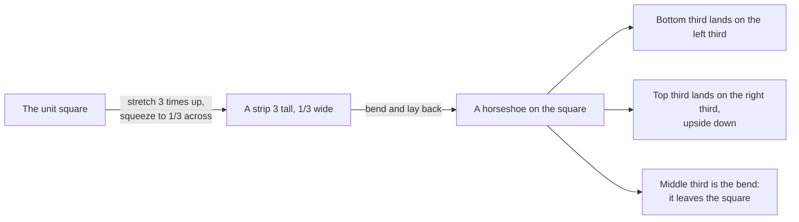

# The Smale horseshoe: stretch, fold and lay back, and every coin-toss sequence becomes an orbit

[Syllabus](../../../SYLLABUS.md) → [Differential equations and dynamics](../README.md) → [Discrete Dynamics and Chaos](../README.md#s11) → The Smale horseshoe

---

## General Overview

Take a square of dough, 1 unit on a side. Roll it out to 3 units tall and 1/3 unit wide. Bend the strip into a horseshoe and lay it back on the square: the legs sit over the left and right thirds, and the bend hangs outside.

One round of stretch, fold and lay back is the **horseshoe map**, written $`f`$. Each round the middle third of the square becomes the bend and falls off. After 10 rounds only 0.0173 of the square's height is left.

What stays forever is a fine dust. Each round, write 0 if a grain is in the bottom third and 1 if it is in the top third. Every endless list of 0s and 1s, running into past and future, belongs to exactly one grain. So 2 grains never move, 4 return after two rounds, and $`2^n`$ return after $`n`$ rounds.

**Stretching by 3 and folding back keeps only the points whose every past and future round lands in the bottom or top third; recording 0 or 1 for each round names each such point by a two-way endless coin-toss sequence, and one round of the map just shifts that sequence one place.**

**What kind of fact this is:** a theorem, proved on this card in Why it works; the Smale–Birkhoff theorem in Step 5 is stated, with its proof in the Sources.

### The picture: one round of the map



---

## The formula

Notation first, in words. A point of the unit square $`S`$ is $`(x, y)`$: $`x`$ across, $`y`$ up. $`H_0`$ and $`H_1`$ are the bottom and top thirds; $`V_0`$ and $`V_1`$ are the left and right thirds.

```math
f(x, y) = \begin{cases} \left(\tfrac{x}{3},\; 3y\right) & \text{if } 0 \le y \le \tfrac13 \quad (H_0 \to V_0) \\[4pt] \left(1 - \tfrac{x}{3},\; 3 - 3y\right) & \text{if } \tfrac23 \le y \le 1 \quad (H_1 \to V_1,\ \text{flipped}) \end{cases}
```

**Read it aloud:** the bottom third is squeezed across and stretched up onto the left third; the top third goes onto the right third, upside down; the middle third leaves.

The **invariant set** $`\Lambda`$ (capital lambda) holds the points that stay in the square forever, forward and backward. A point's **code** $`h`$ lists $`s_k`$, 0 or 1, for the third it is in after $`k`$ rounds, negative $`k`$ for the past. The **shift** $`\sigma`$ moves every symbol one place left. The theorem:

```math
\Lambda = C \times C, \qquad h(f(\text{point})) = \sigma(h(\text{point})), \qquad \text{number of points with } f^n(\text{point}) = \text{point} \;=\; 2^n
```

**Read it aloud:** the stayers are a Cantor set across times a Cantor set up; one round of the map is one shift of the code; exactly $`2^n`$ points come back after $`n`$ rounds.

$`C`$ is the middle-thirds **Cantor set**: cut the middle third out of [0, 1], then out of each piece left, forever. Its similarity dimension is log 2 / log 3 = 0.6309 ([Fractals](../../05-Geometry%20and%20trig/07-Points%2C%20Convexity%20and%20Fractals/05-self-similarity-and-fractal-dimension.md)).

| Symbol | Plain meaning | In our example | Push it up and the answer… |
| --- | --- | --- | --- |
| $`S`$, $`(x, y)`$ | the unit square; a point, across and up | $`(9/10, 3/10)`$ | — |
| $`f`$, $`f^n`$ | the horseshoe map; the map done $`n`$ times | $`f(9/10, 3/10) = (3/10, 9/10)`$ | — |
| $`H_0`$, $`H_1`$ | bottom and top thirds, the strips that stay one round | heights 0 to 1/3 and 2/3 to 1 | — |
| $`V_0`$, $`V_1`$ | left and right thirds, where they land | widths 0 to 1/3 and 2/3 to 1 | — |
| $`\Lambda`$, $`C`$ | points that stay forever; the middle-thirds Cantor set | $`\Lambda = C \times C`$ | — |
| $`s_k`$, $`h`$ | strip after round $`k`$ (0 bottom, 1 top); the coding | $`\ldots 01.01 \ldots`$ for $`(9/10, 3/10)`$ | — |
| $`\sigma`$ | the shift: every symbol one place left | $`\ldots 01.01 \ldots \to \ldots 10.10 \ldots`$ | — |
| $`n`$, $`k`$, $`N`$ | a period; a number of rounds; the power of the map in Smale–Birkhoff | $`n = 2`$; $`k = 10`$ | $`2^n`$ points of period $`n`$; height $`(2/3)^k`$ kept |

### When it holds

- **Each leg crosses the whole square.** Otherwise some sequences have no point. [The logistic map](03-the-logistic-map-and-period-doubling.md) with growth setting 3.9 folds but tops out at 0.975, short of 1.
- **Stretch one way, squeeze the other.** This shrinks each nested square to one point; without it a code can name a whole blob.
- **An invertible map.** The past half of the code needs $`f`$ run backward. [The doubling map](05-the-doubling-map-and-symbolic-dynamics.md) cannot be undone, so it gets only the one-sided shift.
- **Exact arithmetic, when computing an orbit.** The theorem is exact, but in floating point the 2-cycle point $`(9/10, 3/10)`$ falls into the gap after 35 rounds.

---

## Why it works

### Step 0: which third, each round, is all the map remembers

The up-coordinate moves by $`y \to 3y`$ or $`y \to 3 - 3y`$, whatever $`x`$ is. Each round stretches by 3, so $`k`$ future symbols pin $`y`$ to within $`3^{-k}`$. Run backward, the map stretches across, so the past pins $`x`$ the same way.

### Step 1: forward, the stayers form horizontal strips

After one round the stayers are $`H_0`$ and $`H_1`$, each 1/3 tall. Each is stretched to the full height, so its own middle third falls into the gap next round. After $`k`$ rounds: $`2^k`$ strips of height $`3^{-k}`$.

The height kept shrinks by 2/3 a round:

```
round 1  ##############################  0.6667
round 2  ####################            0.4444
round 3  #############                   0.2963
round 4  #########                       0.1975
round 5  ######                          0.1317
```

The heights kept forever are the Cantor set $`C`$: middle thirds removed forever. The height tends to 0, yet $`y = 0`$ is always kept.

### Step 2: backward, vertical strips; together, a Cantor dust

Run $`f`$ backward on $`V_0`$ and $`V_1`$: then $`x \to 3x`$ or $`x \to 3 - 3x`$, the same rule. So staying forever in the past means $`x`$ is in $`C`$, and staying both ways means $`\Lambda = C \times C`$.

Magnify $`C`$ by 3 and it holds 2 copies: dimension log 2 / log 3 = 0.6309, across and up. Magnify the dust by 3 and it holds 4 copies: log 4 / log 3 = 1.2619.

### Step 3: the code names each point exactly once

Write a code as $`\ldots s_{-2}\, s_{-1} \,.\, s_0\, s_1 \ldots`$, the dot marking the present. Future symbols $`s_0 \ldots s_{k-1}`$ pick one of $`2^k`$ horizontal strips; past symbols $`s_{-1} \ldots s_{-k}`$ pick one of $`2^k`$ vertical strips. They cross in a square of side $`3^{-k}`$, and as $`k`$ grows these squares shrink to one point.

Every sequence occurs because each leg crosses the square completely. So $`h`$ matches $`\Lambda`$ one-to-one with all two-way coin-toss sequences. Nearby points share a long central block, so $`h`$ is a **conjugacy**: a renaming that respects nearness and carries one map onto the other.

<details>
<summary>Detailed proof: the coding is a conjugacy</summary>

Fix the symbols from place $`-k`$ to $`k-1`$. A level-$`k`$ horizontal strip is stretched by $`f^k`$ to full height, so it crosses both $`H_0`$ and $`H_1`$ and splits in two at the next level; backward, the same holds across. So each block gives one closed square of side $`3^{-k}`$, never empty. Nested closed squares shrinking to size 0 meet in exactly one point, so $`h`$ is one-to-one and onto. Neighbouring level-$`k`$ squares are at least $`3^{-k}`$ apart, so points of $`\Lambda`$ that close share the block from $`-k`$ to $`k-1`$: $`h`$ and its inverse are continuous.

</details>

### Step 4: one round is one shift

Symbol $`k`$ of $`f(\text{point})`$ records where $`f^{k+1}(\text{point})`$ lies: symbol $`k+1`$ of the point. So $`h(f(\text{point})) = \sigma(h(\text{point}))`$. The shift's properties from [The doubling map](05-the-doubling-map-and-symbolic-dynamics.md) carry over.

- **Periodic points.** A code returns after $`n`$ shifts exactly when it repeats a block of $`n`$ symbols. There are $`2^n`$ blocks, so $`2^n`$ points.
- **Dense periodic points.** Repeating a point's central block gives a periodic point in the same tiny square.
- **A dense orbit.** A code whose future lists every finite block visits every tiny square. In small: the word 0000100110101111 holds all 16 blocks of 4 symbols (reading round the end), so its orbit visits all 16 squares of side 1/9.
- **Sensitivity.** [The Lyapunov exponent](04-chaos-and-the-lyapunov-exponent.md) is ln 3 = 1.0986 up and −1.0986 across.

### Step 5: the Smale–Birkhoff theorem

Take a smooth invertible map of the plane, such as a return map of a periodically pushed oscillator ([Poincare maps](07-poincare-return-maps.md)). Suppose it has a **saddle**: a fixed point that stretches one way and squeezes another. Its **stable** and **unstable manifolds** are the curves of points that approach it and that came from it ([Invariant manifolds](../06-Nonlinear%20Dynamics%20in%20the%20Plane/12-stable-unstable-and-centre-manifolds.md)). A **transverse homoclinic point** is a point, not the saddle, where the two curves cross at a nonzero angle ([Global bifurcations](../06-Nonlinear%20Dynamics%20in%20the%20Plane/14-homoclinic-and-heteroclinic-bifurcations.md)).

**Theorem (Smale–Birkhoff).** If such a map has a transverse homoclinic point, some power $`f^N`$ has an invariant Cantor set on which it is conjugate to the shift on two-way coin-toss sequences.

The proof's shape: a thin box along the stable curve is squeezed toward the saddle, stretched along the unstable curve, and carried back across itself: after $`N`$ rounds, a horseshoe.

For a small periodic push on a system with a homoclinic loop, the **Melnikov function**, an integral along the loop, measures the signed gap between the curves. A zero crossed with nonzero slope means a transverse crossing.

---

## Worked numbers, by hand

| Step | Arithmetic | Value |
| --- | --- | --- |
| fixed point in the bottom third | $`x/3 = x`$ and $`3y = y`$ | $`(0, 0)`$ |
| fixed point in the top third | $`1 - x/3 = x`$ and $`3 - 3y = y`$ | $`(3/4, 3/4)`$ |
| period 2, bottom then top | $`y = 3 - 3(3y)`$; $`x = 1 - (x/3)/3`$ | $`(9/10, 3/10)`$ |
| check one round | $`3/10 \le 1/3`$: $`(9/10 \div 3,\ 3 \times 3/10)`$ | $`(3/10, 9/10)`$ |
| points back after 2 rounds | 2 fixed + one 2-cycle | **4** |
| strips kept 5 rounds | $`2^5`$ strips of height $`1/243`$ | 32, total height 0.1317 |
| dimension each way | log 2 / log 3 | **0.6309** |
| points back after 4 rounds | $`2^4`$: 2 fixed, 2 of period 2, 12 of period 4 | **16** |

Every block of 4 symbols has its own point, and no other.

### What breaks if you drop a piece

| Mistake | Comes out at | What went wrong |
| --- | --- | --- |
| One direction's dimension taken for the whole set | 0.6309, not 1.2619 | the dust is Cantor across times Cantor up |
| Counting cycles instead of points at period 4 | 3, not 16 | 12 points of exact period 4 form 3 cycles; 4 more points have period 1 or 2 |
| Iterating $`(9/10, 3/10)`$ in floating point | into the gap after 35 rounds | the round-off error triples every round |

---

## Code, from first principles, and it actually runs

Points are kept exact, as whole numbers over whole-number denominators. Road one solves each block of $`n`$ symbols for its periodic point. Road two uses no codes: it runs the true map on every fraction over $`3^n - 1`$ or $`3^n + 1`$ (the only denominators a period-$`n`$ point can have), keeps those that return, and must find the very same points. A box count checks the dust's dimension: the 1024 points of period 10 land in 1024 different squares of side 1/243, and log 1024 / log 243 = 1.2619.

### Python

```python
# The Smale horseshoe -- the check behind the card.  Only math.log is imported.
# f stretches the unit square 3 times up, squeezes it to 1/3 across and folds:
# bottom third (x, y) -> (x/3, 3y); top third -> (1 - x/3, 3 - 3y); middle leaves.
# Points are exact: whole numbers over whole-number denominators.
import math
def fold(seq):                         # compose u -> 3u (symbol 0) or 3 - 3u (symbol 1)
    c, d = 1, 0
    for s in seq: c, d = (3 * c, 3 * d) if s == 0 else (-3 * c, 3 - 3 * d)
    return (d, 1 - c) if c < 1 else (-d, c - 1)      # u = d / (1 - c), denominator > 0
def solve(code): return fold(code[::-1]) + fold(code)   # road one: x from the past, y forward
def gcd(a, b): return gcd(b, a % b) if b else a
def red(a, b): return a // gcd(a, b), b // gcd(a, b)
def pt(c): X, qx, Y, qy = solve(c); return red(X, qx) + red(Y, qy)
def show(p): return f"({p[0]}/{p[1]}, {p[2]}/{p[3]})".replace("0/1", "0")
def codes(n): return [[(m >> i) & 1 for i in range(n)] for m in range(2 ** n)]
def run(X, qx, Y, qy, n):              # road two: the true map n times; None if it leaves
    X, top = X * 3 ** n, qx * 3 ** n   # x kept over qx * 3^n, so x/3 stays whole
    for _ in range(n):
        if 3 * Y <= qy: X, Y = X // 3, 3 * Y
        elif 3 * Y >= 2 * qy: X, Y = top - X // 3, 3 * qy - 3 * Y
        else: return None
    return (X // 3 ** n if X % 3 ** n == 0 else -1), Y

by_code = [{pt(c) for c in codes(n)} for n in range(1, 6)]   # the points themselves
brute = []
for n in range(1, 6):
    qs = (3 ** n - 1, 3 ** n + 1)
    brute.append({red(X, qx) + red(Y, qy) for qx in qs for qy in qs for X in range(qx + 1)
                      for Y in range(qy + 1) if run(X, qx, Y, qy, n) == (X, Y)})
exact = []                             # points of exact period n: drop those of smaller period
for n in range(1, 6): exact.append(len(by_code[n - 1]) - sum(exact[d - 1] for d in range(1, n) if n % d == 0))
cells = [sum(run(0, 1, 2 * m + 1, 2 * 3 ** k, k) is not None for m in range(3 ** k)) for k in range(1, 6)]
word = [int(ch) for ch in "0000100110101111"]          # every 4-symbol block once, cyclically
windows = {tuple((word * 2)[i:i + 4]) for i in range(16)}
squares = {(9 * X // qx, 9 * Y // qy) for i in range(16) for X, qx, Y, qy in [solve(word[i:] + word[:i])]}
boxes = len({(243 * X // qx, 243 * Y // qy) for X, qx, Y, qy in map(solve, codes(10))})   # period-10 points, side 1/243
x, y, steps = 0.9, 0.3, 0              # the period-2 point (9/10, 3/10), in floating point
while (3 * y <= 1 or 3 * y >= 2) and steps < 1000:
    x, y, steps = *((x / 3, 3 * y) if 3 * y <= 1 else (1 - x / 3, 3 - 3 * y)), steps + 1
two, dim = sorted({pt(c) for c in codes(2)}), math.log(2) / math.log(3)
print("fixed points (symbols 0, 1):", show(pt([0])), show(pt([1])))
print("points fixed by f^2:", *map(show, two), "; f sends", show(pt([0, 1])), "to", show(pt([1, 0])))
print("points fixed by f^n, n = 1..5, solving each block of symbols:", *map(len, by_code))
print("the same, running f on every fraction over 3^n - 1 or 3^n + 1:", *map(len, brute))
print("exact period n, n = 1..5:", *exact, "; cycles:", *(e // n for n, e in enumerate(exact, 1)))
print("strips of height 1/3^k kept for k steps, k = 1..5:", *cells)
print("height kept after k steps, k = 1..5:", *(f"{(2 / 3) ** k:.4f}" for k in range(1, 6)), f"; k = 10: {(2 / 3) ** 10:.4f}")
print(f"dimension across or up: log 2 / log 3 = {dim:.4f}; whole set log 4 / log 3 = {math.log(4) / math.log(3):.4f}")
print(f"box count, level 5: log {cells[4]} / log 243 = {math.log(cells[4], 243):.4f}; squares log {boxes} / log 243 = {math.log(boxes, 243):.4f}")
print(f"period-16 orbit of 0000100110101111: 4-blocks seen {len(windows)}, 1/9 squares visited {len(squares)}")
print(f"stretch rate per step: up ln 3 = {math.log(3):.4f}, across {-math.log(3):.4f}")
print(f"logistic map at r = 3.9 tops out at {3.9 / 4:.3f}, short of 1")
print(f"mistake 1, one direction taken for the whole set: {dim:.4f}, not {2 * dim:.4f}")
print(f"mistake 2, cycles counted for points at n = 4: {exact[3] // 4}, not {len(by_code[3])}")
print(f"mistake 3, (9/10, 3/10) iterated in floating point falls into the gap after {steps} steps")
assert by_code == brute and [len(s) for s in brute] == [2 ** n for n in range(1, 6)]  # same points, 2^n
assert two == sorted([(0, 1, 0, 1), (3, 4, 3, 4), (9, 10, 3, 10), (3, 10, 9, 10)])
assert cells == [2 ** k for k in range(1, 6)] and abs(math.log(boxes, 243) - math.log(4, 3)) < 1e-12
assert len(windows) == len(squares) == 16 and exact == [2, 2, 6, 12, 30]
print("ALL CHECKS PASS")
```

**Ran 2026-11-23 on macOS, Python 3.14.10, standard library only. All checks passed. Output, pasted from the run:**

```
fixed points (symbols 0, 1): (0, 0) (3/4, 3/4)
points fixed by f^2: (0, 0) (3/4, 3/4) (3/10, 9/10) (9/10, 3/10) ; f sends (9/10, 3/10) to (3/10, 9/10)
points fixed by f^n, n = 1..5, solving each block of symbols: 2 4 8 16 32
the same, running f on every fraction over 3^n - 1 or 3^n + 1: 2 4 8 16 32
exact period n, n = 1..5: 2 2 6 12 30 ; cycles: 2 1 2 3 6
strips of height 1/3^k kept for k steps, k = 1..5: 2 4 8 16 32
height kept after k steps, k = 1..5: 0.6667 0.4444 0.2963 0.1975 0.1317 ; k = 10: 0.0173
dimension across or up: log 2 / log 3 = 0.6309; whole set log 4 / log 3 = 1.2619
box count, level 5: log 32 / log 243 = 0.6309; squares log 1024 / log 243 = 1.2619
period-16 orbit of 0000100110101111: 4-blocks seen 16, 1/9 squares visited 16
stretch rate per step: up ln 3 = 1.0986, across -1.0986
logistic map at r = 3.9 tops out at 0.975, short of 1
mistake 1, one direction taken for the whole set: 0.6309, not 1.2619
mistake 2, cycles counted for points at n = 4: 3, not 16
mistake 3, (9/10, 3/10) iterated in floating point falls into the gap after 35 steps
ALL CHECKS PASS
```

### Rust

Same numbers, same labels, built with `rustc --edition 2021 -O`.

```rust
// The Smale horseshoe -- the same check as the Python, in Rust.  No crates.
// f stretches the unit square 3 times up, squeezes it to 1/3 across and folds:
// bottom third (x, y) -> (x/3, 3y); top third -> (1 - x/3, 3 - 3y); middle leaves.
// Points are exact: whole numbers over whole-number denominators.
use std::collections::BTreeSet;
type P = (i64, i64, i64, i64);
fn fold(seq: &[i64]) -> (i64, i64) {  // compose u -> 3u (symbol 0) or 3 - 3u (symbol 1)
    let (mut c, mut d) = (1i64, 0i64);
    for &s in seq { (c, d) = if s == 0 { (3 * c, 3 * d) } else { (-3 * c, 3 - 3 * d) } }
    if c < 1 { (d, 1 - c) } else { (-d, c - 1) }   // u = d / (1 - c), denominator > 0
}
fn solve(code: &[i64]) -> P {         // road one: x from the past, y forward
    let rev: Vec<i64> = code.iter().rev().copied().collect();
    let ((a, b), (c, d)) = (fold(&rev), fold(code));
    (a, b, c, d)
}
fn gcd(a: i64, b: i64) -> i64 { if b == 0 { a } else { gcd(b, a % b) } }
fn red(a: i64, b: i64) -> (i64, i64) { (a / gcd(a, b), b / gcd(a, b)) }
fn pt(c: &[i64]) -> P { let (x, qx, y, qy) = solve(c); let (a, b) = red(x, qx); let (e, f) = red(y, qy); (a, b, e, f) }
fn show(p: P) -> String { format!("({}/{}, {}/{})", p.0, p.1, p.2, p.3).replace("0/1", "0") }
fn codes(n: usize) -> Vec<Vec<i64>> { (0..1i64 << n).map(|m| (0..n).map(|i| (m >> i) & 1).collect()).collect() }
fn run(x0: i64, qx: i64, y0: i64, qy: i64, n: u32) -> Option<(i64, i64)> { // road two: the true map
    let (mut x, mut y, top, p) = (x0 * 3i64.pow(n), y0, qx * 3i64.pow(n), 3i64.pow(n));
    for _ in 0..n {
        if 3 * y <= qy { (x, y) = (x / 3, 3 * y) }
        else if 3 * y >= 2 * qy { (x, y) = (top - x / 3, 3 * qy - 3 * y) }
        else { return None }
    }
    Some((if x % p == 0 { x / p } else { -1 }, y))
}
fn join<T: ToString>(v: &[T]) -> String { v.iter().map(|t| t.to_string()).collect::<Vec<_>>().join(" ") }
fn main() {
    let by_code: Vec<BTreeSet<P>> = (1..6).map(|n| codes(n).iter().map(|c| pt(c)).collect()).collect();
    let mut brute = vec![];
    for n in 1..6u32 {
        let (qs, mut found) = ([3i64.pow(n) - 1, 3i64.pow(n) + 1], BTreeSet::new());
        for &qx in &qs { for &qy in &qs { for x in 0..=qx { for y in 0..=qy {
            if run(x, qx, y, qy, n) == Some((x, y)) { let (a, b) = red(x, qx); let (c, d) = red(y, qy); found.insert((a, b, c, d)); }
        } } } }
        brute.push(found);
    }
    let mut exact: Vec<usize> = vec![];  // points of exact period n: drop those of smaller period
    for n in 1..6 { let s: usize = (1..n).filter(|d| n % d == 0).map(|d| exact[d - 1]).sum(); exact.push(by_code[n - 1].len() - s); }
    let cells: Vec<usize> = (1..6u32).map(|k| (0..3i64.pow(k)).filter(|m| run(0, 1, 2 * m + 1, 2 * 3i64.pow(k), k).is_some()).count()).collect();
    let word: Vec<i64> = "0000100110101111".chars().map(|c| c as i64 - 48).collect();
    let w2: Vec<i64> = word.repeat(2);
    let windows: BTreeSet<Vec<i64>> = (0..16).map(|i| w2[i..i + 4].to_vec()).collect();
    let squares: BTreeSet<(i64, i64)> = (0..16).map(|i| { let (x, qx, y, qy) = solve(&w2[i..i + 16]); (9 * x / qx, 9 * y / qy) }).collect();
    let boxes = codes(10).iter().map(|c| { let (x, qx, y, qy) = solve(c); (243 * x / qx, 243 * y / qy) }).collect::<BTreeSet<_>>().len();
    let (mut x, mut y, mut steps) = (0.9f64, 0.3f64, 0);  // the period-2 point, in floating point
    while (3.0 * y <= 1.0 || 3.0 * y >= 2.0) && steps < 1000 {
        (x, y) = if 3.0 * y <= 1.0 { (x / 3.0, 3.0 * y) } else { (1.0 - x / 3.0, 3.0 - 3.0 * y) };
        steps += 1;
    }
    let two: Vec<P> = codes(2).iter().map(|c| pt(c)).collect::<BTreeSet<P>>().into_iter().collect();
    let dim = 2f64.ln() / 3f64.ln();
    let ts: Vec<String> = two.iter().map(|&p| show(p)).collect();
    let hs: Vec<String> = (1..6).map(|k| format!("{:.4}", (2.0f64 / 3.0).powi(k))).collect();
    let cy: Vec<usize> = exact.iter().enumerate().map(|(i, e)| e / (i + 1)).collect();
    println!("fixed points (symbols 0, 1): {} {}", show(pt(&[0])), show(pt(&[1])));
    println!("points fixed by f^2: {} ; f sends {} to {}", ts.join(" "), show(pt(&[0, 1])), show(pt(&[1, 0])));
    println!("points fixed by f^n, n = 1..5, solving each block of symbols: {}", join(&by_code.iter().map(|s| s.len()).collect::<Vec<_>>()));
    println!("the same, running f on every fraction over 3^n - 1 or 3^n + 1: {}", join(&brute.iter().map(|s| s.len()).collect::<Vec<_>>()));
    println!("exact period n, n = 1..5: {} ; cycles: {}", join(&exact), join(&cy));
    println!("strips of height 1/3^k kept for k steps, k = 1..5: {}", join(&cells));
    println!("height kept after k steps, k = 1..5: {} ; k = 10: {:.4}", hs.join(" "), (2.0f64 / 3.0).powi(10));
    println!("dimension across or up: log 2 / log 3 = {:.4}; whole set log 4 / log 3 = {:.4}", dim, 4f64.ln() / 3f64.ln());
    println!("box count, level 5: log {} / log 243 = {:.4}; squares log {} / log 243 = {:.4}", cells[4], (cells[4] as f64).log(243.0), boxes, (boxes as f64).log(243.0));
    println!("period-16 orbit of 0000100110101111: 4-blocks seen {}, 1/9 squares visited {}", windows.len(), squares.len());
    println!("stretch rate per step: up ln 3 = {:.4}, across {:.4}", 3f64.ln(), -3f64.ln());
    println!("logistic map at r = 3.9 tops out at {:.3}, short of 1", 3.9f64 / 4.0);
    println!("mistake 1, one direction taken for the whole set: {:.4}, not {:.4}", dim, 2.0 * dim);
    println!("mistake 2, cycles counted for points at n = 4: {}, not {}", exact[3] / 4, by_code[3].len());
    println!("mistake 3, (9/10, 3/10) iterated in floating point falls into the gap after {} steps", steps);
    assert!(by_code == brute && (1..6).all(|n| brute[n - 1].len() == 1 << n));   // same points, 2^n
    assert!(two.iter().map(|&p| show(p)).collect::<BTreeSet<_>>() == ["(0, 0)", "(3/4, 3/4)", "(9/10, 3/10)", "(3/10, 9/10)"].iter().map(|s| s.to_string()).collect());
    assert!(cells.iter().enumerate().all(|(i, &c)| c == 2 << i) && ((boxes as f64).log(243.0) - 4f64.log(3.0)).abs() < 1e-12);
    assert!(windows.len() == 16 && squares.len() == 16 && exact == vec![2, 2, 6, 12, 30]);
    println!("ALL CHECKS PASS");
}
```

**Ran 2026-11-23 on macOS, rustc 1.98.1, no crates. All checks passed. Output, pasted from the run:**

```
fixed points (symbols 0, 1): (0, 0) (3/4, 3/4)
points fixed by f^2: (0, 0) (3/4, 3/4) (3/10, 9/10) (9/10, 3/10) ; f sends (9/10, 3/10) to (3/10, 9/10)
points fixed by f^n, n = 1..5, solving each block of symbols: 2 4 8 16 32
the same, running f on every fraction over 3^n - 1 or 3^n + 1: 2 4 8 16 32
exact period n, n = 1..5: 2 2 6 12 30 ; cycles: 2 1 2 3 6
strips of height 1/3^k kept for k steps, k = 1..5: 2 4 8 16 32
height kept after k steps, k = 1..5: 0.6667 0.4444 0.2963 0.1975 0.1317 ; k = 10: 0.0173
dimension across or up: log 2 / log 3 = 0.6309; whole set log 4 / log 3 = 1.2619
box count, level 5: log 32 / log 243 = 0.6309; squares log 1024 / log 243 = 1.2619
period-16 orbit of 0000100110101111: 4-blocks seen 16, 1/9 squares visited 16
stretch rate per step: up ln 3 = 1.0986, across -1.0986
logistic map at r = 3.9 tops out at 0.975, short of 1
mistake 1, one direction taken for the whole set: 0.6309, not 1.2619
mistake 2, cycles counted for points at n = 4: 3, not 16
mistake 3, (9/10, 3/10) iterated in floating point falls into the gap after 35 steps
ALL CHECKS PASS
```

The two outputs match line for line.

### Lean

Lean proves the card's theorem for this exact horseshoe map: the coding, the Cantor dust and the count of periodic points.

- The map sends $`\Lambda`$ into itself, so a point that stays forever still stays after one round.
- The code $`h`$ matches $`\Lambda`$ one-to-one with all two-way coin-toss sequences, and it is continuous both ways.
- Symbol $`k`$ of the code is 1 in the top third after $`k`$ rounds, and 0 in the bottom third.
- Take any point of $`\Lambda`$. Then $`h(f(\text{point})) = \sigma(h(\text{point}))`$: one round of the map is one shift.
- Take the middle-thirds Cantor set $`C`$. Then $`\Lambda = C \times C`$, a Cantor set across times a Cantor set up.
- Take any period $`n \ge 1`$. Then exactly $`2^n`$ points of $`\Lambda`$ come back after $`n`$ rounds.
- The worked numbers by hand are exact: the two fixed points, the 2-cycle, the counts up to period 5 and the 16-block word.

The Python and Rust checks cover the rest: each periodic point solved from its code, the box count, and the floating-point escape after 35 rounds.

```lean
-- The Smale horseshoe: the points of the square that stay forever under the stretch-and-fold map are a Cantor set times a Cantor set, their 0/1 codes match them one-to-one and continuously with all two-way coin-toss sequences so that one round of the map is one shift, and exactly 2^n of them come back after n rounds.
import Mathlib.Topology.Instances.CantorSet
import Mathlib.Dynamics.SymbolicDynamics.Basic
import Mathlib.Dynamics.PeriodicPts.Defs
import Mathlib.Topology.Homeomorph.Lemmas
import Mathlib.Algebra.Ring.Periodic
import Mathlib.Data.Set.Card

/-- The unit square `S`: a point is `(x, y)`, `x` across and `y` up, both from 0 to 1. -/
def unitSquare : Set (ℝ × ℝ) := Set.Icc (0 : ℝ) 1 ×ˢ Set.Icc (0 : ℝ) 1

/-- The horseshoe map `f`, as on the card: the bottom third `0 ≤ y ≤ 1/3` goes to
`(x/3, 3y)`, onto the left third; everything higher goes to `(1 - x/3, 3 - 3y)`, so the top
third `2/3 ≤ y ≤ 1` lands on the right third upside down and the middle third leaves the
square (its height becomes more than 1). -/
noncomputable def horseshoe (p : ℝ × ℝ) : ℝ × ℝ :=
  if p.2 ≤ 1 / 3 then (p.1 / 3, 3 * p.2) else (1 - p.1 / 3, 3 - 3 * p.2)

/-- A two-way orbit that never leaves the square: `γ k` is where the point is after `k`
rounds (negative `k` for the past), every place is in the square, and each round is one
step of the map. -/
def IsSquareOrbit (γ : ℤ → ℝ × ℝ) : Prop :=
  ∀ k : ℤ, γ k ∈ unitSquare ∧ horseshoe (γ k) = γ (k + 1)

/-- The invariant set `Λ`: the points of the square that stay in it forever, forward and
backward, that is, the points that sit at round 0 of a two-way orbit inside the square. -/
def horseshoeInvariantSet : Set (ℝ × ℝ) :=
  {p | ∃ γ : ℤ → ℝ × ℝ, IsSquareOrbit γ ∧ γ 0 = p}

/-! ## Helper lemmas for the proofs below -/

/-- Ternary digits (0 or 2) built from a 0/1 sequence by running parity. -/
noncomputable def hsDigit (w : ℕ → Fin 2) (n : ℕ) : Fin 3 :=
  if (∑ j ∈ Finset.range (n + 1), (w j : ℕ)) % 2 = 0 then 0 else 2

/-- The real number in the Cantor set coded by a one-way 0/1 sequence. -/
noncomputable def hsVal (w : ℕ → Fin 2) : ℝ := Real.ofDigits (hsDigit w)

lemma hs_fin_two (c : Fin 2) : c = 0 ∨ c = 1 := by
  fin_cases c <;> simp

lemma hs_ofDigits_add (a b : ℕ → Fin 3) (h : ∀ i, ((a i : ℕ) : ℝ) + ((b i : ℕ) : ℝ) = 2) :
    Real.ofDigits a + Real.ofDigits b = 1 := by
  rw [← Real.ofDigits_const_last_eq_one' (b := 3) (by norm_num)]
  unfold Real.ofDigits
  rw [← Summable.tsum_add Real.summable_ofDigitsTerm Real.summable_ofDigitsTerm]
  congr 1
  funext i
  simp only [Real.ofDigitsTerm]
  rw [← add_mul, h i]
  norm_num

lemma hs_val_nonneg (w : ℕ → Fin 2) : 0 ≤ hsVal w := Real.ofDigits_nonneg _

lemma hs_val_le_one (w : ℕ → Fin 2) : hsVal w ≤ 1 := Real.ofDigits_le_one _

lemma hs_val_mem_cantor (w : ℕ → Fin 2) : hsVal w ∈ cantorSet :=
  ofDigits_zero_two_sequence_mem_cantorSet (fun n => by unfold hsDigit; split_ifs <;> decide)

lemma hs_continuous_val : Continuous hsVal := by
  refine Real.continuous_ofDigits.comp (continuous_pi fun n => ?_)
  have h1 : Continuous (fun w : ℕ → Fin 2 => ∑ j ∈ Finset.range (n + 1), (w j : ℕ)) :=
    continuous_finsetSum _ fun j _ => continuous_of_discreteTopology.comp (continuous_apply j)
  exact (continuous_of_discreteTopology
    (f := fun m : ℕ => if m % 2 = 0 then (0 : Fin 3) else 2)).comp h1

lemma hs_val_cons (w : ℕ → Fin 2) :
    hsVal w = if w 0 = 0 then hsVal (fun n => w (n + 1)) / 3
      else 1 - hsVal (fun n => w (n + 1)) / 3 := by
  unfold hsVal
  rw [Real.ofDigits_eq_sum_add_ofDigits _ 1]
  simp only [Finset.range_one, Finset.sum_singleton, Real.ofDigitsTerm]
  have hsucc : ∀ i, (∑ j ∈ Finset.range (i + 1 + 1), (w j : ℕ)) =
      (∑ j ∈ Finset.range (i + 1), (w (j + 1) : ℕ)) + (w 0 : ℕ) :=
    fun i => Finset.sum_range_succ' _ _
  rcases hs_fin_two (w 0) with h0 | h0
  · have hd : (fun i => hsDigit w (i + 1)) = hsDigit (fun n => w (n + 1)) := by
      funext i
      simp only [hsDigit, hsucc, h0, Fin.val_zero, add_zero]
    have h00 : hsDigit w 0 = 0 := by simp [hsDigit, h0]
    rw [hd, h00]; simp only [h0, ite_true]
    simp
    ring
  · have hd : ∀ i, ((hsDigit w (i + 1) : ℕ) : ℝ) + ((hsDigit (fun n => w (n + 1)) i : ℕ) : ℝ) = 2 := by
      intro i
      simp only [hsDigit, hsucc, h0, Fin.val_one]
      split_ifs with h1 h2 h2 <;> first | (norm_num; done) | (exfalso; omega)
    have hc := hs_ofDigits_add _ _ hd
    have h02 : hsDigit w 0 = 2 := by simp [hsDigit, h0]
    rw [h02]; simp only [h0, show (1 : Fin 2) ≠ 0 by decide, ite_false]
    have : ((2 : Fin 3) : ℕ) = 2 := rfl
    simp only [this]
    push_cast
    linarith

/-- The forward half of a two-way sequence (rounds 0, 1, 2, ...). -/
def hsFwd (s : ℤ → Fin 2) : ℕ → Fin 2 := fun n => s n

/-- The backward half of a two-way sequence (rounds -1, -2, ...). -/
def hsBwd (s : ℤ → Fin 2) : ℕ → Fin 2 := fun n => s (-(n : ℤ) - 1)

/-- The point of the square coded by a two-way sequence. -/
noncomputable def hsPt (s : ℤ → Fin 2) : ℝ × ℝ := (hsVal (hsBwd s), hsVal (hsFwd s))

/-- The orbit of the coded point: round `k` is the point coded by the sequence shifted `k`. -/
noncomputable def hsOrbit (s : ℤ → Fin 2) (k : ℤ) : ℝ × ℝ := hsPt (fun j => s (j + k))

lemma hs_pt_mem (s : ℤ → Fin 2) : hsPt s ∈ unitSquare :=
  ⟨⟨hs_val_nonneg _, hs_val_le_one _⟩, ⟨hs_val_nonneg _, hs_val_le_one _⟩⟩

lemma hs_pt_snd (s : ℤ → Fin 2) :
    (hsPt s).2 = if s 0 = 0 then hsVal (hsFwd (fun j => s (j + 1))) / 3
      else 1 - hsVal (hsFwd (fun j => s (j + 1))) / 3 := by
  have e3 : hsFwd s 0 = s 0 := by simp [hsFwd]
  have e4 : (fun n => hsFwd s (n + 1)) = hsFwd (fun j => s (j + 1)) := by
    funext n; simp only [hsFwd]; push_cast; rfl
  have hy := hs_val_cons (hsFwd s)
  rw [e3, e4] at hy
  exact hy

lemma hs_symbol (s : ℤ → Fin 2) :
    (s 0 = 1 ↔ 2 / 3 ≤ (hsPt s).2) ∧ (s 0 = 0 ↔ (hsPt s).2 ≤ 1 / 3) := by
  rw [hs_pt_snd]
  have b0 := hs_val_nonneg (hsFwd (fun j => s (j + 1)))
  have b1 := hs_val_le_one (hsFwd (fun j => s (j + 1)))
  rcases hs_fin_two (s 0) with h | h
  · simp only [h, ite_true]
    constructor
    · constructor
      · intro h'; exact absurd h' (by decide)
      · intro h'; linarith
    · constructor
      · intro _; linarith
      · intro _; trivial
  · simp only [h, show (1 : Fin 2) ≠ 0 by decide, ite_false]
    constructor
    · constructor
      · intro _; linarith
      · intro _; trivial
    · constructor
      · intro h'; exact absurd h' (by decide)
      · intro h'; linarith

lemma hs_horseshoe_pt (s : ℤ → Fin 2) : horseshoe (hsPt s) = hsPt (fun j => s (j + 1)) := by
  have e1 : hsBwd (fun j => s (j + 1)) 0 = s 0 := by simp [hsBwd]
  have e2 : (fun n => hsBwd (fun j => s (j + 1)) (n + 1)) = hsBwd s := by
    funext n; simp only [hsBwd]; congr 1; push_cast; ring
  have hx := hs_val_cons (hsBwd (fun j => s (j + 1)))
  rw [e1, e2] at hx
  have hy := hs_pt_snd s
  have b0 := hs_val_nonneg (hsFwd (fun j => s (j + 1)))
  have b1 := hs_val_le_one (hsFwd (fun j => s (j + 1)))
  rcases hs_fin_two (s 0) with h | h
  · simp only [h, ite_true] at hx hy
    have hle : (hsPt s).2 ≤ 1 / 3 := by rw [hy]; linarith
    unfold horseshoe
    rw [ite_eq_left hle]
    ext
    · simp only [hsPt] at hx ⊢; rw [hx]
    · simp only [hsPt] at hy ⊢; rw [hy]; ring
  · simp only [h, show (1 : Fin 2) ≠ 0 by decide, ite_false] at hx hy
    have hle : ¬ (hsPt s).2 ≤ 1 / 3 := by rw [hy]; linarith
    unfold horseshoe
    rw [ite_eq_right hle]
    ext
    · simp only [hsPt] at hx ⊢; rw [hx]
    · simp only [hsPt] at hy ⊢; rw [hy]; ring

lemma hs_orbit_zero (s : ℤ → Fin 2) : hsOrbit s 0 = hsPt s := by
  simp [hsOrbit]

lemma hs_orbit_isSquareOrbit (s : ℤ → Fin 2) : IsSquareOrbit (hsOrbit s) := by
  intro k
  refine ⟨hs_pt_mem _, ?_⟩
  rw [hsOrbit, hs_horseshoe_pt, hsOrbit]
  congr 1
  funext j
  congr 1
  ring

lemma hs_orbit_symbol (s : ℤ → Fin 2) (k : ℤ) :
    (s k = 1 ↔ 2 / 3 ≤ (hsOrbit s k).2) ∧ (s k = 0 ↔ (hsOrbit s k).2 ≤ 1 / 3) := by
  have := hs_symbol (fun j => s (j + k))
  simpa [hsOrbit] using this

lemma hs_horseshoe_injOn {a b : ℝ × ℝ} (ha : a ∈ unitSquare) (hb : b ∈ unitSquare)
    (h : horseshoe a = horseshoe b) : a = b := by
  simp only [unitSquare, Set.mem_prod, Set.mem_Icc] at ha hb
  unfold horseshoe at h
  split_ifs at h with h1 h2 h2 <;> simp only [Prod.mk.injEq] at h <;> obtain ⟨e1, e2⟩ := h <;>
    ext <;> linarith

lemma hs_orbit_unique {γ γ' : ℤ → ℝ × ℝ} (hγ : IsSquareOrbit γ) (hγ' : IsSquareOrbit γ')
    (h0 : γ 0 = γ' 0) (k : ℤ) : γ k = γ' k := by
  induction k using Int.induction_on with
  | zero => exact h0
  | succ i ih => rw [← (hγ i).2, ← (hγ' i).2, ih]
  | pred i ih =>
    apply hs_horseshoe_injOn (hγ _).1 (hγ' _).1
    rw [(hγ _).2, (hγ' _).2]
    simpa using ih

lemma hs_branch {γ : ℤ → ℝ × ℝ} (hγ : IsSquareOrbit γ) (k : ℤ) :
    (γ k).2 ≤ 1 / 3 ∨ 2 / 3 ≤ (γ k).2 := by
  have h1 := (hγ (k + 1)).1
  rw [← (hγ k).2] at h1
  by_cases h : (γ k).2 ≤ 1 / 3
  · exact Or.inl h
  · right
    unfold horseshoe at h1
    rw [ite_eq_right h] at h1
    simp only [unitSquare, Set.mem_prod, Set.mem_Icc] at h1
    linarith [h1.2.2]

lemma hs_step {p q : ℝ × ℝ} (hb : p.2 ≤ 1 / 3 ↔ q.2 ≤ 1 / 3) :
    |(horseshoe p).1 - (horseshoe q).1| = |p.1 - q.1| / 3 ∧
      |(horseshoe p).2 - (horseshoe q).2| = 3 * |p.2 - q.2| := by
  unfold horseshoe
  by_cases hp : p.2 ≤ 1 / 3
  · have hq := hb.mp hp
    rw [ite_eq_left hp, ite_eq_left hq]
    constructor
    · rw [show p.1 / 3 - q.1 / 3 = (p.1 - q.1) / 3 by ring, abs_div]; norm_num
    · rw [show 3 * p.2 - 3 * q.2 = 3 * (p.2 - q.2) by ring, abs_mul]; norm_num
  · have hq : ¬ q.2 ≤ 1 / 3 := fun h => hp (hb.mpr h)
    rw [ite_eq_right hp, ite_eq_right hq]
    constructor
    · rw [show 1 - p.1 / 3 - (1 - q.1 / 3) = -((p.1 - q.1) / 3) by ring, abs_neg, abs_div]
      norm_num
    · rw [show 3 - 3 * p.2 - (3 - 3 * q.2) = -(3 * (p.2 - q.2)) by ring, abs_neg, abs_mul]
      norm_num

lemma hs_eq_of_abs_le {a b : ℝ} (h : ∀ n : ℕ, |a - b| ≤ (1 / 3) ^ n) : a = b := by
  by_contra hne
  have hpos : 0 < |a - b| := abs_pos.mpr (sub_ne_zero.mpr hne)
  obtain ⟨n, hn⟩ := exists_pow_lt_of_lt_one hpos (by norm_num : (1 / 3 : ℝ) < 1)
  linarith [h n]

lemma hs_code_unique {γ γ' : ℤ → ℝ × ℝ} (hγ : IsSquareOrbit γ) (hγ' : IsSquareOrbit γ')
    (hc : ∀ k, (2 / 3 ≤ (γ k).2 ↔ 2 / 3 ≤ (γ' k).2)) : γ 0 = γ' 0 := by
  have hb : ∀ k, ((γ k).2 ≤ 1 / 3 ↔ (γ' k).2 ≤ 1 / 3) := by
    intro k
    have h1 := hs_branch hγ k
    have h2 := hs_branch hγ' k
    have h3 := hc k
    constructor
    · intro h
      rcases h2 with h2 | h2
      · exact h2
      · have := h3.mpr h2; linarith
    · intro h
      rcases h1 with h1 | h1
      · exact h1
      · have := h3.mp h1; linarith
  have key : ∀ n : ℕ, ∀ k : ℤ,
      |(γ k).1 - (γ' k).1| ≤ (1 / 3) ^ n ∧ |(γ k).2 - (γ' k).2| ≤ (1 / 3) ^ n := by
    intro n
    induction n with
    | zero =>
      intro k
      have ha := (hγ k).1
      have hb' := (hγ' k).1
      simp only [unitSquare, Set.mem_prod, Set.mem_Icc] at ha hb'
      simp only [pow_zero]
      constructor <;> rw [abs_le] <;> constructor <;> linarith
    | succ n ih =>
      intro k
      constructor
      · have hs := (hs_step (hb (k - 1))).1
        have ek := (hγ (k - 1)).2
        have ek' := (hγ' (k - 1)).2
        rw [sub_add_cancel] at ek ek'
        rw [ek, ek'] at hs
        rw [hs, pow_succ]
        have := (ih (k - 1)).1
        linarith
      · have hs := (hs_step (hb k)).2
        rw [(hγ k).2, (hγ' k).2] at hs
        have := (ih (k + 1)).2
        rw [pow_succ]
        linarith
  exact Prod.ext (hs_eq_of_abs_le fun n => (key n 0).1) (hs_eq_of_abs_le fun n => (key n 0).2)

/-- The coded point, as a point of the invariant set. -/
noncomputable def hsPsi (s : ℤ → Fin 2) : horseshoeInvariantSet :=
  ⟨hsPt s, hsOrbit s, hs_orbit_isSquareOrbit s, hs_orbit_zero s⟩

lemma hs_psi_continuous : Continuous hsPsi := by
  apply Continuous.subtype_mk
  unfold hsPt
  refine Continuous.prodMk (hs_continuous_val.comp ?_) (hs_continuous_val.comp ?_)
  · exact continuous_pi fun n => continuous_apply _
  · exact continuous_pi fun n => continuous_apply _

lemma hs_psi_injective : Function.Injective hsPsi := by
  intro s s' h
  have h0 : hsPt s = hsPt s' := congrArg Subtype.val h
  have hk := hs_orbit_unique (hs_orbit_isSquareOrbit s) (hs_orbit_isSquareOrbit s')
    (by rw [hs_orbit_zero, hs_orbit_zero, h0])
  funext k
  have a := hs_orbit_symbol s k
  have b := hs_orbit_symbol s' k
  rw [hk k] at a
  rcases hs_fin_two (s k) with e | e <;> rcases hs_fin_two (s' k) with e' | e'
  · rw [e, e']
  · have h1 := a.2.mp e
    have h2 := b.1.mp e'
    linarith
  · have h1 := a.1.mp e
    have h2 := b.2.mp e'
    linarith
  · rw [e, e']

lemma hs_psi_surjective : Function.Surjective hsPsi := by
  rintro ⟨p, γ, hγ, rfl⟩
  classical
  let s : ℤ → Fin 2 := fun k => if 2 / 3 ≤ (γ k).2 then 1 else 0
  refine ⟨s, Subtype.ext ?_⟩
  show hsPt s = γ 0
  rw [← hs_orbit_zero s]
  apply hs_code_unique (hs_orbit_isSquareOrbit s) hγ
  intro k
  rw [← (hs_orbit_symbol s k).1]
  by_cases h : 2 / 3 ≤ (γ k).2
  · simp [s, h]
  · simp [s, h]

/-- The coding as an equivalence (inverse direction). -/
noncomputable def hsEquiv : (ℤ → Fin 2) ≃ horseshoeInvariantSet :=
  Equiv.ofBijective hsPsi ⟨hs_psi_injective, hs_psi_surjective⟩

/-- The coding homeomorphism. -/
noncomputable def hsHomeo : horseshoeInvariantSet ≃ₜ (ℤ → Fin 2) :=
  (Continuous.homeoOfEquivCompactToT2 (f := hsEquiv) hs_psi_continuous).symm

lemma hs_psi_homeo (p : horseshoeInvariantSet) : hsPsi (hsHomeo p) = p :=
  hsEquiv.apply_symm_apply p

lemma hs_homeo_psi (s : ℤ → Fin 2) : hsHomeo (hsPsi s) = s :=
  hsEquiv.symm_apply_apply s

lemma hs_pt_injective : Function.Injective hsPt := fun _ _ h =>
  hs_psi_injective (Subtype.ext h)

lemma hs_iterate_pt (s : ℤ → Fin 2) (m : ℕ) :
    horseshoe^[m] (hsPt s) = hsPt (fun j => s (j + m)) := by
  induction m with
  | zero => simp
  | succ m ih =>
    rw [Function.iterate_succ_apply', ih, hs_horseshoe_pt]
    congr 1
    funext j
    congr 1
    push_cast
    ring

/-- From a 0/2 ternary digit sequence (as bits `b n ∈ {0, 1}`) to the 0/1 code. -/
def hsFromBits (b : ℕ → ℕ) : ℕ → Fin 2
  | 0 => ⟨b 0 % 2, Nat.mod_lt _ (by norm_num)⟩
  | n + 1 => ⟨(b (n + 1) + b n) % 2, Nat.mod_lt _ (by norm_num)⟩

lemma hs_fromBits_sum (b : ℕ → ℕ) (hb : ∀ n, b n ≤ 1) (n : ℕ) :
    (∑ j ∈ Finset.range (n + 1), (hsFromBits b j : ℕ)) % 2 = b n := by
  induction n with
  | zero =>
    simp only [zero_add, Finset.range_one, Finset.sum_singleton, hsFromBits]
    have := hb 0
    omega
  | succ n ih =>
    rw [Finset.sum_range_succ]
    have e : (hsFromBits b (n + 1) : ℕ) = (b (n + 1) + b n) % 2 := rfl
    rw [e]
    have := hb n
    have := hb (n + 1)
    omega

lemma hs_val_surj {x : ℝ} (hx : x ∈ cantorSet) : ∃ w : ℕ → Fin 2, hsVal w = x := by
  rw [cantorSet_eq_zero_two_ofDigits] at hx
  obtain ⟨a, ha, rfl⟩ := hx
  refine ⟨hsFromBits (fun n => (a n : ℕ) / 2), ?_⟩
  unfold hsVal
  congr 1
  funext n
  have hs := hs_fromBits_sum (fun n => (a n : ℕ) / 2) (fun n => by have := (a n).2; omega) n
  have h1 : (a n : ℕ) ≠ 1 := fun h => ha n (Fin.ext h)
  have h3 := (a n).2
  unfold hsDigit
  rw [hs]
  split_ifs with h
  · apply Fin.ext; simp only [Fin.val_zero]; omega
  · apply Fin.ext; show 2 = _; omega

lemma hs_invariant_eq_range : horseshoeInvariantSet = Set.range hsPt := by
  ext p
  constructor
  · intro hp
    obtain ⟨s, hs⟩ := hs_psi_surjective ⟨p, hp⟩
    exact ⟨s, congrArg Subtype.val hs⟩
  · rintro ⟨s, rfl⟩
    exact (hsPsi s).2

#print axioms hs_fin_two
#print axioms hs_ofDigits_add
#print axioms hs_val_nonneg
#print axioms hs_val_le_one
#print axioms hs_val_mem_cantor
#print axioms hs_continuous_val
#print axioms hs_val_cons
#print axioms hs_pt_mem
#print axioms hs_pt_snd
#print axioms hs_symbol
#print axioms hs_horseshoe_pt
#print axioms hs_orbit_zero
#print axioms hs_orbit_isSquareOrbit
#print axioms hs_orbit_symbol
#print axioms hs_horseshoe_injOn
#print axioms hs_orbit_unique
#print axioms hs_branch
#print axioms hs_step
#print axioms hs_eq_of_abs_le
#print axioms hs_code_unique
#print axioms hs_psi_continuous
#print axioms hs_psi_injective
#print axioms hs_psi_surjective
#print axioms hs_psi_homeo
#print axioms hs_homeo_psi
#print axioms hs_pt_injective
#print axioms hs_iterate_pt
#print axioms hs_fromBits_sum
#print axioms hs_val_surj
#print axioms hs_invariant_eq_range

/-- The card's main theorem. The map sends the invariant set `Λ` into itself, and the code
`h` is a homeomorphism (one-to-one, onto, and continuous both ways) from `Λ` to the two-way
endless 0/1 sequences with the product topology. The code of a point lists, for each round
`k`, the symbol 1 when the point is in the top third after `k` rounds and 0 when it is in the
bottom third; and the code of `f(point)` is the code of the point shifted one place left. -/
theorem horseshoe_coding_conjugates_to_shift :
    Set.MapsTo horseshoe horseshoeInvariantSet horseshoeInvariantSet ∧
    ∃ h : horseshoeInvariantSet ≃ₜ (ℤ → Fin 2),
      (∀ (p : horseshoeInvariantSet) (γ : ℤ → ℝ × ℝ), IsSquareOrbit γ → γ 0 = p →
        ∀ k : ℤ, (h p k = 1 ↔ 2 / 3 ≤ (γ k).2) ∧ (h p k = 0 ↔ (γ k).2 ≤ 1 / 3)) ∧
      ∀ (p : horseshoeInvariantSet) (hfp : horseshoe p ∈ horseshoeInvariantSet),
        h ⟨horseshoe p, hfp⟩ = SymbolicDynamics.FullShift.shift 1 (h p) := by
  refine ⟨?_, hsHomeo, ?_, ?_⟩
  · rintro p ⟨γ, hγ, rfl⟩
    exact ⟨fun k => γ (k + 1), fun k => hγ (k + 1), by simpa using ((hγ 0).2).symm⟩
  · intro p γ hγ hp k
    have hpt : hsPt (hsHomeo p) = (p : ℝ × ℝ) := congrArg Subtype.val (hs_psi_homeo p)
    have hk := hs_orbit_unique (hs_orbit_isSquareOrbit (hsHomeo p)) hγ
      (by rw [hs_orbit_zero, hpt, hp]) k
    have := hs_orbit_symbol (hsHomeo p) k
    rw [hk] at this
    exact this
  · intro p hfp
    have hpt : hsPt (hsHomeo p) = (p : ℝ × ℝ) := congrArg Subtype.val (hs_psi_homeo p)
    have e : (⟨horseshoe p, hfp⟩ : horseshoeInvariantSet) =
        hsPsi (SymbolicDynamics.FullShift.shift 1 (hsHomeo p)) := by
      apply Subtype.ext
      show horseshoe p = hsPt _
      rw [← hpt, hs_horseshoe_pt]
      congr 1
      funext j
      simp [SymbolicDynamics.FullShift.shift_apply, add_comm]
    rw [e, hs_homeo_psi]

/-- The points that stay forever are the middle-thirds Cantor set across times the
middle-thirds Cantor set up: `Λ = C × C`. -/
theorem horseshoe_invariant_set_eq_cantor_prod :
    horseshoeInvariantSet = cantorSet ×ˢ cantorSet := by
  rw [hs_invariant_eq_range]
  ext ⟨x, y⟩
  constructor
  · rintro ⟨s, hs⟩
    rw [← hs]
    exact ⟨hs_val_mem_cantor _, hs_val_mem_cantor _⟩
  · rintro ⟨hx, hy⟩
    obtain ⟨wx, rfl⟩ := hs_val_surj hx
    obtain ⟨wy, rfl⟩ := hs_val_surj hy
    classical
    refine ⟨fun k => if 0 ≤ k then wy k.toNat else wx (-k - 1).toNat, ?_⟩
    have e1 : hsFwd (fun k => if 0 ≤ k then wy k.toNat else wx (-k - 1).toNat) = wy := by
      funext n
      simp [hsFwd]
    have e2 : hsBwd (fun k => if 0 ≤ k then wy k.toNat else wx (-k - 1).toNat) = wx := by
      funext n
      simp only [hsBwd]
      rw [ite_eq_right (by omega)]
      congr 1
      omega
    simp only [hsPt, e1, e2]

/-- For every `n ≥ 1`, exactly `2^n` points of `Λ` come back to themselves after `n` rounds
(`f^n(point) = point`). -/
theorem horseshoe_periodic_points_ncard (n : ℕ) (hn : 1 ≤ n) :
    {p ∈ horseshoeInvariantSet | Function.IsPeriodicPt horseshoe n p}.ncard = 2 ^ n := by
  have hn0 : (0 : ℤ) < n := by exact_mod_cast hn
  let P : Set (ℤ → Fin 2) := {s | ∀ j, s (j + n) = s j}
  have hS : {p ∈ horseshoeInvariantSet | Function.IsPeriodicPt horseshoe n p} = hsPt '' P := by
    ext p
    constructor
    · rintro ⟨hp, hper⟩
      obtain ⟨s, hs⟩ := hs_psi_surjective ⟨p, hp⟩
      have hps : hsPt s = p := congrArg Subtype.val hs
      refine ⟨s, ?_, hps⟩
      have h1 : horseshoe^[n] (hsPt s) = hsPt s := by rw [hps]; exact hper
      rw [hs_iterate_pt] at h1
      intro j
      exact congrFun (hs_pt_injective h1) j
    · rintro ⟨s, hs, rfl⟩
      refine ⟨(hsPsi s).2, ?_⟩
      show horseshoe^[n] (hsPt s) = hsPt s
      rw [hs_iterate_pt]
      congr 1
      funext j
      exact hs j
  rw [hS, Set.ncard_image_of_injective P hs_pt_injective, ← Nat.card_coe_set_eq]
  have e : P ≃ (Fin n → Fin 2) :=
    { toFun := fun s i => s.1 i
      invFun := fun r => ⟨fun j => r ⟨(j % n).toNat, by
          have h1 := Int.emod_nonneg j hn0.ne'
          have h2 := Int.emod_lt_of_pos j hn0
          omega⟩, fun j => by simp [Int.add_emod_right]⟩
      left_inv := fun s => by
        apply Subtype.ext
        funext j
        have hper : Function.Periodic s.1 (n : ℤ) := s.2
        have h1 := Int.emod_nonneg j hn0.ne'
        simp only
        rw [Int.toNat_of_nonneg h1]
        rw [show j % (n : ℤ) = j - (j / n) * n by rw [Int.emod_def]; ring]
        exact hper.sub_int_mul_eq (j / n)
      right_inv := fun r => by
        funext i
        simp only
        congr 1
        apply Fin.ext
        simp only
        rw [Int.emod_eq_of_lt (by positivity) (by exact_mod_cast i.2)]
        simp }
  rw [Nat.card_congr e]
  simp

-- The fixed point in the bottom third is (0, 0); the one in the top third is (3/4, 3/4).
example : horseshoe (0, 0) = (0, 0) := by norm_num [horseshoe]
example : horseshoe (3 / 4, 3 / 4) = (3 / 4, 3 / 4) := by norm_num [horseshoe]

-- The 2-cycle: f(9/10, 3/10) = (3/10, 9/10) and back, so (9/10, 3/10) returns after 2 rounds.
example : horseshoe (9 / 10, 3 / 10) = (3 / 10, 9 / 10) := by norm_num [horseshoe]
example : horseshoe (3 / 10, 9 / 10) = (9 / 10, 3 / 10) := by norm_num [horseshoe]
example : Function.IsPeriodicPt horseshoe 2 (9 / 10, 3 / 10) := by
  norm_num [Function.IsPeriodicPt, Function.IsFixedPt, horseshoe]

-- Points back after n rounds, n = 1..5: 2, 4, 8, 16, 32; of exact period n: 2, 2, 6, 12, 30.
example : [2 ^ 1, 2 ^ 2, 2 ^ 3, 2 ^ 4, 2 ^ 5] = [2, 4, 8, 16, 32] := by decide
example : [2 ^ 1, 2 ^ 2 - 2 ^ 1, 2 ^ 3 - 2 ^ 1, 2 ^ 4 - 2 ^ 2, 2 ^ 5 - 2 ^ 1]
    = [2, 2, 6, 12, 30] := by decide

-- The usual mistake: at period 4, 12 points of exact period 4 make 3 cycles, but 16 points
-- come back after 4 rounds.
example : (2 ^ 4 - 2 ^ 2) / 4 = 3 ∧ 2 ^ 4 = 16 := by decide

-- Strips kept for 5 rounds: 32 strips of height 1/243, total height (2/3)^5 = 32/243.
example : (2 : ℚ) ^ 5 * (1 / 3 ^ 5) = 32 / 243 ∧ ((2 : ℚ) / 3) ^ 5 = 32 / 243 := by norm_num

-- Box count: the 1024 points of period 10 in squares of side 1/243 give log 1024 / log 243,
-- which is log 4 / log 3 since 1024 = 4^5 and 243 = 3^5.
example : (2 : ℕ) ^ 10 = 4 ^ 5 ∧ (243 : ℕ) = 3 ^ 5 := by decide

-- The word 0000100110101111, read round the end, holds all 16 blocks of 4 symbols.
example :
    let w : List ℕ := [0, 0, 0, 0, 1, 0, 0, 1, 1, 0, 1, 0, 1, 1, 1, 1]
    ((List.range 16).map (fun i => (List.range 4).map (fun j => w.getD ((i + j) % 16) 0))).dedup.length
      = 16 := by decide

#print axioms horseshoe_coding_conjugates_to_shift
#print axioms horseshoe_invariant_set_eq_cantor_prod
#print axioms horseshoe_periodic_points_ncard
```

**Checked 2026-11-23 on macOS, Lean 4.36.0-rc2, Mathlib v4.36.0-rc2. Every proof is complete and uses only Lean's standard axioms. Output, pasted from the run:**

```
'hs_fin_two' depends on axioms: [propext, Classical.choice, Quot.sound]
'hs_ofDigits_add' depends on axioms: [propext, Classical.choice, Quot.sound]
'hs_val_nonneg' depends on axioms: [propext, Classical.choice, Quot.sound]
'hs_val_le_one' depends on axioms: [propext, Classical.choice, Quot.sound]
'hs_val_mem_cantor' depends on axioms: [propext, Classical.choice, Quot.sound]
'hs_continuous_val' depends on axioms: [propext, Classical.choice, Quot.sound]
'hs_val_cons' depends on axioms: [propext, Classical.choice, Quot.sound]
'hs_pt_mem' depends on axioms: [propext, Classical.choice, Quot.sound]
'hs_pt_snd' depends on axioms: [propext, Classical.choice, Quot.sound]
'hs_symbol' depends on axioms: [propext, Classical.choice, Quot.sound]
'hs_horseshoe_pt' depends on axioms: [propext, Classical.choice, Quot.sound]
'hs_orbit_zero' depends on axioms: [propext, Classical.choice, Quot.sound]
'hs_orbit_isSquareOrbit' depends on axioms: [propext, Classical.choice, Quot.sound]
'hs_orbit_symbol' depends on axioms: [propext, Classical.choice, Quot.sound]
'hs_horseshoe_injOn' depends on axioms: [propext, Classical.choice, Quot.sound]
'hs_orbit_unique' depends on axioms: [propext, Classical.choice, Quot.sound]
'hs_branch' depends on axioms: [propext, Classical.choice, Quot.sound]
'hs_step' depends on axioms: [propext, Classical.choice, Quot.sound]
'hs_eq_of_abs_le' depends on axioms: [propext, Classical.choice, Quot.sound]
'hs_code_unique' depends on axioms: [propext, Classical.choice, Quot.sound]
'hs_psi_continuous' depends on axioms: [propext, Classical.choice, Quot.sound]
'hs_psi_injective' depends on axioms: [propext, Classical.choice, Quot.sound]
'hs_psi_surjective' depends on axioms: [propext, Classical.choice, Quot.sound]
'hs_psi_homeo' depends on axioms: [propext, Classical.choice, Quot.sound]
'hs_homeo_psi' depends on axioms: [propext, Classical.choice, Quot.sound]
'hs_pt_injective' depends on axioms: [propext, Classical.choice, Quot.sound]
'hs_iterate_pt' depends on axioms: [propext, Classical.choice, Quot.sound]
'hs_fromBits_sum' depends on axioms: [propext, Classical.choice, Quot.sound]
'hs_val_surj' depends on axioms: [propext, Classical.choice, Quot.sound]
'hs_invariant_eq_range' depends on axioms: [propext, Classical.choice, Quot.sound]
'horseshoe_coding_conjugates_to_shift' depends on axioms: [propext, Classical.choice, Quot.sound]
'horseshoe_invariant_set_eq_cantor_prod' depends on axioms: [propext, Classical.choice, Quot.sound]
'horseshoe_periodic_points_ncard' depends on axioms: [propext, Classical.choice, Quot.sound]
```

> [!TIP]
> **Try changing**
> - **Guess first: does floating point lose the fixed point?** Set the float start to `0.75, 0.75`. No: 3/4 is exact in binary, so mistake 3 reads 1000, the loop's cap.
> - **Guess first: the other point of the 2-cycle.** Set the float start to `0.3, 0.9`. It falls into the gap after 31 rounds, not 35.
> - **Guess first: a word that misses blocks.** Set `word` to `"0000111100001111"`. Only 8 blocks and 8 squares appear, and the last assert stops the run.

---

## The usual mistake

> [!warning]
> **Taking the horseshoe for an attractor.** The dust has zero area, and almost every point falls off: after 10 rounds only 0.0173 of the height is left. Real systems wander chaotically for a while, then leave: transient chaos.
>
> - **One direction for the whole set.** The dust's dimension is 1.2619, not 0.6309.
> - **Cycles for points.** At period 4 there are 3 cycles of exact period 4 but 16 points back after 4 rounds.
> - **Any meeting of the two curves.** Smale–Birkhoff needs a crossing at a nonzero angle; a tangency does not guarantee a horseshoe.

---

## Where you meet it in real life

- **Pushed pendulums and buckled beams.** Driven by a small periodic force, they have a horseshoe in their return map, found by the Melnikov test. Their flips can follow any coin-toss sequence.
- **The three-body problem.** Poincaré met the tangled curves in 1890. In the Sitnikov problem, a small body bounces through the plane of two stars, and the star orbits between its crossings can follow any sequence of large enough whole numbers.
- **Stirring and mixing.** Mixers stretch and fold; a horseshoe in the stirring's return map marks good mixing.
- **Proofs of chaos by computer.** Rigorous computer proofs of chaos for maps such as [The Henon map](09-the-henon-map.md) find a horseshoe in some power of the map.

> **Say it back**
> The horseshoe map stretches the square 3 times up, squeezes it to a third across, and folds it back, so only the bottom and top thirds stay. The points that stay forever form a Cantor set across times a Cantor set up, of dimension 0.6309 each way. Writing 0 or 1 for the third visited each round names each such point by one two-way coin-toss sequence, and the map becomes the shift. So there are exactly $`2^n`$ points of period $`n`$ and an orbit that visits everywhere. Any transverse homoclinic crossing hides such a horseshoe.

---

## What this builds on

- [The doubling map](05-the-doubling-map-and-symbolic-dynamics.md): the one-sided shift, made two-sided here.
- [Poincare maps](07-poincare-return-maps.md): how a flow becomes a map of the plane.
- [Global bifurcations](../06-Nonlinear%20Dynamics%20in%20the%20Plane/14-homoclinic-and-heteroclinic-bifurcations.md): homoclinic orbits, which a push turns into crossings.
- [Invariant manifolds](../06-Nonlinear%20Dynamics%20in%20the%20Plane/12-stable-unstable-and-centre-manifolds.md): the stable and unstable curves of a saddle.
- [The Lyapunov exponent](04-chaos-and-the-lyapunov-exponent.md): the stretch rate, here ln 3 per round.
- [Fractals](../../05-Geometry%20and%20trig/07-Points%2C%20Convexity%20and%20Fractals/05-self-similarity-and-fractal-dimension.md): similarity dimension.

## Where this goes next

- [The Henon map](09-the-henon-map.md): a smooth map of the plane that stretches and folds, with a horseshoe for large parameters.
- [The Cantor set](../../10-Measure%20and%20integration/02-Length%20Done%20Properly/07-the-cantor-set.md): why the dust has zero length in each direction yet uncountably many points.

Left open: the horseshoe repels almost every point, so what makes a set like the Lorenz attractor pull its neighbours in while still carrying a horseshoe's chaos?

---

## Sources

Verified 2026-11-23: every link below resolves to the publisher's page.

- Smale, S. "Differentiable dynamical systems." *Bulletin of the American Mathematical Society* 73 (1967), 747–817. [DOI](https://doi.org/10.1090/S0002-9904-1967-11798-1). The horseshoe and its link to transverse homoclinic points.
- Guckenheimer, John, and Philip Holmes. *Nonlinear Oscillations, Dynamical Systems, and Bifurcations of Vector Fields*. Springer, 1983. [DOI](https://doi.org/10.1007/978-1-4612-1140-2). The horseshoe, symbolic dynamics, the Smale–Birkhoff theorem with proof, and Melnikov's method.
- Devaney, Robert L. *An Introduction to Chaotic Dynamical Systems*, 3rd ed. Chapman and Hall/CRC, 2021. [DOI](https://doi.org/10.1201/9780429280801). A chapter on the Smale horseshoe map, and the two-sided shift.
