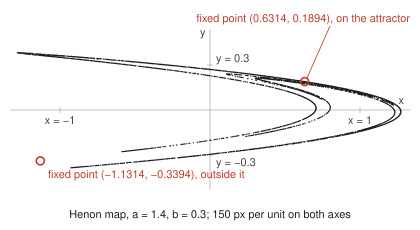
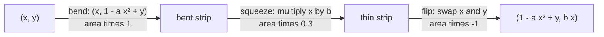

# The Henon map: a two-line rule that folds the plane onto a strange attractor

[Syllabus](../../../SYLLABUS.md) → [Differential equations and dynamics](../README.md) → [Discrete Dynamics and Chaos](../README.md#s11) → The Henon map

---

## General Overview

Take a point in the plane, two numbers $`(x, y)`$. Make a new point by two lines of arithmetic: the new $`x`$ is $`1 - 1.4x^2 + y`$, and the new $`y`$ is $`0.3x`$. Repeat.

From $`(0, 0)`$ the points run $`(1, 0)`$, $`(-0.4, 0.3)`$, $`(1.076, -0.12)`$, $`(-0.7409, 0.3228)`$, and on without end. In ten million steps they neither settle nor repeat. Plot a few thousand and they draw a thin, curved band with fine layers inside it, the same band from almost every start nearby.

The astronomer Michel Hénon wrote this rule in 1976 as a cheap stand-in for the Lorenz butterfly, whose return map ([Poincare maps](07-poincare-return-maps.md)) stretches and folds in the same way. It shows the three marks of a **strange attractor**: a set that nearby orbits crowd onto, layered inside, on which points still drift apart. Every area shrinks to 0.3 of itself each step. One direction still stretches: its **Lyapunov exponent**, the average log-stretch per step, is 0.4192. The band has a dimension of about 1.26: more than a curve, less than a patch.

**The Henon map stretches the plane in one direction, folds it, and squeezes every area to 0.3 of itself each step, so its points crowd onto a layered band of zero area and dimension about 1.26, where nearby points still drift apart.**

**What kind of fact this is:** the map is a definition; its fixed points, their saddle type and the area rule are theorems proved on this card in Why it works; the exponent and the dimension are measurements. That this band is a true strange attractor, and not a very long cycle, has not been proved as of 2026-11-23.

### The picture: the band at a = 1.4, b = 0.3

<p align="center"></p>

To scale: 150 px per unit on both axes, origin at (210, 110). The dots are points 1001 to 6000 of the orbit from (0, 0). Red circles: the two fixed points.

---

## The formula

```math
x_{n+1} = 1 - a\,x_n^2 + y_n, \qquad y_{n+1} = b\,x_n
```

**Read it aloud:** the new across-position is one, minus a times the old across-position squared, plus the old up-position; the new up-position is b times the old across-position.

The two derived results the card proves and uses:

```math
\det J = -b \text{ at every point}, \qquad \lambda_1 + \lambda_2 = \ln\lvert b\rvert
```

**Read it aloud:** each step multiplies every area by the size of b and flips it over; so the two long-run stretch rates add up to the logarithm of b's size.

Here $`J`$ is the Jacobian: the table of partial slopes that says how a tiny arrow at $`(x, y)`$ is carried by one step ([Fixed points of a map](02-fixed-points-of-a-map.md) uses it for maps of several numbers):

```math
J = \begin{pmatrix} -2ax & 1 \\ b & 0 \end{pmatrix}
```

| Symbol | Plain meaning | In our example | Push it up and the answer… |
| --- | --- | --- | --- |
| $`x_n`$, $`y_n`$, $`n`$ | the point's two coordinates after $`n`$ steps | start (0, 0) | — |
| $`a`$ | bend: how hard the $`x^2`$ term folds the plane | 1.4 | more folding, until the band breaks and points escape |
| $`b`$ | squeeze: the area factor, with a flip when it is positive | 0.3 | thicker band, slower squeeze |
| $`x^*`$, $`y^*`$ | a fixed point, sent to itself | (0.6314, 0.1894) and (−1.1314, −0.3394) | — |
| $`J`$, $`\det J`$ | the Jacobian; its determinant, the area factor of one step | $`\det J = -0.3`$ | — |
| $`\mu`$ | an eigenvalue of $`J`$ at a fixed point: the stretch along a direction the step does not turn | 0.155946 and −1.923739 | above 1 in size: nudges grow |
| $`\lambda_1`$, $`\lambda_2`$ | Lyapunov exponents: long-run average log-stretch, fastest and slowest | 0.4192 and −1.6231 | shorter forecast horizon |
| $`\varepsilon`$, $`N(\varepsilon)`$, $`D`$, $`D_{KY}`$ | box side; boxes hit; dimension by box count, and by the exponents | 1/128 to 1/4096; 1931 to 151028; 1.2600; 1.2582 | — |

### When it holds

- **b is not 0.** At $`b = 0`$ the new $`y`$ is always 0, the determinant is 0, and the rule collapses to the one-line map sending $`x`$ to $`1 - ax^2`$, the same family as [The logistic map](03-the-logistic-map-and-period-doubling.md).
- **b is smaller than 1 in size.** Then areas shrink and points can gather on a band of zero area. At size exactly 1 areas are kept, and there is no attractor to gather on.
- **The start is in the basin**, the set of starts that end on the band. From $`(2, 0)`$ the across-position runs 2.0, −4.6, −28.0, −1099.9, −1693583.6: gone in four steps.
- **The values a = 1.4, b = 0.3.** Other bends can settle on a cycle. The band belongs to these values, not to the rule.
- **Long runs.** The exponent and the dimension use ten million points; fewer give a different dimension, shown below.

---

## Why it works

### Step 0: stretch, fold, squeeze

The rule is three moves in a row:



The bend slides each vertical line up or down by $`1 - ax^2`$, so it curves a straight strip into a horseshoe shape without changing its area. The squeeze shrinks every area to 0.3. The flip mirrors the plane across the diagonal, which keeps area and reverses its orientation.

Bend, squeeze and lay back, again and again: that is the stretch-and-fold of [The Smale horseshoe](08-smale-horseshoe.md). Each pass doubles the layers and thins them, so the band ends up as layers within layers.

### Step 1: two fixed points

A fixed point has $`y^* = bx^*`$ and $`x^* = 1 - a{x^*}^2 + bx^*`$, which rearranges to

```math
a{x^*}^2 + (1 - b)\,x^* - 1 = 0, \qquad x^* = \frac{-(1 - b) \pm \sqrt{(1 - b)^2 + 4a}}{2a}.
```

At a = 1.4, b = 0.3: $`(1 - b)^2 + 4a = 6.09`$, whose root is 2.467793. So $`x^* = 0.631354`$ or $`-1.131354`$, and $`y^* = 0.189406`$ or $`-0.339406`$. Newton's method, run on the two equations from (0.5, 0) and (−1, 0), lands on the same points.

### Step 2: both fixed points are saddles

Near a fixed point a step acts like $`J`$. Its eigenvalues solve $`\mu^2 + 2ax\mu - b = 0`$, so

```math
\mu = -ax \pm \sqrt{a^2x^2 + b}.
```

| Fixed point | Eigenvalues | Type |
| --- | --- | --- |
| (0.6314, 0.1894) | 0.155946 and −1.923739 | saddle |
| (−1.1314, −0.3394) | 3.259822 and −0.092030 | saddle |

A **saddle** pulls points in along one direction and pushes them out along another, because one eigenvalue is smaller than 1 in size and the other larger. Neither fixed point holds the orbit, so it wanders. The first lies on the band; the second sits outside it.

### Step 3: every area is multiplied by 0.3

The determinant of $`J`$ is $`(-2ax)(0) - (1)(b) = -b`$. It does not depend on the point. A tiny square anywhere is turned into a parallelogram of area 0.3 times its own ([Determinants](../../03-Algebra/05-Solving%20Systems/04-determinants.md)), mirrored.

A big region is a sum of tiny squares, so its area is also multiplied by exactly 0.3 each step, however the step bends it. The square from −1.5 to 1.5 on both axes has area 9.000000. After one step its signed area is −2.700000; after two, 0.810000. The minus sign is the flip. That is 9 times −0.3, then 9 times 0.09.

After $`n`$ steps the area is $`9 \times 0.3^n`$, which goes to zero. So the band, where all these points end up, has zero area.

### Step 4: one direction still stretches

Shrinking area does not mean shrinking distance. Carry a tiny arrow along the orbit by $`J`$, rescale it to length 1 after each step, and average the natural logarithm, ln, of each step's stretch. That average is the largest **Lyapunov exponent** ([The Lyapunov exponent](04-chaos-and-the-lyapunov-exponent.md)): $`\lambda_1 = 0.4192`$ per step, over steps 1001 to 10001000.

A second road: run a shadow orbit $`10^{-8}`$ away, measure the gap after each step, and pull the shadow back to $`10^{-8}`$. The average log-growth is again 0.4192.

A tiny parallelogram grows by the product of the two stretches, and its area grows by 0.3 each step. Take logarithms: $`\lambda_1 + \lambda_2 = \ln 0.3`$. So the second exponent is $`\lambda_2 = \ln 0.3 - 0.4192 = -1.6231`$. Points spread apart along the band and collapse across it.

### Step 5: the band's dimension

Cover the plane with a grid of square boxes of side $`\varepsilon`$ and count the boxes the band touches, $`N(\varepsilon)`$. For a curve, halving the box doubles the count; for a solid patch, it multiplies the count by 4. The **box-counting dimension** $`D`$ is the growth in between: $`N(\varepsilon)`$ grows like $`(1/\varepsilon)^D`$ ([Fractals](../../05-Geometry%20and%20trig/07-Points%2C%20Convexity%20and%20Fractals/05-self-similarity-and-fractal-dimension.md)).

Ten million orbit points touch 1931, 4560, 10611, 25768, 63124 and 151028 boxes of side 1/128 down to 1/4096. The best straight line through $`\ln N`$ against $`\ln(1/\varepsilon)`$ has slope **1.2600**.

The second road uses the exponents. The Kaplan–Yorke estimate counts the one fully stretched direction, plus the share of the squeezed direction that the stretch can fill:

```math
D_{KY} = 1 + \frac{\lambda_1}{\lvert\lambda_2\rvert} = 1 + \frac{0.4192}{1.6231} = 1.2582.
```

The two roads agree to within 0.002.

---

## Worked numbers, by hand

| Step | Arithmetic | Value |
| --- | --- | --- |
| first step | $`(1 - 1.4 \times 0^2 + 0,\ 0.3 \times 0)`$ | (1, 0) |
| second step | $`(1 - 1.4 \times 1^2 + 0,\ 0.3 \times 1)`$ | (−0.4, 0.3) |
| fixed-point quadratic | $`1.4x^2 + 0.7x - 1 = 0`$; $`0.7^2 + 4 \times 1.4`$ | 6.09, root 2.467793 |
| fixed points | $`(-0.7 \pm 2.467793) / 2.8`$ | 0.631354 and −1.131354 |
| eigenvalues at the first | $`-1.4 \times 0.631354 \pm \sqrt{(1.4 \times 0.631354)^2 + 0.3}`$ | 0.155946 and −1.923739 |
| area of the square, two steps | $`9 \times (-0.3)`$, then $`\times (-0.3)`$ | −2.7, then 0.81 |
| second exponent | $`\ln 0.3 - 0.4192`$ | −1.6231 |
| Kaplan–Yorke | $`1 + 0.4192 / 1.6231`$ | **1.2582** |

The band is a little more than a curve: about a quarter of the way from a line to a filled patch; the box count agrees at 1.2600.

### What breaks if you drop a piece

| Mistake | Comes out at | What went wrong |
| --- | --- | --- |
| Exponent from one fixed point's biggest eigenvalue | ln 1.923739 = 0.6543 | The orbit only passes near the fixed point; the average is over the whole band |
| Averaging the log of each step's biggest eigenvalue | 0.6206 | The stretch directions turn from step to step, so the biggest stretches do not line up and multiply |
| Box count with only 100,000 points | slope 1.0310 | The smallest boxes are not filled yet, so they are undercounted |
| Starting at (2, 0) | −1693583.6 by step 4 | Outside the basin the bend wins and the point escapes |

---

## Code, from first principles, and it actually runs

Each script runs the map from (0, 0) for ten million steps and reaches four results by two roads each. Fixed points: the quadratic formula against Newton's method. Area: the determinant against the shoelace area of a square mapped point by point. Stretch: an arrow carried by the Jacobian against a shadow orbit. Dimension: box counting against the Kaplan–Yorke formula.

### Python

```python
# The Henon map -- the check behind the card.  Standard library only.  The rule (x, y) ->
# (1 - a x^2 + y, b x) at a = 1.4, b = 0.3: fixed points, area, stretch and dimension, two roads each.
from math import sqrt, log, floor
A, B, M = 1.4, 0.3, 10 ** 7
step = lambda x, y: (1 - A * x * x + y, B * x)
def newton(x, y):                     # road two: solve step(x, y) = (x, y) by Newton
    for _ in range(40):
        f, g, p = 1 - A * x * x + y - x, B * x - y, -2 * A * x - 1
        x, y = x + (f + g) / (-p - B), y + (B * f - p * g) / (-p - B)
    return x, y
shoelace = lambda p: sum(p[i - 1][0] * p[i][1] - p[i][0] * p[i - 1][1] for i in range(len(p))) / 2
def slope(cs):                        # least-squares slope of ln(count) against ln(1/side)
    xs, ys = [k * log(2) for k in range(7, 13)], [log(c) for c in cs]
    mx, my = sum(xs) / 6, sum(ys) / 6
    return sum((u - mx) * (v - my) for u, v in zip(xs, ys)) / sum((u - mx) * (u - mx) for u in xs)
fx = [(-(1 - B) + s * sqrt((1 - B) * (1 - B) + 4 * A)) / (2 * A) for s in (1, -1)]   # road one: formula
nw = [newton(0.5, 0.0), newton(-1.0, 0.0)]
orb = [(0.0, 0.0)]                                  # the orbit from (0, 0); pts drops 1000 steps
for _ in range(10 ** 7 + 1001): orb.append(step(*orb[-1]))
pts = orb[1001:]
eig = [(-A * u + sqrt(A * A * u * u + B), -A * u - sqrt(A * A * u * u + B)) for u in fx]
print(f"Henon map, a = {A}, b = {B}; from (0, 0): {' '.join(f'({u:.4f}, {v:.4f})' for u, v in orb[1:5])}")
print(f"fixed points, formula: (1 - b)^2 + 4a = {(1 - B) * (1 - B) + 4 * A:.2f}, root {sqrt((1 - B) * (1 - B) + 4 * A):.6f}; x = {fx[0]:.6f}, {fx[1]:.6f}; y = b x = {B * fx[0]:.6f}, {B * fx[1]:.6f}")
print(f"fixed points, Newton: ({nw[0][0]:.6f}, {nw[0][1]:.6f}), ({nw[1][0]:.6f}, {nw[1][1]:.6f})")
print(f"eigenvalues: {eig[0][0]:.6f} and {eig[0][1]:.6f}; {eig[1][0]:.6f} and {eig[1][1]:.6f}")
t = [-1.5 + 3 * i / 4000 for i in range(4000)]
sq = [(u, -1.5) for u in t] + [(1.5, u) for u in t] + [(-u, 1.5) for u in t] + [(-1.5, -u) for u in t]
im1 = [step(*p) for p in sq]
ar = [shoelace(sq), shoelace(im1), shoelace([step(*p) for p in im1])]
print(f"signed area of the square [-1.5, 1.5]^2, then 1 and 2 steps: {ar[0]:.6f} {ar[1]:.6f} {ar[2]:.6f};"
      f" times -b, b^2: {ar[0] * -B:.6f} {ar[0] * B * B:.6f}")
vx, vy, d0, s_tan, s_two, s_eig, px, py = 1.0, 0.0, 1e-8, 0.0, 0.0, 0.0, pts[0][0] + 1e-8, pts[0][1]
for (x, y), (nx, ny) in zip(pts[:M], pts[1:M + 1]):
    vx, vy = -2 * A * x * vx + vy, B * vx              # road one: carry an arrow by the Jacobian
    nv = sqrt(vx * vx + vy * vy)
    s_tan, vx, vy = s_tan + log(nv), vx / nv, vy / nv
    s_eig += log(abs(A * x) + sqrt(A * A * x * x + B))
    px, py = step(px, py)                              # road two: a shadow run 1e-8 away
    dd = sqrt((px - nx) * (px - nx) + (py - ny) * (py - ny))
    s_two, px, py = s_two + log(dd / d0), nx + (px - nx) * d0 / dd, ny + (py - ny) * d0 / dd
l1, l2 = s_tan / M, log(B) - s_tan / M
print(f"largest Lyapunov exponent, steps 1001 to {M + 1000}, carried arrow: {l1:.4f}; shadow run: {s_two / M:.4f}")
print(f"second exponent ln 0.3 - {l1:.4f} = {l2:.4f}; Kaplan-Yorke 1 + {l1:.4f}/{-l2:.4f} = {1 - l1 / l2:.4f}")
count = lambda n: [len({(floor(x * 2 ** k), floor(y * 2 ** k)) for x, y in pts[:n]}) for k in range(7, 13)]
many, few = count(10 ** 7), count(10 ** 5)
print(f"boxes of side 1/128 to 1/4096 hit by 10^7 points: {many}; slope {slope(many):.4f}")
print(f"mistakes, exponent from one fixed point: ln {-eig[0][1]:.6f} = {log(-eig[0][1]):.4f};"
      f" from each step's biggest eigenvalue: {s_eig / M:.4f}")
print(f"mistake, only 10^5 points: {few}; slope {slope(few):.4f}")
path = [(2.0, 0.0)]
while abs(path[-1][0]) < 1e6: path.append(step(*path[-1]))
print(f"mistake, start (2, 0): x runs {', '.join(f'{p[0]:.1f}' for p in path)}")
fig = [f"({210 + 150 * u:.1f}, {110 - 150 * B * u:.1f})" for u in fx]
print(f"figure, 150 px per unit, origin at (210, 110), orbit points 1001 to 6000, fixed points at {fig[0]} and {fig[1]}")
assert all(abs(fx[i] - nw[i][0]) < 1e-9 and abs(B * fx[i] - nw[i][1]) < 1e-9 for i in range(2))
assert all(abs(e[0]) > 1 > abs(e[1]) or abs(e[1]) > 1 > abs(e[0]) for e in eig)    # saddles, and
assert all(abs((-2 * A * u - m) * -m - B) < 1e-12 for u, e in zip(fx, eig) for m in e)  # det(J - mu I) = 0
assert abs(ar[0] - 9) < 1e-9 and abs(ar[1] + B * ar[0]) < 1e-5 and abs(ar[2] - B * B * ar[0]) < 1e-5
assert abs(l1 - s_two / M) < 0.002 and abs(slope(many) - (1 - l1 / l2)) < 0.01
print("ALL CHECKS PASS")
```

**Ran 2026-11-23 on macOS, Python 3.14.10, standard library only. All checks passed. Output, pasted from the run:**

```
Henon map, a = 1.4, b = 0.3; from (0, 0): (1.0000, 0.0000) (-0.4000, 0.3000) (1.0760, -0.1200) (-0.7409, 0.3228)
fixed points, formula: (1 - b)^2 + 4a = 6.09, root 2.467793; x = 0.631354, -1.131354; y = b x = 0.189406, -0.339406
fixed points, Newton: (0.631354, 0.189406), (-1.131354, -0.339406)
eigenvalues: 0.155946 and -1.923739; 3.259822 and -0.092030
signed area of the square [-1.5, 1.5]^2, then 1 and 2 steps: 9.000000 -2.700000 0.810000; times -b, b^2: -2.700000 0.810000
largest Lyapunov exponent, steps 1001 to 10001000, carried arrow: 0.4192; shadow run: 0.4192
second exponent ln 0.3 - 0.4192 = -1.6231; Kaplan-Yorke 1 + 0.4192/1.6231 = 1.2582
boxes of side 1/128 to 1/4096 hit by 10^7 points: [1931, 4560, 10611, 25768, 63124, 151028]; slope 1.2600
mistakes, exponent from one fixed point: ln 1.923739 = 0.6543; from each step's biggest eigenvalue: 0.6206
mistake, only 10^5 points: [1917, 4455, 10081, 22362, 41895, 63371]; slope 1.0310
mistake, start (2, 0): x runs 2.0, -4.6, -28.0, -1099.9, -1693583.6
figure, 150 px per unit, origin at (210, 110), orbit points 1001 to 6000, fixed points at (304.7, 81.6) and (40.3, 160.9)
ALL CHECKS PASS
```

### Rust

Same numbers, same labels, built with `rustc --edition 2021 -O`.

```rust
// The Henon map -- the same check as the Python, in Rust.  No crates.  The rule (x, y) ->
// (1 - a x^2 + y, b x) at a = 1.4, b = 0.3: fixed points, area, stretch and dimension, two roads each.
use std::collections::HashSet;
const A: f64 = 1.4; const B: f64 = 0.3; const M: usize = 10_000_000;
fn step(x: f64, y: f64) -> (f64, f64) { (1.0 - A * x * x + y, B * x) }
fn newton(mut x: f64, mut y: f64) -> (f64, f64) {     // road two: solve step(x, y) = (x, y) by Newton
    for _ in 0..40 {
        let (f, g, p) = (1.0 - A * x * x + y - x, B * x - y, -2.0 * A * x - 1.0);
        (x, y) = (x + (f + g) / (-p - B), y + (B * f - p * g) / (-p - B));
    }
    (x, y)
}
fn shoelace(p: &[(f64, f64)]) -> f64 {                // signed area; negative means the order flipped
    (0..p.len()).map(|i| { let q = p[(i + p.len() - 1) % p.len()]; q.0 * p[i].1 - p[i].0 * q.1 }).sum::<f64>() / 2.0
}
fn slope(cs: &[usize]) -> f64 {                       // least-squares slope of ln(count) against ln(1/side)
    let xs: Vec<f64> = (7..13).map(|k| k as f64 * 2f64.ln()).collect();
    let ys: Vec<f64> = cs.iter().map(|&c| (c as f64).ln()).collect();
    let (mx, my) = (xs.iter().sum::<f64>() / 6.0, ys.iter().sum::<f64>() / 6.0);
    let top: f64 = xs.iter().zip(&ys).map(|(u, v)| (u - mx) * (v - my)).sum();
    top / xs.iter().map(|u| (u - mx) * (u - mx)).sum::<f64>()
}
fn count(pts: &[(f64, f64)]) -> Vec<usize> {
    (7..13).map(|k| {
        let s = (1u64 << k) as f64;
        pts.iter().map(|&(x, y)| ((x * s).floor() as i64, (y * s).floor() as i64)).collect::<HashSet<_>>().len()
    }).collect()
}
fn main() {
    let root = ((1.0 - B) * (1.0 - B) + 4.0 * A).sqrt();
    let fx = [(-(1.0 - B) + root) / (2.0 * A), (-(1.0 - B) - root) / (2.0 * A)];   // road one: formula
    let nw = [newton(0.5, 0.0), newton(-1.0, 0.0)];
    let mut orb: Vec<(f64, f64)> = vec![(0.0, 0.0)];              // the orbit from (0, 0); pts drops 1000 steps
    for _ in 0..10_001_001 { let (x, y) = *orb.last().unwrap(); orb.push(step(x, y)) }
    let pts = &orb[1001..];
    let eig: Vec<(f64, f64)> = fx.iter().map(|&u| { let r = (A * A * u * u + B).sqrt(); (-A * u + r, -A * u - r) }).collect();
    println!("Henon map, a = {}, b = {}; from (0, 0): {}", A, B, orb[1..5].iter().map(|p| format!("({:.4}, {:.4})", p.0, p.1)).collect::<Vec<_>>().join(" "));
    println!("fixed points, formula: (1 - b)^2 + 4a = {:.2}, root {:.6}; x = {:.6}, {:.6}; y = b x = {:.6}, {:.6}",
             (1.0 - B) * (1.0 - B) + 4.0 * A, root, fx[0], fx[1], B * fx[0], B * fx[1]);
    println!("fixed points, Newton: ({:.6}, {:.6}), ({:.6}, {:.6})", nw[0].0, nw[0].1, nw[1].0, nw[1].1);
    println!("eigenvalues: {:.6} and {:.6}; {:.6} and {:.6}", eig[0].0, eig[0].1, eig[1].0, eig[1].1);
    let t: Vec<f64> = (0..4000).map(|i| -1.5 + (3 * i) as f64 / 4000.0).collect();
    let sq: Vec<(f64, f64)> = t.iter().map(|&u| (u, -1.5)).chain(t.iter().map(|&u| (1.5, u)))
        .chain(t.iter().map(|&u| (-u, 1.5))).chain(t.iter().map(|&u| (-1.5, -u))).collect();
    let image = |p: &[(f64, f64)]| -> Vec<(f64, f64)> { p.iter().map(|&(x, y)| step(x, y)).collect() };
    let (im1, im2) = (image(&sq), image(&image(&sq)));
    let ar = [shoelace(&sq), shoelace(&im1), shoelace(&im2)];
    println!("signed area of the square [-1.5, 1.5]^2, then 1 and 2 steps: {:.6} {:.6} {:.6}; times -b, b^2: {:.6} {:.6}",
             ar[0], ar[1], ar[2], ar[0] * -B, ar[0] * B * B);
    let (mut vx, mut vy, d0, mut s_tan, mut s_two, mut s_eig) = (1.0f64, 0.0f64, 1e-8, 0.0f64, 0.0f64, 0.0f64);
    let (mut px, mut py) = (pts[0].0 + 1e-8, pts[0].1);
    for k in 0..M {
        let ((x, _), (nx, ny)) = (pts[k], pts[k + 1]);
        (vx, vy) = (-2.0 * A * x * vx + vy, B * vx);       // road one: carry an arrow by the Jacobian
        let nv = (vx * vx + vy * vy).sqrt();
        (s_tan, vx, vy) = (s_tan + nv.ln(), vx / nv, vy / nv);
        s_eig += ((A * x).abs() + (A * A * x * x + B).sqrt()).ln();
        (px, py) = step(px, py);                           // road two: a shadow run 1e-8 away
        let dd = ((px - nx) * (px - nx) + (py - ny) * (py - ny)).sqrt();
        (s_two, px, py) = (s_two + (dd / d0).ln(), nx + (px - nx) * d0 / dd, ny + (py - ny) * d0 / dd);
    }
    let (l1, l2) = (s_tan / M as f64, B.ln() - s_tan / M as f64);
    println!("largest Lyapunov exponent, steps 1001 to {}, carried arrow: {:.4}; shadow run: {:.4}", M + 1000, l1, s_two / M as f64);
    println!("second exponent ln 0.3 - {:.4} = {:.4}; Kaplan-Yorke 1 + {:.4}/{:.4} = {:.4}", l1, l2, l1, -l2, 1.0 - l1 / l2);
    let (many, few) = (count(&pts[..10_000_000]), count(&pts[..100_000]));
    println!("boxes of side 1/128 to 1/4096 hit by 10^7 points: {:?}; slope {:.4}", many, slope(&many));
    println!("mistakes, exponent from one fixed point: ln {:.6} = {:.4}; from each step's biggest eigenvalue: {:.4}",
             -eig[0].1, (-eig[0].1).ln(), s_eig / M as f64);
    println!("mistake, only 10^5 points: {:?}; slope {:.4}", few, slope(&few));
    let mut path = vec![(2.0f64, 0.0f64)];
    while path.last().unwrap().0.abs() < 1e6 { let (a, b) = *path.last().unwrap(); path.push(step(a, b)) }
    println!("mistake, start (2, 0): x runs {}", path.iter().map(|p| format!("{:.1}", p.0)).collect::<Vec<_>>().join(", "));
    let fig: Vec<String> = fx.iter().map(|u| format!("({:.1}, {:.1})", 210.0 + 150.0 * u, 110.0 - 150.0 * B * u)).collect();
    println!("figure, 150 px per unit, origin at (210, 110), orbit points 1001 to 6000, fixed points at {} and {}", fig[0], fig[1]);
    assert!((0..2).all(|i| (fx[i] - nw[i].0).abs() < 1e-9 && (B * fx[i] - nw[i].1).abs() < 1e-9));
    assert!(eig.iter().zip(&fx).all(|(e, &u)| ((e.0.abs() > 1.0 && 1.0 > e.1.abs()) || (e.1.abs() > 1.0 && 1.0 > e.0.abs())) && [e.0, e.1].iter().all(|&m| ((-2.0 * A * u - m) * -m - B).abs() < 1e-12)));  // saddles; det(J - mu I) = 0
    assert!((ar[0] - 9.0).abs() < 1e-9 && (ar[1] + B * ar[0]).abs() < 1e-5 && (ar[2] - B * B * ar[0]).abs() < 1e-5);
    assert!((l1 - s_two / M as f64).abs() < 0.002 && (slope(&many) - (1.0 - l1 / l2)).abs() < 0.01);
    println!("ALL CHECKS PASS");
}
```

**Ran 2026-11-23 on macOS, rustc 1.98.1, no crates. All checks passed. Output, pasted from the run:**

```
Henon map, a = 1.4, b = 0.3; from (0, 0): (1.0000, 0.0000) (-0.4000, 0.3000) (1.0760, -0.1200) (-0.7409, 0.3228)
fixed points, formula: (1 - b)^2 + 4a = 6.09, root 2.467793; x = 0.631354, -1.131354; y = b x = 0.189406, -0.339406
fixed points, Newton: (0.631354, 0.189406), (-1.131354, -0.339406)
eigenvalues: 0.155946 and -1.923739; 3.259822 and -0.092030
signed area of the square [-1.5, 1.5]^2, then 1 and 2 steps: 9.000000 -2.700000 0.810000; times -b, b^2: -2.700000 0.810000
largest Lyapunov exponent, steps 1001 to 10001000, carried arrow: 0.4192; shadow run: 0.4192
second exponent ln 0.3 - 0.4192 = -1.6231; Kaplan-Yorke 1 + 0.4192/1.6231 = 1.2582
boxes of side 1/128 to 1/4096 hit by 10^7 points: [1931, 4560, 10611, 25768, 63124, 151028]; slope 1.2600
mistakes, exponent from one fixed point: ln 1.923739 = 0.6543; from each step's biggest eigenvalue: 0.6206
mistake, only 10^5 points: [1917, 4455, 10081, 22362, 41895, 63371]; slope 1.0310
mistake, start (2, 0): x runs 2.0, -4.6, -28.0, -1099.9, -1693583.6
figure, 150 px per unit, origin at (210, 110), orbit points 1001 to 6000, fixed points at (304.7, 81.6) and (40.3, 160.9)
ALL CHECKS PASS
```

The two outputs match line for line.

### Lean

Lean proves the area rule and the determinant for every bend and squeeze, and the saddle test at a = 1.4, b = 0.3.

- Each step multiplies the area of every region by the size of $`b`$, whatever the bend $`a`$.
- At every point the Jacobian $`J`$ has determinant $`-b`$, whatever the bend $`a`$.
- Take a = 1.4, b = 0.3 and a fixed point $`(x, y)`$. Then $`y = 0.3x`$ and $`1.4x^2 + 0.7x - 1 = 0`$.
- That fixed point is a saddle: $`J`$ there has one eigenvalue smaller than 1 in size and one larger.
- The worked numbers hold exactly: the first four steps from (0, 0), and the value 6.09.
- So do the square's signed areas −2.7 and 0.81, and the first two steps from (2, 0).

The fixed points' decimals, the eigenvalues, the Lyapunov exponents and the box-counting dimension are left to the Python and Rust checks.

```lean
-- The Henon map: every step multiplies every area by |b|, its Jacobian has determinant -b everywhere, and at a = 1.4, b = 0.3 both fixed points are saddles.
import Mathlib.MeasureTheory.Measure.Lebesgue.EqHaar
import Mathlib.MeasureTheory.Constructions.BorelSpace.Real
import Mathlib.Analysis.Calculus.FDeriv.Prod
import Mathlib.LinearAlgebra.Eigenspace.Basic
import Mathlib.Tactic
import Mathlib.Analysis.Calculus.FDeriv.Pow
import Mathlib.Analysis.Calculus.FDeriv.Mul

open MeasureTheory

/-- The Henon map with bend `a` and squeeze `b`: `(x, y) ↦ (1 - a x² + y, b x)`. -/
def henon (a b : ℝ) (p : ℝ × ℝ) : ℝ × ℝ := (1 - a * p.1 ^ 2 + p.2, b * p.1)

/-- The derivative of the Henon map at `p`: `(u, v) ↦ (-2 a p.1 u + v, b u)`. -/
theorem henon_hasFDerivAt (a b : ℝ) (p : ℝ × ℝ) :
    HasFDerivAt (henon a b)
      (((-(2 * a * p.1)) • ContinuousLinearMap.fst ℝ ℝ ℝ + ContinuousLinearMap.snd ℝ ℝ ℝ).prod
        (b • ContinuousLinearMap.fst ℝ ℝ ℝ)) p := by
  have h1 : HasFDerivAt (fun q : ℝ × ℝ => 1 - a * q.1 ^ 2 + q.2)
      ((-(2 * a * p.1)) • ContinuousLinearMap.fst ℝ ℝ ℝ + ContinuousLinearMap.snd ℝ ℝ ℝ) p := by
    have hf : HasFDerivAt (Prod.fst : ℝ × ℝ → ℝ) (ContinuousLinearMap.fst ℝ ℝ ℝ) p := hasFDerivAt_fst
    have := HasFDerivAt.add (HasFDerivAt.const_sub (HasFDerivAt.const_mul (HasFDerivAt.pow hf 2) a) 1)
      (hasFDerivAt_snd : HasFDerivAt (Prod.snd : ℝ × ℝ → ℝ) (ContinuousLinearMap.snd ℝ ℝ ℝ) p)
    convert this using 1
    ext <;> simp; ring
  have h2 : HasFDerivAt (fun q : ℝ × ℝ => b * q.1) (b • ContinuousLinearMap.fst ℝ ℝ ℝ) p := by
    have hf : HasFDerivAt (Prod.fst : ℝ × ℝ → ℝ) (ContinuousLinearMap.fst ℝ ℝ ℝ) p := hasFDerivAt_fst
    have := HasFDerivAt.const_mul hf b
    convert this using 1
  exact h1.prodMk h2

/-- The derivative of the Henon map, applied to a vector. -/
theorem henon_fderiv_apply (a b : ℝ) (p q : ℝ × ℝ) :
    fderiv ℝ (henon a b) p q = (-(2 * a * p.1) * q.1 + q.2, b * q.1) := by
  rw [(henon_hasFDerivAt a b p).fderiv]
  simp

/-- Every area is multiplied by `|b|` each step: for any set `s` in the plane, the area
(Lebesgue measure) of its image under the Henon map is `|b|` times the area of `s`. -/
theorem henon_area_multiplied_by_abs_b (a b : ℝ) (s : Set (ℝ × ℝ)) :
    volume (henon a b '' s) = ENNReal.ofReal |b| * volume s := by
  let e : (ℝ × ℝ) ≃ᵐ (ℝ × ℝ) :=
    { toFun := fun p => (p.1, p.2 + (1 - a * p.1 ^ 2))
      invFun := fun p => (p.1, p.2 - (1 - a * p.1 ^ 2))
      left_inv := fun p => by simp
      right_inv := fun p => by simp
      measurable_toFun := (by fun_prop : Measurable fun p : ℝ × ℝ => (p.1, p.2 + (1 - a * p.1 ^ 2)))
      measurable_invFun := (by fun_prop : Measurable fun p : ℝ × ℝ => (p.1, p.2 - (1 - a * p.1 ^ 2))) }
  have he : MeasurePreserving e volume volume := by
    rw [Measure.volume_eq_prod]
    exact (MeasurePreserving.id volume).skew_product (g := fun x y => y + (1 - a * x ^ 2))
      (by fun_prop) (ae_of_all _ fun x => map_add_right_eq_self volume _)
  let L : ℝ × ℝ →ₗ[ℝ] ℝ × ℝ := LinearMap.prod (LinearMap.snd ℝ ℝ ℝ) (b • LinearMap.fst ℝ ℝ ℝ)
  have hL : LinearMap.det L = -b := by
    rw [← LinearMap.det_toMatrix (Module.Basis.finTwoProd ℝ), Matrix.det_fin_two]
    simp [L, LinearMap.toMatrix_apply]
  have hcomp : henon a b = L ∘ e := by
    funext p
    simp [henon, L, e]
    ring
  have : Measure.IsAddHaarMeasure (volume : Measure (ℝ × ℝ)) :=
    Measure.prod.instIsAddHaarMeasure _ _
  rw [hcomp, Set.image_comp, Measure.addHaar_image_linearMap, hL, abs_neg,
    MeasurableEquiv.image_eq_preimage_symm, he.symm.measure_preimage_equiv]

/-- The Jacobian of the Henon map has determinant `-b` at every point, whatever the bend `a`. -/
theorem henon_jacobian_det (a b : ℝ) (p : ℝ × ℝ) :
    LinearMap.det (fderiv ℝ (henon a b) p : ℝ × ℝ →ₗ[ℝ] ℝ × ℝ) = -b := by
  rw [← LinearMap.det_toMatrix (Module.Basis.finTwoProd ℝ), Matrix.det_fin_two]
  simp [LinearMap.toMatrix_apply, henon_fderiv_apply]

/-- At `a = 1.4`, `b = 0.3`, a fixed point `(x, y)` has `y = 0.3 x` and `1.4 x² + 0.7 x - 1 = 0`,
and it is a saddle: its Jacobian has one real eigenvalue smaller than 1 in size and one larger. -/
theorem henon_fixed_points_are_saddles (x y : ℝ) (h : henon (7 / 5) (3 / 10) (x, y) = (x, y)) :
    y = 3 / 10 * x ∧ 7 / 5 * x ^ 2 + 7 / 10 * x - 1 = 0 ∧
      ∃ μ₁ μ₂ : ℝ, |μ₁| < 1 ∧ 1 < |μ₂| ∧
        Module.End.HasEigenvalue
          (fderiv ℝ (henon (7 / 5) (3 / 10)) (x, y) : ℝ × ℝ →ₗ[ℝ] ℝ × ℝ) μ₁ ∧
        Module.End.HasEigenvalue
          (fderiv ℝ (henon (7 / 5) (3 / 10)) (x, y) : ℝ × ℝ →ₗ[ℝ] ℝ × ℝ) μ₂ := by
  simp only [henon, Prod.mk.injEq] at h
  obtain ⟨h1, h2⟩ := h
  have hy : y = 3 / 10 * x := by linarith
  have hq : 7 / 5 * x ^ 2 + 7 / 10 * x - 1 = 0 := by subst hy; linarith
  refine ⟨hy, hq, ?_⟩
  have key : ∀ μ : ℝ, μ ^ 2 + (2 * (7 / 5) * x) * μ - 3 / 10 = 0 →
      Module.End.HasEigenvalue
        (fderiv ℝ (henon (7 / 5) (3 / 10)) (x, y) : ℝ × ℝ →ₗ[ℝ] ℝ × ℝ) μ := by
    intro μ hμ
    apply Module.End.hasEigenvalue_of_hasEigenvector (x := ((μ, 3 / 10) : ℝ × ℝ))
    refine ⟨?_, ?_⟩
    · rw [Module.End.mem_eigenspace_iff]
      simp only [ContinuousLinearMap.coe_coe, henon_fderiv_apply, Prod.smul_mk, smul_eq_mul,
        Prod.mk.injEq]
      constructor
      · linear_combination -hμ
      · ring
    · simp
  set t := 2 * (7 / 5 : ℝ) * x with ht
  set s := Real.sqrt (t ^ 2 + 6 / 5) with hs
  have hs0 : 0 ≤ s := Real.sqrt_nonneg _
  have hs2 : s ^ 2 = t ^ 2 + 6 / 5 := Real.sq_sqrt (by positivity)
  have hra : ((-t + s) / 2) ^ 2 + t * ((-t + s) / 2) - 3 / 10 = 0 := by
    linear_combination hs2 / 4
  have hrb : ((-t - s) / 2) ^ 2 + t * ((-t - s) / 2) - 3 / 10 = 0 := by
    linear_combination hs2 / 4
  rcases lt_or_gt_of_ne (show x ≠ 0 by rintro rfl; norm_num at hq) with hx | hx
  · -- negative root: x < -1
    have hx1 : x < -1 := by nlinarith
    have hst : -t < s := by nlinarith
    refine ⟨(-t - s) / 2, (-t + s) / 2, ?_, ?_, key _ hrb, key _ hra⟩
    · rw [abs_lt]; constructor <;> nlinarith
    · rw [lt_abs]; left; nlinarith
  · -- positive root: x > 1/2
    have hx1 : 1 / 2 < x := by nlinarith
    have hst : t < s := by nlinarith
    refine ⟨(-t + s) / 2, (-t - s) / 2, ?_, ?_, key _ hra, key _ hrb⟩
    · rw [abs_lt]; constructor <;> nlinarith
    · rw [lt_abs]; right; nlinarith

-- The orbit from (0, 0): (1, 0), (-0.4, 0.3), (1.076, -0.12), (-0.7408864, 0.3228).
example : henon (7 / 5) (3 / 10) (0, 0) = (1, 0) := by norm_num [henon]
example : henon (7 / 5) (3 / 10) (1, 0) = (-2 / 5, 3 / 10) := by norm_num [henon]
example : henon (7 / 5) (3 / 10) (-2 / 5, 3 / 10) = (269 / 250, -3 / 25) := by norm_num [henon]
example : henon (7 / 5) (3 / 10) (269 / 250, -3 / 25) = (-231527 / 312500, 807 / 2500) := by
  norm_num [henon]
-- The fixed-point quadratic at a = 1.4, b = 0.3: (1 - b)² + 4a = 6.09.
example : (1 - (3 / 10 : ℚ)) ^ 2 + 4 * (7 / 5) = 609 / 100 := by norm_num
-- The square [-1.5, 1.5]² of area 9: signed area 9 × (-0.3) = -2.7, then × (-0.3) = 0.81.
example : (9 : ℚ) * (-3 / 10) = -27 / 10 ∧ (-27 / 10 : ℚ) * (-3 / 10) = 81 / 100 := by norm_num
-- The escaping start (2, 0): x runs 2, -4.6, -28.024.
example : henon (7 / 5) (3 / 10) (2, 0) = (-23 / 5, 3 / 5) := by norm_num [henon]
example : (henon (7 / 5) (3 / 10) (-23 / 5, 3 / 5)).1 = -3503 / 125 := by norm_num [henon]

#print axioms henon_hasFDerivAt
#print axioms henon_fderiv_apply
#print axioms henon_area_multiplied_by_abs_b
#print axioms henon_jacobian_det
#print axioms henon_fixed_points_are_saddles
```

**Checked 2026-11-23 on macOS, Lean 4.36.0-rc2, Mathlib v4.36.0-rc2. Every proof is complete and uses only Lean's standard axioms. Output, pasted from the run:**

```
'henon_hasFDerivAt' depends on axioms: [propext, Classical.choice, Quot.sound]
'henon_fderiv_apply' depends on axioms: [propext, Classical.choice, Quot.sound]
'henon_area_multiplied_by_abs_b' depends on axioms: [propext, Classical.choice, Quot.sound]
'henon_jacobian_det' depends on axioms: [propext, Classical.choice, Quot.sound]
'henon_fixed_points_are_saddles' depends on axioms: [propext, Classical.choice, Quot.sound]
```

> [!TIP]
> **Try changing**
> - **Start at (2, 0).** Guess first: does it join the band? No: the across-position runs 2.0, −4.6, −28.0, −1099.9, −1693583.6.
> - **Count boxes on 10^5 points instead of 10^7.** Guess first: higher or lower than 1.26? Lower: 1.0310, because the smallest boxes are still mostly empty.
> - **Set b = −0.3.** Guess first: what is the square's signed area after one step? The determinant becomes +0.3: the area is still multiplied by 0.3, to 2.7, but without the flip. The run then fails: later lines need b > 0.

---

## The usual mistake

> [!warning]
> **Reading "every area shrinks" as "everything settles down."** The area factor is the product of two stretches. Here one direction shrinks fast, at −1.6231 per step, while the other grows at 0.4192. Area goes to zero while nearby points still drift apart.
>
> - **Taking the exponent from a fixed point.** Its biggest eigenvalue gives 0.6543, not 0.4192.
> - **Averaging each step's biggest eigenvalue.** That gives 0.6206: stretches along turning directions do not multiply.
> - **Trusting a small box count.** On 100,000 points the slope is 1.0310, far below 1.26.
> - **Assuming every start lands on the band.** From (2, 0) the point is past a million by step 4.

---

## Where you meet it in real life

- **Return maps of flows.** Strobe a forced, damped oscillator once per drive cycle, or cut the Lorenz flow with a plane, and the dots often fall on a folded, layered band like this one. The Henon map is the simplest rule with that fold.
- **Testing chaos tools.** Methods that estimate Lyapunov exponents and dimensions from measured data are tried on this map first, because its exponents are known to several digits.
- **Proofs about chaos.** For small squeeze factors $`b`$, strange attractors of this map are proved to exist for many bends $`a`$.

> **Say it back**
> The Henon map sends $`(x, y)`$ to $`(1 - ax^2 + y, bx)`$. At a = 1.4 and b = 0.3 it has two fixed points, both saddles. Its Jacobian has determinant −0.3 everywhere, so every area shrinks to 0.3 of itself each step and flips. One direction still stretches, at 0.4192 per step, so nearby points drift apart along a band of zero area. Box counting and the Kaplan–Yorke formula both put the band's dimension near 1.26.

---

## What this builds on

- [The Lorenz system](06-the-lorenz-system-and-strange-attractors.md): the strange attractor of a flow, which this map copies in two dimensions.
- [The Lyapunov exponent](04-chaos-and-the-lyapunov-exponent.md): the average log-stretch, used here along a two-dimensional orbit.
- [The Smale horseshoe](08-smale-horseshoe.md): stretch, fold and lay back, the mechanism behind the layers.
- [Fixed points of a map](02-fixed-points-of-a-map.md): fixed points and the eigenvalue test for their stability.
- [Fractals](../../05-Geometry%20and%20trig/07-Points%2C%20Convexity%20and%20Fractals/05-self-similarity-and-fractal-dimension.md): dimension that is not a whole number, and box counting.
- [Determinants](../../03-Algebra/05-Solving%20Systems/04-determinants.md): the determinant as the factor that multiplies every area.

## Where this goes next

- [Feigenbaum renormalisation](10-feigenbaum-renormalisation.md): as the bend $`a`$ rises, this map doubles its period at the same rate as the logistic map.
- Chaos in measured data, in the applied and computational wing (planned): estimating exponents and dimensions from a recorded series, where this map is the usual test.

The measurements say chaos, but no proof yet does: is the band at a = 1.4, b = 0.3 a true strange attractor, or a cycle too long to see?

---

## Sources

Verified 2026-11-23: every link below resolves to the publisher's page.

- Hénon, Michel. "A two-dimensional mapping with a strange attractor." *Communications in Mathematical Physics* 50 (1976). [DOI](https://doi.org/10.1007/BF01608556). The map, the values a = 1.4 and b = 0.3, the three-move reading and the constant determinant.
- Russell, David A., James D. Hanson and Edward Ott. "Dimension of Strange Attractors." *Physical Review Letters* 45 (1980). [DOI](https://doi.org/10.1103/PhysRevLett.45.1175). Box-counting dimension of this attractor, about 1.26.
- Benedicks, Michael, and Lennart Carleson. "The Dynamics of the Henon Map." *Annals of Mathematics* 133 (1991). [DOI](https://doi.org/10.2307/2944326). The proof that strange attractors exist for small b.
- Strogatz, Steven H. *Nonlinear Dynamics and Chaos*, 3rd ed. CRC Press, 2024. [DOI](https://doi.org/10.1201/9780429398490). Chapter 12, strange attractors: the Henon map, its folds and its area contraction.
