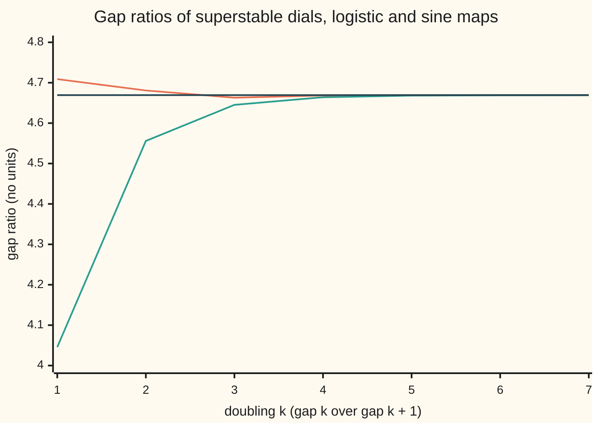

# Feigenbaum renormalisation: why every one-hump map doubles its period at the same rate 4.669

[Syllabus](../../../SYLLABUS.md) → [Differential equations and dynamics](../README.md) → [Discrete Dynamics and Chaos](../README.md#s11) → Feigenbaum renormalisation

---

## General Overview

Take the orchard moths of [The logistic map](03-the-logistic-map-and-period-doubling.md): next summer's share of the food is the breeding dial r, times this summer's share, times the share still free. At r = 3.2 two values alternate; at 3.5 four take turns. Each doubling of the period comes sooner than the last.

Mark the dials where the cycle passes through the top of the hump: 2, 3.236068, 3.498562, 3.554641. Each gap is about 4.7 times the next: 4.7089, then 4.6808. Further along, the ratio settles at 4.6692.

Swap the moth rule for a sine curve, r sin(πx). Its ratios start at 4.0457 and settle at the same 4.6692. The reason is a zoom: after one doubling, the top of the hump, applied twice and magnified 2.5029 times, looks like the map before. Repeat the zoom and every one-hump map is pulled toward one shape. Finding that shape is **renormalisation**: rescaling a system and asking what stays the same.

**Each period doubling is the previous one seen through a zoom of 2.5029; the zoom has one fixed shape, and 4.669 is how fast the zoom pushes a map away from that shape, so every map with a rounded top shares both numbers.**

**What kind of fact this is:** a computation of two constants, done on this card. That the fixed shape exists, and that the zoom pushes away from it in exactly one direction, is a theorem: Lanford proved it with computer help in 1982, and Lyubich completed a proof without computers in 1999. This card computes the shape and the rate; it does not prove the theorem.

### The picture: two maps, one limit



Orange: the logistic map. Green: the sine map. Dark: 4.669201, the zoom's stretch rate, computed from the fixed shape alone. Both maps reach it, to four decimals, by the seventh ratio.

---

## The formula

A **one-hump map** $`f`$ turns this step's value into the next and rises to a single rounded top, here at $`x = 1/2`$. Its dial is $`r`$. A dial is **superstable** for period $`2^k`$ when the cycle of that length passes through the top. The slope there is 0, so the cycle attracts as hard as it can. Call that dial $`R_k`$, where $`k`$ counts the doublings.

The zoom is the **doubling operator** $`T`$. It takes a one-hump shape $`g`$, with the top moved to $`x = 0`$ and scaled so $`g(0) = 1`$, and returns a new shape:

```math
(Tg)(x) = -\alpha\, g\big(g(-x/\alpha)\big), \qquad \alpha = -\frac{1}{g(1)}
```

**Read it aloud:** shrink the view by alpha around the top and flip it, apply the shape twice, then flip and magnify by alpha; alpha is whatever keeps the top at height 1.

The universal shape is the **fixed point** $`g = Tg`$: the shape the zoom leaves unchanged. The two Feigenbaum constants are

```math
\alpha = \lim_{k\to\infty} \left| \frac{d_k}{d_{k+1}} \right| = 2.502908\ldots, \qquad \delta = \lim_{k\to\infty} \frac{R_k - R_{k-1}}{R_{k+1} - R_k} = 4.669201\ldots
```

**Read it aloud:** the window around the top shrinks by alpha at each doubling, and the gap between superstable dials shrinks by delta.

Here $`d_k`$ is the **window**: the signed distance from the top to the cycle point closest to it, at $`R_k`$. The card finds $`g`$ by guessing a polynomial with $`N`$ unknown coefficients, an **ansatz** (a guessed form to be fitted):

```math
g(x) = 1 + c_1 x^2 + c_2 x^4 + \cdots + c_N x^{2N}
```

**Read it aloud:** the shape is 1 at the top and falls away evenly on both sides, a sum of even powers.

| Symbol | Plain meaning | In our example | Push it up and the answer… |
| --- | --- | --- | --- |
| $`f`$, $`r`$ | a one-hump map and its dial | $`r x (1 - x)`$; $`r \sin(\pi x)`$ | longer cycles, then chaos |
| $`R_k`$, $`k`$, $`r_\infty`$ | superstable dial of the $`2^k`$-cycle; $`k`$ counts doublings; $`r_\infty`$ the pile-up dial | $`R_1`$ = 3.236068 | gaps shrink by $`\delta`$ |
| $`d_k`$ | window: top to nearest cycle point, at $`R_k`$ | 0.309017, then −0.116402 | sign flips each doubling |
| $`\alpha`$ | zoom factor of the window | 2.502908 | — |
| $`\delta`$ | Feigenbaum's delta: limit of gap ratios | 4.669201 | — |
| $`g`$, $`x`$ | the universal shape; $`x`$ measured from the top | $`1 - 1.527633x^2 + \ldots`$ | — |
| $`T`$ | the doubling operator: apply twice, zoom, flip | $`Tg = g`$ at the fixed point | — |
| $`N`$, $`c_1 \ldots c_N`$ | terms in the ansatz, and their coefficients | $`N`$ = 2: −1.541695, 0.143920 | $`\alpha`$ closes on 2.502908 |

### When it holds

- **A rounded top, like $`x^2`$.** A flatter top, like $`x^4`$, gives a different family: window ratios settle at −1.6903, and gap ratios are still falling at the seventh, 7.2851.
- **Deep in the cascade.** The constants are limits. The sine map's first ratio is 4.0457, and the logistic's first window ratio is −2.6547.
- **Enough terms in the ansatz.** Two terms give $`\alpha`$ = 2.513984, too high; eight give 2.502908.

---

## Why it works

### Step 0: each doubling is the previous one, zoomed

At $`R_1`$ = 3.236068 the moths alternate, and one of the two values is the top, 1/2. At $`R_2`$ = 3.498562 four values take turns. Watch every second summer near the top: that two-step map has a small upside-down hump there. Magnified, it looks like the one-step map at $`R_1`$.

So a doubling is three moves: apply the map twice, cut a small window at the top, and blow it up with a flip. That is $`T`$.

### Step 1: the zoom factor is fixed by the top

Measure $`x`$ from the top and scale so the top has height 1. The inner $`-x/\alpha`$ shrinks the view to a window $`1/\alpha`$ wide and flips it. The outer $`-\alpha`$ magnifies and flips back. At $`x = 0`$:

```math
(Tg)(0) = -\alpha\, g(g(0)) = -\alpha\, g(1)
```

For the new shape to keep height 1 at the top, $`\alpha = -1/g(1)`$. On the logistic map the window ratios close in on this factor: 0.309017 to −0.116402 is a ratio of −2.6547, and the later ratios settle at −2.5029.

### Step 2: find the fixed shape by Newton's method

Put the ansatz into $`g = Tg`$ and demand equality at $`N`$ points, $`x = 1/N, 2/N, \ldots, 1`$. That is $`N`$ equations in $`N`$ unknowns. [Newton's method](../../06-Calculus%20and%20analysis/03-What%20Derivatives%20Tell%20You/06-newtons-method.md) solves them: replace the equations by their tangent planes, solve, repeat.

| Terms $`N`$ | $`c_1`$ | $`\alpha`$ |
| --- | --- | --- |
| 1 | −1.402197 | 2.486344 |
| 2 (quartic) | −1.541695 | 2.513984 |
| 4 | −1.527694 | 2.502941 |
| 8 | −1.527633 | 2.502908 |

The logistic windows reach 2.5029 without ever using $`T`$.

### Step 3: delta is the zoom's stretch near the fixed shape

Near its fixed point, $`T`$ acts like multiplying by a matrix, as a map does near its fixed point ([Fixed points of a map](02-fixed-points-of-a-map.md)). Every direction away from $`g`$ shrinks except one, which grows by 4.669201. Turning a map's dial moves it partly along that direction.

So each zoom magnifies a dial's offset from the pile-up by 4.669201. A dial is superstable for period $`2^k`$ when its offset, magnified by $`k`$ zooms, reaches one fixed size. So the superstable offsets, and the gaps between them, shrink by 4.669201 each doubling.

<details>
<summary>The argument in symbols, and how the code finds 4.669201</summary>

Write $`r_\infty`$ for the dial where the doublings pile up. Near it, a map's shape is $`g`$ plus $`(r - r_\infty)`$ times one fixed direction, plus smaller terms. After $`k`$ zooms the part along the growing direction has been multiplied by $`\delta^k`$. Superstability at period $`2^k`$ fixes that part at one set size, the same for every $`k`$. So $`\delta^k (R_k - r_\infty)`$ stays about constant:

$`\displaystyle R_k - r_\infty \approx \text{constant} \times \delta^{-k}`$

That is a geometric sequence, and its gaps shrink by its ratio, $`\delta`$.

The code builds the matrix by nudging each coefficient of $`g`$, applying $`T`$, and reading how the coefficients move. Power iteration (multiplying a vector by the matrix again and again) finds the largest stretch. With 1, 2, 4 and 8 terms it gives 4.466487, 4.660715, 4.669178 and 4.669201.

</details>

### Step 4: why every rounded top shares the numbers

Each map starts somewhere different, but the zoom shrinks every direction except one. After a few doublings only $`g`$ and the growing direction are left, and neither depends on the map. So the sine map's ratios settle on 4.6692 and its windows on −2.5029, like the logistic's.

The one thing the zoom cannot forget is the shape of the top, because $`g`$ is built around it. A map with an $`x^4`$ top has its own fixed shape. Its gap ratios run 8.0005, 7.5640, …, 7.2851 and are still falling; its window ratios settle at −1.6903.

---

## Worked numbers, by hand

The logistic map $`f(x) = r x (1 - x)`$, at its first superstable dials.

| Step | Arithmetic | Value |
| --- | --- | --- |
| $`R_1`$ | $`f(1/2) = r/4`$, then $`f(r/4) = 1/2`$ gives $`r^3 - 4r^2 + 8 = 0`$; drop $`r = 2`$ | 1 + √5 = 3.236068 |
| gaps | 3.236068 − 2, 3.498562 − 3.236068, 3.554641 − 3.498562 | 1.236068, 0.262494, 0.056079 |
| gap ratios | 1.236068 / 0.262494 and 0.262494 / 0.056079 | 4.7089 and 4.6808 |
| windows | $`f(1/2) - 1/2`$ at 3.236068; two steps from 1/2 at 3.498562, minus 1/2 | 0.309017 and −0.116402 |
| window ratio | 0.309017 / −0.116402 | −2.6547 |
| limits | ratios continued, and the fixed point of $`T`$ | **δ = 4.669201, α = 2.502908** |

Three dials already give a gap ratio of 4.7089, near the limit 4.669201. From there on, the zoom predicts the rest of the cascade from one number.

The cubic factors as $`(r - 2)(r^2 - 2r - 4)`$: the root 2 is $`R_0`$, and the other positive root is 1 + √5. The house dials 3.2 and 3.5 sit in the period-2 and period-4 ranges, near 3.236068 and 3.498562.

### What breaks if you drop a piece

| Mistake | Comes out at | What went wrong |
| --- | --- | --- |
| Reading delta off the first gaps | 4.7089 (logistic), 4.0457 (sine) | the ratios only tend to 4.669201 |
| Taking the quartic ansatz as the answer | α = 2.513984 | two terms are too few; eight give 2.502908 |
| Expecting 4.669 from a flat top | 7.2851 by the seventh ratio, windows −1.6903 | the top's shape is the one thing the zoom keeps |

The code prints all three.

---

## Code, from first principles, and it actually runs

Two independent roads. Road one finds superstable dials of three maps by Newton's method in the dial, then forms gap and window ratios. Road two never touches a map: it solves $`g = Tg`$ by Newton's method, reads $`\alpha`$ from $`g(1)`$, and finds $`\delta`$ by power iteration. The asserts set the roads against each other, and the first dial against 1 + √5.

### Python

```python
# Feigenbaum renormalisation -- the check behind the card.  Standard library only.
# Road one: three one-hump maps, superstable dials found by Newton in the dial.
# Road two: the doubling operator T g(x) = -alpha g(g(-x/alpha)), its fixed point by Newton.
from math import sin, pi, sqrt
from functools import reduce
def g(c, x):                             # g(x) = 1 + c1 x^2 + c2 x^4 + ...
    return 1 + sum(cj * x ** (2 * j + 2) for j, cj in enumerate(c))
def T(c, x):                             # the doubling operator, with alpha = -1/g(1)
    a = -1 / g(c, 1)
    return -a * g(c, g(c, -x / a))
def solve(A, b):                         # Gaussian elimination with row swaps
    n = len(b); M = [A[i][:] + [b[i]] for i in range(n)]
    for k in range(n):
        p = max(range(k, n), key=lambda i: abs(M[i][k])); M[k], M[p] = M[p], M[k]
        for i in range(k + 1, n):
            m = M[i][k] / M[k][k]; M[i] = [u - m * v for u, v in zip(M[i], M[k])]
    x = [0.0] * n
    for i in reversed(range(n)): x[i] = (M[i][n] - sum(M[i][j] * x[j] for j in range(i + 1, n))) / M[i][i]
    return x
def jac(F, c, h):                        # F at c, and its slopes by small nudges
    f0 = F(c); cols = [F(c[:j] + [c[j] + h] + c[j + 1:]) for j in range(len(c))]
    return f0, [[(cols[j][i] - f0[i]) / h for j in range(len(c))] for i in range(len(c))]
def fixed_point(N):                      # Newton: g = T g at x = 1/N, 2/N, ..., 1
    xs, c = [(i + 1) / N for i in range(N)], ([-1.5, 0.1] + [0.0] * (N - 2))[:N]
    for _ in range(30):
        f0, J = jac(lambda c: [g(c, x) - T(c, x) for x in xs], c, 1e-7)
        c = [u + v for u, v in zip(c, solve(J, [-v for v in f0]))]
    V = [[x ** (2 * j + 2) for j in range(N)] for x in xs]   # values -> coefficients
    _, J = jac(lambda c: solve(V, [T(c, x) - 1 for x in xs]), c, 1e-6)
    v, lam = [1.0] * N, 0.0
    for _ in range(200):                 # power iteration: T's largest stretch near g
        w = [sum(J[i][j] * v[j] for j in range(N)) for i in range(N)]
        lam = max(w, key=abs) / max(v, key=abs); v = [u / max(w, key=abs) for u in w]
    return c, -1 / g(c, 1), lam
orbit = lambda f, r, p: reduce(lambda x, _: f(r, x), range(p), 0.5)   # p steps from the top
def superstable(f, p, r):                # Newton in r: the p-cycle passes through x = 1/2
    G = lambda r: orbit(f, r, p) - 0.5
    for _ in range(40): h = 1e-9 * max(1, abs(r)); r -= G(r) * 2 * h / (G(r + h) - G(r - h))
    return r
fm, out = (lambda v, d: " ".join(f"{x:.{d}f}" for x in v)), []
maps = [("logistic r x (1 - x)", lambda r, x: r * x * (1 - x), 2.0, 3.2),
        ("sine r sin(pi x)", lambda r, x: r * sin(pi * x), 0.5, 0.78),
        ("flat top r (1 - (2x - 1)^4)", lambda r, x: r * (1 - (2 * x - 1) ** 4), 0.5, 0.915)]
for name, f, a0, a1 in maps:
    R = [superstable(f, 1, a0), superstable(f, 2, a1)]
    for k in range(2, 9):                # guess: the last gap shrunk by the last ratio
        R.append(superstable(f, 2 ** k, R[-1] + (R[-1] - R[-2]) / (6 if k == 2 else (R[-2] - R[-3]) / (R[-1] - R[-2]))))
    d = [orbit(f, R[k], 2 ** (k - 1)) - 0.5 for k in range(1, 9)]
    out.append((R, [(R[i] - R[i - 1]) / (R[i + 1] - R[i]) for i in range(1, 8)], [d[i] / d[i + 1] for i in range(7)], d))
    print(f"{name}, superstable dials: {fm(R, 6)}\n  gap ratios: {fm(out[-1][1], 4)}\n  window ratios: {fm(out[-1][2], 4)}")
(R, dl, al, d), (_, ds, als, _), (_, dq, aq, _) = out
print(f"logistic by hand: 1 + sqrt(5) = {1 + sqrt(5):.6f}; gaps {fm([R[i + 1] - R[i] for i in range(3)], 6)}; windows {fm(d[:2], 6)}")
for N in (1, 2, 4, 8):
    c, alpha, delta = fixed_point(N)
    print(f"fixed point of T, N = {N}: alpha {alpha:.6f}, delta {delta:.6f}, c = {fm(c[:3], 6)}")
assert abs(R[1] - (1 + sqrt(5))) < 1e-12                       # Newton against the closed form
assert abs(alpha + al[-1]) < 1e-4 and abs(alpha + als[-1]) < 1e-4  # operator against two maps
assert abs(delta - dl[-1]) < 1e-4 and abs(delta - ds[-1]) < 1e-4   # eigenvalue against two maps
assert dq[-1] > 7 and abs(aq[-1]) < 2                          # flat top: another family
print("ALL CHECKS PASS")
```

**Ran 2026-11-23 on macOS, Python 3.14.10, standard library only. All checks passed. Output, pasted from the run:**

```
logistic r x (1 - x), superstable dials: 2.000000 3.236068 3.498562 3.554641 3.566667 3.569244 3.569795 3.569913 3.569939
  gap ratios: 4.7089 4.6808 4.6630 4.6684 4.6690 4.6692 4.6692
  window ratios: -2.6547 -2.5318 -2.5087 -2.5041 -2.5032 -2.5030 -2.5029
sine r sin(pi x), superstable dials: 0.500000 0.777734 0.846382 0.861450 0.864694 0.865390 0.865539 0.865571 0.865577
  gap ratios: 4.0457 4.5559 4.6452 4.6641 4.6681 4.6690 4.6692
  window ratios: -2.5907 -2.5214 -2.5067 -2.5037 -2.5031 -2.5029 -2.5029
flat top r (1 - (2x - 1)^4), superstable dials: 0.500000 0.909586 0.960781 0.967549 0.968473 0.968599 0.968617 0.968619 0.968619
  gap ratios: 8.0005 7.5640 7.3300 7.3043 7.2897 7.2863 7.2851
  window ratios: -1.7639 -1.7062 -1.6946 -1.6914 -1.6906 -1.6904 -1.6903
logistic by hand: 1 + sqrt(5) = 3.236068; gaps 1.236068 0.262494 0.056079; windows 0.309017 -0.116402
fixed point of T, N = 1: alpha 2.486344, delta 4.466487, c = -1.402197
fixed point of T, N = 2: alpha 2.513984, delta 4.660715, c = -1.541695 0.143920
fixed point of T, N = 4: alpha 2.502941, delta 4.669178, c = -1.527694 0.105000 0.026434
fixed point of T, N = 8: alpha 2.502908, delta 4.669201, c = -1.527633 0.104815 0.026706
ALL CHECKS PASS
```

### Rust

Same numbers, same labels, built with `rustc --edition 2021 -O`.

```rust
// Feigenbaum renormalisation -- the same check as the Python, in Rust.  No crates.
// Road one: three one-hump maps, superstable dials found by Newton in the dial.
// Road two: the doubling operator T g(x) = -alpha g(g(-x/alpha)), its fixed point by Newton.
fn g(c: &[f64], x: f64) -> f64 {             // g(x) = 1 + c1 x^2 + c2 x^4 + ...
    1.0 + c.iter().enumerate().map(|(j, cj)| cj * x.powf((2 * j + 2) as f64)).sum::<f64>() }
fn t(c: &[f64], x: f64) -> f64 { let a = -1.0 / g(c, 1.0); -a * g(c, g(c, -x / a)) }   // the doubling operator
fn solve(a: &[Vec<f64>], b: &[f64]) -> Vec<f64> {   // Gaussian elimination with row swaps
    let n = b.len();
    let mut m: Vec<Vec<f64>> = (0..n).map(|i| { let mut r = a[i].clone(); r.push(b[i]); r }).collect();
    for k in 0..n {
        let p = (k..n).fold(k, |p, i| if m[i][k].abs() > m[p][k].abs() { i } else { p }); m.swap(k, p);
        for i in k + 1..n { let f = m[i][k] / m[k][k]; for j in 0..=n { m[i][j] -= f * m[k][j] } }
    }
    let mut x = vec![0.0; n];
    for i in (0..n).rev() { x[i] = (m[i][n] - (i + 1..n).map(|j| m[i][j] * x[j]).sum::<f64>()) / m[i][i] }
    x
}
fn jac(f: &dyn Fn(&[f64]) -> Vec<f64>, c: &[f64], h: f64) -> (Vec<f64>, Vec<Vec<f64>>) {
    let f0 = f(c);                           // F at c, and its slopes by small nudges
    let cols: Vec<Vec<f64>> = (0..c.len()).map(|j| { let mut d = c.to_vec(); d[j] += h; f(&d) }).collect();
    let jm = (0..c.len()).map(|i| (0..c.len()).map(|j| (cols[j][i] - f0[i]) / h).collect()).collect();
    (f0, jm)
}
fn fixed_point(n: usize) -> (Vec<f64>, f64, f64) {   // Newton: g = T g at x = 1/N, ..., 1
    let xs: Vec<f64> = (0..n).map(|i| (i + 1) as f64 / n as f64).collect();
    let mut c: Vec<f64> = [-1.5, 0.1].iter().copied().chain(std::iter::repeat(0.0)).take(n).collect();
    for _ in 0..30 {
        let (f0, jm) = jac(&|c: &[f64]| xs.iter().map(|&x| g(c, x) - t(c, x)).collect(), &c, 1e-7);
        let step = solve(&jm, &f0.iter().map(|v| -v).collect::<Vec<f64>>());
        c = c.iter().zip(&step).map(|(u, v)| u + v).collect();
    }
    let vm: Vec<Vec<f64>> = xs.iter().map(|&x| (0..n).map(|j| x.powf((2 * j + 2) as f64)).collect()).collect();
    let (_, jm) = jac(&|c: &[f64]| solve(&vm, &xs.iter().map(|&x| t(c, x) - 1.0).collect::<Vec<f64>>()), &c, 1e-6);
    let big = |v: &[f64]| v.iter().copied().fold(0.0f64, |m, x| if x.abs() > m.abs() { x } else { m });
    let (mut v, mut lam) = (vec![1.0; n], 0.0);
    for _ in 0..200 {                        // power iteration: T's largest stretch near g
        let w: Vec<f64> = (0..n).map(|i| (0..n).map(|j| jm[i][j] * v[j]).sum()).collect();
        lam = big(&w) / big(&v); v = w.iter().map(|u| u / big(&w)).collect();
    }
    let a = -1.0 / g(&c, 1.0); (c, a, lam)
}
fn orbit(f: &dyn Fn(f64, f64) -> f64, r: f64, p: usize) -> f64 { (0..p).fold(0.5, |x, _| f(r, x)) }
fn superstable(f: &dyn Fn(f64, f64) -> f64, p: usize, mut r: f64) -> f64 {   // Newton in r
    let gg = |r: f64| orbit(f, r, p) - 0.5;
    for _ in 0..40 { let h = 1e-9 * r.abs().max(1.0); r -= gg(r) * 2.0 * h / (gg(r + h) - gg(r - h)) }
    r
}
fn fm(v: &[f64], d: usize) -> String { v.iter().map(|x| format!("{:.*}", d, x)).collect::<Vec<_>>().join(" ") }
fn main() {
    let maps: [(&str, Box<dyn Fn(f64, f64) -> f64>, f64, f64); 3] = [
        ("logistic r x (1 - x)", Box::new(|r, x| r * x * (1.0 - x)), 2.0, 3.2),
        ("sine r sin(pi x)", Box::new(|r, x| r * (std::f64::consts::PI * x).sin()), 0.5, 0.78),
        ("flat top r (1 - (2x - 1)^4)", Box::new(|r, x| r * (1.0 - (2.0 * x - 1.0).powf(4.0))), 0.5, 0.915)];
    let mut out = Vec::new();
    for (name, f, a0, a1) in maps.iter() {
        let mut rr = vec![superstable(f.as_ref(), 1, *a0), superstable(f.as_ref(), 2, *a1)];
        for k in 2..9 {                      // guess: the last gap shrunk by the last ratio
            let n = rr.len();
            let ratio = if k == 2 { 6.0 } else { (rr[n - 2] - rr[n - 3]) / (rr[n - 1] - rr[n - 2]) };
            rr.push(superstable(f.as_ref(), 1 << k, rr[n - 1] + (rr[n - 1] - rr[n - 2]) / ratio));
        }
        let d: Vec<f64> = (1..9).map(|k| orbit(f.as_ref(), rr[k], 1 << (k - 1)) - 0.5).collect();
        let dr: Vec<f64> = (1..8).map(|i| (rr[i] - rr[i - 1]) / (rr[i + 1] - rr[i])).collect();
        let ar: Vec<f64> = (0..7).map(|i| d[i] / d[i + 1]).collect();
        println!("{}, superstable dials: {}\n  gap ratios: {}\n  window ratios: {}", name, fm(&rr, 6), fm(&dr, 4), fm(&ar, 4));
        out.push((rr, dr, ar, d));
    }
    let (rl, dl, al, d) = (&out[0].0, &out[0].1, &out[0].2, &out[0].3);
    println!("logistic by hand: 1 + sqrt(5) = {:.6}; gaps {}; windows {}", 1.0 + 5f64.sqrt(), fm(&(0..3).map(|i| rl[i + 1] - rl[i]).collect::<Vec<f64>>(), 6), fm(&d[..2], 6));
    let (mut alpha, mut delta) = (0.0, 0.0);
    for n in [1, 2, 4, 8] {
        let (c, a, l) = fixed_point(n); (alpha, delta) = (a, l); println!("fixed point of T, N = {}: alpha {:.6}, delta {:.6}, c = {}", n, a, l, fm(&c[..c.len().min(3)], 6));
    }
    assert!((rl[1] - (1.0 + 5f64.sqrt())).abs() < 1e-12);                       // Newton against the closed form
    assert!((alpha + al[6]).abs() < 1e-4 && (alpha + out[1].2[6]).abs() < 1e-4);    // operator against two maps
    assert!((delta - dl[6]).abs() < 1e-4 && (delta - out[1].1[6]).abs() < 1e-4);     // eigenvalue against two maps
    assert!(out[2].1[6] > 7.0 && out[2].2[6].abs() < 2.0);                                   // flat top: another family
    println!("ALL CHECKS PASS");
}
```

**Ran 2026-11-23 on macOS, rustc 1.98.1, no crates. All checks passed. Output, pasted from the run:**

```
logistic r x (1 - x), superstable dials: 2.000000 3.236068 3.498562 3.554641 3.566667 3.569244 3.569795 3.569913 3.569939
  gap ratios: 4.7089 4.6808 4.6630 4.6684 4.6690 4.6692 4.6692
  window ratios: -2.6547 -2.5318 -2.5087 -2.5041 -2.5032 -2.5030 -2.5029
sine r sin(pi x), superstable dials: 0.500000 0.777734 0.846382 0.861450 0.864694 0.865390 0.865539 0.865571 0.865577
  gap ratios: 4.0457 4.5559 4.6452 4.6641 4.6681 4.6690 4.6692
  window ratios: -2.5907 -2.5214 -2.5067 -2.5037 -2.5031 -2.5029 -2.5029
flat top r (1 - (2x - 1)^4), superstable dials: 0.500000 0.909586 0.960781 0.967549 0.968473 0.968599 0.968617 0.968619 0.968619
  gap ratios: 8.0005 7.5640 7.3300 7.3043 7.2897 7.2863 7.2851
  window ratios: -1.7639 -1.7062 -1.6946 -1.6914 -1.6906 -1.6904 -1.6903
logistic by hand: 1 + sqrt(5) = 3.236068; gaps 1.236068 0.262494 0.056079; windows 0.309017 -0.116402
fixed point of T, N = 1: alpha 2.486344, delta 4.466487, c = -1.402197
fixed point of T, N = 2: alpha 2.513984, delta 4.660715, c = -1.541695 0.143920
fixed point of T, N = 4: alpha 2.502941, delta 4.669178, c = -1.527694 0.105000 0.026434
fixed point of T, N = 8: alpha 2.502908, delta 4.669201, c = -1.527633 0.104815 0.026706
ALL CHECKS PASS
```

The two outputs match line for line.

### Lean

Lean proves the first superstable dial, its window and Step 1's rule for alpha, exactly, and checks the worked numbers.

- Take the logistic map $`f(x) = r x (1 - x)`$ with a positive dial $`r`$. Then the top, 1/2, is on a cycle of exactly two values exactly when $`r = 1 + \sqrt{5}`$.
- Take the dial $`r = 1 + \sqrt{5}`$. Then the window $`f(1/2) - 1/2`$ is $`(\sqrt{5} - 1)/4`$, about 0.309017.
- Take a shape $`g`$ with $`g(0) = 1`$ and $`g(1) \neq 0`$. Then the doubled shape $`Tg`$ keeps height 1 at the top exactly when $`\alpha = -1/g(1)`$.
- Two steps from the top, minus 1/2, is $`-(r^3 - 4r^2 + 8)/16`$. That cubic factors as $`(r - 2)(r^2 - 2r - 4)`$.
- At the dial 2, $`f(1/2) = 1/2`$, so the top is a fixed point.

The later dials, the fixed shape and the constants 2.502908 and 4.669201 are left to the Python and Rust checks.

```lean
-- Feigenbaum renormalisation: the logistic map's first superstable dial for period 2 is exactly 1 + √5, with window (√5 - 1)/4, and the doubling operator keeps the top at height 1 exactly when alpha = -1/g(1).
import Mathlib.Analysis.Real.Sqrt
import Mathlib.Dynamics.PeriodicPts.Defs
import Mathlib.Dynamics.PeriodicPts.Lemmas
import Mathlib.Tactic.Linarith
import Mathlib.Tactic.LinearCombination
import Mathlib.Tactic.FieldSimp
import Mathlib.Tactic.NormNum
import Mathlib.Tactic.Ring

/-- The card's superstable dial `R_1`: for a positive dial `r`, the logistic map
`x ↦ r x (1 - x)` has a cycle of length exactly 2 through the top `x = 1/2`
if and only if `r = 1 + √5`. (The root `r = 2` is dropped because there
`1/2` is a fixed point, the period-1 dial `R_0`.) -/
theorem logistic_superstable_period_two_iff (r : ℝ) (hr : 0 < r) :
    Function.minimalPeriod (fun x : ℝ => r * x * (1 - x)) (1 / 2) = 2 ↔
      r = 1 + Real.sqrt 5 := by
  have : Fact (Nat.Prime 2) := Nat.fact_prime_two
  rw [Function.minimalPeriod_eq_prime_iff]
  simp only [Function.IsPeriodicPt, Function.IsFixedPt, Function.iterate_succ,
    Function.iterate_zero, Function.comp_apply, id]
  have hs : Real.sqrt 5 ^ 2 = 5 := Real.sq_sqrt (by norm_num)
  have hs0 : 0 ≤ Real.sqrt 5 := Real.sqrt_nonneg 5
  have hs1 : 1 < Real.sqrt 5 := by nlinarith
  constructor
  · rintro ⟨h1, h2⟩
    have h2' : r - 2 ≠ 0 := by
      intro h; apply h2; have : r = 2 := by linarith
      subst this; norm_num
    have hcub : (r - 2) * (r ^ 2 - 2 * r - 4) = 0 := by linear_combination (-16) * h1
    have hq : r ^ 2 - 2 * r - 4 = 0 := by
      rcases mul_eq_zero.mp hcub with h | h
      · exact absurd h h2'
      · exact h
    have hf : (r - (1 + Real.sqrt 5)) * (r - (1 - Real.sqrt 5)) = 0 := by
      linear_combination hq - hs
    rcases mul_eq_zero.mp hf with h | h
    · linarith
    · linarith
  · intro h
    subst h
    constructor
    · linear_combination ((1 - Real.sqrt 5) / 16) * hs
    · intro h
      linarith

/-- The card's first window `d_1`: at the dial `r = 1 + √5`, the distance from the
top `1/2` to the other cycle point `f(1/2)` is `(√5 - 1)/4` (about 0.309017). -/
theorem logistic_first_window (r : ℝ) (hr : r = 1 + Real.sqrt 5) :
    r * (1 / 2) * (1 - 1 / 2) - 1 / 2 = (Real.sqrt 5 - 1) / 4 := by
  subst hr
  ring

/-- Step 1 of the card: for a shape `g` with its top scaled to `g 0 = 1` (and
`g 1 ≠ 0`, so that `alpha = -1/g(1)` makes sense), the doubled shape
`(T g)(x) = -alpha * g (g (-x / alpha))` keeps height 1 at the top
exactly when `alpha = -1 / g 1`. -/
theorem doubling_operator_keeps_top_iff (g : ℝ → ℝ) (hg0 : g 0 = 1) (hg1 : g 1 ≠ 0)
    (α : ℝ) :
    (fun x : ℝ => -α * g (g (-x / α))) 0 = 1 ↔ α = -1 / g 1 := by
  simp only [neg_zero, zero_div, hg0]
  rw [eq_div_iff hg1]
  constructor
  · intro h; linarith
  · intro h; linarith

-- Worked numbers from the card.
-- The cubic for the period-2 superstable dial factors as (r - 2)(r^2 - 2r - 4).
example (r : ℝ) : r ^ 3 - 4 * r ^ 2 + 8 = (r - 2) * (r ^ 2 - 2 * r - 4) := by ring
-- Two steps from the top: f(f(1/2)) = r^2 (4 - r) / 16, so f(f(1/2)) = 1/2 is the cubic.
example (r : ℝ) :
    r * (r * (1 / 2) * (1 - 1 / 2)) * (1 - r * (1 / 2) * (1 - 1 / 2)) - 1 / 2
      = -(r ^ 3 - 4 * r ^ 2 + 8) / 16 := by ring
-- At the dial R_0 = 2 the top is a fixed point: 2 * (1/2) * (1 - 1/2) = 1/2.
example : (2 : ℚ) * (1 / 2) * (1 - 1 / 2) = 1 / 2 := by norm_num

#print axioms logistic_superstable_period_two_iff
#print axioms logistic_first_window
#print axioms doubling_operator_keeps_top_iff
```

**Checked 2026-11-23 on macOS, Lean 4.36.0-rc2, Mathlib v4.36.0-rc2. Every proof is complete and uses only Lean's standard axioms. Output, pasted from the run:**

```
'logistic_superstable_period_two_iff' depends on axioms: [propext, Classical.choice, Quot.sound]
'logistic_first_window' depends on axioms: [propext, Classical.choice, Quot.sound]
'doubling_operator_keeps_top_iff' depends on axioms: [propext, Classical.choice, Quot.sound]
```

> [!TIP]
> **Try changing**
> - **Guess first:** does the answer depend on where the ansatz is matched? Change `(i + 1) / N` to `(i + 0.5) / N`. Two terms now give α = 2.522236, but eight still give 2.502908.
> - **Guess first:** do fewer terms do worse? Change `(1, 2, 4, 8)` to `(1, 2, 3, 6)`. Three terms give α = 2.501364, too low; six give 2.502908.
> - **Guess first:** what does the flat top become with a square? Change `** 4` to `** 2` in the flat-top map. It becomes the logistic map with its dial scaled by 4, its ratios run 4.7089 … 4.6692, and the last assert stops the run.

---

## The usual mistake

> [!warning]
> **Thinking 4.669 comes from the formula $`r x (1 - x)`$.** It comes from the zoom's fixed shape, which knows only that the top is rounded. The sine map shares no algebra with the logistic map and runs to the same 4.6692.
>
> - **Stopping at the first gaps.** The first ratios, 4.7089 and 4.0457, both miss the limit.
> - **Trusting a short ansatz.** The quartic gives α = 2.513984, not 2.502908.
> - **Mixing up the two constants.** Dials close in by δ = 4.669201; the window around the top shrinks by α = 2.502908, and its sign flips each time.
> - **Expecting 4.669 from every hump.** A flat $`x^4`$ top gives 7.2851 at the seventh ratio, nowhere near 4.669.

---

## Where you meet it in real life

- **Heated fluids.** Liquid mercury or helium heated from below rolls into convection cells. Experiments around 1980 saw the oscillation double its period again and again; the mercury runs measured a gap ratio a few percent below 4.669.
- **Driven electronic circuits.** A diode circuit pushed by a sine-wave voltage doubles its period as the voltage rises, with a similar ratio.
- **Two-dimensional maps.** Maps that squeeze area as they fold, such as [The Henon map](09-the-henon-map.md), double their period at the same rate.
- **Phase transitions.** The same plan, rescale and find what stays the same, explains why different materials share numbers near a critical point: the renormalisation group.

> **Say it back**
> After each doubling, the top of a one-hump map, applied twice and magnified, looks like the map before. That zoom is the doubling operator, and it has one fixed shape. Newton's method on a polynomial guess finds it, and with it the zoom factor 2.502908. Near the shape the zoom stretches one direction by 4.669201, so superstable dials close in at that rate. Every rounded top shares both numbers.

---

## What this builds on

- [The logistic map](03-the-logistic-map-and-period-doubling.md): the cascade, the superstable dials and the ratio 4.669, measured on one map.
- [Fixed points of a map](02-fixed-points-of-a-map.md): near a fixed point a map multiplies gaps by its slope; here the same idea applies to the zoom acting on shapes.
- [The Lyapunov exponent](04-chaos-and-the-lyapunov-exponent.md): what happens past the pile-up, where nearby starts drift apart.
- [Newton's method](../../06-Calculus%20and%20analysis/03-What%20Derivatives%20Tell%20You/06-newtons-method.md): solving equations by tangent lines, used here twice, for dials and for the fixed shape.

## Where this goes next

This card closes the shelf; no later card builds on it yet.

The card leaves open why the zoom has exactly one growing direction at the fixed shape: Lanford proved it with computer help in 1982, and Lyubich completed a proof without computers in 1999.

---

## Sources

Verified 2026-11-23: every link below resolves to the publisher's page.

- Feigenbaum, Mitchell J. "Quantitative universality for a class of nonlinear transformations." *Journal of Statistical Physics* 19, 25–52 (1978). [DOI](https://doi.org/10.1007/BF01020332). The doubling operator, its fixed point and the two constants.
- Lanford, Oscar E., III. "A computer-assisted proof of the Feigenbaum conjectures." *Bulletin of the American Mathematical Society* 6, 427–435 (1982). [DOI](https://doi.org/10.1090/S0273-0979-1982-15008-X). The proof that the fixed shape exists and has one growing direction.
- Collet, Pierre, and Jean-Pierre Eckmann. *Iterated Maps on the Interval as Dynamical Systems*. Birkhäuser, 1980; reprinted 2009. [DOI](https://doi.org/10.1007/978-0-8176-4927-2). One-hump maps and renormalisation, done with full rigour.
- Strogatz, Steven H. *Nonlinear Dynamics and Chaos*, 3rd ed. CRC Press, 2024. [DOI](https://doi.org/10.1201/9780429398490). Sections 10.6 and 10.7 explain universality and estimate both constants by a hand-sized renormalisation.
