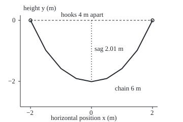
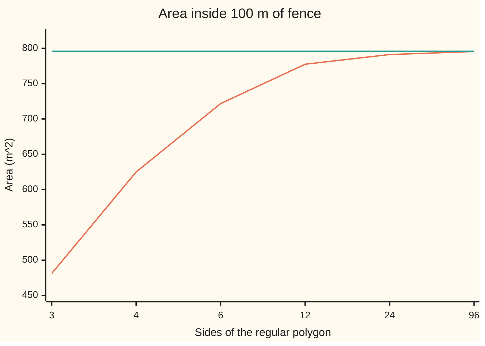

# Paths with a budget: a Lagrange multiplier joins the constraint to the cost, and a chain hangs as a cosh

[Syllabus](../../../SYLLABUS.md) → [Differential equations and dynamics](../README.md) → [Calculus of Variations and Optimal Control](../README.md#s12) → Paths with a budget

---

## General Overview

A chain 6 m long hangs from two hooks 4 m apart at the same height. Of all curves 6 m long joining the hooks, it takes the one that puts its weight lowest. Its bottom settles 2.0105 m below the hooks.

The chain cannot just drop: its length is a budget spent over the whole path. A fence of 100 m poses the same problem: enclose the most ground. The answer is a circle, holding 795.7747 m^2; a square holds 625.00 m^2.

One move settles both. Join the budget to the cost with a constant, the **multiplier**, and solve the ordinary path equation for the combination. The multiplier is the price of the budget, what one more metre buys; for the fence it is the circle's radius.

**To find the best path under an integral budget, make the cost minus a constant times the budget stationary, then choose the constant so the budget is spent exactly.**

**What kind of fact this is:** a theorem, Euler's multiplier rule for functionals, proved on this card in Why it works with the full argument folded; the catenary and the circle follow from it.

### The picture: the 6 m chain, to scale

<p align="center"></p>

Drawn to scale at 60 px to the metre on both axes. The nine points on the curve are the `figure,` line both checks print.

---

## The formula

Reminder: a functional takes a whole path y(x) and returns one number ([The Euler-Lagrange equation](01-functionals-and-the-euler-lagrange-equation.md)). Here there are two: the cost $J$, the integral of $F$, and the budget $K$, the integral of $G$, which must equal a fixed amount $L$. Both integrands depend on the height y and the slope y'. The multiplier rule: a path that makes $J$ stationary among all paths with $K = L$ satisfies the Euler-Lagrange equation for $F - \lambda G$, for some constant $\lambda$.

$$\frac{\partial (F - \lambda G)}{\partial y} - \frac{d}{dx}\,\frac{\partial (F - \lambda G)}{\partial y'} = 0, \qquad K[y] = L$$

**Read it aloud:** subtract the multiplier times the budget from the cost, make the combination stationary, then pick the multiplier that spends the budget exactly.

For the chain, the cost is height summed along its length, its potential energy per unit weight; hooks sit at x = ±2 m, height 0:

$$J[y] = \int_{-2}^{2} y\sqrt{1+y'^2}\,dx, \qquad K[y] = \int_{-2}^{2} \sqrt{1+y'^2}\,dx = 6$$

The answer is a shifted hyperbolic cosine, the **catenary**:

$$y = a\cosh\frac{x}{a} + c, \qquad 2a\sinh\frac{2}{a} = 6, \qquad \text{sag} = a\left(\cosh\frac{2}{a} - 1\right)$$

For the fence the cost is the enclosed area $A$; the answer is a circle of radius $\lambda$.

| Symbol | Plain meaning | In our example | Push it up and the answer… |
| --- | --- | --- | --- |
| $x$, $y$ | horizontal position and height, in m; y' is the slope | hooks at x = ±2 m, y = 0 | — |
| $J$, $E$ | the cost; $E$ is its least value for a given length | height summed along the chain | — |
| $K$, $L$ | the budget, and the amount it must equal | 6 m of chain, 100 m of fence | the chain sags lower; the fence holds more |
| $F$, $G$ | the integrands of $J$ and $K$ | y√(1+y'^2) and √(1+y'^2) | — |
| $\lambda$ | the multiplier: change in the best cost per unit of budget | −3.2435 m (chain), 15.9155 m (fence) | — |
| $a$ | the catenary's scale: sideways pull, as a length of chain | 1.2329 m | a flatter, tauter chain |
| $c$ | the catenary's vertical shift, equal to $\lambda$ | −3.2435 m | the curve moves up |
| $A$, $r$ | enclosed area, and the circle's radius | 795.7747 m^2, 15.9155 m | — |

### When it holds

- **The budget is an integral over the path.** A rule at every point needs a multiplier that varies along the path.
- **The path is not stationary for the budget alone.** A chain exactly 4 m long can only be straight, already the shortest path, so nothing is left to trade; near that limit a and the tension run away (What breaks, last row).
- **The path is smooth with fixed ends.** A chain over a peg has a corner there; the equation holds on each side.
- **Stationary is not least.** The rule yields candidates; the bead model in the code confirms the chain's resting shape.
- **The chain is ideal:** it does not stretch, bends freely, and weighs the same per metre.

---

## Why it works

### Step 0: the idea

With a few numbers and one constraint, the best point has the cost's gradient a multiple of the constraint's ([Lagrange multipliers](../../06-Calculus%20and%20analysis/07-Several%20Variables/08-lagrange-multipliers.md)). A path is infinitely many numbers, but each wiggle is one direction, so the rule applies wiggle by wiggle.

### Step 1: two wiggles reduce it to two numbers

Add to the best path two small bumps that vanish at the hooks, scaled by two small numbers. Cost and budget become functions of two numbers, and the two-variable rule gives one constant $\lambda$, the same for every bump, with the cost's first change $\lambda$ times the budget's. So $J - \lambda K$ has zero first change, and the argument of [The Euler-Lagrange equation](01-functionals-and-the-euler-lagrange-equation.md) turns that into the Euler-Lagrange equation for $F - \lambda G$.

<details>
<summary>Detailed proof</summary>

Write δJ[η] for the first change of J along a bump η vanishing at both ends:
$$\delta J[\eta] = \int \left( F_y\,\eta + F_{y'}\,\eta' \right) dx,$$
and δK[η] likewise with G. Since y is not stationary for K alone, some bump η₂ has δK[η₂] ≠ 0. Set λ = δJ[η₂] / δK[η₂].

Take any bump η₁ and the family y + ε₁η₁ + ε₂η₂, making J and K functions j and k of (ε₁, ε₂). As δK[η₂] ≠ 0, the implicit function theorem (an equation in two numbers can be solved for one of them near a point where its rate of change in that one is not zero) makes k = L near the origin a curve. Along it j is stationary, and the two-variable rule gives a constant μ with δJ[η₁] = μ δK[η₁] and δJ[η₂] = μ δK[η₂]. The second forces μ = λ, whatever η₁ was.

So δ(J − λK)[η₁] = 0 for every bump. Integrating the η₁' term by parts leaves the integral of η₁ times the Euler-Lagrange expression for F − λG, zero for every bump, so that expression is zero everywhere.

</details>

### Step 2: no x in the integrand, so Beltrami applies

The chain's combined integrand is (y − λ)√(1+y'^2), with no x on its own. The Beltrami identity ([The brachistochrone](02-the-brachistochrone-and-the-beltrami-identity.md)) says the integrand minus y' times its slope-derivative is constant. Working it out:

$$\frac{y - \lambda}{\sqrt{1+y'^2}} = a$$

### Step 3: solve it, and a cosh appears

Put u = y − λ, so u = a√(1+u'^2). The function a cosh(x/a) satisfies it, since 1 + sinh^2 = cosh^2 ([Hyperbolic functions](../../06-Calculus%20and%20analysis/02-Derivatives/07-hyperbolic-functions.md)). Level hooks put the lowest point at x = 0, so y = a cosh(x/a) + λ. The shift $c$ is the multiplier. Hooks at height 0 fix c = −a cosh(2/a). The length, the integral of cosh(x/a) from −2 to 2, gives 2a sinh(2/a) = 6, which fixes $a$.

### Step 4: what the multiplier means

The sideways pull is the same all along the chain: the weight of $a$ metres of it. Full tension is that pull times the stretch factor √(1+y'^2), which Step 2 says is (y − λ)/a. So tension is the weight of a length of chain equal to the height above the level λ: $a$ at the bottom, a cosh(2/a) at the hooks. It is also a price: the least energy $E$ changes with length at rate λ = −3.2435 m, which the code checks by differencing.

### Step 5: the fence gives a circle

For the arc of fence above a straight chord, the combined integrand is y − λ√(1+y'^2). Beltrami gives y − λ/√(1+y'^2) = constant, which rearranges to a circle of radius λ. The arc below the chord shares the same λ, since one fence has one budget, so both arcs lie on one circle. Circumference 100 m gives r = 100/(2π) = 15.9155 m and area 100^2/(4π) = 795.7747 m^2. The area's rate in the length is 100/(2π) = r: the multiplier is the radius.

The rule shows only that a best fence, if one exists, is a circle; that one exists was proved by Weierstrass. A second road to the chain, beads on weightless strings, is in the code.

---

## Worked numbers, by hand

| Step | Arithmetic | Value |
| --- | --- | --- |
| length equation | 2a sinh(2/a) = 6, solved by halving an interval | a = 1.2329 m |
| cosh at the hook | cosh(2 / 1.2329) | 2.6307 |
| shift = multiplier | c = −1.2329 × 2.6307 | −3.2435 m |
| sag | 1.2329 × (2.6307 − 1) | **2.0105 m** |
| vertical pull at each hook | a sinh(2/a) = 6 / 2 | 3.0000 m of chain |
| fence radius | 100 / (2π) | 15.9155 m |
| fence area | 100^2 / (4π) | **795.7747 m^2** |

The bottom hangs 2.0105 m below the hooks, each hook carrying half the chain's weight. The circle holds 170.77 m^2 more than a square.

### The picture: the fence's best shape, approached by polygons



The orange line is the regular polygon's area; the green line is the circle's 795.77 m^2, which every polygon falls short of.

### What breaks if you drop a piece

| Mistake | Comes out at | What went wrong |
| --- | --- | --- |
| A parabola 6 m long through the hooks | sag 2.0554 m | A parabola suits weight spread evenly across the span, not along the chain |
| Sag read as a cosh(2/a) | 3.2435 m | Measured from the level λ, not from the bottom, which sits $a$ above it |
| A square fence of 100 m | 625.00 m^2 | Budget spent, but not on the stationary shape |
| No slack: a chain just over 4 m | 4.01 m gives a = 16.3 m; 4.001 m gives 51.6 m | The straight path is stationary for length alone |

---

## Code, from first principles, and it actually runs

Road one solves 2a sinh(2/a) = 6 by halving an interval. Road two never mentions cosh: n equal beads on weightless strings, one sideways pull throughout, the upward pull dropping by a bead's weight at each bead, adjusted until the strings span 4 m. Its sag error falls a hundredfold per tenfold rise in beads. The least energy, integrated by Simpson's rule, is differenced to price λ. The fence is checked by regular polygons, their areas by the shoelace formula (half the sum of cross-products of neighbouring corners).

### Python

```python
# Paths with a budget -- the check behind the card.  Standard library only.
# A 6 m chain hangs from hooks 4 m apart at height 0; a 100 m fence encloses
# the most area it can.  Each answer is reached by two roads.
import math
D, L, FENCE = 2.0, 6.0, 100.0           # half-span (m), chain length (m), fence (m)

def bisect(f, lo, hi):                  # f(lo) > 0 > f(hi); halve 200 times
    for _ in range(200):
        mid = (lo + hi) / 2
        lo, hi = (mid, hi) if f(mid) > 0 else (lo, mid)
    return (lo + hi) / 2

def simpson(f, lo, hi, m=2000):         # Simpson's rule on m panels
    h = (hi - lo) / m
    return h / 3 * sum(f(lo + i * h) * (1 if i in (0, m) else 4 if i % 2 else 2) for i in range(m + 1))

def catenary(length):                   # road 1: y = a cosh(x/a) + c from the multiplier rule
    a = bisect(lambda a: 2 * a * math.sinh(D / a) - length, 0.1, 1e4)
    return a, -a * math.cosh(D / a)     # c = lambda puts the hooks at height 0

def beads(n):                           # road 2: n massless strings, n - 1 equal beads
    s = L / n                           # force balance: slope of string k is (k - (n-1)/2) s / a
    slopes = lambda a: [(k - (n - 1) / 2) * s / a for k in range(n)]
    a = bisect(lambda a: 2 * D - sum(s / math.sqrt(1 + t * t) for t in slopes(a)), 0.01, 100.0)
    return a, sum(s * abs(t) / math.sqrt(1 + t * t) for t in slopes(a)[: n // 2])

def energy(length):                     # height summed along the chain, J[y]
    a, c = catenary(length)
    return simpson(lambda x: (a * math.cosh(x / a) + c) * math.cosh(x / a), -D, D)

def polygon(n, perim):                  # regular n-gon by the shoelace formula, rescaled to perim
    p = [(math.cos(2 * math.pi * k / n), math.sin(2 * math.pi * k / n)) for k in range(n)]
    q = p[1:] + p[:1]
    side = sum(math.hypot(x2 - x1, y2 - y1) for (x1, y1), (x2, y2) in zip(p, q))
    return sum(x1 * y2 - x2 * y1 for (x1, y1), (x2, y2) in zip(p, q)) / 2 * (perim / side) ** 2

a, c = catenary(L)
sag = a * (math.cosh(D / a) - 1)
print(f"chain 6 m, hooks 4 m apart; road 1, multiplier rule: a = {a:.4f} m, c = lambda = {c:.4f} m, sag = {sag:.4f} m")
for n in (10, 100, 1000):
    an, sn = beads(n)
    print(f"road 2, {n:4d} beads: a = {an:.4f} m, sag = {sn:.4f} m, sag error {abs(sn - sag):.1e} m")
print(f"cosh(2/a) = {math.cosh(D / a):.4f}; tension as a length of chain: bottom {a:.4f} m, hooks {-c:.4f} m, hook vertical {a * math.sinh(D / a):.4f} m")
dE = (energy(L + 1e-3) - energy(L - 1e-3)) / 2e-3
print(f"price of chain: dE/dL = {dE:.4f} m against lambda = {c:.4f} m")
print("figure, " + " ".join(f"{180 + 60 * x:.0f},{40 - 60 * (a * math.cosh(x / a) + c):.1f}" for x in (-2, -1.5, -1, -0.5, 0, 0.5, 1, 1.5, 2)))
r = FENCE / (2 * math.pi)
print(f"fence: circle radius {r:.4f} m, area L^2/(4 pi) = {FENCE ** 2 / (4 * math.pi):.4f} m^2")
print("regular n-gons, n = 3 4 6 12 24 96: " + " ".join(f"{polygon(n, FENCE):.2f}" for n in (3, 4, 6, 12, 24, 96)))
big, dA = polygon(4096, FENCE), (polygon(4096, FENCE + 0.01) - polygon(4096, FENCE - 0.01)) / 0.02
print(f"4096-gon area {big:.4f} m^2; price of fence dA/dL = {dA:.4f} m against radius {r:.4f} m")
k = bisect(lambda k: L - simpson(lambda x: math.sqrt(1 + 4 * k * k * x * x), -D, D), 0.0, 5.0)
print(f"mistake 1, a parabola 6 m long: sag {4 * k:.4f} m; mistake 2, sag read as a cosh(2/a): {-c:.4f} m")
print("hypothesis dropped, no slack: " + ", ".join(f"chain {x} m gives a = {catenary(x)[0]:.1f} m" for x in (4.01, 4.001)))
print(f"mistake 3, a square fence: {polygon(4, FENCE):.2f} m^2, short by {FENCE ** 2 / (4 * math.pi) - polygon(4, FENCE):.2f} m^2")
assert abs(beads(1000)[1] - sag) < 1e-4                  # force balance agrees with the multiplier rule
assert abs(dE - c) < 1e-4                                # the multiplier is the price of chain
assert abs(big - FENCE ** 2 / (4 * math.pi)) < 0.01      # polygons close on the circle
assert abs(dA - r) < 1e-3                                # the fence's multiplier is the radius
print("ALL CHECKS PASS")
```

**Ran 2026-09-28 on macOS, Python 3.14.6, standard library only. All checks passed. Output, pasted from the run:**

```
chain 6 m, hooks 4 m apart; road 1, multiplier rule: a = 1.2329 m, c = lambda = -3.2435 m, sag = 2.0105 m
road 2,   10 beads: a = 1.2306 m, sag = 2.0238 m, sag error 1.3e-02 m
road 2,  100 beads: a = 1.2329 m, sag = 2.0107 m, sag error 1.3e-04 m
road 2, 1000 beads: a = 1.2329 m, sag = 2.0105 m, sag error 1.3e-06 m
cosh(2/a) = 2.6307; tension as a length of chain: bottom 1.2329 m, hooks 3.2435 m, hook vertical 3.0000 m
price of chain: dE/dL = -3.2435 m against lambda = -3.2435 m
figure, 60,40.0 90,98.8 120,134.9 150,154.5 180,160.6 210,154.5 240,134.9 270,98.8 300,40.0
fence: circle radius 15.9155 m, area L^2/(4 pi) = 795.7747 m^2
regular n-gons, n = 3 4 6 12 24 96: 481.13 625.00 721.69 777.51 791.22 795.49
4096-gon area 795.7746 m^2; price of fence dA/dL = 15.9155 m against radius 15.9155 m
mistake 1, a parabola 6 m long: sag 2.0554 m; mistake 2, sag read as a cosh(2/a): 3.2435 m
hypothesis dropped, no slack: chain 4.01 m gives a = 16.3 m, chain 4.001 m gives a = 51.6 m
mistake 3, a square fence: 625.00 m^2, short by 170.77 m^2
ALL CHECKS PASS
```

### Rust

Same numbers, same labels, built with `rustc --edition 2021 -O`.

```rust
// Paths with a budget -- the same check as the Python, in Rust.  No crates.
// A 6 m chain hangs from hooks 4 m apart at height 0; a 100 m fence encloses
// the most area it can.  Each answer is reached by two roads.
use std::f64::consts::PI;
const D: f64 = 2.0; const L: f64 = 6.0; const FENCE: f64 = 100.0;

fn bisect(f: &dyn Fn(f64) -> f64, mut lo: f64, mut hi: f64) -> f64 { // f(lo) > 0 > f(hi)
    for _ in 0..200 { let mid = (lo + hi) / 2.0; if f(mid) > 0.0 { lo = mid } else { hi = mid } }
    (lo + hi) / 2.0
}

fn simpson(f: &dyn Fn(f64) -> f64, lo: f64, hi: f64) -> f64 {      // Simpson's rule, 2000 panels
    let (m, h) = (2000, (hi - lo) / 2000.0);
    h / 3.0 * (0..=m).map(|i| f(lo + i as f64 * h) * if i == 0 || i == m { 1.0 } else if i % 2 == 1 { 4.0 } else { 2.0 }).sum::<f64>()
}

fn catenary(length: f64) -> (f64, f64) {                          // road 1: the multiplier rule
    let a = bisect(&|a: f64| 2.0 * a * (D / a).sinh() - length, 0.1, 1e4);
    (a, -a * (D / a).cosh())
}

fn beads(n: usize) -> (f64, f64) {                                // road 2: force balance on beads
    let s = L / n as f64;
    let slopes = |a: f64| -> Vec<f64> { (0..n).map(|k| (k as f64 - (n as f64 - 1.0) / 2.0) * s / a).collect() };
    let a = bisect(&|a: f64| 2.0 * D - slopes(a).iter().map(|t| s / (1.0 + t * t).sqrt()).sum::<f64>(), 0.01, 100.0);
    (a, slopes(a)[..n / 2].iter().map(|t| s * t.abs() / (1.0 + t * t).sqrt()).sum())
}

fn energy(length: f64) -> f64 {                                   // height summed along the chain
    let (a, c) = catenary(length);
    simpson(&|x: f64| (a * (x / a).cosh() + c) * (x / a).cosh(), -D, D)
}

fn polygon(n: usize, perim: f64) -> f64 {                         // shoelace, rescaled to perim
    let p: Vec<(f64, f64)> = (0..n).map(|k| { let t = 2.0 * PI * k as f64 / n as f64; (t.cos(), t.sin()) }).collect();
    let (mut side, mut area) = (0.0, 0.0);
    for i in 0..n {
        let ((x1, y1), (x2, y2)) = (p[i], p[(i + 1) % n]);
        side += (x2 - x1).hypot(y2 - y1);
        area += x1 * y2 - x2 * y1;
    }
    area / 2.0 * (perim / side).powi(2)
}

fn sci(v: f64) -> String {                                        // 1.3e-02, as Python prints it
    let s = format!("{:.1e}", v); let (m, e) = s.split_once('e').unwrap();
    let e: i32 = e.parse().unwrap();
    format!("{}e{}{:02}", m, if e < 0 { '-' } else { '+' }, e.abs())
}

fn main() {
    let (a, c) = catenary(L); let sag = a * ((D / a).cosh() - 1.0);
    println!("chain 6 m, hooks 4 m apart; road 1, multiplier rule: a = {:.4} m, c = lambda = {:.4} m, sag = {:.4} m", a, c, sag);
    for n in [10, 100, 1000] {
        let (an, sn) = beads(n);
        println!("road 2, {:4} beads: a = {:.4} m, sag = {:.4} m, sag error {} m", n, an, sn, sci((sn - sag).abs()));
    }
    println!("cosh(2/a) = {:.4}; tension as a length of chain: bottom {:.4} m, hooks {:.4} m, hook vertical {:.4} m", (D / a).cosh(), a, -c, a * (D / a).sinh());
    let de = (energy(L + 1e-3) - energy(L - 1e-3)) / 2e-3;
    println!("price of chain: dE/dL = {:.4} m against lambda = {:.4} m", de, c);
    let fig: Vec<String> = [-2.0, -1.5, -1.0, -0.5, 0.0, 0.5, 1.0, 1.5, 2.0f64].iter()
        .map(|&x| format!("{:.0},{:.1}", 180.0 + 60.0 * x, 40.0 - 60.0 * (a * (x / a).cosh() + c))).collect();
    println!("figure, {}", fig.join(" "));
    let r = FENCE / (2.0 * PI);
    println!("fence: circle radius {:.4} m, area L^2/(4 pi) = {:.4} m^2", r, FENCE * FENCE / (4.0 * PI));
    let gons: Vec<String> = [3, 4, 6, 12, 24, 96].iter().map(|&n| format!("{:.2}", polygon(n, FENCE))).collect();
    println!("regular n-gons, n = 3 4 6 12 24 96: {}", gons.join(" "));
    let (big, da) = (polygon(4096, FENCE), (polygon(4096, FENCE + 0.01) - polygon(4096, FENCE - 0.01)) / 0.02);
    println!("4096-gon area {:.4} m^2; price of fence dA/dL = {:.4} m against radius {:.4} m", big, da, r);
    let k = bisect(&|k: f64| L - simpson(&|x: f64| (1.0 + 4.0 * k * k * x * x).sqrt(), -D, D), 0.0, 5.0);
    println!("mistake 1, a parabola 6 m long: sag {:.4} m; mistake 2, sag read as a cosh(2/a): {:.4} m", 4.0 * k, -c);
    let hyp: Vec<String> = [4.01, 4.001].iter().map(|&x: &f64| format!("chain {} m gives a = {:.1} m", x, catenary(x).0)).collect();
    println!("hypothesis dropped, no slack: {}", hyp.join(", "));
    println!("mistake 3, a square fence: {:.2} m^2, short by {:.2} m^2", polygon(4, FENCE), FENCE * FENCE / (4.0 * PI) - polygon(4, FENCE));
    assert!((beads(1000).1 - sag).abs() < 1e-4);                  // force balance agrees with the multiplier rule
    assert!((de - c).abs() < 1e-4);                               // the multiplier is the price of chain
    assert!((big - FENCE * FENCE / (4.0 * PI)).abs() < 0.01);     // polygons close on the circle
    assert!((da - r).abs() < 1e-3);                               // the fence's multiplier is the radius
    println!("ALL CHECKS PASS");
}
```

**Ran 2026-09-28 on macOS, rustc 1.98.1, no crates. All checks passed. Output, pasted from the run:**

```
chain 6 m, hooks 4 m apart; road 1, multiplier rule: a = 1.2329 m, c = lambda = -3.2435 m, sag = 2.0105 m
road 2,   10 beads: a = 1.2306 m, sag = 2.0238 m, sag error 1.3e-02 m
road 2,  100 beads: a = 1.2329 m, sag = 2.0107 m, sag error 1.3e-04 m
road 2, 1000 beads: a = 1.2329 m, sag = 2.0105 m, sag error 1.3e-06 m
cosh(2/a) = 2.6307; tension as a length of chain: bottom 1.2329 m, hooks 3.2435 m, hook vertical 3.0000 m
price of chain: dE/dL = -3.2435 m against lambda = -3.2435 m
figure, 60,40.0 90,98.8 120,134.9 150,154.5 180,160.6 210,154.5 240,134.9 270,98.8 300,40.0
fence: circle radius 15.9155 m, area L^2/(4 pi) = 795.7747 m^2
regular n-gons, n = 3 4 6 12 24 96: 481.13 625.00 721.69 777.51 791.22 795.49
4096-gon area 795.7746 m^2; price of fence dA/dL = 15.9155 m against radius 15.9155 m
mistake 1, a parabola 6 m long: sag 2.0554 m; mistake 2, sag read as a cosh(2/a): 3.2435 m
hypothesis dropped, no slack: chain 4.01 m gives a = 16.3 m, chain 4.001 m gives a = 51.6 m
mistake 3, a square fence: 625.00 m^2, short by 170.77 m^2
ALL CHECKS PASS
```

### Lean

Lean proves Euler's multiplier rule for all smooth integrands, and the catenary's equation and length for every chain longer than its span.

- Suppose a smooth path with fixed ends makes $J$ stationary among paths with $K = L$, but is not stationary for $K$ alone. Then for some constant $\lambda$, the path satisfies the Euler-Lagrange equation for $F - \lambda G$ at every point.
- Take the catenary $y = a\cosh(x/a) + \lambda$ with $a > 0$. Then it solves the Euler-Lagrange equation for the chain's $F - \lambda G$ at every $x$. It also satisfies Step 2's equation, $(y - \lambda)/\sqrt{1+y'^2} = a$.
- Take $a > 0$ and hooks at $x = -d$ and $x = d$, both at height 0. Then the catenary through both hooks has length $2a\sinh(d/a)$.
- Take a chain of length $L$ longer than the span $2d$. Then exactly one $a > 0$ gives $2a\sinh(d/a) = L$, so the length fixes the scale.
- The square fence of 100 m holds 625 m^2. A circle of 100 m has radius 100/(2π) and area 100^2/(4π).
- The 6 m chain is longer than the 4 m span, and half of it, 3 m, is the vertical pull at each hook.

The decimals, the bead model, the price of chain and the fence's circle are left to the Python and Rust checks.

```lean
-- Paths with a budget: a smooth path that makes one integral stationary while a second integral is held fixed solves the Euler-Lagrange equation for the first minus a constant times the second, the hanging chain's catenary solves that equation, and its length fixes its scale.
import Mathlib.Analysis.Calculus.ContDiff.Basic
import Mathlib.Analysis.Calculus.Deriv.Basic
import Mathlib.Analysis.SpecialFunctions.Trigonometric.DerivHyp
import Mathlib.Analysis.SpecialFunctions.Sqrt
import Mathlib.MeasureTheory.Integral.IntervalIntegral.Basic
import Mathlib.Order.Filter.Basic
import Mathlib.Tactic.NormNum
import Mathlib.Tactic.FieldSimp
import Mathlib

open Real Filter Topology

/-- The functional built from an integrand `F` of height and slope: the path `y` goes in, and the
number `∫ x in x₀..x₁, F (y x) (y' x)` comes out. The cost `J` and the budget `K` are both of this
kind. -/
noncomputable def pathIntegral (F : ℝ → ℝ → ℝ) (x₀ x₁ : ℝ) (y : ℝ → ℝ) : ℝ :=
  ∫ x in x₀..x₁, F (y x) (deriv y x)

/-- The Euler-Lagrange expression of the integrand `H` along the path `y` at `x`:
`∂H/∂y - d/dx (∂H/∂y')`, with both partial rates taken at the point `(y x, y' x)`. -/
noncomputable def eulerLagrange (H : ℝ → ℝ → ℝ) (y : ℝ → ℝ) (x : ℝ) : ℝ :=
  deriv (fun u => H u (deriv y x)) (y x) -
    deriv (fun t => deriv (fun p => H (y t) p) (deriv y t)) x

/-- The path `y` makes the cost `∫ F` stationary among paths with the same ends and budget
`∫ G = L`: along every smooth family of such paths through `y`, the cost has rate zero at `y`. -/
def StationaryUnderBudget (F G : ℝ → ℝ → ℝ) (x₀ x₁ L : ℝ) (y : ℝ → ℝ) : Prop :=
  ∀ Y : ℝ → ℝ → ℝ, ContDiff ℝ 2 (Function.uncurry Y) → Y 0 = y →
    (∀ ε, Y ε x₀ = y x₀ ∧ Y ε x₁ = y x₁) →
    (∀ᶠ ε in 𝓝 0, pathIntegral G x₀ x₁ (Y ε) = L) →
    deriv (fun ε => pathIntegral F x₀ x₁ (Y ε)) 0 = 0

-- Helper lemmas.
set_option linter.unusedSectionVars false

section param
variable {P W E : Type*}
    [NormedAddCommGroup P] [NormedSpace ℝ P] [ProperSpace P]
    [NormedAddCommGroup W] [NormedSpace ℝ W]
    [NormedAddCommGroup E] [NormedSpace ℝ E] [CompleteSpace E]

lemma hasFDerivAt_param_slice (Ψ : P × W → E) (hΨ : ContDiff ℝ 1 Ψ) (q : P) (w : W) :
    HasFDerivAt (fun q => Ψ (q, w)) ((fderiv ℝ Ψ (q, w)).comp (ContinuousLinearMap.inl ℝ P W)) q :=
  (hΨ.differentiable one_ne_zero (q, w)).hasFDerivAt.comp q (hasFDerivAt_prodMk_left q w)

lemma hasFDerivAt_param_integral (Ψ : P × W → E) (hΨ : ContDiff ℝ 1 Ψ) (v : ℝ → W)
    (hv : Continuous v) (a b : ℝ) (p : P) :
    HasFDerivAt (fun q => ∫ x in a..b, Ψ (q, v x))
      (∫ x in a..b, (fderiv ℝ Ψ (p, v x)).comp (ContinuousLinearMap.inl ℝ P W)) p := by
  have hD : Continuous (fun z : P × W => (fderiv ℝ Ψ z).comp (ContinuousLinearMap.inl ℝ P W)) :=
    (hΨ.continuous_fderiv one_ne_zero).clm_comp continuous_const
  have hDv : Continuous (fun z : P × ℝ =>
      (fderiv ℝ Ψ (z.1, v z.2)).comp (ContinuousLinearMap.inl ℝ P W)) :=
    hD.comp (continuous_fst.prodMk (hv.comp continuous_snd))
  have hK : IsCompact (Metric.closedBall p 1 ×ˢ Set.uIcc a b) :=
    (isCompact_closedBall p 1).prod isCompact_uIcc
  obtain ⟨C, hC⟩ := hK.exists_bound_of_continuousOn hDv.continuousOn
  have hΨc : Continuous Ψ := hΨ.continuous
  refine intervalIntegral.hasFDerivAt_integral_of_dominated_of_fderiv_le (𝕜 := ℝ)
    (μ := MeasureTheory.volume) (F := fun q x => Ψ (q, v x))
    (F' := fun q x => (fderiv ℝ Ψ (q, v x)).comp (ContinuousLinearMap.inl ℝ P W))
    (s := Metric.closedBall p 1) (bound := fun _ => C) ?_ ?_ ?_ ?_ ?_ ?_ ?_
  · exact Metric.closedBall_mem_nhds p one_pos
  · filter_upwards with q
    exact (hΨc.comp (continuous_const.prodMk hv)).aestronglyMeasurable
  · exact (hΨc.comp (continuous_const.prodMk hv)).intervalIntegrable a b
  · exact (hD.comp (continuous_const.prodMk hv)).aestronglyMeasurable
  · filter_upwards with x hx q hq
    exact hC (q, x) ⟨hq, Set.uIoc_subset_uIcc hx⟩
  · exact intervalIntegrable_const
  · filter_upwards with x hx q hq
    exact hasFDerivAt_param_slice Ψ hΨ q (v x)

lemma contDiff_two_param_integral (Ψ : P × W → E) (hΨ : ContDiff ℝ 2 Ψ) (v : ℝ → W)
    (hv : Continuous v) (a b : ℝ) :
    ContDiff ℝ 2 (fun q => ∫ x in a..b, Ψ (q, v x)) := by
  set D : P × W → (P →L[ℝ] E) := fun z => (fderiv ℝ Ψ z).comp (ContinuousLinearMap.inl ℝ P W)
    with hDdef
  have hD : ContDiff ℝ 1 D := (hΨ.fderiv_right (m := 1) (by norm_num)).clm_comp contDiff_const
  rw [show (2 : WithTop ℕ∞) = ((1 : ℕ) : WithTop ℕ∞) + 1 from rfl, contDiff_succ_iff_hasFDerivAt]
  refine ⟨fun q => ∫ x in a..b, D (q, v x), ?_,
    fun q => hasFDerivAt_param_integral Ψ (hΨ.of_le (by norm_num)) v hv a b q⟩
  rw [show ((1 : ℕ) : WithTop ℕ∞) = ((0 : ℕ) : WithTop ℕ∞) + 1 from rfl,
    contDiff_succ_iff_hasFDerivAt]
  refine ⟨fun q => ∫ x in a..b, (fderiv ℝ D (q, v x)).comp (ContinuousLinearMap.inl ℝ P W), ?_,
    fun q => hasFDerivAt_param_integral D hD v hv a b q⟩
  rw [Nat.cast_zero, contDiff_zero]
  have hD' : Continuous (fderiv ℝ D) := hD.continuous_fderiv one_ne_zero
  apply intervalIntegral.continuous_parametric_intervalIntegral_of_continuous'
  exact (hD'.comp (continuous_fst.prodMk (hv.comp continuous_snd))).clm_comp continuous_const

end param

/-- The fundamental lemma of the calculus of variations, with `C²` test functions. -/
lemma fundamental_lemma (g : ℝ → ℝ) (hg : Continuous g) (x₀ x₁ : ℝ) (hx : x₀ < x₁)
    (h : ∀ η : ℝ → ℝ, ContDiff ℝ 2 η → η x₀ = 0 → η x₁ = 0 → ∫ x in x₀..x₁, g x * η x = 0) :
    ∀ x ∈ Set.Icc x₀ x₁, g x = 0 := by
  have hIoo : ∀ c ∈ Set.Ioo x₀ x₁, g c = 0 := by
    intro c hc
    by_contra hne
    have hpos : 0 < g c * g c := mul_self_pos.2 hne
    have hev : ∀ᶠ x in 𝓝 c, x ∈ Set.Ioo x₀ x₁ ∧ 0 < g c * g x := by
      refine Filter.Eventually.and (Ioo_mem_nhds hc.1 hc.2) ?_
      have : Tendsto (fun x => g c * g x) (𝓝 c) (𝓝 (g c * g c)) :=
        (hg.continuousAt.const_mul (g c)).tendsto
      exact this.eventually (lt_mem_nhds hpos)
    obtain ⟨r, hr, hball⟩ := Metric.eventually_nhds_iff_ball.1 hev
    let φ : ContDiffBump c := ⟨r / 2, r, half_pos hr, half_lt_self hr⟩
    have hout : ∀ x, x ∉ Set.Ioo x₀ x₁ → φ x = 0 := by
      intro x hx'
      apply φ.zero_of_le_dist
      by_contra hlt
      exact hx' (hball x (Metric.mem_ball.2 (lt_of_not_ge hlt))).1
    have h0 := h (fun x => g c * φ x) (contDiff_const.mul φ.contDiff)
      (by simp [hout x₀ (by simp)]) (by simp [hout x₁ (by simp)])
    have hcont : Continuous (fun x => g x * (g c * φ x)) :=
      hg.mul (continuous_const.mul φ.continuous)
    have hnonneg : ∀ x, 0 ≤ g x * (g c * φ x) := by
      intro x
      by_cases hx' : x ∈ Metric.ball c r
      · have := (hball x hx').2
        have := φ.nonneg (x := x)
        nlinarith
      · have : φ x = 0 := φ.zero_of_le_dist (by simpa [Metric.mem_ball] using hx')
        simp [this]
    have hsmall : 0 < ∫ x in (c - r / 2)..(c + r / 2), g x * (g c * φ x) := by
      apply intervalIntegral.intervalIntegral_pos_of_pos_on
        (hcont.intervalIntegrable (μ := MeasureTheory.volume) _ _)
      · intro x hx'
        have hxb : x ∈ Metric.closedBall c (r / 2) := by
          rw [Metric.mem_closedBall, Real.dist_eq, abs_le]
          constructor <;> linarith [hx'.1, hx'.2]
        have h1 : φ x = 1 := φ.one_of_mem_closedBall hxb
        have h2 := (hball x (Metric.closedBall_subset_ball (half_lt_self hr) hxb)).2
        rw [h1]; linarith
      · linarith
    have hl : x₀ ≤ c - r / 2 := by
      have := (hball (c - r / 2) (by
        rw [Metric.mem_ball, Real.dist_eq]; rw [abs_lt]; constructor <;> linarith)).1
      exact this.1.le
    have hu : c + r / 2 ≤ x₁ := by
      have := (hball (c + r / 2) (by
        rw [Metric.mem_ball, Real.dist_eq]; rw [abs_lt]; constructor <;> linarith)).1
      exact this.2.le
    have hmono := intervalIntegral.integral_mono_interval hl (by linarith) hu
      (Filter.Eventually.of_forall hnonneg) (hcont.intervalIntegrable (μ := MeasureTheory.volume) _ _)
    linarith
  have hclosed : IsClosed {x | g x = 0} := isClosed_eq hg continuous_const
  have hsub : closure (Set.Ioo x₀ x₁) ⊆ {x | g x = 0} := closure_minimal hIoo hclosed
  rw [closure_Ioo hx.ne] at hsub
  exact fun x hx' => hsub hx'

lemma partial_fst (H : ℝ → ℝ → ℝ) (hH : Differentiable ℝ (Function.uncurry H)) (u p : ℝ) :
    HasDerivAt (fun u => H u p) (fderiv ℝ (Function.uncurry H) (u, p) (1, 0)) u := by
  have h := (hH (u, p)).hasFDerivAt.comp_hasDerivAt u
    ((hasDerivAt_id u).prodMk (hasDerivAt_const u p))
  exact h

lemma partial_snd (H : ℝ → ℝ → ℝ) (hH : Differentiable ℝ (Function.uncurry H)) (u p : ℝ) :
    HasDerivAt (fun p => H u p) (fderiv ℝ (Function.uncurry H) (u, p) (0, 1)) p := by
  have h := (hH (u, p)).hasFDerivAt.comp_hasDerivAt p
    ((hasDerivAt_const p u).prodMk (hasDerivAt_id p))
  exact h

lemma clm_pair (D : ℝ × ℝ →L[ℝ] ℝ) (a b : ℝ) : D (a, b) = a * D (1, 0) + b * D (0, 1) := by
  have : ((a, b) : ℝ × ℝ) = a • ((1 : ℝ), (0 : ℝ)) + b • ((0 : ℝ), (1 : ℝ)) := by
    ext <;> simp
  rw [this, map_add, map_smul, map_smul, smul_eq_mul, smul_eq_mul]

/-- The two pieces of the Euler-Lagrange expression are regular along a `C²` path. -/
lemma el_pieces (H : ℝ → ℝ → ℝ) (hH : ContDiff ℝ 2 (Function.uncurry H)) (y : ℝ → ℝ)
    (hy : ContDiff ℝ 2 y) :
    Continuous (fun x => deriv (fun u => H u (deriv y x)) (y x)) ∧
      ContDiff ℝ 1 (fun t => deriv (fun p => H (y t) p) (deriv y t)) := by
  have hd : Differentiable ℝ (Function.uncurry H) := hH.differentiable (by norm_num)
  have hy1 : ContDiff ℝ 1 (deriv y) := hy.deriv'
  have hpath : ContDiff ℝ 1 (fun t => (y t, deriv y t)) := (hy.of_le (by norm_num)).prodMk hy1
  have hfd : ContDiff ℝ 1 (fderiv ℝ (Function.uncurry H)) := hH.fderiv_right (by norm_num)
  have eA : (fun x => deriv (fun u => H u (deriv y x)) (y x)) =
      fun x => fderiv ℝ (Function.uncurry H) (y x, deriv y x) (1, 0) := by
    funext x; exact (partial_fst H hd _ _).deriv
  have eB : (fun t => deriv (fun p => H (y t) p) (deriv y t)) =
      fun t => fderiv ℝ (Function.uncurry H) (y t, deriv y t) (0, 1) := by
    funext t; exact (partial_snd H hd _ _).deriv
  rw [eA, eB]
  exact ⟨((hfd.comp hpath).clm_apply contDiff_const).continuous,
    (hfd.comp hpath).clm_apply contDiff_const⟩

lemma el_continuous (H : ℝ → ℝ → ℝ) (hH : ContDiff ℝ 2 (Function.uncurry H)) (y : ℝ → ℝ)
    (hy : ContDiff ℝ 2 y) : Continuous (eulerLagrange H y) := by
  obtain ⟨hA, hB⟩ := el_pieces H hH y hy
  exact hA.sub hB.continuous_deriv_one

lemma deriv_line (y η : ℝ → ℝ) (hy : Differentiable ℝ y) (hη : Differentiable ℝ η) (ε x : ℝ) :
    deriv (fun x => y x + ε * η x) x = deriv y x + ε * deriv η x :=
  ((hy x).hasDerivAt.add ((hη x).hasDerivAt.const_mul ε)).deriv

/-- The first variation: along `y + ε η` with `η` vanishing at both ends, the rate of change of
`∫ H` at `ε = 0` is `∫ (Euler-Lagrange expression) * η`. -/
lemma first_variation (H : ℝ → ℝ → ℝ) (hH : ContDiff ℝ 2 (Function.uncurry H)) (y : ℝ → ℝ)
    (hy : ContDiff ℝ 2 y) (η : ℝ → ℝ) (hη : ContDiff ℝ 2 η) (x₀ x₁ : ℝ) (h0 : η x₀ = 0)
    (h1 : η x₁ = 0) :
    HasDerivAt (fun ε => pathIntegral H x₀ x₁ (fun x => y x + ε * η x))
      (∫ x in x₀..x₁, eulerLagrange H y x * η x) 0 := by
  have hyd : Differentiable ℝ y := hy.differentiable (by norm_num)
  have hηd : Differentiable ℝ η := hη.differentiable (by norm_num)
  have hdH : Differentiable ℝ (Function.uncurry H) := hH.differentiable (by norm_num)
  set Ψ : ℝ × (ℝ × ℝ × ℝ × ℝ) → ℝ :=
    fun z => H (z.2.1 + z.1 * z.2.2.2.1) (z.2.2.1 + z.1 * z.2.2.2.2) with hΨdef
  have hΨ : ContDiff ℝ 1 Ψ := by
    have : ContDiff ℝ 1 (fun z : ℝ × (ℝ × ℝ × ℝ × ℝ) =>
        (z.2.1 + z.1 * z.2.2.2.1, z.2.2.1 + z.1 * z.2.2.2.2)) := by fun_prop
    exact (hH.of_le (by norm_num)).comp this
  set v : ℝ → ℝ × ℝ × ℝ × ℝ := fun x => (y x, deriv y x, η x, deriv η x) with hvdef
  have hv : Continuous v := by
    have := hy.continuous_deriv (by norm_num)
    have := hη.continuous_deriv (by norm_num)
    have := hy.continuous
    have := hη.continuous
    fun_prop
  have efun : (fun ε => pathIntegral H x₀ x₁ (fun x => y x + ε * η x)) =
      fun ε => ∫ x in x₀..x₁, Ψ (ε, v x) := by
    funext ε
    unfold pathIntegral
    congr 1
    funext x
    rw [deriv_line y η hyd hηd]
  rw [efun]
  have hF := (hasFDerivAt_param_integral Ψ hΨ v hv x₀ x₁ 0).hasDerivAt
  have hDint : IntervalIntegrable
      (fun x => (fderiv ℝ Ψ ((0 : ℝ), v x)).comp (ContinuousLinearMap.inl ℝ ℝ (ℝ × ℝ × ℝ × ℝ)))
      MeasureTheory.volume x₀ x₁ := by
    apply Continuous.intervalIntegrable
    exact ((hΨ.continuous_fderiv one_ne_zero).comp (continuous_const.prodMk hv)).clm_comp
      continuous_const
  rw [ContinuousLinearMap.intervalIntegral_apply hDint] at hF
  -- the pointwise rate
  set A : ℝ → ℝ := fun x => deriv (fun u => H u (deriv y x)) (y x) with hAdef
  set B : ℝ → ℝ := fun t => deriv (fun p => H (y t) p) (deriv y t) with hBdef
  have hpt : ∀ x, ((fderiv ℝ Ψ ((0 : ℝ), v x)).comp
      (ContinuousLinearMap.inl ℝ ℝ (ℝ × ℝ × ℝ × ℝ))) 1 = A x * η x + B x * deriv η x := by
    intro x
    have h1 := (hasFDerivAt_param_slice Ψ hΨ 0 (v x)).hasDerivAt
    have hcurve : HasDerivAt (fun q : ℝ => (y x + q * η x, deriv y x + q * deriv η x))
        (η x, deriv η x) 0 := by
      have ha := ((hasDerivAt_id (0 : ℝ)).mul_const (η x)).const_add (y x)
      have hb := ((hasDerivAt_id (0 : ℝ)).mul_const (deriv η x)).const_add (deriv y x)
      simp only [id, one_mul] at ha hb
      exact ha.prodMk hb
    have h2 := (hdH _).hasFDerivAt.comp_hasDerivAt (0 : ℝ) hcurve
    simp only [zero_mul, add_zero] at h2
    have h3 := h1.unique h2
    rw [h3, clm_pair]
    rw [← (partial_fst H hdH (y x) (deriv y x)).deriv,
      ← (partial_snd H hdH (y x) (deriv y x)).deriv]
    simp only [hAdef, hBdef]
    ring
  simp_rw [hpt] at hF
  convert hF using 1
  -- integration by parts
  obtain ⟨hA, hB⟩ := el_pieces H hH y hy
  have hBd : Differentiable ℝ B := hB.differentiable one_ne_zero
  have hB' : Continuous (deriv B) := hB.continuous_deriv_one
  have hηc : Continuous η := hη.continuous
  have hη' : Continuous (deriv η) := hη.continuous_deriv (by norm_num)
  have hparts := intervalIntegral.integral_mul_deriv_eq_deriv_mul (a := x₀) (b := x₁)
    (u := B) (v := η) (u' := deriv B) (v' := deriv η)
    (fun x _ => (hBd x).hasDerivAt) (fun x _ => (hηd x).hasDerivAt)
    (hB'.intervalIntegrable _ _) (hη'.intervalIntegrable _ _)
  rw [h0, h1, mul_zero, mul_zero, sub_zero, zero_sub] at hparts
  have e1 : ∫ x in x₀..x₁, (A x * η x + B x * deriv η x) =
      (∫ x in x₀..x₁, A x * η x) + ∫ x in x₀..x₁, B x * deriv η x :=
    intervalIntegral.integral_add ((hA.mul hηc).intervalIntegrable _ _)
      ((hB.continuous.mul hη').intervalIntegrable _ _)
  have e2 : ∫ x in x₀..x₁, eulerLagrange H y x * η x =
      (∫ x in x₀..x₁, A x * η x) - ∫ x in x₀..x₁, deriv B x * η x := by
    have i1 : IntervalIntegrable (fun x => A x * η x) MeasureTheory.volume x₀ x₁ :=
      (hA.mul hηc).intervalIntegrable _ _
    have i2 : IntervalIntegrable (fun x => deriv B x * η x) MeasureTheory.volume x₀ x₁ :=
      (hB'.mul hηc).intervalIntegrable _ _
    rw [← intervalIntegral.integral_sub i1 i2]
    congr 1
    funext x
    simp only [eulerLagrange, hAdef, hBdef]
    ring
  rw [e1, e2, hparts]
  ring

/-- The cost of the two-parameter family `y + a η + b ζ` is a `C²` function of `(a, b)`. -/
lemma family_contDiff (H : ℝ → ℝ → ℝ) (hH : ContDiff ℝ 2 (Function.uncurry H))
    (y η ζ : ℝ → ℝ) (hy : ContDiff ℝ 2 y) (hη : ContDiff ℝ 2 η) (hζ : ContDiff ℝ 2 ζ)
    (x₀ x₁ : ℝ) :
    ContDiff ℝ 2
      (fun p : ℝ × ℝ => pathIntegral H x₀ x₁ (fun x => y x + p.1 * η x + p.2 * ζ x)) := by
  have hyd : Differentiable ℝ y := hy.differentiable (by norm_num)
  have hηd : Differentiable ℝ η := hη.differentiable (by norm_num)
  have hζd : Differentiable ℝ ζ := hζ.differentiable (by norm_num)
  set Ψ : (ℝ × ℝ) × (ℝ × ℝ × ℝ × ℝ × ℝ × ℝ) → ℝ := fun z =>
    H (z.2.1 + z.1.1 * z.2.2.2.1 + z.1.2 * z.2.2.2.2.2.1)
      (z.2.2.1 + z.1.1 * z.2.2.2.2.1 + z.1.2 * z.2.2.2.2.2.2) with hΨdef
  have hΨ : ContDiff ℝ 2 Ψ := by
    have : ContDiff ℝ 2 (fun z : (ℝ × ℝ) × (ℝ × ℝ × ℝ × ℝ × ℝ × ℝ) =>
        (z.2.1 + z.1.1 * z.2.2.2.1 + z.1.2 * z.2.2.2.2.2.1,
          z.2.2.1 + z.1.1 * z.2.2.2.2.1 + z.1.2 * z.2.2.2.2.2.2)) := by fun_prop
    exact hH.comp this
  set v : ℝ → ℝ × ℝ × ℝ × ℝ × ℝ × ℝ :=
    fun x => (y x, deriv y x, η x, deriv η x, ζ x, deriv ζ x) with hvdef
  have hv : Continuous v := by
    have := hy.continuous_deriv (by norm_num)
    have := hη.continuous_deriv (by norm_num)
    have := hζ.continuous_deriv (by norm_num)
    have := hy.continuous
    have := hη.continuous
    have := hζ.continuous
    fun_prop
  have efun : (fun p : ℝ × ℝ => pathIntegral H x₀ x₁ (fun x => y x + p.1 * η x + p.2 * ζ x)) =
      fun p => ∫ x in x₀..x₁, Ψ (p, v x) := by
    funext p
    unfold pathIntegral
    congr 1
    funext x
    have : deriv (fun x => y x + p.1 * η x + p.2 * ζ x) x =
        deriv y x + p.1 * deriv η x + p.2 * deriv ζ x :=
      (((hyd x).hasDerivAt.add ((hηd x).hasDerivAt.const_mul p.1)).add
        ((hζd x).hasDerivAt.const_mul p.2)).deriv
    rw [this]
  rw [efun]
  exact contDiff_two_param_integral Ψ hΨ v hv x₀ x₁

/-- The heart of the multiplier rule: the implicit function theorem bends the line `y + ε η` back
onto the budget, and stationarity then ties the rates of the cost and the budget together. -/
lemma multiplier_relation (F G : ℝ → ℝ → ℝ) (x₀ x₁ L : ℝ) (y : ℝ → ℝ)
    (hF : ContDiff ℝ 2 (Function.uncurry F)) (hG : ContDiff ℝ 2 (Function.uncurry G))
    (hy : ContDiff ℝ 2 y) (hbudget : pathIntegral G x₀ x₁ y = L)
    (hstat : StationaryUnderBudget F G x₀ x₁ L y)
    (η ζ : ℝ → ℝ) (hη : ContDiff ℝ 2 η) (hζ : ContDiff ℝ 2 ζ)
    (hη0 : η x₀ = 0) (hη1 : η x₁ = 0) (hζ0 : ζ x₀ = 0) (hζ1 : ζ x₁ = 0)
    (Jη Jζ Kη Kζ : ℝ)
    (hJη : HasDerivAt (fun ε => pathIntegral F x₀ x₁ (fun x => y x + ε * η x)) Jη 0)
    (hJζ : HasDerivAt (fun ε => pathIntegral F x₀ x₁ (fun x => y x + ε * ζ x)) Jζ 0)
    (hKη : HasDerivAt (fun ε => pathIntegral G x₀ x₁ (fun x => y x + ε * η x)) Kη 0)
    (hKζ : HasDerivAt (fun ε => pathIntegral G x₀ x₁ (fun x => y x + ε * ζ x)) Kζ 0)
    (hK : Kζ ≠ 0) : Jη * Kζ = Jζ * Kη := by
  set IF : ℝ × ℝ → ℝ :=
    fun p => pathIntegral F x₀ x₁ (fun x => y x + p.1 * η x + p.2 * ζ x) with hIF
  set IG : ℝ × ℝ → ℝ :=
    fun p => pathIntegral G x₀ x₁ (fun x => y x + p.1 * η x + p.2 * ζ x) with hIG
  have hIFc : ContDiff ℝ 2 IF := family_contDiff F hF y η ζ hy hη hζ x₀ x₁
  have hIGc : ContDiff ℝ 2 IG := family_contDiff G hG y η ζ hy hη hζ x₀ x₁
  set u : ℝ × ℝ := ((0 : ℝ), (0 : ℝ)) with hu
  set DF := fderiv ℝ IF u with hDFdef
  set DG := fderiv ℝ IG u with hDGdef
  have hDF : HasFDerivAt IF DF u := (hIFc.differentiable (by norm_num) u).hasFDerivAt
  have hDG : HasFDerivAt IG DG u := (hIGc.differentiable (by norm_num) u).hasFDerivAt
  have slice1 : ∀ (I : ℝ × ℝ → ℝ) (D : ℝ × ℝ →L[ℝ] ℝ), HasFDerivAt I D u →
      HasDerivAt (fun ε => I (ε, 0)) (D (1, 0)) 0 := by
    intro I D hD
    have h := HasFDerivAt.comp_hasDerivAt (f := fun ε : ℝ => (ε, (0 : ℝ))) (0 : ℝ) hD
      ((hasDerivAt_id' (0 : ℝ)).prodMk (hasDerivAt_const (0 : ℝ) (0 : ℝ)))
    exact h
  have slice2 : ∀ (I : ℝ × ℝ → ℝ) (D : ℝ × ℝ →L[ℝ] ℝ), HasFDerivAt I D u →
      HasDerivAt (fun ε => I (0, ε)) (D (0, 1)) 0 := by
    intro I D hD
    have h := HasFDerivAt.comp_hasDerivAt (f := fun ε : ℝ => ((0 : ℝ), ε)) (0 : ℝ) hD
      ((hasDerivAt_const (0 : ℝ) (0 : ℝ)).prodMk (hasDerivAt_id' (0 : ℝ)))
    exact h
  have line1 : ∀ H : ℝ → ℝ → ℝ,
      (fun ε : ℝ => pathIntegral H x₀ x₁ (fun x => y x + (ε, (0 : ℝ)).1 * η x +
        (ε, (0 : ℝ)).2 * ζ x)) = fun ε => pathIntegral H x₀ x₁ (fun x => y x + ε * η x) := by
    intro H; funext ε; simp
  have line2 : ∀ H : ℝ → ℝ → ℝ,
      (fun ε : ℝ => pathIntegral H x₀ x₁ (fun x => y x + ((0 : ℝ), ε).1 * η x +
        ((0 : ℝ), ε).2 * ζ x)) = fun ε => pathIntegral H x₀ x₁ (fun x => y x + ε * ζ x) := by
    intro H; funext ε; simp
  have hDF10 : DF (1, 0) = Jη := by
    have h := slice1 IF DF hDF
    simp only [hIF] at h
    rw [line1 F] at h
    exact h.unique hJη
  have hDF01 : DF (0, 1) = Jζ := by
    have h := slice2 IF DF hDF
    simp only [hIF] at h
    rw [line2 F] at h
    exact h.unique hJζ
  have hDG10 : DG (1, 0) = Kη := by
    have h := slice1 IG DG hDG
    simp only [hIG] at h
    rw [line1 G] at h
    exact h.unique hKη
  have hDG01 : DG (0, 1) = Kζ := by
    have h := slice2 IG DG hDG
    simp only [hIG] at h
    rw [line2 G] at h
    exact h.unique hKζ
  -- the implicit function theorem
  have cdf : ContDiffAt ℝ 2 IG u := hIGc.contDiffAt
  have pn : (2 : WithTop ℕ∞) ≠ 0 := by norm_num
  have if₂ : (fderiv ℝ IG u ∘L ContinuousLinearMap.inr ℝ ℝ ℝ).IsInvertible := by
    refine ⟨ContinuousLinearEquiv.unitsEquivAut ℝ (Units.mk0 Kζ hK), ?_⟩
    apply ContinuousLinearMap.ext_ring
    rw [← hDGdef]
    simp [ContinuousLinearEquiv.unitsEquivAut_apply, hDG01]
  set ψ := cdf.implicitFunction pn if₂ with hψdef
  have hψ0 : ψ 0 = 0 := cdf.implicitFunction_apply_self pn if₂
  have hψeq : ∀ᶠ ε in 𝓝 (0 : ℝ), IG (ε, ψ ε) = IG u := cdf.eventually_apply_implicitFunction pn if₂
  have hψC : ∀ᶠ ε in 𝓝 (0 : ℝ), ContDiffAt ℝ 2 ψ ε :=
    (cdf.contDiffAt_implicitFunction pn if₂).eventually (by decide)
  have hIGu : IG u = L := by
    rw [← hbudget]
    simp only [hIG, hu]
    congr 1
    funext x
    simp
  obtain ⟨r, hr, hball⟩ := Metric.eventually_nhds_iff_ball.1 (hψeq.and hψC)
  -- a bounded reparametrization keeps the family inside the ball where `ψ` works
  set s : ℝ → ℝ := fun ε => r / 2 * arctan ε with hsdef
  have hs_mem : ∀ ε, s ε ∈ Metric.ball (0 : ℝ) r := by
    intro ε
    rw [Metric.mem_ball, Real.dist_eq, sub_zero, hsdef, abs_mul, abs_of_pos (half_pos hr)]
    have h1 : |arctan ε| < π / 2 := abs_lt.2 ⟨neg_pi_div_two_lt_arctan ε, arctan_lt_pi_div_two ε⟩
    have h2 := pi_lt_four
    have h3 : 0 ≤ |arctan ε| := abs_nonneg _
    nlinarith
  have hsC : ContDiff ℝ 2 s := contDiff_const.mul contDiff_arctan
  set σ : ℝ → ℝ := fun ε => ψ (s ε) with hσdef
  have hσC : ContDiff ℝ 2 σ :=
    contDiff_iff_contDiffAt.2 fun ε => ((hball _ (hs_mem ε)).2).comp ε hsC.contDiffAt
  have hs0 : s 0 = 0 := by simp [hsdef]
  have hσ0 : σ 0 = 0 := by simp only [hσdef, hs0, hψ0]
  set Y : ℝ → ℝ → ℝ := fun ε x => y x + s ε * η x + σ ε * ζ x with hYdef
  have hYC : ContDiff ℝ 2 (Function.uncurry Y) := by
    show ContDiff ℝ 2 (fun z : ℝ × ℝ => y z.2 + s z.1 * η z.2 + σ z.1 * ζ z.2)
    exact ((hy.comp contDiff_snd).add ((hsC.comp contDiff_fst).mul (hη.comp contDiff_snd))).add
      ((hσC.comp contDiff_fst).mul (hζ.comp contDiff_snd))
  have hY0 : Y 0 = y := by funext x; simp [hYdef, hs0, hσ0]
  have hYends : ∀ ε, Y ε x₀ = y x₀ ∧ Y ε x₁ = y x₁ := by
    intro ε; simp [hYdef, hη0, hη1, hζ0, hζ1]
  have hYbudget : ∀ ε, pathIntegral G x₀ x₁ (Y ε) = L := by
    intro ε
    have h := (hball _ (hs_mem ε)).1
    rw [← hIGu, ← h]
  have hstat' := hstat Y hYC hY0 hYends (Filter.Eventually.of_forall hYbudget)
  -- rates along the family
  have hs' : HasDerivAt s (r / 2) 0 := by
    have h := (hasDerivAt_arctan (0 : ℝ)).const_mul (r / 2)
    simpa using h
  set m := deriv ψ 0 with hm
  have hψd : HasDerivAt ψ m (s 0) := by
    rw [hs0]
    exact ((hball 0 (Metric.mem_ball_self hr)).2.differentiableAt (by norm_num)).hasDerivAt
  have hσ' : HasDerivAt σ (m * (r / 2)) 0 := hψd.comp 0 hs'
  have hγ : HasDerivAt (fun ε => (s ε, σ ε)) (r / 2, m * (r / 2)) 0 := hs'.prodMk hσ'
  have hγ0 : (s 0, σ 0) = u := by rw [hs0, hσ0]
  have hFcomp : HasDerivAt (fun ε => IF (s ε, σ ε)) (DF (r / 2, m * (r / 2))) 0 := by
    rw [← hγ0] at hDF
    exact hDF.comp_hasDerivAt 0 hγ
  have hGcomp : HasDerivAt (fun ε => IG (s ε, σ ε)) (DG (r / 2, m * (r / 2))) 0 := by
    rw [← hγ0] at hDG
    exact hDG.comp_hasDerivAt 0 hγ
  have e1 : DF (r / 2, m * (r / 2)) = 0 := by
    rw [← hstat']
    exact hFcomp.deriv.symm
  have e2 : DG (r / 2, m * (r / 2)) = 0 := by
    have hconst : (fun ε => IG (s ε, σ ε)) = fun _ => L := funext hYbudget
    rw [hconst] at hGcomp
    exact hGcomp.unique (hasDerivAt_const 0 L)
  rw [clm_pair, hDF10, hDF01] at e1
  rw [clm_pair, hDG10, hDG01] at e2
  have hr2 : r / 2 ≠ 0 := (half_pos hr).ne'
  have e1' : Jη = -(m * Jζ) := by
    have : r / 2 * (Jη + m * Jζ) = 0 := by linarith
    have := (mul_eq_zero.1 this).resolve_left hr2
    linarith
  have e2' : Kη = -(m * Kζ) := by
    have : r / 2 * (Kη + m * Kζ) = 0 := by linarith
    have := (mul_eq_zero.1 this).resolve_left hr2
    linarith
  rw [e1', e2']
  ring

lemma catenary_deriv (a c : ℝ) (ha : 0 < a) (x : ℝ) :
    HasDerivAt (fun x => a * cosh (x / a) + c) (sinh (x / a)) x := by
  have h := ((hasDerivAt_id' x).div_const a).cosh.const_mul a |>.add_const c
  convert h using 1
  field_simp

lemma sqrt_one_add_sinh_sq (t : ℝ) : √(1 + sinh t ^ 2) = cosh t := by
  rw [← cosh_sq', sqrt_sq (cosh_pos t).le]

lemma sqrt_hasDerivAt (p : ℝ) :
    HasDerivAt (fun p : ℝ => √(1 + p ^ 2)) (p / √(1 + p ^ 2)) p := by
  have h1 : (1 + p ^ 2) ≠ 0 := by positivity
  have h := ((hasDerivAt_pow 2 p).const_add 1).sqrt h1
  convert h using 1
  field_simp
  ring


lemma sinh_lt_mul_cosh {t : ℝ} (ht : 0 < t) : sinh t < t * cosh t := by
  have hmono : StrictMonoOn (fun t => t * cosh t - sinh t) (Set.Ici 0) := by
    apply strictMonoOn_of_deriv_pos (convex_Ici 0)
    · fun_prop
    · intro x hx
      rw [interior_Ici] at hx
      have h := ((hasDerivAt_id' x).mul (hasDerivAt_cosh x)).sub (hasDerivAt_sinh x)
      rw [show deriv (fun t => t * cosh t - sinh t) x = _ from h.deriv]
      have := sinh_pos_iff.2 (show 0 < x from hx)
      have : 0 < x * sinh x := mul_pos hx this
      linarith
  have := hmono (Set.mem_Ici.2 le_rfl) (Set.mem_Ici.2 ht.le) ht
  simp at this
  linarith

/-- The hanging length as a function of the scale. -/
lemma chainLen_hasDerivAt (d a : ℝ) (ha : 0 < a) :
    HasDerivAt (fun a => 2 * a * sinh (d / a))
      (2 * sinh (d / a) + 2 * a * (cosh (d / a) * (-(d / a ^ 2)))) a := by
  have h1 : HasDerivAt (fun a : ℝ => d / a) (-(d / a ^ 2)) a := by
    have := (hasDerivAt_inv ha.ne').const_mul d
    convert this using 1
    · ext x; simp [div_eq_mul_inv]
    · field_simp
  have := ((hasDerivAt_id' a).const_mul 2).mul h1.sinh
  convert this using 1
  ring

/-- Euler's multiplier rule. Let the cost and budget integrands `F` and `G` of height and slope be
smooth, and let the smooth path `y` with fixed ends at `x₀ < x₁` spend the budget exactly,
`∫ G = L`. Suppose `y` makes the cost `∫ F` stationary among all paths with the same ends and the
same budget, and `y` is not stationary for the budget alone: some bump `η` that vanishes at both
ends changes the budget at a nonzero rate. Then there is a constant `lam` such that `y` satisfies the
Euler-Lagrange equation for `F - lam G` all along `[x₀, x₁]`. -/
theorem euler_multiplier_rule
    (F G : ℝ → ℝ → ℝ) (x₀ x₁ L : ℝ) (y : ℝ → ℝ)
    (hF : ContDiff ℝ 2 (Function.uncurry F)) (hG : ContDiff ℝ 2 (Function.uncurry G))
    (hy : ContDiff ℝ 2 y) (hx : x₀ < x₁)
    (hbudget : pathIntegral G x₀ x₁ y = L)
    (hstat : StationaryUnderBudget F G x₀ x₁ L y)
    (hfree : ∃ η : ℝ → ℝ, ContDiff ℝ 2 η ∧ η x₀ = 0 ∧ η x₁ = 0 ∧
      deriv (fun ε => pathIntegral G x₀ x₁ (fun x => y x + ε * η x)) 0 ≠ 0) :
    ∃ lam : ℝ, ∀ x ∈ Set.Icc x₀ x₁,
      eulerLagrange (fun u p => F u p - lam * G u p) y x = 0 := by
  obtain ⟨ζ, hζ, hζ0, hζ1, hfreeζ⟩ := hfree
  have hyd : Differentiable ℝ y := hy.differentiable (by norm_num)
  have hJζ := first_variation F hF y hy ζ hζ x₀ x₁ hζ0 hζ1
  have hKζ := first_variation G hG y hy ζ hζ x₀ x₁ hζ0 hζ1
  have hK : (∫ x in x₀..x₁, eulerLagrange G y x * ζ x) ≠ 0 := by
    rw [← hKζ.deriv]; exact hfreeζ
  refine ⟨(∫ x in x₀..x₁, eulerLagrange F y x * ζ x) / ∫ x in x₀..x₁, eulerLagrange G y x * ζ x,
    ?_⟩
  set lam := (∫ x in x₀..x₁, eulerLagrange F y x * ζ x) /
    ∫ x in x₀..x₁, eulerLagrange G y x * ζ x with hlam
  have hH : ContDiff ℝ 2 (Function.uncurry (fun u p => F u p - lam * G u p)) := by
    show ContDiff ℝ 2 (fun z : ℝ × ℝ => F z.1 z.2 - lam * G z.1 z.2)
    exact hF.sub (contDiff_const.mul hG)
  apply fundamental_lemma _ (el_continuous _ hH y hy) x₀ x₁ hx
  intro η hη h0 h1
  have hηd : Differentiable ℝ η := hη.differentiable (by norm_num)
  have hJη := first_variation F hF y hy η hη x₀ x₁ h0 h1
  have hKη := first_variation G hG y hy η hη x₀ x₁ h0 h1
  have hHη := first_variation _ hH y hy η hη x₀ x₁ h0 h1
  have rel := multiplier_relation F G x₀ x₁ L y hF hG hy hbudget hstat η ζ hη hζ h0 h1 hζ0 hζ1
    _ _ _ _ hJη hJζ hKη hKζ hK
  have hlin : (fun ε => pathIntegral (fun u p => F u p - lam * G u p) x₀ x₁
      (fun x => y x + ε * η x)) = fun ε => pathIntegral F x₀ x₁ (fun x => y x + ε * η x) -
        lam * pathIntegral G x₀ x₁ (fun x => y x + ε * η x) := by
    funext ε
    unfold pathIntegral
    have hpath : Continuous (fun x => (y x + ε * η x, deriv (fun x => y x + ε * η x) x)) := by
      simp only [deriv_line y η hyd hηd ε]
      have := hy.continuous_deriv (by norm_num)
      have := hη.continuous_deriv (by norm_num)
      have := hy.continuous
      have := hη.continuous
      fun_prop
    have iF : IntervalIntegrable (fun x => F (y x + ε * η x) (deriv (fun x => y x + ε * η x) x))
        MeasureTheory.volume x₀ x₁ :=
      (hF.continuous.comp hpath).intervalIntegrable _ _
    have iG : IntervalIntegrable
        (fun x => lam * G (y x + ε * η x) (deriv (fun x => y x + ε * η x) x))
        MeasureTheory.volume x₀ x₁ :=
      (continuous_const.mul (hG.continuous.comp hpath)).intervalIntegrable _ _
    rw [← intervalIntegral.integral_const_mul, ← intervalIntegral.integral_sub iF iG]
  rw [hlin] at hHη
  rw [hHη.unique (hJη.sub (hKη.const_mul lam)), hlam, div_mul_eq_mul_div, sub_eq_zero,
    eq_div_iff hK]
  linarith [rel]

/-- The chain's answer. With the cost `y √(1 + y'^2)` (height summed along the chain) and the
budget `√(1 + y'^2)` (length), the catenary `y = a cosh (x / a) + lam` with scale `a > 0` solves the
Euler-Lagrange equation for the cost minus `lam` times the budget at every `x`, and it satisfies
the Beltrami first integral `(y - lam) / √(1 + y'^2) = a`. -/
theorem catenary_solves_chain_equation (a lam : ℝ) (ha : 0 < a) :
    let y : ℝ → ℝ := fun x => a * cosh (x / a) + lam
    ∀ x : ℝ,
      eulerLagrange (fun u p => u * √(1 + p ^ 2) - lam * √(1 + p ^ 2)) y x = 0 ∧
      (y x - lam) / √(1 + deriv y x ^ 2) = a := by
  intro y x
  have hd : ∀ t, deriv y t = sinh (t / a) := fun t => (catenary_deriv a lam ha t).deriv
  have hinner : (fun t => deriv (fun p => y t * √(1 + p ^ 2) - lam * √(1 + p ^ 2)) (deriv y t))
      = fun t => a * sinh (t / a) := by
    funext t
    rw [hd t]
    have h := ((sqrt_hasDerivAt (sinh (t / a))).const_mul (y t)).sub
      ((sqrt_hasDerivAt (sinh (t / a))).const_mul lam)
    refine h.deriv.trans ?_
    rw [sqrt_one_add_sinh_sq]
    have := (cosh_pos (t / a)).ne'
    simp only [y]
    field_simp
    ring
  have hfirst : deriv (fun u => u * √(1 + deriv y x ^ 2) - lam * √(1 + deriv y x ^ 2)) (y x)
      = cosh (x / a) := by
    rw [hd x, sqrt_one_add_sinh_sq]
    have h := ((hasDerivAt_id' (y x)).mul_const (cosh (x / a))).sub_const (lam * cosh (x / a))
    exact h.deriv.trans (one_mul _)
  have hsecond : deriv (fun t => a * sinh (t / a)) x = cosh (x / a) := by
    have h := ((hasDerivAt_id' x).div_const a).sinh.const_mul a
    refine h.deriv.trans ?_
    field_simp
  refine ⟨?_, ?_⟩
  · unfold eulerLagrange
    rw [hfirst, hinner, hsecond, sub_self]
  · rw [hd x, sqrt_one_add_sinh_sq]
    have := (cosh_pos (x / a)).ne'
    simp only [y]
    field_simp
    ring

/-- The length fixes the scale. Hang the catenary `y = a cosh (x / a) - a cosh (d / a)` from hooks
at `x = -d` and `x = d`, both at height 0. Its length from hook to hook is `2 a sinh (d / a)`, and
for a chain of length `L` longer than the span `2 d` exactly one scale `a > 0` gives that
length. -/
theorem catenary_length_fixes_scale (d L : ℝ) (hd : 0 < d) (hL : 2 * d < L) :
    (∀ a : ℝ, 0 < a →
      let y : ℝ → ℝ := fun x => a * cosh (x / a) - a * cosh (d / a)
      y (-d) = 0 ∧ y d = 0 ∧
      ∫ x in -d..d, √(1 + deriv y x ^ 2) = 2 * a * sinh (d / a)) ∧
    ∃! a : ℝ, 0 < a ∧ 2 * a * sinh (d / a) = L := by
  refine ⟨fun a ha => ?_, ?_⟩
  · intro y
    have hd' : ∀ x, deriv y x = sinh (x / a) := by
      intro x
      have := catenary_deriv a (-(a * cosh (d / a))) ha x
      exact this.deriv
    refine ⟨?_, ?_, ?_⟩
    · simp only [y]; rw [neg_div, cosh_neg, sub_self]
    · simp only [y]; rw [sub_self]
    · simp_rw [hd', sqrt_one_add_sinh_sq]
      have hint : ∀ x ∈ Set.uIcc (-d) d, HasDerivAt (fun x => a * sinh (x / a)) (cosh (x / a)) x := by
        intro x _
        have h := ((hasDerivAt_id' x).div_const a).sinh.const_mul a
        convert h using 1
        field_simp
      rw [intervalIntegral.integral_eq_sub_of_hasDerivAt hint (by apply Continuous.intervalIntegrable; fun_prop)]
      rw [neg_div, sinh_neg]
      ring
  · set f : ℝ → ℝ := fun a => 2 * a * sinh (d / a) with hf
    have hanti : StrictAntiOn f (Set.Ioi 0) := by
      apply strictAntiOn_of_deriv_neg (convex_Ioi 0)
      · intro x hx
        exact (chainLen_hasDerivAt d x hx).continuousAt.continuousWithinAt
      · intro x hx
        rw [interior_Ioi] at hx
        have hx' : (0 : ℝ) < x := hx
        rw [(chainLen_hasDerivAt d x hx').deriv]
        have h := sinh_lt_mul_cosh (div_pos hd hx')
        have : 2 * x * (cosh (d / x) * -(d / x ^ 2)) = -2 * (d / x * cosh (d / x)) := by
          field_simp
        rw [this]
        linarith
    -- a small scale gives a long chain
    have hsmall : ∀ a, 0 < a → d + d ^ 2 / (2 * a) ≤ f a := by
      intro a ha
      have ht : 0 ≤ d / a := (div_pos hd ha).le
      have h1 := quadratic_le_exp_of_nonneg ht
      have h2 : exp (-(d / a)) ≤ 1 := exp_le_one_iff.2 (by linarith)
      have h3 : sinh (d / a) = (exp (d / a) - exp (-(d / a))) / 2 := sinh_eq _
      simp only [hf]
      rw [h3]
      have : d + d ^ 2 / (2 * a) = a * (d / a + (d / a) ^ 2 / 2) := by field_simp
      rw [this]
      have : a * (d / a + (d / a) ^ 2 / 2) ≤ a * (exp (d / a) - exp (-(d / a))) := by
        apply mul_le_mul_of_nonneg_left _ ha.le
        linarith
      linarith
    -- a large scale gives a chain close to the span
    have hlarge : ∀ a, 0 < a → d / a < 1 → f a ≤ 2 * d / (1 - d / a) := by
      intro a ha h1
      have ht := div_pos hd ha
      have hs := (sinh_lt_mul_cosh ht).le
      have hc : cosh (d / a) ≤ exp (d / a) := by
        rw [cosh_eq]
        have := exp_pos (-(d / a))
        have : exp (-(d / a)) ≤ exp (d / a) := exp_le_exp.2 (by linarith)
        linarith
      have he := exp_bound_div_one_sub_of_interval ht.le h1
      simp only [hf]
      calc 2 * a * sinh (d / a) ≤ 2 * a * (d / a * cosh (d / a)) := by
            apply mul_le_mul_of_nonneg_left hs; positivity
        _ = 2 * d * cosh (d / a) := by field_simp
        _ ≤ 2 * d * (1 / (1 - d / a)) := by
            apply mul_le_mul_of_nonneg_left (hc.trans he); positivity
        _ = 2 * d / (1 - d / a) := by ring
    have hLpos : 0 < L := by linarith
    set a₁ := d ^ 2 / (2 * L) with ha₁
    set a₂ := d * L / (L - 2 * d) with ha₂
    have ha₁pos : 0 < a₁ := by positivity
    have hLd : 0 < L - 2 * d := by linarith
    have ha₂pos : 0 < a₂ := by positivity
    have hf₁ : L ≤ f a₁ := by
      have := hsmall a₁ ha₁pos
      have : d ^ 2 / (2 * a₁) = L := by rw [ha₁]; field_simp
      linarith
    have hda₂ : d / a₂ = 1 - 2 * d / L := by rw [ha₂]; field_simp
    have hf₂ : f a₂ ≤ L := by
      have h1 : d / a₂ < 1 := by
        rw [hda₂]
        have : 0 < 2 * d / L := by positivity
        linarith
      have := hlarge a₂ ha₂pos h1
      rw [hda₂] at this
      have : 2 * d / (1 - (1 - 2 * d / L)) = L := by field_simp; ring
      linarith
    have hcont : ContinuousOn f (Set.uIcc a₁ a₂) := by
      intro x hx
      have : 0 < x := by
        rcases Set.mem_uIcc.1 hx with h | h
        · linarith [h.1]
        · linarith [h.1]
      exact (chainLen_hasDerivAt d x this).continuousAt.continuousWithinAt
    obtain ⟨a, ha, hfa⟩ := intermediate_value_uIcc hcont (Set.mem_uIcc.2 (Or.inr ⟨hf₂, hf₁⟩))
    have hapos : 0 < a := by
      rcases Set.mem_uIcc.1 ha with h | h
      · linarith [h.1]
      · linarith [h.1]
    refine ⟨a, ⟨hapos, hfa⟩, ?_⟩
    rintro b ⟨hb, hfb⟩
    exact hanti.injOn hb hapos (hfb.trans hfa.symm)

-- Worked numbers, by hand, exactly.
-- The square fence of 100 m has sides of 25 m and holds 625 m^2.
example : ((100 : ℝ) / 4) ^ 2 = 625 := by norm_num
-- The circle of 100 m of fence has radius r = 100 / (2 π) and area π r^2 = 100^2 / (4 π).
example : π * (100 / (2 * π)) ^ 2 = 100 ^ 2 / (4 * π) := by
  have := pi_pos.ne'
  field_simp
  ring
-- The 6 m chain is longer than the 4 m span, so the multiplier rule applies; each hook carries
-- half the chain: a sinh(2/a) = 6 / 2 = 3.
example : 2 * (2 : ℝ) < 6 ∧ (6 : ℝ) / 2 = 3 := by norm_num

#print axioms euler_multiplier_rule
#print axioms catenary_solves_chain_equation
#print axioms catenary_length_fixes_scale
#print axioms hasFDerivAt_param_slice
#print axioms hasFDerivAt_param_integral
#print axioms contDiff_two_param_integral
#print axioms fundamental_lemma
#print axioms partial_fst
#print axioms partial_snd
#print axioms clm_pair
#print axioms el_pieces
#print axioms el_continuous
#print axioms deriv_line
#print axioms first_variation
#print axioms family_contDiff
#print axioms multiplier_relation
#print axioms catenary_deriv
#print axioms sqrt_one_add_sinh_sq
#print axioms sqrt_hasDerivAt
#print axioms sinh_lt_mul_cosh
#print axioms chainLen_hasDerivAt
```

**Checked 2026-11-13 on macOS, Lean 4.36.0-rc2, Mathlib v4.36.0-rc2. Every proof is complete and uses only Lean's standard axioms. Output, pasted from the run:**

```
'euler_multiplier_rule' depends on axioms: [propext, Classical.choice, Quot.sound]
'catenary_solves_chain_equation' depends on axioms: [propext, Classical.choice, Quot.sound]
'catenary_length_fixes_scale' depends on axioms: [propext, Classical.choice, Quot.sound]
'hasFDerivAt_param_slice' depends on axioms: [propext, Classical.choice, Quot.sound]
'hasFDerivAt_param_integral' depends on axioms: [propext, Classical.choice, Quot.sound]
'contDiff_two_param_integral' depends on axioms: [propext, Classical.choice, Quot.sound]
'fundamental_lemma' depends on axioms: [propext, Classical.choice, Quot.sound]
'partial_fst' depends on axioms: [propext, Classical.choice, Quot.sound]
'partial_snd' depends on axioms: [propext, Classical.choice, Quot.sound]
'clm_pair' depends on axioms: [propext, Classical.choice, Quot.sound]
'el_pieces' depends on axioms: [propext, Classical.choice, Quot.sound]
'el_continuous' depends on axioms: [propext, Classical.choice, Quot.sound]
'deriv_line' depends on axioms: [propext, Classical.choice, Quot.sound]
'first_variation' depends on axioms: [propext, Classical.choice, Quot.sound]
'family_contDiff' depends on axioms: [propext, Classical.choice, Quot.sound]
'multiplier_relation' depends on axioms: [propext, Classical.choice, Quot.sound]
'catenary_deriv' depends on axioms: [propext, Classical.choice, Quot.sound]
'sqrt_one_add_sinh_sq' depends on axioms: [propext, Classical.choice, Quot.sound]
'sqrt_hasDerivAt' depends on axioms: [propext, Classical.choice, Quot.sound]
'sinh_lt_mul_cosh' depends on axioms: [propext, Classical.choice, Quot.sound]
'chainLen_hasDerivAt' depends on axioms: [propext, Classical.choice, Quot.sound]
```

> [!TIP]
> **Try changing**
> - **A longer chain.** Guess first, then set L to 8.0: sag 3.1856 m, multiplier −4.1041 m.
> - **Hooks closer.** Guess first, then set D to 1.5: sag 2.3892 m, a = 0.6889 m.
> - **20 beads instead of 100.** Guess first. Sag error 3.3e-03 m, a quarter of the 10-bead error.
> - **200 m of fence.** Guess first: area 3183.0989 m^2, four times as much; multiplier 31.8310 m.

---

## The usual mistake

> [!warning]
> **Treating the multiplier as a throwaway.** It is the catenary's shift, the zero-tension level and the price of chain. Measuring the sag from that level, a cosh(2/a), gives 3.2435 m; the bottom sits $a$ above it, so the sag is 2.0105 m.
>
> - **Calling the curve a parabola.** A parabola of the same 6 m sags 2.0554 m; the two part near the hooks.
> - **Taking the rule as proof the circle is best.** It finds the only candidate; existence is a separate fact.

---

## Where you meet it in real life

- **Power lines and cables.** A cable carrying only its own weight hangs as a catenary, its tension at a tower equal to the weight of the cable that would reach down to the level λ.
- **Dido's problem.** Carthage's founding legend, a boundary of fixed length around the most land, is the fence problem.
- **Budgets over time.** A rocket with a fixed fuel load is a path with an integral budget; [Pontryagin's principle](06-pontryagins-principle-and-bang-bang-control.md) lets the multiplier change along the path.

> **Say it back**
> Some best-path problems carry a budget spent along the whole path, such as a fixed length. Subtract a constant times the budget from the cost and solve the Euler-Lagrange equation for the combination. The multiplier is fixed by spending the budget exactly, and measures what one more unit is worth. A 6 m chain between hooks 4 m apart sags 2.0105 m as a catenary; a 100 m fence is a circle holding 795.7747 m^2.

---

## What this builds on

- [The brachistochrone](02-the-brachistochrone-and-the-beltrami-identity.md): the first integral used for the chain and the fence.
- [Lagrange multipliers](../../06-Calculus%20and%20analysis/07-Several%20Variables/08-lagrange-multipliers.md): the two-variable rule the proof reduces to, and the multiplier as a price.
- [Hyperbolic functions](../../06-Calculus%20and%20analysis/02-Derivatives/07-hyperbolic-functions.md): cosh, sinh and cosh^2 − sinh^2 = 1.

## Where this goes next

- [Lagrangian mechanics](04-lagrangian-mechanics.md): the same equation run in time, the path a motion and the cost the action.
- [Pontryagin's principle](06-pontryagins-principle-and-bang-bang-control.md): a multiplier for a constraint that holds at every instant.

Left open: here one constant prices a budget spent over the whole path; what replaces it when a limit must hold at every instant, as with a cap on a rocket's thrust?

---

## Sources

Verified 2026-09-28: every link below resolves to the publisher's page.

- Gelfand, I. M., and S. V. Fomin. *Calculus of Variations*. Dover, 2000. [Publisher page](https://store.doverpublications.com/products/9780486414485). Chapter 2: the multiplier rule for integral constraints, and Dido's problem.
- Liberzon, Daniel. *Calculus of Variations and Optimal Control Theory: A Concise Introduction*. Princeton University Press, 2012. [Publisher page](https://press.princeton.edu/books/hardcover/9780691151878/calculus-of-variations-and-optimal-control-theory). Integral constraints, leading on to Pontryagin's principle.
- Blåsjö, Viktor. "The Isoperimetric Problem." *The American Mathematical Monthly* 112 (2005), 526–566. [DOI](https://doi.org/10.1080/00029890.2005.11920227). The fence problem's history, from Dido to Steiner and Weierstrass.
