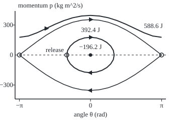

# Hamilton's equations: trade velocity for momentum and the motion becomes a pair of first-order equations that conserve energy

[Syllabus](../../../SYLLABUS.md) → [Differential equations and dynamics](../README.md) → [Calculus of Variations and Optimal Control](../README.md#s12) → Hamilton's equations

---

## General Overview

A 20 kg child sits on a playground swing hung from rigid 2 m rods. A parent pulls the seat back to 60 degrees and lets go. The seat passes the bottom at 4.43 m/s and one full swing, there and back, takes 3.045 s.

The Lagrangian route ([Lagrangian mechanics](04-lagrangian-mechanics.md)) gives one second-order equation for the angle. William Rowan Hamilton, in 1834, kept the angle as one unknown and took the swing's **momentum**, its mass-weighted turning speed, as the second. Then one function, the energy written in angle and momentum, drives both rates, and it cannot change while the swing moves.

Every motion becomes a level curve of that function (the points where it takes one value), so the whole portrait is drawn without solving anything. And the motion keeps areas in the angle–momentum plane, which is why the steps of [Symplectic steps](../05-Numerical%20Evolution/07-symplectic-steps-for-oscillators.md) hold a swing's energy for thousands of steps.

**Write the energy as a function of position and momentum, the Hamiltonian; the position then changes at its slope in the momentum, the momentum at minus its slope in the position, and the Hamiltonian stays constant along the motion.**

**What kind of fact this is:** a theorem: Hamilton's equations are Lagrange's equations rewritten, proved on this card in Why it works.

### The picture: every motion of the swing, in angle and momentum

<p align="center"></p>

Scale: 45 units per radian across, 0.2 per kg m^2/s up. Each curve is one value of the Hamiltonian: the loop is the release from −60 degrees, −196.2 J; the curves through the open circles (seat upside down) are the separatrix, 392.4 J; the wavy curve, 588.6 J, goes over the top.

---

## The formula

The angle $\theta$ is measured from straight down; a prime means rate in time, so $\theta'$ is the angular speed. The Lagrangian $L$ is kinetic minus potential energy. For a swing of mass $m$, rod length $l$, under gravity $g$:

$$L(\theta, \theta') = \tfrac12\, m l^2\, \theta'^2 + m g l \cos\theta$$

The **momentum** $p$ is the slope of $L$ in the velocity; the **Hamiltonian** $H$ comes from the Legendre transform of Step 2:

$$p = \frac{\partial L}{\partial \theta'} = m l^2\, \theta', \qquad H(\theta, p) = p\,\theta' - L = \frac{p^2}{2 m l^2} - m g l \cos\theta$$

**Read it aloud:** momentum is how steeply the Lagrangian rises with speed; the Hamiltonian is momentum times speed minus the Lagrangian, in angle and momentum only. Hamilton's equations:

$$\theta' = \frac{\partial H}{\partial p} = \frac{p}{m l^2}, \qquad p' = -\frac{\partial H}{\partial \theta} = -m g l \sin\theta$$

**Read it aloud:** the angle changes at the Hamiltonian's slope in the momentum, the momentum at minus its slope in the angle.

| Symbol | Plain meaning | In our example | Push it up and the answer… |
| --- | --- | --- | --- |
| $\theta$ | angle from straight down, rad | −60 degrees at release | seat higher |
| $\theta'$ | angular speed, rad/s | 0 at release, 2.2147 at the bottom | more kinetic energy |
| $p$ | momentum about the pivot, kg m^2/s | 0 at release, 177.18 at the bottom | faster swing |
| $L$ | kinetic minus potential energy, J | 588.6 J at the bottom | — |
| $H$ | kinetic plus potential energy, J | −196.2 J throughout | past 392.4 J: over the top |
| $m$, $l$, $g$ | mass 20 kg, rod length 2 m, gravity 9.81 m/s^2 | $m l^2$ = 80 kg m^2, $m g l$ = 392.4 J | longer rods: slower swing |
| $q$, $v$ | any position, its velocity | $\theta$, $\theta'$ | — |
| $t$, $h$ | time, s; a method's step | $h$ = 0.05 s | larger error per step |

Potential energy is zero with the rods horizontal, −392.4 J hanging.

### When it holds

- **The Lagrangian curves upward in the velocity.** Here its second slope (the slope of its slope) is $m l^2$ = 80, so each momentum names one speed. A Lagrangian that is a straight line in the velocity has no Legendre transform.
- **No clock inside the Hamiltonian.** A child who stands and squats changes $l$; $H$ then changes, which is how pumping works.
- **Forces from a potential.** Friction is not one; with it $H$ drains away, as on [LaSalle's principle](../06-Nonlinear%20Dynamics%20in%20the%20Plane/05-lasalle-and-the-damped-pendulum.md).
- **Any coordinate works.** Each position coordinate gets its own **conjugate momentum** by the same slope rule.

---

## Why it works

### Step 0: choose the second unknown so one function drives both rates

A second-order equation becomes two first-order ones with a second unknown ([From one equation to a system](../04-Systems%20and%20the%20Matrix%20Exponential/01-from-one-equation-to-a-system.md)). Choosing the momentum, not the velocity, makes the two rates the two slopes of one function, with a sign between them.

### Step 1: the momentum

The slope of $L$ in $\theta'$ is $m l^2 \theta'$: 80 × 2.2147 = 177.18 kg m^2/s at the bottom. It is mass times the seat's speed $l\theta'$, times the lever arm $l$.

### Step 2: the Legendre transform

For a fixed $p$, let the velocity $v$ vary in $p\,v - L(\theta, v)$. Because $L$ curves upward in $v$, this has one highest point, where its slope $p - \partial L/\partial v$ is zero: where $p$ is the momentum of $v$. The highest value is the Hamiltonian:

$$H(\theta, p) = \max_{v}\,\big(p\,v - L(\theta, v)\big)$$

This is the **Legendre transform**. At the bottom, $p$ = 177.18, the best $v$ is 2.2147 rad/s and the maximum −196.2 J; the code finds both by search. For the swing the maximum is kinetic plus potential energy.

### Step 3: the two slopes of H are the two rates

Nudge $p$ in $H = p\,\theta' - L$. $H$ changes by $\theta'$, plus $p$ times the change in $\theta'$, minus $\partial L/\partial\theta'$ times that change. The last two cancel, because $p = \partial L/\partial\theta'$. So $\partial H/\partial p = \theta'$.

Nudging $\theta$ leaves only $-\partial L/\partial\theta$. Lagrange's equation says the rate of $\partial L/\partial\theta'$, which is $p'$, equals $\partial L/\partial\theta$. So $p' = -\partial H/\partial\theta$. At release that is −392.4 × sin(−60°) = +339.83 N m, a torque, pushing the seat toward the bottom.

<details>
<summary>Detailed proof: Hamilton's equations for any smooth Lagrangian</summary>

Let $L(q, v, t)$ be smooth with $\partial^2 L/\partial v^2 > 0$. By the inverse function theorem $p = \partial L/\partial v(q, v, t)$ has a unique smooth solution $v = V(q, p, t)$. Define $H = p\,V - L(q, V, t)$. The chain rule gives $\partial H/\partial p = V + (p - \partial L/\partial v)\,\partial V/\partial p = V$ and $\partial H/\partial q = (p - \partial L/\partial v)\,\partial V/\partial q - \partial L/\partial q = -\partial L/\partial q$. If $q(t)$ solves $(\partial L/\partial v)' = \partial L/\partial q$ and $p = \partial L/\partial v(q, q', t)$, then $q' = V = \partial H/\partial p$ and $p' = \partial L/\partial q = -\partial H/\partial q$. The steps reverse, so the two systems share their solutions. Several coordinates work the same way, the matrix of second slopes positive definite.

</details>

### Step 4: the Hamiltonian is conserved

Along a motion, the chain rule gives

$$H' = \frac{\partial H}{\partial \theta}\,\theta' + \frac{\partial H}{\partial p}\,p' = \frac{\partial H}{\partial \theta}\,\frac{\partial H}{\partial p} - \frac{\partial H}{\partial p}\,\frac{\partial H}{\partial \theta} = 0.$$

The sign between the two equations makes the terms cancel, so $H$ keeps its release value, −196.2 J. At the bottom the cosine is 1: $p^2/160 = -196.2 + 392.4$, so $p$ = 177.18 and the seat moves at 2 m × 2.2147 = 4.43 m/s. If $H$ carries an explicit time, the same line gives $H' = \partial H/\partial t$.

### Step 5: the level curves are the pendulum's portrait

Each motion keeps to one curve, $p = \pm\sqrt{2 m l^2\,(H + m g l\cos\theta)}$. Below 392.4 J the square root limits the angle: a closed loop. At 392.4 J the momentum reaches zero exactly upside down: the separatrix. Above it the momentum never vanishes: the seat goes over the top. This is the portrait of [The pendulum](../06-Nonlinear%20Dynamics%20in%20the%20Plane/03-the-nonlinear-pendulum.md) with momentum on the vertical axis; that card's quarter-swing integral, scaled by $\sqrt{l/g}$ to 2 m rods, gives 0.761156138 s.

### Step 6: the motion keeps area, and so should the steps

A small patch of starting states changes area at the divergence of the rates, $\partial\theta'/\partial\theta + \partial p'/\partial p = \partial^2 H/\partial\theta\,\partial p - \partial^2 H/\partial p\,\partial\theta = 0$. Areas never change: Liouville's theorem. A map that keeps this area is **symplectic**.

Euler's rule, a straight step along the current slope ([Euler's method](../05-Numerical%20Evolution/01-eulers-method.md)), stretches area by $1 + h^2 (g/l)\cos\theta$: 1.01226250 per step at the bottom with $h$ = 0.05 s. Leapfrog (half a kick to $p$, a drift of $\theta$, half a kick) is three shears, each keeping area exactly. Over 100 s Euler's swing spins over the top; leapfrog's $H$ stays within 0.55 J.

Another road: the equations are the Euler–Lagrange equations of $\int (p\,\theta' - H)\,dt$, with angle and momentum varied independently, the start of Hamilton-Jacobi.

---

## Worked numbers, by hand

| Step | Arithmetic | Value |
| --- | --- | --- |
| $m l^2$ and $m g l$ | 20 × 2 × 2; 20 × 9.81 × 2 | 80 kg m^2; 392.4 J |
| $H$ at release | 0/160 − 392.4 × cos(−60°) = −392.4 × 0.5 | **−196.2 J** |
| rates at release | $\theta'$ = 0/80; $p'$ = −392.4 × sin(−60°) | 0 rad/s; +339.83 N m |
| $H$ at the bottom, still −196.2 | $p^2$/160 − 392.4 = −196.2, so $p^2$ = 160 × 196.2 = 31,392 | $p$ = **177.18** kg m^2/s |
| speed at the bottom | 177.18 / 80; times 2 m | 2.2147 rad/s; **4.43 m/s** |
| over the top | needs $H$ above 392.4: $p^2$/160 = 784.8 | $p$ = 354.36; seat 8.859 m/s |

### What breaks if you drop a piece

| Mistake | Comes out at | What went wrong |
| --- | --- | --- |
| Momentum taken as $m l\,\theta'$ | 88.59, so $H$ = −343.35 J at the bottom | Not the slope of $L$: one $l$ missing |
| Sign of $p'$ flipped | after 1 s: −185.8 degrees, $H$ = 977.02 J | The two terms in $H'$ add |
| Euler's rule, $h$ = 0.05 s, 100 s | $H$ = 4526.44 J: spinning | Each step stretches area |

---

## Code, from first principles, and it actually runs

Three roads. The bottom momentum comes from the level curve of $H$ and from Runge-Kutta 4 (RK4, four slope samples per step) stepping Hamilton's equations. The quarter swing comes from Simpson's rule on the pendulum card's integral and from the same steps; the error falls 16-fold when the step halves, as a fourth-order method's should. The Hamiltonian is also found as the Legendre maximum, by search.

### Python

```python
# Hamilton's equations -- the check behind the card.  Imports only math's sin, cos, asin, sqrt, pi.
# A 20 kg child, 2 m rods, released at -60 degrees; state: angle th (rad), momentum p = m l^2 th'.
# Roads: the level curve of H, RK4 steps of Hamilton's equations, Simpson's rule, Legendre's max.
from math import sin, cos, asin, sqrt, pi
M, L, G, TH0 = 20.0, 2.0, 9.81, -pi / 3; I, K = M * L * L, M * G * L   # I = m l^2, K = m g l
ham = lambda th, p: p * p / (2 * I) - K * cos(th)     # the Hamiltonian, J
lag = lambda th, v: 0.5 * I * v * v + K * cos(th)      # the Lagrangian, J
def legendre(th, p, lo=-50.0, hi=50.0):                # max over v of p v - L, by ternary search
    for _ in range(200):
        a, b = lo + (hi - lo) / 3, hi - (hi - lo) / 3
        lo, hi = (a, hi) if p * a - lag(th, a) < p * b - lag(th, b) else (lo, b)
    return p * lo - lag(th, lo), lo
def rk4(th, p, h, s=-1.0):                             # s = -1: p' = -dH/dth; s = +1 is mistake 2
    f = lambda a, b: (b / I, s * K * sin(a))
    a1, b1 = f(th, p); a2, b2 = f(th + h / 2 * a1, p + h / 2 * b1)
    a3, b3 = f(th + h / 2 * a2, p + h / 2 * b2); a4, b4 = f(th + h * a3, p + h * b3)
    return th + h / 6 * (a1 + 2 * a2 + 2 * a3 + a4), p + h / 6 * (b1 + 2 * b2 + 2 * b3 + b4)
def to_bottom(h, th=TH0, p=0.0, t=0.0):                # step until th passes 0,
    while rk4(th, p, h)[0] < 0: th, p = rk4(th, p, h); t += h
    lo, hi = 0.0, h                                    # bisect the last step onto th = 0
    for _ in range(60): mid = (lo + hi) / 2; lo, hi = (mid, hi) if rk4(th, p, mid)[0] < 0 else (lo, mid)
    return t + lo, rk4(th, p, lo)[1]
euler = lambda th, p, h: (th + h * p / I, p - h * K * sin(th))
def leap(th, p, h):                                    # kick half, drift, kick half
    p -= h / 2 * K * sin(th); th += h * p / I; return th, p - h / 2 * K * sin(th)
def drift(step, h=0.05, th=TH0, p=0.0, worst=0.0):     # 100 s of steps: largest |H - H0|, final H
    for _ in range(2000): th, p = step(th, p, h); worst = max(worst, abs(ham(th, p) - H0))
    return worst, ham(th, p)
def det(step, th, p, h=0.05, e=1e-4):                  # area factor of one step, by differences
    a = [(x - y) / (2 * e) for x, y in zip(step(th + e, p, h), step(th - e, p, h))]
    b = [(x - y) / (2 * e) for x, y in zip(step(th, p + e, h), step(th, p - e, h))]
    return a[0] * b[1] - a[1] * b[0]
H0, k, n = ham(TH0, 0.0), sin(-TH0 / 2), 400
p_curve = sqrt(2 * I * (H0 + K))                       # the level curve H = H0, read at th = 0
f = lambda q: 1 / sqrt(1 - k * k * sin(q) ** 2)        # the quarter-swing integrand, as on the pendulum card
t_simp = sqrt(I / K) * pi / 6 / n * sum((1 if i in (0, n) else 4 if i % 2 else 2) * f(i * pi / 2 / n) for i in range(n + 1))
runs = [to_bottom(h) for h in (0.02, 0.01)]; err = [abs(r[0] - t_simp) for r in runs]
(H_leg, v_star), lf, eu, th1, p1 = legendre(0.0, runs[1][1]), drift(leap), drift(euler), TH0, 0.0
for _ in range(100): th1, p1 = rk4(th1, p1, 0.01, +1.0)
print(f"swing: m l^2 = {I:.1f} kg m^2, m g l = {K:.1f} J, released at -60 deg: H0 = {H0:.1f} J")
print(f"rates at release: th' = p/(m l^2) = 0, p' = -m g l sin(-60 deg) = {-K * sin(TH0):.2f} N m")
print(f"bottom, level curve: p = {p_curve:.2f} kg m^2/s, th' = {p_curve / I:.4f} rad/s, seat {L * p_curve / I:.2f} m/s")
print(f"bottom, RK4 h = 0.02, 0.01: p = {runs[0][1]:.6f} {runs[1][1]:.6f}; off the level curve by {1e9 * (runs[0][1] - p_curve):.1f} {1e9 * (runs[1][1] - p_curve):.1f} x 1e-9")
print(f"quarter swing: Simpson {t_simp:.9f} s; RK4 h = 0.02, 0.01 off by {1e9 * err[0]:.2f} {1e9 * err[1]:.2f} ns, ratio {err[0] / err[1]:.1f}; full swing {4 * t_simp:.3f} s")
print(f"Legendre at the bottom: best v = {v_star:.4f} rad/s, max of p v - L = {H_leg:.1f} J")
print(f"100 s at h = 0.05: leapfrog largest |H - H0| {lf[0]:.2f} J; Euler ends at H = {eu[1]:.2f} J")
print(f"area factor of one step at the bottom: leapfrog {det(leap, 0.0, p_curve):.8f}, Euler {det(euler, 0.0, p_curve):.8f}")
print(f"standing on end: H = {K:.1f} J, needs p = {2 * sqrt(I * K):.2f} at the bottom, seat {2 * L * sqrt(K / I):.3f} m/s; curve drawn above it H = {1.5 * K:.1f} J")
print(f"mistake 1, p = m l th' at the bottom: {M * L * p_curve / I:.2f}, so H = {ham(0.0, M * L * p_curve / I):.2f} J")
print(f"mistake 2, p' = +dH/dth for 1 s: th = {th1 * 180 / pi:.1f} deg, H = {ham(th1, p1):.2f} J")
pts = lambda cs: " ".join(f"{180 + 45 * a:.1f},{110 - 0.2 * b:.1f}" for a, b in cs)   # 45 per rad, 0.2 per kg m^2/s
print("figure, swing loop:", pts((2 * asin(k * sin(i * pi / 12)), 2 * sqrt(I * K) * k * cos(i * pi / 12)) for i in range(24)))
for sg in (1, -1):
    print(f"figure, separatrix {sg:+d}:", pts((i * pi / 8, sg * 2 * sqrt(I * K) * cos(i * pi / 16)) for i in range(-8, 9)))
print("figure, over the top:", pts((i * pi / 8, sqrt(2 * I * (1.5 * K + K * cos(i * pi / 8)))) for i in range(-8, 9)))
assert abs(runs[1][1] - p_curve) < 1e-6                        # RK4 steps land on the level curve
assert err[1] < 1e-8 and 12 < err[0] / err[1] < 20             # two roads to the quarter swing; order four
assert abs(H_leg - H0) < 1e-6                                  # Legendre's max at the bottom = energy at release
assert lf[0] < K / 100 < abs(eu[1] - H0) and abs(det(leap, 0.0, p_curve) - 1) < 1e-8 < abs(det(euler, 0.0, p_curve) - 1)
print("ALL CHECKS PASS")
```

**Ran 2026-09-28 on macOS, Python 3.14.6, standard library only. All checks passed. Output, pasted from the run:**

```
swing: m l^2 = 80.0 kg m^2, m g l = 392.4 J, released at -60 deg: H0 = -196.2 J
rates at release: th' = p/(m l^2) = 0, p' = -m g l sin(-60 deg) = 339.83 N m
bottom, level curve: p = 177.18 kg m^2/s, th' = 2.2147 rad/s, seat 4.43 m/s
bottom, RK4 h = 0.02, 0.01: p = 177.177877 177.177877; off the level curve by 284.0 25.5 x 1e-9
quarter swing: Simpson 0.761156138 s; RK4 h = 0.02, 0.01 off by 16.29 1.01 ns, ratio 16.1; full swing 3.045 s
Legendre at the bottom: best v = 2.2147 rad/s, max of p v - L = -196.2 J
100 s at h = 0.05: leapfrog largest |H - H0| 0.55 J; Euler ends at H = 4526.44 J
area factor of one step at the bottom: leapfrog 1.00000000, Euler 1.01226250
standing on end: H = 392.4 J, needs p = 354.36 at the bottom, seat 8.859 m/s; curve drawn above it H = 588.6 J
mistake 1, p = m l th' at the bottom: 88.59, so H = -343.35 J
mistake 2, p' = +dH/dth for 1 s: th = -185.8 deg, H = 977.02 J
figure, swing loop: 180.0,74.6 191.7,75.8 202.7,79.3 212.5,84.9 220.3,92.3 225.4,100.8 227.1,110.0 225.4,119.2 220.3,127.7 212.5,135.1 202.7,140.7 191.7,144.2 180.0,145.4 168.3,144.2 157.3,140.7 147.5,135.1 139.7,127.7 134.6,119.2 132.9,110.0 134.6,100.8 139.7,92.3 147.5,84.9 157.3,79.3 168.3,75.8
figure, separatrix +1: 38.6,110.0 56.3,96.2 74.0,82.9 91.6,70.6 109.3,59.9 127.0,51.1 144.7,44.5 162.3,40.5 180.0,39.1 197.7,40.5 215.3,44.5 233.0,51.1 250.7,59.9 268.4,70.6 286.0,82.9 303.7,96.2 321.4,110.0
figure, separatrix -1: 38.6,110.0 56.3,123.8 74.0,137.1 91.6,149.4 109.3,160.1 127.0,168.9 144.7,175.5 162.3,179.5 180.0,180.9 197.7,179.5 215.3,175.5 233.0,168.9 250.7,160.1 268.4,149.4 286.0,137.1 303.7,123.8 321.4,110.0
figure, over the top: 38.6,74.6 56.3,72.0 74.0,65.4 91.6,57.0 109.3,48.6 127.0,41.2 144.7,35.5 162.3,32.0 180.0,30.8 197.7,32.0 215.3,35.5 233.0,41.2 250.7,48.6 268.4,57.0 286.0,65.4 303.7,72.0 321.4,74.6
ALL CHECKS PASS
```

### Rust

Same numbers, same labels, built with `rustc --edition 2021 -O`.

```rust
// Hamilton's equations -- the same check as the Python, in Rust.  No crates.
// A 20 kg child, 2 m rods, released at -60 degrees; state: angle th (rad), momentum p = m l^2 th'.
// Roads: the level curve of H, RK4 steps of Hamilton's equations, Simpson's rule, Legendre's max.
use std::f64::consts::PI;
const M: f64 = 20.0; const L: f64 = 2.0; const G: f64 = 9.81; const TH0: f64 = -PI / 3.0;
const I: f64 = M * L * L; const K: f64 = M * G * L;                 // I = m l^2, K = m g l
fn ham(th: f64, p: f64) -> f64 { p * p / (2.0 * I) - K * th.cos() } // the Hamiltonian, J
fn lag(th: f64, v: f64) -> f64 { 0.5 * I * v * v + K * th.cos() }   // the Lagrangian, J
fn legendre(th: f64, p: f64) -> (f64, f64) {             // max over v of p v - L, by ternary search
    let (mut lo, mut hi) = (-50.0, 50.0);
    for _ in 0..200 { let (a, b) = (lo + (hi - lo) / 3.0, hi - (hi - lo) / 3.0); if p * a - lag(th, a) < p * b - lag(th, b) { lo = a } else { hi = b } }
    (p * lo - lag(th, lo), lo)
}
fn rk4(th: f64, p: f64, h: f64, s: f64) -> (f64, f64) {  // s = -1: p' = -dH/dth; s = +1 is mistake 2
    let f = |a: f64, b: f64| (b / I, s * K * a.sin());
    let (a1, b1) = f(th, p); let (a2, b2) = f(th + h / 2.0 * a1, p + h / 2.0 * b1);
    let (a3, b3) = f(th + h / 2.0 * a2, p + h / 2.0 * b2); let (a4, b4) = f(th + h * a3, p + h * b3);
    (th + h / 6.0 * (a1 + 2.0 * a2 + 2.0 * a3 + a4), p + h / 6.0 * (b1 + 2.0 * b2 + 2.0 * b3 + b4))
}
fn to_bottom(h: f64) -> (f64, f64) {                     // step until th passes 0,
    let (mut th, mut p, mut t) = (TH0, 0.0, 0.0);
    while rk4(th, p, h, -1.0).0 < 0.0 { (th, p) = rk4(th, p, h, -1.0); t += h }
    let (mut lo, mut hi) = (0.0, h);                     // bisect the last step onto th = 0
    for _ in 0..60 { let mid = (lo + hi) / 2.0; if rk4(th, p, mid, -1.0).0 < 0.0 { lo = mid } else { hi = mid } }
    (t + lo, rk4(th, p, lo, -1.0).1)
}
fn euler(th: f64, p: f64, h: f64) -> (f64, f64) { (th + h * p / I, p - h * K * th.sin()) }
fn leap(th: f64, p: f64, h: f64) -> (f64, f64) {         // kick half, drift, kick half
    let p = p - h / 2.0 * K * th.sin(); let th = th + h * p / I; (th, p - h / 2.0 * K * th.sin())
}
fn drift(step: fn(f64, f64, f64) -> (f64, f64), h0: f64) -> (f64, f64) {   // 100 s at h = 0.05
    let (mut th, mut p, mut worst) = (TH0, 0.0, 0.0f64);
    for _ in 0..2000 { (th, p) = step(th, p, 0.05); worst = worst.max((ham(th, p) - h0).abs()) }
    (worst, ham(th, p))
}
fn det(step: fn(f64, f64, f64) -> (f64, f64), th: f64, p: f64) -> f64 {   // area factor of one step
    let (h, e) = (0.05, 1e-4); let (ap, am) = (step(th + e, p, h), step(th - e, p, h)); let (bp, bm) = (step(th, p + e, h), step(th, p - e, h));
    ((ap.0 - am.0) * (bp.1 - bm.1) - (ap.1 - am.1) * (bp.0 - bm.0)) / (4.0 * e * e)
}
fn pts(cs: &[(f64, f64)]) -> String {                    // 45 per rad, 0.2 per kg m^2/s
    cs.iter().map(|&(a, b)| format!("{:.1},{:.1}", 180.0 + 45.0 * a, 110.0 - 0.2 * b)).collect::<Vec<_>>().join(" ")
}
fn main() {
    let (h0, k, n) = (ham(TH0, 0.0), (-TH0 / 2.0).sin(), 400);
    let p_curve = (2.0 * I * (h0 + K)).sqrt();           // the level curve H = H0, read at th = 0
    let f = |q: f64| 1.0 / (1.0 - k * k * q.sin().powi(2)).sqrt();
    let sum: f64 = (0..=n).map(|i| (if i == 0 || i == n { 1.0 } else if i % 2 == 1 { 4.0 } else { 2.0 }) * f(i as f64 * PI / 2.0 / n as f64)).sum();
    let t_simp = (I / K).sqrt() * PI / 6.0 / n as f64 * sum;
    let runs: Vec<(f64, f64)> = [0.02, 0.01].iter().map(|&h| to_bottom(h)).collect();
    let err: Vec<f64> = runs.iter().map(|r| (r.0 - t_simp).abs()).collect();
    let ((h_leg, v_star), lf, eu) = (legendre(0.0, runs[1].1), drift(leap, h0), drift(euler, h0));
    let (mut th1, mut p1) = (TH0, 0.0); for _ in 0..100 { (th1, p1) = rk4(th1, p1, 0.01, 1.0) }
    let (d_lf, d_eu, pw) = (det(leap, 0.0, p_curve), det(euler, 0.0, p_curve), M * L * p_curve / I);
    println!("swing: m l^2 = {:.1} kg m^2, m g l = {:.1} J, released at -60 deg: H0 = {:.1} J", I, K, h0);
    println!("rates at release: th' = p/(m l^2) = 0, p' = -m g l sin(-60 deg) = {:.2} N m", -K * TH0.sin());
    println!("bottom, level curve: p = {:.2} kg m^2/s, th' = {:.4} rad/s, seat {:.2} m/s", p_curve, p_curve / I, L * p_curve / I);
    println!("bottom, RK4 h = 0.02, 0.01: p = {:.6} {:.6}; off the level curve by {:.1} {:.1} x 1e-9", runs[0].1, runs[1].1, 1e9 * (runs[0].1 - p_curve), 1e9 * (runs[1].1 - p_curve));
    println!("quarter swing: Simpson {:.9} s; RK4 h = 0.02, 0.01 off by {:.2} {:.2} ns, ratio {:.1}; full swing {:.3} s", t_simp, 1e9 * err[0], 1e9 * err[1], err[0] / err[1], 4.0 * t_simp);
    println!("Legendre at the bottom: best v = {:.4} rad/s, max of p v - L = {:.1} J", v_star, h_leg);
    println!("100 s at h = 0.05: leapfrog largest |H - H0| {:.2} J; Euler ends at H = {:.2} J", lf.0, eu.1);
    println!("area factor of one step at the bottom: leapfrog {:.8}, Euler {:.8}", d_lf, d_eu);
    println!("standing on end: H = {:.1} J, needs p = {:.2} at the bottom, seat {:.3} m/s; curve drawn above it H = {:.1} J", K, 2.0 * (I * K).sqrt(), 2.0 * L * (K / I).sqrt(), 1.5 * K);
    println!("mistake 1, p = m l th' at the bottom: {:.2}, so H = {:.2} J", pw, ham(0.0, pw));
    println!("mistake 2, p' = +dH/dth for 1 s: th = {:.1} deg, H = {:.2} J", th1 * 180.0 / PI, ham(th1, p1));
    let r = 2.0 * (I * K).sqrt();
    let lp: Vec<(f64, f64)> = (0..24).map(|i| { let a = i as f64 * PI / 12.0; (2.0 * (k * a.sin()).asin(), r * k * a.cos()) }).collect();
    println!("figure, swing loop: {}", pts(&lp));
    for sg in [1.0f64, -1.0] {
        let sp: Vec<(f64, f64)> = (-8..9).map(|i| (i as f64 * PI / 8.0, sg * r * (i as f64 * PI / 16.0).cos())).collect();
        println!("figure, separatrix {:+}: {}", sg as i32, pts(&sp));
    }
    let ov: Vec<(f64, f64)> = (-8..9).map(|i| { let a = i as f64 * PI / 8.0; (a, (2.0 * I * (1.5 * K + K * a.cos())).sqrt()) }).collect();
    println!("figure, over the top: {}", pts(&ov));
    assert!((runs[1].1 - p_curve).abs() < 1e-6);                     // RK4 steps land on the level curve
    assert!(err[1] < 1e-8 && 12.0 < err[0] / err[1] && err[0] / err[1] < 20.0);   // two roads; order four
    assert!((h_leg - h0).abs() < 1e-6);                              // Legendre's max = energy at release
    assert!(lf.0 < K / 100.0 && K / 100.0 < (eu.1 - h0).abs() && (d_lf - 1.0).abs() < 1e-8 && 1e-8 < (d_eu - 1.0).abs());
    println!("ALL CHECKS PASS");
}
```

**Ran 2026-09-28 on macOS, rustc 1.98.1, no crates. All checks passed. Output, pasted from the run:**

```
swing: m l^2 = 80.0 kg m^2, m g l = 392.4 J, released at -60 deg: H0 = -196.2 J
rates at release: th' = p/(m l^2) = 0, p' = -m g l sin(-60 deg) = 339.83 N m
bottom, level curve: p = 177.18 kg m^2/s, th' = 2.2147 rad/s, seat 4.43 m/s
bottom, RK4 h = 0.02, 0.01: p = 177.177877 177.177877; off the level curve by 284.0 25.5 x 1e-9
quarter swing: Simpson 0.761156138 s; RK4 h = 0.02, 0.01 off by 16.29 1.01 ns, ratio 16.1; full swing 3.045 s
Legendre at the bottom: best v = 2.2147 rad/s, max of p v - L = -196.2 J
100 s at h = 0.05: leapfrog largest |H - H0| 0.55 J; Euler ends at H = 4526.44 J
area factor of one step at the bottom: leapfrog 1.00000000, Euler 1.01226250
standing on end: H = 392.4 J, needs p = 354.36 at the bottom, seat 8.859 m/s; curve drawn above it H = 588.6 J
mistake 1, p = m l th' at the bottom: 88.59, so H = -343.35 J
mistake 2, p' = +dH/dth for 1 s: th = -185.8 deg, H = 977.02 J
figure, swing loop: 180.0,74.6 191.7,75.8 202.7,79.3 212.5,84.9 220.3,92.3 225.4,100.8 227.1,110.0 225.4,119.2 220.3,127.7 212.5,135.1 202.7,140.7 191.7,144.2 180.0,145.4 168.3,144.2 157.3,140.7 147.5,135.1 139.7,127.7 134.6,119.2 132.9,110.0 134.6,100.8 139.7,92.3 147.5,84.9 157.3,79.3 168.3,75.8
figure, separatrix +1: 38.6,110.0 56.3,96.2 74.0,82.9 91.6,70.6 109.3,59.9 127.0,51.1 144.7,44.5 162.3,40.5 180.0,39.1 197.7,40.5 215.3,44.5 233.0,51.1 250.7,59.9 268.4,70.6 286.0,82.9 303.7,96.2 321.4,110.0
figure, separatrix -1: 38.6,110.0 56.3,123.8 74.0,137.1 91.6,149.4 109.3,160.1 127.0,168.9 144.7,175.5 162.3,179.5 180.0,180.9 197.7,179.5 215.3,175.5 233.0,168.9 250.7,160.1 268.4,149.4 286.0,137.1 303.7,123.8 321.4,110.0
figure, over the top: 38.6,74.6 56.3,72.0 74.0,65.4 91.6,57.0 109.3,48.6 127.0,41.2 144.7,35.5 162.3,32.0 180.0,30.8 197.7,32.0 215.3,35.5 233.0,41.2 250.7,48.6 268.4,57.0 286.0,65.4 303.7,72.0 321.4,74.6
ALL CHECKS PASS
```

The two outputs match line for line.

### Lean

Lean proves Hamilton's equations and the kept Hamiltonian for every smooth Lagrangian curving upward in the velocity, then the swing's formulas exactly.

- Suppose a smooth Lagrangian with no clock inside has positive second slope in the velocity, and a smooth motion obeys Lagrange's equation. Then its Legendre transform equals momentum times velocity minus the Lagrangian, at every time.
- Along that motion, the Hamiltonian's slope in the momentum is the velocity, and its slope in the position is minus the momentum's rate.
- Along that motion, the Hamiltonian keeps its starting value.
- Take the swing, with $m$ and $l$ positive and any $g$. Then its Legendre transform is $H = p^2/(2 m l^2) - m g l \cos\theta$.
- Take the same swing. Then $\partial H/\partial p = p/(m l^2)$ and $\partial H/\partial\theta = m g l \sin\theta$.
- Take the swing, any step size $h$ and any state. Then one Euler step stretches area by $1 + h^2 (g/l)\cos\theta$, and one leapfrog step keeps area exactly.
- The hand arithmetic in the worked numbers holds exactly, including mistake 1 and both Euler area factors.

The decimals, the RK4 runs, the quarter swing, the 100 s drift and the flipped sign are left to the Python and Rust checks.

```lean
-- Hamilton's equations: for a twice-smooth Lagrangian that curves upward in the velocity, every motion obeying Lagrange's equation obeys q' = ∂H/∂p and p' = -∂H/∂q for its Legendre transform H and keeps H constant; for the swing H = p²/(2ml²) - mgl cos θ, and an Euler step stretches area by 1 + h²(g/l) cos θ while a leapfrog step keeps it.
import Mathlib.Analysis.Calculus.ContDiff.Defs
import Mathlib.Analysis.Calculus.Deriv.Basic
import Mathlib.Analysis.Calculus.FDeriv.Prod
import Mathlib.Analysis.SpecialFunctions.Trigonometric.Deriv
import Mathlib.Topology.Algebra.Module.Determinant
import Mathlib.Data.Real.Archimedean
import Mathlib.Tactic.NormNum
import Mathlib.Analysis.Calculus.InverseFunctionTheorem.FDeriv
import Mathlib.Analysis.Calculus.ContDiff.RCLike
import Mathlib.Analysis.Calculus.ContDiff.Deriv
import Mathlib.Analysis.Calculus.MeanValue
import Mathlib.Analysis.Calculus.Deriv.MeanValue
import Mathlib.Analysis.Calculus.Deriv.Prod
import Mathlib.Analysis.Calculus.Deriv.Pow
import Mathlib.Analysis.Calculus.FDeriv.Mul
import Mathlib.LinearAlgebra.Basis.Fin
import Mathlib.LinearAlgebra.Determinant
import Mathlib.Tactic.FieldSimp
import Mathlib.Tactic.Positivity

open Real

noncomputable section

/-- The Legendre transform of a Lagrangian `L q v` (position `q`, velocity `v`): the Hamiltonian
`H q p = max over v of (p v - L q v)`, written as the least upper bound over every velocity. -/
def legendre (L : ℝ → ℝ → ℝ) (q p : ℝ) : ℝ :=
  ⨆ v : ℝ, p * v - L q v

lemma ham_tangent_le (f : ℝ → ℝ) (hconv : ∀ v, 0 < deriv (fun w => deriv f w) v)
    (hd : Differentiable ℝ f) (v w : ℝ) :
    deriv f v * w - f w ≤ deriv f v * v - f v := by
  have hmono : StrictMono (deriv f) := strictMono_of_deriv_pos hconv
  rcases lt_trichotomy w v with hwv | hwv | hwv
  · obtain ⟨c, hc, hcs⟩ := exists_deriv_eq_slope f hwv hd.continuous.continuousOn
      (fun y _ => (hd y).differentiableWithinAt)
    have h1 : deriv f c < deriv f v := hmono hc.2
    have h2 : f v - f w = deriv f c * (v - w) := by
      rw [hcs]; field_simp [(sub_pos.2 hwv).ne']
    nlinarith [sub_pos.2 hwv]
  · rw [hwv]
  · obtain ⟨c, hc, hcs⟩ := exists_deriv_eq_slope f hwv hd.continuous.continuousOn
      (fun y _ => (hd y).differentiableWithinAt)
    have h1 : deriv f v < deriv f c := hmono hc.1
    have h2 : f w - f v = deriv f c * (w - v) := by
      rw [hcs]; field_simp [(sub_pos.2 hwv).ne']
    nlinarith [sub_pos.2 hwv]

#print axioms ham_tangent_le

lemma ham_legendre_eq (L : ℝ → ℝ → ℝ) (hd : ∀ q, Differentiable ℝ (fun u => L q u))
    (hconv : ∀ q v, 0 < deriv (fun w => deriv (fun u => L q u) w) v) (q v : ℝ) :
    legendre L q (deriv (fun u => L q u) v) = deriv (fun u => L q u) v * v - L q v := by
  have h := fun w => ham_tangent_le (fun u => L q u) (hconv q) (hd q) v w
  unfold legendre
  apply le_antisymm
  · exact ciSup_le h
  · exact le_ciSup_of_le ⟨_, Set.forall_mem_range.2 h⟩ v le_rfl

#print axioms ham_legendre_eq

lemma ham_clm_apply (ℓ : ℝ × ℝ →L[ℝ] ℝ) (a b : ℝ) :
    ℓ (a, b) = a * ℓ (1, 0) + b * ℓ (0, 1) := by
  have : ((a, b) : ℝ × ℝ) = a • ((1 : ℝ), (0 : ℝ)) + b • ((0 : ℝ), (1 : ℝ)) := by simp
  rw [this, map_add, map_smul, map_smul, smul_eq_mul, smul_eq_mul]

#print axioms ham_clm_apply

lemma ham_det_eq (f : ℝ × ℝ →L[ℝ] ℝ × ℝ) :
    f.det = (f (1, 0)).1 * (f (0, 1)).2 - (f (0, 1)).1 * (f (1, 0)).2 := by
  rw [ContinuousLinearMap.det, ← LinearMap.det_toMatrix (Module.Basis.finTwoProd ℝ),
    Matrix.det_fin_two]
  simp [LinearMap.toMatrix_apply]

#print axioms ham_det_eq

/-- Hamilton's equations and the conservation of the Hamiltonian (Steps 2 to 4 and the detailed
proof). Take a Lagrangian `L q v` with no clock in it, twice continuously differentiable in
position and velocity together, that curves upward in the velocity (its second slope in `v` is
positive everywhere). Let `x` be a twice continuously differentiable motion that obeys Lagrange's
equation: the rate of the momentum `p = ∂L/∂v (x, x')` equals `∂L/∂q (x, x')`. Let `H` be the
Legendre transform of `L`. Then at every time `t`:
* `H (x t) (p t) = p t * x' t - L (x t) (x' t)` (momentum times velocity minus the Lagrangian);
* the position changes at the slope of `H` in the momentum: `∂H/∂p = x'`;
* the momentum changes at minus the slope of `H` in the position: `∂H/∂q = -p'`;
* `H` stays constant along the motion: `H (x t) (p t) = H (x 0) (p 0)`. -/
theorem hamiltons_equations_and_conservation (L : ℝ → ℝ → ℝ)
    (hL : ContDiff ℝ 2 (fun z : ℝ × ℝ => L z.1 z.2))
    (hconvex : ∀ q v, 0 < deriv (fun w => deriv (fun u => L q u) w) v)
    (x : ℝ → ℝ) (hx : ContDiff ℝ 2 x)
    (hlagrange : ∀ t, HasDerivAt (fun s => deriv (fun u => L (x s) u) (deriv x s))
      (deriv (fun y => L y (deriv x t)) (x t)) t) :
    let p : ℝ → ℝ := fun s => deriv (fun u => L (x s) u) (deriv x s)
    ∀ t : ℝ,
      legendre L (x t) (p t) = p t * deriv x t - L (x t) (deriv x t) ∧
      HasDerivAt (fun p' => legendre L (x t) p') (deriv x t) (p t) ∧
      HasDerivAt (fun q' => legendre L q' (p t)) (-deriv p t) (x t) ∧
      legendre L (x t) (p t) = legendre L (x 0) (p 0) := by
  intro p
  set Lz : ℝ × ℝ → ℝ := fun z => L z.1 z.2 with hLz
  have hLd : Differentiable ℝ Lz := hL.differentiable (by norm_num)
  have hv : ∀ q u, HasDerivAt (fun u => L q u) (fderiv ℝ Lz (q, u) (0, 1)) u := by
    intro q u
    have h1 : HasDerivAt (fun u : ℝ => (q, u)) ((0 : ℝ), (1 : ℝ)) u :=
      (hasDerivAt_const u q).prodMk (hasDerivAt_id u)
    exact (hLd (q, u)).hasFDerivAt.comp_hasDerivAt u h1
  have hq : ∀ q u, HasDerivAt (fun q => L q u) (fderiv ℝ Lz (q, u) (1, 0)) q := by
    intro q u
    have h1 : HasDerivAt (fun q : ℝ => (q, u)) ((1 : ℝ), (0 : ℝ)) q :=
      (hasDerivAt_id q).prodMk (hasDerivAt_const q u)
    exact (hLd (q, u)).hasFDerivAt.comp_hasDerivAt q h1
  set Φ : ℝ × ℝ → ℝ := fun z => fderiv ℝ Lz z (0, 1) with hΦdef
  have hΦ : ContDiff ℝ 1 Φ := (hL.fderiv_right (m := 1) (by norm_num)).clm_apply contDiff_const
  have hΦd : Differentiable ℝ Φ := hΦ.differentiable (by norm_num)
  have hDv : ∀ q, deriv (fun u => L q u) = fun u => Φ (q, u) :=
    fun q => funext fun u => (hv q u).deriv
  have hdiffL : ∀ q, Differentiable ℝ (fun u => L q u) := fun q u => (hv q u).differentiableAt
  -- Claim 1 at every time.
  have hE : ∀ s, legendre L (x s) (p s) = p s * deriv x s - L (x s) (deriv x s) :=
    fun s => ham_legendre_eq L hdiffL hconvex (x s) (deriv x s)
  intro t
  set q0 := x t with hq0
  set v0 := deriv x t with hv0
  set z0 : ℝ × ℝ := (q0, v0) with hz0
  have hp0 : p t = Φ z0 := by simp only [p, hDv]; rfl
  -- The map F (q, v) = (q, ∂L/∂v) and its invertible derivative.
  set DΦ := fderiv ℝ Φ z0 with hDΦ
  set c := DΦ (0, 1) with hc
  have hcpos : 0 < c := by
    have h1 : HasDerivAt (fun w => Φ (q0, w)) c v0 := by
      have h2 : HasDerivAt (fun w : ℝ => (q0, w)) ((0 : ℝ), (1 : ℝ)) v0 :=
        (hasDerivAt_const v0 q0).prodMk (hasDerivAt_id v0)
      exact (hΦd z0).hasFDerivAt.comp_hasDerivAt v0 h2
    have h3 := hconvex q0 v0
    rw [hDv] at h3
    rwa [h1.deriv] at h3
  have hlin : ∀ a b, DΦ (a, b) = DΦ (a, 0) + b * c := by
    intro a b
    have : ((a, b) : ℝ × ℝ) = (a, 0) + b • ((0 : ℝ), (1 : ℝ)) := by simp
    rw [this, map_add, map_smul, smul_eq_mul]
  let A : ℝ × ℝ →L[ℝ] ℝ × ℝ := (ContinuousLinearMap.fst ℝ ℝ ℝ).prod DΦ
  let B : ℝ × ℝ →L[ℝ] ℝ × ℝ := (ContinuousLinearMap.fst ℝ ℝ ℝ).prod
    (c⁻¹ • (ContinuousLinearMap.snd ℝ ℝ ℝ - DΦ.comp ((ContinuousLinearMap.inl ℝ ℝ ℝ).comp (ContinuousLinearMap.fst ℝ ℝ ℝ))))
  have hBA : Function.LeftInverse B A := by
    rintro ⟨a, b⟩
    simp [A, B]
    rw [hlin a b]
    congr 1
    field_simp
    ring
  have hAB : Function.RightInverse B A := by
    rintro ⟨a, b⟩
    simp [A, B]
    rw [hlin]
    congr 1
    field_simp
    ring
  let e : (ℝ × ℝ) ≃L[ℝ] (ℝ × ℝ) := ContinuousLinearEquiv.equivOfInverse A B hBA hAB
  set F : ℝ × ℝ → ℝ × ℝ := fun z => (z.1, Φ z) with hFdef
  have hFc : ContDiff ℝ 1 F := contDiff_fst.prodMk hΦ
  have hFA : HasFDerivAt F (e : ℝ × ℝ →L[ℝ] ℝ × ℝ) z0 :=
    (hasFDerivAt_fst (𝕜 := ℝ)).prodMk (hΦd z0).hasFDerivAt
  have hFs : HasStrictFDerivAt F (e : ℝ × ℝ →L[ℝ] ℝ × ℝ) z0 :=
    hFc.contDiffAt.hasStrictFDerivAt' hFA one_ne_zero
  set G := hFs.localInverse F e z0 with hGdef
  have hFz0 : F z0 = (q0, p t) := by rw [hp0]
  have hG : HasFDerivAt G (e.symm : ℝ × ℝ →L[ℝ] ℝ × ℝ) (F z0) :=
    hFs.to_localInverse.hasFDerivAt
  have hGz0 : G (F z0) = z0 := hFs.localInverse_apply_image
  -- K0 (q, v) = (∂L/∂v) v - L, so that H ∘ F = K0.
  set K0 : ℝ × ℝ → ℝ := fun z => Φ z * z.2 - Lz z with hK0def
  set K0' : ℝ × ℝ →L[ℝ] ℝ :=
    Φ z0 • ContinuousLinearMap.snd ℝ ℝ ℝ + z0.2 • DΦ - fderiv ℝ Lz z0 with hK0'def
  have hK0 : HasFDerivAt K0 K0' z0 :=
    ((hΦd z0).hasFDerivAt.mul (hasFDerivAt_snd (𝕜 := ℝ) (p := z0))).sub (hLd z0).hasFDerivAt
  have hKG : HasFDerivAt (K0 ∘ G) (K0'.comp (e.symm : ℝ × ℝ →L[ℝ] ℝ × ℝ)) (F z0) := by
    apply HasFDerivAt.comp
    · rw [hGz0]; exact hK0
    · exact hG
  rw [hFz0] at hKG
  have hev : (fun y : ℝ × ℝ => legendre L y.1 y.2) =ᶠ[nhds (q0, p t)] (K0 ∘ G) := by
    have := hFs.eventually_right_inverse
    rw [hFz0] at this
    filter_upwards [this] with y hy
    have h1 : y.1 = (G y).1 := by
      conv_lhs => rw [← hy]
    have h2 : y.2 = Φ (G y) := by
      conv_lhs => rw [← hy]
    rw [h1, h2, Function.comp_apply]
    have := ham_legendre_eq L hdiffL hconvex (G y).1 (G y).2
    rw [hDv] at this
    exact this
  have hH := hKG.congr_of_eventuallyEq hev
  -- The derivative of H at (q0, p0), on any vector w.
  have hval : ∀ w : ℝ × ℝ, (K0'.comp (e.symm : ℝ × ℝ →L[ℝ] ℝ × ℝ)) w
      = w.2 * v0 - w.1 * fderiv ℝ Lz z0 (1, 0) := by
    intro w
    have heu : e (e.symm w) = w := e.apply_symm_apply w
    have hu1 : (e.symm w).1 = w.1 := by
      conv_rhs => rw [← heu]
      rfl
    have hu2 : DΦ (e.symm w) = w.2 := by
      conv_rhs => rw [← heu]
      rfl
    have hcl := ham_clm_apply (fderiv ℝ Lz z0) (e.symm w).1 (e.symm w).2
    rw [Prod.mk.eta] at hcl
    have hLv : fderiv ℝ Lz z0 (0, 1) = Φ z0 := rfl
    rw [ContinuousLinearMap.comp_apply]
    simp only [hK0'def, ContinuousLinearMap.sub_apply, ContinuousLinearMap.add_apply,
      ContinuousLinearMap.smul_apply, ContinuousLinearMap.coe_snd', smul_eq_mul,
      ContinuousLinearEquiv.coe_coe]
    rw [hu2, hcl, hu1, hLv]
    ring
  have hderivp : deriv p t = fderiv ℝ Lz z0 (1, 0) := by
    show deriv (fun s => deriv (fun u => L (x s) u) (deriv x s)) t = _
    rw [(hlagrange t).deriv]
    exact (hq q0 v0).deriv
  have hH2 : HasDerivAt (fun p' => legendre L q0 p') v0 (p t) := by
    have h1 : HasDerivAt (fun p' : ℝ => (q0, p')) ((0 : ℝ), (1 : ℝ)) (p t) :=
      (hasDerivAt_const _ q0).prodMk (hasDerivAt_id _)
    have := hH.comp_hasDerivAt (p t) h1
    rw [hval] at this
    exact this.congr_deriv (by simp)
  have hH3 : HasDerivAt (fun q' => legendre L q' (p t)) (-deriv p t) q0 := by
    have h1 : HasDerivAt (fun q' : ℝ => (q', p t)) ((1 : ℝ), (0 : ℝ)) q0 :=
      (hasDerivAt_id _).prodMk (hasDerivAt_const _ (p t))
    have := hH.comp_hasDerivAt q0 h1
    rw [hval] at this
    rw [hderivp]
    exact this.congr_deriv (by simp)
  -- Conservation of H along the motion.
  have hx1 : ContDiff ℝ 1 (deriv x) :=
    ((contDiff_succ_iff_deriv (n := 1)).1 (by rw [one_add_one_eq_two]; exact hx)).2.2
  have hxd : Differentiable ℝ x := hx.differentiable (by norm_num)
  have hx'd : Differentiable ℝ (deriv x) := hx1.differentiable (by norm_num)
  have hEd : ∀ s, HasDerivAt (fun s => p s * deriv x s - L (x s) (deriv x s)) 0 s := by
    intro s
    have hp' := hlagrange s
    rw [(hq (x s) (deriv x s)).deriv] at hp'
    have hpath : HasDerivAt (fun s => (x s, deriv x s)) (deriv x s, deriv (deriv x) s) s :=
      (hxd s).hasDerivAt.prodMk (hx'd s).hasDerivAt
    have hLs := (hLd (x s, deriv x s)).hasFDerivAt.comp_hasDerivAt s hpath
    have key := (hp'.mul (hx'd s).hasDerivAt).sub hLs
    refine key.congr_deriv ?_
    rw [ham_clm_apply (fderiv ℝ Lz (x s, deriv x s)) (deriv x s) (deriv (deriv x) s)]
    have hps : deriv (fun u => L (x s) u) (deriv x s) = fderiv ℝ Lz (x s, deriv x s) (0, 1) := by
      rw [hDv]
    rw [hps]
    ring
  have hconst := is_const_of_deriv_eq_zero
    (f := fun s => p s * deriv x s - L (x s) (deriv x s))
    (fun s => (hEd s).differentiableAt) (fun s => (hEd s).deriv) t 0
  refine ⟨hE t, hH2, hH3, ?_⟩
  rw [hE t, hE 0]
  exact hconst


/-- The swing (The formula). For mass `m > 0` and rod length `l > 0` under any gravity `g`, the
Lagrangian `L = ½ m l² θ'² + m g l cos θ` has Legendre transform
`H θ p = p² / (2 m l²) - m g l cos θ`, and Hamilton's equations read
`θ' = ∂H/∂p = p / (m l²)` and `p' = -∂H/∂θ = -m g l sin θ`. -/
theorem swing_hamiltonian (m l g : ℝ) (hm : 0 < m) (hl : 0 < l) (θ p : ℝ) :
    legendre (fun q v => 1 / 2 * m * l ^ 2 * v ^ 2 + m * g * l * cos q) θ p
        = p ^ 2 / (2 * m * l ^ 2) - m * g * l * cos θ ∧
      HasDerivAt (fun p' => p' ^ 2 / (2 * m * l ^ 2) - m * g * l * cos θ)
        (p / (m * l ^ 2)) p ∧
      HasDerivAt (fun θ' => p ^ 2 / (2 * m * l ^ 2) - m * g * l * cos θ')
        (m * g * l * sin θ) θ := by
  have ha : 0 < m * l ^ 2 := by positivity
  have hb : ∀ v, p * v - (1 / 2 * m * l ^ 2 * v ^ 2 + m * g * l * cos θ)
      ≤ p ^ 2 / (2 * m * l ^ 2) - m * g * l * cos θ := by
    intro v
    rw [← sub_nonneg]
    have : p ^ 2 / (2 * m * l ^ 2) - m * g * l * cos θ
        - (p * v - (1 / 2 * m * l ^ 2 * v ^ 2 + m * g * l * cos θ))
        = (p - m * l ^ 2 * v) ^ 2 / (2 * (m * l ^ 2)) := by
      field_simp; ring
    rw [this]; positivity
  refine ⟨?_, ?_, ?_⟩
  · unfold legendre
    apply le_antisymm
    · exact ciSup_le hb
    · refine le_ciSup_of_le ⟨_, Set.forall_mem_range.2 hb⟩ (p / (m * l ^ 2)) (le_of_eq ?_)
      field_simp; ring
  · have := ((hasDerivAt_pow 2 p).div_const (2 * m * l ^ 2)).sub_const (m * g * l * cos θ)
    convert this using 1
    field_simp; ring
  · have := ((hasDerivAt_cos θ).const_mul (m * g * l)).const_sub (p ^ 2 / (2 * m * l ^ 2))
    convert this using 1
    ring


/-- One Euler step of size `h` for the swing on the state `(θ, p)`: a straight step along the
current rates, `θ + h p / (m l²)` and `p - h m g l sin θ`. -/
def swingEuler (m l g h : ℝ) (z : ℝ × ℝ) : ℝ × ℝ :=
  (z.1 + h * z.2 / (m * l ^ 2), z.2 - h * (m * g * l) * sin z.1)

/-- One leapfrog step of size `h` for the swing: half a kick to `p`, a drift of `θ` at the new
momentum, then the second half kick felt at the new angle. -/
def swingLeapfrog (m l g h : ℝ) (z : ℝ × ℝ) : ℝ × ℝ :=
  let p₁ := z.2 - h / 2 * (m * g * l) * sin z.1
  let θ₁ := z.1 + h * p₁ / (m * l ^ 2)
  (θ₁, p₁ - h / 2 * (m * g * l) * sin θ₁)

/-- Step 6, area in the angle–momentum plane. For a swing with `m ≠ 0` and `l ≠ 0`, at every
state `(θ, p)` and every step size `h`, one Euler step stretches area by the factor
`1 + h² (g / l) cos θ` (the determinant of its Jacobian), while one leapfrog step keeps area
exactly (factor 1). -/
theorem swing_step_area_factors (m l g h : ℝ) (hm : m ≠ 0) (hl : l ≠ 0) (z : ℝ × ℝ) :
    (fderiv ℝ (swingEuler m l g h) z).det = 1 + h ^ 2 * (g / l) * cos z.1 ∧
      (fderiv ℝ (swingLeapfrog m l g h) z).det = 1 := by
  have hf : HasFDerivAt (fun z : ℝ × ℝ => z.1) (ContinuousLinearMap.fst ℝ ℝ ℝ) z :=
    hasFDerivAt_fst
  have hs : HasFDerivAt (fun z : ℝ × ℝ => z.2) (ContinuousLinearMap.snd ℝ ℝ ℝ) z :=
    hasFDerivAt_snd
  constructor
  · have hfun : swingEuler m l g h = fun z : ℝ × ℝ =>
        (z.1 + h / (m * l ^ 2) * z.2, z.2 - h * (m * g * l) * sin z.1) := by
      funext z; simp only [swingEuler]; congr 1; ring
    have h1 := hf.add (hs.const_mul (h / (m * l ^ 2)))
    have h2 := hs.sub (((hasDerivAt_sin z.1).comp_hasFDerivAt z hf).const_mul (h * (m * g * l)))
    have hE : HasFDerivAt (swingEuler m l g h) _ z := hfun ▸ h1.prodMk h2
    rw [hE.fderiv, ham_det_eq]
    simp
    field_simp
  · have hfun : swingLeapfrog m l g h = fun z : ℝ × ℝ =>
        (z.1 + h / (m * l ^ 2) * (z.2 - h / 2 * (m * g * l) * sin z.1),
          (z.2 - h / 2 * (m * g * l) * sin z.1) - h / 2 * (m * g * l) *
            sin (z.1 + h / (m * l ^ 2) * (z.2 - h / 2 * (m * g * l) * sin z.1))) := by
      funext z; simp only [swingLeapfrog]; congr 1 <;> ring_nf
    have hp1 := hs.sub (((hasDerivAt_sin z.1).comp_hasFDerivAt z hf).const_mul
      (h / 2 * (m * g * l)))
    have hθ1 := hf.add (hp1.const_mul (h / (m * l ^ 2)))
    have hp2 := hp1.sub
      (((hasDerivAt_sin _).comp_hasFDerivAt z hθ1).const_mul (h / 2 * (m * g * l)))
    have hE : HasFDerivAt (swingLeapfrog m l g h) _ z := hfun ▸ hθ1.prodMk hp2
    rw [hE.fderiv, ham_det_eq]
    simp
    ring


end

/-! Worked numbers from the card: m = 20 kg, l = 2 m, g = 9.81 = 981/100 m/s², written as exact
fractions. -/

-- m l² = 80 kg m², m g l = 392.4 = 1962/5 J, and 2 m l² = 160.
example : (20 : ℚ) * 2 ^ 2 = 80 ∧ (20 : ℚ) * (981 / 100) * 2 = 1962 / 5 ∧
    2 * (20 : ℚ) * 2 ^ 2 = 160 := by norm_num
-- H at release: 0/160 - 392.4 × cos(-60°) = -392.4 × 1/2 = -196.2 = -981/5 J.
example : (0 : ℚ) ^ 2 / 160 - 1962 / 5 * (1 / 2) = -981 / 5 := by norm_num
-- At the bottom H is still -196.2: p² = 160 × 196.2 = 31392, and 31392/160 - 392.4 = -196.2.
example : (160 : ℚ) * (981 / 5) = 31392 ∧ (31392 : ℚ) / 160 - 1962 / 5 = -981 / 5 := by norm_num
-- Over the top needs H above 392.4: p²/160 = 784.8, so p² = 125568, four times 31392.
example : (1962 / 5 : ℚ) + 1962 / 5 = 3924 / 5 ∧ (160 : ℚ) * (3924 / 5) = 125568 ∧
    (125568 : ℚ) = 4 * 31392 := by norm_num
-- Mistake 1: momentum m l θ' is half of m l² θ', so H = (p/2)²/160 - 392.4 = -343.35 J.
example : (31392 : ℚ) / 4 / 160 - 1962 / 5 = -6867 / 20 := by norm_num
-- Euler's area factor at the bottom, h = 0.05 s: 1 + 0.05² × (9.81/2) × 1 = 1.01226250.
example : (1 : ℚ) + (1 / 20) ^ 2 * ((981 / 100) / 2) * 1 = 101226250 / 100000000 := by norm_num
-- Shorter rods, l = 1 m: the factor rises to 1 + 0.05² × 9.81 = 1.02452500.
example : (1 : ℚ) + (1 / 20) ^ 2 * ((981 / 100) / 1) * 1 = 102452500 / 100000000 := by norm_num

#print axioms hamiltons_equations_and_conservation
#print axioms swing_hamiltonian
#print axioms swing_step_area_factors
```

**Checked 2026-11-12 on macOS, Lean 4.36.0-rc2, Mathlib v4.36.0-rc2. Every proof is complete and uses only Lean's standard axioms. Output, pasted from the run:**

```
'ham_tangent_le' depends on axioms: [propext, Classical.choice, Quot.sound]
'ham_legendre_eq' depends on axioms: [propext, Classical.choice, Quot.sound]
'ham_clm_apply' depends on axioms: [propext, Classical.choice, Quot.sound]
'ham_det_eq' depends on axioms: [propext, Classical.choice, Quot.sound]
'hamiltons_equations_and_conservation' depends on axioms: [propext, Classical.choice, Quot.sound]
'swing_hamiltonian' depends on axioms: [propext, Classical.choice, Quot.sound]
'swing_step_area_factors' depends on axioms: [propext, Classical.choice, Quot.sound]
```

> [!TIP]
> **Try changing**
> Guess first, then run the Python. Every run passes its asserts.
> - **Release from 90 degrees.** Set `TH0` to `-pi / 2`. $H$ becomes 0 J (printed −0.0), the bottom momentum 250.57, the full swing 3.349 s.
> - **A heavier child.** Set `M` to `40.0`. The momentum doubles to 354.36; the angular speed stays 2.2147 rad/s, the full swing 3.045 s.
> - **Shorter rods.** Set `L` to `1.0`. The full swing drops to 2.153 s, the pendulum card's 1 m swing, and Euler's area factor rises to 1.02452500, since it carries $g/l$.

---

## The usual mistake

> [!warning]
> **Differentiating the energy written in angle and speed.** $H$ must be a function of angle and momentum. The energy written with $\theta'$ has slope 177.18 in $\theta'$ at the bottom: the momentum, not the rate 2.2147 rad/s. The equations come out right only after the Legendre transform replaces speed by momentum.
>
> - **Momentum as mass times speed in every coordinate.** For an angle it is $m l^2\,\theta'$; $m l\,\theta'$ gives 88.59 and a false energy of −343.35 J.

---

## Where you meet it in real life

- **Orbits and molecules.** Planetary and molecular simulations step Hamilton's equations symplectically.
- **Quantum mechanics.** The Schrödinger equation is built from the Hamiltonian.
- **Optimal control.** Steering at least cost produces a Hamiltonian whose extra unknown, the costate, plays the momentum's part.

> **Say it back**
> Momentum is the slope of the Lagrangian in the velocity. Momentum times velocity minus the Lagrangian, in position and momentum, is the Hamiltonian: for the swing, the energy. Position changes at its slope in momentum, momentum at minus its slope in position. That minus sign keeps the Hamiltonian constant and keeps area, so symplectic steps stay near the level curves.

---

## What this builds on

- [Lagrangian mechanics](04-lagrangian-mechanics.md): the Lagrangian and its Euler–Lagrange equation, which Step 3 rewrites.
- [Symplectic steps](../05-Numerical%20Evolution/07-symplectic-steps-for-oscillators.md): leapfrog and its kept area, which Step 6 explains.

## Where this goes next

- [Pontryagin's principle](06-pontryagins-principle-and-bang-bang-control.md): the same pair of equations with a control to choose.
- [Lagrangian and Hamiltonian mechanics](../../13-Engineering%20mathematics/07-Mechanics%20and%20Structures/04-lagrangian-and-hamiltonian-mechanics-for-engineers.md): machines with several coordinates.
- [Symmetry and conservation](../../13-Engineering%20mathematics/09-Quantum%20Mechanics%20in%20Outline/08-symmetry-and-conserved-quantities.md): a coordinate missing from $H$ has a conserved momentum.
- [Symplectic steps](../05-Numerical%20Evolution/07-symplectic-steps-for-oscillators.md): why kept area bounds the energy error.
- Hamilton-Jacobi: a function whose slopes are the momenta.
- Symplectic form: the kept area as a geometric object.
- Einstein equations: variational field equations on curved spacetime.

Left open: the swing has nothing to steer. If a push could be chosen at each moment, which pushes reach a goal at the least cost?

---

## Sources

Verified 2026-11-12: every link below resolves to the publisher's page.

- Hamilton, William Rowan. "On a General Method in Dynamics." *Philosophical Transactions of the Royal Society*, 1834. [Transcription at Trinity College Dublin](https://www.maths.tcd.ie/pub/HistMath/People/Hamilton/Dynamics/). The 1834 paper.
- Arnold, V. I. *Mathematical Methods of Classical Mechanics*, 2nd ed. Springer, 1989. [doi:10.1007/978-1-4757-2063-1](https://doi.org/10.1007/978-1-4757-2063-1). Legendre transform, Hamilton's equations, Liouville.
- Tong, David. *Classical Dynamics*. University of Cambridge lecture notes. [Course page](https://www.damtp.cam.ac.uk/user/tong/dynamics.html). Free notes on the Hamiltonian formulation.
- Hairer, Ernst, Christian Lubich, and Gerhard Wanner. "Geometric numerical integration illustrated by the Störmer–Verlet method." *Acta Numerica* 12 (2003). [doi:10.1017/S0962492902000144](https://doi.org/10.1017/S0962492902000144). Why leapfrog holds the energy.
