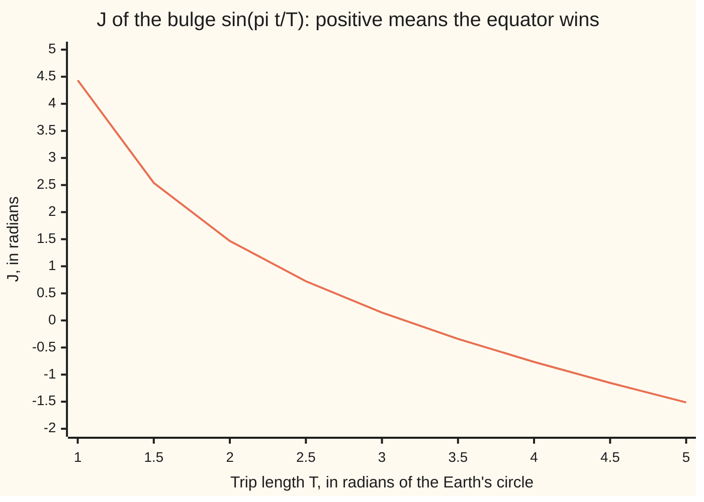

# The second variation: when a stationary path is truly a minimum, and what a free end must satisfy

[Syllabus](../../../SYLLABUS.md) → [Differential equations and dynamics](../README.md) → [Calculus of Variations and Optimal Control](../README.md#s12) → The second variation

---

## General Overview

A ship sails due west along the equator, on an Earth taken as a sphere of radius 6,371 km. The equator is a great circle, and great circles are stationary for length: a small nudge north changes the length by nothing to first order.

Stationary is not the same as shortest. On a trip of 19,113 km, a gentle bulge 63.7 km north at the middle adds 46.2 m. On a trip of 25,484 km, the same bulge saves 244.1 m. The route has turned from a valley floor into a saddle (a point that some nudges raise and others lower).

The switch happens at 20,015 km, half way round, where every great circle from the start meets the equator again: a **conjugate point**. The card's second question is where a route should end if its end may slide. A pipe from a well to a straight coast must meet the coast at right angles.

**A stationary path is a true minimum when the second-order change in cost is positive for every nudge, which needs the cost to curve upward in the slope (Legendre) and no conjugate point before the end (Jacobi); a free end adds one equation at that end.**

**What kind of fact this is:** theorems, proved on this card for the example; the general Jacobi theorem is sketched in a fold.

### The picture: the bulge's second-order cost against the trip length



The line is the second-order cost $`J`$ of one bulge shape, defined below. It crosses zero at $`T = \pi`$.

---

## The formula

The route is latitude $`y`$ (radians north) against distance $`t`$ west along the equator (radians, so $`t = 1`$ is 6,371 km). The trip ends at $`t = T`$; $`y'`$ is the route's slope.

On a sphere of radius 1, the route's length is $`\int_0^T \sqrt{y'^2 + \cos^2 y}\,dt`$. For small $`y`$ this is $`T + \tfrac12 J[y]`$ plus fourth-order terms, where

```math
J[y] = \int_0^T \big(y'^2 - y^2\big)\,dt, \qquad y(0) = y(T) = 0
```

**Read it aloud:** J adds up slope squared minus latitude squared over the trip.

The equator, $`y = 0`$, solves the Euler-Lagrange equation $`y'' + y = 0`$, so it is stationary. The question is the sign of $`J`$ nearby.

In general, take a cost $`\int F(t, y, p)\,dt`$, with $`p`$ the slope slot. Nudge a stationary path by $`\varepsilon\eta`$. The cost changes by $`\varepsilon^2\,\delta^2 J`$ plus higher terms, with the **second variation**

```math
\delta^2 J[\eta] = \int_a^b \big(P\,\eta'^2 + Q\,\eta^2\big)\,dt, \qquad P = \tfrac12 F_{pp}, \quad Q = \tfrac12\Big(F_{yy} - \frac{d}{dt}F_{yp}\Big)
```

**Read it aloud:** the second-order change weighs the nudge's slope squared and its size squared.

Here $`F = p^2 - y^2`$, so $`P = 1`$, $`Q = -1`$, and $`\delta^2 J[\eta] = J[\eta]`$. Two tests follow:

- **Legendre condition:** a minimum needs $`F_{pp} \ge 0`$ along the path. Here $`F_{pp} = 2`$.
- **Jacobi condition:** solve the **Jacobi equation** $`(P u')' = Q u`$ with $`u(a) = 0`$, $`u'(a) = 1`$. A later zero of $`u`$ is a conjugate point $`t^*`$. With $`P > 0`$: no $`t^*`$ up to the end means a minimum; a $`t^*`$ inside means not. Here $`u = \sin t`$ and $`t^* = \pi`$.

A free end adds one equation there. A free far height needs the **natural boundary condition** $`F_p = 0`$. An end sliding on a curve $`y = c(x)`$ needs the **transversality condition**

```math
\Big[\,F + (c' - y')\,F_p\,\Big]_{\text{at the end}} = 0
```

**Read it aloud:** at the end, cost per step plus slope gap times slope pull is zero.

For length, $`F = \sqrt{1 + p^2}`$, and this reduces to $`1 + c'\,y' = 0`$: the path meets the curve at right angles.

| Symbol | Plain meaning | In our example | Push it up and the answer… |
| --- | --- | --- | --- |
| $`t`$, $`T`$, $`R`$; $`a`$, $`b`$ | distance west, rad; trip length; Earth's radius; start and end in general | 0 to 4 rad; 6,371 km; 0 and $`T`$ | past $`\pi`$ the equator loses |
| $`y`$, $`y'`$ | route's latitude, rad (pipe: km north); its slope | 0 on the equator; pipe $`y = x`$ | — |
| $`J`$, $`\delta^2 J`$ | second-order cost; second variation | −0.7663 for the bulge at $`T = 4`$ | positive: the equator wins |
| $`F`$, $`p`$, $`F_p`$, $`F_{pp}`$ | cost per step; slope slot; its slopes (subscripts name the slots, as in $`F_{yy}`$, $`F_{yp}`$) | $`p^2 - y^2`$; $`2p`$; 2 | Legendre needs $`F_{pp} \ge 0`$ |
| $`\eta`$, $`\varepsilon`$ | nudge shape, zero at both ends; its size | $`\sin(\pi t/T)`$; 0.01 rad | change grows as $`\varepsilon^2`$ |
| $`P`$, $`Q`$, $`\lambda`$ | weights on slope squared, size squared; lowest Sturm-Liouville eigenvalue | 1, −1; $`(\pi/T)^2`$ | lower $`Q`$: earlier $`t^*`$ |
| $`u`$, $`t^*`$, $`w`$, $`\delta`$ | Jacobi field; conjugate point; helper $`u'/u`$; its small shift | $`\sin t`$; $`\pi`$; $`\cot(t + \delta)`$, $`\delta = 0.07`$ | — |
| $`x`$, $`c`$, $`c'`$, $`\Delta x`$, $`k`$ | pipe's distance east, km; coast; its slope; end's slide; slope of a line $`y = kx`$ | $`2 - x`$; −1; small; 1 | — |

### When it holds

- **The path is already stationary.** The second variation decides only once the first variation is zero ([The Euler-Lagrange equation](01-functionals-and-the-euler-lagrange-equation.md)).
- **Strict Legendre, $`P > 0`$.** Where $`P = 0`$, the Jacobi equation degenerates and the test can fail to decide.
- **Small nudges.** The tests prove a local minimum. Sailing round the Earth the other way is a far-away route they say nothing about.
- **Smooth ends.** The free-end conditions need $`F`$ and the end curve to have slopes at the end point.

---

## Why it works

### Step 0: the conjugate point is where a neighbouring stationary path returns

Tilt the equator by a small angle about the start. The tilted great circle is also stationary, and its latitude is about that angle times $`\sin t`$. It crosses the equator again at $`t = \pi`$.

That gap, $`u = \sin t`$, is the Jacobi field. At $`\pi`$, the tilted route and the equator join the same two points with the same length. On a longer trip, follow the tilted route to $`\pi`$, then the equator: no longer, but it has a corner, and cutting the corner saves length. Before $`\pi`$, no such second route exists.

### Step 1: expand the cost to second order

Put $`y + \varepsilon\eta`$ into $`F`$ and expand. The first-order term vanishes because the path is stationary. The second-order term is $`\tfrac12\int(F_{yy}\eta^2 + 2F_{yp}\eta\eta' + F_{pp}\eta'^2)\,dt`$.

The middle term is $`F_{yp}\,(\eta^2)'`$. Integration by parts moves the derivative onto $`F_{yp}`$, giving $`P`$ and $`Q`$. [Lagrangian mechanics](04-lagrangian-mechanics.md) computes one second variation numerically, for a swing.

### Step 2: Legendre: steep wiggles test the slope weight

A fine sawtooth nudge has a large slope but a small size. So the $`P\eta'^2`$ term dominates, and a negative $`P`$ anywhere makes $`\delta^2 J`$ negative.

Flip the example to $`\int_0^1 (y^2 - y'^2)\,dt`$. Then $`F_{pp} = -2`$, and one arch, $`\sin(\pi t)`$, gives −4.4348.

### Step 3: Jacobi: before the conjugate point, complete the square

For $`T < \pi`$, pick a small $`\delta > 0`$ with $`T + \delta < \pi`$. Then $`\sin(t + \delta)`$ solves the Jacobi equation with no zero on $`[0, T]`$. Its slope over its value, $`w = \cot(t + \delta)`$, satisfies $`w' + w^2 = -1`$. Expanding gives

```math
\eta'^2 - \eta^2 = \big(\eta' - w\,\eta\big)^2 + \big(w\,\eta^2\big)'
```

Integrate over the trip. The last term is zero at both ends, so $`J[\eta] = \int_0^T(\eta' - w\eta)^2\,dt \ge 0`$, and it is zero only for $`\eta = 0`$. At $`T = 3`$, with $`\delta = 0.07`$ and $`\eta = t(3 - t)`$, both sides are 0.900000.

[Sturm-Liouville](../07-Series%20Solutions%20and%20Boundary%20Problems/09-sturm-liouville-and-orthogonality.md) gives the same answer: the lowest eigenvalue of $`-\eta'' = \lambda\eta`$, ends pinned, is $`(\pi/T)^2`$. So $`J \ge 0`$ exactly when $`(\pi/T)^2 \ge 1`$.

### Step 4: past the conjugate point, the equator is a saddle

For $`T = 4`$, no helper $`w`$ exists: every Jacobi solution is a shifted sine, with a zero in every stretch longer than $`\pi`$. The trial bulge shows the failure:

```math
J = \int_0^4\Big(\tfrac{\pi^2}{16}\cos^2\tfrac{\pi t}{4} - \sin^2\tfrac{\pi t}{4}\Big)dt = 2\Big(\tfrac{\pi^2}{16} - 1\Big) = -0.7663
```

Each squared sine or cosine averages one half over the trip. On the Earth, a bulge of 0.01 rad changes the length by $`R\,\varepsilon^2 J/2`$ = −244.1 m, as the exact sphere integral confirms.

<details>
<summary>Detailed proof: the general Jacobi theorem in outline</summary>

**Sufficiency.** Let $`P > 0`$ with no conjugate point in $`(a, b]`$. A Jacobi solution started slightly before $`a`$ has no zero on $`[a, b]`$. With $`w = P u'/u`$, which solves $`w' = Q - w^2/P`$,

$`\displaystyle P\eta'^2 + Q\eta^2 = P\Big(\eta' - \frac{w}{P}\eta\Big)^2 + \big(w\eta^2\big)'`$

so $`\delta^2 J > 0`$ for every nonzero nudge (Gelfand and Fomin, chapter 5).

**Necessity.** Let $`t^*`$ in $`(a, b)`$ be conjugate, with Jacobi field $`u`$. Take $`\eta = u`$ up to $`t^*`$ and 0 after. Integration by parts and the Jacobi equation give $`\delta^2 J[\eta] = 0`$. This nudge has a corner at $`t^*`$, and rounding the corner makes $`\delta^2 J`$ negative.

</details>

### Step 5: a free end adds a boundary term

On [The Euler-Lagrange equation](01-functionals-and-the-euler-lagrange-equation.md), the end term $`F_p\,\eta`$ vanished because the nudge was pinned there. Unpin it. Euler-Lagrange still holds inside, so only end terms remain.

- **Height free.** $`F_p\,\eta(b)`$ must vanish for any $`\eta(b)`$, so $`F_p = 0`$ at $`b`$.
- **End slides on $`y = c(x)`$.** Move the end by $`\Delta x`$ along the curve. The longer interval adds $`F\,\Delta x`$. The height gap at fixed $`x`$ is $`(c' - y')\,\Delta x`$, adding $`F_p\,(c' - y')\,\Delta x`$. The sum must vanish.

For the pipe, $`F = \sqrt{1 + p^2}`$ is km of pipe per km east. Multiplying the condition by $`F`$ gives $`1 + c'y' = 0`$. The coast $`y = 2 - x`$ has $`c' = -1`$, so $`y' = 1`$. The pipe $`y = x`$ meets the coast at (1, 1), length 1.4142 km. A plain search along the coast finds the same point.

---

## Worked numbers, by hand

| Step | Arithmetic | Value |
| --- | --- | --- |
| Legendre | $`F = p^2 - y^2`$, so $`F_{pp} = 2`$ | 2 > 0, passes |
| Jacobi equation | $`u'' + u = 0`$, $`u(0) = 0`$, $`u'(0) = 1`$ | $`u = \sin t`$ |
| conjugate point | first zero of $`\sin t`$ after 0 | 3.141593 rad = 20,015 km |
| trial at $`T = 4`$ | $`2(\pi^2/16 - 1)`$ | **−0.7663** |
| on the Earth, bulge 0.01 rad | $`6{,}371{,}000 \times 0.01^2/2 \times (-0.7663)`$ | **−244.1 m** |
| pipe, transversality | $`1 + (-1)\,y' = 0`$ | $`y' = 1`$, end (1, 1) |
| pipe length | $`\sqrt{1^2 + 1^2}`$ | **1.4142 km** |

The 25,484 km equator route passes Legendre but fails Jacobi, so a bulge saves 244.1 m. The pipe is shortest when it meets the coast square on.

### What breaks if you drop a piece

| Mistake | Comes out at | What went wrong |
| --- | --- | --- |
| Check Legendre only, at $`T = 4`$ | bulge saves 244.1 m | the conjugate point at $`\pi`$ lies inside |
| Flip the sign: $`\int_0^1(y^2 - y'^2)`$ | $`J = -4.4348`$ | $`F_{pp} = -2`$: wiggles lower the cost |
| Stop exactly at $`T = \pi`$ | $`J[\sin t]`$ = 0.000000 | conjugate point at the end: a tie, not a strict minimum |
| Pipe with $`y' = 0`$ (the free-height rule) | 2.0000 km, 0.5858 too long | the end slides on a slanted coast |

---

## Code, from first principles, and it actually runs

The script takes five roads. Simpson's rule ([Numerical integration](../../06-Calculus%20and%20analysis/04-Integrals/08-numerical-integration.md)) computes $`J`$ against the hand formula. Runge-Kutta 4 (RK4, four slope samples per step) runs the Jacobi equation to its first zero, against $`\pi`$. The exact sphere length is compared with $`\varepsilon^2 J/2`$, the completed square with $`J`$, and a golden-section search along the coast with transversality.

### Python

```python
# The second variation and free ends -- the check behind the card.  Standard library only.
# J[y] = integral from 0 to T of (y'^2 - y^2) dt, y(0) = y(T) = 0: the second-order part of a route's
# length along the equator of a unit sphere.  Then a pipe from (0, 0) to anywhere on the coast y = 2 - x.
from math import sin, cos, tan, pi, sqrt
R = 6371.0                                            # Earth's radius in km, Earth taken as a sphere
def simpson(f, a, b, n=2000):                         # Simpson's rule, written out here
    w = (b - a) / n
    return w / 3 * (f(a) + f(b) + sum((4 if k % 2 else 2) * f(a + k * w) for k in range(1, n)))
J = lambda e, de, T: simpson(lambda t: de(t) ** 2 - e(t) ** 2, 0, T)     # J from a shape and its slope
trial = lambda T: J(lambda t: sin(pi * t / T), lambda t: pi / T * cos(pi * t / T), T)
closed = lambda T: pi ** 2 / (2 * T) - T / 2           # the same integral, done by hand
print("J of the trial sin(pi t/T), T = 1, 1.5, ..., 5:", ", ".join(f"{trial(k / 2):.4f}" for k in range(2, 11)))
j4, j3 = trial(4.0), trial(3.0)
print(f"T = 4: Simpson {j4:.6f}, by hand 2(pi^2/16 - 1) = {2 * (pi ** 2 / 16 - 1):.6f}; T = 3: {j3:.6f}")
def conjugate(h=1e-3):                                # RK4 on the Jacobi equation u'' = -u, u(0) = 0, u'(0) = 1
    t, u, v = 0.0, 0.0, 1.0
    while True:
        f = lambda a, b: (b, -a)
        k1 = f(u, v); k2 = f(u + h / 2 * k1[0], v + h / 2 * k1[1])
        k3 = f(u + h / 2 * k2[0], v + h / 2 * k2[1]); k4 = f(u + h * k3[0], v + h * k3[1])
        un = u + h / 6 * (k1[0] + 2 * k2[0] + 2 * k3[0] + k4[0])
        v += h / 6 * (k1[1] + 2 * k2[1] + 2 * k3[1] + k4[1])
        if t > 1 and un <= 0:
            return t + h * u / (u - un)               # straight-line guess between the last two steps
        t, u = t + h, un
tc = conjugate()
print(f"Legendre: F_pp = 2 > 0.  Jacobi field returns to 0 at t = {tc:.6f} = pi = {pi:.6f}, {pi * R:.0f} km on Earth")
def gap(T, eps):                                      # exact sphere length minus T, latitude eps sin(pi t/T)
    s = lambda t: sqrt((eps * pi / T * cos(pi * t / T)) ** 2 + cos(eps * sin(pi * t / T)) ** 2)
    return simpson(s, 0, T, 4000) - T
for T in (4.0, 3.0):
    g, q = gap(T, 0.01) * R * 1000, 0.01 ** 2 / 2 * trial(T) * R * 1000
    print(f"sphere, T = {T:.0f} rad = {T * R:.0f} km, bulge 0.01 rad = {0.01 * R:.1f} km north: change {g:.1f} m, from J {q:.1f} m")
    assert abs(g - q) < 1e-3 * abs(q)                 # J really is the second-order part of the length
d = 0.07                                              # Riccati road at T = 3: w = cot(t + d), sin(t + d) > 0
w = lambda t: 1 / tan(t + d)
lhs = J(lambda t: t * (3 - t), lambda t: 3 - 2 * t, 3.0)
rhs = simpson(lambda t: (3 - 2 * t - w(t) * t * (3 - t)) ** 2, 0, 3.0)
print(f"T = 3, eta = t(3 - t): J = {lhs:.6f}, integral of (eta' - w eta)^2 = {rhs:.6f}")
print(f"T = pi, trial sin t: J = {abs(trial(pi)):.6f}")
lo, hi, dist = 0.0, 2.0, lambda s: sqrt(s * s + (2 - s) ** 2)        # pipe end at (s, 2 - s) on the coast
for _ in range(100):                                  # golden-section search for the nearest coast point
    a, b = hi - 0.618034 * (hi - lo), lo + 0.618034 * (hi - lo)
    lo, hi = (lo, b) if dist(a) < dist(b) else (a, hi)
s = (lo + hi) / 2
p = 1.0                                               # slope y' = 1 from the transversality condition 1 + c' y' = 0
print(f"pipe, search: ends at ({s:.4f}, {2 - s:.4f}), length {dist(s):.4f} km")
print(f"pipe, transversality F + (c' - y') F_p at y' = 1, c' = -1: {sqrt(1 + p * p) + (-1 - p) * p / sqrt(1 + p * p):.6f}")
print(f"mistake, flip the sign, integral of (y^2 - y'^2) on T = 1 with sin(pi t): {-trial(1.0):.4f}")
print(f"mistake, end condition y' = 0 (pipe due east to (2, 0)): {dist(2.0):.4f} km, {dist(2.0) - dist(s):.4f} too long")
assert abs(j4 - closed(4.0)) < 1e-9 and j4 < 0 < j3  # Simpson = hand integral; sign flips past pi
assert abs(tc - pi) < 1e-6                            # RK4 conjugate point = pi, the zero of sin t
assert abs(lhs - 0.9) < 1e-9 and abs(rhs - lhs) < 1e-6  # completing the square, T < pi
assert abs(s - 1) < 1e-6 and abs(dist(s) - sqrt(2)) < 1e-9  # search lands where transversality says
print("ALL CHECKS PASS")
```

**Ran 2026-11-23 on macOS, Python 3.14.10, standard library only. All checks passed. Output, pasted from the run:**

```
J of the trial sin(pi t/T), T = 1, 1.5, ..., 5: 4.4348, 2.5399, 1.4674, 0.7239, 0.1449, -0.3401, -0.7663, -1.1534, -1.5130
T = 4: Simpson -0.766299, by hand 2(pi^2/16 - 1) = -0.766299; T = 3: 0.144934
Legendre: F_pp = 2 > 0.  Jacobi field returns to 0 at t = 3.141593 = pi = 3.141593, 20015 km on Earth
sphere, T = 4 rad = 25484 km, bulge 0.01 rad = 63.7 km north: change -244.1 m, from J -244.1 m
sphere, T = 3 rad = 19113 km, bulge 0.01 rad = 63.7 km north: change 46.2 m, from J 46.2 m
T = 3, eta = t(3 - t): J = 0.900000, integral of (eta' - w eta)^2 = 0.900000
T = pi, trial sin t: J = 0.000000
pipe, search: ends at (1.0000, 1.0000), length 1.4142 km
pipe, transversality F + (c' - y') F_p at y' = 1, c' = -1: 0.000000
mistake, flip the sign, integral of (y^2 - y'^2) on T = 1 with sin(pi t): -4.4348
mistake, end condition y' = 0 (pipe due east to (2, 0)): 2.0000 km, 0.5858 too long
ALL CHECKS PASS
```

### Rust

Same numbers, same labels, built with `rustc --edition 2021 -O`.

```rust
// The second variation and free ends -- the same check as the Python, in Rust.  No crates.
// J[y] = integral from 0 to T of (y'^2 - y^2) dt, y(0) = y(T) = 0: the second-order part of a route's
// length along the equator of a unit sphere.  Then a pipe from (0, 0) to anywhere on the coast y = 2 - x.
use std::f64::consts::PI;
const R: f64 = 6371.0; // Earth's radius in km, Earth taken as a sphere
fn simpson(f: &dyn Fn(f64) -> f64, a: f64, b: f64, n: usize) -> f64 { // Simpson's rule, written out here
    let w = (b - a) / n as f64;
    let inner: f64 = (1..n).map(|k| if k % 2 == 1 { 4.0 } else { 2.0 } * f(a + k as f64 * w)).sum();
    w / 3.0 * (f(a) + f(b) + inner)
}
fn j(e: &dyn Fn(f64) -> f64, de: &dyn Fn(f64) -> f64, t: f64) -> f64 { // J from a shape and its slope
    simpson(&|x| de(x).powi(2) - e(x).powi(2), 0.0, t, 2000)
}
fn trial(t: f64) -> f64 { j(&|x| (PI * x / t).sin(), &|x| PI / t * (PI * x / t).cos(), t) }
fn closed(t: f64) -> f64 { PI * PI / (2.0 * t) - t / 2.0 } // the same integral, done by hand
fn conjugate(h: f64) -> f64 { // RK4 on the Jacobi equation u'' = -u, u(0) = 0, u'(0) = 1
    let (mut t, mut u, mut v) = (0.0, 0.0, 1.0);
    let f = |a: f64, b: f64| (b, -a);
    loop {
        let k1 = f(u, v);
        let k2 = f(u + h / 2.0 * k1.0, v + h / 2.0 * k1.1);
        let k3 = f(u + h / 2.0 * k2.0, v + h / 2.0 * k2.1);
        let k4 = f(u + h * k3.0, v + h * k3.1);
        let un = u + h / 6.0 * (k1.0 + 2.0 * k2.0 + 2.0 * k3.0 + k4.0);
        v += h / 6.0 * (k1.1 + 2.0 * k2.1 + 2.0 * k3.1 + k4.1);
        if t > 1.0 && un <= 0.0 { return t + h * u / (u - un); } // straight-line guess between steps
        t += h;
        u = un;
    }
}
fn gap(t: f64, eps: f64) -> f64 { // exact sphere length minus T, latitude eps sin(pi t/T)
    simpson(&|x| ((eps * PI / t * (PI * x / t).cos()).powi(2) + (eps * (PI * x / t).sin()).cos().powi(2)).sqrt(), 0.0, t, 4000) - t
}
fn main() {
    let js: Vec<String> = (2..11).map(|k| format!("{:.4}", trial(k as f64 / 2.0))).collect();
    println!("J of the trial sin(pi t/T), T = 1, 1.5, ..., 5: {}", js.join(", "));
    let (j4, j3) = (trial(4.0), trial(3.0));
    println!("T = 4: Simpson {:.6}, by hand 2(pi^2/16 - 1) = {:.6}; T = 3: {:.6}", j4, 2.0 * (PI * PI / 16.0 - 1.0), j3);
    let tc = conjugate(1e-3);
    println!("Legendre: F_pp = 2 > 0.  Jacobi field returns to 0 at t = {:.6} = pi = {:.6}, {:.0} km on Earth", tc, PI, PI * R);
    for t in [4.0, 3.0] {
        let (g, q) = (gap(t, 0.01) * R * 1000.0, 0.01f64.powi(2) / 2.0 * trial(t) * R * 1000.0);
        println!("sphere, T = {:.0} rad = {:.0} km, bulge 0.01 rad = {:.1} km north: change {:.1} m, from J {:.1} m", t, t * R, 0.01 * R, g, q);
        assert!((g - q).abs() < 1e-3 * q.abs()); // J really is the second-order part of the length
    }
    let d = 0.07; // Riccati road at T = 3: w = cot(t + d), sin(t + d) > 0
    let w = |x: f64| 1.0 / (x + d).tan();
    let lhs = j(&|x| x * (3.0 - x), &|x| 3.0 - 2.0 * x, 3.0);
    let rhs = simpson(&|x| (3.0 - 2.0 * x - w(x) * x * (3.0 - x)).powi(2), 0.0, 3.0, 2000);
    println!("T = 3, eta = t(3 - t): J = {:.6}, integral of (eta' - w eta)^2 = {:.6}", lhs, rhs);
    println!("T = pi, trial sin t: J = {:.6}", trial(PI).abs());
    let dist = |s: f64| (s * s + (2.0 - s).powi(2)).sqrt(); // pipe end at (s, 2 - s) on the coast
    let (mut lo, mut hi) = (0.0f64, 2.0f64);
    for _ in 0..100 { // golden-section search for the nearest coast point
        let (a, b) = (hi - 0.618034 * (hi - lo), lo + 0.618034 * (hi - lo));
        if dist(a) < dist(b) { hi = b } else { lo = a }
    }
    let s = (lo + hi) / 2.0;
    let p = 1.0f64; // slope y' = 1 from the transversality condition 1 + c' y' = 0
    println!("pipe, search: ends at ({:.4}, {:.4}), length {:.4} km", s, 2.0 - s, dist(s));
    println!("pipe, transversality F + (c' - y') F_p at y' = 1, c' = -1: {:.6}", (1.0 + p * p).sqrt() + (-1.0 - p) * p / (1.0 + p * p).sqrt());
    println!("mistake, flip the sign, integral of (y^2 - y'^2) on T = 1 with sin(pi t): {:.4}", -trial(1.0));
    println!("mistake, end condition y' = 0 (pipe due east to (2, 0)): {:.4} km, {:.4} too long", dist(2.0), dist(2.0) - dist(s));
    assert!((j4 - closed(4.0)).abs() < 1e-9 && j4 < 0.0 && 0.0 < j3); // Simpson = hand integral; sign flips past pi
    assert!((tc - PI).abs() < 1e-6); // RK4 conjugate point = pi, the zero of sin t
    assert!((lhs - 0.9).abs() < 1e-9 && (rhs - lhs).abs() < 1e-6); // completing the square, T < pi
    assert!((s - 1.0).abs() < 1e-6 && (dist(s) - 2f64.sqrt()).abs() < 1e-9); // search lands where transversality says
    println!("ALL CHECKS PASS");
}
```

**Ran 2026-11-23 on macOS, rustc 1.98.1, no crates. All checks passed. Output, pasted from the run:**

```
J of the trial sin(pi t/T), T = 1, 1.5, ..., 5: 4.4348, 2.5399, 1.4674, 0.7239, 0.1449, -0.3401, -0.7663, -1.1534, -1.5130
T = 4: Simpson -0.766299, by hand 2(pi^2/16 - 1) = -0.766299; T = 3: 0.144934
Legendre: F_pp = 2 > 0.  Jacobi field returns to 0 at t = 3.141593 = pi = 3.141593, 20015 km on Earth
sphere, T = 4 rad = 25484 km, bulge 0.01 rad = 63.7 km north: change -244.1 m, from J -244.1 m
sphere, T = 3 rad = 19113 km, bulge 0.01 rad = 63.7 km north: change 46.2 m, from J 46.2 m
T = 3, eta = t(3 - t): J = 0.900000, integral of (eta' - w eta)^2 = 0.900000
T = pi, trial sin t: J = 0.000000
pipe, search: ends at (1.0000, 1.0000), length 1.4142 km
pipe, transversality F + (c' - y') F_p at y' = 1, c' = -1: 0.000000
mistake, flip the sign, integral of (y^2 - y'^2) on T = 1 with sin(pi t): -4.4348
mistake, end condition y' = 0 (pipe due east to (2, 0)): 2.0000 km, 0.5858 too long
ALL CHECKS PASS
```

### Lean

Lean proves Jacobi's test for every smooth $`P`$ and $`Q`$, the bulge's cost for every trip length, and the right-angle rule for length.

- Suppose $`P > 0`$ on $`[a, b]`$, and the Jacobi field $`u`$ has no zero in $`(a, b]`$. Then $`\delta^2 J[\eta] > 0`$ for every smooth nudge $`\eta`$ pinned at both ends and not zero everywhere.
- Take a trip length $`T > 0`$ and the bulge $`\eta = \sin(\pi t/T)`$. Then $`\eta`$ is zero at both ends, and $`J[\eta] = \pi^2/(2T) - T/2`$.
- Take a trip longer than $`\pi`$. Then the bulge's cost is negative, so past the conjugate point the equator is not a minimum.
- Take $`F = \sqrt{1 + p^2}`$ and an end sliding on a curve of slope $`c'`$. Then the transversality condition holds exactly when $`1 + c'y' = 0`$.
- For $`F = p^2 - y^2`$, $`F_{pp} = 2`$. The Jacobi field $`\sin t`$ is positive on $`(0, \pi)`$ and zero at $`\pi`$.
- At $`T = 4`$ the bulge's cost is $`2(\pi^2/16 - 1)`$, which is negative.
- The pipe with slope 1 ends at (1, 1) on the coast. No coast point is closer to the well, and the pipe due east is longer.

The decimals, the exact sphere length, the RK4 run and the coast search are left to the Python and Rust checks.

```lean
-- The second variation: with strict Legendre and no conjugate point up to the end, the second variation is positive for every nonzero pinned nudge; past the conjugate point pi the equator's bulge has negative cost; and for length, transversality at a sliding end means meeting the end curve at right angles.
import Mathlib.Analysis.SpecialFunctions.Integrals.Basic
import Mathlib.Analysis.SpecialFunctions.Trigonometric.Deriv
import Mathlib.Analysis.SpecialFunctions.Sqrt
import Mathlib.Analysis.Real.Pi.Bounds
import Mathlib.Analysis.Calculus.ContDiff.Basic

open Real Set
open Filter Topology

/-- **Jacobi's test: strict Legendre and no conjugate point make the second variation positive.**
The second variation of a stationary path on `[a, b]` is
`δ²J[η] = ∫ (P η'² + Q η²) dt` with weights `P = F_pp / 2` and `Q`.
Suppose the strict Legendre condition `P > 0` holds on `[a, b]`, and the Jacobi field `u`
(the solution of the Jacobi equation `(P u')' = Q u` with `u(a) = 0`, `u'(a) = 1`) has no
conjugate point in `(a, b]`, that is, no zero there. Then every smooth nudge `η` pinned at both
ends (`η(a) = η(b) = 0`) and not zero everywhere has `δ²J[η] > 0`: the stationary path is a
strict local minimum. -/
theorem second_variation_pos_of_legendre_and_no_conjugate_point
    (P Q u η : ℝ → ℝ) (a b : ℝ) (hab : a < b)
    (hP : ContDiff ℝ 1 P) (hQ : Continuous Q) (hu : ContDiff ℝ 2 u)
    (hlegendre : ∀ t ∈ Icc a b, 0 < P t)
    (hjacobi : ∀ t ∈ Icc a b, deriv (fun s => P s * deriv u s) t = Q t * u t)
    (hu_a : u a = 0) (hu'_a : deriv u a = 1)
    (hno_conj : ∀ t ∈ Ioc a b, u t ≠ 0)
    (hη : ContDiff ℝ 1 η) (hη_a : η a = 0) (hη_b : η b = 0)
    (hη_ne : ∃ t ∈ Icc a b, η t ≠ 0) :
    0 < ∫ t in a..b, (P t * deriv η t ^ 2 + Q t * η t ^ 2) := by
  -- regularity
  have hPdiff : Differentiable ℝ P := hP.differentiable (by norm_num)
  have hPc : Continuous P := hP.continuous
  have hu2 := contDiff_succ_iff_deriv.mp (show ContDiff ℝ (1 + 1) u from hu)
  have hudiff : Differentiable ℝ u := hu2.1
  have hu'C : ContDiff ℝ 1 (deriv u) := hu2.2.2
  have hu'diff : Differentiable ℝ (deriv u) := hu'C.differentiable (by norm_num)
  have huc : Continuous u := hudiff.continuous
  have hu'c : Continuous (deriv u) := hu'C.continuous
  have hηdiff : Differentiable ℝ η := hη.differentiable (by norm_num)
  have hηc : Continuous η := hη.continuous
  have hη'c : Continuous (deriv η) := hη.continuous_deriv le_rfl
  -- the pieces
  set f : ℝ → ℝ := fun t => P t * deriv η t ^ 2 + Q t * η t ^ 2 with hf
  set h : ℝ → ℝ := fun t => P t * (deriv η t - η t * deriv u t / u t) ^ 2 with hh
  set g : ℝ → ℝ := fun t => (P t * deriv u t) * (η t ^ 2 / u t) with hg
  have hfc : Continuous f := by
    simp only [hf]; fun_prop
  have hgd : ∀ t ∈ Ioc a b, HasDerivAt g (f t - h t) t := by
    intro t ht
    have hut : u t ≠ 0 := hno_conj t ht
    have h1 : HasDerivAt (fun s => P s * deriv u s) (Q t * u t) t := by
      have hd : DifferentiableAt ℝ (fun s => P s * deriv u s) t := (hPdiff t).mul (hu'diff t)
      have := hd.hasDerivAt
      rwa [hjacobi t (Ioc_subset_Icc_self ht)] at this
    have h2 : HasDerivAt (fun s => η s ^ 2 / u s)
        (((2 : ℕ) * η t ^ (2 - 1) * deriv η t * u t - η t ^ 2 * deriv u t) / u t ^ 2) t :=
      ((hηdiff t).hasDerivAt.pow 2).div (hudiff t).hasDerivAt hut
    convert h1.mul h2 using 1
    simp only [hf, hh]
    field_simp
    ring
  have hhcont : ContinuousOn h (Ioc a b) := by
    simp only [hh]
    exact hPc.continuousOn.mul ((hη'c.continuousOn.sub
      ((hηc.continuousOn.mul hu'c.continuousOn).div huc.continuousOn
        (fun t ht => hno_conj t ht))).pow 2)
  have hhnn : ∀ t ∈ Ioc a b, 0 ≤ h t := fun t ht =>
    mul_nonneg (hlegendre t (Ioc_subset_Icc_self ht)).le (sq_nonneg _)
  have hhint : ∀ x y, a < x → x ≤ y → y ≤ b → IntervalIntegrable h MeasureTheory.volume x y := by
    intro x y hx hxy hy
    apply ContinuousOn.intervalIntegrable
    rw [uIcc_of_le hxy]
    exact hhcont.mono (Icc_subset_Ioc hx hy)
  -- the identity on [c, b]
  have hid : ∀ c ∈ Ioc a b, ∫ t in c..b, f t = (∫ t in c..b, h t) - g c := by
    intro c hc
    have hfint : IntervalIntegrable f MeasureTheory.volume c b := hfc.intervalIntegrable _ _
    have hint := hhint c b hc.1 hc.2 le_rfl
    have hftc : ∫ t in c..b, (f t - h t) = g b - g c := by
      apply intervalIntegral.integral_eq_sub_of_hasDerivAt
      · intro x hx
        rw [uIcc_of_le hc.2] at hx
        exact hgd x ⟨lt_of_lt_of_le hc.1 hx.1, hx.2⟩
      · exact hfint.sub hint
    rw [intervalIntegral.integral_sub hfint hint] at hftc
    have hgb : g b = 0 := by simp [hg, hη_b]
    rw [hgb] at hftc
    linarith
  -- the boundary term vanishes at a
  have hglim : Tendsto g (𝓝[>] a) (𝓝 0) := by
    have hle : 𝓝[>] a ≤ 𝓝[≠] a := nhdsWithin_mono _ (fun x hx => ne_of_gt hx)
    have hηs : Tendsto (slope η a) (𝓝[>] a) (𝓝 (deriv η a)) :=
      (hasDerivAt_iff_tendsto_slope.mp (hηdiff a).hasDerivAt).mono_left hle
    have hus : Tendsto (slope u a) (𝓝[>] a) (𝓝 1) := by
      have := (hasDerivAt_iff_tendsto_slope.mp (hudiff a).hasDerivAt).mono_left hle
      rwa [hu'_a] at this
    have hpre : Tendsto (fun c => P c * deriv u c) (𝓝[>] a) (𝓝 (P a * deriv u a)) :=
      ((hPc.mul hu'c).tendsto a).mono_left nhdsWithin_le_nhds
    have hηt : Tendsto η (𝓝[>] a) (𝓝 0) := by
      have := (hηc.tendsto a).mono_left (nhdsWithin_le_nhds (s := Ioi a))
      rwa [hη_a] at this
    have hall := hpre.mul (hηt.mul (hηs.div hus one_ne_zero))
    rw [zero_mul, mul_zero] at hall
    refine hall.congr' ?_
    filter_upwards [Ioo_mem_nhdsGT hab] with c hc
    have hca : c - a ≠ 0 := sub_ne_zero.mpr (ne_of_gt hc.1)
    have huc0 : u c ≠ 0 := hno_conj c ⟨hc.1, hc.2.le⟩
    simp only [hg, Pi.div_apply, slope_def_field, hη_a, hu_a, sub_zero]
    field_simp
  -- the left integral converges
  have hflim : Tendsto (fun c => ∫ t in c..b, f t) (𝓝[>] a) (𝓝 (∫ t in a..b, f t)) := by
    have hcont : Continuous (fun c => ∫ t in c..b, f t) := by
      have := (intervalIntegral.continuous_primitive (μ := MeasureTheory.volume)
        (fun x y => hfc.intervalIntegrable x y) b).neg
      refine this.congr ?_
      intro c
      simp [intervalIntegral.integral_symm b c]
    exact (hcont.tendsto a).mono_left nhdsWithin_le_nhds
  -- positivity of the square term on a small window
  obtain ⟨t0, ht0, hηt0⟩ := hη_ne
  have ht0a : a < t0 := by
    rcases eq_or_lt_of_le ht0.1 with h' | h'
    · exact absurd (h' ▸ hη_a) hηt0
    · exact h'
  have ht0b : t0 < b := by
    rcases eq_or_lt_of_le ht0.2 with h' | h'
    · exact absurd (h' ▸ hη_b) hηt0
    · exact h'
  have hrc : ContinuousOn (fun t => η t / u t) (Icc t0 b) :=
    hηc.continuousOn.div huc.continuousOn
      (fun t ht => hno_conj t ⟨lt_of_lt_of_le ht0a ht.1, ht.2⟩)
  have hrd : ∀ x ∈ Ioo t0 b, HasDerivAt (fun t => η t / u t)
      ((deriv η x * u x - η x * deriv u x) / u x ^ 2) x := fun x hx =>
    (hηdiff x).hasDerivAt.div (hudiff x).hasDerivAt
      (hno_conj x ⟨ht0a.trans hx.1, hx.2.le⟩)
  obtain ⟨s, hs, hseq⟩ := exists_hasDerivAt_eq_slope (fun t => η t / u t) _ ht0b hrc hrd
  have hsI : s ∈ Ioc a b := ⟨ht0a.trans hs.1, hs.2.le⟩
  have hus0 : u s ≠ 0 := hno_conj s hsI
  have hut0 : u t0 ≠ 0 := hno_conj t0 ⟨ht0a, ht0b.le⟩
  have hhs : 0 < h s := by
    have hne : deriv η s - η s * deriv u s / u s ≠ 0 := by
      intro hz
      have hnum : deriv η s * u s - η s * deriv u s
          = (deriv η s - η s * deriv u s / u s) * u s := by field_simp
      have hseq' : (deriv η s * u s - η s * deriv u s) / u s ^ 2
          = (η b / u b - η t0 / u t0) / (b - t0) := hseq
      rw [hnum, hz, zero_mul, zero_div, hη_b, zero_div, zero_sub] at hseq'
      exact div_ne_zero (neg_ne_zero.mpr (div_ne_zero hηt0 hut0))
        (sub_ne_zero.mpr ht0b.ne') hseq'.symm
    exact mul_pos (hlegendre s (Ioc_subset_Icc_self hsI))
      (lt_of_le_of_ne (sq_nonneg _) (Ne.symm (pow_ne_zero 2 hne)))
  have hcs : ContinuousAt h s := hhcont.continuousAt (Ioc_mem_nhds hsI.1 hs.2)
  obtain ⟨ε, hε, hball⟩ := Metric.eventually_nhds_iff.mp (hcs.eventually (lt_mem_nhds hhs))
  set s1 := max (s - ε / 2) t0 with hs1def
  set s2 := min (s + ε / 2) b with hs2def
  have hs1 : s1 < s := max_lt (by linarith) hs.1
  have hs2 : s < s2 := lt_min (by linarith) hs.2
  have ha1 : a < s1 := lt_of_lt_of_le ht0a (le_max_right _ _)
  have hs1b : s1 ≤ b := (hs1.trans hs.2).le
  have hs2b : s2 ≤ b := min_le_right _ _
  have ha2 : a < s2 := ha1.trans (hs1.trans hs2)
  have hH : 0 < ∫ t in s1..s2, h t := by
    apply intervalIntegral.intervalIntegral_pos_of_pos_on
      (hhint s1 s2 ha1 (hs1.trans hs2).le hs2b) _ (hs1.trans hs2)
    intro y hy
    apply hball
    rw [Real.dist_eq, abs_sub_lt_iff]
    have h1 : s - ε / 2 ≤ s1 := le_max_left _ _
    have h2 : s2 ≤ s + ε / 2 := min_le_left _ _
    constructor <;> linarith [hy.1, hy.2]
  have hφ : Tendsto (fun c => (∫ t in c..b, f t) + g c) (𝓝[>] a)
      (𝓝 ((∫ t in a..b, f t) + 0)) := hflim.add hglim
  have hev : ∀ᶠ c in 𝓝[>] a, (∫ t in s1..s2, h t) ≤ (∫ t in c..b, f t) + g c := by
    filter_upwards [Ioo_mem_nhdsGT ha1] with c hc
    rw [hid c ⟨hc.1, hc.2.le.trans hs1b⟩, sub_add_cancel,
      ← intervalIntegral.integral_add_adjacent_intervals (hhint c s1 hc.1 hc.2.le hs1b)
        (hhint s1 b ha1 hs1b le_rfl),
      ← intervalIntegral.integral_add_adjacent_intervals
        (hhint s1 s2 ha1 (hs1.trans hs2).le hs2b) (hhint s2 b ha2 hs2b le_rfl)]
    have n1 : 0 ≤ ∫ t in c..s1, h t := intervalIntegral.integral_nonneg hc.2.le
      (fun t ht => hhnn t ⟨hc.1.trans_le ht.1, ht.2.trans hs1b⟩)
    have n2 : 0 ≤ ∫ t in s2..b, h t := intervalIntegral.integral_nonneg hs2b
      (fun t ht => hhnn t ⟨ha2.trans_le ht.1, ht.2⟩)
    linarith
  have := ge_of_tendsto hφ hev
  show 0 < ∫ t in a..b, f t
  linarith

/-- **Past the conjugate point the stationary path is a saddle.** For the equator,
`J[y] = ∫₀ᵀ (y'² - y²) dt`. The bulge `η(t) = sin(π t / T)` is pinned at both ends and has
`J[η] = π² / (2T) - T / 2`, which is negative once the trip is longer than `π`
(at `T = 4` it is `2 (π²/16 - 1) ≈ -0.7663`). -/
theorem bulge_second_variation_eq_and_neg_past_pi (T : ℝ) (hT : 0 < T) :
    sin (π * 0 / T) = 0 ∧ sin (π * T / T) = 0 ∧
    (∫ t in (0 : ℝ)..T, (deriv (fun s => sin (π * s / T)) t ^ 2 - sin (π * t / T) ^ 2))
      = π ^ 2 / (2 * T) - T / 2 ∧
    (π < T → π ^ 2 / (2 * T) - T / 2 < 0) := by
  have hT0 : T ≠ 0 := hT.ne'
  refine ⟨by simp, by rw [mul_div_assoc, div_self hT0, mul_one, sin_pi], ?_, ?_⟩
  · have hd : ∀ t, HasDerivAt (fun s => sin (π * s / T)) (cos (π * t / T) * (π / T)) t := by
      intro t
      have h1 : HasDerivAt (fun s => π * s / T) (π / T) t := by
        simpa using ((hasDerivAt_id t).const_mul π).div_const T
      exact h1.sin
    have hfun : (fun t => deriv (fun s => sin (π * s / T)) t ^ 2 - sin (π * t / T) ^ 2)
        = fun t => (cos (π * t / T) * (π / T)) ^ 2 - sin (π * t / T) ^ 2 := by
      funext t; rw [(hd t).deriv]
    rw [hfun]
    set F : ℝ → ℝ := fun t => (π ^ 2 / T ^ 2 - 1) / 2 * t
      + (π ^ 2 / T ^ 2 + 1) / 2 * (sin (2 * π * t / T) * (T / (2 * π))) with hF
    have hFd : ∀ x ∈ uIcc 0 T, HasDerivAt F
        ((cos (π * x / T) * (π / T)) ^ 2 - sin (π * x / T) ^ 2) x := by
      intro x _
      have h1 : HasDerivAt (fun s => 2 * π * s / T) (2 * π / T) x := by
        simpa using ((hasDerivAt_id x).const_mul (2 * π)).div_const T
      have h2 := (((hasDerivAt_id x).const_mul ((π ^ 2 / T ^ 2 - 1) / 2)).add
        ((h1.sin.mul_const (T / (2 * π))).const_mul ((π ^ 2 / T ^ 2 + 1) / 2)))
      have h3 : HasDerivAt F ((π ^ 2 / T ^ 2 - 1) / 2 * 1 + (π ^ 2 / T ^ 2 + 1) / 2 *
          (cos (2 * π * x / T) * (2 * π / T) * (T / (2 * π)))) x := h2
      convert h3 using 1
      have hc : cos (2 * π * x / T) = 2 * cos (π * x / T) ^ 2 - 1 := by
        rw [show 2 * π * x / T = 2 * (π * x / T) by ring, cos_two_mul]
      · rw [hc]
        have hs := sin_sq_add_cos_sq (π * x / T)
        have hpi : π ≠ 0 := pi_pos.ne'
        field_simp
        nlinarith [hs]
    rw [intervalIntegral.integral_eq_sub_of_hasDerivAt hFd]
    · simp only [hF]
      have : 2 * π * T / T = 2 * π := by field_simp
      rw [this, sin_two_pi]
      simp only [mul_zero, zero_div, sin_zero, zero_mul, add_zero]
      field_simp
      ring
    · apply Continuous.intervalIntegrable
      fun_prop
  · intro h
    have hpT : π ^ 2 < T ^ 2 := by nlinarith [pi_pos]
    rw [sub_neg, div_lt_iff₀ (by positivity)]
    nlinarith

/-- **Transversality for length means right angles.** For the length cost per step
`F(p) = √(1 + p²)`, with slope pull `F_p = F'(p)`, the transversality condition
`F + (c' - y') F_p = 0` at an end sliding on a curve of slope `c'` holds exactly when
`1 + c' y' = 0`: the path meets the end curve at right angles. -/
theorem length_transversality_iff_right_angle (y' c' : ℝ) :
    sqrt (1 + y' ^ 2) + (c' - y') * deriv (fun p : ℝ => sqrt (1 + p ^ 2)) y' = 0 ↔
      1 + c' * y' = 0 := by
  have hpos : 0 < 1 + y' ^ 2 := by positivity
  have hs : 0 < sqrt (1 + y' ^ 2) := sqrt_pos.mpr hpos
  have hsq : sqrt (1 + y' ^ 2) ^ 2 = 1 + y' ^ 2 := sq_sqrt hpos.le
  have hd : HasDerivAt (fun p : ℝ => sqrt (1 + p ^ 2)) (2 * y' / (2 * sqrt (1 + y' ^ 2))) y' := by
    have h1 : HasDerivAt (fun p : ℝ => 1 + p ^ 2) (2 * y') y' := by
      simpa using ((hasDerivAt_id y').pow 2).const_add 1
    convert h1.sqrt hpos.ne' using 1
  rw [hd.deriv]
  have key : sqrt (1 + y' ^ 2) + (c' - y') * (2 * y' / (2 * sqrt (1 + y' ^ 2)))
      = (1 + c' * y') / sqrt (1 + y' ^ 2) := by
    field_simp
    nlinarith [hsq]
  rw [key, div_eq_zero_iff]
  constructor
  · rintro (h | h)
    · exact h
    · exact absurd h hs.ne'
  · intro h; exact Or.inl h

-- The card's exact worked numbers.
-- Legendre for F = p² - y²: the slope weight F_pp is 2 > 0.
example (y p : ℝ) : deriv (fun q : ℝ => deriv (fun r : ℝ => r ^ 2 - y ^ 2) q) p = 2 := by
  simp
-- The Jacobi field sin t is positive on (0, π) and returns to 0 at π: the conjugate point.
example : sin π = 0 ∧ ∀ t ∈ Ioo 0 π, 0 < sin t :=
  ⟨sin_pi, fun _ ht => sin_pos_of_pos_of_lt_pi ht.1 ht.2⟩
-- At T = 4 the bulge's cost π²/(2T) - T/2 is 2(π²/16 - 1), and π < 4 makes it negative.
example : π ^ 2 / (2 * 4) - 4 / 2 = 2 * (π ^ 2 / 16 - 1) := by ring
example : 2 * (π ^ 2 / 16 - 1) < 0 := by nlinarith [pi_lt_four, pi_pos]
-- The pipe: transversality 1 + c' y' = 0 with coast slope c' = -1 gives y' = 1.
example : (1 : ℤ) + (-1) * 1 = 0 := by norm_num
-- The end (1, 1) lies on the coast y = 2 - x, and the squared length 1² + 1² = 2 is the least
-- squared distance from (0, 0) to any coast point (s, 2 - s).
example : (1 : ℤ) = 2 - 1 ∧ (1 : ℤ) ^ 2 + 1 ^ 2 = 2 := by norm_num
example (s : ℝ) : 2 ≤ s ^ 2 + (2 - s) ^ 2 := by nlinarith [sq_nonneg (s - 1)]
-- The wrong pipe due east to (2, 0) has squared length 4, longer than 2.
example : (2 : ℤ) ^ 2 + 0 ^ 2 = 4 ∧ (2 : ℤ) < 4 := by norm_num

#print axioms second_variation_pos_of_legendre_and_no_conjugate_point
#print axioms bulge_second_variation_eq_and_neg_past_pi
#print axioms length_transversality_iff_right_angle
```

**Checked 2026-11-23 on macOS, Lean 4.36.0-rc2, Mathlib v4.36.0-rc2. Every proof is complete and uses only Lean's standard axioms. Output, pasted from the run:**

```
'second_variation_pos_of_legendre_and_no_conjugate_point' depends on axioms: [propext, Classical.choice, Quot.sound]
'bulge_second_variation_eq_and_neg_past_pi' depends on axioms: [propext, Classical.choice, Quot.sound]
'length_transversality_iff_right_angle' depends on axioms: [propext, Classical.choice, Quot.sound]
```

> [!TIP]
> **Try changing**
> - Guess first: sail a little past half way. Change `(4.0, 3.0)` to `(4.0, 3.2)`. Answer: at 20,387 km the bulge now saves 18.4 m (the label rounds $`T`$ to 3).
> - Guess first: start the helper too early. Set `d = 0.2`, so $`\sin(t + 0.2)`$ hits zero inside the trip. Answer: the integral is infinite, as the helper blows up at $`t`$ = 2.94; the assert fails on Simpson's grid value 6932.301881.
> - Guess first: move the coast to $`y = 3 - x`$. Change every `2 - s` to `3 - s`, and the search range `2.0` to `3.0`. Answer: the search ends at (1.5000, 1.5000), length 2.1213 km, and the last assert fails, as it pins the old coast.

---

## The usual mistake

> [!warning]
> **Calling a stationary path a minimum because it solves Euler-Lagrange.** Saddles pass that test too. The 25,484 km equator route is stationary, yet a bulge 63.7 km north saves 244.1 m.
>
> - **Trusting Legendre alone.** $`F_{pp} = 2`$ at every trip length; the conjugate point decides: 0.1449 at $`T = 3`$, −0.7663 at $`T = 4`$.
> - **Forgetting the end condition.** With one end free, Euler-Lagrange leaves a family of paths, such as every line $`y = kx`$ from the well.
> - **Using the free-height rule on a slanted end curve.** $`F_p = 0`$ sends the pipe due east: 2.0000 km instead of 1.4142 km.

---

## Where you meet it in real life

- **Shipping and flight routes.** A great-circle route longer than half the Earth's circumference is not shortest; the other way round is.
- **Buckling.** A column stays straight while its energy's second variation is positive, and buckles when a conjugate point arrives.
- **Pipes, roads and cables to a shore.** The shortest link to a straight coast or road meets it at right angles.

> **Say it back**
> A stationary path passes the first test; the second variation decides whether it is a minimum. Legendre asks that the cost curve upward in the slope. Jacobi asks that no neighbouring stationary path return before the end. The equator route passes both up to 20,015 km and fails beyond. A free end adds one condition there, which for length means meeting the end curve at right angles.

---

## What this builds on

- [The Euler-Lagrange equation](01-functionals-and-the-euler-lagrange-equation.md): the first variation, and the end term $`F_p\,\eta`$ that free ends bring back.
- [The brachistochrone](02-the-brachistochrone-and-the-beltrami-identity.md): stationary paths in closed form, which this card tests for being minima.
- [Lagrangian mechanics](04-lagrangian-mechanics.md): one second variation computed, and the warning that least action is only stationary action.
- [Sturm-Liouville](../07-Series%20Solutions%20and%20Boundary%20Problems/09-sturm-liouville-and-orthogonality.md): the lowest eigenvalue that gives Jacobi's answer a second way.

## Where this goes next

- [Jacobi field](../../23-Differential%20geometry%20and%20Lie%20groups/05-Riemannian%20Geometry/09-jacobi-fields-and-comparison-theorems.md): conjugate points on curved surfaces, where curvature makes nearby shortest paths focus.

Left open: Jacobi's test proves a minimum among nearby routes only. When is a stationary path best among all routes?

---

## Sources

Verified 2026-11-23: every link below resolves to the publisher's page.

- Gelfand, I. M., and S. V. Fomin. *Calculus of Variations*. Dover, 2000. [Publisher page](https://store.doverpublications.com/products/9780486414485). Variable end points and transversality (chapter 3); the second variation, Legendre and Jacobi conditions (chapter 5).
- Liberzon, Daniel. *Calculus of Variations and Optimal Control Theory*. Princeton University Press, 2012. [Publisher page](https://press.princeton.edu/books/hardcover/9780691151878/calculus-of-variations-and-optimal-control-theory). Second-order conditions and free end points, leading into optimal control (chapter 2).
