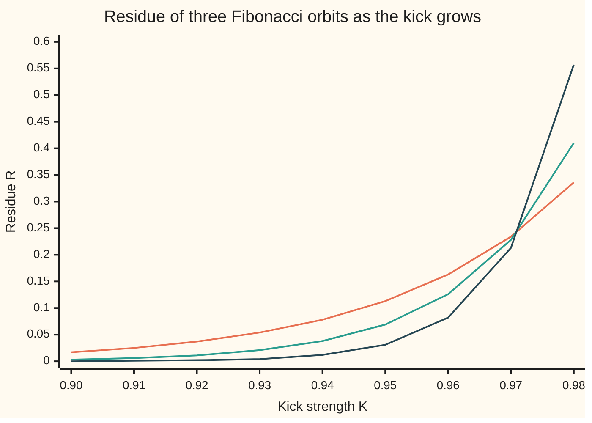

# Action-angle variables and KAM: an integrable system winds round tori, and most tori survive a small push

[Syllabus](../../../SYLLABUS.md) → [Differential equations and dynamics](../README.md) → [Calculus of Variations and Optimal Control](../README.md#s12) → Action-angle variables and KAM

---

## General Overview

A 1 kg weight hangs on a spring of stiffness 4 newtons per metre, with no friction. Give it 1 joule of energy. It swings 0.7071 m each way, peaks at 1.4142 m/s, and repeats every 3.1416 s.

Plot position against momentum (mass times velocity). The motion runs round one ellipse of area 3.1416. That area over 2π, 0.5, is the **action**: a label for the loop that never changes. The **angle** says where on the loop the weight is, and it turns at a steady 2 radians per second.

With several degrees of freedom (independent ways to move), such motions wind round doughnut-shaped surfaces, **tori**. Now push the system: a wheel kicked once a second. At kick strength 0.5 most motions stay on smooth curves. Near 0.9716 the last curve spanning the full turn breaks, and the spin rate can then drift without limit.

**For a motion that repeats, the area its loop encloses, divided by 2π, is a conserved label called the action, and a matching angle advances at a constant rate; the KAM theorem says a small push breaks only the tori whose rates sit close to simple fractions, so most tori survive.**

**What kind of fact this is:** action-angle variables for one degree of freedom are a theorem, proved in Why it works. Liouville-Arnold and KAM are theorems stated here; Arnold's book (Sources) proves the first and outlines the second. The value 0.9716 is numerical; no exact formula is known.

### The picture: how far the spin rate wanders in 100,000 kicks

```
highest momentum p reached, kicked wheel (p > 6.2832 = one extra turn per kick)
K = 0.5, start (0, 1)      ███████                      1.7552   on one smooth curve
K = 0.9, start (0.001, 0)  █████████                    2.3235   fenced in
K = 1.0, start (0.001, 0)  ██████████                   2.4715   fence broken, still inside
K = 1.2, start (0.001, 0)  █████████████████████████    6.3723   escaped after 1575 kicks, this run
```

Each bar is one run of the kicked wheel (Step 5).

---

## The formula

```math
J = \frac{1}{2\pi}\oint p\,dq, \qquad H = H(J), \qquad \theta' = \frac{dH}{dJ} = \omega(J)
```

**Read it aloud:** the action is the loop's area over 2π; the energy depends on the action alone; the angle turns at the energy's slope in the action.

For the spring, $`H = p^2/2 + 2q^2`$, so

```math
J = \frac{E}{\omega}, \qquad q = \sqrt{2J/\omega}\,\sin\theta, \qquad p = \sqrt{2J\omega}\,\cos\theta, \qquad \theta = \omega t
```

The push in the kicked wheel, and the KAM condition on a rate $`\nu`$:

```math
p_{\mathrm{new}} = p + K\sin\theta, \qquad \theta_{\mathrm{new}} = \theta + p_{\mathrm{new}}, \qquad \Big|\nu - \frac{m}{n}\Big| \ge \frac{c}{n^{\tau}} \text{ for every fraction } \frac{m}{n}
```

| Symbol | Plain meaning | In our example | Push it up and the answer… |
| --- | --- | --- | --- |
| $`q`$, $`p`$ | position, m; momentum, kg m/s | swing 0.7071 m, peak 1.4142 | — |
| $`H`$, $`E`$, $`H_0`$, $`H_1`$, $`\varepsilon`$ | energy written in $`q`$ and $`p`$; its value, joules; unpushed part, push, push size | $`E`$ = 1 | bigger loop, larger $`J`$ |
| $`J`$, $`S`$ | the action, joule-seconds; area swept so far | 0.5 | higher energy |
| $`\theta`$, $`t`$, $`h`$ | the angle round the loop, rad; time, s; a step | $`\theta`$ = 1.570796 after a quarter period | — |
| $`\omega`$, $`T`$, $`g`$, $`l`$ | angle's rate, rad/s; period, s; gravity; pendulum length | spring: 2, 3.1416; pendulum at 60 degrees: 2.9185, 2.153; 9.81 m/s², 1 m | pendulum: falls as $`J`$ grows |
| $`K`$ | kick strength of the kicked wheel | 0.5, 0.9716, 1.2 | more curves break |
| $`\nu`$, $`m/n`$, $`c`$, $`\tau`$ | rotation number (turns per kick, on average); a fraction; constants, $`c > 0`$, $`\tau > 2`$ | golden $`\nu`$ = 0.618034 | — |
| $`R`$, $`M`$ | residue of an orbit repeating after $`n`$ kicks; its matrix | 0.25 at the break | unstable unless $`0 < R < 1`$ |

### When it holds

- **The motion repeats on a closed loop.** On the pendulum's separatrix, through the upside-down position, the period is infinite and the angle stops.
- **One conserved quantity per degree of freedom.** With one degree of freedom, $`H`$ is enough. With more, most systems lack enough.
- **KAM needs twist.** The rate must change with the action. The spring's rate is 2 for every $`J`$, so KAM is silent there.
- **KAM needs a small, smooth push.** At $`K`$ = 1.2 no curve spans the full turn, and orbits escape.

---

## Why it works

### Step 0: choose coordinates in which nothing changes but a steady angle

If the energy depends on $`J`$ alone, [Hamilton's equations](05-hamiltons-equations.md) give $`J' = -\partial H/\partial\theta = 0`$ and $`\theta' = \partial H/\partial J`$, a constant. The clue to finding such a pair is that Hamiltonian motion keeps area.

### Step 1: the action is the loop's area over 2π

A change of coordinates that keeps Hamilton's equations keeps area. In the new coordinates the region inside the loop is a strip, angle 0 to $`2\pi`$ across and height $`J`$, of area $`2\pi J`$. So the loop's area in position and momentum is $`2\pi J`$ too.

### Step 2: the angle's rate is the energy's slope in the action

Take loops at energies $`E`$ and $`E + dE`$. The ring between them has area $`2\pi\,dJ`$. Its height in momentum is $`dE/q'`$, since $`q' = \partial H/\partial p`$, and $`\oint dq/q'`$ is the lap time $`T`$. So $`2\pi\,dJ = T\,dE`$, and

```math
\frac{dE}{dJ} = \frac{2\pi}{T} = \omega.
```

The spring has $`E = 2J`$, so the angle turns at 2 rad/s. The code steps the spring with Runge-Kutta 4 (four slope samples per step) and reads $`\theta`$ as the angle of the point ($`p`$, $`\omega q`$). It stays within 5.1e-12 rad of $`2t`$.

<details>
<summary>Detailed proof: the angle for one degree of freedom</summary>

Solve $`H(q, p) = E`$ for $`p`$ along the loop, and define $`J(E) = \frac{1}{2\pi}\oint p\,dq`$. Write $`E`$ as a function of $`J`$. Let $`S(q, J)`$ be the area swept so far, $`\int p\,dq`$ along the loop of action $`J`$ from a fixed starting position to $`q`$. Define $`\theta = \partial S/\partial J`$.

One lap changes $`S`$ by $`2\pi J`$, so it changes $`\theta`$ by

$`\displaystyle \Delta\theta = \frac{\partial}{\partial J}(2\pi J) = 2\pi.`$

Since $`p = \partial S/\partial q`$, $`S`$ generates an area-keeping change $`(q, p) \to (\theta, J)`$. There $`H = E(J)`$, so $`J' = 0`$ and $`\theta' = E'(J)`$. $`S`$ solves the Hamilton-Jacobi equation $`H(q, \partial S/\partial q) = E`$, a cousin of [The HJB equation](08-the-hjb-equation-and-the-linear-quadratic-regulator.md).

</details>

### Step 3: a pendulum's rate falls as its action grows

A pendulum has twist. For a 1 kg, 1 m pendulum ([The pendulum](../06-Nonlinear%20Dynamics%20in%20the%20Plane/03-the-nonlinear-pendulum.md)), the code gets $`dE/dJ`$ from loop areas and $`2\pi/T`$ from the period integral.

| Release angle | Action $`J`$ | $`dE/dJ`$, rad/s | $`2\pi/T`$, rad/s | Period $`T`$, s |
| --- | --- | --- | --- | --- |
| small swings | — | 3.1321 | 3.1321 | 2.006 |
| 20 degrees | 0.1896 | 3.1083 | 3.1083 | 2.021 |
| 60 degrees | 1.6203 | 2.9185 | 2.9185 | 2.153 |
| 120 degrees | 5.3592 | 2.2814 | 2.2814 | 2.754 |

### Step 4: many degrees of freedom, and the KAM theorem in outline

**Liouville-Arnold.** Take one conserved quantity per degree of freedom, independent and in involution: the flow of each leaves the others unchanged. Then a bounded, connected level set (where all keep fixed values) is a torus with one angle per degree of freedom, each turning at its own constant rate.

**KAM**, after Kolmogorov, Arnold and Moser. Add a small smooth push $`\varepsilon H_1(\theta, J)`$ to a twisted $`H_0(J)`$. For small enough $`\varepsilon`$, each torus with a Diophantine rotation number survives, slightly bent; smaller $`\varepsilon`$ lets smaller $`c`$ pass. Diophantine means it obeys the bound in The formula: no fraction comes too close. The lost space shrinks to zero with $`\varepsilon`$.

Why fractions matter: a torus with $`\nu`$ near $`m/n`$ meets the push nearly in step every $`n`$ kicks, so the effect adds up. The golden mean $`\nu = (\sqrt5 - 1)/2`$ is the number hardest to approach by fractions. Its best ones are Fibonacci ratios, and $`n^2|\nu - m/n|`$ settles at $`1/\sqrt5`$: 0.4473 for 21/34, 0.4472 for 34/55 and 55/89.

### Step 5: the kicked wheel shows the break

A wheel turns freely and is kicked once a second with torque $`K\sin\theta`$. Recording $`\theta`$ and $`p`$ after each kick gives a Poincaré map ([Poincare maps](../11-Discrete%20Dynamics%20and%20Chaos/07-poincare-return-maps.md)), the **standard map**. Each step shifts one coordinate by an amount set by the other, so it keeps area, as on [Symplectic steps](../05-Numerical%20Evolution/07-symplectic-steps-for-oscillators.md).

At $`K`$ = 0 every line $`p`$ = constant spans the turn, with $`\nu = p/2\pi`$. As $`K`$ grows, curves with fraction-like $`\nu`$ break first. The golden curve, $`\nu`$ = 0.618034, and its mirror image go last.

**Greene's residue** tests a curve. Take the orbit repeating after $`n`$ kicks with $`\nu = m/n`$. Multiply its $`n`$ step matrices (each step's slopes) into $`M`$, and set $`R = (2 - \mathrm{trace}\,M)/4`$, the trace being the diagonal's sum. For Fibonacci orbits, $`R`$ shrinks to 0 while the golden curve exists and grows without limit once it breaks. At the break it settles near 1/4.



Orange: the 21/34 orbit. Green: 34/55. Dark blue: 55/89. At 0.97 longer orbits have smaller residues: the curve holds. At 0.98 they have larger ones: it has broken.

Solving $`R = 1/4`$ gives 0.969029 (5/8), 0.972634 (8/13), 0.971224 (13/21), 0.971777 (21/34), 0.971572 (34/55) and 0.971653 (55/89), closing in on 0.9716.

### Step 6: after the break, a leaky fence

Start near the unstable rest point, $`\theta`$ = 0.001, $`p`$ = 0. At $`K`$ = 0.9 the motion is irregular but stays below $`p`$ = 2.3235: a surviving curve fences it in. At $`K`$ = 1.0 no fence remains, yet $`p`$ only reaches 2.4715. The broken curve leaves a **cantorus**, a curve with infinitely many gaps, which is slow to cross. At $`K`$ = 1.2 this run passes $`p = 2\pi`$ after 1575 kicks, but rounding sets that count: nearby orbits pull apart fast. Of 20 starts $`10^{-13}`$ apart, 0, 13 and 20 pass $`|p| = 2\pi`$ within 100,000 kicks at $`K`$ = 1.0, 1.1 and 1.2.

---

## Worked numbers, by hand

| Step | Arithmetic | Value |
| --- | --- | --- |
| rate | $`\omega^2/2 = 2`$ | $`\omega`$ = 2 rad/s |
| widest swing | $`2q^2 = 1`$, so $`q = \sqrt{0.5}`$ | 0.7071 m |
| peak momentum | $`p^2/2 = 1`$, so $`p = \sqrt2`$ | 1.4142 kg m/s |
| loop area | $`\pi \times 0.7071 \times 1.4142`$ | 3.141593 |
| action | $`3.141593 / 2\pi`$ | **$`J`$ = 0.5** |
| energy back | $`\omega J = 2 \times 0.5`$ | 1 J |
| angle after a quarter period | $`2 \times 3.1416/4`$ | 1.570796 rad |

Every 1 J motion of this spring has $`J`$ = 0.5, and its angle turns at 2 rad/s.

### What breaks if you drop a piece

| Mistake | Comes out at | What went wrong |
| --- | --- | --- |
| Area taken as the action | $`J`$ = 3.1416, so $`\omega J`$ = 6.2832, not 1 | The $`2\pi`$ is missing |
| $`\omega^2 = 2`$ read off $`2q^2`$ | $`\omega`$ = 1.4142, $`E/\omega`$ = 0.7071 | The potential is $`\omega^2 q^2/2`$; the half was dropped |
| Only the upper half of the loop | $`J`$ = 0.25 | $`\oint`$ runs all the way round |
| Pendulum rate fixed at $`\sqrt{g/l}`$ | period 2.006 s at 60 degrees, not 2.153 | The rate falls as the action grows |

---

## Code, from first principles, and it actually runs

Five roads. The loop area comes from Runge-Kutta 4 steps and from the ellipse formula. The measured angle is checked against $`2t`$. The pendulum's $`dE/dJ`$ is checked against $`2\pi/T`$. Six orbit orders must agree on the critical kick, and direct runs of the map check the fence.

### Python

```python
# Action-angle variables and KAM -- the check behind the card.  Imports only math's sin, cos, atan2, sqrt, pi.
# Oscillator H = p^2/2 + 2 q^2 (omega = 2) at E = 1; the 1 m pendulum; the standard map p' = p + K sin t, t' = t + p'.
from math import sin, cos, atan2, sqrt, pi
W, E, N = 2.0, 1.0, 2000; h, qm, pm = pi / N, sqrt(2 * E) / W, sqrt(2 * E)   # one period pi s in N RK4 steps
f = lambda q, p: (p, -W * W * q)                         # Hamilton's equations: q' = p, p' = -4 q
q, p, loop, gap = 0.0, pm, 0.0, 0.0                      # loop: sum of p dq = p q' dt = p^2 dt round the orbit
for i in range(1, N + 1):                                # RK4 round one orbit, tracking the loop and the angle
    a1, b1 = f(q, p); a2, b2 = f(q + h / 2 * a1, p + h / 2 * b1); a3, b3 = f(q + h / 2 * a2, p + h / 2 * b2)
    a4, b4 = f(q + h * a3, p + h * b3); q2 = q + h / 6 * (a1 + 2 * a2 + 2 * a3 + a4)
    p2 = p + h / 6 * (b1 + 2 * b2 + 2 * b3 + b4); loop += h * p2 * p2; q, p = q2, p2
    th = atan2(W * q, p) % (2 * pi); gap = max(gap, abs((th - W * i * h + pi) % (2 * pi) - pi))
    if i == N // 4: th_q = th
def simpson(g, n=200): return pi / 6 / n * sum((1 if i in (0, n) else 4 if i % 2 else 2) * g(i * pi / 2 / n) for i in range(n + 1))
J, G = loop / (2 * pi), 9.81                             # the action; pendulum: H = p^2/2 + G (1 - cos t), per unit m l^2
def pend(deg, dk=1e-5):                                  # k = sin(amplitude / 2); returns J, dE/dJ, 2 pi / T, T
    k = sin(deg * pi / 360); T = 4 / sqrt(G) * simpson(lambda u: 1 / sqrt(1 - k * k * sin(u) * sin(u)))
    act = lambda k: 8 / pi * sqrt(G) * k * k * simpson(lambda u: cos(u) * cos(u) / sqrt(1 - k * k * sin(u) * sin(u)))
    return act(k), 2 * G * (4 * k * dk) / (act(k + dk) - act(k - dk)), 2 * pi / T, T
def run(K, x, y, n, a=1.0, b=0.0, c=0.0, d=1.0):         # n steps of the standard map with its tangent matrix
    for _ in range(n):
        kc = K * cos(x); y += K * sin(x); x += y; c, d = c + kc * a, d + kc * b; a, b = a + c, b + d
    return x, y, a, b, d
def residue(K, m, n, p):                                 # symmetric orbit through t = pi, by half-orbit shooting
    for _ in range(40):
        x, y, a, b, d = run(K, pi, p, (n + 1) // 2)
        r, s = (x - pi - pi * m, b) if n % 2 == 0 else (2 * x - y - 2 * pi * (1 + m), 2 * b - d)
        p -= max(-0.02, min(0.02, r / s))
    x, y, a, b, d = run(K, pi, p, n); return p, (2 - a - d) / 4, abs(x - pi - 2 * pi * m) + abs(y - p)
def critical(m, n, p=0.0, lo=0.95, hi=1.0):              # follow the orbit up to K = 0.95, then bisect on R = 1/4
    for i in range(96): p = residue(i / 100, m, n, p or 2 * pi * m / n)[0]
    for _ in range(40):
        mid = (lo + hi) / 2; lo, hi = (mid, hi) if 0 <= residue(mid, m, n, p)[1] < 0.25 else (lo, mid)
    return lo, p
def drift(K, t, p, steps=100000, lo=9.0, hi=-9.0):      # iterate; stop if |p| passes 2 pi (one whole turn per kick)
    for i in range(steps):
        p += K * sin(t); t = (t + p) % (2 * pi); lo, hi = min(lo, p), max(hi, p)
        if abs(p) > 2 * pi: return i + 1, lo, hi
    return steps, lo, hi
print(f"oscillator, mass 1 kg, stiffness {W * W:g} N/m, omega = 2, E = {E:g}: q_max = {qm:.4f}, p_max = {pm:.4f}, period {2 * pi / W:.4f} s")
print(f"area: ellipse pi q_max p_max = {pi * qm * pm:.6f}, RK4 loop sum of p dq = {loop:.6f}; J = {J:.6f}, omega J = {W * J:.6f}")
print(f"angle atan2(omega q, p): at a quarter period {th_q:.6f} rad, largest gap from 2 t over the orbit {gap:.1e} rad")
print(f"mistakes: no 2 pi, J = {loop:.4f}, omega J = {W * loop:.4f}; omega^2 = 2, E/omega = {E / sqrt(2):.4f}; half loop, J = {J / 2:.4f}")
pd = [pend(d) for d in (20, 60, 120)]
for d, (j, de, wt, T) in zip((20, 60, 120), pd):
    print(f"pendulum 1 m, {d} deg: J = {j:.4f}, omega = dE/dJ = {de:.4f}, 2 pi/T = {wt:.4f} rad/s, T = {T:.3f} s")
print(f"small swings: omega = sqrt(g/l) = {sqrt(G):.4f} rad/s, T = {2 * pi / sqrt(G):.3f} s")
fib, gold = [(5, 8), (8, 13), (13, 21), (21, 34), (34, 55), (55, 89)], (sqrt(5) - 1) / 2
print(f"golden mean {gold:.6f}: n^2 |gold - m/n| =", " ".join(f"{m}/{n} {n * n * abs(gold - m / n):.4f}" for m, n in fib[3:]), f"(1/sqrt5 = {1 / sqrt(5):.4f})")
crit = [critical(m, n) for m, n in fib]
print("K where the residue reaches 1/4:", " ".join(f"{m}/{n} {c[0]:.6f}" for (m, n), c in zip(fib, crit)))
for (m, n), (_, p0) in list(zip(fib, crit))[3:]:
    print(f"chart, residue {m}/{n} at K = 0.90..0.98:", " ".join(f"{residue(0.9 + i / 100, m, n, p0)[1]:.3f}" for i in range(9)))
for K, t0, p0 in ((0.5, 0.0, 1.0), (0.9, 0.001, 0.0), (1.0, 0.001, 0.0), (1.2, 0.001, 0.0)):
    s, lo, hi = drift(K, t0, p0); print(f"standard map K = {K}, start ({t0}, {p0}): {s} steps, p from {lo:.4f} to {hi:.4f}")
print("of 20 starts 1e-13 apart from (0.001, 0.0), passing |p| = 2 pi in 100000 kicks:", ", ".join(f"K = {K:.1f}: {sum(drift(K, 0.001 + i * 1e-13, 0.0)[0] < 100000 for i in range(20))}" for K in (1.0, 1.1, 1.2)))
assert abs(loop - pi * qm * pm) < 1e-9 and abs(J - E / W) < 1e-9 and gap < 1e-9   # loop area = 2 pi E / omega; angle turns at omega
assert all(abs(de / wt - 1) < 1e-6 for _, de, wt, _ in pd) and pd[0][1] > pd[1][1] > pd[2][1]   # dE/dJ = 2 pi/T
assert all(abs(c[0] - 0.9716) < 0.0015 for c in crit[2:]) and abs(crit[4][0] - crit[5][0]) < 1e-4   # orders agree
assert drift(0.9, 0.001, 0.0)[2] < pi < drift(1.2, 0.001, 0.0)[2]          # fenced in below K_c, escapes above
print("ALL CHECKS PASS")
```

**Ran 2026-11-23 on macOS, Python 3.14.10, standard library only. All checks passed. Output, pasted from the run:**

```
oscillator, mass 1 kg, stiffness 4 N/m, omega = 2, E = 1: q_max = 0.7071, p_max = 1.4142, period 3.1416 s
area: ellipse pi q_max p_max = 3.141593, RK4 loop sum of p dq = 3.141593; J = 0.500000, omega J = 1.000000
angle atan2(omega q, p): at a quarter period 1.570796 rad, largest gap from 2 t over the orbit 5.1e-12 rad
mistakes: no 2 pi, J = 3.1416, omega J = 6.2832; omega^2 = 2, E/omega = 0.7071; half loop, J = 0.2500
pendulum 1 m, 20 deg: J = 0.1896, omega = dE/dJ = 3.1083, 2 pi/T = 3.1083 rad/s, T = 2.021 s
pendulum 1 m, 60 deg: J = 1.6203, omega = dE/dJ = 2.9185, 2 pi/T = 2.9185 rad/s, T = 2.153 s
pendulum 1 m, 120 deg: J = 5.3592, omega = dE/dJ = 2.2814, 2 pi/T = 2.2814 rad/s, T = 2.754 s
small swings: omega = sqrt(g/l) = 3.1321 rad/s, T = 2.006 s
golden mean 0.618034: n^2 |gold - m/n| = 21/34 0.4473 34/55 0.4472 55/89 0.4472 (1/sqrt5 = 0.4472)
K where the residue reaches 1/4: 5/8 0.969029 8/13 0.972634 13/21 0.971224 21/34 0.971777 34/55 0.971572 55/89 0.971653
chart, residue 21/34 at K = 0.90..0.98: 0.017 0.025 0.037 0.054 0.078 0.113 0.163 0.234 0.336
chart, residue 34/55 at K = 0.90..0.98: 0.003 0.006 0.011 0.021 0.038 0.069 0.126 0.228 0.410
chart, residue 55/89 at K = 0.90..0.98: 0.000 0.001 0.002 0.004 0.012 0.031 0.082 0.213 0.557
standard map K = 0.5, start (0.0, 1.0): 100000 steps, p from 0.9508 to 1.7552
standard map K = 0.9, start (0.001, 0.0): 100000 steps, p from -2.2254 to 2.3235
standard map K = 1.0, start (0.001, 0.0): 100000 steps, p from -2.8914 to 2.4715
standard map K = 1.2, start (0.001, 0.0): 1575 steps, p from 0.0012 to 6.3723
of 20 starts 1e-13 apart from (0.001, 0.0), passing |p| = 2 pi in 100000 kicks: K = 1.0: 0, K = 1.1: 13, K = 1.2: 20
ALL CHECKS PASS
```

### Rust

Same numbers, same labels, built with `rustc --edition 2021 -O`.

```rust
// Action-angle variables and KAM -- the same check as the Python, in Rust.  No crates.
// Oscillator H = p^2/2 + 2 q^2 (omega = 2) at E = 1; the 1 m pendulum; the standard map p' = p + K sin t, t' = t + p'.
use std::f64::consts::PI;
const W: f64 = 2.0; const E: f64 = 1.0; const N: usize = 2000; const G: f64 = 9.81;
fn f(q: f64, p: f64) -> (f64, f64) { (p, -W * W * q) }   // Hamilton's equations: q' = p, p' = -4 q
fn simpson(g: &dyn Fn(f64) -> f64) -> f64 {
    let n = 200; let s: f64 = (0..=n).map(|i| (if i == 0 || i == n { 1.0 } else if i % 2 == 1 { 4.0 } else { 2.0 }) * g(i as f64 * PI / 2.0 / n as f64)).sum();
    PI / 6.0 / n as f64 * s
}
fn act(k: f64) -> f64 { 8.0 / PI * G.sqrt() * k * k * simpson(&|u: f64| u.cos() * u.cos() / (1.0 - k * k * u.sin() * u.sin()).sqrt()) }
fn pend(deg: f64) -> (f64, f64, f64, f64) {              // k = sin(amplitude / 2); returns J, dE/dJ, 2 pi / T, T
    let (k, dk) = ((deg * PI / 360.0).sin(), 1e-5);
    let t = 4.0 / G.sqrt() * simpson(&|u: f64| 1.0 / (1.0 - k * k * u.sin() * u.sin()).sqrt());
    (act(k), 2.0 * G * (4.0 * k * dk) / (act(k + dk) - act(k - dk)), 2.0 * PI / t, t)
}
fn run(kk: f64, mut x: f64, mut y: f64, n: usize) -> (f64, f64, f64, f64, f64) {   // map steps with tangent matrix
    let (mut a, mut b, mut c, mut d) = (1.0, 0.0, 0.0, 1.0);
    for _ in 0..n { let kc = kk * x.cos(); y += kk * x.sin(); x += y; c += kc * a; d += kc * b; a += c; b += d; }
    (x, y, a, b, d)
}
fn residue(kk: f64, m: f64, n: usize, mut p: f64) -> (f64, f64, f64) {   // symmetric orbit through t = pi
    for _ in 0..40 {
        let (x, y, _a, b, d) = run(kk, PI, p, (n + 1) / 2);
        let (r, s) = if n % 2 == 0 { (x - PI - PI * m, b) } else { (2.0 * x - y - 2.0 * PI * (1.0 + m), 2.0 * b - d) };
        p -= (r / s).clamp(-0.02, 0.02);
    }
    let (x, y, a, _b, d) = run(kk, PI, p, n); (p, (2.0 - a - d) / 4.0, (x - PI - 2.0 * PI * m).abs() + (y - p).abs())
}
fn critical(m: f64, n: usize) -> (f64, f64) {             // follow the orbit up to K = 0.95, then bisect on R = 1/4
    let (mut p, mut lo, mut hi) = (0.0f64, 0.95, 1.0);
    for i in 0..96 { p = residue(i as f64 / 100.0, m, n, if p == 0.0 { 2.0 * PI * m / n as f64 } else { p }).0; }
    for _ in 0..40 { let mid = (lo + hi) / 2.0; let r = residue(mid, m, n, p).1; if 0.0 <= r && r < 0.25 { lo = mid } else { hi = mid } }
    (lo, p)
}
fn drift(kk: f64, mut t: f64, mut p: f64) -> (usize, f64, f64) {   // stop if |p| passes 2 pi
    let (steps, mut lo, mut hi) = (100000, 9.0f64, -9.0f64);
    for i in 0..steps {
        p += kk * t.sin(); t = (t + p).rem_euclid(2.0 * PI); lo = lo.min(p); hi = hi.max(p); if p.abs() > 2.0 * PI { return (i + 1, lo, hi); }
    }
    (steps, lo, hi)
}
fn main() {
    let (h, qm, pm) = (PI / N as f64, (2.0 * E).sqrt() / W, (2.0 * E).sqrt());
    let (mut q, mut p, mut lp, mut gap, mut th_q) = (0.0, pm, 0.0, 0.0f64, 0.0);
    for i in 1..=N {                                     // RK4 round one orbit, tracking the loop and the angle
        let (a1, b1) = f(q, p); let (a2, b2) = f(q + h / 2.0 * a1, p + h / 2.0 * b1); let (a3, b3) = f(q + h / 2.0 * a2, p + h / 2.0 * b2);
        let (a4, b4) = f(q + h * a3, p + h * b3); let q2 = q + h / 6.0 * (a1 + 2.0 * a2 + 2.0 * a3 + a4);
        let p2 = p + h / 6.0 * (b1 + 2.0 * b2 + 2.0 * b3 + b4); lp += h * p2 * p2; q = q2; p = p2;
        let th = (W * q).atan2(p).rem_euclid(2.0 * PI); gap = gap.max(((th - W * i as f64 * h + PI).rem_euclid(2.0 * PI) - PI).abs()); if i == N / 4 { th_q = th; }
    }
    let j = lp / (2.0 * PI); println!("oscillator, mass 1 kg, stiffness {} N/m, omega = 2, E = {}: q_max = {:.4}, p_max = {:.4}, period {:.4} s", W * W, E, qm, pm, 2.0 * PI / W);
    println!("area: ellipse pi q_max p_max = {:.6}, RK4 loop sum of p dq = {:.6}; J = {:.6}, omega J = {:.6}", PI * qm * pm, lp, j, W * j);
    println!("angle atan2(omega q, p): at a quarter period {:.6} rad, largest gap from 2 t over the orbit {:.1e} rad", th_q, gap);
    println!("mistakes: no 2 pi, J = {:.4}, omega J = {:.4}; omega^2 = 2, E/omega = {:.4}; half loop, J = {:.4}", lp, W * lp, E / 2f64.sqrt(), j / 2.0);
    let pd: Vec<(f64, f64, f64, f64)> = [20.0, 60.0, 120.0].iter().map(|&d| pend(d)).collect();
    for (d, &(jj, de, wt, t)) in [20, 60, 120].iter().zip(pd.iter()) {
        println!("pendulum 1 m, {} deg: J = {:.4}, omega = dE/dJ = {:.4}, 2 pi/T = {:.4} rad/s, T = {:.3} s", d, jj, de, wt, t);
    }
    println!("small swings: omega = sqrt(g/l) = {:.4} rad/s, T = {:.3} s", G.sqrt(), 2.0 * PI / G.sqrt());
    let (fib, gold) = ([(5, 8), (8, 13), (13, 21), (21, 34), (34, 55), (55, 89)], (5f64.sqrt() - 1.0) / 2.0);
    let gs: Vec<String> = fib[3..].iter().map(|&(m, n)| format!("{}/{} {:.4}", m, n, (n * n) as f64 * (gold - m as f64 / n as f64).abs())).collect();
    println!("golden mean {:.6}: n^2 |gold - m/n| = {} (1/sqrt5 = {:.4})", gold, gs.join(" "), 1.0 / 5f64.sqrt());
    let crit: Vec<(f64, f64)> = fib.iter().map(|&(m, n)| critical(m as f64, n)).collect();
    let cs: Vec<String> = fib.iter().zip(crit.iter()).map(|(&(m, n), c)| format!("{}/{} {:.6}", m, n, c.0)).collect();
    println!("K where the residue reaches 1/4: {}", cs.join(" "));
    for (&(m, n), &(_, p0)) in fib.iter().zip(crit.iter()).skip(3) {
        let rs: Vec<String> = (0..9).map(|i| format!("{:.3}", residue(0.9 + i as f64 / 100.0, m as f64, n, p0).1)).collect();
        println!("chart, residue {}/{} at K = 0.90..0.98: {}", m, n, rs.join(" "));
    }
    for &(lab, kk, t0, p0) in &[("0.5, start (0.0, 1.0)", 0.5, 0.0, 1.0), ("0.9, start (0.001, 0.0)", 0.9, 0.001, 0.0), ("1.0, start (0.001, 0.0)", 1.0, 0.001, 0.0), ("1.2, start (0.001, 0.0)", 1.2, 0.001, 0.0)] {
        let (s, lo, hi) = drift(kk, t0, p0); println!("standard map K = {}: {} steps, p from {:.4} to {:.4}", lab, s, lo, hi);
    }
    let es: Vec<String> = [1.0, 1.1, 1.2].iter().map(|&kk| format!("K = {:.1}: {}", kk, (0..20).filter(|&i| drift(kk, 0.001 + i as f64 * 1e-13, 0.0).0 < 100000).count())).collect();
    println!("of 20 starts 1e-13 apart from (0.001, 0.0), passing |p| = 2 pi in 100000 kicks: {}", es.join(", "));
    assert!((lp - PI * qm * pm).abs() < 1e-9 && (j - E / W).abs() < 1e-9 && gap < 1e-9);   // loop area = 2 pi E / omega; angle turns at omega
    assert!(pd.iter().all(|x| (x.1 / x.2 - 1.0).abs() < 1e-6) && pd[0].1 > pd[1].1 && pd[1].1 > pd[2].1);   // dE/dJ = 2 pi/T
    assert!(crit[2..].iter().all(|c| (c.0 - 0.9716).abs() < 0.0015) && (crit[4].0 - crit[5].0).abs() < 1e-4);   // orders agree
    assert!(drift(0.9, 0.001, 0.0).2 < PI && PI < drift(1.2, 0.001, 0.0).2);   // fenced in below K_c, escapes above
    println!("ALL CHECKS PASS");
}
```

**Ran 2026-11-23 on macOS, rustc 1.98.1, no crates. All checks passed. Output, pasted from the run:**

```
oscillator, mass 1 kg, stiffness 4 N/m, omega = 2, E = 1: q_max = 0.7071, p_max = 1.4142, period 3.1416 s
area: ellipse pi q_max p_max = 3.141593, RK4 loop sum of p dq = 3.141593; J = 0.500000, omega J = 1.000000
angle atan2(omega q, p): at a quarter period 1.570796 rad, largest gap from 2 t over the orbit 5.1e-12 rad
mistakes: no 2 pi, J = 3.1416, omega J = 6.2832; omega^2 = 2, E/omega = 0.7071; half loop, J = 0.2500
pendulum 1 m, 20 deg: J = 0.1896, omega = dE/dJ = 3.1083, 2 pi/T = 3.1083 rad/s, T = 2.021 s
pendulum 1 m, 60 deg: J = 1.6203, omega = dE/dJ = 2.9185, 2 pi/T = 2.9185 rad/s, T = 2.153 s
pendulum 1 m, 120 deg: J = 5.3592, omega = dE/dJ = 2.2814, 2 pi/T = 2.2814 rad/s, T = 2.754 s
small swings: omega = sqrt(g/l) = 3.1321 rad/s, T = 2.006 s
golden mean 0.618034: n^2 |gold - m/n| = 21/34 0.4473 34/55 0.4472 55/89 0.4472 (1/sqrt5 = 0.4472)
K where the residue reaches 1/4: 5/8 0.969029 8/13 0.972634 13/21 0.971224 21/34 0.971777 34/55 0.971572 55/89 0.971653
chart, residue 21/34 at K = 0.90..0.98: 0.017 0.025 0.037 0.054 0.078 0.113 0.163 0.234 0.336
chart, residue 34/55 at K = 0.90..0.98: 0.003 0.006 0.011 0.021 0.038 0.069 0.126 0.228 0.410
chart, residue 55/89 at K = 0.90..0.98: 0.000 0.001 0.002 0.004 0.012 0.031 0.082 0.213 0.557
standard map K = 0.5, start (0.0, 1.0): 100000 steps, p from 0.9508 to 1.7552
standard map K = 0.9, start (0.001, 0.0): 100000 steps, p from -2.2254 to 2.3235
standard map K = 1.0, start (0.001, 0.0): 100000 steps, p from -2.8914 to 2.4715
standard map K = 1.2, start (0.001, 0.0): 1575 steps, p from 0.0012 to 6.3723
of 20 starts 1e-13 apart from (0.001, 0.0), passing |p| = 2 pi in 100000 kicks: K = 1.0: 0, K = 1.1: 13, K = 1.2: 20
ALL CHECKS PASS
```

### Lean

Lean proves the spring's action and steady angle, and the kicked wheel's kept area, for every rate, energy and kick strength.

- Take the spring $`H = p^2/2 + \omega^2 q^2/2`$ with $`\omega > 0`$ and energy $`E > 0`$. Then its loop encloses area $`2\pi E/\omega`$, so $`J = E/\omega`$.
- Take $`\omega > 0`$, an action $`J \ge 0`$, and the angle $`\theta = \omega t`$ plus a fixed start. Then $`q = \sqrt{2J/\omega}\,\sin\theta`$ and $`p = \sqrt{2J\omega}\,\cos\theta`$ solve Hamilton's equations with constant energy $`\omega J`$.
- Take any kick strength $`K`$. Then the kicked wheel's step $`(\theta, p) \to (\theta + p + K\sin\theta, p + K\sin\theta)`$ keeps area in the plane of angle and momentum.
- The hand sums hold exactly: $`\omega^2/2 = 2`$, $`J`$ = 0.5, energy back 1 J, and the half-loop mistake 0.25.

The pendulum's rates, the critical kick near 0.9716 and the escape runs are left to the Python and Rust checks.

```lean
-- Action-angle variables and KAM: the spring's loop H = p^2/2 + omega^2 q^2/2 = E encloses area 2 pi E / omega, so its action is J = E / omega; the angle coordinates turn at the constant rate omega with energy omega J; and the kicked wheel (standard map) keeps area.
import Mathlib.Analysis.SpecialFunctions.Trigonometric.Deriv
import Mathlib.Analysis.SpecialFunctions.Sqrt
import Mathlib.MeasureTheory.Measure.Lebesgue.Basic
import Mathlib.MeasureTheory.Measure.Lebesgue.VolumeOfBalls
import Mathlib.MeasureTheory.Measure.Lebesgue.Integral
import Mathlib.MeasureTheory.Group.Prod
import Mathlib.Dynamics.Ergodic.MeasurePreserving
import Mathlib.Data.Nat.Fib.Basic
import Mathlib.Tactic.NormNum

open MeasureTheory Real

/-- Helper: the unit disc in the plane has area pi. -/
theorem unit_disc_area :
    volume {y : ℝ × ℝ | y.1 ^ 2 + y.2 ^ 2 ≤ 1} = ENNReal.ofReal π := by
  have hset : {y : ℝ × ℝ | y.1 ^ 2 + y.2 ^ 2 ≤ 1} =
      Complex.measurableEquivRealProd.symm ⁻¹' Metric.closedBall (0 : ℂ) 1 := by
    ext y
    simp only [Set.mem_ofPred_eq, Set.mem_preimage, Metric.mem_closedBall, dist_zero_right,
      Complex.measurableEquivRealProd_symm_apply, Complex.norm_def, Complex.normSq_mk]
    rw [Real.sqrt_le_one]
    constructor <;> intro h <;> nlinarith
  rw [hset, (Complex.volume_preserving_equiv_real_prod.symm).measure_preimage
    measurableSet_closedBall.nullMeasurableSet, Complex.volume_closedBall]
  simp [← NNReal.coe_real_pi, ENNReal.ofReal_coe_nnreal]

#print axioms unit_disc_area

/-- The action of the spring is its loop's area over 2 pi. For the oscillator
H = p^2/2 + omega^2 q^2/2 with rate omega > 0, at energy E > 0 (so the motion repeats on a
closed loop), the region the loop encloses in the (position, momentum) plane has area
2 pi E / omega. So the action J = area / (2 pi) equals E / omega, and the energy is H = omega J. -/
theorem oscillator_action_eq_energy_div_rate (ω E : ℝ) (hω : 0 < ω) (hE : 0 < E) :
    volume {x : ℝ × ℝ | x.2 ^ 2 / 2 + ω ^ 2 * x.1 ^ 2 / 2 ≤ E} =
      ENNReal.ofReal (2 * π * (E / ω)) := by
  set s := √(2 * E) with hs
  have hs0 : 0 < s := Real.sqrt_pos.2 (by linarith)
  have hs2 : s ^ 2 = 2 * E := Real.sq_sqrt (by linarith)
  let f : ℝ × ℝ →ₗ[ℝ] ℝ × ℝ :=
    LinearMap.prodMap ((ω / s) • LinearMap.id) ((1 / s) • LinearMap.id)
  have hdet : LinearMap.det f = ω / (2 * E) := by
    simp only [f, LinearMap.det_prodMap, LinearMap.det_smul, LinearMap.det_id, Module.finrank_self]
    rw [← hs2]; field_simp
  have hset : {x : ℝ × ℝ | x.2 ^ 2 / 2 + ω ^ 2 * x.1 ^ 2 / 2 ≤ E} =
      f ⁻¹' {y : ℝ × ℝ | y.1 ^ 2 + y.2 ^ 2 ≤ 1} := by
    ext x
    simp only [Set.mem_ofPred_eq, Set.mem_preimage, f, LinearMap.prodMap_apply,
      LinearMap.smul_apply, LinearMap.id_apply, smul_eq_mul]
    rw [div_mul_eq_mul_div, one_div_mul_eq_div, div_pow, div_pow, ← add_div, hs2]
    rw [← add_div, div_le_one (by linarith)]
    constructor <;> intro h <;> nlinarith
  rw [hset, Measure.addHaar_preimage_linearMap _ (by rw [hdet]; positivity), unit_disc_area, hdet,
    ← ENNReal.ofReal_mul (abs_nonneg _)]
  congr 1
  rw [inv_div, abs_of_pos (by positivity)]
  field_simp

/-- Action-angle coordinates for the spring. With action J ≥ 0 and angle theta = omega t + theta0,
the point q = sqrt(2J/omega) sin theta, p = sqrt(2J omega) cos theta solves Hamilton's equations
q' = p, p' = -omega^2 q at every time, and its energy p^2/2 + omega^2 q^2/2 is omega J at every
time: the action stays fixed and the angle advances at the constant rate omega. -/
theorem oscillator_angle_turns_at_constant_rate (ω J θ₀ : ℝ) (hω : 0 < ω) (hJ : 0 ≤ J) (t : ℝ) :
    let q : ℝ → ℝ := fun s => √(2 * J / ω) * Real.sin (ω * s + θ₀)
    let p : ℝ → ℝ := fun s => √(2 * J * ω) * Real.cos (ω * s + θ₀)
    HasDerivAt q (p t) t ∧ HasDerivAt p (-(ω ^ 2 * q t)) t ∧
      p t ^ 2 / 2 + ω ^ 2 * q t ^ 2 / 2 = ω * J := by
  intro q p
  have key : √(2 * J / ω) * ω = √(2 * J * ω) := by
    rw [show 2 * J * ω = 2 * J / ω * ω ^ 2 by field_simp, Real.sqrt_mul (by positivity),
      Real.sqrt_sq hω.le]
  have hlin : HasDerivAt (fun s : ℝ => ω * s + θ₀) ω t := by
    simpa using ((hasDerivAt_id t).const_mul ω).add_const θ₀
  refine ⟨?_, ?_, ?_⟩
  · have := ((hlin.sin).const_mul (√(2 * J / ω)))
    convert this using 1
    simp only [p]; rw [← key]; ring
  · have := ((hlin.cos).const_mul (√(2 * J * ω)))
    convert this using 1
    simp only [q]; rw [← key]; ring
  · simp only [p, q]
    rw [mul_pow, mul_pow, Real.sq_sqrt (by positivity), Real.sq_sqrt (by positivity)]
    have := Real.sin_sq_add_cos_sq (ω * t + θ₀)
    have h2 : ω ^ 2 * (2 * J / ω) = 2 * J * ω := by field_simp
    calc 2 * J * ω * cos (ω * t + θ₀) ^ 2 / 2 + ω ^ 2 * (2 * J / ω * sin (ω * t + θ₀) ^ 2) / 2
        = ω * J * (sin (ω * t + θ₀) ^ 2 + cos (ω * t + θ₀) ^ 2) := by
          rw [← mul_assoc, h2]; ring
      _ = ω * J := by rw [this, mul_one]

/-- The kicked wheel keeps area. The standard map
(theta, p) ↦ (theta + p + K sin theta, p + K sin theta), for any kick strength K,
preserves area in the (angle, momentum) plane. -/
theorem standard_map_keeps_area (K : ℝ) :
    MeasurePreserving
      (fun x : ℝ × ℝ => (x.1 + (x.2 + K * Real.sin x.1), x.2 + K * Real.sin x.1))
      volume volume := by
  have h1 : MeasurePreserving (fun x : ℝ × ℝ => (x.1, x.2 + K * Real.sin x.1))
      (volume : Measure (ℝ × ℝ)) volume := by
    have := (MeasurePreserving.id (volume : Measure ℝ)).skew_product
      (g := fun a b => b + K * Real.sin a) (by fun_prop)
      (Filter.Eventually.of_forall fun a => (measurePreserving_add_right volume _).map_eq)
    exact this
  have h2 : MeasurePreserving (fun x : ℝ × ℝ => (x.1 + x.2, x.2))
      (volume : Measure (ℝ × ℝ)) volume := by
    have := (MeasurePreserving.id (volume : Measure ℝ)).skew_product
      (g := fun (a b : ℝ) => b + a) (by fun_prop)
      (Filter.Eventually.of_forall fun a => (measurePreserving_add_right volume _).map_eq)
    have hs := (Measure.measurePreserving_swap (μ := (volume : Measure ℝ)) (ν := (volume : Measure ℝ)))
    have := (hs.comp this).comp hs
    convert this using 1
    funext x; simp [add_comm]
  exact h2.comp h1

-- Worked numbers, by hand: omega^2 / 2 = 2 gives omega = 2.
example : (2 : ℚ) ^ 2 / 2 = 2 := by norm_num
-- Widest swing: 2 q^2 = 1 at q^2 = 1/2; peak momentum: p^2 / 2 = 1 at p^2 = 2.
example : 2 * (1 / 2 : ℚ) = 1 ∧ (2 : ℚ) / 2 = 1 := by norm_num
-- Action J = E / omega = 1/2, and the energy back is omega J = 2 * 1/2 = 1.
example : (1 : ℚ) / 2 = 1 / 2 ∧ (2 : ℚ) * (1 / 2) = 1 := by norm_num
-- Mistake: only the upper half of the loop gives J = 1/4.
example : (1 / 2 : ℚ) / 2 = 1 / 4 := by norm_num
-- Four times the energy (Try changing): J = 4 / 2 = 2.
example : (4 : ℚ) / 2 = 2 := by norm_num
-- The golden mean's best fractions are Fibonacci ratios: 21/34, 34/55, 55/89, and 5/8, 8/13, 13/21.
example : Nat.fib 5 = 5 ∧ Nat.fib 6 = 8 ∧ Nat.fib 7 = 13 ∧ Nat.fib 8 = 21 ∧ Nat.fib 9 = 34 ∧
    Nat.fib 10 = 55 ∧ Nat.fib 11 = 89 := by decide

#print axioms oscillator_action_eq_energy_div_rate
#print axioms oscillator_angle_turns_at_constant_rate
#print axioms standard_map_keeps_area
```

**Checked 2026-11-23 on macOS, Lean 4.36.0-rc2, Mathlib v4.36.0-rc2. Every proof is complete and uses only Lean's standard axioms. Output, pasted from the run:**

```
'unit_disc_area' depends on axioms: [propext, Classical.choice, Quot.sound]
'oscillator_action_eq_energy_div_rate' depends on axioms: [propext, Classical.choice, Quot.sound]
'oscillator_angle_turns_at_constant_rate' depends on axioms: [propext, Classical.choice, Quot.sound]
'standard_map_keeps_area' depends on axioms: [propext, Classical.choice, Quot.sound]
```

> [!TIP]
> **Try changing**
> Guess first, then run the Python. Every run passes its asserts.
> - **Four times the energy.** Set `E` to `4.0`. Guess the action: 2.0, from area 12.566371; the swing is 1.4142 m.
> - **A 90 degree release.** Replace `60` by `90` in both lists `(20, 60, 120)`. Guess the period: 2.368 s, with $`J`$ = 3.3786 and rate 2.6535 rad/s.
> - **Twenty other starts.** Change `range(20)` to `range(20, 40)`. Guess the counts: 0, 13 and 20 again.

---

## The usual mistake

> [!warning]
> **Reading 0.9716 as the point where chaos starts.** Chaos appears at any $`K`$ above 0, in thin layers where fraction tori broke. At $`K`$ = 0.9 the run from (0.001, 0) is irregular, yet stays below 2.3235. The value 0.9716 marks the loss of the last fence.
>
> - **Assuming a fixed rate.** A 60 degree pendulum then takes 2.006 s per period, not 2.153 s.
> - **Taking no escape as proof of a fence.** At $`K`$ = 1.0 the run stays below 2.4715 for 100,000 kicks, yet no fence exists.
> - **Carrying fences into more dimensions.** With three or more degrees of freedom, tori do not divide the space, so they fence nothing in.

---

## Where you meet it in real life

- **The asteroid belt.** Gaps sit where an asteroid's period is a simple fraction of Jupiter's, such as 3:1: broken resonant tori.
- **Fusion reactors.** Magnetic field lines in a tokamak lie on nested tori; field errors break some into islands and chaos.
- **Long simulations.** Kick-drift steps of a pendulum with step $`h`$ are the standard map with $`K = h^2 g/l`$ (momentum scaled by $`h`$, angle shifted by $`\pi`$). Too large a step breaks the fences.

> **Say it back**
> A repeating motion runs round a loop in position and momentum. The loop's area over $`2\pi`$ is the action, which never changes; the angle turns at $`dE/dJ`$. For the spring at 1 J: $`J`$ = 0.5 and 2 rad/s. With enough conserved quantities, motion winds round tori. A small push keeps the tori whose rates are far from fractions; in the kicked wheel the golden curve goes last, near $`K`$ = 0.9716.

---

## What this builds on

- [Hamilton's equations](05-hamiltons-equations.md): the equations of Step 0 and the kept area behind Step 1.
- [Lagrangian mechanics](04-lagrangian-mechanics.md): where the momentum and the energy function come from.
- [The pendulum](../06-Nonlinear%20Dynamics%20in%20the%20Plane/03-the-nonlinear-pendulum.md): the period integral and the 2.153 s swing of Step 3.
- [Symplectic steps](../05-Numerical%20Evolution/07-symplectic-steps-for-oscillators.md): area-keeping steps; the standard map is one.
- [Poincare maps](../11-Discrete%20Dynamics%20and%20Chaos/07-poincare-return-maps.md): recording a motion once per cycle, which makes the kicked wheel a map.

## Where this goes next

- [Symplectic form](../../23-Differential%20geometry%20and%20Lie%20groups/04-Differential%20Forms/10-symplectic-form-and-hamiltonian-flow.md): the kept area as a geometric object, the setting of Liouville-Arnold.
- Symplectic geometry and the KAM theorem (planned, wing 23): the full statement and proof of KAM.

Left open: with three or more degrees of freedom, surviving tori fence nothing in. How fast can motion then creep between them?

---

## Sources

Verified 2026-11-23: every link below resolves to the publisher's page.

- Arnold, V. I. *Mathematical Methods of Classical Mechanics*, 2nd ed. Springer, 1989. [doi:10.1007/978-1-4757-2063-1](https://doi.org/10.1007/978-1-4757-2063-1). Action-angle variables, the Liouville-Arnold theorem and KAM in outline.
- Lichtenberg, A. J., and M. A. Lieberman. *Regular and Chaotic Dynamics*, 2nd ed. Springer, 1992. [doi:10.1007/978-1-4757-2184-3](https://doi.org/10.1007/978-1-4757-2184-3). The standard map and twist maps.
- Greene, John M. "A method for determining a stochastic transition." *Journal of Mathematical Physics* 20 (1979), 1183–1201. [doi:10.1063/1.524170](https://doi.org/10.1063/1.524170). The residue method and the critical kick near 0.9716.
- Chirikov, Boris V. "A universal instability of many-dimensional oscillator systems." *Physics Reports* 52 (1979), 263–379. [doi:10.1016/0370-1573(79)90023-1](https://doi.org/10.1016/0370-1573(79)90023-1). The kicked wheel as a model.
