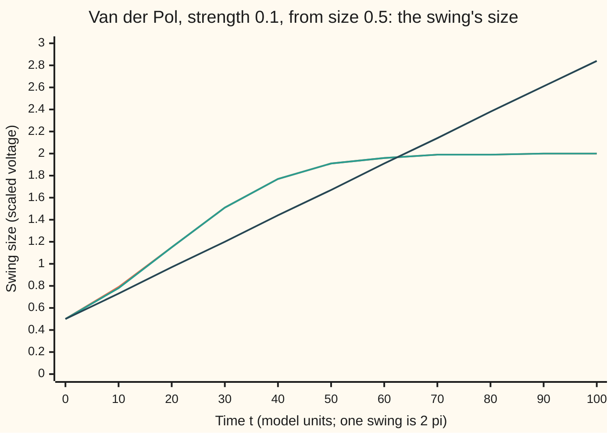

# Two-timing and averaging: let the amplitude drift slowly, and a weak nonlinearity becomes a simple equation for the swing's size

[Syllabus](../../../SYLLABUS.md) → [Differential equations and dynamics](../README.md) → [Rhythms and Synchronisation](../README.md#s13) → Two-timing and averaging

---

## General Overview

A signal generator makes its tone with an oscillator circuit. Switch it on and the swing starts small, grows, and settles at one fixed size. The van der Pol equation models that circuit. With weak feedback, strength 0.1, it reads $`x'' + 0.1(x^2 - 1)x' + x = 0`$.

Here $`x`$ is the scaled voltage and a dash means a rate in time. One time unit is one radian of the swing, so one swing takes $`2\pi`$ units. Start at size 0.5. The slow equation derived below predicts size 1.9 at $`t`$ = 49.33 (the full equation: 49.52), which is 7.85 swings. For a 1 kHz tone that is 7.85 ms.

Expanding in powers of 0.1 fails: it predicts a swing growing in a straight line forever, 2.84 at $`t`$ = 100, where the true swing is 2.00. Two-timing lets the size drift on a slow clock and keeps only the part of the force in step with the swing. The result is one short equation for the size: $`r' = 0.05\,r(1 - r^2/4)`$.

A stiffening spring, $`x'' + x + 0.1x^3 = 0`$, swung at size 1, runs at 1.0375 times its small-swing frequency.

**When a nonlinearity is weak, the motion is a sine wave whose size and timing drift slowly; averaging the weak force over one swing gives a simple equation for that drift, and solving it gives the swing's size and frequency at every time.**

**What kind of fact this is:** a method backed by a theorem. The slow equations are derived on this card. The averaging theorem says their error stays of order $`\varepsilon`$ (the weak force's strength, here 0.1) for times of order $`1/\varepsilon`$; it is stated here, proved in Guckenheimer and Holmes, chapter 4, and checked by the code against the full equation.

### The picture: three answers for the swing's size



Orange: peak heights of the full equation, stepped by Runge-Kutta. Green: the two-timing answer, on top of it. Dark blue: the naive expansion, climbing past 2.

---

## The formula

Write the weak oscillator as a spring plus a small extra force. The letter $`h`$ is that force's shape, $`\varepsilon`$ its strength:

```math
x'' + x = -\varepsilon\, h(x, x')
```

For van der Pol, $`h = (x^2 - 1)x'`$. For the stiffening spring (the Duffing equation), $`h = x^3`$.

Look for $`x = r\cos\theta`$ with $`\theta = t + \varphi`$, where the size $`r`$ and phase lag $`\varphi`$ drift slowly, at the weak force's average over one swing. Angle brackets mean that average, over $`\theta`$ from 0 to $`2\pi`$:

```math
r' = \varepsilon\,\langle h \sin\theta \rangle, \qquad r\,\varphi' = \varepsilon\,\langle h \cos\theta \rangle
```

**Read it aloud:** the size changes at the average rate the force pushes along the motion; the timing shifts at the average rate it pushes across it.

For van der Pol this becomes the slow amplitude equation and its solution:

```math
r' = \frac{\varepsilon}{2}\, r\left(1 - \frac{r^2}{4}\right), \qquad r(t) = \frac{2}{\sqrt{1 + \left(\frac{4}{r_0^{2}} - 1\right) e^{-\varepsilon t}}}
```

**Read it aloud:** the size grows at a rate proportional to itself while it is below 2 and shrinks above 2, and the gap to 2 fades like $`e^{-\varepsilon t}`$.

For Duffing at size $`a`$, the size stays fixed and the frequency rises:

```math
\omega = 1 + \frac{3\varepsilon a^2}{8}
```

| Symbol | Plain meaning | In our example | Push it up and the answer… |
| --- | --- | --- | --- |
| $`x`$, $`x'`$; $`x_0`$, $`x_1`$ | the swing and its rate; first guess and correction | $`x(0) = 0.5`$, $`x'(0) = 0`$ | — |
| $`t`$ or $`\tau`$; $`T`$; $`\partial_\tau`$, $`\partial_T`$ | fast time; slow time $`T = \varepsilon t`$; rate in one with the other held fixed | $`t`$ from 0 to 100 | — |
| $`\varepsilon`$ | strength of the weak force | 0.1 | faster settling, less accuracy |
| $`h`$ | shape of the weak force | $`(x^2 - 1)x'`$, or $`x^3`$ | — |
| $`r`$, $`r_0`$, $`r_T`$; $`u`$ | swing size; its start; its slow-time rate; $`u = 1/r^2`$ | 0.5 rising to 2 | a start above 2 shrinks to 2 |
| $`\theta`$, $`\varphi`$, $`\varphi_T`$ | angle round the swing; phase lag; its slow-time rate | $`\theta = t + \varphi`$ | — |
| $`\langle\ \rangle`$ | average over one swing | $`\langle \cos^4\theta \rangle = 3/8`$ | — |
| $`\omega`$, $`a`$ | Duffing frequency; a fixed swing size (naive guess, Duffing) | 1.0375 at $`a`$ = 1 | frequency rises with size squared |

### When it holds

- **A small strength.** Only the first power of $`\varepsilon`$ is kept: at 0.1 the full equation reaches 1.9 at 49.52, against 49.33. At large strength the van der Pol swing is jerky, not a sine wave, and the slow equation is wrong.
- **Times up to about $`1/\varepsilon`$.** Beyond that, neglected terms of size $`\varepsilon^2`$ can pile up; here the stable resting size keeps the size error small for all time; the timing error still creeps.
- **One natural frequency.** Two frequencies near a simple ratio must both be kept.
- **A smooth force.** A force with sudden jumps, like dry friction, needs care with the average.

---

## Why it works

### Step 0: a slow quantity only feels the average

The weak force changes the swing's size by about $`\varepsilon`$ of itself per swing. So the size cannot follow the force's ups and downs within a swing; it feels only their average.

### Step 1: the naive expansion grows a term that never stops

Write $`x = x_0 + \varepsilon x_1`$ with $`x_0 = a\cos t`$. The correction obeys $`x_1'' + x_1 = -h(x_0, x_0')`$. For van der Pol, using $`\cos^2 t\,\sin t = (\sin t + \sin 3t)/4`$:

```math
x_1'' + x_1 = \left(\frac{a^3}{4} - a\right)\sin t + \frac{a^3}{4}\sin 3t
```

The $`\sin t`$ term pushes at the spring's own frequency. That is resonance ([Resonance](../03-Oscillators%20-%20Second-Order%20Linear%20Equations/06-resonance-and-beats.md)): the response to $`\sin t`$ is $`-\tfrac{1}{2}\,t\cos t`$, which grows without end ([Undetermined coefficients](../03-Oscillators%20-%20Second-Order%20Linear%20Equations/05-undetermined-coefficients.md) gives the $`t`$ factor). A term growing like $`t`$ is called **secular**.

So the naive size grows by $`\varepsilon(a/2 - a^3/8)`$ per unit time: at $`a`$ = 0.5, by 0.0234375, and by $`t`$ = 100 it reads 2.84.

### Step 2: give the size and phase a slow clock

Use two times: fast $`\tau = t`$ for the swing, slow $`T = \varepsilon t`$ for the drift. A rate in $`t`$ becomes $`\partial_\tau + \varepsilon\,\partial_T`$, where $`\partial_\tau`$ means the rate in $`\tau`$ with $`T`$ held fixed.

The first guess becomes $`x_0 = r(T)\cos(\tau + \varphi(T))`$: a sine wave whose size and lag may drift. The terms of size $`\varepsilon`$ now give

```math
\partial_{\tau\tau} x_1 + x_1 = 2\,r_T \sin\theta + 2\,r\,\varphi_T \cos\theta - h(x_0, \partial_\tau x_0)
```

Here $`r_T`$ and $`\varphi_T`$ are rates in slow time. They enter through the cross rate, the middle term of $`(\partial_\tau + \varepsilon\partial_T)^2 = \partial_{\tau\tau} + 2\varepsilon\partial_\tau\partial_T + \varepsilon^2\partial_{TT}`$.

### Step 3: choose the drift so nothing resonates

Every $`\sin\theta`$ and $`\cos\theta`$ on the right drives a secular term, so choose $`r_T`$ and $`\varphi_T`$ to cancel them. For van der Pol, $`h = (r - r^3/4)\sin\theta - (r^3/4)\sin 3\theta`$, so

```math
2\,r_T = r - \frac{r^3}{4}, \qquad \varphi_T = 0
```

Back in fast time, $`r' = \varepsilon r_T`$: this is the slow amplitude equation. The $`\sin 3\theta`$ term only adds a small ripple.

<details>
<summary>The same equations by averaging, without a slow clock</summary>

Change variables exactly: $`x = r\cos\theta`$, $`x' = -r\sin\theta`$, with $`\theta = t + \varphi`$. Differentiate $`x`$ and require the $`r'`$ and $`\varphi'`$ terms to cancel. Then put $`x''`$ into $`x'' + x = -\varepsilon h`$. Solving the two linear equations for $`r'`$ and $`\varphi'`$ gives

$`\displaystyle r' = \varepsilon\, h \sin\theta, \qquad r\,\varphi' = \varepsilon\, h \cos\theta`$

This is exact. Both rates are small, so replace the right sides by their averages over $`\theta`$. For van der Pol, $`h\sin\theta = -r^3\cos^2\theta\sin^2\theta + r\sin^2\theta`$. With $`\langle\cos^2\theta\sin^2\theta\rangle = 1/8`$ and $`\langle\sin^2\theta\rangle = 1/2`$:

$`\displaystyle r' = \varepsilon\left(\frac{r}{2} - \frac{r^3}{8}\right) = \frac{\varepsilon}{2}\, r\left(1 - \frac{r^2}{4}\right)`$

The cosine average is of odd powers of $`\sin\theta`$, so it is zero and $`\varphi' = 0`$.

</details>

### Step 4: solve the slow equation

Put $`u = 1/r^2`$. The chain rule gives $`u' = -2r'/r^3 = -\varepsilon u + \varepsilon/4`$, a linear equation. So $`u - 1/4`$ shrinks by the factor $`e^{-\varepsilon t}`$, and $`r = 1/\sqrt{u}`$ is the closed form above.

Every start except 0 goes to size 2: the limit cycle of [Limit cycles](../06-Nonlinear%20Dynamics%20in%20the%20Plane/08-limit-cycles-and-van-der-pol.md) with a formula for how fast it is reached. The slow equation has the shape of the Hopf normal form from [The Hopf bifurcation](../06-Nonlinear%20Dynamics%20in%20the%20Plane/13-hopf-bifurcation.md): growth rate $`\varepsilon/2`$, cubic coefficient $`-\varepsilon/8`$, so the radius is $`\sqrt{(\varepsilon/2)/(\varepsilon/8)} = 2`$.

### Step 5: Duffing shifts the timing, not the size

For $`h = x^3`$, $`h = r^3\cos^3\theta = r^3(3\cos\theta + \cos 3\theta)/4`$. It has no $`\sin\theta`$ part, so $`r_T = 0`$: the size is fixed, as energy is conserved. The $`\cos\theta`$ part gives $`2r\varphi_T = 3r^3/4`$, so $`\varphi' = 3\varepsilon r^2/8`$.

The angle $`\theta = t + \varphi`$ then turns at $`1 + 3\varepsilon r^2/8`$: faster at larger size.

---

## Worked numbers, by hand

| Step | Arithmetic | Value |
| --- | --- | --- |
| drift at the start | 0.05 × 0.5 × (1 − 0.5²/4) | 0.0234375 per unit |
| resting size | drift is zero where 1 − r²/4 = 0 | 2 |
| start's offset | 4/0.5² − 1 | 15 |
| offset at size 1.9 | 4/1.9² − 1 | 0.10803 |
| time to reach 1.9 | ln(15 / 0.10803) / 0.1 | **49.33** |
| in swings, and at 1 kHz | 49.33 / 2π | 7.85 swings, 7.85 ms |
| full equation, by Runge-Kutta | peak heights reach 1.9 | 49.52 |
| Duffing frequency at size 1 | 1 + 0.1 × 3/8 | **1.0375** |
| full Duffing, by Runge-Kutta | peak-to-peak timing | 1.0367 |

Within 7.85 swings the swing nearly reaches size 2, as the full equation confirms.

### What breaks if you drop a piece

| Mistake | Comes out at | What went wrong |
| --- | --- | --- |
| Naive expansion, no slow clock | size 2.84 at t = 100, not 2.00 | The resonant term grows like t |
| $`\langle\cos^2\theta\sin^2\theta\rangle`$ taken as 1/2 × 1/2 | settles at 1.41, not 2 | The average of a product is not the product of averages: it is 1/8 |
| Dropping the 2 in $`2r_T`$ | reaches 1.9 at 24.67, not 49.33 | The cross rate $`2\partial_\tau\partial_T`$ has a factor 2 |
| Duffing shift taken as 3/4, not 3/8 | frequency 1.0750, not 1.0375 | The $`\cos\theta`$ part of $`\cos^3\theta`$ is 3/4, but it is divided by $`2r`$ |

---

## Code, from first principles, and it actually runs

Both scripts take two roads that share no formula. Road one steps the full equations by Runge-Kutta 4 ([Runge-Kutta four](../05-Numerical%20Evolution/04-runge-kutta-four.md)) and reads the size from the peak heights of $`x`$. Road two finds the drift by averaging $`h\sin\theta`$ over 360 points of one swing, steps it, and meets the closed form. Duffing's frequency is timed from peaks and compared with $`1 + 3\varepsilon/8`$.

### Python

```python
# Two-timing and averaging -- the check behind the card.  Only math is imported; RK4 and cycle
# averages are written out.  Road one: the full equations.  Road two: the slow amplitude law.
import math
EPS, R0, GOAL = 0.1, 0.5, 1.9
def rk4(f, p, h):
    k1 = f(p); k2 = f([p[i] + h / 2 * k1[i] for i in (0, 1)])
    k3 = f([p[i] + h / 2 * k2[i] for i in (0, 1)]); k4 = f([p[i] + h * k3[i] for i in (0, 1)])
    return [p[i] + h / 6 * (k1[i] + 2 * k2[i] + 2 * k3[i] + k4[i]) for i in (0, 1)]
vdp = lambda p: [p[1], -EPS * (p[0] ** 2 - 1) * p[1] - p[0]]     # x'' + 0.1(x^2 - 1)x' + x = 0
duf = lambda p: [p[1], -p[0] - EPS * p[0] ** 3]                  # x'' + x + 0.1 x^3 = 0
avg = lambda g, n=360: sum(g(2 * math.pi * (k + 0.5) / n) for k in range(n)) / n
h_vdp = lambda r, s: (r * r * math.cos(s) ** 2 - 1) * (-r * math.sin(s))   # h(x, x') on x = r cos s
drift = lambda r: EPS * avg(lambda s: h_vdp(r, s) * math.sin(s))           # r' = eps <h sin s>
law = lambda r: EPS / 2 * r * (1 - r * r / 4)
closed = lambda t: 2 / math.sqrt(1 + (4 / R0 ** 2 - 1) * math.exp(-EPS * t))
t_hit = lambda e=EPS: math.log((4 / R0 ** 2 - 1) / (4 / GOAL ** 2 - 1)) / e
def root(f, lo=1.0, hi=3.0):                        # bisection: where a drift falls to zero
    for _ in range(50): lo, hi = ((lo + hi) / 2, hi) if f((lo + hi) / 2) > 0 else (lo, (lo + hi) / 2)
    return lo
r, t, h = R0, 0.0, 0.01                             # road two: step r' = drift(r) to 1.9
while r < GOAL:
    k1 = drift(r); k2 = drift(r + h / 2 * k1); k3 = drift(r + h / 2 * k2); k4 = drift(r + h * k3)
    r_new = r + h / 6 * (k1 + 2 * k2 + 2 * k3 + k4)
    t, r = t + (h if r_new < GOAL else h * (GOAL - r) / (r_new - r)), r_new
def peaks(f, p, t_end, h):                          # times and heights of the maxima of x
    out, k = [(0.0, p[0])], 0
    while k * h < t_end:
        q = rk4(f, p, h); k += 1
        if p[1] > 0 >= q[1]: out.append(((k - 1 + p[1] / (p[1] - q[1])) * h, max(p[0], q[0])))
        p = q
    return out
def cross(pk, i, v):                                # where the line between peaks hits value v
    (a, x), (b, y) = next((u, w) for u, w in zip(pk, pk[1:]) if w[i] >= v)
    return (x + (y - x) * (v - a) / (b - a)) if i == 0 else a + (b - a) * (v - x) / (y - x)
pk = peaks(vdp, [R0, 0.0], 110, 0.001)              # road one: the full van der Pol law
full, t_full = [cross(pk, 0, t) for t in range(0, 101, 10)], cross(pk, 1, GOAL)
ups = [t for t, _ in peaks(duf, [1.0, 0.0], 62, 0.001)]
w_rk = 2 * math.pi * (len(ups) - 1) / (ups[-1] - ups[0])
c4 = avg(lambda s: math.cos(s) ** 4)                # r phi' = eps <h cos s>, h = r^3 cos^3 s
wrong = root(lambda r: EPS * (-r) * (r * r / 4 - 1 / 2))   # <cos^2 sin^2> taken as 1/2 x 1/2
print(f"averaged drift at r = 0.5: by quadrature {drift(R0):.7f}, by 0.05 r(1 - r^2/4) {law(R0):.7f}")
print(f"drift is zero at r = {root(drift):.4f}: every start settles at amplitude 2")
print(f"closed form: 4/0.5^2 - 1 = {4 / R0 ** 2 - 1:.0f}, 4/1.9^2 - 1 = {4 / GOAL ** 2 - 1:.5f}; r = 1.9 at t = {t_hit():.2f}")
print(f"stepping the averaged law: r = 1.9 at t = {t:.2f}")
print(f"full law by RK4: peak height reaches 1.9 at t = {t_full:.2f}; peak at t = 100: {full[-1]:.4f}")
print(f"t = {t_hit():.2f} is {t_hit() / (2 * math.pi):.2f} swings; at 1 kHz, {t_hit() / (2 * math.pi):.2f} ms")
print(f"naive expansion: amplitude 0.5 + {law(R0):.7f} t, at t = 100: {R0 + 100 * law(R0):.2f}")
print(f"Duffing at amplitude 1: averaging 1 + 0.1 x {c4:.4f} = {1 + EPS * c4:.4f}; RK4 {w_rk:.4f}")
print("chart t:", list(range(0, 101, 10)))
print("chart full law:", " ".join(f"{a:.2f}" for a in full))
print("chart averaged:", " ".join(f"{closed(t):.2f}" for t in range(0, 101, 10)))
print("chart naive:", " ".join(f"{R0 + t * law(R0):.2f}" for t in range(0, 101, 10)))
print(f"mistake 1, <cos^2 sin^2> taken as 1/2 x 1/2: settles at {wrong:.2f}, not 2")
print(f"mistake 2, dropping the 1/2 in r': r = 1.9 at t = {t_hit(2 * EPS):.2f}, not {t_hit():.2f}")
print(f"mistake 3, Duffing shift 3/4 instead of 3/8: frequency {1 + 2 * c4 * EPS:.4f}, not {1 + EPS * c4:.4f}")
assert abs(drift(R0) - law(R0)) < 1e-12 and abs(root(drift) - 2) < 1e-9   # quadrature meets formula
assert abs(t - t_hit()) < 0.01 and abs(t_hit() - 49.33) < 0.005 and abs(closed(t) - GOAL) < 1e-3   # stepping meets closed form
assert abs(t_full - t_hit()) < 0.5 and abs(full[-1] - 2) < 0.01            # full law follows slow law
assert abs(w_rk - (1 + EPS * c4)) < 0.002 and abs(c4 - 3 / 8) < 1e-12      # Duffing: RK4 meets averaging
print("ALL CHECKS PASS")
```

**Ran 2026-11-23 on macOS, Python 3.14.10, standard library only. All checks passed. Output, pasted from the run:**

```
averaged drift at r = 0.5: by quadrature 0.0234375, by 0.05 r(1 - r^2/4) 0.0234375
drift is zero at r = 2.0000: every start settles at amplitude 2
closed form: 4/0.5^2 - 1 = 15, 4/1.9^2 - 1 = 0.10803; r = 1.9 at t = 49.33
stepping the averaged law: r = 1.9 at t = 49.33
full law by RK4: peak height reaches 1.9 at t = 49.52; peak at t = 100: 1.9994
t = 49.33 is 7.85 swings; at 1 kHz, 7.85 ms
naive expansion: amplitude 0.5 + 0.0234375 t, at t = 100: 2.84
Duffing at amplitude 1: averaging 1 + 0.1 x 0.3750 = 1.0375; RK4 1.0367
chart t: [0, 10, 20, 30, 40, 50, 60, 70, 80, 90, 100]
chart full law: 0.50 0.79 1.15 1.51 1.77 1.91 1.96 1.99 1.99 2.00 2.00
chart averaged: 0.50 0.78 1.15 1.51 1.77 1.91 1.96 1.99 1.99 2.00 2.00
chart naive: 0.50 0.73 0.97 1.20 1.44 1.67 1.91 2.14 2.38 2.61 2.84
mistake 1, <cos^2 sin^2> taken as 1/2 x 1/2: settles at 1.41, not 2
mistake 2, dropping the 1/2 in r': r = 1.9 at t = 24.67, not 49.33
mistake 3, Duffing shift 3/4 instead of 3/8: frequency 1.0750, not 1.0375
ALL CHECKS PASS
```

### Rust

Same labels, built with `rustc --edition 2021 -O`.

```rust
// Two-timing and averaging -- the same check as the Python, in Rust, std only.  RK4 and cycle
// averages are written out.  Road one: the full equations.  Road two: the slow amplitude law.
use std::f64::consts::PI;
type P = [f64; 2];
const EPS: f64 = 0.1; const R0: f64 = 0.5; const GOAL: f64 = 1.9;
fn rk4(f: &dyn Fn(P) -> P, p: P, h: f64) -> P {
    let k1 = f(p); let k2 = f([p[0] + h / 2.0 * k1[0], p[1] + h / 2.0 * k1[1]]);
    let k3 = f([p[0] + h / 2.0 * k2[0], p[1] + h / 2.0 * k2[1]]); let k4 = f([p[0] + h * k3[0], p[1] + h * k3[1]]);
    [0, 1].map(|i| p[i] + h / 6.0 * (k1[i] + 2.0 * k2[i] + 2.0 * k3[i] + k4[i]))
}
fn vdp(p: P) -> P { [p[1], -EPS * (p[0] * p[0] - 1.0) * p[1] - p[0]] }   // x'' + 0.1(x^2 - 1)x' + x = 0
fn duf(p: P) -> P { [p[1], -p[0] - EPS * p[0].powi(3)] }                // x'' + x + 0.1 x^3 = 0
fn avg(g: &dyn Fn(f64) -> f64) -> f64 { (0..360).map(|k| g(2.0 * PI * (k as f64 + 0.5) / 360.0)).sum::<f64>() / 360.0 }
fn h_vdp(r: f64, s: f64) -> f64 { (r * r * s.cos().powi(2) - 1.0) * (-r * s.sin()) }   // h(x, x') on x = r cos s
fn drift(r: f64) -> f64 { EPS * avg(&|s| h_vdp(r, s) * s.sin()) }                       // r' = eps <h sin s>
fn law(r: f64) -> f64 { EPS / 2.0 * r * (1.0 - r * r / 4.0) }
fn closed(t: f64) -> f64 { 2.0 / (1.0 + (4.0 / (R0 * R0) - 1.0) * (-EPS * t).exp()).sqrt() }
fn t_hit(e: f64) -> f64 { ((4.0 / (R0 * R0) - 1.0) / (4.0 / (GOAL * GOAL) - 1.0)).ln() / e }
fn root(f: &dyn Fn(f64) -> f64) -> f64 {           // bisection: where a drift falls to zero
    let (mut lo, mut hi) = (1.0, 3.0);
    for _ in 0..50 { let m = (lo + hi) / 2.0; if f(m) > 0.0 { lo = m } else { hi = m } }
    lo
}
fn peaks(f: &dyn Fn(P) -> P, mut p: P, t_end: f64, h: f64) -> Vec<(f64, f64)> {   // maxima of x
    let (mut out, mut k) = (vec![(0.0, p[0])], 0usize);
    while (k as f64) * h < t_end {
        let q = rk4(f, p, h); k += 1;
        if p[1] > 0.0 && q[1] <= 0.0 { out.push((((k - 1) as f64 + p[1] / (p[1] - q[1])) * h, p[0].max(q[0]))) }
        p = q;
    }
    out
}
fn cross(pk: &[(f64, f64)], i: usize, v: f64) -> f64 {   // where the line between peaks hits value v
    let j = (1..pk.len()).find(|&j| if i == 0 { pk[j].0 >= v } else { pk[j].1 >= v }).unwrap();
    let ((a, x), (b, y)) = (pk[j - 1], pk[j]);
    if i == 0 { x + (y - x) * (v - a) / (b - a) } else { a + (b - a) * (v - x) / (y - x) }
}
fn line(v: &[f64]) -> String { v.iter().map(|a| format!("{:.2}", a)).collect::<Vec<_>>().join(" ") }
fn main() {
    let (mut r, mut t, h) = (R0, 0.0f64, 0.01);     // road two: step r' = drift(r) to 1.9
    while r < GOAL {
        let k1 = drift(r); let k2 = drift(r + h / 2.0 * k1); let k3 = drift(r + h / 2.0 * k2); let k4 = drift(r + h * k3);
        let r_new = r + h / 6.0 * (k1 + 2.0 * k2 + 2.0 * k3 + k4);
        t += if r_new < GOAL { h } else { h * (GOAL - r) / (r_new - r) }; r = r_new;
    }
    let pk = peaks(&vdp, [R0, 0.0], 110.0, 0.001);  // road one: the full van der Pol law
    let ts: Vec<f64> = (0..11).map(|k| 10.0 * k as f64).collect();
    let full: Vec<f64> = ts.iter().map(|&s| cross(&pk, 0, s)).collect();
    let t_full = cross(&pk, 1, GOAL);
    let ups: Vec<f64> = peaks(&duf, [1.0, 0.0], 62.0, 0.001).iter().map(|u| u.0).collect();
    let w_rk = 2.0 * PI * (ups.len() - 1) as f64 / (ups[ups.len() - 1] - ups[0]);
    let c4 = avg(&|s| s.cos().powi(4));              // r phi' = eps <h cos s>, h = r^3 cos^3 s
    let wrong = root(&|r| EPS * (-r) * (r * r / 4.0 - 0.5));   // <cos^2 sin^2> taken as 1/2 x 1/2
    let th = t_hit(EPS);
    println!("averaged drift at r = 0.5: by quadrature {:.7}, by 0.05 r(1 - r^2/4) {:.7}", drift(R0), law(R0));
    println!("drift is zero at r = {:.4}: every start settles at amplitude 2", root(&drift));
    println!("closed form: 4/0.5^2 - 1 = {:.0}, 4/1.9^2 - 1 = {:.5}; r = 1.9 at t = {:.2}", 4.0 / (R0 * R0) - 1.0, 4.0 / (GOAL * GOAL) - 1.0, th);
    println!("stepping the averaged law: r = 1.9 at t = {:.2}", t);
    println!("full law by RK4: peak height reaches 1.9 at t = {:.2}; peak at t = 100: {:.4}", t_full, full[10]);
    println!("t = {:.2} is {:.2} swings; at 1 kHz, {:.2} ms", th, th / (2.0 * PI), th / (2.0 * PI));
    println!("naive expansion: amplitude 0.5 + {:.7} t, at t = 100: {:.2}", law(R0), R0 + 100.0 * law(R0));
    println!("Duffing at amplitude 1: averaging 1 + 0.1 x {:.4} = {:.4}; RK4 {:.4}", c4, 1.0 + EPS * c4, w_rk);
    println!("chart t: [0, 10, 20, 30, 40, 50, 60, 70, 80, 90, 100]");
    println!("chart full law: {}", line(&full));
    println!("chart averaged: {}", line(&ts.iter().map(|&s| closed(s)).collect::<Vec<_>>()));
    println!("chart naive: {}", line(&ts.iter().map(|&s| R0 + s * law(R0)).collect::<Vec<_>>()));
    println!("mistake 1, <cos^2 sin^2> taken as 1/2 x 1/2: settles at {:.2}, not 2", wrong);
    println!("mistake 2, dropping the 1/2 in r': r = 1.9 at t = {:.2}, not {:.2}", t_hit(2.0 * EPS), th);
    println!("mistake 3, Duffing shift 3/4 instead of 3/8: frequency {:.4}, not {:.4}", 1.0 + 2.0 * c4 * EPS, 1.0 + EPS * c4);
    assert!((drift(R0) - law(R0)).abs() < 1e-12 && (root(&drift) - 2.0).abs() < 1e-9);   // quadrature meets formula
    assert!((t - th).abs() < 0.01 && (th - 49.33).abs() < 0.005 && (closed(t) - GOAL).abs() < 1e-3);   // stepping meets closed form
    assert!((t_full - th).abs() < 0.5 && (full[10] - 2.0).abs() < 0.01);                  // full law follows slow law
    assert!((w_rk - (1.0 + EPS * c4)).abs() < 0.002 && (c4 - 0.375).abs() < 1e-12);       // Duffing: RK4 meets averaging
    println!("ALL CHECKS PASS");
}
```

**Ran 2026-11-23 on macOS, rustc 1.98.1, no crates. All checks passed. Output, pasted from the run:**

```
averaged drift at r = 0.5: by quadrature 0.0234375, by 0.05 r(1 - r^2/4) 0.0234375
drift is zero at r = 2.0000: every start settles at amplitude 2
closed form: 4/0.5^2 - 1 = 15, 4/1.9^2 - 1 = 0.10803; r = 1.9 at t = 49.33
stepping the averaged law: r = 1.9 at t = 49.33
full law by RK4: peak height reaches 1.9 at t = 49.52; peak at t = 100: 1.9994
t = 49.33 is 7.85 swings; at 1 kHz, 7.85 ms
naive expansion: amplitude 0.5 + 0.0234375 t, at t = 100: 2.84
Duffing at amplitude 1: averaging 1 + 0.1 x 0.3750 = 1.0375; RK4 1.0367
chart t: [0, 10, 20, 30, 40, 50, 60, 70, 80, 90, 100]
chart full law: 0.50 0.79 1.15 1.51 1.77 1.91 1.96 1.99 1.99 2.00 2.00
chart averaged: 0.50 0.78 1.15 1.51 1.77 1.91 1.96 1.99 1.99 2.00 2.00
chart naive: 0.50 0.73 0.97 1.20 1.44 1.67 1.91 2.14 2.38 2.61 2.84
mistake 1, <cos^2 sin^2> taken as 1/2 x 1/2: settles at 1.41, not 2
mistake 2, dropping the 1/2 in r': r = 1.9 at t = 24.67, not 49.33
mistake 3, Duffing shift 3/4 instead of 3/8: frequency 1.0750, not 1.0375
ALL CHECKS PASS
```

### Lean

Lean proves the closed form for every strength and start above 0, and the one-swing averages for every size and strength.

- Take strength $`\varepsilon`$ > 0 and start $`r_0`$ > 0. Then the closed form starts at $`r_0`$ and solves the slow amplitude equation at every time $`t \ge 0`$.
- As $`t`$ grows, the closed form tends to 2: every start above 0 settles at size 2.
- Take van der Pol's $`h = (x^2 - 1)x'`$ on the sine wave $`x = r\cos\theta`$. Then $`\varepsilon\langle h\sin\theta\rangle`$ is exactly the right side of the slow amplitude equation.
- Take the same van der Pol force. Then $`\langle h\cos\theta\rangle = 0`$ exactly, so the phase lag does not drift.
- Take Duffing's $`h = x^3`$ on the sine wave $`x = a\cos\theta`$. Then $`\langle h\sin\theta\rangle = 0`$, so the size stays fixed.
- Take the same Duffing force. Then $`\varepsilon\langle h\cos\theta\rangle = 3\varepsilon a^3/8`$, so the phase lag drifts at $`3\varepsilon a^2/8`$.
- The hand numbers hold exactly: drift 0.0234375, resting size 2, offset 15, Hopf radius 2, Duffing 1.0375, and the mistaken 1.0750.

The averaging theorem itself, the time 49.33 and the Runge-Kutta runs are left to the Python and Rust checks.

```lean
-- Two-timing and averaging: the closed form solves van der Pol's slow amplitude equation and tends to 2, and the one-swing averages give the van der Pol drift and the Duffing frequency shift exactly.
import Mathlib.Analysis.SpecialFunctions.Sqrt
import Mathlib.Analysis.SpecialFunctions.ExpDeriv
import Mathlib.Analysis.SpecialFunctions.Integrals.Basic
import Mathlib.Tactic.NormNum
import Mathlib.Tactic.Ring

open Real Filter Topology

lemma sin_four_mul_two_pi : Real.sin (4 * (2 * π)) = 0 := by
  have : 4 * (2 * π) = ((8 : ℕ) : ℝ) * π := by push_cast; ring
  rw [this, Real.sin_nat_mul_pi]

#print axioms sin_four_mul_two_pi

lemma integral_sin_mul_cos_cube_two_pi :
    ∫ θ in (0 : ℝ)..2 * π, Real.sin θ * Real.cos θ ^ 3 = 0 := by
  have := integral_sin_pow_odd_mul_cos_pow (a := 0) (b := 2 * π) 0 3
  simp only [Nat.mul_zero, zero_add, pow_one] at this
  rw [this, Real.cos_two_pi, Real.cos_zero, intervalIntegral.integral_same]

#print axioms integral_sin_mul_cos_cube_two_pi

lemma integral_cos_four_two_pi :
    ∫ θ in (0 : ℝ)..2 * π, Real.cos θ ^ 4 = 3 * π / 4 := by
  have := integral_cos_pow (a := 0) (b := 2 * π) (n := 2)
  norm_num at this
  rw [this]; ring

#print axioms integral_cos_four_two_pi

/-- The card's slow amplitude law for van der Pol: for a positive strength `ε` and a
positive starting size `r₀`, the closed form
`r(t) = 2 / √(1 + (4/r₀² - 1) e^(-ε t))` starts at `r₀`, solves the slow equation
`r' = (ε/2) r (1 - r²/4)` at every time `t ≥ 0`, and tends to size 2 as `t` grows:
every start other than 0 settles at amplitude 2. -/
theorem vdp_slow_amplitude_closed_form (ε r₀ : ℝ) (hε : 0 < ε) (hr₀ : 0 < r₀)
    (r : ℝ → ℝ)
    (hr : ∀ t, r t = 2 / Real.sqrt (1 + (4 / r₀ ^ 2 - 1) * Real.exp (-ε * t))) :
    r 0 = r₀ ∧
      (∀ t, 0 ≤ t → HasDerivAt r (ε / 2 * r t * (1 - r t ^ 2 / 4)) t) ∧
      Tendsto r atTop (𝓝 2) := by
  have hfun : r = fun t => 2 / Real.sqrt (1 + (4 / r₀ ^ 2 - 1) * Real.exp (-ε * t)) :=
    funext hr
  set c := 4 / r₀ ^ 2 - 1 with hc
  refine ⟨?_, ?_, ?_⟩
  · rw [hr]
    have h1 : 1 + c * Real.exp (-ε * 0) = (2 / r₀) ^ 2 := by
      rw [hc]; simp; field_simp; ring
    rw [h1, Real.sqrt_sq (by positivity)]
    field_simp
  · intro t ht
    have he : Real.exp (-ε * t) ≤ 1 := Real.exp_le_one_iff.mpr (by nlinarith)
    have hepos := Real.exp_pos (-ε * t)
    have h4 : 0 < 4 / r₀ ^ 2 := by positivity
    have hu : 0 < 1 + c * Real.exp (-ε * t) := by
      rw [hc]; nlinarith
    have h0 : HasDerivAt (fun t => Real.exp (-ε * t)) (Real.exp (-ε * t) * (-ε * 1)) t :=
      ((hasDerivAt_id t).const_mul (-ε)).exp
    have h1 : HasDerivAt (fun t => 1 + c * Real.exp (-ε * t))
        (c * (Real.exp (-ε * t) * (-ε * 1))) t :=
      (h0.const_mul c).const_add 1
    have h2 := h1.sqrt hu.ne'
    have hs : 0 < Real.sqrt (1 + c * Real.exp (-ε * t)) := Real.sqrt_pos.mpr hu
    have h3 := (hasDerivAt_const t (2 : ℝ)).div h2 hs.ne'
    rw [hr t, hfun]
    convert h3 using 1
    have hs2 := Real.sq_sqrt hu.le
    set s := Real.sqrt (1 + c * Real.exp (-ε * t))
    set e := Real.exp (-ε * t)
    field_simp
    rw [hs2]
    ring
  · have h0 : Tendsto (fun t => Real.exp (-ε * t)) atTop (𝓝 0) := by
      apply Real.tendsto_exp_atBot.comp
      exact tendsto_id.const_mul_atTop_of_neg (by linarith)
    have h1 : Tendsto (fun t => 1 + c * Real.exp (-ε * t)) atTop (𝓝 (1 + c * 0)) :=
      tendsto_const_nhds.add (tendsto_const_nhds.mul h0)
    rw [mul_zero, add_zero] at h1
    have h2 := h1.sqrt
    rw [Real.sqrt_one] at h2
    have h3 := (tendsto_const_nhds (x := (2 : ℝ))).div h2 one_ne_zero
    rw [div_one] at h3
    rw [hfun]
    exact h3

/-- The card's averaging step for van der Pol: with `h = (x² - 1) x'` on the sine wave
`x = r cos θ`, `x' = -r sin θ`, the size rate `ε ⟨h sin θ⟩` (the average over one swing,
`θ` from 0 to `2π`) is exactly `(ε/2) r (1 - r²/4)`, and the timing rate `ε ⟨h cos θ⟩`
is exactly 0, so the phase lag does not drift. -/
theorem vdp_averaged_rates (ε r : ℝ) :
    ε * ((1 / (2 * π)) *
        ∫ θ in (0 : ℝ)..2 * π, ((r * cos θ) ^ 2 - 1) * (-r * sin θ) * sin θ)
        = ε / 2 * r * (1 - r ^ 2 / 4) ∧
      ε * ((1 / (2 * π)) *
        ∫ θ in (0 : ℝ)..2 * π, ((r * cos θ) ^ 2 - 1) * (-r * sin θ) * cos θ) = 0 := by
  have hpi : π ≠ 0 := Real.pi_ne_zero
  constructor
  · have hf : (fun θ => ((r * cos θ) ^ 2 - 1) * (-r * sin θ) * sin θ)
        = fun θ => r * sin θ ^ 2 - r ^ 3 * (sin θ ^ 2 * cos θ ^ 2) := by
      funext θ; ring
    rw [hf, intervalIntegral.integral_sub, intervalIntegral.integral_const_mul,
      intervalIntegral.integral_const_mul, integral_sin_sq, integral_sin_sq_mul_cos_sq,
      sin_four_mul_two_pi]
    · simp
      field_simp
      ring
    · apply Continuous.intervalIntegrable; fun_prop
    · apply Continuous.intervalIntegrable; fun_prop
  · have hf : (fun θ => ((r * cos θ) ^ 2 - 1) * (-r * sin θ) * cos θ)
        = fun θ => r * (sin θ * cos θ) - r ^ 3 * (sin θ * cos θ ^ 3) := by
      funext θ; ring
    rw [hf, intervalIntegral.integral_sub, intervalIntegral.integral_const_mul,
      intervalIntegral.integral_const_mul, integral_sin_mul_cos₁,
      integral_sin_mul_cos_cube_two_pi]
    · simp
    · apply Continuous.intervalIntegrable; fun_prop
    · apply Continuous.intervalIntegrable; fun_prop

/-- The card's Duffing step: with `h = x³` on the sine wave `x = a cos θ`, the size rate
`ε ⟨h sin θ⟩` is 0 (the size stays fixed), and the timing rate `ε ⟨h cos θ⟩` equals
`a · (3 ε a² / 8)`, so the phase lag drifts at `3 ε a² / 8` and the swing runs at
frequency `1 + 3 ε a² / 8`. -/
theorem duffing_averaged_rates (ε a : ℝ) :
    ε * ((1 / (2 * π)) * ∫ θ in (0 : ℝ)..2 * π, (a * cos θ) ^ 3 * sin θ) = 0 ∧
      ε * ((1 / (2 * π)) * ∫ θ in (0 : ℝ)..2 * π, (a * cos θ) ^ 3 * cos θ)
        = a * (3 * ε * a ^ 2 / 8) := by
  have hpi : π ≠ 0 := Real.pi_ne_zero
  constructor
  · have hf : (fun θ => (a * cos θ) ^ 3 * sin θ)
        = fun θ => a ^ 3 * (sin θ * cos θ ^ 3) := by
      funext θ; ring
    rw [hf, intervalIntegral.integral_const_mul, integral_sin_mul_cos_cube_two_pi]
    simp
  · have hf : (fun θ => (a * cos θ) ^ 3 * cos θ)
        = fun θ => a ^ 3 * cos θ ^ 4 := by
      funext θ; ring
    rw [hf, intervalIntegral.integral_const_mul, integral_cos_four_two_pi]
    field_simp
    ring

-- Worked numbers from the card (strength 1/10, start 1/2).
-- Drift at the start: 0.05 × 0.5 × (1 - 0.5²/4) = 3/128 = 0.0234375.
example : (1 / 10 : ℚ) / 2 * (1 / 2) * (1 - (1 / 2) ^ 2 / 4) = 3 / 128 := by norm_num
-- Resting size: the drift factor 1 - r²/4 is zero at r = 2.
example : (1 : ℚ) - 2 ^ 2 / 4 = 0 := by norm_num
-- The start's offset: 4/0.5² - 1 = 15.
example : (4 : ℚ) / (1 / 2) ^ 2 - 1 = 15 := by norm_num
-- Hopf normal form: growth ε/2 over cubic ε/8 is 4, so the radius is 2.
example (ε : ℚ) (hε : ε ≠ 0) : (ε / 2) / (ε / 8) = 2 ^ 2 := by field_simp; norm_num
-- Duffing at size 1: 1 + 0.1 × 3/8 = 1.0375 = 83/80.
example : (1 : ℚ) + 1 / 10 * 3 / 8 = 83 / 80 := by norm_num
-- Mistake 3: shift 3/4 instead of 3/8 gives 1.075 = 43/40.
example : (1 : ℚ) + 1 / 10 * 3 / 4 = 43 / 40 := by norm_num

#print axioms vdp_slow_amplitude_closed_form
#print axioms vdp_averaged_rates
#print axioms duffing_averaged_rates
```

**Checked 2026-11-23 on macOS, Lean 4.36.0-rc2, Mathlib v4.36.0-rc2. Every proof is complete and uses only Lean's standard axioms. Output, pasted from the run:**

```
'sin_four_mul_two_pi' depends on axioms: [propext, Classical.choice, Quot.sound]
'integral_sin_mul_cos_cube_two_pi' depends on axioms: [propext, Classical.choice, Quot.sound]
'integral_cos_four_two_pi' depends on axioms: [propext, Classical.choice, Quot.sound]
'vdp_slow_amplitude_closed_form' depends on axioms: [propext, Classical.choice, Quot.sound]
'vdp_averaged_rates' depends on axioms: [propext, Classical.choice, Quot.sound]
'duffing_averaged_rates' depends on axioms: [propext, Classical.choice, Quot.sound]
```

> [!TIP]
> **Try changing**
> Guess first, then run it.
> - **Double the strength.** Set `EPS` to 0.2. Guess: the time to 1.9 halves to 24.67, and the full equation gives 24.81. The second assert stops it.
> - **Swing Duffing wider.** Start Duffing at `[2.0, 0.0]`. Averaging predicts 1 + 0.1 × 3 × 4/8 = 1.15; Runge-Kutta gives 1.1389. The fourth assert stops it.
> - **Change the feedback threshold.** In `h_vdp`, change `- 1` to `- 2`. Guess: the resting size becomes √8 = 2.8284. The first assert stops it.

---

## The usual mistake

> [!warning]
> **Trusting the naive expansion because it starts well.** Its first few swings match the true motion. Its error then grows like $`\varepsilon t`$, and by $`t`$ = 100 it predicts 2.84 where the swing is 2.00. Any term that pushes at the natural frequency must be removed by letting the size or phase drift.
>
> - **Averaging a product as a product of averages.** $`\langle\cos^2\theta\sin^2\theta\rangle`$ is 1/8, not 1/4. The wrong value puts the resting size at 1.41.
> - **Losing the factor 2 from the cross rate.** It doubles every slow rate: 1.9 reached at 24.67 instead of 49.33.
> - **Reading the $`\cos^3\theta`$ coefficient as the frequency shift.** The shift is 3/8 of $`\varepsilon a^2`$, not 3/4: 1.0375, not 1.0750.

---

## Where you meet it in real life

- **Electronic oscillators.** Signal generators and transmitters settle at a swing set by their feedback; the slow equation predicts it and the start-up time.
- **Lasers.** Laser light grows from noise and saturates, by a slow equation of the same shape, averaged over the light's fast cycle.
- **Stiffening mounts and beams.** Rubber mounts and thin beams stiffen as they bend, so their frequency rises with amplitude; $`1 + 3\varepsilon a^2/8`$ keeps a mount clear of a motor's frequency.

> **Say it back**
> A weak force on a spring makes a nearly sinusoidal swing whose size and timing drift slowly. A naive expansion grows forever, because part of the force pushes at the spring's own frequency. Letting size and phase drift on a slow time to cancel that push gives the slow equations; averaging over one swing gives the same ones. For van der Pol the size obeys $`r' = 0.05\,r(1 - r^2/4)`$ and goes to 2, reaching 1.9 at 49.33. For Duffing the size stays fixed and the frequency rises to 1.0375 at size 1.

---

## What this builds on

- [Limit cycles](../06-Nonlinear%20Dynamics%20in%20the%20Plane/08-limit-cycles-and-van-der-pol.md): the van der Pol rhythm, here given a formula for its approach.
- [Resonance](../03-Oscillators%20-%20Second-Order%20Linear%20Equations/06-resonance-and-beats.md): a push at the natural frequency gives a swing growing like $`t`$, the source of the secular term.
- [Complex roots](../03-Oscillators%20-%20Second-Order%20Linear%20Equations/03-complex-roots-and-damped-oscillation.md): the sine wave $`r\cos(t + \varphi)`$ being disturbed.
- [Undetermined coefficients](../03-Oscillators%20-%20Second-Order%20Linear%20Equations/05-undetermined-coefficients.md): the extra factor $`t`$ in the response to a resonant term.
- [The Hopf bifurcation](../06-Nonlinear%20Dynamics%20in%20the%20Plane/13-hopf-bifurcation.md): the normal form, a linear growth plus a cubic brake, that the slow equation turns out to match.

## Where this goes next

- [Phase locking](02-flows-on-the-circle-and-phase-locking.md): averaging two weakly coupled rhythms leaves one slow equation for their phase gap, which locks or slips.
- [The Kuramoto model](03-the-kuramoto-model.md): the same phase equation for a crowd of rhythms falling into step.
- [Delay equations](04-delay-differential-equations.md): a different cause of oscillation, a delayed feedback.
- [Regular perturbation](../../13-Engineering%20mathematics/01-Units%20and%20Modelling/05-regular-perturbation.md): the Lindstedt-Poincaré method, which stretches the time axis to correct the frequency.

The question this card leaves open: what happens when two rhythms pull on each other's phase?

---

## Sources

Verified 2026-11-23: every link below resolves to the publisher's page.

- Strogatz, Steven H. *Nonlinear Dynamics and Chaos*, 3rd ed. CRC Press, 2024. [Publisher page](https://www.routledge.com/Nonlinear-Dynamics-and-Chaos-With-Applications-to-Physics-Biology-Chemistry-and-Engineering/Strogatz/p/book/9780367026509). Section 7.6 derives the two-timing and averaged equations for van der Pol and Duffing.
- Guckenheimer, John, and Philip Holmes. *Nonlinear Oscillations, Dynamical Systems, and Bifurcations of Vector Fields*. Springer, 1983. [DOI 10.1007/978-1-4612-1140-2](https://doi.org/10.1007/978-1-4612-1140-2). Chapter 4 states and proves the averaging theorem.
- van der Pol, Balthasar. "On relaxation-oscillations." *Philosophical Magazine* 2 (1926). [DOI 10.1080/14786442608564127](https://doi.org/10.1080/14786442608564127). The original paper on the equation and its settled amplitude.
