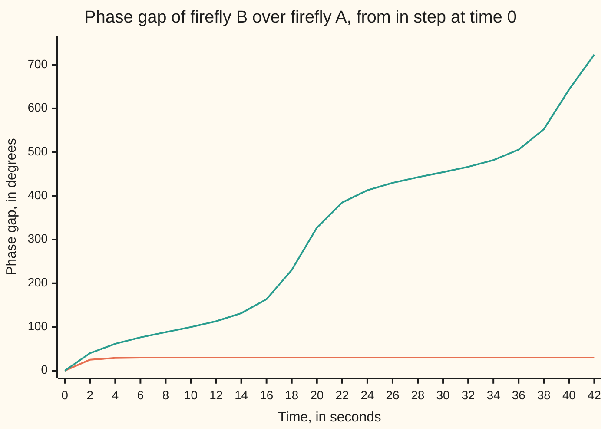
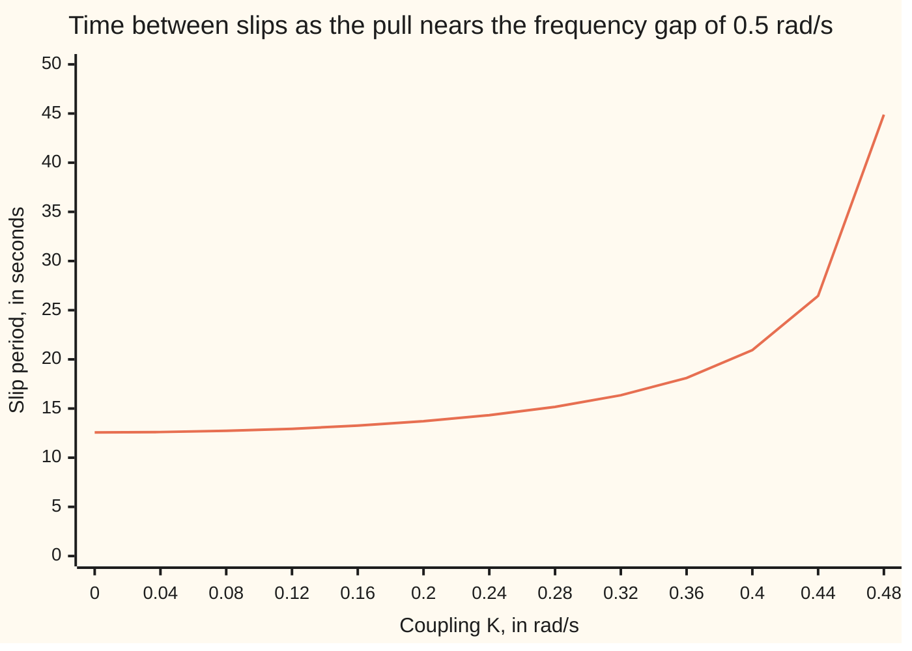

# Phase locking: a rhythm pulled by another either locks at a fixed lag or slips, and the slips get rarer near the edge

[Syllabus](../../../SYLLABUS.md) → [Differential equations and dynamics](../README.md) → [Rhythms and Synchronisation](../README.md#s13) → Phase locking

---

## General Overview

Two fireflies sit on one branch. Alone, A flashes every 1.047 s and B every 0.967 s: rhythms of 6.0 and 6.5 rad/s (radians of the cycle per second; a cycle is 2π radians), a gap of 0.5 rad/s. Each flash nudges the other's timing.

With a strong pull, both settle on a flash every 1.005 s, B always 30 degrees of the cycle (0.0838 s) ahead. With a weaker pull, B looks nearly in step for long stretches, then pulls a whole cycle ahead in a rush: a **slip**.

One number decides it: the **phase gap**, how far B is ahead of A around the cycle. It lives on a circle, because a gap of 360 degrees looks the same as 0.

**A rhythm pulled by another has a phase gap that obeys one equation on a circle: if the pull is at least the frequency gap, the gap settles at a fixed lag; if not, it slips once every 2π divided by the square root of (gap² − pull²), a time that grows without bound as the pull nears the edge.**

**What kind of fact this is:** a theorem about Adler's equation, proved in Why it works; the equation itself is a model of weakly coupled rhythms.

### The picture: one pull locks, one pull slips



The flat orange line is pull strength $`K = 1`$: the gap climbs to 30 degrees and stays. The green staircase is pull strength $`K = 0.4`$: the gap creeps through the 90-degree region, then jumps a whole cycle.

---

## The formula

A dash means a rate: $`\varphi'`$ is how fast the gap $`\varphi`$ changes, in rad/s. The phase gap obeys **Adler's equation**:

```math
\varphi' = \omega - K \sin\varphi
```

**Read it aloud:** the gap grows at the frequency gap, minus a pull that is strongest when the gap is a quarter cycle.

Three results follow. The gap **locks** (stops changing) when $`\lvert\omega\rvert \le K`$, at the lag

```math
\varphi^* = \arcsin\frac{\omega}{K}
```

When $`\lvert\omega\rvert > K`$ there is no rest. The gap goes round the circle forever, one slip every

```math
T = \frac{2\pi}{\sqrt{\omega^2 - K^2}}
```

**Read it aloud:** the lag is the angle whose sine is the frequency gap over the pull; the slip period is a full turn divided by the square root of the gap squared minus the pull squared.

| Symbol | Plain meaning | In our example | Push it up and the answer… |
| --- | --- | --- | --- |
| $`\varphi`$, $`\varphi'`$ | phase gap, B ahead of A, in radians; and its rate | 0 at the start | — |
| $`t`$ | time, in seconds | 20.944 s to the first slip at $`K = 0.4`$ | — |
| $`\omega_A`$, $`\omega_B`$; $`\theta_A`$, $`\theta_B`$ | each firefly's free rhythm, rad/s; and its phase | 6.0 and 6.5 | — |
| $`\omega`$ | frequency gap, $`\omega_B - \omega_A`$ | 0.5 rad/s | lag grows; slips come faster |
| $`K`$ | coupling: the largest pull on the gap, rad/s | 1, 0.4 and 0.49 | lag shrinks; slips come rarer, then stop |
| $`\varphi^*`$ | the locked lag | 30 degrees at $`K = 1`$ | — |
| $`T`$, $`\pi`$ | slip period, seconds; $`\pi`$ the circle constant | 20.944 s at $`K = 0.4`$ | — |
| $`u`$, $`v`$, $`\alpha`$, $`c`$ | in the fold only: $`u = \tan(\varphi/2)`$, $`v`$ a shifted $`u`$, $`\alpha`$ and $`c`$ two positive constants | — | — |

### When it holds

- **Each rhythm is a stable cycle that keeps its shape.** If a nudge can change the size of the swing, a phase alone no longer describes it.
- **The coupling is weak.** Averaged over one cycle, weak coupling leaves a pull that depends only on the gap (assumed here). Other shapes than a sine move the numbers but keep locking and slipping.
- **Fixed rates and coupling.** A drifting frequency gap moves the lag and can unlock the pair.
- **No noise.** Random kicks make a locked gap slip now and then.

---

## Why it works

### Step 0: the gap is a point on a circle

A rhythm that repeats has a **phase**: where it is in its cycle, an angle. Alone, each phase grows at its free rhythm: $`\theta_A' = 6.0`$, $`\theta_B' = 6.5`$. Each firefly speeds toward the other with pull $`K/2`$:

```math
\theta_A' = \omega_A + \tfrac{K}{2}\sin(\theta_B - \theta_A), \qquad \theta_B' = \omega_B - \tfrac{K}{2}\sin(\theta_B - \theta_A)
```

Subtract the first from the second: with $`\varphi = \theta_B - \theta_A`$, the pulls add up to Adler's equation. One angle, with a rate that ignores the clock, is a **flow on the circle**.

### Step 1: rests are where the pull cancels the drift

The phase-line method of [Slope fields and the phase line](../01-Rate%20Equations/02-slope-fields-and-the-phase-line.md) works here, wrapped into a ring. The gap rests where $`\varphi' = 0`$, that is $`\sin\varphi = \omega/K`$. A sine never exceeds 1, so a rest exists only when $`\lvert\omega\rvert \le K`$. That is the locking condition.

At $`K = 1`$, $`\sin\varphi = 0.5`$ at 30 and 150 degrees. The slope of the rate, $`-K\cos\varphi`$, is −0.866 at 30 degrees: negative, so a nudged gap returns there at rate 0.866 per second. At 150 degrees the slope is positive: unstable.

Once locked, $`\theta_A' = 6.0 + 0.5 \times 0.5`$ and $`\theta_B' = 6.5 - 0.25`$: both 6.250 rad/s.

### Step 2: with no rest, the gap goes round, and the period is an integral

If $`\omega > K`$, the rate is positive everywhere, so the gap only grows ($`\omega < -K`$ is the mirror image); one slip is one trip around. Time for a small step of angle is the step divided by the speed, so

```math
T = \int_0^{2\pi} \frac{d\varphi}{\omega - K\sin\varphi} = \frac{2\pi}{\sqrt{\omega^2 - K^2}}
```

At $`K = 0.4`$ that is $`2\pi / \sqrt{0.25 - 0.16} = 2\pi/0.3 = 20.944`$ s.

<details>
<summary>Detailed proof: the integral, by the half-angle substitution</summary>

Put $`u = \tan(\varphi/2)`$. As $`\varphi`$ runs from $`-\pi`$ to $`\pi`$ (one full turn), $`u`$ runs over every real number. Two standard identities give $`\sin\varphi = 2u/(1+u^2)`$ and $`d\varphi = 2\,du/(1+u^2)`$. Then

$`\displaystyle T = \int_{-\infty}^{\infty} \frac{2\,du}{\omega u^2 - 2Ku + \omega} = \int_{-\infty}^{\infty} \frac{2\,du}{\omega\,(u - K/\omega)^2 + (\omega^2 - K^2)/\omega}`$

The integral of $`1/(\alpha v^2 + c)`$ over every real $`v`$ is $`\pi/\sqrt{\alpha c}`$ for positive $`\alpha`$ and $`c`$. Here $`\alpha = \omega`$ and $`c = (\omega^2 - K^2)/\omega`$, so $`\alpha c = \omega^2 - K^2`$ and

$`\displaystyle T = \frac{2\pi}{\sqrt{\omega^2 - K^2}}`$

</details>

### Step 3: the slips stretch at the edge like one over a square root

Factor: $`\omega^2 - K^2 = (\omega - K)(\omega + K)`$. Near the edge $`\omega + K`$ is almost $`2\omega`$, so

```math
T \approx \frac{2\pi}{\sqrt{2\omega\,(\omega - K)}}
```

At $`K = 0.49`$ the exact period is 63.148 s; the estimate gives 62.832 s. Near the edge, quartering $`\omega - K`$ only doubles the slip time.

At $`K = \omega`$ the two rests meet at 90 degrees and vanish: a saddle-node, the fold of [Bifurcations](../06-Nonlinear%20Dynamics%20in%20the%20Plane/10-bifurcations-of-equilibria.md). Just past it the rate near 90 degrees is almost zero, so the gap crawls past the **ghost** of the lost rests, then races round.

The rests vanish on a closed loop, so a cycle is born with infinite period. This is the **saddle-node on a circle**, or infinite-period bifurcation, the case [Global bifurcations](../06-Nonlinear%20Dynamics%20in%20the%20Plane/14-homoclinic-and-heteroclinic-bifurcations.md) points ahead to. Its period grows like $`1/\sqrt{\text{distance}}`$, faster than the logarithm of a homoclinic loop.

### Step 4: what each firefly does while slipping

At $`K = 0.4`$ the mean drift is $`2\pi/T = 0.300`$ rad/s, not 0.5. Firefly A then averages 6.100 rad/s and B 6.400 rad/s: the pull draws the mean rhythms together even when it cannot lock them.

---

## Worked numbers, by hand

| Step | Arithmetic | Value |
| --- | --- | --- |
| lock at $`K = 1`$? | 0.5 ≤ 1 | yes |
| locked lag | $`\arcsin(0.5/1)`$ | **30.000 degrees** |
| the other rest, unstable | 180 − 30 | 150.000 degrees |
| common rhythm and flash | (6.0 + 6.5)/2; $`2\pi/6.25`$ | 6.250 rad/s; 1.005 s |
| B's lead in time | 30 degrees is 1/12 of a cycle: 1.005 ÷ 12 | 0.0838 s |
| lock at $`K = 0.4`$? | 0.5 > 0.4 | no, slips |
| $`\omega^2 - K^2`$ | 0.25 − 0.16 | 0.0900 |
| its square root | | 0.3000 |
| slip period | $`2\pi / 0.3`$ | **20.944 s** |
| at $`K = 0.49`$ | 0.25 − 0.2401 = 0.0099; root 0.0995 | **63.148 s** |

At pull 1 the fireflies flash together, B 0.0838 s ahead; at 0.4 B gains a whole cycle every 20.944 s.

### What breaks if you drop a piece

| Mistake | Comes out at | What went wrong |
| --- | --- | --- |
| Lag taken as $`\omega/K`$ radians | 28.648 degrees, not 30 | the small-angle shortcut $`\sin\varphi \approx \varphi`$ fails at this size |
| Pull subtracted from the drift, $`2\pi/(\omega - K)`$ at $`K = 0.4`$ | 62.832 s, not 20.944 | treats the pull as always full; it peaks only at 90 degrees and helps on the far half |
| Coupling ignored, $`2\pi/\omega`$ | 12.566 s, not 20.944 | the pull holds the gap back near 90 degrees |
| The other root chosen | 150 degrees | that rest is unstable: any nudge leaves it |

---

## How it moves: where the slip spends its time

At $`K = 0.4`$ the gap never stops, yet the first chart has long flat stretches. One slip, traced:

| Time, s | Gap, degrees | Stage |
| --- | --- | --- |
| 0 | 0.0 | in step |
| 8 | 88.1 | crawling past 90 |
| 16 | 163.5 | leaving the slow stretch |
| 20 | 327.3 | racing |
| 20.944 | 360 | one slip done |

The speed $`\varphi' = 0.5 - 0.4\sin\varphi`$ around the circle:

```
gap   0 deg  ####################                  0.500
gap  30 deg  ############                          0.300
gap  60 deg  ######                                0.154
gap  90 deg  ####                                  0.100
gap 120 deg  ######                                0.154
gap 150 deg  ############                          0.300
gap 180 deg  ####################                  0.500
gap 210 deg  ############################          0.700
gap 240 deg  ##################################    0.846
gap 270 deg  ####################################  0.900
gap 300 deg  ##################################    0.846
gap 330 deg  ############################          0.700
```

At 90 degrees the speed is 0.100 rad/s, a ninth of the 0.900 at 270. The slice from 60 to 120 degrees is 0.167 of the circle but takes 0.431 of each slip at $`K = 0.4`$, and 0.772 at $`K = 0.49`$.



The line is $`T = 2\pi/\sqrt{0.25 - K^2}`$. From pull 0 to 0.2 the period moves only from 12.57 s to 13.71 s; from 0.44 to 0.48 it jumps from 26.46 s to 44.88 s. At 0.5 it is infinite and the pair locks at 90 degrees.

---

## Code, from first principles, and it actually runs

Three independent roads reach each slip period: the formula; $`d\varphi/\varphi'`$ added up round the circle in 20,000 slices; and both fireflies stepped forward by the fourth-order Runge–Kutta method (RK4: four slope samples per step of 0.001 s), timing the gap's first full lap. The same simulation finds the locked lag and rhythm, checked against $`\arcsin`$ and the mean free rhythm. The 60-to-120-degree shares are checked against an exact antiderivative.

### Python

```python
# Phase locking -- the check behind the card.  Two fireflies, free rhythms 6.0 and
# 6.5 rad/s, nudge each other with strength K/2, so the phase gap obeys phi' = 0.5 - K sin phi.
# Three roads: the formula, phi' summed round the circle, both fireflies stepped by RK4.
import math
W1, W2 = 6.0, 6.5; W, DT, TAU = W2 - W1, 0.001, 2 * math.pi   # free rhythms, rad/s

def rate(a, b, K):                    # each firefly nudged toward the other
    return W1 + K / 2 * math.sin(b - a), W2 + K / 2 * math.sin(a - b)

def run(K, t_end):                    # road 3: step both phases by RK4
    a = b = 0.0; gaps, slip = [0.0], None
    for n in range(1, round(t_end / DT) + 1):
        k1 = rate(a, b, K); k2 = rate(a + DT / 2 * k1[0], b + DT / 2 * k1[1], K)
        k3 = rate(a + DT / 2 * k2[0], b + DT / 2 * k2[1], K)
        k4 = rate(a + DT * k3[0], b + DT * k3[1], K)
        a0, g0 = a, b - a
        a += DT / 6 * (k1[0] + 2 * k2[0] + 2 * k3[0] + k4[0])
        b += DT / 6 * (k1[1] + 2 * k2[1] + 2 * k3[1] + k4[1])
        if slip is None and b - a >= TAU:          # first full lap, interpolated
            f = (TAU - g0) / (b - a - g0)
            slip, a_slip = (n - 1 + f) * DT, a0 + f * (a - a0)
        if n % 2000 == 0: gaps.append(math.degrees(b - a))
    return gaps, slip, (a_slip / slip if slip else None), rate(a, b, K)

def summed(K, lo=0.0, hi=TAU, n=20000):          # road 2: add up dphi / phi'
    h = (hi - lo) / n
    return sum(h / (W - K * math.sin(lo + (i + 0.5) * h)) for i in range(n))

formula = lambda K: TAU / math.sqrt(W * W - K * K)  # road 1: the slip period
exact = lambda K, p: 2 * math.atan((W * math.tan(p / 2) - K) / math.sqrt(W * W - K * K)) / math.sqrt(W * W - K * K)
row = lambda xs, d: ", ".join(f"{x:.{d}f}" for x in xs)
lock, _, _, (ra, rb) = run(1.0, 42); slips = {}; lag = math.degrees(math.asin(W / 1.0))
print(f"K = 1: lag arcsin(0.5) = {lag:.3f} deg, simulated {lock[-1]:.3f} deg; other rest {180 - lag:.3f} deg")
print(f"K = 1: pull-back rate K cos(lag) = {W / math.tan(math.radians(lag)):.3f} per s; "
      f"both run at {ra:.3f} and {rb:.3f} rad/s; B leads by {math.radians(lag) / rb:.4f} s")
for K in (0.4, 0.49):
    g, s, ma, _ = run(K, 70)
    slips[K] = (formula(K), summed(K), s, ma, g)
    print(f"K = {K}: slip every {formula(K):.3f} s (formula), {summed(K):.3f} s (summed), {s:.3f} s (two fireflies)")
    print(f"K = {K}: share of each slip spent between 60 and 120 deg {summed(K, TAU / 6, TAU / 3) / formula(K):.3f}")
print(f"K = 0.49: edge estimate 2 pi/sqrt(2 w (w - K)) = {TAU / math.sqrt(2 * W * (W - 0.49)):.3f} s")
ma = slips[0.4][3]; print(f"K = 0.4: A averages {ma:.3f} rad/s, B {ma + TAU / slips[0.4][2]:.3f}, beat {TAU / slips[0.4][2]:.3f} rad/s")
print(f"worked: w^2 - K^2 = {W * W - 0.16:.4f} and {W * W - 0.49 ** 2:.4f}, roots "
      f"{math.sqrt(W * W - 0.16):.4f} and {math.sqrt(W * W - 0.49 ** 2):.4f}; even share {1 / 6:.3f}")
print(f"flash every {TAU / W1:.3f} s (A alone), {TAU / W2:.3f} s (B alone), {TAU / ra:.3f} s (locked)")
edge, s51, _, _ = run(0.51, 200)
print(f"K = 0.51: locks at {edge[-1]:.3f} deg (arcsin {math.degrees(math.asin(W / 0.51)):.3f})")
print(f"chart, gap every 2 s, K = 1: {row(lock[:22], 1)}")
print(f"chart, gap every 2 s, K = 0.4: {row(slips[0.4][4][:22], 1)}")
print(f"chart, slip period at K = 0, 0.04 .. 0.48: {row([formula(0.04 * i) for i in range(13)], 2)}")
print(f"bars, phi' at 0, 30 .. 330 deg, K = 0.4: {row([W - 0.4 * math.sin(math.radians(30 * i)) for i in range(12)], 3)}")
print(f"mistakes: lag 0.5 rad = {math.degrees(W):.3f} deg; 2 pi/w = {TAU / W:.3f} s; "
      f"2 pi/(w - K) at K = 0.4: {TAU / (W - 0.4):.3f} s")
for K, (f, q, s, _, _) in slips.items():
    assert abs(f - q) < 1e-6 and abs(f - s) < 1e-6             # three roads agree
assert abs(lock[-1] - lag) < 1e-6 and abs(ra - (W1 + W2) / 2) < 1e-6 and abs(rb - ra) < 1e-6
assert abs(edge[-1] - math.degrees(math.asin(W / 0.51))) < 1e-3 and s51 is None
assert abs(ma - (W1 + 0.2 * (W - TAU / formula(0.4)) / 0.4)) < 1e-3  # mean of sin phi
assert all(abs(summed(K, TAU / 6, TAU / 3) - exact(K, TAU / 3) + exact(K, TAU / 6)) < 1e-6 for K in slips)
print("ALL CHECKS PASS")
```

**Ran 2026-11-23 on macOS, Python 3.14.10, standard library only. All checks passed. Output, pasted from the run:**

```
K = 1: lag arcsin(0.5) = 30.000 deg, simulated 30.000 deg; other rest 150.000 deg
K = 1: pull-back rate K cos(lag) = 0.866 per s; both run at 6.250 and 6.250 rad/s; B leads by 0.0838 s
K = 0.4: slip every 20.944 s (formula), 20.944 s (summed), 20.944 s (two fireflies)
K = 0.4: share of each slip spent between 60 and 120 deg 0.431
K = 0.49: slip every 63.148 s (formula), 63.148 s (summed), 63.148 s (two fireflies)
K = 0.49: share of each slip spent between 60 and 120 deg 0.772
K = 0.49: edge estimate 2 pi/sqrt(2 w (w - K)) = 62.832 s
K = 0.4: A averages 6.100 rad/s, B 6.400, beat 0.300 rad/s
worked: w^2 - K^2 = 0.0900 and 0.0099, roots 0.3000 and 0.0995; even share 0.167
flash every 1.047 s (A alone), 0.967 s (B alone), 1.005 s (locked)
K = 0.51: locks at 78.635 deg (arcsin 78.635)
chart, gap every 2 s, K = 1: 0.0, 25.2, 29.2, 29.9, 30.0, 30.0, 30.0, 30.0, 30.0, 30.0, 30.0, 30.0, 30.0, 30.0, 30.0, 30.0, 30.0, 30.0, 30.0, 30.0, 30.0, 30.0
chart, gap every 2 s, K = 0.4: 0.0, 40.1, 61.6, 76.2, 88.1, 99.8, 113.1, 131.6, 163.5, 230.3, 327.3, 384.8, 412.8, 429.8, 442.6, 454.2, 466.5, 481.9, 505.8, 552.5, 643.2, 723.1
chart, slip period at K = 0, 0.04 .. 0.48: 12.57, 12.61, 12.73, 12.94, 13.26, 13.71, 14.32, 15.17, 16.35, 18.11, 20.94, 26.46, 44.88
bars, phi' at 0, 30 .. 330 deg, K = 0.4: 0.500, 0.300, 0.154, 0.100, 0.154, 0.300, 0.500, 0.700, 0.846, 0.900, 0.846, 0.700
mistakes: lag 0.5 rad = 28.648 deg; 2 pi/w = 12.566 s; 2 pi/(w - K) at K = 0.4: 62.832 s
ALL CHECKS PASS
```

### Rust

Same numbers, same labels, built with `rustc --edition 2021 -O`.

```rust
// Phase locking -- the same check as the Python, in Rust.  No crates.  Two fireflies, free
// rhythms 6.0 and 6.5 rad/s, nudge each other with strength K/2, so phi' = 0.5 - K sin phi.
// Three roads: the formula, phi' summed round the circle, both fireflies stepped by RK4.
use std::f64::consts::PI;
const W1: f64 = 6.0; const W2: f64 = 6.5; const W: f64 = W2 - W1;   // free rhythms, rad/s
const DT: f64 = 0.001; const TAU: f64 = 2.0 * PI;
fn rate(a: f64, b: f64, k: f64) -> (f64, f64) {       // each firefly nudged toward the other
    (W1 + k / 2.0 * (b - a).sin(), W2 + k / 2.0 * (a - b).sin())
}
struct Run { gaps: Vec<f64>, slip: Option<f64>, mean_a: f64, end: (f64, f64) }
fn run(k: f64, t_end: f64) -> Run {                   // road 3: step both phases by RK4
    let (mut a, mut b, mut gaps, mut slip, mut a_slip) = (0.0f64, 0.0f64, vec![0.0], None, 0.0);
    for n in 1..=((t_end / DT).round() as usize) {
        let k1 = rate(a, b, k);
        let k2 = rate(a + DT / 2.0 * k1.0, b + DT / 2.0 * k1.1, k);
        let k3 = rate(a + DT / 2.0 * k2.0, b + DT / 2.0 * k2.1, k);
        let k4 = rate(a + DT * k3.0, b + DT * k3.1, k);
        let (a0, g0) = (a, b - a);
        a += DT / 6.0 * (k1.0 + 2.0 * k2.0 + 2.0 * k3.0 + k4.0);
        b += DT / 6.0 * (k1.1 + 2.0 * k2.1 + 2.0 * k3.1 + k4.1);
        if slip.is_none() && b - a >= TAU {           // first full lap, interpolated
            let f = (TAU - g0) / (b - a - g0);
            slip = Some(((n - 1) as f64 + f) * DT);
            a_slip = a0 + f * (a - a0);
        }
        if n % 2000 == 0 { gaps.push((b - a).to_degrees()); }
    }
    Run { gaps, slip, mean_a: slip.map_or(0.0, |s| a_slip / s), end: rate(a, b, k) }
}
fn summed(k: f64, lo: f64, hi: f64) -> f64 {          // road 2: add up dphi / phi'
    let (n, h) = (20000, (hi - lo) / 20000.0);
    (0..n).map(|i| h / (W - k * (lo + (i as f64 + 0.5) * h).sin())).sum()
}
fn formula(k: f64) -> f64 { TAU / (W * W - k * k).sqrt() }   // road 1: the slip period
fn exact(k: f64, p: f64) -> f64 { let r = (W * W - k * k).sqrt(); 2.0 * ((W * (p / 2.0).tan() - k) / r).atan() / r }
fn row(xs: &[f64], d: usize) -> String {
    xs.iter().map(|x| format!("{:.*}", d, x)).collect::<Vec<_>>().join(", ")
}
fn main() {
    let lock = run(1.0, 42.0); let (ra, rb) = lock.end;
    let (lag, last) = ((W / 1.0).asin().to_degrees(), lock.gaps[lock.gaps.len() - 1]);
    println!("K = 1: lag arcsin(0.5) = {:.3} deg, simulated {:.3} deg; other rest {:.3} deg", lag, last, 180.0 - lag);
    println!("K = 1: pull-back rate K cos(lag) = {:.3} per s; both run at {:.3} and {:.3} rad/s; B leads by {:.4} s",
             W / lag.to_radians().tan(), ra, rb, lag.to_radians() / rb);
    let mut slips = Vec::new();
    for k in [0.4, 0.49] {
        let r = run(k, 70.0);
        let s = r.slip.unwrap();
        println!("K = {}: slip every {:.3} s (formula), {:.3} s (summed), {:.3} s (two fireflies)",
                 k, formula(k), summed(k, 0.0, TAU), s);
        println!("K = {}: share of each slip spent between 60 and 120 deg {:.3}",
                 k, summed(k, TAU / 6.0, TAU / 3.0) / formula(k));
        slips.push((k, r));
    }
    println!("K = 0.49: edge estimate 2 pi/sqrt(2 w (w - K)) = {:.3} s", TAU / (2.0 * W * (W - 0.49)).sqrt());
    let (s4, ma) = (slips[0].1.slip.unwrap(), slips[0].1.mean_a);
    println!("K = 0.4: A averages {:.3} rad/s, B {:.3}, beat {:.3} rad/s", ma, ma + TAU / s4, TAU / s4);
    println!("worked: w^2 - K^2 = {:.4} and {:.4}, roots {:.4} and {:.4}; even share {:.3}", W * W - 0.16,
             W * W - 0.49f64.powi(2), (W * W - 0.16).sqrt(), (W * W - 0.49f64.powi(2)).sqrt(), 1.0 / 6.0);
    println!("flash every {:.3} s (A alone), {:.3} s (B alone), {:.3} s (locked)", TAU / W1, TAU / W2, TAU / ra);
    let edge = run(0.51, 200.0);
    let elast = edge.gaps[edge.gaps.len() - 1];
    println!("K = 0.51: locks at {:.3} deg (arcsin {:.3})", elast, (W / 0.51).asin().to_degrees());
    println!("chart, gap every 2 s, K = 1: {}", row(&lock.gaps[..22], 1));
    println!("chart, gap every 2 s, K = 0.4: {}", row(&slips[0].1.gaps[..22], 1));
    let periods: Vec<f64> = (0..13).map(|i| formula(0.04 * i as f64)).collect();
    println!("chart, slip period at K = 0, 0.04 .. 0.48: {}", row(&periods, 2));
    let bars: Vec<f64> = (0..12).map(|i| W - 0.4 * ((30 * i) as f64).to_radians().sin()).collect();
    println!("bars, phi' at 0, 30 .. 330 deg, K = 0.4: {}", row(&bars, 3));
    println!("mistakes: lag 0.5 rad = {:.3} deg; 2 pi/w = {:.3} s; 2 pi/(w - K) at K = 0.4: {:.3} s",
             W.to_degrees(), TAU / W, TAU / (W - 0.4));
    for (k, r) in &slips {                                   // three roads agree
        assert!((formula(*k) - summed(*k, 0.0, TAU)).abs() < 1e-6 && (formula(*k) - r.slip.unwrap()).abs() < 1e-6);
    }
    assert!((last - lag).abs() < 1e-6 && (ra - (W1 + W2) / 2.0).abs() < 1e-6 && (rb - ra).abs() < 1e-6);
    assert!((elast - (W / 0.51).asin().to_degrees()).abs() < 1e-3 && edge.slip.is_none());
    assert!((ma - (W1 + 0.2 * (W - TAU / formula(0.4)) / 0.4)).abs() < 1e-3);   // mean of sin phi
    for (k, _) in &slips { assert!((summed(*k, TAU / 6.0, TAU / 3.0) - exact(*k, TAU / 3.0) + exact(*k, TAU / 6.0)).abs() < 1e-6); }
    println!("ALL CHECKS PASS");
}
```

**Ran 2026-11-23 on macOS, rustc 1.98.1, no crates. All checks passed. Output, pasted from the run:**

```
K = 1: lag arcsin(0.5) = 30.000 deg, simulated 30.000 deg; other rest 150.000 deg
K = 1: pull-back rate K cos(lag) = 0.866 per s; both run at 6.250 and 6.250 rad/s; B leads by 0.0838 s
K = 0.4: slip every 20.944 s (formula), 20.944 s (summed), 20.944 s (two fireflies)
K = 0.4: share of each slip spent between 60 and 120 deg 0.431
K = 0.49: slip every 63.148 s (formula), 63.148 s (summed), 63.148 s (two fireflies)
K = 0.49: share of each slip spent between 60 and 120 deg 0.772
K = 0.49: edge estimate 2 pi/sqrt(2 w (w - K)) = 62.832 s
K = 0.4: A averages 6.100 rad/s, B 6.400, beat 0.300 rad/s
worked: w^2 - K^2 = 0.0900 and 0.0099, roots 0.3000 and 0.0995; even share 0.167
flash every 1.047 s (A alone), 0.967 s (B alone), 1.005 s (locked)
K = 0.51: locks at 78.635 deg (arcsin 78.635)
chart, gap every 2 s, K = 1: 0.0, 25.2, 29.2, 29.9, 30.0, 30.0, 30.0, 30.0, 30.0, 30.0, 30.0, 30.0, 30.0, 30.0, 30.0, 30.0, 30.0, 30.0, 30.0, 30.0, 30.0, 30.0
chart, gap every 2 s, K = 0.4: 0.0, 40.1, 61.6, 76.2, 88.1, 99.8, 113.1, 131.6, 163.5, 230.3, 327.3, 384.8, 412.8, 429.8, 442.6, 454.2, 466.5, 481.9, 505.8, 552.5, 643.2, 723.1
chart, slip period at K = 0, 0.04 .. 0.48: 12.57, 12.61, 12.73, 12.94, 13.26, 13.71, 14.32, 15.17, 16.35, 18.11, 20.94, 26.46, 44.88
bars, phi' at 0, 30 .. 330 deg, K = 0.4: 0.500, 0.300, 0.154, 0.100, 0.154, 0.300, 0.500, 0.700, 0.846, 0.900, 0.846, 0.700
mistakes: lag 0.5 rad = 28.648 deg; 2 pi/w = 12.566 s; 2 pi/(w - K) at K = 0.4: 62.832 s
ALL CHECKS PASS
```

### Lean

Lean proves locking, the locked lag and the slip period, for every frequency gap $`\omega`$ and every pull $`K \ge 0`$.

- The gap has a rest exactly when $`\lvert\omega\rvert \le K`$.
- Suppose $`\omega > K`$. Then from any start, the gap gains exactly one full turn, $`2\pi`$, in each slip period $`T`$.
- Suppose $`\omega < -K`$. Then the gap loses exactly one full turn in each slip period: the mirror image.
- Suppose $`\lvert\omega\rvert \le K`$. Then the gap rests at the lag $`\varphi^* = \arcsin(\omega/K)`$ and at $`\pi - \varphi^*`$.
- At the lag the slope of the rate is $`-\sqrt{K^2 - \omega^2}`$, so a nudged gap returns. At $`\pi - \varphi^*`$ it is $`+\sqrt{K^2 - \omega^2}`$: unstable.
- Suppose $`\omega > K`$. Then $`\int_0^{2\pi} d\varphi/(\omega - K\sin\varphi) = 2\pi/\sqrt{\omega^2 - K^2}`$, the slip period.
- The hand arithmetic holds exactly: the gap 0.5, the 30-degree lag, 6.250 rad/s, the roots 0.3, and 6.100 and 6.400.

Decimal slip periods, the edge estimate, the two-firefly simulation and the 60-to-120-degree shares are left to the Python and Rust checks.

```lean
-- Phase locking: Adler's equation phi' = omega - K sin phi has a rest exactly when |omega| <= K, at the lag arcsin(omega/K), and otherwise every solution gains or loses one full turn every 2 pi / sqrt(omega^2 - K^2).
import Mathlib.Analysis.SpecialFunctions.Trigonometric.Inverse
import Mathlib.Analysis.SpecialFunctions.Trigonometric.Deriv
import Mathlib.Analysis.SpecialFunctions.Trigonometric.ArctanDeriv
import Mathlib.Analysis.Calculus.Deriv.MeanValue
import Mathlib.Tactic.LinearCombination
import Mathlib.Tactic.FieldSimp
import Mathlib.Tactic.Positivity
import Mathlib.Tactic.Linarith
import Mathlib.Analysis.SpecialFunctions.Integrals.Basic
import Mathlib.Analysis.SpecialFunctions.Sqrt
import Mathlib.Tactic.NormNum.RealSqrt
import Mathlib.Tactic.NormNum
import Mathlib.Tactic.Ring

open Real

theorem adler_antideriv (ω K s : ℝ) (hK : 0 ≤ K) (hs : 0 < s) (hs2 : s ^ 2 = ω ^ 2 - K ^ 2)
    (hω : K < ω) (x : ℝ) :
    HasDerivAt (fun φ => (φ - 2 * arctan (K * cos φ / (ω + s - K * sin φ))) / s)
      (1 / (ω - K * sin x)) x := by
  have hsin : K * sin x ≤ K := by
    have := sin_le_one x; nlinarith
  have hD : ω + s - K * sin x ≠ 0 := by linarith
  have hE : ω - K * sin x ≠ 0 := by linarith
  have h := (((hasDerivAt_id x).sub ((((hasDerivAt_cos x).const_mul K).div
    ((hasDerivAt_const x (ω + s)).sub ((hasDerivAt_sin x).const_mul K)) hD).arctan.const_mul 2)).div_const s)
  convert h using 1
  · funext y; simp only [Pi.sub_apply, Pi.div_apply, id]
  simp only [Pi.sub_apply, Pi.div_apply]
  have hc : cos x ^ 2 = 1 - sin x ^ 2 := by rw [← sin_sq_add_cos_sq x]; ring
  have hP : (ω + s - K * sin x) ^ 2 + (K * cos x) ^ 2 ≠ 0 := by positivity
  field_simp
  linear_combination (s + ω - K * sin x) * (hs2 + K ^ 2 * sin_sq_add_cos_sq x)

#print axioms adler_antideriv

theorem adler_antideriv_periodic (ω K s : ℝ) (y : ℝ) :
    (fun φ => (φ - 2 * arctan (K * cos φ / (ω + s - K * sin φ))) / s) (y + 2 * π) =
      (fun φ => (φ - 2 * arctan (K * cos φ / (ω + s - K * sin φ))) / s) y + 2 * π / s := by
  simp only [sin_add_two_pi, cos_add_two_pi]
  ring

#print axioms adler_antideriv_periodic

theorem adler_slip_forward (ω K : ℝ) (hK : 0 ≤ K) (hω : K < ω) (φ : ℝ → ℝ)
    (hφ : ∀ t, HasDerivAt φ (ω - K * sin (φ t)) t) (t : ℝ) :
    φ (t + 2 * π / √(ω ^ 2 - K ^ 2)) = φ t + 2 * π := by
  have hs : 0 < √(ω ^ 2 - K ^ 2) := Real.sqrt_pos.2 (by nlinarith)
  have hs2 : √(ω ^ 2 - K ^ 2) ^ 2 = ω ^ 2 - K ^ 2 := Real.sq_sqrt (by nlinarith)
  set s := √(ω ^ 2 - K ^ 2)
  set F := fun φ => (φ - 2 * arctan (K * cos φ / (ω + s - K * sin φ))) / s with hFdef
  have hF : ∀ y, HasDerivAt F (1 / (ω - K * sin y)) y := adler_antideriv ω K s hK hs hs2 hω
  have hE : ∀ y, 0 < ω - K * sin y := by
    intro y
    have := sin_le_one y
    nlinarith
  have hmono : StrictMono F := strictMono_of_deriv_pos fun y => by
    rw [(hF y).deriv]
    exact one_div_pos.2 (hE y)
  have hg : ∀ u, HasDerivAt (fun u => F (φ u) - u) 0 u := by
    intro u
    have := ((hF (φ u)).comp u (hφ u)).sub (hasDerivAt_id u)
    convert this using 1
    · rfl
    · rw [one_div_mul_cancel (hE (φ u)).ne', sub_self]
  have hconst : ∀ u, F (φ u) - u = F (φ 0) - 0 := fun u =>
    is_const_of_deriv_eq_zero (fun u => (hg u).differentiableAt) (fun u => (hg u).deriv) u 0
  apply hmono.injective
  have h1 := hconst (t + 2 * π / s)
  have h2 := hconst t
  have h3 : F (φ t + 2 * π) = F (φ t) + 2 * π / s := adler_antideriv_periodic ω K s (φ t)
  rw [h3]
  linarith

#print axioms adler_slip_forward

/-- The card's main claim, for Adler's equation `φ' = ω - K sin φ` with frequency gap `ω`
and pull `K ≥ 0`. Locking: the gap has a rest (a value where its rate is zero) exactly
when `|ω| ≤ K`. Slipping: when the pull is smaller than the gap, every solution goes round
the circle forever, one full turn (`2π`) every `T = 2π / √(ω² - K²)` seconds: forward when
`ω > K`, backward when `ω < -K` (the mirror image). -/
theorem adler_locks_iff_else_slips (ω K : ℝ) (hK : 0 ≤ K) :
    ((∃ φ : ℝ, ω - K * sin φ = 0) ↔ |ω| ≤ K) ∧
      ∀ φ : ℝ → ℝ, (∀ t, HasDerivAt φ (ω - K * sin (φ t)) t) →
        (K < ω → ∀ t, φ (t + 2 * π / √(ω ^ 2 - K ^ 2)) = φ t + 2 * π) ∧
        (ω < -K → ∀ t, φ (t + 2 * π / √(ω ^ 2 - K ^ 2)) = φ t - 2 * π) := by
  refine ⟨⟨?_, ?_⟩, ?_⟩
  · rintro ⟨φ, hφ⟩
    rw [abs_le]
    have h1 := sin_le_one φ
    have h2 := neg_one_le_sin φ
    constructor <;> nlinarith
  · intro h
    rcases hK.lt_or_eq with hK' | hK'
    · refine ⟨arcsin (ω / K), ?_⟩
      rw [abs_le] at h
      rw [sin_arcsin (by rw [le_div_iff₀ hK']; linarith) (by rw [div_le_iff₀ hK']; linarith)]
      field_simp
      ring
    · refine ⟨0, ?_⟩
      subst hK'
      have : ω = 0 := abs_nonpos_iff.1 h
      simp [this]
  · intro φ hφ
    refine ⟨fun hω t => adler_slip_forward ω K hK hω φ hφ t, fun hω t => ?_⟩
    have hψ : ∀ t, HasDerivAt (fun u => -φ u) (-ω - K * sin ((fun u => -φ u) t)) t := by
      intro t
      convert (hφ t).neg using 1
      simp only [sin_neg]
      ring
    have := adler_slip_forward (-ω) K hK (by linarith) (fun u => -φ u) hψ t
    simp only [neg_sq] at this
    linarith

/-- The card's locked lag: when `|ω| ≤ K`, the gap rests at `φ* = arcsin (ω / K)` and at
`π - φ*`. The slope of the rate `ω - K sin φ` is `-√(K² - ω²)` at `φ*` (negative, so a
nudged gap returns: the stable lag) and `+√(K² - ω²)` at `π - φ*` (the unstable rest). -/
theorem adler_locked_lag (ω K : ℝ) (hK : 0 ≤ K) (hlock : |ω| ≤ K) :
    ω - K * sin (arcsin (ω / K)) = 0 ∧
      ω - K * sin (π - arcsin (ω / K)) = 0 ∧
      HasDerivAt (fun φ => ω - K * sin φ) (-√(K ^ 2 - ω ^ 2)) (arcsin (ω / K)) ∧
      HasDerivAt (fun φ => ω - K * sin φ) (√(K ^ 2 - ω ^ 2)) (π - arcsin (ω / K)) := by
  have hd : ∀ x, HasDerivAt (fun φ => ω - K * sin φ) (-(K * cos x)) x := fun x => by
    simpa using ((hasDerivAt_sin x).const_mul K).const_sub ω
  have key : ω - K * sin (arcsin (ω / K)) = 0 ∧ K * cos (arcsin (ω / K)) = √(K ^ 2 - ω ^ 2) := by
    rcases hK.lt_or_eq with hK' | hK'
    · rw [abs_le] at hlock
      rw [sin_arcsin (by rw [le_div_iff₀ hK']; linarith) (by rw [div_le_iff₀ hK']; linarith),
        cos_arcsin]
      refine ⟨by field_simp; ring, ?_⟩
      have h2 : K ^ 2 - ω ^ 2 = K ^ 2 * (1 - (ω / K) ^ 2) := by field_simp
      rw [h2, Real.sqrt_mul (sq_nonneg K), Real.sqrt_sq hK]
    · subst hK'
      have : ω = 0 := abs_nonpos_iff.1 hlock
      simp [this]
  refine ⟨key.1, ?_, ?_, ?_⟩
  · rw [sin_pi_sub]; exact key.1
  · convert hd (arcsin (ω / K)) using 1
    rw [key.2]
  · convert hd (π - arcsin (ω / K)) using 1
    rw [cos_pi_sub, mul_neg, neg_neg, key.2]

/-- The card's period integral: when the gap `ω` exceeds the pull `K ≥ 0`, the time for one
trip round the circle, `∫₀^{2π} dφ / (ω - K sin φ)`, equals `2π / √(ω² - K²)`. -/
theorem adler_slip_period_integral (ω K : ℝ) (hK : 0 ≤ K) (hslip : K < ω) :
    ∫ φ in (0 : ℝ)..2 * π, 1 / (ω - K * sin φ) = 2 * π / √(ω ^ 2 - K ^ 2) := by
  have hs : 0 < √(ω ^ 2 - K ^ 2) := Real.sqrt_pos.2 (by nlinarith)
  have hs2 : √(ω ^ 2 - K ^ 2) ^ 2 = ω ^ 2 - K ^ 2 := Real.sq_sqrt (by nlinarith)
  set s := √(ω ^ 2 - K ^ 2)
  have hE : ∀ y, ω - K * sin y ≠ 0 := by
    intro y
    have := sin_le_one y
    nlinarith
  rw [intervalIntegral.integral_eq_sub_of_hasDerivAt
    (fun x _ => adler_antideriv ω K s hK hs hs2 hslip x)
    ((continuous_const.div (continuous_const.sub (continuous_const.mul continuous_sin))
      hE).intervalIntegrable _ _)]
  simp only [sin_two_pi, cos_two_pi, sin_zero, cos_zero]
  ring

-- Worked numbers from the card: frequency gap 1/2 rad/s (6.5 - 6.0).
example : (13 / 2 : ℚ) - 6 = 1 / 2 := by norm_num
-- Pull 1 locks: |1/2| ≤ 1, and the lag 30 degrees (π/6) has sine 1/2 = ω/K.
example : |(1 / 2 : ℚ)| ≤ 1 := by norm_num
example : sin (π / 6) = 1 / 2 := by norm_num
-- The other rest is 180 - 30 = 150 degrees; 30 degrees is 1/12 of a cycle.
example : (180 : ℚ) - 30 = 150 := by norm_num
example : (30 : ℚ) / 360 = 1 / 12 := by norm_num
-- Once locked both run at 6 + 1/2 · 1/2 = 13/2 - 1/4 = 25/4 = 6.25 rad/s, the mean rhythm.
example : (6 : ℚ) + 1 / 2 * (1 / 2) = 25 / 4 ∧ (13 / 2 : ℚ) - 1 / 4 = 25 / 4 ∧
    ((6 : ℚ) + 13 / 2) / 2 = 25 / 4 := by norm_num
-- Pull 0.4 = 2/5 slips: 2/5 < 1/2, gap² - pull² = 0.09, square root 0.3.
example : (2 / 5 : ℚ) < 1 / 2 := by norm_num
example : (1 / 2 : ℚ) ^ 2 - (2 / 5) ^ 2 = 9 / 100 := by norm_num
example : √((1 / 2 : ℝ) ^ 2 - (2 / 5) ^ 2) = 3 / 10 := by norm_num
-- Pull 0.49: gap² - pull² = 0.0099.
example : (1 / 2 : ℚ) ^ 2 - (49 / 100) ^ 2 = 99 / 10000 := by norm_num
-- While slipping at pull 0.4 the mean drift is 2π/T = 0.3, so A averages
-- 6 + (0.5 - 0.3)/2 = 6.1 rad/s and B 6.5 - 0.1 = 6.4 rad/s.
example : (6 : ℚ) + (1 / 2 - 3 / 10) / 2 = 61 / 10 ∧
    (13 / 2 : ℚ) - (1 / 2 - 3 / 10) / 2 = 32 / 5 := by norm_num

#print axioms adler_locks_iff_else_slips
#print axioms adler_locked_lag
#print axioms adler_slip_period_integral
```

**Checked 2026-11-23 on macOS, Lean 4.36.0-rc2, Mathlib v4.36.0-rc2. Every proof is complete and uses only Lean's standard axioms. Output, pasted from the run:**

```
'adler_antideriv' depends on axioms: [propext, Classical.choice, Quot.sound]
'adler_antideriv_periodic' depends on axioms: [propext, Classical.choice, Quot.sound]
'adler_slip_forward' depends on axioms: [propext, Classical.choice, Quot.sound]
'adler_locks_iff_else_slips' depends on axioms: [propext, Classical.choice, Quot.sound]
'adler_locked_lag' depends on axioms: [propext, Classical.choice, Quot.sound]
'adler_slip_period_integral' depends on axioms: [propext, Classical.choice, Quot.sound]
```

> [!TIP]
> **Try changing**
> Guess first, then run it.
> - **Pull harder.** Change `1.0` to `2.0` in `run(1.0, 42)` and `math.asin(W / 1.0)`. Answer: lag 14.478 degrees, B 0.0404 s ahead.
> - **Creep to the edge.** Change `(0.4, 0.49)` to `(0.4, 0.499)` and `run(K, 70)` to `run(K, 250)`. Answer: a slip every 198.791 s, 0.925 of it between 60 and 120 degrees.
> - **Lock with room to spare.** Change every `0.51` to `0.6`. Answer: lag 56.443 degrees.

---

## The usual mistake

> [!warning]
> **Subtracting the pull from the drift.** A pull of 0.4 against a gap of 0.5 does not leave a drift of 0.1 rad/s and a slip every 62.832 s. The pull is a sine: it slows the gap on one half of the circle and speeds it on the other. The true mean drift is 0.300 rad/s, one slip every 20.944 s.
>
> - **Small-angle lag.** Writing the lag as $`\omega/K`$ radians gives 28.648 degrees, not 30. Near the edge the error grows: at $`K = 0.51`$ the true lag is 78.635 degrees.
> - **Thinking any pull locks.** Locking needs $`K \ge \lvert\omega\rvert`$. At $`K = 0.49`$ the pair slips every 63.148 s.
> - **The wrong rest.** $`\sin\varphi = 0.5`$ also at 150 degrees, but that rest is unstable.

---

## Where you meet it in real life

- **Fireflies.** Some Southeast Asian fireflies flash in step by the thousand. A flashing lamp locks them, and they slip when the lamp's rhythm is too far from theirs.
- **Radios and lasers.** A weak signal fed into an oscillator pulls it onto the signal's frequency, called injection locking. Adler wrote this equation in 1946 to find the lock range.
- **A pendulum turned by a steady force, in thick oil.** Gravity's pull is a sine of the angle ([The pendulum](../06-Nonlinear%20Dynamics%20in%20the%20Plane/03-the-nonlinear-pendulum.md)). A small force holds it at a fixed angle; a larger one turns it over, slowest with the arm level.
- **Body clocks.** An inner day of about 24 hours locks to daylight; jet lag is relocking.

> **Say it back**
> A rhythm's state is a phase, a point on a circle, so two rhythms reduce to their phase gap. Coupling makes the gap obey Adler's equation: the drift minus a sine-shaped pull. If the pull is at least the drift, the gap rests at the lag whose sine is drift over pull, 30 degrees here. If not, it slips once every 2π over the square root of drift squared minus pull squared, 20.944 s at pull 0.4. Near the edge the slips stretch like one over a square root, as the gap crawls past the ghost of the lost rests.

---

## What this builds on

- [Slope fields and the phase line](../01-Rate%20Equations/02-slope-fields-and-the-phase-line.md): rests and arrows on a line, here wrapped into a circle.
- [Bifurcations](../06-Nonlinear%20Dynamics%20in%20the%20Plane/10-bifurcations-of-equilibria.md): the saddle-node fold and the ghost time past it.
- [Global bifurcations](../06-Nonlinear%20Dynamics%20in%20the%20Plane/14-homoclinic-and-heteroclinic-bifurcations.md): cycles born or killed at infinite period; this card is the case it points ahead to.
- [Two-timing and averaging](01-two-timing-and-averaging.md): the averaging idea behind a pull depending on the gap alone; the coupled step is not derived here.
- [The pendulum](../06-Nonlinear%20Dynamics%20in%20the%20Plane/03-the-nonlinear-pendulum.md): the sine-shaped restoring force, and motion on a circle of angles.

## Where this goes next

- [The Kuramoto model](03-the-kuramoto-model.md): a crowd of rhythms with spread-out frequencies, and the coupling at which a share of them locks together.
- [Delay equations](04-delay-differential-equations.md): rhythms caused by a pull that arrives late.

Left open: two rhythms lock or slip, but with thousands of them, each with its own frequency, how strong must the pull be before any group falls into step?

---

## Sources

Verified 2026-11-23: every link below resolves to the publisher's page.

- Adler, R. "A Study of Locking Phenomena in Oscillators." *Proceedings of the IRE* 34, no. 6 (1946): 351–357. [doi:10.1109/JRPROC.1946.229930](https://doi.org/10.1109/JRPROC.1946.229930). The original equation and lock range.
- Strogatz, Steven H. "Flows on the Circle." Chapter 4 of *Nonlinear Dynamics and Chaos*, 3rd ed. CRC Press, 2024. [doi:10.1201/9780429398490-4](https://doi.org/10.1201/9780429398490-4). The period integral, the square-root law and fireflies.
- Pikovsky, Arkady, Michael Rosenblum and Jürgen Kurths. *Synchronization: A Universal Concept in Nonlinear Science*. Cambridge University Press, 2001. [doi:10.1017/CBO9780511755743](https://doi.org/10.1017/CBO9780511755743). Locking and slips across physics and biology.
