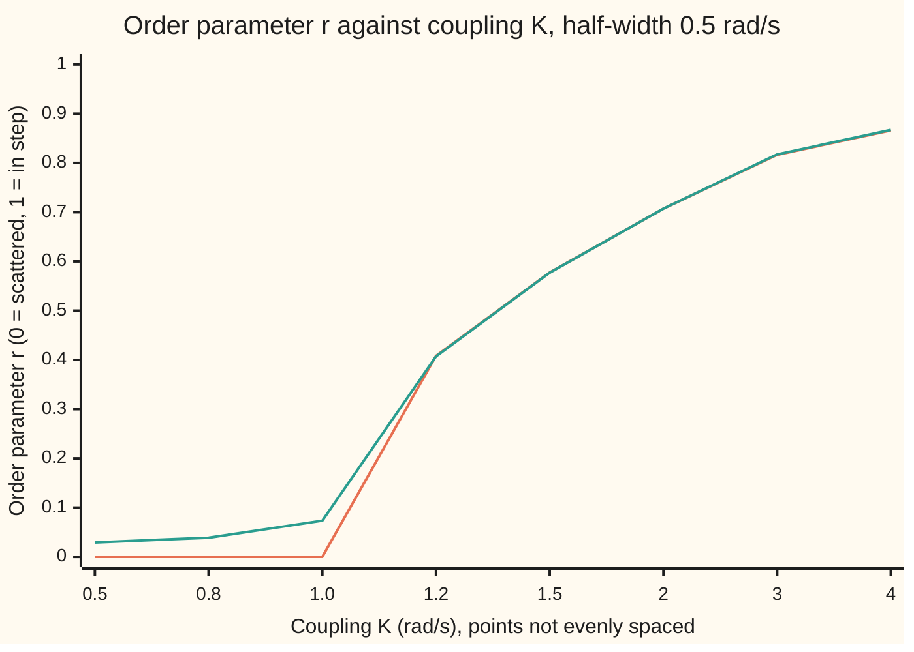

# The Kuramoto model: a crowd of oscillators with different speeds falls into step once the coupling passes a threshold

[Syllabus](../../../SYLLABUS.md) → [Differential equations and dynamics](../README.md) → [Rhythms and Synchronisation](../README.md#s13) → The Kuramoto model

---

## General Overview

A tree by a river holds 2,000 fireflies. Each one flashes on its own rhythm, a little faster or slower than the crowd's average. Each also nudges its flash a little towards the flashes it sees.

The nudges fight the spread of speeds. If they are weak, the tree twinkles at random. If they pass a threshold, a core of fireflies flashes together, and the core grows as the nudges get stronger.

The Kuramoto model is the simplest equation for this. Here the speeds are spread with a half-width of 0.5 rad/s (radians per second: one full cycle is 6.2832 rad). The threshold coupling is then 1 rad/s. At coupling 2 rad/s the theory says the crowd is 0.7071 of the way to perfect step, and a simulation of 2,000 oscillators settles at 0.7072. At 0.8 rad/s the crowd stays scattered.

**Each oscillator feels the crowd only through one average, the crowd's centre; that average pulls harder the more bunched the crowd is, so above a critical coupling the bunching feeds itself and a locked core appears.**

**What kind of fact this is:** a model, an idealised crowd rather than a law of nature. Inside the model, the threshold and the size of the locked core are derived on this card, assuming the crowd settles to a steady state. That it does settle is checked here by simulation, not proved.

### The picture: how bunched the crowd ends up



Orange: the theory, $`r = \sqrt{1 - K_c/K}`$, zero up to the threshold $`K_c = 1`$. Green: 2,000 simulated oscillators, averaged over the last 50 s of a 100 s run. Below the threshold the simulation shows only noise.

---

## The formula

Each oscillator is reduced to a **phase**: where it is in its cycle, an angle. The prime means rate of change per second. Upright $`\mathrm{i}`$ is the imaginary unit, $`\sqrt{-1}`$ ([Complex numbers](../../07-Complex%20analysis/01-Complex%20Numbers%20and%20the%20Plane/01-complex-numbers.md)); a subscript $`i`$ or $`j`$ numbers an oscillator.

```math
\theta_i' = \omega_i + \frac{K}{N}\sum_{j=1}^{N} \sin(\theta_j - \theta_i)
```

**Read it aloud:** each oscillator runs at its own speed, plus the average of the sine pulls from every other oscillator, scaled by the coupling.

The crowd's centre is the **order parameter**, the average of all phases placed as points on the unit circle:

```math
r\,e^{\mathrm{i}\psi} = \frac{1}{N}\sum_{j=1}^{N} e^{\mathrm{i}\theta_j} \qquad\Longrightarrow\qquad \theta_i' = \omega_i + K r \sin(\psi - \theta_i)
```

**Read it aloud:** the N pulls add up to one pull towards the crowd's average phase, with strength the coupling times the bunching.

The threshold holds for any one-peaked spread $`g`$ of speeds, symmetric about the average. The bunching needs the Lorentzian spread (a heavy-tailed bell curve), shown in the middle:

```math
K_c = \frac{2}{\pi\, g(0)}, \qquad g(\omega) = \frac{\gamma}{\pi(\omega^2 + \gamma^2)}, \qquad r = \sqrt{1 - \frac{K_c}{K}} \ \text{ for } K > K_c
```

**Read it aloud:** the critical coupling is two over pi times the crowd density at the centre; for the Lorentzian it is twice the half-width, and above it the bunching is the square root of one minus their ratio.

| Symbol | Plain meaning | In our example | Push it up and the answer… |
| --- | --- | --- | --- |
| $`\theta_i`$, $`\theta_j`$ | phase of oscillator i or j, in radians | 2,000 phases, started at random | — |
| $`\omega_i`$ | natural frequency: its speed alone, in rad/s, measured from the crowd's average | spread by $`g`$ | — |
| $`K`$ | coupling strength, in rad/s | 2 (and 0.8 below threshold) | r rises: 0.7071 at 2, 0.8660 at 4 |
| $`N`$ | number of oscillators | 2,000 | noise in r shrinks like $`1/\sqrt{N}`$ |
| $`r`$, $`\psi`$ | order parameter: r is the bunching, 0 (scattered) to 1 (all together); ψ is the crowd's average phase | r = 0.7071 theory, 0.7072 simulated; ψ stays put, by symmetry | stronger pull on everyone |
| $`\mathrm{i}`$ | the imaginary unit, $`\sqrt{-1}`$: $`e^{\mathrm{i}\theta}`$ is the point at angle θ on the unit circle | — | — |
| $`g(\omega)`$, $`\gamma`$ | the spread of speeds (a Lorentzian density) and its half-width: half the crowd lies within $`\pm\gamma`$ | $`\gamma = 0.5`$, $`g(0) = 0.6366`$ | wider spread, higher threshold |
| $`K_c`$ | critical coupling: the threshold | 1 | — |

### When it holds

- **Everyone couples to everyone, equally.** Only then do the pulls collapse into one average. Neighbours-only coupling, as on a ring, changes the threshold.
- **The spread has one peak, at the average, and is symmetric.** A two-peaked spread can split into two locked groups, and $`g(0)`$ no longer sets the threshold.
- **The crowd is large.** A finite crowd leaves noise of order $`1/\sqrt{N}`$: at K = 0.8 the simulated r is 0.0390, not 0.
- **The square-root law is Lorentzian.** Other spreads share the threshold formula, but r follows its own curve above it.
- **Only phases move.** If the size of each swing also changes, the phase-only model breaks down (the reduction to phases is assumed here, not derived).

---

## Why it works

### Step 0: a feedback loop with one gain

No oscillator sees the others one by one. The pulls add up to a single pull towards the crowd's centre, of strength K r. A bunched crowd pulls hard, which bunches it more.

A scattered crowd (r = 0) pulls on no one, so it is always a solution. The question is when a small bunching can sustain itself. The threshold is where the loop's gain reaches 1.

### Step 1: N pulls become one

Multiply the order parameter by $`e^{-\mathrm{i}\theta_i}`$ and take the imaginary part of both sides ([Euler's formula](../../07-Complex%20analysis/01-Complex%20Numbers%20and%20the%20Plane/04-eulers-formula.md): $`e^{\mathrm{i}x} = \cos x + \mathrm{i}\sin x`$):

```math
r\sin(\psi - \theta_i) = \frac{1}{N}\sum_{j=1}^{N} \sin(\theta_j - \theta_i)
```

Put that into the model and the second form of the formula appears. A step now costs N sums, not $`N^2`$.

### Step 2: each oscillator meets the phase-locking equation

Hold r and ψ steady. Each oscillator obeys $`\theta_i' = \omega_i - K r \sin(\theta_i - \psi)`$. That is the equation of [Phase locking](02-flows-on-the-circle-and-phase-locking.md), with frequency gap $`\omega_i`$ and coupling $`K r`$.

- **Locked** if $`|\omega_i| \le K r`$: it stops at $`\sin(\theta_i - \psi) = \omega_i / (K r)`$.
- **Drifting** otherwise: it slips round the circle forever.

At K = 2, $`K r = 1.4142`$, so every oscillator within ±1.4142 rad/s locks: 78.37% of the crowd in theory, 78.40% in the simulation.

The two-oscillator case is the shelf's house example. With N = 2, frequencies ±0.25 and K = 1, the phase gap $`\varphi = \theta_1 - \theta_2`$ obeys $`\varphi' = 0.5 - \sin\varphi`$ and settles at 30.00 degrees, as the checks confirm.

### Step 3: the crowd must produce the r it feels

The r each oscillator feels must equal the bunching the oscillators produce. A locked oscillator contributes $`\cos(\theta_i - \psi) = \sqrt{1 - (\omega_i/Kr)^2}`$ to it. Drifting ones contribute nothing on average: each spends as long on the near side of the centre as the far side, and drifters at $`+\omega`$ and $`-\omega`$ cancel sideways. So

```math
r = \int_{-Kr}^{Kr} \sqrt{1 - \left(\frac{\omega}{K r}\right)^2}\; g(\omega)\, d\omega
```

**Read it aloud:** the bunching is the sum, over every locked speed, of how near that oscillator sits to the centre, weighted by how many share that speed. This is the **self-consistency equation**.

### Step 4: the threshold

When r is tiny, the window of locked speeds is narrow, so $`g(\omega) \approx g(0)`$ across it. The integral of $`\sqrt{1 - (\omega/a)^2}`$ from $`-a`$ to $`a`$ is a half-disc's area divided by $`a`$: $`\pi a / 2`$. With $`a = K r`$:

```math
r \approx g(0)\,\frac{\pi K r}{2} \quad\Longrightarrow\quad K_c = \frac{2}{\pi\, g(0)}
```

Below $`K_c`$ the right side falls short of r for every r > 0 (for a one-peaked spread), so only the scattered crowd solves it. Above, a bunched solution branches off from r = 0.

### Step 5: the Lorentzian gives a square root

For the Lorentzian, $`g(0) = 1/(\pi\gamma)`$, so $`K_c = 2\gamma`$: 1 rad/s here. The integral has a closed form, and setting it equal to r gives $`r^2 = 1 - 2\gamma/K`$.

<details>
<summary>Detailed algebra: the Lorentzian integral</summary>

Write $`a = Kr`$ and substitute $`\omega = a \sin u`$, with u an angle used only in this fold. Using $`\cos^2 u = 1 - \sin^2 u`$ and the standard integral of $`1/(\gamma^2 + a^2\sin^2 u)`$ over a half-turn, which is $`\pi / (\gamma\sqrt{a^2 + \gamma^2})`$:

$`\displaystyle \int_{-a}^{a} \sqrt{1 - \frac{\omega^2}{a^2}}\;\frac{\gamma}{\pi(\omega^2 + \gamma^2)}\,d\omega = \frac{\sqrt{a^2 + \gamma^2} - \gamma}{a}`$

Set this equal to r, so $`\sqrt{a^2 + \gamma^2} = \gamma + K r^2`$. Square both sides and cancel $`\gamma^2`$:

$`\displaystyle K^2 r^2 = 2\gamma K r^2 + K^2 r^4 \quad\Longrightarrow\quad r^2 = 1 - \frac{2\gamma}{K}`$

The scattered crowd, r = 0, was divided out; it remains a solution, but above $`K_c`$ it is unstable, as the simulation shows.

</details>

---

## Worked numbers, by hand

Half-width 0.5 rad/s, coupling K = 2 rad/s.

| Step | Arithmetic | Value |
| --- | --- | --- |
| density at the centre | 0.5 / (π × 0.5²) | 0.6366 |
| critical coupling | 2 / (π × 0.6366) | 1.0000 |
| bunching, from the formula | √(1 − 1/2) | 0.7071 |
| window of locked speeds | K r = 2 × 0.7071 | ±1.4142 rad/s |
| check, part one | √(1.4142² + 0.5²) | 1.5000 |
| check, part two | (1.5000 − 0.5) / 1.4142 | 0.7071, as assumed |
| share locked | (2/π) × atan(1.4142 / 0.5) | 0.7837 |
| 2,000 oscillators, simulated | RK4, mean r over 50 s to 100 s | **0.7072** |

At twice the threshold, 78% of the crowd locks and the crowd's centre sits 0.71 of the way out to the unit circle.

### What breaks if you drop a piece

| Mistake | Comes out at | What went wrong |
| --- | --- | --- |
| Using the full width, 1 rad/s, as γ | K_c = 2.0000, so r = 0 at K = 2 | The Lorentzian's γ is the half-width |
| Dropping the square root | r = 0.5000 | That is $`r^2`$, not r |
| Dropping the 1/N | r = 0.9999 | The coupling becomes 2,000 times stronger |
| Reading the K = 0.8 value as order | r = 0.0390 | Finite-crowd noise; $`1/\sqrt{N}`$ is 0.0224 |

---

## Code, from first principles, and it actually runs

Only `math` is imported. The script takes three roads to r. The closed form is one line. The self-consistency equation is solved by Simpson's rule for the integral and bisection for r, never using the square-root law. The simulation steps 2,000 oscillators by [Runge-Kutta four](../05-Numerical%20Evolution/04-runge-kutta-four.md), 0.1 s steps for 100 s, computing r and ψ once per stage so each step costs N, not $`N^2`$. Speeds are spread evenly through the Lorentzian; starting phases come from a hand-written random number generator. The same stepper with N = 2 checks the house example's 30-degree lock.

### Python

```python
# The Kuramoto model -- the check behind the card.  Only math is imported.  2,000 oscillators,
# Lorentzian frequencies of half-width 0.5, so K_c = 1.  Three roads to r: the closed form, the
# self-consistency integral (Simpson, bisection) and RK4, starting phases from our own LCG.
import math
G, N, DT, T_END, T_AVG = 0.5, 2000, 0.1, 100.0, 50.0
g = lambda w: G / (math.pi * (w * w + G * G))     # the Lorentzian density
KC = 2 / (math.pi * g(0.0))                       # the critical coupling
theory = lambda K: math.sqrt(max(0.0, 1 - KC / K))
def lcg(seed):                                    # 64-bit LCG, uniform in [0, 1)
    while True:
        seed = (6364136223846793005 * seed + 1442695040888963407) % 2**64
        yield (seed >> 11) / 2**53
def self_consistent(K, m=400):                    # road two: solve the self-consistency
    def excess(r):                                # locked-crowd integral / r - 1, Simpson
        h, x = math.pi / m, lambda j: -math.pi / 2 + j * math.pi / m
        tot = sum((1 if j in (0, m) else 4 if j % 2 else 2) * math.cos(x(j)) ** 2
                  * g(K * r * math.sin(x(j))) for j in range(m + 1))
        return K * tot * h / 3 - 1
    lo, hi = 0.0, 1.0                             # no positive root: hi falls to 0
    for _ in range(60):
        mid = (lo + hi) / 2
        lo, hi = (mid, hi) if excess(mid) > 0 else (lo, mid)
    return (lo + hi) / 2
def simulate(K, om, th):                          # road three: RK4 on every oscillator
    def f(th):                                    # theta' = omega + K r sin(psi - theta)
        c = [math.cos(t) for t in th]; s = [math.sin(t) for t in th]
        C, S = sum(c) / len(th), sum(s) / len(th) # r cos psi and r sin psi
        return [w + K * (S * ci - C * si) for w, ci, si in zip(om, c, s)], math.hypot(C, S)
    rs, steps, mid = [], round(T_END / DT), th
    for n in range(steps):
        k1, r = f(th)
        if n == steps - round(T_AVG / DT): mid = th
        if n >= steps - round(T_AVG / DT): rs.append(r)
        k2, _ = f([t + DT / 2 * k for t, k in zip(th, k1)])
        k3, _ = f([t + DT / 2 * k for t, k in zip(th, k2)])
        k4, _ = f([t + DT * k for t, k in zip(th, k3)])
        th = [t + DT / 6 * (a + 2 * b + 2 * c + d) for t, a, b, c, d in zip(th, k1, k2, k3, k4)]
    return sum(rs) / len(rs), th, mid
om = [G * math.tan(math.pi * ((i + 0.5) / N - 0.5)) for i in range(N)]   # Lorentzian quantiles
u = lcg(2026); th0 = [2 * math.pi * next(u) for _ in range(N)]
print(f"half-width {G}, g(0) = {g(0):.4f}, K_c = 2/(pi g(0)) = {KC:.4f}")
sims = {}; print(f"K      closed form  integral   simulated, N = {N}")
for K in (0.5, 0.8, 1.0, 1.2, 1.5, 2.0, 3.0, 4.0):
    sims[K], th, mid = simulate(K, om, th0)
    print(f"{K:<6} {theory(K):<12.4f} {self_consistent(K):<10.4f} {sims[K]:.4f}")
    if K == 2.0: locked = sum(abs(a - b) / T_AVG < 0.01 for a, b in zip(th, mid)) / N
a = 2.0 * theory(2.0); lock_th = 2 / math.pi * math.atan(a / G)     # a = K r at K = 2
print(f"K = 2 by hand: K r = {a:.4f}; sqrt((K r)^2 + {G}^2) = {math.hypot(a, G):.4f}; "
      f"(that - {G}) / (K r) = {(math.hypot(a, G) - G) / a:.4f}")
print(f"K = 0.8: simulated r = {sims[0.8]:.4f}; 1/sqrt(N) = {1 / math.sqrt(N):.4f}")
print(f"K = 2: share locked, simulated {locked:.4f}; theory (2/pi) atan(K r / 0.5) = {lock_th:.4f}")
_, pair, _ = simulate(1.0, [0.25, -0.25], [0.0, 0.0])
print(f"two oscillators, gap 0.5, K = 1: phase gap settles at {math.degrees(pair[0] - pair[1]):.2f} degrees")
print(f"mistakes at K = 2: gamma = 1 gives K_c = {2 * KC:.4f} and r = {math.sqrt(max(0.0, 1 - 2 * KC / 2)):.4f}; "
      f"no square root {1 - KC / 2:.4f}; no 1/N {theory(2.0 * N):.4f}")
assert all(abs(self_consistent(K) - theory(K)) < 1e-6 for K in sims)        # road 2 = road 1
assert abs(sims[2.0] - theory(2.0)) < 0.02 and abs(sims[4.0] - theory(4.0)) < 0.02
assert sims[0.8] < 5 / math.sqrt(N) and abs(locked - lock_th) < 0.02
assert abs(math.degrees(pair[0] - pair[1]) - 30.0) < 0.01                   # the house pair
print("ALL CHECKS PASS")
```

**Ran 2026-11-23 on macOS, Python 3.14.10, standard library only. All checks passed. Output, pasted from the run:**

```
half-width 0.5, g(0) = 0.6366, K_c = 2/(pi g(0)) = 1.0000
K      closed form  integral   simulated, N = 2000
0.5    0.0000       0.0000     0.0293
0.8    0.0000       0.0000     0.0390
1.0    0.0000       0.0000     0.0735
1.2    0.4082       0.4082     0.4072
1.5    0.5774       0.5774     0.5771
2.0    0.7071       0.7071     0.7072
3.0    0.8165       0.8165     0.8174
4.0    0.8660       0.8660     0.8670
K = 2 by hand: K r = 1.4142; sqrt((K r)^2 + 0.5^2) = 1.5000; (that - 0.5) / (K r) = 0.7071
K = 0.8: simulated r = 0.0390; 1/sqrt(N) = 0.0224
K = 2: share locked, simulated 0.7840; theory (2/pi) atan(K r / 0.5) = 0.7837
two oscillators, gap 0.5, K = 1: phase gap settles at 30.00 degrees
mistakes at K = 2: gamma = 1 gives K_c = 2.0000 and r = 0.0000; no square root 0.5000; no 1/N 0.9999
ALL CHECKS PASS
```

### Rust

Same numbers, same labels, built with `rustc --edition 2021 -O`.

```rust
// The Kuramoto model -- the same check as the Python, in Rust.  No crates.  2,000 oscillators,
// Lorentzian frequencies of half-width 0.5, so K_c = 1.  Three roads to r: the closed form, the
// self-consistency integral (Simpson, bisection) and RK4, starting phases from our own LCG.
use std::f64::consts::PI;
const G: f64 = 0.5; const N: usize = 2000;                // half-width, oscillators
const DT: f64 = 0.1; const T_END: f64 = 100.0; const T_AVG: f64 = 50.0;
fn g(w: f64) -> f64 { G / (PI * (w * w + G * G)) }      // the Lorentzian density
fn sum(v: &[f64]) -> f64 {                                // compensated sum, as Python's sum()
    let (mut s, mut c) = (0.0f64, 0.0f64);
    for &x in v { let t = s + x; c += if s.abs() >= x.abs() { (s - t) + x } else { (x - t) + s }; s = t; }
    if c != 0.0 && c.is_finite() { s + c } else { s }
}
fn theory(k: f64, kc: f64) -> f64 { (1.0 - kc / k).max(0.0).sqrt() }
fn self_consistent(k: f64) -> f64 {                       // road two: solve the self-consistency
    let m = 400; let excess = |r: f64| {                               // locked-crowd integral / r - 1, Simpson
        let (h, x) = (PI / m as f64, |j: usize| -PI / 2.0 + j as f64 * PI / m as f64);
        let terms: Vec<f64> = (0..=m).map(|j| {
            let wt = if j == 0 || j == m { 1.0 } else if j % 2 == 1 { 4.0 } else { 2.0 };
            wt * x(j).cos().powi(2) * g(k * r * x(j).sin())
        }).collect();
        k * sum(&terms) * h / 3.0 - 1.0
    };
    let (mut lo, mut hi) = (0.0, 1.0);                    // no positive root: hi falls to 0
    for _ in 0..60 { let mid = (lo + hi) / 2.0; if excess(mid) > 0.0 { lo = mid } else { hi = mid } }
    (lo + hi) / 2.0
}
fn simulate(k: f64, om: &[f64], th0: &[f64]) -> (f64, Vec<f64>, Vec<f64>) {   // road three: RK4
    let f = |th: &[f64]| -> (Vec<f64>, f64) {             // theta' = omega + K r sin(psi - theta)
        let c: Vec<f64> = th.iter().map(|t| t.cos()).collect();
        let s: Vec<f64> = th.iter().map(|t| t.sin()).collect();
        let (cc, ss) = (sum(&c) / th.len() as f64, sum(&s) / th.len() as f64);
        ((0..th.len()).map(|i| om[i] + k * (ss * c[i] - cc * s[i])).collect(), cc.hypot(ss))
    };
    let step = |th: &[f64], kk: &[f64], a: f64| -> Vec<f64> { th.iter().zip(kk).map(|(t, q)| t + a * q).collect() };
    let (steps, avg) = ((T_END / DT).round() as usize, (T_AVG / DT).round() as usize);
    let (mut th, mut mid, mut rs) = (th0.to_vec(), th0.to_vec(), Vec::new());
    for n in 0..steps {
        let (k1, r) = f(&th);
        if n == steps - avg { mid = th.clone() }
        if n >= steps - avg { rs.push(r) }
        let (k2, _) = f(&step(&th, &k1, DT / 2.0));
        let (k3, _) = f(&step(&th, &k2, DT / 2.0));
        let (k4, _) = f(&step(&th, &k3, DT));
        th = (0..th.len()).map(|i| th[i] + DT / 6.0 * (k1[i] + 2.0 * k2[i] + 2.0 * k3[i] + k4[i])).collect();
    }
    (sum(&rs) / rs.len() as f64, th, mid)
}
fn main() {
    let kc = 2.0 / (PI * g(0.0));                         // the critical coupling
    let om: Vec<f64> = (0..N).map(|i| G * (PI * ((i as f64 + 0.5) / N as f64 - 0.5)).tan()).collect();
    let mut seed: u64 = 2026;                             // 64-bit LCG, uniform in [0, 1)
    let th0: Vec<f64> = (0..N).map(|_| {
        seed = seed.wrapping_mul(6364136223846793005).wrapping_add(1442695040888963407);
        2.0 * PI * ((seed >> 11) as f64 / 9007199254740992.0)
    }).collect();
    println!("half-width {}, g(0) = {:.4}, K_c = 2/(pi g(0)) = {:.4}", G, g(0.0), kc);
    println!("K      closed form  integral   simulated, N = {}", N);
    let ks = [0.5, 0.8, 1.0, 1.2, 1.5, 2.0, 3.0, 4.0];
    let (mut sims, mut locked) = (Vec::new(), 0.0);
    for &k in &ks {
        let (r, th, mid) = simulate(k, &om, &th0);
        sims.push(r);
        println!("{:<6} {:<12.4} {:<10.4} {:.4}", format!("{:?}", k), theory(k, kc), self_consistent(k), r);
        if k == 2.0 { locked = (0..N).filter(|&i| ((th[i] - mid[i]) / T_AVG).abs() < 0.01).count() as f64 / N as f64 }
    }
    let a = 2.0 * theory(2.0, kc); let lock_th = 2.0 / PI * (a / G).atan();   // a = K r at K = 2
    println!("K = 2 by hand: K r = {:.4}; sqrt((K r)^2 + {}^2) = {:.4}; (that - {}) / (K r) = {:.4}",
             a, G, a.hypot(G), G, (a.hypot(G) - G) / a);
    println!("K = 0.8: simulated r = {:.4}; 1/sqrt(N) = {:.4}", sims[1], 1.0 / (N as f64).sqrt());
    println!("K = 2: share locked, simulated {:.4}; theory (2/pi) atan(K r / 0.5) = {:.4}", locked, lock_th);
    let (_, pair, _) = simulate(1.0, &[0.25, -0.25], &[0.0, 0.0]);
    println!("two oscillators, gap 0.5, K = 1: phase gap settles at {:.2} degrees", (pair[0] - pair[1]).to_degrees());
    println!("mistakes at K = 2: gamma = 1 gives K_c = {:.4} and r = {:.4}; no square root {:.4}; no 1/N {:.4}",
             2.0 * kc, theory(2.0, 2.0 * kc), 1.0 - kc / 2.0, theory(2.0 * N as f64, kc));
    assert!(ks.iter().all(|&k| (self_consistent(k) - theory(k, kc)).abs() < 1e-6));   // road 2 = road 1
    assert!((sims[5] - theory(2.0, kc)).abs() < 0.02 && (sims[7] - theory(4.0, kc)).abs() < 0.02);
    assert!(sims[1] < 5.0 / (N as f64).sqrt() && (locked - lock_th).abs() < 0.02);
    assert!(((pair[0] - pair[1]).to_degrees() - 30.0).abs() < 0.01);                 // the house pair
    println!("ALL CHECKS PASS");
}
```

**Ran 2026-11-23 on macOS, rustc 1.98.1, no crates. All checks passed. Output, pasted from the run:**

```
half-width 0.5, g(0) = 0.6366, K_c = 2/(pi g(0)) = 1.0000
K      closed form  integral   simulated, N = 2000
0.5    0.0000       0.0000     0.0293
0.8    0.0000       0.0000     0.0390
1.0    0.0000       0.0000     0.0735
1.2    0.4082       0.4082     0.4072
1.5    0.5774       0.5774     0.5771
2.0    0.7071       0.7071     0.7072
3.0    0.8165       0.8165     0.8174
4.0    0.8660       0.8660     0.8670
K = 2 by hand: K r = 1.4142; sqrt((K r)^2 + 0.5^2) = 1.5000; (that - 0.5) / (K r) = 0.7071
K = 0.8: simulated r = 0.0390; 1/sqrt(N) = 0.0224
K = 2: share locked, simulated 0.7840; theory (2/pi) atan(K r / 0.5) = 0.7837
two oscillators, gap 0.5, K = 1: phase gap settles at 30.00 degrees
mistakes at K = 2: gamma = 1 gives K_c = 2.0000 and r = 0.0000; no square root 0.5000; no 1/N 0.9999
ALL CHECKS PASS
```

### Lean

Lean proves the self-consistency step: the Lorentzian threshold and square-root law, and the shortfall below the threshold for any one-peaked symmetric spread.

- For the Lorentzian spread of half-width γ, the critical coupling $`2/(\pi g(0))`$ is exactly $`2\gamma`$.
- Take K above $`K_c`$ and $`r = \sqrt{1 - K_c/K}`$. Then r lies strictly between 0 and 1 and solves the self-consistency equation exactly.
- The fold's integral is exact. Take locked speeds from $`-a`$ to $`a`$, with $`a > 0`$. Then the locked crowd gives $`(\sqrt{a^2 + \gamma^2} - \gamma)/a`$.
- Suppose the spread g has one peak, at the average, and is symmetric, and $`0 < K < K_c`$. Then for every r > 0 the self-consistency integral falls short of r.
- The worked numbers: half-width 0.5 gives $`K_c = 1`$, and the full-width mistake, γ = 1, gives $`K_c = 2`$.
- At K = 2 the check holds: $`(K r)^2 + \gamma^2 = 1.5^2`$, and $`1.5 - 0.5 = K r^2`$.
- On the chart's theory line, $`r^2`$ is 1/6 at K = 1.2 and 1/3 at K = 1.5. It is 2/3 at K = 3 and 3/4 at K = 4.
- In the house example at K = 1, the phase gap is at rest at 30 degrees, since $`\sin 30^\circ = 0.5`$.

Deriving the self-consistency equation from the oscillators, the simulation, the share locked and the noise are left to the Python and Rust checks.

```lean
-- The Kuramoto model: for a Lorentzian spread of speeds the critical coupling is twice the half-width and above it r = √(1 - K_c/K) solves the self-consistency equation exactly, and below the threshold no bunched crowd solves it for any one-peaked symmetric spread.
import Mathlib.Analysis.SpecialFunctions.Integrals.Basic
import Mathlib.Analysis.SpecialFunctions.Sqrt
import Mathlib.Analysis.SpecialFunctions.Trigonometric.Basic
import Mathlib.Analysis.SpecialFunctions.Trigonometric.ArctanDeriv
import Mathlib.Tactic

open Real

/-- The Lorentzian spread of natural frequencies with half-width `γ`:
`g(ω) = γ / (π (ω² + γ²))`. -/
noncomputable def lorentzian (γ ω : ℝ) : ℝ := γ / (π * (ω ^ 2 + γ ^ 2))

/-- The critical coupling of a spread `g` of natural frequencies: `K_c = 2 / (π g(0))`. -/
noncomputable def criticalCoupling (g : ℝ → ℝ) : ℝ := 2 / (π * g 0)

/-- Algebra behind the derivative of the antiderivative used for the Lorentzian integral. -/
theorem kuramoto_arctan_deriv_alg (x y s γ a : ℝ) (hxy : x ^ 2 + y ^ 2 = 1)
    (hs2 : s ^ 2 = a ^ 2 + γ ^ 2) (hγ : 0 < γ) (hs : γ < s) :
    (s - γ) + s * (1 / (1 + ((s - γ) * x * y / (γ * y ^ 2 + s * x ^ 2)) ^ 2) *
      (((s - γ) * (y ^ 2 - x ^ 2) * (γ * y ^ 2 + s * x ^ 2) -
        (s - γ) * x * y * (2 * (s - γ) * x * y)) / (γ * y ^ 2 + s * x ^ 2) ^ 2))
      = γ * a ^ 2 * y ^ 2 / (γ ^ 2 * y ^ 2 + s ^ 2 * x ^ 2) := by
  have hs0 : 0 < s := by linarith
  have hD : 0 < γ * y ^ 2 + s * x ^ 2 := by
    rcases eq_or_ne y 0 with h | h
    · have : x ^ 2 = 1 := by rw [h] at hxy; linarith
      rw [h, this]; linarith
    · have : 0 < y ^ 2 := by positivity
      nlinarith [sq_nonneg x]
  have hE : 0 < γ ^ 2 * y ^ 2 + s ^ 2 * x ^ 2 := by
    rcases eq_or_ne y 0 with h | h
    · have : x ^ 2 = 1 := by rw [h] at hxy; linarith
      rw [h, this]; nlinarith
    · have : 0 < y ^ 2 := by positivity
      nlinarith [sq_nonneg x, sq_nonneg s]
  set D := γ * y ^ 2 + s * x ^ 2 with hD_def
  set N := (s - γ) * x * y with hN_def
  have h1 : 1 / (1 + (N / D) ^ 2) *
      (((s - γ) * (y ^ 2 - x ^ 2) * D - N * (2 * (s - γ) * x * y)) / D ^ 2)
      = ((s - γ) * (y ^ 2 - x ^ 2) * D - N * (2 * (s - γ) * x * y)) / (D ^ 2 + N ^ 2) := by
    have : 0 < D ^ 2 + N ^ 2 := by positivity
    field_simp
  have h2 : (s - γ) * (y ^ 2 - x ^ 2) * D - N * (2 * (s - γ) * x * y)
      = (s - γ) * (γ * y ^ 2 - s * x ^ 2) := by
    simp only [hD_def, hN_def]
    linear_combination ((s - γ) * (γ * y ^ 2 - s * x ^ 2)) * hxy
  have h3 : D ^ 2 + N ^ 2 = γ ^ 2 * y ^ 2 + s ^ 2 * x ^ 2 := by
    simp only [hD_def, hN_def]
    linear_combination (γ ^ 2 * y ^ 2 + s ^ 2 * x ^ 2) * hxy
  rw [h1, h2, h3]
  field_simp
  linear_combination (γ * y ^ 2) * hs2

#print axioms kuramoto_arctan_deriv_alg

/-- The Lorentzian locked-crowd integral, proved by the substitution `ω = a sin θ`. -/
theorem kuramoto_locked_integral_aux (γ a : ℝ) (hγ : 0 < γ) (ha : 0 < a) :
    ∫ ω in (-a)..a, √(1 - (ω / a) ^ 2) * lorentzian γ ω = (√(a ^ 2 + γ ^ 2) - γ) / a := by
  set s := √(a ^ 2 + γ ^ 2) with hs_def
  have hs2 : s ^ 2 = a ^ 2 + γ ^ 2 := Real.sq_sqrt (by positivity)
  have hs0 : 0 ≤ s := Real.sqrt_nonneg _
  have hs : γ < s := by nlinarith
  have hpi : 0 < π := Real.pi_pos
  have hgc : Continuous (fun ω => √(1 - (ω / a) ^ 2) * lorentzian γ ω) := by
    unfold lorentzian
    refine (Real.continuous_sqrt.comp (by fun_prop)).mul ?_
    refine continuous_const.div (by fun_prop) (fun ω => ?_)
    have : 0 < ω ^ 2 + γ ^ 2 := by positivity
    positivity
  have hsub := intervalIntegral.integral_comp_mul_deriv (a := -(π / 2)) (b := π / 2)
    (f := fun θ => a * sin θ) (f' := fun θ => a * cos θ)
    (fun x _ => (hasDerivAt_sin x).const_mul a)
    ((continuous_const.mul continuous_cos).continuousOn) hgc
  simp only [sin_neg, sin_pi_div_two, mul_neg, mul_one] at hsub
  rw [← hsub]
  set h : ℝ → ℝ := fun θ => γ * a * cos θ ^ 2 / (π * (γ ^ 2 * cos θ ^ 2 + s ^ 2 * sin θ ^ 2))
    with h_def
  have hE : ∀ θ, 0 < γ ^ 2 * cos θ ^ 2 + s ^ 2 * sin θ ^ 2 := by
    intro θ
    have hxy := sin_sq_add_cos_sq θ
    nlinarith [sq_nonneg (sin θ), sq_nonneg (cos θ)]
  have hcongr : Set.EqOn
      (fun θ => ((fun ω => √(1 - (ω / a) ^ 2) * lorentzian γ ω) ∘ (fun θ => a * sin θ)) θ
        * (a * cos θ)) h (Set.uIcc (-(π / 2)) (π / 2)) := by
    intro θ hθ
    rw [Set.uIcc_of_le (by linarith)] at hθ
    have hc := cos_nonneg_of_mem_Icc hθ
    have hsq : √(1 - (a * sin θ / a) ^ 2) = cos θ := by
      rw [mul_div_cancel_left₀ _ ha.ne', ← cos_sq', Real.sqrt_sq hc]
    simp only [Function.comp_apply, h_def, hsq, lorentzian]
    have h1 : (a * sin θ) ^ 2 + γ ^ 2 = γ ^ 2 * cos θ ^ 2 + s ^ 2 * sin θ ^ 2 := by
      linear_combination (-(γ ^ 2)) * sin_sq_add_cos_sq θ + (-(sin θ ^ 2)) * hs2
    rw [h1]
    have := hE θ
    field_simp
  rw [intervalIntegral.integral_congr hcongr]
  set k : ℝ → ℝ := fun θ => (s - γ) * sin θ * cos θ / (γ * cos θ ^ 2 + s * sin θ ^ 2) with hk_def
  set G : ℝ → ℝ := fun θ => ((s - γ) * θ + s * arctan (k θ)) / (π * a) with hG_def
  have hD : ∀ θ, 0 < γ * cos θ ^ 2 + s * sin θ ^ 2 := by
    intro θ
    have hxy := sin_sq_add_cos_sq θ
    nlinarith [sq_nonneg (sin θ), sq_nonneg (cos θ)]
  have hderiv : ∀ θ ∈ Set.uIcc (-(π / 2)) (π / 2), HasDerivAt G (h θ) θ := by
    intro θ _
    have hN : HasDerivAt (fun θ => (s - γ) * sin θ * cos θ)
        ((s - γ) * (cos θ ^ 2 - sin θ ^ 2)) θ := by
      convert ((hasDerivAt_sin θ).const_mul (s - γ)).mul (hasDerivAt_cos θ) using 1
      ring
    have hDd : HasDerivAt (fun θ => γ * cos θ ^ 2 + s * sin θ ^ 2)
        (2 * (s - γ) * sin θ * cos θ) θ := by
      convert (((hasDerivAt_cos θ).pow 2).const_mul γ).add
        (((hasDerivAt_sin θ).pow 2).const_mul s) using 1
      simp only [Nat.cast_ofNat]
      ring
    have hkd := (hN.div hDd (hD θ).ne').arctan
    have hGd := (((hasDerivAt_id θ).const_mul (s - γ)).add (hkd.const_mul s)).div_const (π * a)
    convert hGd using 1
    · funext x
      simp only [hG_def, hk_def, Pi.add_apply, Pi.div_apply, id]
    simp only [h_def, mul_one, Pi.div_apply]
    have halg := kuramoto_arctan_deriv_alg (sin θ) (cos θ) s γ a (sin_sq_add_cos_sq θ) hs2 hγ hs
    rw [halg]
    have := hE θ
    field_simp
  have hint : IntervalIntegrable h MeasureTheory.volume (-(π / 2)) (π / 2) := by
    apply Continuous.intervalIntegrable
    simp only [h_def]
    refine Continuous.div (by fun_prop) (by fun_prop) (fun θ => ?_)
    have := hE θ
    positivity
  rw [intervalIntegral.integral_eq_sub_of_hasDerivAt hderiv hint]
  simp only [hG_def, hk_def, sin_neg, cos_neg, sin_pi_div_two, cos_pi_div_two]
  simp
  field_simp
  ring

#print axioms kuramoto_locked_integral_aux

/-- The card's main claim. For Lorentzian frequencies of half-width `γ > 0`, the critical
coupling `2 / (π g(0))` is `2γ`; and for every coupling `K` above it, the bunching
`r = √(1 - K_c/K)` lies strictly between 0 and 1 and solves the self-consistency equation:
`r` equals the integral over the locked speeds `-K r ≤ ω ≤ K r` of
`√(1 - (ω/(K r))²) g(ω)`. -/
theorem lorentzian_order_parameter_sqrt_law (γ K r : ℝ) (hγ : 0 < γ)
    (hK : criticalCoupling (lorentzian γ) < K)
    (hr : r = √(1 - criticalCoupling (lorentzian γ) / K)) :
    criticalCoupling (lorentzian γ) = 2 * γ ∧ 0 < r ∧ r < 1 ∧
      r = ∫ ω in (-(K * r))..(K * r), √(1 - (ω / (K * r)) ^ 2) * lorentzian γ ω := by
  have hcc : criticalCoupling (lorentzian γ) = 2 * γ := by
    unfold criticalCoupling lorentzian
    have := Real.pi_pos
    field_simp
    ring
  rw [hcc] at hK hr
  have hK0 : 0 < K := by linarith
  have h1 : 0 < 1 - 2 * γ / K := by
    rw [sub_pos, div_lt_one hK0]
    exact hK
  have hr0 : 0 < r := by rw [hr]; exact Real.sqrt_pos.mpr h1
  have hr2 : r ^ 2 = 1 - 2 * γ / K := by rw [hr]; exact Real.sq_sqrt h1.le
  have hr1 : r < 1 := by
    have : 0 < 2 * γ / K := by positivity
    nlinarith
  refine ⟨hcc, hr0, hr1, ?_⟩
  rw [kuramoto_locked_integral_aux γ (K * r) hγ (by positivity)]
  have hKr2 : K * r ^ 2 = K - 2 * γ := by
    rw [hr2]
    field_simp
  have hsq : √((K * r) ^ 2 + γ ^ 2) = K - γ := by
    rw [Real.sqrt_eq_iff_mul_self_eq_of_pos (by linarith)]
    linear_combination (-K) * hKr2
  rw [hsq]
  field_simp
  linear_combination hKr2

/-- The Lorentzian integral from the card's fold: for a window half-width `a > 0` and
half-width `γ > 0`, the locked crowd's contribution
`∫_{-a}^{a} √(1 - ω²/a²) g(ω) dω` equals `(√(a² + γ²) - γ) / a`. -/
theorem lorentzian_locked_integral (γ a : ℝ) (hγ : 0 < γ) (ha : 0 < a) :
    ∫ ω in (-a)..a, √(1 - (ω / a) ^ 2) * lorentzian γ ω = (√(a ^ 2 + γ ^ 2) - γ) / a := by
  exact kuramoto_locked_integral_aux γ a hγ ha

/-- Below the threshold only the scattered crowd survives: for any spread `g` with its one
peak at the average and symmetric about it (even, and falling away from 0), and any
coupling `0 < K < 2 / (π g(0))`, every bunching `r > 0` gets back strictly less than itself
from the self-consistency integral, so no `r > 0` solves the equation. -/
theorem below_threshold_no_bunched_solution (g : ℝ → ℝ) (hg_even : ∀ ω, g (-ω) = g ω)
    (hg_peak : AntitoneOn g (Set.Ici 0)) (hg0 : 0 < g 0) (K r : ℝ) (hK0 : 0 < K)
    (hK : K < criticalCoupling g) (hr : 0 < r) :
    ∫ ω in (-(K * r))..(K * r), √(1 - (ω / (K * r)) ^ 2) * g ω < r := by
  have hpi : 0 < π := Real.pi_pos
  have ha : 0 < K * r := mul_pos hK0 hr
  have hgle : ∀ ω, g ω ≤ g 0 := by
    intro ω
    rcases le_total 0 ω with h | h
    · exact hg_peak (Set.mem_Ici.mpr le_rfl) (Set.mem_Ici.mpr h) h
    · rw [← hg_even ω]
      exact hg_peak (Set.mem_Ici.mpr le_rfl) (Set.mem_Ici.mpr (by linarith)) (by linarith)
  have hsub := intervalIntegral.integral_comp_div (f := fun x => √(1 - x ^ 2))
    (a := -(K * r)) (b := K * r) ha.ne'
  simp only [neg_div, div_self ha.ne'] at hsub
  have hbound : ∫ ω in (-(K * r))..(K * r), √(1 - (ω / (K * r)) ^ 2) * g 0
      = g 0 * (K * r * (π / 2)) := by
    rw [intervalIntegral.integral_mul_const, hsub, integral_sqrt_one_sub_sq, smul_eq_mul]
    ring
  have hKg : K * (π * g 0) < 2 := by
    unfold criticalCoupling at hK
    rwa [lt_div_iff₀ (by positivity)] at hK
  by_cases hint : IntervalIntegrable (fun ω => √(1 - (ω / (K * r)) ^ 2) * g ω)
      MeasureTheory.volume (-(K * r)) (K * r)
  · calc ∫ ω in (-(K * r))..(K * r), √(1 - (ω / (K * r)) ^ 2) * g ω
        ≤ ∫ ω in (-(K * r))..(K * r), √(1 - (ω / (K * r)) ^ 2) * g 0 := by
          apply intervalIntegral.integral_mono_on (by linarith) hint
          · exact (Continuous.intervalIntegrable (by fun_prop) _ _)
          · intro ω _
            exact mul_le_mul_of_nonneg_left (hgle ω) (Real.sqrt_nonneg _)
      _ = g 0 * (K * r * (π / 2)) := hbound
      _ < r := by nlinarith
  · rw [intervalIntegral.integral_undef hint]
    exact hr

-- Half-width 0.5: g(0) = 1/(π γ) and the critical coupling is 1.
example : criticalCoupling (lorentzian (1 / 2)) = 1 := by
  norm_num [criticalCoupling, lorentzian]
  field_simp
  norm_num
-- At K = 2: 1 - K_c/K = 1/2, so r² = 1/2 (r = 0.7071).
example : (1 : ℚ) - 1 / 2 = 1 / 2 := by norm_num
-- The card's check at K = 2: (K r)² + γ² = 2 + 1/4 = (3/2)², and 3/2 - 1/2 = 1 = (K r) · r = K r².
example : (2 : ℚ) ^ 2 * (1 / 2) + (1 / 2) ^ 2 = (3 / 2) ^ 2 := by norm_num
example : (3 / 2 : ℚ) - 1 / 2 = 2 * (1 / 2) := by norm_num
-- The chart's theory points: r² = 1/6 at K = 1.2, 1/3 at 1.5, 2/3 at 3, 3/4 at 4.
example : (1 : ℚ) - 1 / (6 / 5) = 1 / 6 ∧ (1 : ℚ) - 1 / (3 / 2) = 1 / 3 ∧
    (1 : ℚ) - 1 / 3 = 2 / 3 ∧ (1 : ℚ) - 1 / 4 = 3 / 4 := by norm_num
-- Mistake: the full width γ = 1 doubles the threshold to 2, so 1 - K_c/K = 0 at K = 2.
example : criticalCoupling (lorentzian 1) = 2 := by
  norm_num [criticalCoupling, lorentzian, Real.pi_ne_zero]
example : (1 : ℚ) - 2 / 2 = 0 := by norm_num
-- The house example: the phase gap obeys φ' = 0.5 - sin φ at K = 1, at rest at 30 degrees.
example : (1 / 2 : ℝ) - sin (π / 6) = 0 := by norm_num [Real.sin_pi_div_six]

#print axioms lorentzian_order_parameter_sqrt_law
#print axioms lorentzian_locked_integral
#print axioms below_threshold_no_bunched_solution
```

**Checked 2026-11-23 on macOS, Lean 4.36.0-rc2, Mathlib v4.36.0-rc2. Every proof is complete and uses only Lean's standard axioms. Output, pasted from the run:**

```
'kuramoto_arctan_deriv_alg' depends on axioms: [propext, Classical.choice, Quot.sound]
'kuramoto_locked_integral_aux' depends on axioms: [propext, Classical.choice, Quot.sound]
'lorentzian_order_parameter_sqrt_law' depends on axioms: [propext, Classical.choice, Quot.sound]
'lorentzian_locked_integral' depends on axioms: [propext, Classical.choice, Quot.sound]
'below_threshold_no_bunched_solution' depends on axioms: [propext, Classical.choice, Quot.sound]
```

> [!TIP]
> **Try changing**
> The asserts are pinned to the card's numbers, so some changes stop the program.
> - **A smaller crowd.** Set `N` to `200`. Guess first: what happens to r at K = 0.8? It rises to 0.0608, since $`1/\sqrt{200}`$ is 0.0707; above the threshold r stays within 0.01 of the theory, and every check still passes.
> - **A narrower spread.** Set `G` to `0.25`. Guess first: where is the threshold now? At 0.5, so K = 0.8 is above it: r comes out at 0.6124 in theory and 0.6115 simulated. The third assert stops the run, as it expects scatter at K = 0.8.
> - **Coarser steps.** Set `DT` to `0.2`. Guess first: does the settled r change? Barely: 0.7070 at K = 2, against 0.7072. The settled state belongs to the model, not the step.

---

## The usual mistake

> [!warning]
> **Thinking that past the threshold everyone locks.** At K = 2, twice the threshold, only the oscillators within ±1.4142 rad/s of the average lock: 78% of the crowd. The rest drift forever, and r is 0.7071, not 1. Some oscillators are always too fast to catch.
>
> - **Full width for half-width.** Taking γ = 1 rad/s doubles the threshold to 2 and predicts no order at K = 2.
> - **Forgetting the square root.** $`1 - K_c/K`$ is 0.5000 at K = 2; r is its square root, 0.7071.
> - **Forgetting the 1/N.** Each pull then counts 2,000 times over, and r comes out at 0.9999.
> - **Reading noise as order.** Below the threshold a finite crowd still shows r = 0.0390 at K = 0.8, of the size of $`1/\sqrt{N}`$ = 0.0224, and larger close to the threshold.

---

## Where you meet it in real life

- **Fireflies.** In parts of Southeast Asia whole trees of fireflies flash together, each insect adjusting its flash to the ones it sees.
- **The heart's pacemaker.** Thousands of pacemaker cells, each with its own firing rate, fire together and set one heartbeat.
- **Power grids.** Every generator must turn in step with the grid's frequency; models of grid stability are Kuramoto models with inertia added.
- **Walkers on a bridge.** On the day London's Millennium Bridge opened in 2000, crowds of walkers fell into step with its small sideways sway, and the sway grew.

> **Say it back**
> Each oscillator runs at its own speed and is pulled by the sine of its phase gap to every other. The pulls add up to one pull towards the crowd's centre, of strength K times r, the bunching. Each oscillator then locks or drifts, as in the two-oscillator problem, and the locked ones must produce the r they feel. A small bunching sustains itself only when K passes $`2/(\pi g(0))`$, which is 1 rad/s for a Lorentzian of half-width 0.5. At K = 2, r is 0.7071 in theory and 0.7072 for 2,000 simulated oscillators, with 78% of them locked.

---

## What this builds on

- [Phase locking](02-flows-on-the-circle-and-phase-locking.md): the two-oscillator equation that each oscillator here obeys, with the crowd as its partner.
- [Runge-Kutta four](../05-Numerical%20Evolution/04-runge-kutta-four.md): the stepper that runs the 2,000-oscillator simulation.
- [Complex numbers](../../07-Complex%20analysis/01-Complex%20Numbers%20and%20the%20Plane/01-complex-numbers.md): phases as points on the unit circle, so the crowd's centre is one complex average.
- [Two-timing and averaging](01-two-timing-and-averaging.md): the slow-drift idea behind phase equations; reducing coupled oscillators to phases is assumed here.

## Where this goes next

- [Delay equations](04-delay-differential-equations.md): the next card on this shelf, where a signal takes time to arrive and the delay alone can cause oscillation.

Left open: real signals between fireflies, cells or generators take time to travel, so how does a delay in the coupling change the threshold?

---

## Sources

Verified 2026-11-23: every link below resolves to the publisher's page.

- Kuramoto, Yoshiki. *Chemical Oscillations, Waves, and Turbulence*. Springer, 1984. [Publisher page](https://link.springer.com/book/10.1007/978-3-642-69689-3). The model, the order parameter and the self-consistency argument, from the source.
- Strogatz, Steven H. "From Kuramoto to Crawford: exploring the onset of synchronization in populations of coupled oscillators." *Physica D* 143 (2000): 1–20. [doi:10.1016/S0167-2789(00)00094-4](https://doi.org/10.1016/S0167-2789(00)00094-4). A readable derivation of the threshold and the Lorentzian square-root law.
- Acebrón, Juan A., et al. "The Kuramoto model: a simple paradigm for synchronization phenomena." *Reviews of Modern Physics* 77 (2005): 137–185. [doi:10.1103/RevModPhys.77.137](https://doi.org/10.1103/RevModPhys.77.137). Finite-crowd noise, other frequency spreads and applications.
