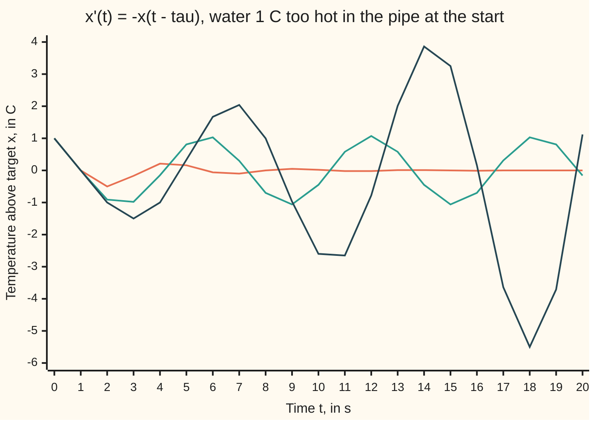

# Delay equations: a rate that reacts to the past can oscillate even with one variable

[Syllabus](../../../SYLLABUS.md) → [Differential equations and dynamics](../README.md) → [Rhythms and Synchronisation](../README.md#s13) → Delay equations

---

## General Overview

A shower runs 1 °C too hot. The hand on the mixing valve turns it cooler, but the skin feels the water only after it has travelled up the pipe. That trip takes τ seconds, the **delay**. So the hand reacts to the water of τ seconds ago, not to the water leaving the valve now.

Say the hand cools the water 1 °C per second for each degree of heat it feels. With a 1 s pipe, the water overshoots to 0.5 °C too cold at 2 s, then swings back and settles. With a 1.5708 s pipe it swings by about 1 °C for ever, once every 6.28 s. With a 2 s pipe each swing is 1.91 times bigger than the one before.

One number describes the shower: the temperature gap. Without a delay, a one-number rate law can only creep toward rest or run away. The delay makes it swing. The shelf's other cards get rhythm from averaging ([Two-timing and averaging](01-two-timing-and-averaging.md)), coupled phases ([Phase locking](02-flows-on-the-circle-and-phase-locking.md)) and crowds ([The Kuramoto model](03-the-kuramoto-model.md)); this card gets it from delay.

**A rate that depends on the state τ time units ago needs a whole stretch of history as its starting data, is solved one delay-length at a time, and for x' = −k x(t − τ) decays when kτ < π/2 and swings with growing size when kτ > π/2.**

**What kind of fact this is:** a theorem about models, proved in Why it works (the shower and Hutchinson's law are assumptions, not laws). Three steps are stated, not proved: below the threshold no root lies further right, past kτ = 1/e every solution crosses zero (Smith, chapter 2), and Hutchinson's swings settle into a cycle (chapter 6).

### The picture: three pipes, one hand



Orange: 1 s pipe, decaying. Green: 1.5708 s pipe, steady. Dark blue: 2 s pipe, growing.

---

## The formula

The rate of change of the gap x at time t is set by the gap τ seconds earlier. A dash means a rate, as across this wing.

```math
x'(t) = -k\,x(t - \tau), \qquad x(t) \text{ given for } -\tau \le t \le 0
```

**Read it aloud:** the gap now falls at k times the gap one delay ago, starting from a known stretch of history.

In general $`x'(t) = f(x(t), x(t - \tau))`$: the rate may use present and past. Trying $`x = e^{\lambda t}`$ in the linear law gives the **characteristic equation**, the delay version of the one in [Complex roots](../03-Oscillators%20-%20Second-Order%20Linear%20Equations/03-complex-roots-and-damped-oscillation.md):

```math
\lambda = -k\,e^{-\lambda \tau}
```

**Read it aloud:** a growth rate λ works if it equals minus k times the factor by which that growth shrinks over one delay.

Its roots cross from decay to growth at the **Hopf point**:

```math
k\tau = \frac{\pi}{2}, \qquad \omega = k
```

**Read it aloud:** steady swinging starts when the delay is a quarter of a swing, and the swing turns at k radians per second.

| Symbol | Plain meaning | In our example | Push it up and the answer… |
| --- | --- | --- | --- |
| $`t`$, $`x(t)`$ | time in s; how far the water leaving the valve is above target, in °C | x = 1 for −τ ≤ t ≤ 0 | — |
| $`\tau`$ | the delay: the water's trip up the pipe, in s | 1, 1.5708 and 2 s | decay turns to growth once kτ passes π/2 |
| $`k`$ | the gain: °C per second of correction per °C felt | 1 per s | the same: only kτ matters for the switch |
| $`\lambda`$ | a growth rate in a trial solution $`e^{\lambda t}`$, a complex number | −0.3181 + 1.3372i at τ = 1 s | — |
| $`a`$, $`\omega`$ | real and imaginary parts of λ: growth rate per s, turning rate in radians per s; one swing lasts $`2\pi/\omega`$ | −0.3181 per s and 1.3372 rad/s; a swing of 4.6986 s | a > 0 means growing swings |
| $`i`$, $`e`$, $`s`$, $`f`$, $`g`$ | the number whose square is −1; Euler's number 2.71828; the Laplace transform's variable; any rate rule; the fold's λ + k e^(−λτ) | — | — |
| $`N(t)`$, $`K`$, $`u`$ | Hutchinson's population; its carrying capacity (the level food supports); the fractional gap from it | history 900, K = 1000 | — |
| $`r`$ | growth rate per head, per day | 0.5 per day | cycles start once rτ passes π/2 |

### When it holds

- **The whole history is known.** The first τ seconds of the rate read it. With only x(0) = 1 and pipe water at target, x(2) is 0, not −0.5.
- **One fixed delay.** A changing delay, or a spread of delays, gives a different characteristic equation.
- **A linear law, or a small gap.** The threshold kτ = π/2 is exact for x' = −k x(t − τ); a nonlinear law obeys it only near rest (Step 4).
- **k and τ positive.** With k < 0 the correction pushes away from target, a runaway with or without delay.

---

## Why it works

### Step 0: the correction keeps going after the target is passed

When the valve water reaches target, the skin still feels hot water, so the hand keeps cooling. That overshoot reaches the skin later, and the hand overshoots the other way. The longer the pipe, the bigger each overshoot. Without a delay the correction stops at the target.

### Step 1: the method of steps

On the first stretch, 0 ≤ t ≤ τ, the rate uses only history, which is known. So the rate is a known function, and one integration gives x. That x is then the known history for the next stretch, τ ≤ t ≤ 2τ. Repeating gives the solution one delay-length at a time. This is the **method of steps**, and it proves that each history gives exactly one solution.

With τ = 1 and x = 1 in the pipe: on the first stretch x' = −1, so x = 1 − t and x(1) = 0. On the second stretch x' = −(1 − (t − 1)) = t − 2, so x = t²/2 − 2t + 1.5 and x(2) = −0.5, too cold.

### Step 2: the characteristic equation has infinitely many roots

Put $`x = e^{\lambda t}`$ in the law. The left side is $`\lambda e^{\lambda t}`$ and the right side is $`-k e^{\lambda(t - \tau)}`$. Divide by $`e^{\lambda t}`$ to get $`\lambda = -k e^{-\lambda\tau}`$.

The exponential makes this a **transcendental equation** (not a polynomial), with infinitely many complex roots. Each root λ = a + iω gives a swing $`e^{at}\cos\omega t`$. An ordinary first-order equation has one real root; a delay equation has complex pairs, so one variable can swing.

[The Laplace transform](../08-Laplace%20Transforms%20for%20Initial-Value%20Problems/01-the-laplace-transform.md) agrees: the delay rule of [Step functions](../08-Laplace%20Transforms%20for%20Initial-Value%20Problems/05-step-functions-and-delays.md) puts $`s + k e^{-s\tau}`$ under the solution's transform, and its zeros are the roots λ.

<details>
<summary>When do the solutions swing at all? The real roots vanish at kτ = 1/e</summary>

A real root makes $`g(\lambda) = \lambda + k e^{-\lambda\tau}`$ zero. This curve bends upward, with its lowest point at $`\lambda = \ln(k\tau)/\tau`$ and lowest value $`(\ln(k\tau) + 1)/\tau`$.

So real roots exist only when $`k\tau \le 1/e = 0.3679`$. Above that every root is complex and every solution crosses zero. With k = 1, a 0.30 s pipe never crosses zero; a 0.45 s pipe does.

</details>

### Step 3: the Hopf point, where a root crosses the imaginary axis

Decay turns into growth when a root has real part zero: λ = iω. Put it in the equation and use $`e^{-i\omega\tau} = \cos\omega\tau - i\sin\omega\tau`$:

```math
i\omega = -k\cos\omega\tau + i\,k\sin\omega\tau
```

**Read it aloud:** the real parts must match, so k cos ωτ = 0, and the imaginary parts must match, so ω = k sin ωτ.

The first gives ωτ = π/2, the smallest choice. Then sin ωτ = 1, so ω = k and τ = π/(2k). One swing lasts 2π/k, so the delay is a quarter of a swing. Then −k x(t − τ) equals the steady swing's own rate: the late correction neither damps nor feeds it. A longer delay feeds it.

For k = 1 the crossing is at τ = 1.5708 s with ω = 1 rad/s, a swing of 6.2832 s. As τ grows, the root moves right: a = −0.3181 per s at τ = 1 s, 0 at τ = 1.5708 s, +0.0864 per s at τ = 2 s. For shorter delays every root lies to the left, so every solution decays.

### Step 4: Hutchinson's delayed logistic

[Logistic growth](../01-Rate%20Equations/07-logistic-growth.md) brakes a population as it nears the carrying capacity K. Hutchinson (1948) made the brake act late, τ days after the births that cause the crowding.

```math
N'(t) = r\,N(t)\left(1 - \frac{N(t - \tau)}{K}\right)
```

**Read it aloud:** the population grows at rate r, braked by how crowded it was one delay ago.

Near the rest, write N = K(1 + u) with u small. The law becomes u' = −r u(t − τ)(1 + u); dropping the tiny product leaves u' = −r u(t − τ). That is the shower law with k = r. So the rest at K turns unstable at rτ = π/2.

Past it the swings grow, but the factor N(t) caps them: a population near zero cannot fall fast. The swings settle into a fixed cycle, the gentle case of [The Hopf bifurcation](../06-Nonlinear%20Dynamics%20in%20the%20Plane/13-hopf-bifurcation.md). With r = 0.5 per day and K = 1000, starting from 900:

- **τ = 2 days, rτ = 1:** the population settles at 1000.0 by day 120.
- **τ = 4 days, rτ = 2:** it cycles between 68.5 and 2901.8, once every 17.61 days.

---

## Worked numbers, by hand

The shower with k = 1 per s and a 1 s pipe.

| Step | Arithmetic | Value |
| --- | --- | --- |
| stretch 0 to 1 s | rate uses the pipe water: x' = −1, so x = 1 − t | x(1) = 0 |
| stretch 1 to 2 s | x' = −(1 − (t − 1)) = t − 2, so x = t²/2 − 2t + 1.5 | x(2) = −0.5 |
| stretch 2 to 3 s | x = −0.5 + (t − 2)²/2 − (t − 2)³/6 | x(3) = −0.1667 |
| stretch 3 to 4 s | integrate once more | x(4) = 0.2083 |
| Hopf test, τ = π/2 | λ = i: $`e^{-i\pi/2} = -i`$, so $`-k e^{-\lambda\tau} = i`$ | λ = i works |
| one swing at the Hopf point | 2π / ω with ω = 1 | **6.2832 s** |

The 1 s pipe overshoots to half a degree too cold and rings down; a 1.5708 s pipe rings for ever.

### What breaks if you drop a piece

| Mistake | Comes out at | What went wrong |
| --- | --- | --- |
| Drop the delay: x' = −x | x(2) = 0.1353, not −0.5000 | no overshoot: the gap never changes sign |
| Give only x(0) = 1, pipe water at target before | x(2) = 0.0000 | a different history is a different answer |
| Treat the delay as half a swing | threshold τ = 3.1416 s | the true threshold is a quarter swing: at τ = 2 s swings already grow at +0.0864 per s |

---

## Code, from first principles, and it actually runs

The code checks each shower answer two independent ways. Exact polynomial pieces from the method of steps meet a trapezoid stepper (averaging two delayed values per step) on a grid holding the history. Newton's method finds roots that predict a swing time and peak ratio, checked against simulated peaks. A bisection (halving an interval that contains the answer) finds the Hopf delay. Hutchinson's cycle has one road: Heun's rule (a trial step, then an average of two slopes).

### Python

```python
# Delay equations -- the check behind the card.  Standard library only.  Shower: x is the
# water temperature above target (C) leaving the valve; the skin feels it tau seconds
# later, and the hand turns the valve at the rate x'(t) = -k x(t - tau), with k = 1 per s.
from math import exp, cos, sin, pi, e
def root(k, tau, re=0.0, im=1.2):      # Newton on f(lam) = lam + k e^(-lam tau) = 0
    for _ in range(60):
        er, ei = exp(-re * tau) * cos(im * tau), -exp(-re * tau) * sin(im * tau)
        fr, fi, dr, di = re + k * er, im + k * ei, 1 - k * tau * er, -k * tau * ei
        d2 = dr * dr + di * di         # Newton step: lam - f / f', in complex arithmetic
        re, im = re - (fr * dr + fi * di) / d2, im - (fi * dr - fr * di) / d2
    return re, im
def run(tau, T, k=1.0, M=1000):        # trapezoid stepper on a grid holding the history
    h, x = tau / M, [1.0] * (M + 1)
    for n in range(int(round(T / h))):
        x.append(x[-1] - k * h * (x[-1 - M] + x[-M]) / 2)
    return x[M:], h
def yn(c): return "yes" if c else "no"
def at(x, h, t): i = int(t / h); return x[i] + (x[i + 1] - x[i]) * (t / h - i)   # read between grid points
def peaks(x, h): return [(i * h, x[i]) for i in range(1, len(x) - 1) if x[i - 1] < x[i] >= x[i + 1]]
def steps(n, p):                       # method of steps, tau = 1: exact polynomial pieces
    ends = []                          # p = piece on [j, j+1] as coefficients of s = t - j
    for _ in range(n):
        ends.append(sum(p)); p = [ends[-1]] + [-c / (m + 1) for m, c in enumerate(p)]
    return [round(v, 4) + 0.0 for v in ends]
ex = steps(4, [1.0, -1.0]); xs, h = run(1.0, 4.0)
num = [round(xs[int(round(j / h))], 4) + 0.0 for j in (1, 2, 3, 4)]
print("method of steps, tau = 1: x(1..4) = " + ", ".join(f"{v:.4f}" for v in ex))
print("trapezoid stepper,        x(1..4) = " + ", ".join(f"{v:.4f}" for v in num))
assert ex == num and ex[1] == -0.5
for tau in (1.0, pi / 2, 2.0):
    re, im = root(1.0, tau); P = 2 * pi / im
    (t1, a1), (t2, a2) = peaks(*run(tau, 60.0, M=2000))[3:5]
    xc, hc = run(tau, 21.0)
    print(f"chart tau {tau:.4f}: " + ", ".join(f"{round(at(xc, hc, j), 2) + 0.0:.2f}" for j in range(21)))
    print(f"tau = {tau:.4f}: root {round(re, 4) + 0.0:+.4f} {im:+.4f}i, period {P:.4f} s, peak ratio {exp(re * P):.4f}; "
          f"simulated period {t2 - t1:.4f} s, ratio {a2 / a1:.4f}")
    assert abs(t2 - t1 - P) < 2e-3 and abs(a2 / a1 - exp(re * P)) < 2e-3
lo, hi = 1.0, 2.0                      # bisection: the delay where the root's real part is 0
for _ in range(50): mid = (lo + hi) / 2; lo, hi = (mid, hi) if root(1.0, mid)[0] < 0 else (lo, mid)
print(f"Hopf delay by bisection {lo:.4f} s; pi/2 = {pi / 2:.4f}; "
      f"lam = i solves it at tau = pi/2: {yn(abs(cos(pi / 2)) + abs(1 - sin(pi / 2)) < 1e-12)}")
assert abs(lo - pi / 2) < 1e-6
cross = [min(run(t, 30.0)[0]) < 0 for t in (0.30, 0.45)]
print(f"oscillation starts at k tau = 1/e = {1 / e:.4f}: crosses zero at tau 0.30? {yn(cross[0])}; at 0.45? {yn(cross[1])}")
assert cross == [False, True]
def hutch(tau, T, r=0.5, K=1000.0, M=2000):  # N' = r N (1 - N(t - tau)/K), Heun on a grid
    h, N = tau / M, [900.0] * (M + 1)
    for n in range(int(round(T / h))):
        f = r * N[-1] * (1 - N[-1 - M] / K); p = N[-1] + h * f
        N.append(N[-1] + h / 2 * (f + r * p * (1 - N[-M] / K)))
    return N[M:], h
N2, _ = hutch(2.0, 120.0); N4, h4 = hutch(4.0, 400.0); tail = N4[len(N4) // 2:]
pk = peaks(N4, h4)
print(f"Hutchinson r = 0.5/day, K = 1000: tau 2 d (r tau = 1) N(120) = {N2[-1]:.1f}; tau 4 d (r tau = 2) "
      f"swings {min(tail):.1f} to {max(tail):.1f}, period {pk[-1][0] - pk[-2][0]:.2f} d")
assert abs(N2[-1] - 1000) < 0.1 and max(tail) > 1500
print(f"mistake 1, drop the delay: x(2) = {exp(-2):.4f}, not {ex[1]:.4f}")
print(f"mistake 2, history 0 with only x(0) = 1: x(2) = {steps(2, [1.0])[1]:.4f}")
print(f"mistake 3, delay as half a swing: threshold pi = {pi:.4f} s, but tau = 2 already grows at {root(1.0, 2.0)[0]:+.4f} per s")
print("ALL CHECKS PASS")
```

**Ran 2026-11-23 on macOS, Python 3.14.10, standard library only. All checks passed. Output, pasted from the run:**

```
method of steps, tau = 1: x(1..4) = 0.0000, -0.5000, -0.1667, 0.2083
trapezoid stepper,        x(1..4) = 0.0000, -0.5000, -0.1667, 0.2083
chart tau 1.0000: 1.00, 0.00, -0.50, -0.17, 0.21, 0.16, -0.06, -0.10, 0.00, 0.05, 0.02, -0.02, -0.02, 0.01, 0.01, 0.00, -0.01, 0.00, 0.00, 0.00, 0.00
tau = 1.0000: root -0.3181 +1.3372i, period 4.6986 s, peak ratio 0.2243; simulated period 4.6985 s, ratio 0.2243
chart tau 1.5708: 1.00, 0.00, -0.91, -0.98, -0.15, 0.81, 1.03, 0.30, -0.70, -1.06, -0.45, 0.58, 1.07, 0.58, -0.45, -1.06, -0.70, 0.31, 1.03, 0.81, -0.16
tau = 1.5708: root +0.0000 +1.0000i, period 6.2832 s, peak ratio 1.0000; simulated period 6.2832 s, ratio 1.0000
chart tau 2.0000: 1.00, 0.00, -1.00, -1.50, -1.00, 0.33, 1.67, 2.04, 1.00, -0.97, -2.60, -2.65, -0.78, 2.01, 3.86, 3.25, 0.16, -3.64, -5.50, -3.71, 1.12
tau = 2.0000: root +0.0864 +0.8368i, period 7.5082 s, peak ratio 1.9132; simulated period 7.5090 s, ratio 1.9132
Hopf delay by bisection 1.5708 s; pi/2 = 1.5708; lam = i solves it at tau = pi/2: yes
oscillation starts at k tau = 1/e = 0.3679: crosses zero at tau 0.30? no; at 0.45? yes
Hutchinson r = 0.5/day, K = 1000: tau 2 d (r tau = 1) N(120) = 1000.0; tau 4 d (r tau = 2) swings 68.5 to 2901.8, period 17.61 d
mistake 1, drop the delay: x(2) = 0.1353, not -0.5000
mistake 2, history 0 with only x(0) = 1: x(2) = 0.0000
mistake 3, delay as half a swing: threshold pi = 3.1416 s, but tau = 2 already grows at +0.0864 per s
ALL CHECKS PASS
```

### Rust

Same numbers and labels, built with `rustc --edition 2021 -O`.

```rust
// Delay equations -- the same check as the Python, in Rust.  No crates.  Shower: x is the
// water temperature above target (C) leaving the valve; the skin feels it tau seconds
// later, and the hand turns the valve at the rate x'(t) = -k x(t - tau), with k = 1 per s.
use std::f64::consts::{E, PI};
fn root(k: f64, tau: f64) -> (f64, f64) {          // Newton on f(lam) = lam + k e^(-lam tau) = 0
    let (mut re, mut im) = (0.0, 1.2);
    for _ in 0..60 {
        let (er, ei) = ((-re * tau).exp() * (im * tau).cos(), -(-re * tau).exp() * (im * tau).sin());
        let (fr, fi, dr, di) = (re + k * er, im + k * ei, 1.0 - k * tau * er, -k * tau * ei);
        let d2 = dr * dr + di * di;                 // Newton step: lam - f / f', in complex arithmetic
        (re, im) = (re - (fr * dr + fi * di) / d2, im - (fi * dr - fr * di) / d2);
    }
    (re, im)
}
fn run(tau: f64, t_end: f64, m: usize) -> (Vec<f64>, f64) {  // trapezoid stepper on a history grid
    let (h, mut x) = (tau / m as f64, vec![1.0; m + 1]);
    for _ in 0..(t_end / h).round() as usize { let n = x.len(); x.push(x[n - 1] - h * (x[n - 1 - m] + x[n - m]) / 2.0) }
    (x[m..].to_vec(), h)
}
fn yn(c: bool) -> &'static str { if c { "yes" } else { "no" } }
fn at(x: &[f64], h: f64, t: f64) -> f64 { let i = (t / h) as usize; x[i] + (x[i + 1] - x[i]) * (t / h - i as f64) }   // read between grid points
fn r4(v: f64) -> f64 { (v * 1e4).round() / 1e4 + 0.0 }
fn peaks(x: &[f64], h: f64) -> Vec<(f64, f64)> { (1..x.len() - 1).filter(|&i| x[i - 1] < x[i] && x[i] >= x[i + 1]).map(|i| (i as f64 * h, x[i])).collect() }
fn steps(n: usize, mut p: Vec<f64>) -> Vec<f64> {  // method of steps, tau = 1: exact polynomial pieces
    let mut ends = vec![];                          // p = piece on [j, j+1] as coefficients of s = t - j
    for _ in 0..n {
        let end: f64 = p.iter().sum();
        ends.push(end);
        p = std::iter::once(end).chain(p.iter().enumerate().map(|(m, c)| -c / (m as f64 + 1.0))).collect();
    }
    ends.iter().map(|&v| r4(v)).collect()
}
fn join(v: &[f64], d: usize) -> String { v.iter().map(|x| format!("{:.*}", d, x)).collect::<Vec<_>>().join(", ") }
fn hutch(tau: f64, t_end: f64) -> (Vec<f64>, f64) { // N' = r N (1 - N(t - tau)/K), Heun on a grid
    let (r, k, m) = (0.5, 1000.0, 2000usize);
    let (h, mut n) = (tau / m as f64, vec![900.0; m + 1]);
    for _ in 0..(t_end / h).round() as usize {
        let l = n.len();
        let f = r * n[l - 1] * (1.0 - n[l - 1 - m] / k); let p = n[l - 1] + h * f;
        n.push(n[l - 1] + h / 2.0 * (f + r * p * (1.0 - n[l - m] / k)));
    }
    (n[m..].to_vec(), h)
}
fn main() {
    let (ex, (xs, h)) = (steps(4, vec![1.0, -1.0]), run(1.0, 4.0, 1000));
    let num: Vec<f64> = (1..5).map(|j| r4(xs[(j as f64 / h).round() as usize])).collect();
    println!("method of steps, tau = 1: x(1..4) = {}", join(&ex, 4));
    println!("trapezoid stepper,        x(1..4) = {}", join(&num, 4));
    assert!(ex == num && ex[1] == -0.5);
    for tau in [1.0, PI / 2.0, 2.0] {
        let ((re, im), (xc, hc)) = (root(1.0, tau), run(tau, 21.0, 1000));
        let p = 2.0 * PI / im;
        let ch: Vec<f64> = (0..21).map(|j| (at(&xc, hc, j as f64) * 100.0).round() / 100.0 + 0.0).collect();
        println!("chart tau {:.4}: {}", tau, join(&ch, 2));
        let (x2, h2) = run(tau, 60.0, 2000);
        let ((t1, a1), (t2, a2)) = { let pk = peaks(&x2, h2); (pk[3], pk[4]) };
        println!("tau = {:.4}: root {:+.4} {:+.4}i, period {:.4} s, peak ratio {:.4}; simulated period {:.4} s, ratio {:.4}",
                 tau, r4(re), im, p, (re * p).exp(), t2 - t1, a2 / a1);
        assert!((t2 - t1 - p).abs() < 2e-3 && (a2 / a1 - (re * p).exp()).abs() < 2e-3);
    }
    let (mut lo, mut hi) = (1.0, 2.0);              // bisection: the delay where the root's real part is 0
    for _ in 0..50 { let mid = (lo + hi) / 2.0; if root(1.0, mid).0 < 0.0 { lo = mid } else { hi = mid } }
    println!("Hopf delay by bisection {:.4} s; pi/2 = {:.4}; lam = i solves it at tau = pi/2: {}", lo, PI / 2.0,
             yn((PI / 2.0).cos().abs() + (1.0 - (PI / 2.0).sin()).abs() < 1e-12));
    assert!((lo - PI / 2.0).abs() < 1e-6);
    let cross: Vec<bool> = [0.30, 0.45].iter().map(|&t| run(t, 30.0, 1000).0.iter().any(|&v| v < 0.0)).collect();
    println!("oscillation starts at k tau = 1/e = {:.4}: crosses zero at tau 0.30? {}; at 0.45? {}", 1.0 / E, yn(cross[0]), yn(cross[1]));
    assert!(cross == vec![false, true]);
    let ((n2, _), (n4, h4)) = (hutch(2.0, 120.0), hutch(4.0, 400.0));
    let tail = &n4[n4.len() / 2..];
    let (mn, mx) = tail.iter().fold((f64::MAX, f64::MIN), |(a, b), &v| (a.min(v), b.max(v)));
    let pk = peaks(&n4, h4);
    println!("Hutchinson r = 0.5/day, K = 1000: tau 2 d (r tau = 1) N(120) = {:.1}; tau 4 d (r tau = 2) swings {:.1} to {:.1}, period {:.2} d",
             n2[n2.len() - 1], mn, mx, pk[pk.len() - 1].0 - pk[pk.len() - 2].0);
    assert!((n2[n2.len() - 1] - 1000.0).abs() < 0.1 && mx > 1500.0);
    println!("mistake 1, drop the delay: x(2) = {:.4}, not {:.4}", (-2.0f64).exp(), ex[1]);
    println!("mistake 2, history 0 with only x(0) = 1: x(2) = {:.4}", steps(2, vec![1.0])[1]);
    println!("mistake 3, delay as half a swing: threshold pi = {:.4} s, but tau = 2 already grows at {:+.4} per s", PI, root(1.0, 2.0).0);
    println!("ALL CHECKS PASS");
}
```

**Ran 2026-11-23 on macOS, rustc 1.98.1, no crates. All checks passed. Output, pasted from the run:**

```
method of steps, tau = 1: x(1..4) = 0.0000, -0.5000, -0.1667, 0.2083
trapezoid stepper,        x(1..4) = 0.0000, -0.5000, -0.1667, 0.2083
chart tau 1.0000: 1.00, 0.00, -0.50, -0.17, 0.21, 0.16, -0.06, -0.10, 0.00, 0.05, 0.02, -0.02, -0.02, 0.01, 0.01, 0.00, -0.01, 0.00, 0.00, 0.00, 0.00
tau = 1.0000: root -0.3181 +1.3372i, period 4.6986 s, peak ratio 0.2243; simulated period 4.6985 s, ratio 0.2243
chart tau 1.5708: 1.00, 0.00, -0.91, -0.98, -0.15, 0.81, 1.03, 0.30, -0.70, -1.06, -0.45, 0.58, 1.07, 0.58, -0.45, -1.06, -0.70, 0.31, 1.03, 0.81, -0.16
tau = 1.5708: root +0.0000 +1.0000i, period 6.2832 s, peak ratio 1.0000; simulated period 6.2832 s, ratio 1.0000
chart tau 2.0000: 1.00, 0.00, -1.00, -1.50, -1.00, 0.33, 1.67, 2.04, 1.00, -0.97, -2.60, -2.65, -0.78, 2.01, 3.86, 3.25, 0.16, -3.64, -5.50, -3.71, 1.12
tau = 2.0000: root +0.0864 +0.8368i, period 7.5082 s, peak ratio 1.9132; simulated period 7.5090 s, ratio 1.9132
Hopf delay by bisection 1.5708 s; pi/2 = 1.5708; lam = i solves it at tau = pi/2: yes
oscillation starts at k tau = 1/e = 0.3679: crosses zero at tau 0.30? no; at 0.45? yes
Hutchinson r = 0.5/day, K = 1000: tau 2 d (r tau = 1) N(120) = 1000.0; tau 4 d (r tau = 2) swings 68.5 to 2901.8, period 17.61 d
mistake 1, drop the delay: x(2) = 0.1353, not -0.5000
mistake 2, history 0 with only x(0) = 1: x(2) = 0.0000
mistake 3, delay as half a swing: threshold pi = 3.1416 s, but tau = 2 already grows at +0.0864 per s
ALL CHECKS PASS
```

### Lean

Lean proves the characteristic equation, the Hopf point and the 1/e limit for every positive gain $`k`$ and delay $`\tau`$.

- Take a growth rate $`\lambda`$, a complex number. Then $`e^{\lambda t}`$ solves $`x'(t) = -k\,x(t - \tau)`$ at every time exactly when $`\lambda = -k e^{-\lambda\tau}`$.
- Take a turning rate $`\omega`$. Then $`\lambda = i\omega`$ is a root exactly when $`\omega = \pm k`$ and $`k\tau`$ is $`\pi/2`$ plus whole turns of $`2\pi`$.
- So the first crossing of the imaginary axis is at $`k\tau = \pi/2`$, the Hopf point.
- The equation $`\lambda + k e^{-\lambda\tau} = 0`$ has a real root exactly when $`k\tau \le 1/e`$.
- The method-of-steps pieces end exactly at x(1) = 0, x(2) = −1/2, x(3) = −1/6 and x(4) = 5/24.

The decay below $`\pi/2`$, the growth beyond it, Hutchinson's cycle and the simulated swings are left to the Python and Rust checks.

```lean
-- Delay equations: for x'(t) = -k x(t - tau), e^(lambda t) is a solution exactly when lambda = -k e^(-lambda tau), a root i omega on the imaginary axis needs omega = k or -k and k tau = pi/2 plus whole turns, and real roots exist exactly when k tau is at most 1/e.
import Mathlib.Analysis.SpecialFunctions.ExpDeriv
import Mathlib.Analysis.SpecialFunctions.Trigonometric.Basic
import Mathlib.Analysis.SpecialFunctions.Trigonometric.Complex
import Mathlib.Topology.Order.IntermediateValue

open Real

theorem helper_parts (k τ ω : ℝ) :
    ((ω : ℂ) * Complex.I = -(k : ℂ) * Complex.exp (-((ω : ℂ) * Complex.I) * (τ : ℂ))) ↔
      (Real.cos (ω * τ) * k = 0 ∧ ω = k * Real.sin (ω * τ)) := by
  have h : -((ω : ℂ) * Complex.I) * (τ : ℂ) = ((-(ω * τ) : ℝ) : ℂ) * Complex.I := by
    push_cast; ring
  rw [h, Complex.exp_mul_I, ← Complex.ofReal_cos, ← Complex.ofReal_sin, Complex.ext_iff]
  simp only [Complex.mul_re, Complex.mul_im, Complex.neg_re, Complex.neg_im, Complex.ofReal_re,
    Complex.ofReal_im, Complex.I_re, Complex.I_im, Complex.add_re, Complex.add_im,
    Real.cos_neg, Real.sin_neg]
  constructor
  · rintro ⟨h1, h2⟩
    exact ⟨by linarith, by linarith⟩
  · rintro ⟨h1, h2⟩
    exact ⟨by linarith, by linarith⟩

#print axioms helper_parts

theorem helper_xexp_le (x : ℝ) : x * Real.exp (-x) ≤ Real.exp (-1) := by
  have h1 : x ≤ Real.exp (x - 1) := by linarith [Real.add_one_le_exp (x - 1)]
  have h2 : Real.exp (x - 1) * Real.exp (-x) = Real.exp (-1) := by
    rw [← Real.exp_add]; ring_nf
  rw [← h2]
  exact mul_le_mul_of_nonneg_right h1 (Real.exp_pos _).le

#print axioms helper_xexp_le

/-- The Hopf point. For the delay law x'(t) = -k x(t - τ) with k and τ positive, a root of the
characteristic equation λ = -k e^(-λτ) lies on the imaginary axis, λ = iω, exactly when the
turning rate is ω = k (or its mirror -k) and kτ = π/2 plus a whole number of full turns 2π.
So the first such crossing, the Hopf point, is at kτ = π/2 with ω = k. -/
theorem hopf_point_imaginary_root (k τ ω : ℝ) (hk : 0 < k) (hτ : 0 < τ) :
    ((ω : ℂ) * Complex.I = -(k : ℂ) * Complex.exp (-((ω : ℂ) * Complex.I) * (τ : ℂ))) ↔
      ((ω = k ∨ ω = -k) ∧ ∃ n : ℕ, k * τ = π / 2 + 2 * π * n) := by
  rw [helper_parts]
  constructor
  · rintro ⟨h1, h2⟩
    have hc : Real.cos (ω * τ) = 0 := by
      rcases mul_eq_zero.mp h1 with h | h
      · exact h
      · exact absurd h hk.ne'
    have hω : ω = k ∨ ω = -k := by
      rcases Real.cos_eq_zero_iff_sin_eq.mp hc with h | h
      · left; rw [h] at h2; linarith
      · right; rw [h] at h2; linarith
    have hs1 : Real.sin (k * τ) = 1 := by
      rcases hω with h | h
      · subst h
        rcases Real.cos_eq_zero_iff_sin_eq.mp hc with h' | h'
        · exact h'
        · rw [h'] at h2; linarith
      · subst h
        rcases Real.cos_eq_zero_iff_sin_eq.mp hc with h' | h'
        · rw [h'] at h2; linarith
        · rw [neg_mul, Real.sin_neg] at h'; linarith
    refine ⟨hω, ?_⟩
    obtain ⟨n, hn⟩ := Real.sin_eq_one_iff.mp hs1
    have hpos : 0 < k * τ := mul_pos hk hτ
    have hn0 : 0 ≤ n := by
      by_contra hneg
      have hle : n ≤ -1 := by omega
      have : (n : ℝ) ≤ -1 := by exact_mod_cast hle
      nlinarith [Real.pi_pos]
    refine ⟨n.toNat, ?_⟩
    have : ((n.toNat : ℕ) : ℝ) = (n : ℝ) := by
      rw [← Int.cast_natCast, Int.toNat_of_nonneg hn0]
    rw [this, ← hn]; ring
  · rintro ⟨hω, n, hn⟩
    have hc : Real.cos (k * τ) = 0 := by
      rw [hn, show π / 2 + 2 * π * n = π / 2 + n * (2 * π) by ring,
        Real.cos_add_nat_mul_two_pi, Real.cos_pi_div_two]
    have hs : Real.sin (k * τ) = 1 := by
      rw [hn, show π / 2 + 2 * π * n = π / 2 + n * (2 * π) by ring,
        Real.sin_add_nat_mul_two_pi, Real.sin_pi_div_two]
    rcases hω with h | h
    · subst h; rw [hc, hs]; simp
    · subst h; rw [neg_mul, Real.cos_neg, Real.sin_neg, hc, hs]; simp

/-- The characteristic equation. With k and τ positive, the trial solution x(t) = e^(λt) obeys
x'(t) = -k x(t - τ) at every time t exactly when λ = -k e^(-λτ). -/
theorem exp_solves_delay_law_iff_characteristic (k τ : ℝ) (lam : ℂ) (hk : 0 < k) (hτ : 0 < τ) :
    (∀ t : ℝ, HasDerivAt (fun s : ℝ => Complex.exp (lam * s))
        (-(k : ℂ) * Complex.exp (lam * ((t : ℂ) - τ))) t) ↔
      lam = -(k : ℂ) * Complex.exp (-lam * τ) := by
  have hd : ∀ t : ℝ, HasDerivAt (fun s : ℝ => Complex.exp (lam * s))
      (lam * Complex.exp (lam * t)) t := by
    intro t
    have h1 : HasDerivAt (fun s : ℝ => lam * (s : ℂ)) (lam * 1) t :=
      (Complex.ofRealCLM.hasDerivAt).const_mul lam
    have := h1.cexp
    simpa [mul_comm] using this
  have hsplit : ∀ t : ℝ, Complex.exp (lam * ((t : ℂ) - τ)) =
      Complex.exp (lam * t) * Complex.exp (-lam * τ) := by
    intro t; rw [← Complex.exp_add]; ring_nf
  constructor
  · intro h
    have h0 := (h 0).unique (hd 0)
    rw [hsplit] at h0
    simp only [Complex.ofReal_zero, mul_zero, Complex.exp_zero, one_mul, mul_one] at h0
    exact h0.symm
  · intro h t
    convert hd t using 1
    calc -(k : ℂ) * Complex.exp (lam * ((t : ℂ) - τ))
        = (-(k : ℂ) * Complex.exp (-lam * τ)) * Complex.exp (lam * t) := by rw [hsplit]; ring
      _ = lam * Complex.exp (lam * t) := by rw [← h]

/-- Real roots vanish at kτ = 1/e. With k and τ positive, the characteristic equation
λ + k e^(-λτ) = 0 has a real root λ exactly when kτ ≤ 1/e. -/
theorem real_root_iff_le_inv_e (k τ : ℝ) (hk : 0 < k) (hτ : 0 < τ) :
    (∃ lam : ℝ, lam + k * Real.exp (-lam * τ) = 0) ↔ k * τ ≤ Real.exp (-1) := by
  constructor
  · rintro ⟨lam, h⟩
    have hl : -lam = k * Real.exp (-lam * τ) := by linarith
    have hkey : k * τ = (-lam * τ) * Real.exp (-(-lam * τ)) := by
      calc k * τ = k * τ * (Real.exp (-lam * τ) * Real.exp (-(-lam * τ))) := by
            rw [← Real.exp_add]; simp
        _ = (k * Real.exp (-lam * τ)) * τ * Real.exp (-(-lam * τ)) := by ring
        _ = (-lam * τ) * Real.exp (-(-lam * τ)) := by rw [← hl]
    rw [hkey]; exact helper_xexp_le _
  · intro hle
    have hcont : ContinuousOn (fun x : ℝ => x * Real.exp (-x)) (Set.Icc 0 1) :=
      (continuous_id.mul (Real.continuous_exp.comp continuous_neg)).continuousOn
    have hmem : k * τ ∈ Set.Icc ((fun x : ℝ => x * Real.exp (-x)) 0)
        ((fun x : ℝ => x * Real.exp (-x)) 1) := by
      simp only [zero_mul, one_mul]
      exact ⟨(mul_pos hk hτ).le, hle⟩
    obtain ⟨x, -, hxv⟩ := intermediate_value_Icc zero_le_one hcont hmem
    simp only at hxv
    refine ⟨-x / τ, ?_⟩
    have hE : Real.exp (-x) * Real.exp x = 1 := by rw [← Real.exp_add]; simp
    have harg : -(-x / τ) * τ = x := by field_simp
    rw [harg]
    have hx : x = k * τ * Real.exp x := by
      rw [← hxv]
      calc x = x * (Real.exp (-x) * Real.exp x) := by rw [hE, mul_one]
        _ = _ := by ring
    have : -x / τ = -(k * Real.exp x) := by
      rw [div_eq_iff hτ.ne']; linarith [hx]
    rw [this]; ring

/- The card's method of steps with k = 1, τ = 1 and x = 1 on [-1, 0]: each piece is the
previous end value plus the integral of minus the piece before, in s = t - j. -/
-- x = 1 - t on [0, 1]: x(1) = 0
example : (1 : ℚ) - 1 = 0 := by norm_num
-- x = t^2/2 - 2t + 3/2 on [1, 2]: it starts at 0 and x(2) = -1/2
example : (1 : ℚ) ^ 2 / 2 - 2 * 1 + 3 / 2 = 0 := by norm_num
example : (2 : ℚ) ^ 2 / 2 - 2 * 2 + 3 / 2 = -1 / 2 := by norm_num
-- x = -1/2 + (t - 2)^2/2 - (t - 2)^3/6 on [2, 3]: x(3) = -1/6
example : (-1 / 2 : ℚ) + 1 ^ 2 / 2 - 1 ^ 3 / 6 = -1 / 6 := by norm_num
-- next piece -1/6 + s/2 - s^3/6 + s^4/24 in s = t - 3: x(4) = 5/24 = 0.2083
example : (-1 / 6 : ℚ) + 1 / 2 - 1 / 6 + 1 / 24 = 5 / 24 := by norm_num

#print axioms hopf_point_imaginary_root
#print axioms exp_solves_delay_law_iff_characteristic
#print axioms real_root_iff_le_inv_e
```

**Checked 2026-11-23 on macOS, Lean 4.36.0-rc2, Mathlib v4.36.0-rc2. Every proof is complete and uses only Lean's standard axioms. Output, pasted from the run:**

```
'helper_parts' depends on axioms: [propext, Classical.choice, Quot.sound]
'helper_xexp_le' depends on axioms: [propext, Classical.choice, Quot.sound]
'hopf_point_imaginary_root' depends on axioms: [propext, Classical.choice, Quot.sound]
'exp_solves_delay_law_iff_characteristic' depends on axioms: [propext, Classical.choice, Quot.sound]
'real_root_iff_le_inv_e' depends on axioms: [propext, Classical.choice, Quot.sound]
```

> [!TIP]
> **Try changing**
> - **Either side of 1/e.** Change every `0.30` to `0.36` and every `0.45` to `0.37`. Guess first: which pipe turns the water too cold? Answer: only the 0.37 s pipe.
> - **A 1.8 s pipe.** Change `2.0` in `(1.0, pi / 2, 2.0)` to `1.8`. Guess first: does it grow? Answer: yes, 1.4545 times per swing, every 6.9370 s.
> - **Hutchinson nearer the edge.** In `hutch`, set `r=0.4`, so rτ = 1.6 at τ = 4. Guess first: how big is the cycle? Answer: 728.4 to 1301.7, every 16.00 days (the label still says 0.5); the last assert stops the run.

---

## The usual mistake

> [!warning]
> **Giving a delay equation one starting value.** It needs x over a whole delay-length, because the first stretch of the rate reads it. With the pipe full of hot water, x(2) = −0.5; with pipe water at target and the same x(0) = 1, x(2) = 0.
>
> - **Dropping a short delay.** x' = −x gives x(2) = 0.1353 and never overshoots.
> - **Taking the Hopf point as the start of swinging.** Swinging starts at kτ = 1/e = 0.3679; from there to π/2 the swings die out.
> - **Putting the threshold at half a swing.** That predicts τ = 3.1416 s for k = 1; the swings already grow at τ = 2 s.

---

## Where you meet it in real life

- **Showers and heating loops.** A sensor downstream of the heater reads old water; long pipes make the control swing.
- **Animal populations.** Hutchinson's law, with τ the time from birth to breeding, gives boom-and-bust cycles.
- **Blood and breathing.** Mackey and Glass modelled blood-cell production and breathing with a delay between signal and response; long delays gave oscillations seen in patients.
- **Internet traffic.** A sender slows down on lost packets but learns of each loss a round trip late, so its rate can swing.

> **Say it back**
> A delay equation sets today's rate from the state one delay ago. It starts from a whole stretch of history and is solved one delay-length at a time. Its characteristic equation λ = −k e^(−λτ) has infinitely many complex roots, so one variable can swing. For x' = −k x(t − τ), swings appear at kτ = 1/e, hold steady at kτ = π/2, and grow beyond. Hutchinson's delayed logistic has the same threshold with k = r.

---

## What this builds on

- [The Hopf bifurcation](../06-Nonlinear%20Dynamics%20in%20the%20Plane/13-hopf-bifurcation.md): a complex pair crossing the imaginary axis turns rest into a cycle; here the pair comes from a delay instead of a second variable.
- [Step functions](../08-Laplace%20Transforms%20for%20Initial-Value%20Problems/05-step-functions-and-delays.md): the delay rule, $`e^{-s\tau}`$ for a shift by τ; there the delay sits in the forcing, here in the law.
- [Logistic growth](../01-Rate%20Equations/07-logistic-growth.md): the crowding brake that Hutchinson made act late.
- [The Laplace transform](../08-Laplace%20Transforms%20for%20Initial-Value%20Problems/01-the-laplace-transform.md): the transform whose denominator $`s + k e^{-s\tau}`$ holds the same roots.
- [Complex roots](../03-Oscillators%20-%20Second-Order%20Linear%20Equations/03-complex-roots-and-damped-oscillation.md): a root a + iω means a swing with growth rate a and turning rate ω.

## Where this goes next

- Delay and functional equations in depth (planned): several delays, spread-out delays, and the solution space as a space of whole histories.
- Delayed coupling (planned): the phase models of [Phase locking](02-flows-on-the-circle-and-phase-locking.md) and [The Kuramoto model](03-the-kuramoto-model.md), with each oscillator hearing the others late.

This card leaves open what sets the swing's size far past the Hopf point, where Hutchinson's cycle runs from 68.5 to 2901.8.

---

## Sources

Verified 2026-11-23: every link below resolves to the publisher's page.

- Hale, Jack K., and Sjoerd M. Verduyn Lunel. *Introduction to Functional Differential Equations*. Springer, 1993. [DOI](https://doi.org/10.1007/978-1-4612-4342-7). Chapters 1 and 2: the method of steps and the characteristic equation of a linear delay equation.
- Smith, Hal. *An Introduction to Delay Differential Equations with Applications to the Life Sciences*. Springer, 2011. [DOI](https://doi.org/10.1007/978-1-4419-7646-8). Chapter 2: delayed negative feedback and where its characteristic roots lie; chapter 6: Hopf bifurcation in delay equations.
- Hutchinson, G. E. "Circular causal systems in ecology." *Annals of the New York Academy of Sciences* 50, 221–246 (1948). [DOI](https://doi.org/10.1111/j.1749-6632.1948.tb39854.x). The delayed logistic law.
- Mackey, Michael C., and Leon Glass. "Oscillation and chaos in physiological control systems." *Science* 197, 287–289 (1977). [DOI](https://doi.org/10.1126/science.267326). Delay models of blood-cell production and breathing.
