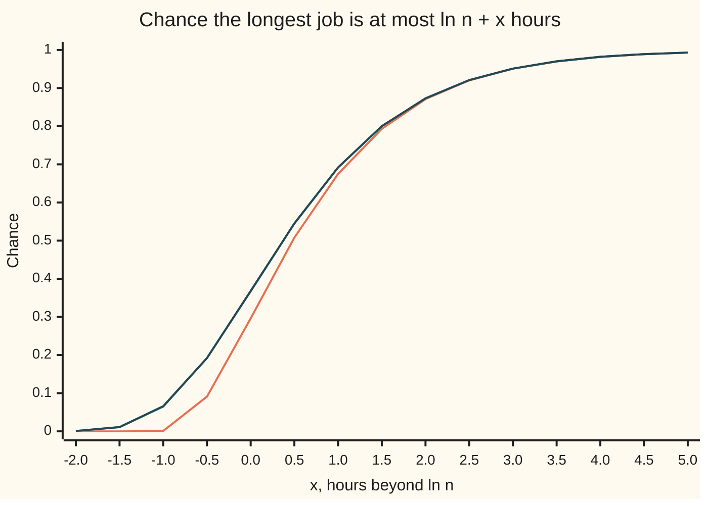
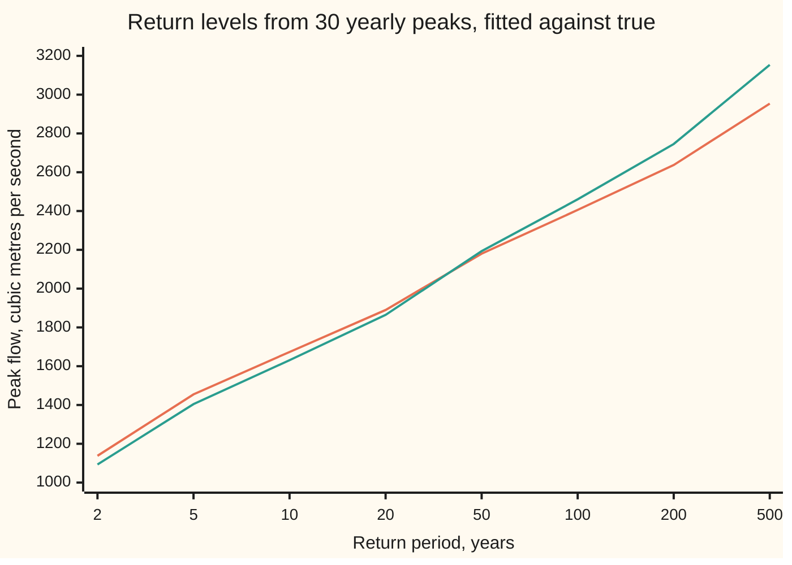

# Extreme value theory: why the largest of many settles into one of three shapes

[Syllabus](../../../SYLLABUS.md) → [Probability and statistics](../README.md) → [Transformations and Joint Laws](../README.md#s05) → Extreme value theory

---

## General Overview

A workshop logs 365 repair jobs a year. Each job takes an exponential time averaging one hour, independent of the others. The manager cares about one job only: the longest of the year.

The longest job grows with the number of jobs, roughly like ln 365 = 5.90 hours. Subtract that drift and the leftover settles down. The chance that the year's longest job ends within 5.90 + 2 hours is exactly 0.873401. A fixed curve, the **Gumbel law**, gives 0.873423 for the same question. With 365 jobs the limit is already right to four decimals.

The surprise is that this is not special to repair times. Take the largest of many independent draws from almost any law, shift it and stretch it by amounts that depend on the count, and, as [Order statistics](08-order-statistics-and-extremes.md) states, only three limit shapes can appear: **Gumbel** for thin tails, **Fréchet** for power tails and **Weibull** for a hard ceiling. This card proves why.

All three are one formula with one shape number, the **generalised extreme value law** (GEV). That is what makes floods, wind loads and record losses predictable. A river's peak flow each year is the largest of many daily flows, so it should follow a GEV. Fit a GEV to 30 years of peaks and it estimates the **100-year flood**: the flow passed with chance 1 in 100 in any one year. For the river on this card, the fit gives 2,405.6 cubic metres per second.

**A limit law for the largest of many draws must survive being maxed with copies of itself, and the only laws that do are the generalised extreme value family: Gumbel, Fréchet or Weibull, set by one shape number.**

**What kind of fact this is:** a theorem. Why it works proves that every limit is max-stable and that max-stable laws are exactly the GEV. It states two supporting results with sources: the convergence-of-types lemma and the von Mises test. Using a GEV for real river peaks is a model, checked against data rather than proved.

### The picture: the longest job, shifted, against its limit



Orange: the longest of n = 3 jobs. Green: the longest of n = 365 jobs. Dark blue: the Gumbel limit. The green and dark blue lines differ by at most 0.001 anywhere on the chart. Even three jobs come close above the middle.

---

## The formula

Notation first. $`M_n`$ is the largest of n independent draws from one law with cumulative chance $`F(x)`$ (the chance one draw is at most x). Its own law is $`F(x)^n`$ ([Order statistics](08-order-statistics-and-extremes.md)). Rescale it with a stretch $`a_n > 0`$ and a shift $`b_n`$, both chosen for each n.

If $`(M_n - b_n)/a_n`$ settles to a law $`G`$ that is not stuck at one point, then $`G`$ is, after a shift and stretch of its axis, the GEV:

```math
G(x) = \exp\left(-\left[1 + \xi\,\frac{x - \mu}{\sigma}\right]^{-1/\xi}\right) \quad \text{where } 1 + \xi\,\frac{x-\mu}{\sigma} > 0, \qquad G(x) = \exp\left(-e^{-(x-\mu)/\sigma}\right) \text{ when } \xi = 0
```

**Read it aloud:** the chance that the block maximum is at most x is e raised to minus a power of a shifted, scaled x; the shape number ξ picks the power, and ξ = 0 is the Gumbel curve.

The property that forces this shape is **max-stability**: the largest of k copies of G is again G, moved and stretched.

```math
G(x)^k = G(\alpha_k x + \beta_k) \quad \text{for every } k = 1, 2, 3, \ldots
```

**Read it aloud:** the chance that all k copies stay under x equals the chance that one copy stays under a moved and stretched x.

The use: the **T-year return level** $`z_T`$ is the level a yearly maximum passes with chance 1/T. Set $`G(z_T) = 1 - 1/T`$ and solve:

```math
z_T = \mu + \frac{\sigma}{\xi}\left[\left(-\ln\left(1 - \tfrac{1}{T}\right)\right)^{-\xi} - 1\right], \qquad z_T = \mu - \sigma \ln\left(-\ln\left(1 - \tfrac{1}{T}\right)\right) \text{ when } \xi = 0
```

**Read it aloud:** take the yearly chance of staying under, its minus log, raise that to minus ξ, subtract one, multiply by σ/ξ and add μ; when ξ = 0, take μ minus σ times the log of that minus log.

| Symbol | Plain meaning | In our example | Push it up and the answer… |
| --- | --- | --- | --- |
| $`n`$ | draws per block | 365 jobs a year | the maximum drifts up, by ln n here |
| $`M_n`$ | the largest of the n draws | the year's longest job | — |
| $`F(x), f(x), r(x), u`$ | one draw's chance of being at most x; its density f; the overshoot size $`r = (1 - F)/f`$ past a high line u (Step 4) | $`1 - e^{-x}`$, $`e^{-x}`$ and 1 for a job | — |
| $`a_n, b_n`$ | the stretch and shift that make $`M_n`$ settle | 1 and ln 365 = 5.899897 hours | — |
| $`x, z, x_i`$ | a level; z, a level on the rescaled axis $`b_n + a_n z`$ (Step 4); year i's peak flow | 2 hours beyond the shift; 1,015 m³/s in year 1 | larger x: a larger chance of staying under |
| $`G(x), y`$ | the limit law of the rescaled maximum; $`y = -\ln(-\ln G(x))`$, its double log (Step 3) | Gumbel, 0.873423 at x = 2; for Gumbel y = x | — |
| $`k, \alpha_k, \beta_k`$ | a number of copies, and the stretch and shift that undo taking their maximum | for Gumbel, $`\alpha_k = 1`$ and $`\beta_k = -\ln k`$ | — |
| $`\mu`$ | location: where the yearly peaks centre | fitted 1,038.8 m³/s | every return level rises by the same amount |
| $`\sigma`$ | scale: the spread of the yearly peaks | fitted 268.4 m³/s | return levels spread further apart |
| $`\xi, a`$ | shape: above 0 a power tail (Fréchet, ξ = 1/a for tail power a), 0 Gumbel, below 0 a ceiling (Weibull, ξ = −1/a) | fitted 0.0435; 0.6667 for the Pareto with a = 1.5 | rare levels rise fast |
| $`T, z_T`$ | a return period in years, and its return level | T = 100, z = 2,405.6 m³/s | longer T: a higher level |
| $`\ell`$ | the log-likelihood of the fit (below) | −216.085 at the fit | higher means the data fit better |

Units: m³/s is cubic metres of water per second passing the gauge.

### When it holds

- **Independent draws, or nearly so.** Floods on consecutive days are linked, but yearly peaks from different years are close to independent. Strongly linked draws behave like fewer draws, and the block maximum is smaller than the count suggests.
- **One law for every draw.** A river whose climate or land use is changing has a drifting law. Then μ, and maybe σ, must change with time, or the fit averages two rivers into one.
- **Big enough blocks.** The GEV is a limit. With n = 3 the answer at x = 2 is 0.870678 against the limit's 0.873423. A year of daily flows is usually a big enough block.
- **A law that has a limit at all.** Some laws, such as the Poisson count, have no rescaling that makes the maximum settle. The theorem says what the limit must be if one exists. It does not promise one.
- **A model for the real record.** Thirty yearly peaks pin down three numbers only loosely. The fit's 100-year level could sit anywhere from 1,745 to 3,217 m³/s on a 90% range.

---

## Why it works

### Step 0: a maximum of maxima is a maximum

The largest of 3,650 draws is the largest of ten blocks of 365. So whatever law the maximum settles to must also describe the largest of ten copies of itself, after a fresh shift and stretch. That one requirement, max-stability, is enough to pin down the whole family.

### Step 1: every limit is max-stable

Suppose $`F(a_n x + b_n)^n`$ settles to a law $`G`$ as n grows. Fix a whole number k. Two facts hold at once.

- Raise the whole statement to the power k: $`F(a_n x + b_n)^{nk}`$ settles to $`G(x)^k`$.
- Read the same sequence with block size nk: $`F(a_{nk} x + b_{nk})^{nk}`$ settles to $`G(x)`$.

The same laws, rescaled two ways, settle to $`G^k`$ and to $`G`$. The **convergence-of-types lemma** says two such limits differ only by a shift and stretch of the axis, so $`G(x)^k = G(\alpha_k x + \beta_k)`$. The lemma is stated here, not proved; it is in chapter 1 of de Haan and Ferreira (Sources).

The converse is free. Draw from a max-stable G itself: the maximum of n draws has law $`G(x)^n = G(\alpha_n x + \beta_n)`$, so undoing that stretch and shift gives G exactly, for every n. So the possible limits are exactly the max-stable laws.

### Step 2: the three max-stable shapes can be checked directly

Each family takes its own maximum and comes back moved.

- **Gumbel**, $`G(x) = e^{-e^{-x}}`$: $`G(x)^k = e^{-k e^{-x}} = e^{-e^{-(x - \ln k)}} = G(x - \ln k)`$. Taking a maximum only shifts it, by ln k.
- **Fréchet**, $`G(x) = e^{-x^{-a}}`$ for x > 0: $`G(x)^k = e^{-k x^{-a}} = G(k^{-1/a} x)`$. Taking a maximum only stretches it.
- **Weibull** (reversed), $`G(x) = e^{-(-x)^a}`$ for x < 0: $`G(x)^k = G(k^{1/a} x)`$. The ceiling at 0 stays put and the law squeezes toward it.

Here a > 0 is the tail power, the shape a of [Heavy tails](../04-Continuous%20Distributions/08-heavy-tails-pareto-and-cauchy.md). In the GEV it becomes ξ = 1/a for Fréchet and ξ = −1/a for Weibull.

The code runs 27 tests, nine per family, and finds the largest gap 1.1e-16, which is rounding only.

### Step 3: there are no other max-stable laws

Take a double logarithm. Write $`y = -\ln(-\ln G(x))`$; it rises with x, and $`G = \exp(-e^{-y})`$. Raising G to a power k only subtracts ln k from y. So max-stability says: moving every level x by a stretch and shift is the same as sliding y by a constant.

Read x as a function of y. Sliding y by any amount s must act on x as a stretch and shift. The fold solves this. Either the stretch is always 1, so x is a straight line in y, which is the Gumbel law. Or the stretch grows like $`e^{\xi s}`$, so x is an exponential in y, which gives the bracket raised to $`-1/\xi`$: Fréchet for ξ > 0, Weibull for ξ < 0. Gumbel is the edge case between them: as ξ shrinks to 0, $`(1 + \xi t)^{-1/\xi}`$ tends to $`e^{-t}`$.

<details>
<summary>Detailed proof: solving the max-stability equation</summary>

Max-stability holds first for whole numbers k. Applying it to $`G^{1/m}`$ and to powers $`k/m`$ extends it to every rational power, and, by the convergence-of-types lemma again, to every real power t > 0: there are $`A(t) > 0`$ and $`B(t)`$ with $`G(x)^t = G(A(t)x + B(t))`$.

Let $`L(x) = -\ln(-\ln G(x))`$ on the levels where $`0 < G < 1`$, and let H be its inverse, so x = H(y). If L has jumps or flat stretches, take H(y) as the smallest x with L(x) ≥ y; every step below still holds. Since $`-\ln(G^t) = t(-\ln G)`$, the equation becomes $`L(A x + B) = L(x) - \ln t`$. Put y = L(x) and s = −ln t, which runs over every real number:

$`\displaystyle H(y + s) = A\, H(y) + B, \qquad A, B \text{ depending on } s.`$

Set $`W(y) = H(y) - H(0)`$. Putting y = 0 gives $`H(s) = A H(0) + B`$; subtracting, $`W(y + s) - W(s) = \lambda(s)\, W(y)`$ with $`\lambda(s) = A`$. Swapping the roles of y and s gives $`W(y + s) - W(y) = \lambda(y)\, W(s)`$. Subtracting one equation from the other leaves

$`\displaystyle W(y)\,\bigl(\lambda(s) - 1\bigr) = W(s)\,\bigl(\lambda(y) - 1\bigr).`$

Case 1, λ(s) = 1 for every s. Then W(y + s) = W(y) + W(s), and W rises with y, so W(y) = σ y for some σ > 0. So x = μ + σ y, with μ = H(0), and $`G(x) = \exp(-e^{-(x-\mu)/\sigma})`$: Gumbel.

Case 2, $`\lambda(s_0) \neq 1`$ for some $`s_0`$. Then W(y) = c (λ(y) − 1) with $`c = W(s_0)/(\lambda(s_0) - 1)`$. Put that back in and divide by c: λ(y + s) = λ(y) λ(s). A monotone positive solution of that equation is an exponential, $`\lambda(y) = e^{\xi y}`$ with ξ ≠ 0. Write c = σ/ξ:

$`\displaystyle x = \mu + \frac{\sigma}{\xi}\left(e^{\xi y} - 1\right) \;\Longrightarrow\; e^{-y} = \left(1 + \xi\,\frac{x - \mu}{\sigma}\right)^{-1/\xi}.`$

Since $`G = \exp(-e^{-y})`$, this is the GEV with ξ ≠ 0. Both cases together are the GEV formula.

</details>

### Step 4: which law goes to which shape, by the von Mises test

The shape number comes from one function of the daily law, $`r(x) = (1 - F(x))/f(x)`$, where f is the density. r(u) is the typical size of an overshoot past a high line u. The **von Mises test**: if the slope of r tends to ξ toward the top of the range, the maximum's limit is the GEV with that ξ. The shift $`b_n`$ is the level one draw passes with chance 1/n, and the stretch is $`a_n = r(b_n)`$.

| Daily law | r(x) | Slope, so ξ | Shift and stretch | n = 365 against the limit |
| --- | --- | --- | --- | --- |
| Exponential, mean 1 | 1 | 0: Gumbel | ln n and 1 | 0.873401 against 0.873423, at x = 2 |
| Pareto, shape a = 1.5 | x / 1.5 | 0.6667: Fréchet | divide by $`n^{2/3}`$ | 0.7021 against 0.7022, at x = 2 |
| Uniform on 0 to 1 | 1 − x | −1: Weibull | shift by 1, stretch 1/n | 0.3674 against 0.3679, at x = −1 |

The Pareto and uniform rows use the classical shift and stretch, which give the Fréchet and Weibull forms of Step 2. The recipe gives $`b_n = n^{2/3}`$ and $`a_n = n^{2/3}/1.5`$ for the Pareto, and $`b_n = 1 - 1/n`$ and $`a_n = 1/n`$ for the uniform, and reads the maximum as $`b_n + a_n z`$. The two axes differ by a fixed shift and stretch, x = 1 + ξz for Fréchet and x = −(1 + ξz) for Weibull, so both pairs give the same limit law (the convergence-of-types lemma of Step 1).

The bell curve has r(x) close to 1/x far out, so its slope tends to 0 and its maxima head to Gumbel, slowly. That is why the worst of 20 bell-shaped days on [Order statistics](08-order-statistics-and-extremes.md) is only roughly Gumbel. The test is a sufficient condition, proved in de Haan and Ferreira, chapter 1; the fold shows why it works.

<details>
<summary>Why the slope of r sets the shape</summary>

The tail chance obeys $`\frac{d}{dx}\ln(1 - F(x)) = -1/r(x)`$. So the chance of passing u + r(u) z, given that u is passed, is

$`\displaystyle \frac{1 - F(u + r(u) z)}{1 - F(u)} = \exp\left(-\int_0^z \frac{r(u)}{r(u + r(u) w)}\, dw\right).`$

If r has slope close to ξ, then $`r(u + r(u)w) \approx r(u)(1 + \xi w)`$, and the integral tends to $`\int_0^z \frac{dw}{1 + \xi w} = \frac{1}{\xi}\ln(1 + \xi z)`$. So the overshoot chance tends to $`(1 + \xi z)^{-1/\xi}`$.

Now put u = $`b_n`$, where $`1 - F(b_n) = 1/n`$, and $`a_n = r(b_n)`$:

$`\displaystyle P\left(M_n \le b_n + a_n z\right) = \left(1 - \frac{(1 + \xi z)^{-1/\xi}}{n}(1 + \text{small})\right)^n \to \exp\left(-(1 + \xi z)^{-1/\xi}\right),`$

by the limit $`(1 - c/n)^n \to e^{-c}`$. For the repair jobs, c = $`e^{-x}`$ and the left side is exactly $`(1 - e^{-x}/n)^n`$.

</details>

### Step 5: fitting a GEV to yearly maxima

**Block maxima** is the method: cut the record into blocks, here years, keep each block's largest value, and fit a GEV to those values. A river gauge gives 30 yearly peak flows, in m³/s. They are simulated for this card from a GEV with μ = 1,000, σ = 250 and ξ = 0.1, so the fit can be judged against a known truth:

`1015 672 1633 1159 1059 919 1070 973 832 1031 803 1941 1697 1548 1530 1131 1570 972 1191 1341 1244 807 984 1038 1639 1945 775 1027 1637 1032`

Their mean is 1,207.2, their standard deviation 354.1, and the largest 1,945.

The fit uses **maximum likelihood**: choose the μ, σ and ξ under which the 30 observed peaks are most probable. In practice that means maximising the log-likelihood ℓ, the sum of the log of the GEV density at each peak:

```math
\ell(\mu, \sigma, \xi) = -30 \ln \sigma - \left(1 + \frac{1}{\xi}\right)\sum_{i=1}^{30} \ln\left(1 + \xi\,\frac{x_i - \mu}{\sigma}\right) - \sum_{i=1}^{30} \left(1 + \xi\,\frac{x_i - \mu}{\sigma}\right)^{-1/\xi}
```

**Read it aloud:** a penalty for a wide spread, then two sums that reward parameters putting high density where the peaks actually fell.

No formula solves for the best parameters, so the code searches: it starts from the Gumbel with the data's mean and spread, σ = 354.1 × √6/π = 276.1 and μ = 1,207.2 − 0.5772 × 276.1 = 1,047.8 (0.5772 is Euler's constant), and moves downhill on −ℓ. The maximum sits at μ = 1,038.8, σ = 268.4, ξ = 0.0435, with ℓ = −216.085. The method itself, and why it is the standard choice, is [Maximum likelihood](../07-Sampling%20and%20Estimation/04-maximum-likelihood.md), later in this wing.

Then the return level formula turns the fit into design flows:



Orange: the fitted GEV. Green: the true GEV that made the data. The fitted curve is too flat. It sits above the truth at short periods (1,138.0 against 1,093.3 at 2 years), crosses it between 20 and 50 years, and falls further below it as the period grows (2,405.6 against 2,460.2 at 100 years, 2,953.6 against 3,153.6 at 500). Thirty years say little about the shape ξ, fitted 0.0435 against a true 0.1, and a smaller ξ bends the curve up less.

---

## Worked numbers, by hand

| Step | Arithmetic | Value |
| --- | --- | --- |
| shift for 365 jobs | ln 365 | 5.899897 hours |
| one job's chance of passing 5.90 + 2 hours | $`e^{-2}/365`$ = 0.135335 / 365 | 0.000370782 |
| all 365 jobs under it | $`(1 - 0.000370782)^{365}`$ | **0.873401** |
| the Gumbel limit | $`\exp(-0.135335)`$ | **0.873423** |
| the 100-year chance of staying under | 1 − 1/100 | 0.99 |
| its minus log | −ln 0.99 | 0.010050 |
| the fit, unrounded | from the search in Step 5 | μ 1,038.802, σ 268.417, ξ 0.043462 |
| raised to minus the fitted ξ | $`0.010050^{-0.043462}`$ | 1.221320 |
| scale over shape | 268.417 / 0.043462 | 6,175.9 |
| rise above μ | 6,175.9 × (1.221320 − 1) | 1,366.847 |
| 100-year level | 1,038.802 + 1,366.847 | **2,405.6 m³/s** |

The exact chance and the Gumbel limit agree to four decimals, and the river's 100-year flood is estimated at 2,405.6 m³/s, against the 2,460.2 the true law gives.

### What breaks if you drop a piece

| Mistake | Comes out at | What went wrong |
| --- | --- | --- |
| No shift: ask for the longest job at most 2 hours | 8.901e-24 | The maximum drifts up like ln n; without the shift its law collapses to 0 at every fixed level |
| Take the largest of the 30 years as the 100-year flood | 1,945 m³/s, not 2,405.6 | A 30-year record's top value is roughly a 30-year level, not a 100-year one |
| Force ξ = 0 and fit a Gumbel | 2,302.2 m³/s, ℓ = −216.112 | The data barely tell ξ = 0 from 0.0435, yet the choice moves the 100-year level by about 100 m³/s |

The code prints all three.

---

## Code, from first principles, and it actually runs

Nothing imported holds the answer: no statistics module, no random module, no optimiser. Random numbers come from SplitMix64, a short written-out recipe that scrambles a counter into random-looking bits. Four roads meet:

- **Road 1, exact against limit against simulation.** The formula $`(1 - e^{-x}/n)^n`$, the Gumbel limit, and 20,000 simulated years of 365 jobs all give 0.8734. The simulation's standard error (se, the typical size of its random miss) is 0.0024.
- **Road 2, the shapes.** Max-stability is tested for all three families at 27 points. Pareto and uniform maxima are compared with their Fréchet and Weibull limits, and the von Mises slopes are taken by finite differences.
- **Road 3, two fits.** Nelder–Mead, a search that moves a small cluster of trial points downhill, finds the maximum likelihood. A brute-force grid of 127,551 parameter triples, searched blindly, must land within one grid step, and the slope of ℓ at the fit must be 0. A second road to ℓ itself takes each peak's density as the slope of G, by finite differences, and must match the likelihood formula.
- **Road 4, the return level two ways.** The closed formula against bisection (halving an interval until it traps the answer) on G(z) = 0.99. Then a **parametric bootstrap**: simulate 200 new 30-year records from the fitted law, refit each, and read the middle 90% of their 100-year levels.

The asserts compare roads, never a number with itself. A simulated number may miss by up to four standard errors.

### Python

```python
# Extreme value theory -- the check behind the card.  Nothing imported holds the answer.
# Part 1: largest of n exponential waits minus ln n: exact formula, Gumbel limit, simulation.
# Part 2: max-stability of the three limits; the von Mises shape of three laws.
# Part 3: 30 yearly flood maxima simulated from a known GEV, fitted by maximum likelihood
#   (Nelder-Mead) and by a brute-force grid; the 100-year level by formula and by bisection.
import math

M64 = (1 << 64) - 1
class Rng:
    def __init__(self, seed): self.s = seed
    def u(self):  # SplitMix64 mapped into (0, 1)
        self.s = (self.s + 0x9E3779B97F4A7C15) & M64
        z = ((self.s ^ (self.s >> 30)) * 0xBF58476D1CE4E5B9) & M64
        z = ((z ^ (z >> 27)) * 0x94D049BB133111EB) & M64
        return (((z ^ (z >> 31)) >> 11) + 0.5) / 9007199254740992.0

def gev_cdf(z, mu, sg, xi):
    t = (z - mu) / sg; w = 1 + xi * t
    if abs(xi) < 1e-12: return math.exp(-math.exp(-t))
    if w <= 0: return 0.0 if xi > 0 else 1.0
    return math.exp(-w ** (-1 / xi))

def gev_level(p, mu, sg, xi):  # the level a year stays under with chance p
    y = -math.log(p)
    return mu - sg * math.log(y) if abs(xi) < 1e-12 else mu + sg * (y ** (-xi) - 1) / xi

def nll(x, mu, sg, xi):  # minus the log-likelihood of the GEV for the data x
    if sg <= 0: return math.inf
    s = len(x) * math.log(sg)
    for v in x:
        t = (v - mu) / sg
        if abs(xi) < 1e-12: s += t + math.exp(-t); continue
        w = 1 + xi * t
        if w <= 0: return math.inf
        s += (1 + 1 / xi) * math.log(w) + w ** (-1 / xi)
    return s

def nelder_mead(f, p0, steps, iters):
    d = len(p0)
    pts = [list(p0)] + [[p0[j] + (steps[j] if i == j else 0.0) for j in range(d)] for i in range(d)]
    val = [f(p) for p in pts]
    for _ in range(iters):
        idx = sorted(range(d + 1), key=lambda i: val[i])
        pts = [pts[i] for i in idx]; val = [val[i] for i in idx]
        c = [sum(pts[i][j] for i in range(d)) / d for j in range(d)]
        r = [c[j] + (c[j] - pts[d][j]) for j in range(d)]; fr = f(r)
        if fr < val[0]:
            e = [c[j] + 2 * (c[j] - pts[d][j]) for j in range(d)]; fe = f(e)
            pts[d], val[d] = (e, fe) if fe < fr else (r, fr)
        elif fr < val[d - 1]: pts[d], val[d] = r, fr
        else:
            k = [c[j] + 0.5 * (pts[d][j] - c[j]) for j in range(d)]; fk = f(k)
            if fk < val[d]: pts[d], val[d] = k, fk
            else:
                for i in range(1, d + 1):
                    pts[i] = [pts[0][j] + 0.5 * (pts[i][j] - pts[0][j]) for j in range(d)]; val[i] = f(pts[i])
    b = min(range(d + 1), key=lambda i: val[i])
    return pts[b], val[b]

# Part 1 -- the largest of n exponential waits
N, X = 365, 2.0
exact, gumbel = (1 - math.exp(-X) / N) ** N, math.exp(-math.exp(-X))
rng, T, hits = Rng(20261123), 20000, 0  # T simulated years of N daily waits
for _ in range(T):
    m = max(-math.log(rng.u()) for _ in range(N))
    hits += m - math.log(N) <= X
sim = hits / T; se = math.sqrt(sim * (1 - sim) / T)
print(f"ln 365 {math.log(N):.6f}  e^-2 {math.exp(-X):.6f}  e^-2/365 {math.exp(-X) / N:.9f}")
print(f"exp max n=365 x=2: exact {exact:.6f}  gumbel {gumbel:.6f}  sim {sim:.4f} (se {se:.4f})")
assert abs(exact - gumbel) < 1e-4 and abs(sim - exact) < 4 * se
for n in (3, 10, 100, 365, 10000): print(f"n={n:5d}: P(max - ln n <= 2) = {(1 - math.exp(-X) / n) ** n:.6f}")
xs = [i / 2 - 2 for i in range(15)]
print("chart x:", " ".join(f"{x:5.1f}" for x in xs))
for n in (3, 365): print(f"chart n={n:3d}:", " ".join(f"{max(0.0, 1 - math.exp(-x) / n) ** n:5.3f}" for x in xs))
print("chart gumbel:", " ".join(f"{math.exp(-math.exp(-x)):5.3f}" for x in xs))
print(f"no shift: P(max <= 2) = {(1 - math.exp(-X)) ** N:.3e}")
# Part 2 -- max-stability: G(x)^k equals G at a shifted or rescaled point
A, worst, h = 1.5, 0.0, 1e-4  # Pareto shape a = 1.5, as on the heavy-tails card
fr = lambda y: math.exp(-y ** -A) if y > 0 else 0.0  # Frechet, shape 1/A
wb = lambda y: math.exp(y) if y < 0 else 1.0  # reversed Weibull, ceiling 0
for k in (2, 10, 365):
    for x in (-1.0, 0.5, 2.0):
        g = gev_cdf(x, 0, 1, 0.0) ** k; worst = max(worst, abs(g - gev_cdf(x - math.log(k), 0, 1, 0.0)))
        worst = max(worst, abs(fr(x + 2) ** k - fr((x + 2) * k ** (-1 / A))))
        worst = max(worst, abs(wb(x - 3) ** k - wb((x - 3) * k)))
print(f"max-stability, largest gap over 27 tests: {worst:.1e}")
assert worst < 1e-12
par, uni = (1 - 2.0 ** -A / N) ** N, (1 - 1 / N) ** N
print(f"pareto a=1.5, P(max <= 2 n^(2/3)): {par:.4f}  frechet {math.exp(-2.0 ** -A):.4f}")
print(f"uniform, P(n(max - 1) <= -1): {uni:.4f}  weibull {math.exp(-1):.4f}")
assert abs(par - math.exp(-2.0 ** -A)) < 2e-3 and abs(uni - math.exp(-1)) < 1e-3
r = lambda sf, pdf, x: sf(x) / pdf(x)  # (1 - F)/f; its slope far out is the shape xi
for name, sf, pdf, x0, xi in (("exponential", lambda x: math.exp(-x), lambda x: math.exp(-x), 20.0, 0.0),
                              ("pareto 1.5", lambda x: x ** -A, lambda x: A * x ** (-A - 1), 50.0, 1 / A),
                              ("uniform", lambda x: 1 - x, lambda x: 1.0, 0.99, -1.0)):
    sl = (r(sf, pdf, x0 + h) - r(sf, pdf, x0 - h)) / (2 * h)
    print(f"von Mises slope, {name}: {sl:+.4f}"); assert abs(sl - xi) < 1e-6
# Part 3 -- 30 yearly flood maxima, cubic metres per second
MU, SG, XI, YEARS, g = 1000.0, 250.0, 0.1, 30, Rng(7)
data = [float(round(gev_level(g.u(), MU, SG, XI))) for _ in range(YEARS)]
print("flows:", " ".join(str(int(v)) for v in data))
mean = sum(data) / YEARS; sd = math.sqrt(sum((v - mean) ** 2 for v in data) / (YEARS - 1))
s0 = sd * math.sqrt(6) / math.pi; m0 = mean - 0.5772156649 * s0
print(f"mean {mean:.1f}  sd {sd:.1f}  largest {max(data):.0f}  start mu {m0:.1f} sigma {s0:.1f}")
f3 = lambda p: nll(data, p[0], p[1], p[2])
(mu, sg, xi), best = nelder_mead(f3, [m0, s0, 0.1], [50.0, 25.0, 0.1], 1500)
z100 = gev_level(0.99, mu, sg, xi)
print(f"ML fit: mu {mu:.1f}  sigma {sg:.1f}  xi {xi:.4f}  loglik {-best:.3f}")
dens = sum(-math.log((gev_cdf(v + 1e-3, mu, sg, xi) - gev_cdf(v - 1e-3, mu, sg, xi)) / 2e-3) for v in data)
print(f"log-likelihood from the slope of G: {-dens:.3f}"); assert abs(dens - best) < 1e-6
gb = (0.0, 0.0, 0.0, math.inf)
for i in range(61):
    for j in range(41):
        for k in range(51):
            v = nll(data, 700 + 10 * i, 100 + 10 * j, -0.4 + 0.02 * k)
            if v < gb[3]: gb = (700 + 10 * i, 100 + 10 * j, -0.4 + 0.02 * k, v)
print(f"grid fit ({61 * 41 * 51} points): mu {gb[0]}  sigma {gb[1]}  xi {gb[2]:.2f}  loglik {-gb[3]:.3f}")
assert best <= gb[3] and abs(gb[0] - mu) <= 10 and abs(gb[1] - sg) <= 10 and abs(gb[2] - xi) <= 0.02
bump = lambda q, e: [mu + e * (q == 0), sg + e * (q == 1), xi + e * (q == 2)]
gmax = max(abs(f3(bump(q, e)) - f3(bump(q, -e))) / (2 * e) for q, e in ((0, 0.01), (1, 0.01), (2, 1e-5)))
print(f"largest slope of the log-likelihood at the fit: {gmax:.4f}"); assert gmax < 0.01
lo, hi = mu, mu + 100 * sg
for _ in range(200):
    mid = (lo + hi) / 2; lo, hi = (mid, hi) if gev_cdf(mid, mu, sg, xi) < 0.99 else (lo, mid)
y1 = -math.log(0.99); print(f"by hand: mu {mu:.3f}  sigma {sg:.3f}  xi {xi:.6f}  y {y1:.6f}  y^-xi {y1 ** -xi:.6f}  sigma/xi {sg / xi:.1f}  rise {sg * (y1 ** -xi - 1) / xi:.3f}")
print(f"100-year level: formula {z100:.1f}  bisection {lo:.1f}  true {gev_level(0.99, MU, SG, XI):.1f}")
assert abs(lo - z100) < 1e-6
for T_ in (2, 5, 10, 20, 50, 100, 200, 500):
    print(f"return period {T_:3d} years: fitted {gev_level(1 - 1 / T_, mu, sg, xi):7.1f}  true {gev_level(1 - 1 / T_, MU, SG, XI):7.1f}")
(gm, gs), gbv = nelder_mead(lambda p: nll(data, p[0], p[1], 0.0), [m0, s0], [50.0, 25.0], 800)
print(f"gumbel fit (xi forced to 0): mu {gm:.1f}  sigma {gs:.1f}  100-year {gev_level(0.99, gm, gs, 0.0):.1f}  loglik {-gbv:.3f}")
assert -gbv <= -best
boot = []
for _ in range(200):
    y = [gev_level(g.u(), mu, sg, xi) for _ in range(YEARS)]
    (bm, bs, bx), _v = nelder_mead(lambda p: nll(y, p[0], p[1], p[2]), [mu, sg, xi], [50.0, 25.0, 0.1], 600)
    boot.append(gev_level(0.99, bm, bs, bx))
boot.sort(); print(f"bootstrap 90% range of the 100-year level: {boot[9]:.0f} to {boot[189]:.0f}")
print(f"chance of at least one 100-year flood: in 30 years {1 - 0.99 ** 30:.4f}, in 100 years {1 - 0.99 ** 100:.4f}")
print("ALL CHECKS PASS")
```

**Ran 2026-11-23 on macOS, Python 3.14.10, standard library only. All checks passed. Output, pasted from the run:**

```
ln 365 5.899897  e^-2 0.135335  e^-2/365 0.000370782
exp max n=365 x=2: exact 0.873401  gumbel 0.873423  sim 0.8734 (se 0.0024)
n=    3: P(max - ln n <= 2) = 0.870678
n=   10: P(max - ln n <= 2) = 0.872616
n=  100: P(max - ln n <= 2) = 0.873343
n=  365: P(max - ln n <= 2) = 0.873401
n=10000: P(max - ln n <= 2) = 0.873422
chart x:  -2.0  -1.5  -1.0  -0.5   0.0   0.5   1.0   1.5   2.0   2.5   3.0   3.5   4.0   4.5   5.0
chart n=  3: 0.000 0.000 0.001 0.091 0.296 0.508 0.675 0.793 0.871 0.920 0.951 0.970 0.982 0.989 0.993
chart n=365: 0.001 0.011 0.065 0.192 0.367 0.545 0.692 0.800 0.873 0.921 0.951 0.970 0.982 0.989 0.993
chart gumbel: 0.001 0.011 0.066 0.192 0.368 0.545 0.692 0.800 0.873 0.921 0.951 0.970 0.982 0.989 0.993
no shift: P(max <= 2) = 8.901e-24
max-stability, largest gap over 27 tests: 1.1e-16
pareto a=1.5, P(max <= 2 n^(2/3)): 0.7021  frechet 0.7022
uniform, P(n(max - 1) <= -1): 0.3674  weibull 0.3679
von Mises slope, exponential: +0.0000
von Mises slope, pareto 1.5: +0.6667
von Mises slope, uniform: -1.0000
flows: 1015 672 1633 1159 1059 919 1070 973 832 1031 803 1941 1697 1548 1530 1131 1570 972 1191 1341 1244 807 984 1038 1639 1945 775 1027 1637 1032
mean 1207.2  sd 354.1  largest 1945  start mu 1047.8 sigma 276.1
ML fit: mu 1038.8  sigma 268.4  xi 0.0435  loglik -216.085
log-likelihood from the slope of G: -216.085
grid fit (127551 points): mu 1040  sigma 270  xi 0.04  loglik -216.085
largest slope of the log-likelihood at the fit: 0.0000
by hand: mu 1038.802  sigma 268.417  xi 0.043462  y 0.010050  y^-xi 1.221320  sigma/xi 6175.9  rise 1366.847
100-year level: formula 2405.6  bisection 2405.6  true 2460.2
return period   2 years: fitted  1138.0  true  1093.3
return period   5 years: fitted  1454.8  true  1404.6
return period  10 years: fitted  1673.4  true  1630.9
return period  20 years: fitted  1889.8  true  1864.6
return period  50 years: fitted  2180.2  true  2193.2
return period 100 years: fitted  2405.6  true  2460.2
return period 200 years: fitted  2637.2  true  2745.6
return period 500 years: fitted  2953.6  true  3153.6
gumbel fit (xi forced to 0): mu 1045.0  sigma 273.3  100-year 2302.2  loglik -216.112
bootstrap 90% range of the 100-year level: 1745 to 3217
chance of at least one 100-year flood: in 30 years 0.2603, in 100 years 0.6340
ALL CHECKS PASS
```

### Rust

```rust
// Extreme value theory -- the check behind the card.  std only, no crates.
// Part 1: largest of n exponential waits minus ln n: exact formula, Gumbel limit, simulation.
// Part 2: max-stability of the three limits; the von Mises shape of three laws.
// Part 3: 30 yearly flood maxima simulated from a known GEV, fitted by maximum likelihood
//   (Nelder-Mead) and by a brute-force grid; the 100-year level by formula and by bisection.
struct Rng { s: u64 }
impl Rng {
    fn u(&mut self) -> f64 { // SplitMix64 mapped into (0, 1)
        self.s = self.s.wrapping_add(0x9E3779B97F4A7C15);
        let mut z = (self.s ^ (self.s >> 30)).wrapping_mul(0xBF58476D1CE4E5B9);
        z = (z ^ (z >> 27)).wrapping_mul(0x94D049BB133111EB);
        (((z ^ (z >> 31)) >> 11) as f64 + 0.5) / 9007199254740992.0
    }
}
fn gev_cdf(z: f64, mu: f64, sg: f64, xi: f64) -> f64 {
    let t = (z - mu) / sg; let w = 1.0 + xi * t;
    if xi.abs() < 1e-12 { return (-(-t).exp()).exp(); }
    if w <= 0.0 { return if xi > 0.0 { 0.0 } else { 1.0 }; }
    (-w.powf(-1.0 / xi)).exp()
}
fn gev_level(p: f64, mu: f64, sg: f64, xi: f64) -> f64 { // the level a year stays under with chance p
    let y = -p.ln();
    if xi.abs() < 1e-12 { mu - sg * y.ln() } else { mu + sg * (y.powf(-xi) - 1.0) / xi }
}
fn nll(x: &[f64], mu: f64, sg: f64, xi: f64) -> f64 { // minus the log-likelihood of the GEV
    if sg <= 0.0 { return f64::INFINITY; }
    let mut s = x.len() as f64 * sg.ln();
    for &v in x {
        let t = (v - mu) / sg;
        if xi.abs() < 1e-12 { s += t + (-t).exp(); continue; }
        let w = 1.0 + xi * t;
        if w <= 0.0 { return f64::INFINITY; }
        s += (1.0 + 1.0 / xi) * w.ln() + w.powf(-1.0 / xi);
    }
    s
}
fn nelder_mead(f: &dyn Fn(&[f64]) -> f64, p0: &[f64], steps: &[f64], iters: usize) -> (Vec<f64>, f64) {
    let d = p0.len();
    let mut pts: Vec<Vec<f64>> = vec![p0.to_vec()];
    for i in 0..d { pts.push((0..d).map(|j| p0[j] + if i == j { steps[j] } else { 0.0 }).collect()); }
    let mut val: Vec<f64> = pts.iter().map(|p| f(p)).collect();
    for _ in 0..iters {
        let mut idx: Vec<usize> = (0..=d).collect();
        idx.sort_by(|&a, &b| val[a].partial_cmp(&val[b]).unwrap());
        pts = idx.iter().map(|&i| pts[i].clone()).collect(); val = idx.iter().map(|&i| val[i]).collect();
        let c: Vec<f64> = (0..d).map(|j| (0..d).map(|i| pts[i][j]).sum::<f64>() / d as f64).collect();
        let r: Vec<f64> = (0..d).map(|j| c[j] + (c[j] - pts[d][j])).collect(); let fr = f(&r);
        if fr < val[0] {
            let e: Vec<f64> = (0..d).map(|j| c[j] + 2.0 * (c[j] - pts[d][j])).collect(); let fe = f(&e);
            if fe < fr { pts[d] = e; val[d] = fe; } else { pts[d] = r; val[d] = fr; }
        } else if fr < val[d - 1] { pts[d] = r; val[d] = fr; }
        else {
            let k: Vec<f64> = (0..d).map(|j| c[j] + 0.5 * (pts[d][j] - c[j])).collect(); let fk = f(&k);
            if fk < val[d] { pts[d] = k; val[d] = fk; } else {
                for i in 1..=d {
                    pts[i] = (0..d).map(|j| pts[0][j] + 0.5 * (pts[i][j] - pts[0][j])).collect(); val[i] = f(&pts[i]);
                }
            }
        }
    }
    let mut b = 0;
    for i in 1..=d { if val[i] < val[b] { b = i; } }
    (pts[b].clone(), val[b])
}
fn row(v: &[f64]) -> String { v.iter().map(|x| format!("{:5.3}", x)).collect::<Vec<_>>().join(" ") }
fn main() {
    // Part 1 -- the largest of n exponential waits
    let (n, x) = (365usize, 2.0f64); let nf = n as f64;
    let exact = (1.0 - (-x).exp() / nf).powf(nf);
    let gumbel = (-(-x).exp()).exp();
    let (mut rng, t, mut hits) = (Rng { s: 20261123 }, 20000usize, 0usize); // t simulated years of n daily waits
    for _ in 0..t {
        let mut m = f64::NEG_INFINITY;
        for _ in 0..n { m = m.max(-rng.u().ln()); }
        if m - nf.ln() <= x { hits += 1; }
    }
    let sim = hits as f64 / t as f64; let se = (sim * (1.0 - sim) / t as f64).sqrt();
    println!("ln 365 {:.6}  e^-2 {:.6}  e^-2/365 {:.9}", nf.ln(), (-x).exp(), (-x).exp() / nf);
    println!("exp max n=365 x=2: exact {:.6}  gumbel {:.6}  sim {:.4} (se {:.4})", exact, gumbel, sim, se);
    assert!((exact - gumbel).abs() < 1e-4 && (sim - exact).abs() < 4.0 * se);
    for &k in &[3.0f64, 10.0, 100.0, 365.0, 10000.0] {
        println!("n={:5}: P(max - ln n <= 2) = {:.6}", k as u64, (1.0 - (-x).exp() / k).powf(k));
    }
    let xs: Vec<f64> = (0..15).map(|i| i as f64 / 2.0 - 2.0).collect();
    println!("chart x: {}", xs.iter().map(|x| format!("{:5.1}", x)).collect::<Vec<_>>().join(" "));
    for &k in &[3.0f64, 365.0] {
        println!("chart n={:3}: {}", k as u64, row(&xs.iter().map(|x| (1.0 - (-x).exp() / k).max(0.0).powf(k)).collect::<Vec<_>>()));
    }
    println!("chart gumbel: {}", row(&xs.iter().map(|x| (-(-x).exp()).exp()).collect::<Vec<_>>()));
    let ns = (1.0 - (-x).exp()).powf(nf);
    println!("no shift: P(max <= 2) = {:.3e}", ns);
    // Part 2 -- max-stability: G(x)^k equals G at a shifted or rescaled point
    let (a, mut worst) = (1.5f64, 0.0f64); // Pareto shape a = 1.5, as on the heavy-tails card
    let fr = |y: f64| if y > 0.0 { (-y.powf(-a)).exp() } else { 0.0 }; // Frechet, shape 1/a
    let wb = |y: f64| if y < 0.0 { y.exp() } else { 1.0 }; // reversed Weibull, ceiling 0
    for &k in &[2.0f64, 10.0, 365.0] {
        for &x in &[-1.0f64, 0.5, 2.0] {
            let g = gev_cdf(x, 0.0, 1.0, 0.0).powf(k);
            worst = worst.max((g - gev_cdf(x - k.ln(), 0.0, 1.0, 0.0)).abs());
            worst = worst.max((fr(x + 2.0).powf(k) - fr((x + 2.0) * k.powf(-1.0 / a))).abs());
            worst = worst.max((wb(x - 3.0).powf(k) - wb((x - 3.0) * k)).abs());
        }
    }
    println!("max-stability, largest gap over 27 tests: {:.1e}", worst);
    assert!(worst < 1e-12);
    let par = (1.0 - 2.0f64.powf(-a) / nf).powf(nf); let uni = (1.0 - 1.0 / nf).powf(nf);
    let frl = (-2.0f64.powf(-a)).exp(); let wbl = (-1.0f64).exp();
    println!("pareto a=1.5, P(max <= 2 n^(2/3)): {:.4}  frechet {:.4}", par, frl);
    println!("uniform, P(n(max - 1) <= -1): {:.4}  weibull {:.4}", uni, wbl);
    assert!((par - frl).abs() < 2e-3 && (uni - wbl).abs() < 1e-3);
    let h = 1e-4; // (1 - F)/f; its slope far out is the shape xi
    let laws: [(&str, Box<dyn Fn(f64) -> f64>, Box<dyn Fn(f64) -> f64>, f64, f64); 3] = [
        ("exponential", Box::new(|x: f64| (-x).exp()), Box::new(|x: f64| (-x).exp()), 20.0, 0.0),
        ("pareto 1.5", Box::new(move |x: f64| x.powf(-a)), Box::new(move |x: f64| a * x.powf(-a - 1.0)), 50.0, 1.0 / a),
        ("uniform", Box::new(|x: f64| 1.0 - x), Box::new(|_x: f64| 1.0), 0.99, -1.0)];
    for (name, sf, pdf, x0, xi) in laws.iter() {
        let r = |x: f64| sf(x) / pdf(x);
        let sl = (r(x0 + h) - r(x0 - h)) / (2.0 * h);
        println!("von Mises slope, {}: {:+.4}", name, sl); assert!((sl - xi).abs() < 1e-6);
    }
    // Part 3 -- 30 yearly flood maxima, cubic metres per second
    let (mu0, sg0, xi0, years) = (1000.0f64, 250.0f64, 0.1f64, 30usize); let mut g = Rng { s: 7 };
    let data: Vec<f64> = (0..years).map(|_| gev_level(g.u(), mu0, sg0, xi0).round()).collect();
    println!("flows: {}", data.iter().map(|v| format!("{}", *v as i64)).collect::<Vec<_>>().join(" "));
    let mean = data.iter().sum::<f64>() / years as f64;
    let sd = (data.iter().map(|v| (v - mean).powi(2)).sum::<f64>() / (years as f64 - 1.0)).sqrt();
    let s0 = sd * 6.0f64.sqrt() / std::f64::consts::PI; let m0 = mean - 0.5772156649 * s0;
    let big = data.iter().cloned().fold(f64::MIN, f64::max);
    println!("mean {:.1}  sd {:.1}  largest {:.0}  start mu {:.1} sigma {:.1}", mean, sd, big, m0, s0);
    let f3 = |p: &[f64]| nll(&data, p[0], p[1], p[2]);
    let (p, best) = nelder_mead(&f3, &[m0, s0, 0.1], &[50.0, 25.0, 0.1], 1500);
    let (mu, sg, xi) = (p[0], p[1], p[2]);
    let z100 = gev_level(0.99, mu, sg, xi);
    println!("ML fit: mu {:.1}  sigma {:.1}  xi {:.4}  loglik {:.3}", mu, sg, xi, -best);
    let dens: f64 = data.iter().map(|&v| -((gev_cdf(v + 1e-3, mu, sg, xi) - gev_cdf(v - 1e-3, mu, sg, xi)) / 2e-3).ln()).sum();
    println!("log-likelihood from the slope of G: {:.3}", -dens); assert!((dens - best).abs() < 1e-6);
    let mut gb = (0.0, 0.0, 0.0, f64::INFINITY);
    for i in 0..61 { for j in 0..41 { for k in 0..51 {
        let (a1, b1, c1) = (700.0 + 10.0 * i as f64, 100.0 + 10.0 * j as f64, -0.4 + 0.02 * k as f64);
        let v = nll(&data, a1, b1, c1);
        if v < gb.3 { gb = (a1, b1, c1, v); }
    } } }
    println!("grid fit ({} points): mu {}  sigma {}  xi {:.2}  loglik {:.3}", 61 * 41 * 51, gb.0, gb.1, gb.2, -gb.3);
    assert!(best <= gb.3 && (gb.0 - mu).abs() <= 10.0 && (gb.1 - sg).abs() <= 10.0 && (gb.2 - xi).abs() <= 0.02);
    let bump = |q: usize, e: f64| vec![mu + if q == 0 { e } else { 0.0 }, sg + if q == 1 { e } else { 0.0 }, xi + if q == 2 { e } else { 0.0 }];
    let grad: Vec<f64> = [(0usize, 0.01f64), (1, 0.01), (2, 1e-5)].iter().map(|&(q, e)| (f3(&bump(q, e)) - f3(&bump(q, -e))) / (2.0 * e)).collect();
    let gmax = grad.iter().fold(0.0f64, |m, v| m.max(v.abs()));
    println!("largest slope of the log-likelihood at the fit: {:.4}", gmax); assert!(gmax < 0.01);
    let (mut lo, mut hi) = (mu, mu + 100.0 * sg);
    for _ in 0..200 { let mid = (lo + hi) / 2.0; if gev_cdf(mid, mu, sg, xi) < 0.99 { lo = mid } else { hi = mid } }
    let y1 = -0.99f64.ln(); println!("by hand: mu {:.3}  sigma {:.3}  xi {:.6}  y {:.6}  y^-xi {:.6}  sigma/xi {:.1}  rise {:.3}", mu, sg, xi, y1, y1.powf(-xi), sg / xi, sg * (y1.powf(-xi) - 1.0) / xi);
    println!("100-year level: formula {:.1}  bisection {:.1}  true {:.1}", z100, lo, gev_level(0.99, mu0, sg0, xi0));
    assert!((lo - z100).abs() < 1e-6);
    for &tp in &[2.0f64, 5.0, 10.0, 20.0, 50.0, 100.0, 200.0, 500.0] {
        println!("return period {:3} years: fitted {:7.1}  true {:7.1}", tp as u64, gev_level(1.0 - 1.0 / tp, mu, sg, xi), gev_level(1.0 - 1.0 / tp, mu0, sg0, xi0));
    }
    let (q, gbv) = nelder_mead(&|p: &[f64]| nll(&data, p[0], p[1], 0.0), &[m0, s0], &[50.0, 25.0], 800);
    println!("gumbel fit (xi forced to 0): mu {:.1}  sigma {:.1}  100-year {:.1}  loglik {:.3}", q[0], q[1], gev_level(0.99, q[0], q[1], 0.0), -gbv);
    assert!(-gbv <= -best);
    let mut boot: Vec<f64> = Vec::new();
    for _ in 0..200 {
        let y: Vec<f64> = (0..years).map(|_| gev_level(g.u(), mu, sg, xi)).collect();
        let (b, _v) = nelder_mead(&|p: &[f64]| nll(&y, p[0], p[1], p[2]), &[mu, sg, xi], &[50.0, 25.0, 0.1], 600);
        boot.push(gev_level(0.99, b[0], b[1], b[2]));
    }
    boot.sort_by(|a, b| a.partial_cmp(b).unwrap());
    println!("bootstrap 90% range of the 100-year level: {:.0} to {:.0}", boot[9], boot[189]);
    println!("chance of at least one 100-year flood: in 30 years {:.4}, in 100 years {:.4}", 1.0 - 0.99f64.powi(30), 1.0 - 0.99f64.powi(100));
    println!("ALL CHECKS PASS");
}
```

**Ran 2026-11-23 on macOS, rustc 1.98.1, no crates. All checks passed. Output, pasted from the run:**

```
ln 365 5.899897  e^-2 0.135335  e^-2/365 0.000370782
exp max n=365 x=2: exact 0.873401  gumbel 0.873423  sim 0.8734 (se 0.0024)
n=    3: P(max - ln n <= 2) = 0.870678
n=   10: P(max - ln n <= 2) = 0.872616
n=  100: P(max - ln n <= 2) = 0.873343
n=  365: P(max - ln n <= 2) = 0.873401
n=10000: P(max - ln n <= 2) = 0.873422
chart x:  -2.0  -1.5  -1.0  -0.5   0.0   0.5   1.0   1.5   2.0   2.5   3.0   3.5   4.0   4.5   5.0
chart n=  3: 0.000 0.000 0.001 0.091 0.296 0.508 0.675 0.793 0.871 0.920 0.951 0.970 0.982 0.989 0.993
chart n=365: 0.001 0.011 0.065 0.192 0.367 0.545 0.692 0.800 0.873 0.921 0.951 0.970 0.982 0.989 0.993
chart gumbel: 0.001 0.011 0.066 0.192 0.368 0.545 0.692 0.800 0.873 0.921 0.951 0.970 0.982 0.989 0.993
no shift: P(max <= 2) = 8.901e-24
max-stability, largest gap over 27 tests: 1.1e-16
pareto a=1.5, P(max <= 2 n^(2/3)): 0.7021  frechet 0.7022
uniform, P(n(max - 1) <= -1): 0.3674  weibull 0.3679
von Mises slope, exponential: +0.0000
von Mises slope, pareto 1.5: +0.6667
von Mises slope, uniform: -1.0000
flows: 1015 672 1633 1159 1059 919 1070 973 832 1031 803 1941 1697 1548 1530 1131 1570 972 1191 1341 1244 807 984 1038 1639 1945 775 1027 1637 1032
mean 1207.2  sd 354.1  largest 1945  start mu 1047.8 sigma 276.1
ML fit: mu 1038.8  sigma 268.4  xi 0.0435  loglik -216.085
log-likelihood from the slope of G: -216.085
grid fit (127551 points): mu 1040  sigma 270  xi 0.04  loglik -216.085
largest slope of the log-likelihood at the fit: 0.0000
by hand: mu 1038.802  sigma 268.417  xi 0.043462  y 0.010050  y^-xi 1.221320  sigma/xi 6175.9  rise 1366.847
100-year level: formula 2405.6  bisection 2405.6  true 2460.2
return period   2 years: fitted  1138.0  true  1093.3
return period   5 years: fitted  1454.8  true  1404.6
return period  10 years: fitted  1673.4  true  1630.9
return period  20 years: fitted  1889.8  true  1864.6
return period  50 years: fitted  2180.2  true  2193.2
return period 100 years: fitted  2405.6  true  2460.2
return period 200 years: fitted  2637.2  true  2745.6
return period 500 years: fitted  2953.6  true  3153.6
gumbel fit (xi forced to 0): mu 1045.0  sigma 273.3  100-year 2302.2  loglik -216.112
bootstrap 90% range of the 100-year level: 1745 to 3217
chance of at least one 100-year flood: in 30 years 0.2603, in 100 years 0.6340
ALL CHECKS PASS
```

### Lean

Lean proves Step 2 for the whole GEV, the Gumbel limit of the exponential jobs, and the return level formula.

- Take any GEV, Gumbel, Fréchet or Weibull, with σ above 0, and a whole number k of at least 1. Then some stretch $`\alpha_k > 0`$ and shift $`\beta_k`$ give $`G(x)^k = G(\alpha_k x + \beta_k)`$ at every x.
- Fix a level x, and take n independent exponential jobs averaging one hour. Then, as n grows, the chance that the longest is at most ln n + x tends to $`\exp(-e^{-x})`$, the Gumbel value.
- Take any GEV with σ above 0, and a return period T above 1 year. Then $`G(z_T) = 1 - 1/T`$ exactly, so a yearly maximum passes $`z_T`$ with chance 1/T.
- The counts: 3,650 draws in ten blocks of 365, 27 max-stability tests, 127,551 grid points, and 30 peaks topped by 1,945 m³/s.

The von Mises slopes, the fit, the bootstrap and every decimal are left to the Python and Rust checks.

```lean
-- Extreme value theory: every generalised extreme value (GEV) law is max-stable, the largest of n exponential waits shifted by ln n tends to the Gumbel law, and the return level formula hits the chance 1 - 1/T exactly.
import Mathlib.Analysis.SpecialFunctions.Pow.Real
import Mathlib.Analysis.SpecialFunctions.Log.Basic
import Mathlib.Probability.Distributions.Exponential
import Mathlib.Order.Filter.AtTopBot.Basic
import Mathlib.Tactic.NormNum
import Mathlib.Analysis.SpecialFunctions.Complex.LogBounds

open Filter Topology ProbabilityTheory

/-- The cumulative chance `G(x)` of the generalised extreme value law with location `μ`,
scale `σ` and shape `ξ`. For `ξ = 0` it is the Gumbel curve `exp (-exp (-(x - μ)/σ))`.
For `ξ ≠ 0` it is `exp (-(1 + ξ (x - μ)/σ) ^ (-1/ξ))` where the bracket is positive;
outside that range it is `0` below the floor (`ξ > 0`, Fréchet) and `1` above the
ceiling (`ξ < 0`, Weibull). -/
noncomputable def gevCDF (μ σ ξ x : ℝ) : ℝ :=
  if ξ = 0 then Real.exp (-Real.exp (-((x - μ) / σ)))
  else if 0 < 1 + ξ * ((x - μ) / σ) then
    Real.exp (-(1 + ξ * ((x - μ) / σ)) ^ (-1 / ξ))
  else if 0 < ξ then 0 else 1

/-- The `T`-year return level `z_T` of the GEV law: for `ξ ≠ 0`,
`μ + (σ/ξ) ((-ln (1 - 1/T)) ^ (-ξ) - 1)`, and for `ξ = 0`, `μ - σ ln (-ln (1 - 1/T))`. -/
noncomputable def returnLevel (μ σ ξ T : ℝ) : ℝ :=
  if ξ = 0 then μ - σ * Real.log (-Real.log (1 - 1 / T))
  else μ + σ / ξ * ((-Real.log (1 - 1 / T)) ^ (-ξ) - 1)

/-- Max-stability of the GEV family: for every location `μ`, scale `σ > 0`, shape `ξ` and
whole number `k ≥ 1`, the largest of `k` independent copies of a GEV law is the same law with
its axis moved and stretched: there are a stretch `α_k > 0` and a shift `β_k` with
`G(x)^k = G(α_k x + β_k)` for every level `x`. -/
theorem gev_max_stable (μ σ ξ : ℝ) (hσ : 0 < σ) (k : ℕ) (hk : 1 ≤ k) :
    ∃ α β : ℝ, 0 < α ∧ ∀ x : ℝ, gevCDF μ σ ξ x ^ k = gevCDF μ σ ξ (α * x + β) := by
  by_cases hξ : ξ = 0
  · subst hξ
    refine ⟨1, -σ * Real.log k, one_pos, fun x => ?_⟩
    have hk0 : (0 : ℝ) < k := by exact_mod_cast hk
    simp only [gevCDF, if_true]
    rw [← Real.exp_nat_mul]
    congr 1
    have hσ' : σ ≠ 0 := hσ.ne'
    have : -((1 * x + -σ * Real.log k - μ) / σ) = -((x - μ) / σ) + Real.log k := by
      field_simp
      ring
    rw [this, Real.exp_add, Real.exp_log hk0]
    ring
  · set c : ℝ := (k : ℝ) ^ (-ξ) with hc
    have hk0 : (0 : ℝ) < k := by exact_mod_cast hk
    have hc0 : 0 < c := Real.rpow_pos_of_pos hk0 _
    refine ⟨c, μ * (1 - c) + σ * (c - 1) / ξ, hc0, fun x => ?_⟩
    have hσ' : σ ≠ 0 := hσ.ne'
    have ht : 1 + ξ * ((c * x + (μ * (1 - c) + σ * (c - 1) / ξ) - μ) / σ)
        = c * (1 + ξ * ((x - μ) / σ)) := by
      field_simp
      ring
    simp only [gevCDF, if_neg hξ, ht]
    by_cases hpos : 0 < 1 + ξ * ((x - μ) / σ)
    · rw [if_pos hpos, if_pos (mul_pos hc0 hpos), ← Real.exp_nat_mul]
      congr 1
      rw [Real.mul_rpow hc0.le hpos.le, hc, ← Real.rpow_mul hk0.le]
      have : -ξ * (-1 / ξ) = 1 := by field_simp
      rw [this, Real.rpow_one]
      ring
    · have hneg : ¬ 0 < c * (1 + ξ * ((x - μ) / σ)) := by
        intro h
        exact hpos (pos_of_mul_pos_right h hc0.le)
      rw [if_neg hpos, if_neg hneg]
      split_ifs <;> simp
      omega

/-- The largest of `n` independent exponential waits with mean 1, shifted down by `ln n`:
the chance that it is at most `x`, which is `F(ln n + x)^n` with `F` the exponential law's
cumulative chance, tends to the Gumbel value `exp (-e^{-x})` as `n` grows, for every `x`. -/
theorem exponential_max_tends_to_gumbel (x : ℝ) :
    Tendsto (fun n : ℕ => cdf (expMeasure 1) (Real.log n + x) ^ n) atTop
      (𝓝 (Real.exp (-Real.exp (-x)))) := by
  have hlog : Tendsto (fun n : ℕ => Real.log n) atTop atTop :=
    Real.tendsto_log_atTop.comp tendsto_natCast_atTop_atTop
  refine (Real.tendsto_one_add_div_pow_exp (-Real.exp (-x))).congr' ?_
  filter_upwards [hlog.eventually_ge_atTop (-x), eventually_ge_atTop 1] with n hn hn1
  have hn0 : (0 : ℝ) < n := by exact_mod_cast hn1
  rw [cdf_expMeasure_eq one_pos, if_pos (by linarith)]
  congr 1
  rw [one_mul, neg_add, Real.exp_add, Real.exp_neg (Real.log n), Real.exp_log hn0]
  field_simp
  ring

/-- The return level formula is right: for scale `σ > 0`, any shape `ξ` and a return period
`T > 1` years, the GEV law stays under the level `z_T` with chance exactly `1 - 1/T`, so a
yearly maximum passes `z_T` with chance `1/T`. -/
theorem gev_return_level_spec (μ σ ξ T : ℝ) (hσ : 0 < σ) (hT : 1 < T) :
    gevCDF μ σ ξ (returnLevel μ σ ξ T) = 1 - 1 / T := by
  have hT0 : 0 < T := by linarith
  have hp0 : 0 < 1 - 1 / T := by
    rw [sub_pos, div_lt_one hT0]; exact hT
  have hp1 : 1 - 1 / T < 1 := by
    have : 0 < 1 / T := by positivity
    linarith
  have hL : 0 < -Real.log (1 - 1 / T) := by
    have := Real.log_neg hp0 hp1
    linarith
  have hσ' : σ ≠ 0 := hσ.ne'
  by_cases hξ : ξ = 0
  · subst hξ
    simp only [gevCDF, returnLevel, if_true]
    have : -((μ - σ * Real.log (-Real.log (1 - 1 / T)) - μ) / σ)
        = Real.log (-Real.log (1 - 1 / T)) := by
      field_simp
      ring
    rw [this, Real.exp_log hL, neg_neg, Real.exp_log hp0]
  · simp only [gevCDF, returnLevel, if_neg hξ]
    have h1 : 1 + ξ * ((μ + σ / ξ * ((-Real.log (1 - 1 / T)) ^ (-ξ) - 1) - μ) / σ)
        = (-Real.log (1 - 1 / T)) ^ (-ξ) := by
      field_simp
      ring
    rw [h1, if_pos (Real.rpow_pos_of_pos hL _), ← Real.rpow_mul hL.le]
    have : -ξ * (-1 / ξ) = 1 := by field_simp
    rw [this, Real.rpow_one, neg_neg, Real.exp_log hp0]

-- The largest of 3,650 draws is the largest of ten blocks of 365.
example : 10 * 365 = 3650 := by norm_num
-- Max-stability tests: three values of k times three levels x, for each of three families.
example : 3 * 3 * 3 = 27 := by norm_num
-- The brute-force grid: 61 values of μ, 41 of σ, 51 of ξ.
example : 61 * 41 * 51 = 127551 := by norm_num
-- The 30 yearly peak flows: there are 30 of them and the largest is 1,945 m³/s.
example :
    let flows : List ℕ := [1015, 672, 1633, 1159, 1059, 919, 1070, 973, 832, 1031, 803, 1941,
      1697, 1548, 1530, 1131, 1570, 972, 1191, 1341, 1244, 807, 984, 1038, 1639, 1945, 775,
      1027, 1637, 1032]
    flows.length = 30 ∧ flows.foldr max 0 = 1945 := by decide

#print axioms gev_max_stable
#print axioms exponential_max_tends_to_gumbel
#print axioms gev_return_level_spec
```

**Checked 2026-11-23 on macOS, Lean 4.36.0-rc2, Mathlib v4.36.0-rc2. Every proof is complete and uses only Lean's standard axioms. Output, pasted from the run:**

```
'gev_max_stable' depends on axioms: [propext, Classical.choice, Quot.sound]
'exponential_max_tends_to_gumbel' depends on axioms: [propext, Classical.choice, Quot.sound]
'gev_return_level_spec' depends on axioms: [propext, Classical.choice, Quot.sound]
```

> [!TIP]
> **Try changing**
> Guess first, then run it. Change both files the same way.
> - **A century of records.** Set `YEARS` to 100. The record now includes one flood of 3,811 m³/s. The fit becomes μ 1,008.0, σ 256.4, ξ 0.1817, the 100-year level jumps to 2,851.9, and the bootstrap range is 2,236 to 3,569. One giant flood moves the estimate a long way.
> - **Too few jobs.** Set `N` to 3. The exact chance is 0.870678 against Gumbel's 0.873423, and the first assert stops the run: three draws are not yet the limit.
> - **Break max-stability.** In the Weibull test change `wb((x - 3) * k)` to `wb((x - 3) / k)`. The largest gap prints as 1.0e+00 and the assert fails: the squeeze toward the ceiling must speed up with k, not slow down.
> - **Another river.** Change the flood seed `Rng(7)` to `Rng(8)`. The fit becomes ξ 0.1179 and the 100-year level 2,496.5, with a bootstrap range of 1,719 to 3,915. Thirty years of one river are not thirty years of another.

---

## The usual mistake

> [!warning]
> **Reading "100-year flood" as "once a century".** It is the level passed with chance 1/100 in each year. Over the next 30 years the chance of at least one such flood is 0.2603. Over 100 years it is 0.6340, not 1, and two such floods in a decade can happen.
>
> - **Trusting the point estimate.** Thirty years give 2,405.6 m³/s, but the bootstrap's 90% range runs from 1,745 to 3,217. A design should quote the range.
> - **Using the record's top value as the answer.** The largest of 30 peaks, 1,945 m³/s, is roughly a 30-year level. Only the fitted law reaches past the record.
> - **Fixing ξ = 0 out of habit.** A Gumbel fit gives 2,302.2 m³/s, about 100 below the GEV. For a power tail the gap grows fast with the return period.
> - **Confusing the two Weibulls.** The extreme value Weibull is a law for maxima with a ceiling, living below its top. The Weibull of [Weibull and hazards](../04-Continuous%20Distributions/09-weibull-and-hazard-rates.md) is a lifetime law, the mirror image used for minima such as a chain's weakest link.

---

## Where you meet it in real life

- **Dams and levees.** Engineers fit a GEV to yearly peak flows or sea levels and design to a 100-year or rarer return level. The worked river on this card is that calculation in small.
- **Wind and snow loads.** Building codes set design loads from yearly maximum gusts and snow depths, often as 50-year return levels.
- **Insurance and reinsurance.** The largest storm loss in a year is a block maximum; its fitted tail prices cover against rare catastrophes.
- **Market risk.** The worst daily loss of each month or quarter is a block maximum. Fitting a GEV to it estimates losses deeper than the record; [Extreme value theory](../../12-Financial%20mathematics/39-Value%20at%20Risk%20and%20Expected%20Shortfall/07-extreme-value-theory-and-tails.md) does the same job with peaks over a threshold.
- **Records in sport and climate.** The longest jump each year or the hottest day each summer are block maxima, and the fitted shape says whether a hard limit exists (ξ < 0) or not. A fastest time is a minimum: negate it and it becomes a maximum.

> **Say it back**
> The largest of many draws drifts, but shifted and stretched it can settle to a limit law. That limit must survive being maxed with copies of itself, and the only such laws are the GEV: Gumbel, Fréchet or Weibull, set by one shape number ξ. The von Mises test reads ξ from the slope of (1 − F)/f: 0 for the exponential, 2/3 for a Pareto with shape 1.5, −1 for the uniform. For 365 exponential jobs the exact chance 0.873401 meets the Gumbel 0.873423. Fitting a GEV to 30 yearly river peaks gives a 100-year flood of 2,405.6 m³/s, with a wide range from 1,745 to 3,217.

---

## What this builds on

- [Order statistics](08-order-statistics-and-extremes.md): the law of the maximum, $`F(x)^n`$, and the statement of the three limit shapes that this card proves.
- [Exponential](../04-Continuous%20Distributions/03-exponential-distribution.md): the repair-time law and its tail $`e^{-x}`$, whose overshoot past any line averages the same one hour, which is why its maxima only shift.
- [Heavy tails](../04-Continuous%20Distributions/08-heavy-tails-pareto-and-cauchy.md): the Pareto law with shape 1.5, whose maxima go to the Fréchet shape.

## Where this goes next

- [Maximum likelihood](../07-Sampling%20and%20Estimation/04-maximum-likelihood.md): why the fit in Step 5 is the standard way to estimate parameters, and how to put error bars on them.
- [Bootstrap](../07-Sampling%20and%20Estimation/08-bootstrap.md): the resampling idea behind the range 1,745 to 3,217.
- [Extreme value theory](../../12-Financial%20mathematics/39-Value%20at%20Risk%20and%20Expected%20Shortfall/07-extreme-value-theory-and-tails.md): peaks over a threshold and the generalised Pareto law, which use every large value instead of one per block.

Block maxima keep one value per year and throw the rest away; how to use every flood above a high line, and so pin down ξ with fewer years, is the question this card leaves open.

---

## Sources

Verified 2026-11-23: every link below resolves to the publisher's page.

- Coles, Stuart. *An Introduction to Statistical Modeling of Extreme Values*. 2001. [doi:10.1007/978-1-4471-3675-0](https://doi.org/10.1007/978-1-4471-3675-0). Chapter 3: block maxima, the GEV likelihood and return levels, the method of Step 5.
- de Haan, Laurens, and Ana Ferreira. *Extreme Value Theory: An Introduction*. 2006. [doi:10.1007/0-387-34471-3](https://doi.org/10.1007/0-387-34471-3). Chapter 1: max-stability, the convergence-of-types lemma and the von Mises conditions.
- Embrechts, Paul, Claudia Klüppelberg, and Thomas Mikosch. *Modelling Extremal Events*. 1997. [doi:10.1007/978-3-642-33483-2](https://doi.org/10.1007/978-3-642-33483-2). Chapter 3: the three types, their domains of attraction and the norming constants.
- Fisher, R. A., and L. H. C. Tippett. "Limiting forms of the frequency distribution of the largest or smallest member of a sample." *Mathematical Proceedings of the Cambridge Philosophical Society* 24, no. 2 (1928): 180–190. [doi:10.1017/S0305004100015681](https://doi.org/10.1017/S0305004100015681). Where the three limit shapes first appeared.
- Gnedenko, B. "Sur la distribution limite du terme maximum d'une série aléatoire." *Annals of Mathematics* 44, no. 3 (1943): 423–453. [doi:10.2307/1968974](https://doi.org/10.2307/1968974). The first complete proof that no other limits exist.
