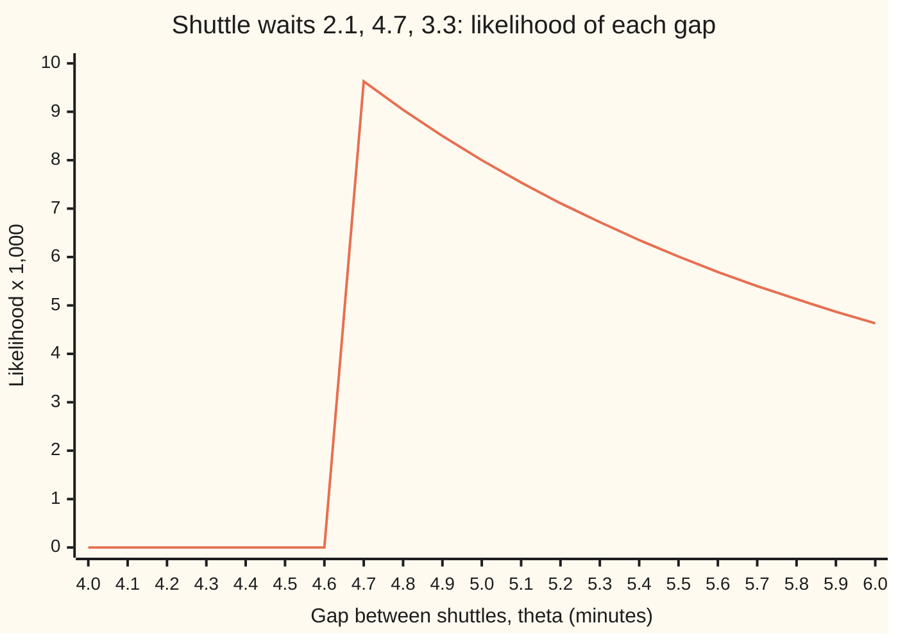

# Sufficient statistics: the summary that keeps everything the data say about the parameter

[Syllabus](../../../SYLLABUS.md) → [Probability and statistics](../README.md) → [Sampling and Estimation](../README.md#s07) → Sufficient statistics

---

## General Overview

A polling firm runs a poll in miniature: 10 voters, one yes-or-no question, 7 yeses. It stores the number 7 and throws away the order in which the answers came. Has it thrown away anything about the electorate's true share of yes voters?

No. There are 120 orders that hold 7 yeses and 3 nos. Once the count 7 is known, each of those 120 orders has chance 1/120, whatever the true share is. The order is then a pure lottery. It behaves the same under every possible share, so it cannot point towards any of them.

A summary of the data with this property is called **sufficient**. Earlier cards on this shelf used the count of yeses and ignored the order; [Maximum likelihood](04-maximum-likelihood.md) and [Fisher information](07-fisher-information-and-cramer-rao.md) did so without saying why. This card says why, and gives a quick test for spotting such summaries.

A second example shows the test at work. A shuttle leaves a stop every θ minutes (θ, theta, is unknown). A rider who turns up at random waits anywhere from 0 to θ minutes, all equally likely. Three waits are 2.1, 4.7 and 3.3 minutes. Their likelihood (the chance of the data, read as a function of the unknown θ) is $`\theta^{-3}`$ for every θ of at least 4.7 and zero below. Only the longest wait, 4.7, appears in it. So the longest wait is sufficient: the other two waits add nothing about θ.

**A statistic is sufficient when, once its value is known, the rest of the data has a chance law that does not involve the unknown; then it keeps everything the data say about the unknown, and the likelihood shows it by depending on the data only through that statistic.**

**What kind of fact this is:** sufficiency and minimal sufficiency are definitions; the factorisation theorem and the likelihood-ratio test for minimal sufficiency are theorems, proved on this card in Why it works for data with countably many possible values. The version for densities is stated; its full proof needs the measure theory of wing 10.

### The picture: the count can rebuild the data


Anyone holding only the count can shuffle up a fake list of answers without knowing p. The fake list has exactly the chance law of the real one. So nothing done with the real list can learn more about p than the count already allows.

---

## The formula

Notation first, in words. The data before they are seen are $`X`$, a list of $`n`$ random answers or measurements; the list actually observed is $`x`$. The unknown is $`\theta`$; for the poll it is the share $`p`$. A **statistic** $`T`$ is any summary computed from the data alone, such as the count of yeses; $`t`$ is its value. $`P_\theta(\ldots)`$ is a chance worked out as if the unknown were $`\theta`$, and the bar $`\mid`$ reads "given", as on [Conditional probability](../01-Chance%20and%20Events/05-conditional-probability.md).

The definition:

```math
T \text{ is sufficient for } \theta \quad\text{when}\quad P_\theta(X = x \mid T = t) \text{ is the same for every } \theta
```

**Read it aloud:** the statistic is sufficient when the chance of each data list, given the statistic's value, does not change as the unknown changes.

The factorisation theorem, with $`f(x;\theta)`$ the chance of the list $`x`$ (or its density height):

```math
T \text{ is sufficient} \iff f(x;\theta) = g\big(T(x);\theta\big)\, h(x) \text{ for some } g \text{ and } h
```

**Read it aloud:** the statistic is sufficient exactly when the chance of the data splits into a piece that sees the data only through the statistic and a piece that never sees the unknown.

A sufficient statistic is **minimal** when it is a function of every other sufficient statistic: it is the coarsest summary that loses nothing. The test, for two possible data lists $`x`$ and $`y`$:

```math
T \text{ is minimal sufficient} \;\Longleftarrow\; \Big( T(x) = T(y) \iff \frac{f(x;\theta)}{f(y;\theta)} \text{ does not depend on } \theta \Big)
```

**Read it aloud:** if two lists share the statistic's value exactly when their likelihoods keep a fixed ratio as the unknown moves, the statistic is minimal sufficient.

For the poll, $`f(x;p) = p^{7}(1-p)^{3}`$ for every list with 7 yeses, so $`g(7;p) = p^7(1-p)^3`$ and $`h(x) = 1`$.

| Symbol | Plain meaning | In our example | Push it up and the answer… |
| --- | --- | --- | --- |
| $`X`$, $`x`$, $`y`$ | the data as random; the list actually observed; a second possible list to compare with it | 10 answers; the list with 7 yeses; the twin waits 0.4, 4.7, 1.0 | — |
| $`n`$ | how many answers or measurements | 10 answers; 3 waits; 5 polls | more lists share each count |
| $`\theta`$, $`p`$ | the unknown in general; for the poll, the true share of yes voters | p; for the shuttle θ is the gap between shuttles | — |
| $`T(x)`$, $`t`$, $`S`$, $`x_t`$ | a statistic, a summary of the data, and its value; S, another sufficient statistic in the minimality proof; $`x_t`$, one chosen list with value t | the count, 7; for the shuttle the longest wait, 4.7 | — |
| $`P_\theta(\ldots \mid \ldots)`$ | a chance worked out as if the unknown were θ, given what follows the bar | one list given 7 yeses: 0.008333 | — |
| $`f(x;\theta)`$, $`L`$ | the chance of the list x (or its density height) when the unknown is θ; read as a function of θ it is the likelihood L | 0.00113697 at p = 0.52 | — |
| $`g`$, $`h`$, $`H`$, $`g_S`$, $`h_S`$ | g holds θ and sees the data only through t; h never involves θ; H(t) adds h over the lists with value t; $`g_S`$, $`h_S`$, the same two pieces for S | $`g = p^7(1-p)^3`$, $`h = 1`$, H(7) = 120 | — |
| $`C(n,t)`$ | the number of orders in which t yeses can fall among n answers | C(10, 7) = 120 | each order's chance given t falls |
| $`\mathbf{1}\{\ldots\}`$ | the indicator: 1 when the condition holds, 0 when not | $`\mathbf{1}\{\max(x) \le \theta\}`$ is 0 at θ = 4.5 | — |
| $`\mu`$, $`\sigma`$ | a bell curve's centre (mu) and its spread (sigma) | the race's true share; spread 0.02, taken as known | — |
| $`\sum`$, $`\max`$, $`\min`$, $`\mathrm{E}_\theta`$ | add the terms; the largest value; the smallest value; the average over chance when the unknown is θ | the waits' total 10.1; the longest wait 4.7 | — |
| $`I`$, $`I_X`$, $`I_T`$, $`I_{X \mid T}`$ | Fisher information: how sharply the chance of what was recorded changes as θ moves; of the whole list; of the statistic alone; of the list once the statistic is known | 47.619048 for the whole list at p = 0.7 | sharper estimates possible |

### When it holds

- **The model must be right.** Sufficiency is a fact about one model. The count is sufficient only if the answers are independent with one shared chance. If each answer tends to copy the one before, the number of switches between yes and no also carries information, and the count alone is no longer sufficient.
- **It covers the unknown, not the model check.** The count keeps everything about p, but nothing about whether the model is right. A list of 7 yeses followed by 3 nos hints at a trend; only the full list can show it.
- **The factor h must be free of θ, range included.** For the shuttle, the condition "θ is at least the longest wait" involves θ, so it belongs in g. Drop it and the likelihood $`\theta^{-3}`$ peaks at the search floor, 0.1 minutes, below a wait already seen.
- **Countable outcomes for this proof.** The proof below sums over lists. For measurements on a continuous scale the same factorisation with density heights still decides sufficiency, but conditioning on a continuous statistic needs [The Radon-Nikodym theorem](../../10-Measure%20and%20integration/08-Densities%20and%20Changing%20Measure/03-radon-nikodym-theorem.md).
- **Minimal summaries exist here.** A minimal sufficient statistic exists for every model on this card. In some unusual models none exists.

---

## Why it works

### Step 0: a lottery that ignores θ tells nothing about θ

Split the data into two parts: the statistic's value, and the rest of the detail. If the rest has the same chance law under every θ, it is like a coin flip done on the side. Anyone could produce it with their own coin, without knowing θ. So it cannot carry information about θ. Everything the data say about θ must sit in the statistic.

### Step 1: the poll, one list given its count

Each answer is a yes with chance p, independently ([Binomial](../03-Discrete%20Distributions/01-bernoulli-and-binomial.md)). So every list with 7 yeses and 3 nos has the same chance, $`p^7(1-p)^3`$. There are C(10, 7) = 120 such lists, so the chance of a count of 7 is $`120\,p^7(1-p)^3`$. Divide one by the other:

```math
P_p(X = x \mid T = 7) = \frac{p^7(1-p)^3}{120\,p^7(1-p)^3} = \frac{1}{120} = 0.008333
```

The p cancels. The checks confirm it by brute force over all 1,024 possible lists at three shares:

| True share p | One list with 7 yes | Count of 7 | One list given 7 |
| --- | --- | --- | --- |
| 0.30 | 0.00007501 | 0.009002 | 0.008333 |
| 0.52 | 0.00113697 | 0.136436 | 0.008333 |
| 0.90 | 0.00047830 | 0.057396 | 0.008333 |

A simulation says the same thing another way. Given 7 yeses, every position is equally likely to hold each yes, so the first answer is a yes with chance 7/10, at every p. Over 200,000 simulated polls, the share is 0.6970 when p = 0.52 and 0.6957 when p = 0.9.

### Step 2: the factorisation theorem

Checking a conditional law list by list is slow. The factorisation theorem replaces it with a look at the likelihood.

- **Sufficient gives a factorisation.** The chance of a list is the chance of its statistic's value times the chance of the list given that value. The first piece sees the data only through t. The second piece is free of θ, by sufficiency. Call them g and h.
- **A factorisation gives sufficiency.** Add up $`g(t;\theta)h(y)`$ over all lists y with value t: g comes out as a common factor, so the chance of t is g times a sum of h values. Dividing the chance of x by the chance of t cancels g, and θ with it.

<details>
<summary>Detailed proof: the factorisation theorem, for countably many possible lists</summary>

Write $`t = T(x)`$ and assume $`P_\theta(T = t) > 0`$; lists of zero chance play no part.

**Sufficient implies factorised.** Since x has value t, the event "X = x" lies inside "T = t". So

$`\displaystyle f(x;\theta) = P_\theta(X = x) = P_\theta(T = t)\, P_\theta(X = x \mid T = t).`$

Set $`g(t;\theta) = P_\theta(T = t)`$, which sees the data only through t. Set $`h(x) = P_\theta(X = x \mid T = t)`$, which by sufficiency is the same for every θ. That is the factorisation.

**Factorised implies sufficient.** Suppose $`f(x;\theta) = g(T(x);\theta)h(x)`$. Add over the lists with value t:

$`\displaystyle P_\theta(T = t) = \sum_{y:\,T(y) = t} g(t;\theta)\,h(y) = g(t;\theta)\,H(t), \qquad H(t) = \sum_{y:\,T(y) = t} h(y).`$

Then for any x with value t,

$`\displaystyle P_\theta(X = x \mid T = t) = \frac{g(t;\theta)\,h(x)}{g(t;\theta)\,H(t)} = \frac{h(x)}{H(t)},`$

which does not involve θ. For the poll, h = 1 and H(7) = 120, giving 1/120.

</details>

### Step 3: read the sufficient statistic off the likelihood

**The poll.** $`f(x;p) = p^{t}(1-p)^{n-t}`$ with t the count. Take $`g(t;p) = p^t(1-p)^{n-t}`$ and $`h = 1`$. The count is sufficient. The checks confirm the split on all 1,024 lists.

**The shuttle.** Each wait has density height $`1/\theta`$ between 0 and θ, and 0 outside ([Uniform](../04-Continuous%20Distributions/02-uniform-distribution.md)). Three independent waits multiply. A wait above θ is impossible, so the product is zero unless every wait is at most θ, which is the same as the longest wait being at most θ:

```math
f(x;\theta) = \underbrace{\theta^{-3}\,\mathbf{1}\{\max(x) \le \theta\}}_{g(\max(x);\,\theta)} \;\cdot\; \underbrace{\mathbf{1}\{\min(x) \ge 0\}}_{h(x)}
```

The longest wait is sufficient. For 2.1, 4.7 and 3.3, the likelihood is 0 at θ = 4.5, peaks at θ = 4.7 with $`4.7^{-3}`$ = 0.009632, and falls to 0.008000 at θ = 5.0, 0.004630 at 6.0 and 0.001953 at 8.0. The twin sample 0.4, 4.7 and 1.0 has the same longest wait, and its likelihood matches at every θ.



The single line is the likelihood, times 1,000. It is zero for every gap shorter than the longest wait, jumps to its peak at 4.7, then falls like $`\theta^{-3}`$. The other two waits change nothing in it.

The conditional-law view agrees. Given that the longest wait is m, the other two are spread evenly between 0 and m, whatever θ is, so their average sits near m/2. The checks simulate 400,000 sets of three waits at θ = 5 and at θ = 9 and keep those whose longest wait falls between 4.6 and 4.8. The average of the other two is 2.3560 at θ = 5 and 2.3703 at θ = 9: both near 4.7/2 = 2.35.

**The normal with a known spread.** For n measurements from a bell curve with unknown centre μ and known spread σ ([Normal](../04-Continuous%20Distributions/04-normal-distribution.md)), expanding the squares in the density gives

```math
f(x;\mu) = \underbrace{\exp\!\Big(\frac{\mu \sum x_i - n\mu^2/2}{\sigma^2}\Big)}_{g(\sum x_i;\,\mu)} \;\cdot\; \underbrace{(2\pi\sigma^2)^{-n/2} \exp\!\Big(-\frac{\sum x_i^2}{2\sigma^2}\Big)}_{h(x)}
```

The total $`\sum x_i`$ (the sum of the measurements), and so the average, is sufficient for μ. With σ unknown too, the pair $`\sum x_i`$ and $`\sum x_i^2`$ is sufficient for both.

### Step 4: no summary beats a sufficient one

Two ways to see that a sufficient statistic loses nothing.

**Rebuild the data.** From the count alone, shuffle that many yeses into a random order. The rebuilt list has exactly the chance law of the real list, for every p; the checks confirm it on all 1,024 lists. So any rule applied to the real list has a twin, applied to the rebuilt list, with the same chances of every answer. No rule, test or estimate can do better on the real data than something built from the count.

**Count the information.** [Fisher information](07-fisher-information-and-cramer-rao.md) measures how sharply the chance of what was recorded changes as p moves. A summary can keep at most the information of the whole list, and a sufficient summary keeps all of it. At p = 0.7 the checks find:

```
information kept at p = 0.7 (whole list = 47.619048)
whole list             ████████████████████████████████████████  47.619048
count of yes           ████████████████████████████████████████  47.619048
counts in each half    ████████████████████████████████████████  47.619048
count in first half    ████████████████████                      23.809524
majority yes or not    ███████████████████                       23.043172
first answer only      ████                                       4.761905
```

The full value matches the formula $`n/(p(1-p))`$ = 47.619048. "Majority yes or not" keeps less than half of it, even though it uses all ten answers.

<details>
<summary>Detailed proof: a summary keeps at most the full information, and a sufficient one keeps all of it</summary>

Take logarithms of $`f(x;\theta) = P_\theta(T = t)\,P_\theta(X = x \mid T = t)`$ and differentiate in θ. The **score** (the slope of the log-chance in θ) of the whole list is the score of the statistic plus the score of the list given the statistic:

$`\displaystyle \frac{\partial}{\partial\theta}\ln f(x;\theta) = \frac{\partial}{\partial\theta}\ln P_\theta(T = t) + \frac{\partial}{\partial\theta}\ln P_\theta(X = x \mid T = t).`$

Given T = t, the second score averages to zero, because conditional chances add to 1 for every θ. So the two parts are uncorrelated, and the variances add. The Fisher information is the variance of the score, so

$`\displaystyle I_X(\theta) = I_T(\theta) + \mathrm{E}_\theta\big[I_{X \mid T}(\theta)\big] \ge I_T(\theta).`$

When T is sufficient, the conditional chance does not involve θ, its score is zero, and $`I_X = I_T`$. This needs the model to be smooth in θ, as on the Fisher information card.

</details>

### Step 5: the smallest summary that loses nothing

The whole list is sufficient too, trivially: it keeps everything. So is the pair "yeses among the first five, yeses among the last five". The goal is the coarsest sufficient summary: the **minimal sufficient statistic**.

The test compares two lists. If their likelihoods keep a fixed ratio as θ moves, the data cannot tell them apart on θ, so a minimal summary should merge them. If the ratio moves, they must stay apart. For the poll,

```math
\frac{f(x;p)}{f(y;p)} = \Big(\frac{p}{1-p}\Big)^{t(x) - t(y)}
```

This is fixed in p exactly when the two counts are equal. So the count is minimal sufficient.

The checks do this without ever looking at the count. They sort all 1,024 lists by the shape of their likelihood ratio across nine shares. That gives 11 groups, and each group holds exactly one count. The halves pair is sufficient, because the count can be computed from it, and it keeps 47.619048, but it takes 36 values where 11 do. It splits lists the data cannot tell apart, such as 3 then 4 yeses against 4 then 3.

For the shuttle, the ratio of two likelihoods stays fixed in θ only when the two longest waits are equal, so the longest wait is minimal sufficient.

<details>
<summary>Detailed proof: the likelihood-ratio test gives a minimal sufficient statistic</summary>

Suppose T has the property: $`T(x) = T(y)`$ exactly when $`f(x;\theta)/f(y;\theta)`$ does not depend on θ. Work with lists of positive chance.

**T is sufficient.** For each value t pick one list $`x_t`$ with that value. Set $`g(t;\theta) = f(x_t;\theta)`$ and $`h(x) = f(x;\theta)/f(x_{T(x)};\theta)`$. Since x and $`x_{T(x)}`$ share the value of T, that ratio does not depend on θ, so h is free of θ. Then

$`\displaystyle f(x;\theta) = g(T(x);\theta)\,h(x),`$

and the factorisation theorem makes T sufficient.

**T is a function of every sufficient S.** Let S be sufficient, with factorisation $`f = g_S(S(x);\theta)\,h_S(x)`$. If $`S(x) = S(y)`$, then

$`\displaystyle \frac{f(x;\theta)}{f(y;\theta)} = \frac{h_S(x)}{h_S(y)},`$

which does not depend on θ, so $`T(x) = T(y)`$. Lists with equal S have equal T, so T can be computed from S. That is minimality.

</details>

### Step 6: a summary that looks good but is not sufficient

The median, the middle value once sorted, is a fine estimate of a bell curve's centre. It is not sufficient. Take five earlier polls of the same race, each treated as a normal measurement of the true share μ with known spread 0.02:

- A: 0.49, 0.51, 0.52, 0.54, 0.54 (median 0.52, average 0.520)
- B: 0.51, 0.51, 0.52, 0.52, 0.59 (median 0.52, average 0.530)
- C: 0.50, 0.50, 0.50, 0.55, 0.55 (median 0.50, average 0.520)

| Centre μ | L(A)/L(B), same median | L(A)/L(C), same average |
| --- | --- | --- |
| 0.50 | 753.7042 | 4.4817 |
| 0.52 | 61.8678 | 4.4817 |
| 0.54 | 5.0784 | 4.4817 |

A and B share a median, yet the ratio of their likelihoods falls from 753.7042 to 5.0784 as μ moves. B points to a higher centre than A, and the median cannot see it. By the second half of the minimality proof in Step 5, two lists with the same value of a sufficient statistic have a likelihood ratio that does not move with the unknown. So the median is not sufficient. A and C share an average, and their ratio stays at 4.4817 for every μ, as the average's sufficiency requires.

---

## Worked numbers, by hand

| Step | Arithmetic | Value |
| --- | --- | --- |
| orders holding 7 yes in 10 | C(10, 7) | 120 |
| one list with 7 yes, at p = 0.52 | $`0.52^7 \times 0.48^3`$ | 0.00113697 |
| a count of 7, at p = 0.52 | 120 × 0.00113697 | 0.136436 |
| one list given the count | 0.00113697 / 0.136436 | 0.008333 = 1/120 |
| the same at p = 0.3 | 0.00007501 / 0.009002 | 0.008333 |
| shuttle likelihood at θ = 4.5 | a wait of 4.7 is impossible | 0 |
| at θ = 4.7 | $`4.7^{-3}`$ | 0.009632 |
| at θ = 5.0 | $`5^{-3}`$ = 1/125 | 0.008000 |
| **sufficient summaries** | the count; the longest wait | **7 yes; 4.7 minutes** |

The firm loses nothing about the true share by storing only 7, and the rider loses nothing about the gap by keeping only the longest wait, 4.7 minutes.

### What breaks if you drop a piece

| Mistake | Comes out at | What went wrong |
| --- | --- | --- |
| Storing only "did yes win a majority" | information 23.043172 instead of 47.619048 at p = 0.7 | the summary is not sufficient, so it loses information |
| Summarising the shuttle waits by their total, 10.1 | waits 3.3, 3.4, 3.4 share the total but give likelihood 0.015625 at θ = 4.0, where the real waits give 0 | the total mixes samples that disagree about θ |
| Dropping the indicator and keeping $`\theta^{-3}`$ alone | a peak at the search floor, 0.1 minutes | the range condition involves θ, so it belongs in g |
| Summarising normal polls by their median | the likelihood ratio of A and B moves from 753.7042 to 5.0784 | samples with one median can disagree about μ |

---

## Code, from first principles, and it actually runs

The code takes four independent roads. Brute force lists all 1,024 answer lists and computes each conditional law directly. The factorisation formula is checked against that brute force, and the law rebuilt from the count is checked against the real law. A likelihood-ratio grouping finds the minimal summary without ever counting yeses. A seeded simulation (SplitMix64, a small random-number generator written out in both languages with seed 20261123) reruns the poll and the shuttle. It also computes the Fisher information each summary keeps, the shuttle likelihoods, and the normal ratios for the median example.

### Python

```python
# Sufficient statistics -- the check behind the card.  Standard library only.
# Every number on the card is printed here.  Roads: brute force over all 1,024
# answer lists, the factorisation formula, a likelihood-ratio grouping that never
# mentions the count, and a seeded simulation (SplitMix64, same draws as Rust).
from math import comb, log, exp
from itertools import product

N, T = 10, 7                                   # the poll in miniature: 10 answers, 7 yes
LISTS = list(product((0, 1), repeat=N))        # all 1,024 possible answer lists

def chance(x, p):                              # one exact list: p per yes, 1 - p per no
    out = 1.0
    for a in x: out *= p if a else 1 - p
    return out

def fisher(groups, p, h=1e-6):                 # information kept by a summary
    info = 0.0                                 # groups: summary value -> its lists
    for xs in groups.values():
        q = sum(chance(x, p) for x in xs)
        dq = (sum(chance(x, p + h) for x in xs) - sum(chance(x, p - h) for x in xs)) / (2 * h)
        info += dq * dq / q
    return info

def group_by(key):
    g = {}
    for x in LISTS: g.setdefault(key(x), []).append(x)
    return g

M64 = (1 << 64) - 1
state = [20261123]
def unif():                                    # SplitMix64: a uniform number in [0, 1)
    state[0] = (state[0] + 0x9E3779B97F4A7C15) & M64
    z = state[0]
    z = ((z ^ (z >> 30)) * 0xBF58476D1CE4E5B9) & M64
    z = ((z ^ (z >> 27)) * 0x94D049BB133111EB) & M64
    return ((z ^ (z >> 31)) >> 11) / 9007199254740992.0

# ---- road 1: the conditional law of the list, given the count 7 ----
seven = [x for x in LISTS if sum(x) == T]
print(f"lists with 7 yes out of 10: {len(seven)}; C(10, 7) = {comb(N, T)}")
worst = 0.0
for p in (0.3, 0.52, 0.9):
    one, total = chance(seven[0], p), sum(chance(x, p) for x in seven)
    cond = [chance(x, p) / total for x in seven]
    worst = max(worst, max(abs(c - 1 / 120) for c in cond))
    print(f"p = {p:.2f}: one list {one:.8f}; count 7 {total:.6f}; one list given 7 {one / total:.6f}")
assert len(seven) == comb(N, T) and worst < 1e-12

# ---- road 2: the factorisation g(t, p) h(x), h = 1, against brute force ----
gap = max(abs(chance(x, 0.52) - 0.52 ** sum(x) * 0.48 ** (N - sum(x))) for x in LISTS)
by_count = group_by(sum)                       # rebuild: draw the count, then shuffle it
law_t = {t: sum(chance(x, 0.52) for x in xs) for t, xs in by_count.items()}
rebuilt = max(abs(law_t[sum(x)] / len(by_count[sum(x)]) - chance(x, 0.52)) for x in LISTS)
print(f"all 1,024 lists: brute chance = g(t,p)h(x): {'yes' if gap < 1e-15 else 'no'}; "
      f"law rebuilt from the count = real law: {'yes' if rebuilt < 1e-15 else 'no'}")
assert gap < 1e-15 and rebuilt < 1e-15

# ---- road 3: simulate. Given 7 yes, is the first answer yes 70% of the time? ----
for p in (0.52, 0.9):
    hits = first = 0
    for _ in range(200000):
        x = [1 if unif() < p else 0 for _ in range(N)]
        if sum(x) == T:
            hits += 1
            first += x[0]
    print(f"simulated, p = {p:.2f}: {hits} polls with 7 yes; first answer yes in {first / hits:.4f}")
    assert abs(first / hits - 0.7) < 0.02

# ---- what a summary keeps: Fisher information at p = 0.7 ----
infos = [("whole list", group_by(lambda x: x)), ("count of yes", group_by(sum)),
         ("counts in each half", group_by(lambda x: (sum(x[:5]), sum(x[5:])))),
         ("count in first half", group_by(lambda x: sum(x[:5]))),
         ("majority yes or not", group_by(lambda x: sum(x) >= 6)),
         ("first answer only", group_by(lambda x: x[0]))]
for name, g in infos:
    print(f"information kept, {name:<20} {fisher(g, 0.7):10.6f}   ({len(g)} values)")
print(f"formula n / (p(1 - p)) = {N / (0.7 * 0.3):.6f}")
assert abs(fisher(infos[0][1], 0.7) - N / 0.21) < 1e-4 and abs(fisher(infos[1][1], 0.7) - N / 0.21) < 1e-4
assert fisher(infos[4][1], 0.7) < 0.5 * N / 0.21

# ---- minimal: group lists whose likelihood ratio does not move with p ----
grid = [i / 10 for i in range(1, 10)]
def ratio_key(x):                              # ln P(x; p) - ln P(x; 0.5) on a grid, never the count
    return tuple(round(log(chance(x, p)) - log(chance(x, 0.5)), 9) for p in grid)
classes = group_by(ratio_key)
same = all(len({sum(x) for x in xs}) == 1 for xs in classes.values())
print(f"classes of equal likelihood ratio: {len(classes)}; each class is one count: {'yes' if same else 'no'}")
assert len(classes) == 11 and same

# ---- the shuttle: waits Uniform(0, theta), observed 2.1, 4.7, 3.3 minutes ----
waits, twin, same_sum = [2.1, 4.7, 3.3], [0.4, 4.7, 1.0], [3.3, 3.4, 3.4]
def lik(w, th):                                # independent waits multiply: 1/theta each in [0, theta]
    out = 1.0
    for v in w: out *= 1 / th if 0 <= v <= th else 0.0
    return out
for th in (4.5, 4.7, 5.0, 6.0, 8.0):
    print(f"theta = {th:.1f}: likelihood {lik(waits, th):.6f}; same-maximum twin {lik(twin, th):.6f}")
pts = [4.0 + 0.1 * i for i in range(21)]
print("chart, likelihood x 1000, theta 4.0 to 6.0:", " ".join(f"{1000 * lik(waits, t):.2f}" for t in pts))
best = max(pts + [4.7], key=lambda t: lik(waits, t))
print(f"peak at theta = {best:.1f}; sums {sum(waits):.1f} and {sum(same_sum):.1f}; "
      f"at theta = 4.0: {lik(waits, 4.0):.6f} vs {lik(same_sum, 4.0):.6f}")
wrong = min((0.1 * i for i in range(1, 101)), key=lambda t: -t ** -3)
print(f"indicator dropped, theta^-3 alone: peak at the search floor {wrong:.1f}")
assert all(lik(waits, t) == lik(twin, t) for t in pts) and abs(best - 4.7) < 1e-12
assert lik(waits, 4.0) == 0.0 and lik(same_sum, 4.0) > 0.0
for th in (5.0, 9.0):                          # given a maximum near 4.7, the rest ignore theta
    hits, rest = 0, 0.0
    for _ in range(400000):
        w = [th * unif() for _ in range(3)]
        w.sort()
        if 4.6 <= w[2] <= 4.8:
            hits += 1
            rest += (w[0] + w[1]) / 2
    print(f"simulated, theta = {th:.0f}: {hits} samples with maximum in 4.6-4.8; mean of the other two {rest / hits:.4f}")
    assert abs(rest / hits - 2.35) < 0.05

# ---- the normal with known spread 0.02: the median is not sufficient ----
A, B = [0.49, 0.51, 0.52, 0.54, 0.54], [0.51, 0.51, 0.52, 0.52, 0.59]
C, s2 = [0.50, 0.50, 0.50, 0.55, 0.55], 0.02 ** 2
def lnratio(x, y, mu):                         # ln of L(mu; x) / L(mu; y)
    return (sum((v - mu) ** 2 for v in y) - sum((v - mu) ** 2 for v in x)) / (2 * s2)
med = lambda v: sorted(v)[2]
print(f"medians A, B, C: {med(A):.2f} {med(B):.2f} {med(C):.2f}; means {sum(A) / 5:.3f} {sum(B) / 5:.3f} {sum(C) / 5:.3f}")
for mu in (0.50, 0.52, 0.54):
    print(f"mu = {mu:.2f}: L(A)/L(B) = {exp(lnratio(A, B, mu)):.4f}; L(A)/L(C) = {exp(lnratio(A, C, mu)):.4f}")
assert abs(lnratio(A, B, 0.50) - lnratio(A, B, 0.54)) > 1.0
assert abs(lnratio(A, C, 0.50) - lnratio(A, C, 0.54)) < 1e-9
print("ALL CHECKS PASS")
```

**Ran 2026-11-23 on macOS, Python 3.14.10, standard library only. All checks passed. Output, pasted from the run:**

```
lists with 7 yes out of 10: 120; C(10, 7) = 120
p = 0.30: one list 0.00007501; count 7 0.009002; one list given 7 0.008333
p = 0.52: one list 0.00113697; count 7 0.136436; one list given 7 0.008333
p = 0.90: one list 0.00047830; count 7 0.057396; one list given 7 0.008333
all 1,024 lists: brute chance = g(t,p)h(x): yes; law rebuilt from the count = real law: yes
simulated, p = 0.52: 27085 polls with 7 yes; first answer yes in 0.6970
simulated, p = 0.90: 11497 polls with 7 yes; first answer yes in 0.6957
information kept, whole list            47.619048   (1024 values)
information kept, count of yes          47.619048   (11 values)
information kept, counts in each half   47.619048   (36 values)
information kept, count in first half   23.809524   (6 values)
information kept, majority yes or not   23.043172   (2 values)
information kept, first answer only      4.761905   (2 values)
formula n / (p(1 - p)) = 47.619048
classes of equal likelihood ratio: 11; each class is one count: yes
theta = 4.5: likelihood 0.000000; same-maximum twin 0.000000
theta = 4.7: likelihood 0.009632; same-maximum twin 0.009632
theta = 5.0: likelihood 0.008000; same-maximum twin 0.008000
theta = 6.0: likelihood 0.004630; same-maximum twin 0.004630
theta = 8.0: likelihood 0.001953; same-maximum twin 0.001953
chart, likelihood x 1000, theta 4.0 to 6.0: 0.00 0.00 0.00 0.00 0.00 0.00 0.00 9.63 9.04 8.50 8.00 7.54 7.11 6.72 6.35 6.01 5.69 5.40 5.13 4.87 4.63
peak at theta = 4.7; sums 10.1 and 10.1; at theta = 4.0: 0.000000 vs 0.015625
indicator dropped, theta^-3 alone: peak at the search floor 0.1
simulated, theta = 5: 42706 samples with maximum in 4.6-4.8; mean of the other two 2.3560
simulated, theta = 9: 7326 samples with maximum in 4.6-4.8; mean of the other two 2.3703
medians A, B, C: 0.52 0.52 0.50; means 0.520 0.530 0.520
mu = 0.50: L(A)/L(B) = 753.7042; L(A)/L(C) = 4.4817
mu = 0.52: L(A)/L(B) = 61.8678; L(A)/L(C) = 4.4817
mu = 0.54: L(A)/L(B) = 5.0784; L(A)/L(C) = 4.4817
ALL CHECKS PASS
```

### Rust

Same numbers, same labels, built with `rustc --edition 2021 -O`.

```rust
// Sufficient statistics -- the same check as the Python, in Rust.  No crates.
// Every number on the card is printed here.  Roads: brute force over all 1,024
// answer lists, the factorisation formula, a likelihood-ratio grouping that never
// mentions the count, and a seeded simulation (SplitMix64, same draws as Python).
use std::collections::BTreeMap;

const N: usize = 10; const T: usize = 7;              // the poll in miniature: 10 answers, 7 yes
type Groups = BTreeMap<Vec<i64>, Vec<Vec<u8>>>;

fn chance(x: &[u8], p: f64) -> f64 {              // one exact list: p per yes, 1 - p per no
    x.iter().fold(1.0, |out, &a| out * if a == 1 { p } else { 1.0 - p })
}

fn comb(n: u64, k: u64) -> u64 { (0..k).fold(1, |c, i| c * (n - i) / (i + 1)) }
fn count(x: &[u8]) -> usize { x.iter().map(|&a| a as usize).sum() }

fn fisher(groups: &Groups, p: f64) -> f64 {     // information kept by a summary
    let (h, mut info) = (1e-6, 0.0);
    for xs in groups.values() {
        let sum = |q: f64| -> f64 { xs.iter().map(|x| chance(x, q)).sum() };
        let dq = (sum(p + h) - sum(p - h)) / (2.0 * h);
        info += dq * dq / sum(p);
    }
    info
}

fn group_by(lists: &[Vec<u8>], key: &dyn Fn(&[u8]) -> Vec<i64>) -> Groups {
    let mut g: Groups = BTreeMap::new();
    for x in lists { g.entry(key(x)).or_default().push(x.clone()) } g
}

struct SplitMix(u64);
impl SplitMix { fn unif(&mut self) -> f64 {        // SplitMix64: a uniform number in [0, 1)
    self.0 = self.0.wrapping_add(0x9E3779B97F4A7C15);
    let mut z = self.0;
    z = (z ^ (z >> 30)).wrapping_mul(0xBF58476D1CE4E5B9);
    z = (z ^ (z >> 27)).wrapping_mul(0x94D049BB133111EB);
    ((z ^ (z >> 31)) >> 11) as f64 / 9007199254740992.0
} }

fn lik(w: &[f64], th: f64) -> f64 {               // independent waits multiply: 1/theta each in [0, theta]
    w.iter().fold(1.0, |out, &v| out * if 0.0 <= v && v <= th { 1.0 / th } else { 0.0 })
}

fn lnratio(x: &[f64], y: &[f64], mu: f64, s2: f64) -> f64 {   // ln of L(mu; x) / L(mu; y)
    let ss = |v: &[f64]| -> f64 { v.iter().map(|a| (a - mu) * (a - mu)).sum() };
    (ss(y) - ss(x)) / (2.0 * s2)
}

fn yn(c: bool) -> &'static str { if c { "yes" } else { "no" } }

fn main() {
    let lists: Vec<Vec<u8>> = (0..1024u32).map(|i| (0..N).map(|j| ((i >> (9 - j)) & 1) as u8).collect()).collect();
    let mut rng = SplitMix(20261123);

    // ---- road 1: the conditional law of the list, given the count 7 ----
    let seven: Vec<&Vec<u8>> = lists.iter().filter(|x| count(x) == T).collect();
    println!("lists with 7 yes out of 10: {}; C(10, 7) = {}", seven.len(), comb(10, 7));
    let mut worst: f64 = 0.0;
    for p in [0.3, 0.52, 0.9] {
        let (one, total) = (chance(seven[0], p), seven.iter().map(|x| chance(x, p)).sum::<f64>());
        for x in &seven { worst = worst.max((chance(x, p) / total - 1.0 / 120.0).abs()) }
        println!("p = {:.2}: one list {:.8}; count 7 {:.6}; one list given 7 {:.6}", p, one, total, one / total);
    }
    assert!(seven.len() as u64 == comb(10, 7) && worst < 1e-12);

    // ---- road 2: the factorisation g(t, p) h(x), h = 1, against brute force ----
    let mut gap: f64 = 0.0;
    for x in &lists {
        let t = count(x) as f64; gap = gap.max((chance(x, 0.52) - 0.52f64.powf(t) * 0.48f64.powf(N as f64 - t)).abs());
    }
    let by_count = group_by(&lists, &|x| vec![count(x) as i64]);   // rebuild: draw the count, then shuffle it
    let mut rebuilt: f64 = 0.0;
    for x in &lists {
        let xs = &by_count[&vec![count(x) as i64]];
        let law_t: f64 = xs.iter().map(|y| chance(y, 0.52)).sum();
        rebuilt = rebuilt.max((law_t / xs.len() as f64 - chance(x, 0.52)).abs());
    }
    println!("all 1,024 lists: brute chance = g(t,p)h(x): {}; law rebuilt from the count = real law: {}",
             yn(gap < 1e-15), yn(rebuilt < 1e-15));
    assert!(gap < 1e-15 && rebuilt < 1e-15);

    // ---- road 3: simulate. Given 7 yes, is the first answer yes 70% of the time? ----
    for p in [0.52, 0.9] {
        let (mut hits, mut first) = (0u32, 0u32);
        for _ in 0..200000 {
            let x: Vec<u8> = (0..N).map(|_| if rng.unif() < p { 1 } else { 0 }).collect();
            if count(&x) == T { hits += 1; first += x[0] as u32 }
        }
        let share = first as f64 / hits as f64;
        println!("simulated, p = {:.2}: {} polls with 7 yes; first answer yes in {:.4}", p, hits, share);
        assert!((share - 0.7).abs() < 0.02);
    }

    // ---- what a summary keeps: Fisher information at p = 0.7 ----
    let keys: Vec<(&str, Box<dyn Fn(&[u8]) -> Vec<i64>>)> = vec![
        ("whole list", Box::new(|x: &[u8]| x.iter().map(|&a| a as i64).collect())),
        ("count of yes", Box::new(|x: &[u8]| vec![count(x) as i64])),
        ("counts in each half", Box::new(|x: &[u8]| vec![count(&x[..5]) as i64, count(&x[5..]) as i64])),
        ("count in first half", Box::new(|x: &[u8]| vec![count(&x[..5]) as i64])),
        ("majority yes or not", Box::new(|x: &[u8]| vec![(count(x) >= 6) as i64])),
        ("first answer only", Box::new(|x: &[u8]| vec![x[0] as i64])),
    ];
    let mut infos = Vec::new();
    for (name, key) in &keys {
        let g = group_by(&lists, key.as_ref());
        let i = fisher(&g, 0.7);
        println!("information kept, {:<20} {:10.6}   ({} values)", name, i, g.len());
        infos.push(i);
    }
    println!("formula n / (p(1 - p)) = {:.6}", N as f64 / (0.7 * 0.3));
    assert!((infos[0] - N as f64 / 0.21).abs() < 1e-4 && (infos[1] - N as f64 / 0.21).abs() < 1e-4);
    assert!(infos[4] < 0.5 * N as f64 / 0.21);

    // ---- minimal: group lists whose likelihood ratio does not move with p ----
    let ratio_key = |x: &[u8]| -> Vec<i64> {      // ln P(x; p) - ln P(x; 0.5) on a grid, never the count
        (1..10).map(|i| {
            let p = i as f64 / 10.0;
            ((chance(x, p).ln() - chance(x, 0.5).ln()) * 1e9).round() as i64
        }).collect()
    };
    let classes = group_by(&lists, &ratio_key);
    let same = classes.values().all(|xs| xs.iter().all(|x| count(x) == count(&xs[0])));
    println!("classes of equal likelihood ratio: {}; each class is one count: {}", classes.len(), yn(same));
    assert!(classes.len() == 11 && same);

    // ---- the shuttle: waits Uniform(0, theta), observed 2.1, 4.7, 3.3 minutes ----
    let (waits, twin, same_sum) = ([2.1, 4.7, 3.3], [0.4, 4.7, 1.0], [3.3, 3.4, 3.4]);
    for th in [4.5, 4.7, 5.0, 6.0, 8.0] {
        println!("theta = {:.1}: likelihood {:.6}; same-maximum twin {:.6}", th, lik(&waits, th), lik(&twin, th));
    }
    let pts: Vec<f64> = (0..21).map(|i| 4.0 + 0.1 * i as f64).collect();
    let chart: Vec<String> = pts.iter().map(|&t| format!("{:.2}", 1000.0 * lik(&waits, t))).collect();
    println!("chart, likelihood x 1000, theta 4.0 to 6.0: {}", chart.join(" "));
    let mut best = pts[0];
    for &t in pts.iter().chain([4.7].iter()) { if lik(&waits, t) > lik(&waits, best) { best = t } }
    let (s1, s2sum): (f64, f64) = (waits.iter().sum(), same_sum.iter().sum());
    println!("peak at theta = {:.1}; sums {:.1} and {:.1}; at theta = 4.0: {:.6} vs {:.6}",
             best, s1, s2sum, lik(&waits, 4.0), lik(&same_sum, 4.0));
    let mut wrong: f64 = 0.1;
    for i in 1..101 { let t = 0.1 * i as f64; if t.powf(-3.0) > wrong.powf(-3.0) { wrong = t } }
    println!("indicator dropped, theta^-3 alone: peak at the search floor {:.1}", wrong);
    assert!(pts.iter().all(|&t| lik(&waits, t) == lik(&twin, t)) && (best - 4.7).abs() < 1e-12);
    assert!(lik(&waits, 4.0) == 0.0 && lik(&same_sum, 4.0) > 0.0);
    for th in [5.0, 9.0] {                        // given a maximum near 4.7, the rest ignore theta
        let (mut hits, mut rest) = (0u32, 0.0);
        for _ in 0..400000 {
            let mut w: Vec<f64> = (0..3).map(|_| th * rng.unif()).collect();
            w.sort_by(|a, b| a.partial_cmp(b).unwrap());
            if 4.6 <= w[2] && w[2] <= 4.8 { hits += 1; rest += (w[0] + w[1]) / 2.0 }
        }
        let m = rest / hits as f64;
        println!("simulated, theta = {:.0}: {} samples with maximum in 4.6-4.8; mean of the other two {:.4}", th, hits, m);
        assert!((m - 2.35).abs() < 0.05);
    }

    // ---- the normal with known spread 0.02: the median is not sufficient ----
    let (a, b) = ([0.49, 0.51, 0.52, 0.54, 0.54], [0.51, 0.51, 0.52, 0.52, 0.59]);
    let (c, s2) = ([0.50, 0.50, 0.50, 0.55, 0.55], 0.02f64 * 0.02);
    let mean = |v: &[f64]| v.iter().sum::<f64>() / 5.0;
    println!("medians A, B, C: {:.2} {:.2} {:.2}; means {:.3} {:.3} {:.3}", a[2], b[2], c[2], mean(&a), mean(&b), mean(&c));
    for mu in [0.50, 0.52, 0.54] {
        println!("mu = {:.2}: L(A)/L(B) = {:.4}; L(A)/L(C) = {:.4}", mu,
                 lnratio(&a, &b, mu, s2).exp(), lnratio(&a, &c, mu, s2).exp());
    }
    assert!((lnratio(&a, &b, 0.50, s2) - lnratio(&a, &b, 0.54, s2)).abs() > 1.0);
    assert!((lnratio(&a, &c, 0.50, s2) - lnratio(&a, &c, 0.54, s2)).abs() < 1e-9);
    println!("ALL CHECKS PASS");
}
```

**Ran 2026-11-23 on macOS, rustc 1.98.1, no crates. All checks passed. Output, pasted from the run:**

```
lists with 7 yes out of 10: 120; C(10, 7) = 120
p = 0.30: one list 0.00007501; count 7 0.009002; one list given 7 0.008333
p = 0.52: one list 0.00113697; count 7 0.136436; one list given 7 0.008333
p = 0.90: one list 0.00047830; count 7 0.057396; one list given 7 0.008333
all 1,024 lists: brute chance = g(t,p)h(x): yes; law rebuilt from the count = real law: yes
simulated, p = 0.52: 27085 polls with 7 yes; first answer yes in 0.6970
simulated, p = 0.90: 11497 polls with 7 yes; first answer yes in 0.6957
information kept, whole list            47.619048   (1024 values)
information kept, count of yes          47.619048   (11 values)
information kept, counts in each half   47.619048   (36 values)
information kept, count in first half   23.809524   (6 values)
information kept, majority yes or not   23.043172   (2 values)
information kept, first answer only      4.761905   (2 values)
formula n / (p(1 - p)) = 47.619048
classes of equal likelihood ratio: 11; each class is one count: yes
theta = 4.5: likelihood 0.000000; same-maximum twin 0.000000
theta = 4.7: likelihood 0.009632; same-maximum twin 0.009632
theta = 5.0: likelihood 0.008000; same-maximum twin 0.008000
theta = 6.0: likelihood 0.004630; same-maximum twin 0.004630
theta = 8.0: likelihood 0.001953; same-maximum twin 0.001953
chart, likelihood x 1000, theta 4.0 to 6.0: 0.00 0.00 0.00 0.00 0.00 0.00 0.00 9.63 9.04 8.50 8.00 7.54 7.11 6.72 6.35 6.01 5.69 5.40 5.13 4.87 4.63
peak at theta = 4.7; sums 10.1 and 10.1; at theta = 4.0: 0.000000 vs 0.015625
indicator dropped, theta^-3 alone: peak at the search floor 0.1
simulated, theta = 5: 42706 samples with maximum in 4.6-4.8; mean of the other two 2.3560
simulated, theta = 9: 7326 samples with maximum in 4.6-4.8; mean of the other two 2.3703
medians A, B, C: 0.52 0.52 0.50; means 0.520 0.530 0.520
mu = 0.50: L(A)/L(B) = 753.7042; L(A)/L(C) = 4.4817
mu = 0.52: L(A)/L(B) = 61.8678; L(A)/L(C) = 4.4817
mu = 0.54: L(A)/L(B) = 5.0784; L(A)/L(C) = 4.4817
ALL CHECKS PASS
```

The two outputs match line for line.

### Lean

Lean proves the factorisation theorem and the likelihood-ratio test for countably many lists, and the poll result for every n.

- Take data with countably many possible lists. Then a statistic is sufficient exactly when $`f(x;\theta) = g(T(x);\theta)\,h(x)`$ for some g and h.
- Suppose every list always has positive chance, and $`T(x) = T(y)`$ exactly when $`f(x;\theta)/f(y;\theta)`$ is free of θ. Then T is minimal sufficient.
- Take n answers, each a yes with chance p, where $`0 < p < 1`$. Then each list with t yeses has chance $`1/C(n,t)`$ given its count t.
- The worked counts hold: C(10, 7) = 120, there are 1,024 possible lists, and exactly 120 of them hold 7 yeses.
- One list given 7 yeses has chance 1/120 at p = 0.52 and at p = 0.3.
- The whole list's information at p = 0.7 is exactly 1000/21, and the shuttle likelihood at θ = 5 is 1/125.

Step 4's information proof, the shuttle and normal examples, the grouping, the simulations and the decimals are left to the Python and Rust checks.

```lean
-- Sufficient statistics: for data with countably many possible lists, a statistic is sufficient exactly when the chance of the data factors as g(T(x); θ) h(x), the likelihood-ratio test gives a minimal sufficient statistic, and given its count of yeses each yes-or-no list has chance 1 / C(n, t).
import Mathlib.Probability.ProbabilityMassFunction.Constructions
import Mathlib.Data.Fintype.Pi
import Mathlib.Basic.Real.Basic
import Mathlib.Tactic.NormNum
import Mathlib.Data.Fintype.Powerset

open scoped ENNReal

universe u v w z

namespace SufficientStatistics

variable {Θ : Type u} {Ω : Type v} {τ : Type w}

/-- The data `X` take countably many possible values `Ω`; `P θ` is their chance law when the
unknown is `θ`, so `P θ x = f(x; θ)`. `(P θ).map T` is the chance law of the statistic `T`, and
`P θ x / (P θ).map T (T x)` is the chance of the list `x` given `T = T x`.
`T` is sufficient when this conditional chance is the same for every `θ` (wherever the value
`T x` has positive chance). -/
def IsSufficient (P : Θ → PMF Ω) (T : Ω → τ) : Prop :=
  ∀ θ θ' x, (P θ).map T (T x) ≠ 0 → (P θ').map T (T x) ≠ 0 →
    P θ x / (P θ).map T (T x) = P θ' x / (P θ').map T (T x)

/-- `T` is minimal sufficient when it is sufficient and is a function of every other sufficient
statistic `S`: lists with equal `S` have equal `T`. -/
def IsMinimalSufficient (P : Θ → PMF Ω) (T : Ω → τ) : Prop :=
  IsSufficient P T ∧
    ∀ (σ : Type z) (S : Ω → σ), IsSufficient P S → ∀ x y, S x = S y → T x = T y

/-- Each list has no more chance than the value of the statistic it gives. -/
theorem le_map_self (p : PMF Ω) (T : Ω → τ) (x : Ω) : p x ≤ p.map T (T x) := by
  classical
  rw [PMF.map_apply]
  refine le_trans ?_ (le_tsum _ x)
  simp

#print axioms le_map_self

/-- The Fisher-Neyman factorisation theorem, for data with countably many possible lists:
a statistic `T` is sufficient exactly when the chance of the data splits as
`f(x; θ) = g(T(x); θ) h(x)`, a piece that sees the data only through `T` times a piece that
never sees the unknown. -/
theorem sufficient_iff_factorisation [Countable Ω] (P : Θ → PMF Ω) (T : Ω → τ) :
    IsSufficient P T ↔
      ∃ (g : τ → Θ → ℝ≥0∞) (h : Ω → ℝ≥0∞), ∀ θ x, P θ x = g (T x) θ * h x := by
  classical
  constructor
  · intro hS
    refine ⟨fun t θ => (P θ).map T t, fun x =>
      if hx : ∃ θ, (P θ).map T (T x) ≠ 0 then
        P hx.choose x / (P hx.choose).map T (T x) else 0, ?_⟩
    intro θ x
    by_cases h0 : (P θ).map T (T x) = 0
    · have : P θ x = 0 := le_antisymm (h0 ▸ le_map_self (P θ) T x) bot_le
      simp [this, h0]
    · have hx : ∃ θ, (P θ).map T (T x) ≠ 0 := ⟨θ, h0⟩
      simp only [hx, ↓reduceDIte]
      rw [hS hx.choose θ x hx.choose_spec h0, ENNReal.mul_div_cancel h0 (PMF.apply_ne_top _ _)]
  · rintro ⟨g, h, hgh⟩
    have key : ∀ θ x,
        (P θ).map T (T x) = g (T x) θ * ∑' a, (if T x = T a then h a else 0) := by
      intro θ x
      rw [PMF.map_apply, ← ENNReal.tsum_mul_left]
      refine tsum_congr fun a => ?_
      split_ifs with ha
      · rw [hgh, ha]
      · simp
    have hdiv : ∀ θ x, (P θ).map T (T x) ≠ 0 →
        P θ x / (P θ).map T (T x) = h x / ∑' a, (if T x = T a then h a else 0) := by
      intro θ x hne
      have hk := key θ x
      rw [hk] at hne
      have hg0 : g (T x) θ ≠ 0 := left_ne_zero_of_mul hne
      have hgt : g (T x) θ ≠ ⊤ := by
        intro htop
        have hH : (∑' a, (if T x = T a then h a else 0)) ≠ 0 := right_ne_zero_of_mul hne
        have := PMF.apply_ne_top ((P θ).map T) (T x)
        rw [hk, htop, ENNReal.top_mul hH] at this
        exact this rfl
      rw [hk, hgh θ x, ENNReal.mul_div_mul_left _ _ hg0 hgt]
    intro θ θ' x h1 h2
    rw [hdiv θ x h1, hdiv θ' x h2]

/-- The likelihood-ratio test for minimal sufficiency, working with lists of positive chance:
if two lists share the value of `T` exactly when the ratio `f(x; θ) / f(y; θ)` of their
likelihoods does not depend on `θ`, then `T` is minimal sufficient. -/
theorem minimal_sufficient_of_likelihood_ratio [Countable Ω] (P : Θ → PMF Ω) (T : Ω → τ)
    (hpos : ∀ θ x, P θ x ≠ 0)
    (hT : ∀ x y, T x = T y ↔ ∀ θ θ', P θ x / P θ y = P θ' x / P θ' y) :
    IsMinimalSufficient.{u, v, w, z} P T := by
  classical
  refine ⟨?_, ?_⟩
  · rcases isEmpty_or_nonempty Θ with hΘ | ⟨⟨θ₀⟩⟩
    · intro θ
      exact isEmptyElim θ
    rw [sufficient_iff_factorisation]
    refine ⟨fun t θ => if ht : ∃ x, T x = t then P θ ht.choose else 0,
      fun x => P θ₀ x / P θ₀ (Classical.choose (⟨x, rfl⟩ : ∃ y, T y = T x)), ?_⟩
    intro θ x
    have ht : ∃ y, T y = T x := ⟨x, rfl⟩
    simp only [ht, ↓reduceDIte]
    have hr := (hT x ht.choose).mp ht.choose_spec.symm θ₀ θ
    rw [hr, ENNReal.mul_div_cancel (hpos θ _) (PMF.apply_ne_top _ _)]
  · intro σ S hS x y hxy
    rw [hT]
    obtain ⟨g, h, hgh⟩ := (sufficient_iff_factorisation P S).mp hS
    have hfac : ∀ θ, P θ x / P θ y = h x / h y := by
      intro θ
      have hy := hpos θ y
      rw [hgh θ y] at hy
      have hg0 : g (S y) θ ≠ 0 := left_ne_zero_of_mul hy
      have hgt : g (S y) θ ≠ ⊤ := by
        intro htop
        have hh : h y ≠ 0 := right_ne_zero_of_mul hy
        have := PMF.apply_ne_top (P θ) y
        rw [hgh θ y, htop, ENNReal.top_mul hh] at this
        exact this rfl
      rw [hgh θ x, hgh θ y, hxy, ENNReal.mul_div_mul_left _ _ hg0 hgt]
    intro θ θ'
    rw [hfac θ, hfac θ']

/-- The chance of one yes-or-no list `x` of `n` independent answers, each a yes with chance `p`. -/
noncomputable def listChance {n : ℕ} (p : ℝ) (x : Fin n → Bool) : ℝ :=
  ∏ i, if x i then p else 1 - p

/-- The number of yeses in the list `x`. -/
def yesCount {n : ℕ} (x : Fin n → Bool) : ℕ :=
  (Finset.univ.filter (fun i => x i = true)).card

/-- A list's chance depends only on its count of yeses. -/
theorem listChance_eq_pow {n : ℕ} (p : ℝ) (x : Fin n → Bool) :
    listChance p x = p ^ yesCount x * (1 - p) ^ (n - yesCount x) := by
  unfold listChance yesCount
  rw [Finset.prod_ite, Finset.prod_const, Finset.prod_const]
  congr 2
  have := Finset.card_filter_add_card_filter_not (s := (Finset.univ : Finset (Fin n)))
    (fun i => x i = true)
  rw [Finset.card_univ, Fintype.card_fin] at this
  omega

#print axioms listChance_eq_pow

/-- Exactly `C(n, t)` lists of `n` answers hold `t` yeses. -/
theorem card_yesCount_eq (n t : ℕ) :
    (Finset.univ.filter (fun y : Fin n → Bool => yesCount y = t)).card = n.choose t := by
  have hc : (Finset.powersetCard t (Finset.univ : Finset (Fin n))).card = n.choose t := by
    rw [Finset.card_powersetCard, Finset.card_univ, Fintype.card_fin]
  rw [← hc]
  refine Finset.card_nbij' (fun y => Finset.univ.filter (fun i => y i = true))
    (fun s i => decide (i ∈ s)) ?_ ?_ ?_ ?_
  · intro y hy
    simp only [Finset.coe_filter, Finset.mem_univ, true_and] at hy
    simp only [Finset.mem_coe, Finset.mem_powersetCard]
    exact ⟨Finset.subset_univ _, hy⟩
  · intro s hs
    simp only [Finset.mem_coe, Finset.mem_powersetCard] at hs
    simp only [Finset.coe_filter, Finset.mem_univ, true_and]
    show yesCount _ = t
    simpa [yesCount] using hs.2
  · intro y _
    funext i
    simp
  · intro s _
    ext i
    simp

#print axioms card_yesCount_eq

/-- The poll: given its count of `t` yeses among `n` answers, each list has chance
`1 / C(n, t)`, whatever the true share `p` is, so the count is sufficient. -/
theorem poll_list_given_count {n : ℕ} (p : ℝ) (hp0 : 0 < p) (hp1 : p < 1) (x : Fin n → Bool) :
    listChance p x /
        ∑ y ∈ Finset.univ.filter (fun y : Fin n → Bool => yesCount y = yesCount x), listChance p y =
      1 / (n.choose (yesCount x) : ℝ) := by
  have hsum : ∑ y ∈ Finset.univ.filter (fun y : Fin n → Bool => yesCount y = yesCount x),
      listChance p y = (n.choose (yesCount x) : ℝ) * listChance p x := by
    rw [Finset.sum_congr rfl (g := fun _ => listChance p x), Finset.sum_const,
      card_yesCount_eq, nsmul_eq_mul]
    intro y hy
    simp only [Finset.mem_filter, Finset.mem_univ, true_and] at hy
    rw [listChance_eq_pow, listChance_eq_pow, hy]
  have hpos : listChance p x ≠ 0 := by
    rw [listChance_eq_pow]
    have : 0 < 1 - p := by linarith
    positivity
  rw [hsum, div_mul_cancel_right₀ hpos, one_div]

-- The poll in miniature: 7 yeses can fall among 10 answers in C(10, 7) = 120 orders.
example : Nat.choose 10 7 = 120 := by decide

-- There are 2 ^ 10 = 1,024 possible lists of 10 answers.
example : Fintype.card (Fin 10 → Bool) = 1024 := by simp

-- One list given the count 7, at p = 0.52: p^7 (1 - p)^3 / (120 p^7 (1 - p)^3) = 1/120.
example : ((52 / 100 : ℚ) ^ 7 * (48 / 100) ^ 3) / (120 * ((52 / 100) ^ 7 * (48 / 100) ^ 3)) = 1 / 120 := by
  norm_num

-- The same at p = 0.3.
example : ((3 / 10 : ℚ) ^ 7 * (7 / 10) ^ 3) / (120 * ((3 / 10) ^ 7 * (7 / 10) ^ 3)) = 1 / 120 := by
  norm_num

-- Brute force over all 1,024 lists: exactly 120 of them hold 7 yeses.
example : (Finset.univ.filter (fun y : Fin 10 → Bool => yesCount y = 7)).card = 120 := by
  decide +kernel

-- The whole list keeps n / (p (1 - p)) = 10 / (0.7 × 0.3) = 1000/21 units of information.
example : (10 : ℚ) / ((7 / 10) * (3 / 10)) = 1000 / 21 := by norm_num

-- The shuttle at θ = 5: the likelihood θ^-3 is 1/125.
example : ((5 : ℚ) ^ 3)⁻¹ = 1 / 125 := by norm_num

#print axioms sufficient_iff_factorisation
#print axioms minimal_sufficient_of_likelihood_ratio
#print axioms poll_list_given_count

end SufficientStatistics
```

**Checked 2026-11-23 on macOS, Lean 4.36.0-rc2, Mathlib v4.36.0-rc2. Every proof is complete and uses only Lean's standard axioms. Output, pasted from the run:**

```
'SufficientStatistics.le_map_self' depends on axioms: [propext, Classical.choice, Quot.sound]
'SufficientStatistics.listChance_eq_pow' depends on axioms: [propext, Classical.choice, Quot.sound]
'SufficientStatistics.card_yesCount_eq' depends on axioms: [propext, Classical.choice, Quot.sound]
'SufficientStatistics.sufficient_iff_factorisation' depends on axioms: [propext, Classical.choice, Quot.sound]
'SufficientStatistics.minimal_sufficient_of_likelihood_ratio' depends on axioms: [propext, Classical.choice, Quot.sound]
'SufficientStatistics.poll_list_given_count' depends on axioms: [propext, Classical.choice, Quot.sound]
```

> [!TIP]
> **Try changing**
> Guess first, then run.
> - **Another share.** In road 3, change the shares `(0.52, 0.9)` to `(0.52, 0.7)`, and the same in the Rust. Guess: does the chance that the first answer was yes, given 7 yeses, move? Answer: no; it stays near 7/10. Only the number of polls with 7 yeses changes, since a count of 7 is commonest near p = 0.7.
> - **A longer gap.** In the shuttle simulation, change the gaps `(5.0, 9.0)` to `(5.0, 12.0)`, and the same in the Rust. Guess: does the average of the two shorter waits move, given a longest wait near 4.7? Answer: no; it stays near 4.7/2 = 2.35. Fewer samples land in the window, so it wobbles a little more.
> - **Drop the range.** In `lik`, give each wait the density 1/θ with no range test. Guess: where does the peak go? Answer: to 4.0, the shortest gap on the chart, below a wait already seen, and the peak assert stops the run.
> - **Give B the same average.** In the normal example, change B's last value from 0.59 to 0.54. Guess: does the ratio of A to B still move with μ? Answer: no; A and B now share an average as well as a median, so the ratio stays fixed, and the assert that expects a moving ratio stops the run.

---

## The usual mistake

> [!warning]
> **Reading "sufficient" as "a good estimate".** Sufficiency says a summary loses nothing about θ. It does not say the summary is a good guess at θ. The median is a reasonable estimate of a bell curve's centre and is not sufficient. The two half-counts are sufficient, yet neither is a guess at p. Sufficiency tells you what to keep; choosing the best estimate from it is a separate step.
>
> - **Keeping a coarser summary.** "Did yes win a majority" uses all ten answers but keeps 23.043172 of the 47.619048 units of information at p = 0.7.
> - **Forgetting the range.** Writing the shuttle likelihood as $`\theta^{-3}`$ without the indicator sends its peak to the search floor, 0.1 minutes.
> - **Trusting the median for normal data.** Samples A and B share a median of 0.52, yet their likelihood ratio moves from 753.7042 to 5.0784 across μ.
> - **Throwing the raw data away too soon.** The count keeps everything about p within the model. It keeps nothing for checking the model, such as a trend in the order of answers.

---

## Where you meet it in real life

- **Polls and online experiments.** Firms that test two versions of a web page store yes counts and totals, not millions of rows. Under the independent-answer model, those counts keep everything about the two true rates.
- **Bayesian updating.** The posterior for a share depends on the data only through the count of yeses, because the likelihood does ([Beta-binomial](../10-Bayesian%20Inference/02-beta-binomial.md)).
- **Serial numbers.** In the Second World War, Allied statisticians estimated German tank production from captured serial numbers. Under a uniform model the largest serial number seen is sufficient, as the longest wait is for the shuttle.
- **Running summaries.** Quality-control systems keep a running count, total and total of squares. For normal data those three numbers are sufficient for the centre and the spread.
- **Data compression for inference.** Many standard models allow the data to be replaced by a fixed handful of totals without losing information ([Exponential families](10-exponential-families.md)).

> **Say it back**
> A statistic is sufficient when, once its value is known, the rest of the data has a chance law that does not involve the unknown. Then the data can be rebuilt from the statistic with a random shuffle, so no rule can learn more from the full data. The factorisation theorem tests this directly: the likelihood must split into a piece that sees the data only through the statistic and a piece free of the unknown. The minimal sufficient statistic merges exactly the data lists whose likelihood ratio does not move with the unknown. For 7 yeses in 10 answers it is the count, for the shuttle it is the longest wait, and for normal data the median fails the test.

---

## What this builds on

- [Maximum likelihood](04-maximum-likelihood.md): the likelihood, the chance of the data read as a function of the unknown, which the factorisation splits.
- [Samples and estimators](01-populations-samples-and-estimators.md): the poll, and a statistic as a rule computed from the sample alone.
- [Conditional probability](../01-Chance%20and%20Events/05-conditional-probability.md): the chance of the data given the statistic, which defines sufficiency.
- [Binomial](../03-Discrete%20Distributions/01-bernoulli-and-binomial.md): every list with the same count shares one chance, and C(n, k) counts those lists.
- [Fisher information](07-fisher-information-and-cramer-rao.md): the information a summary keeps, used in Step 4.

## Where this goes next

- [Exponential families](10-exponential-families.md): the models whose likelihoods factor through a fixed number of totals, whatever the sample size.
- [Rao-Blackwell and Lehmann-Scheffe](11-rao-blackwell-and-lehmann-scheffe.md): averaging any estimate given a sufficient statistic never increases its error, and when the best such estimate is unique.
- [Likelihood ratio tests](../08-Confidence%20Intervals%20and%20Tests/07-likelihood-ratio-tests.md): tests built from the likelihood, which depend on the data only through a sufficient statistic.
- [Conditioning on a random variable](../../10-Measure%20and%20integration/09-Conditional%20Expectation/05-conditioning-on-a-random-variable.md): conditioning on a continuous statistic, made exact.

The count keeps everything about p, but among the unbiased estimates built from it (those right on average), which one has the smallest variance, and is it the only one? That question is answered by [Rao-Blackwell and Lehmann-Scheffe](11-rao-blackwell-and-lehmann-scheffe.md).

---

## Sources

Verified 2026-11-23: every link below resolves to the publisher's page.

- Fisher, R. A. "On the Mathematical Foundations of Theoretical Statistics." *Philosophical Transactions of the Royal Society A* 222 (1922): 309–368. [doi:10.1098/rsta.1922.0009](https://doi.org/10.1098/rsta.1922.0009). The paper that defines a sufficient statistic.
- Halmos, Paul R., and L. J. Savage. "Application of the Radon-Nikodym Theorem to the Theory of Sufficient Statistics." *Annals of Mathematical Statistics* 20, no. 2 (1949): 225–241. [doi:10.1214/aoms/1177730032](https://doi.org/10.1214/aoms/1177730032). The factorisation theorem in full generality, beyond countable outcomes.
- Casella, George, and Roger L. Berger. *Statistical Inference*, 2nd ed. Chapman and Hall/CRC. [Publisher page](https://www.routledge.com/Statistical-Inference/Casella-Berger/p/book/9781032593036). Sections 6.1–6.2: sufficiency, factorisation and the likelihood-ratio test for minimal sufficiency.
- Lehmann, E. L., and George Casella. *Theory of Point Estimation*, 2nd ed. Springer, 1998. [doi:10.1007/b98854](https://doi.org/10.1007/b98854). Section 1.6: sufficient and minimal sufficient statistics.
- Wasserman, Larry. *All of Statistics*. Springer, 2004. [doi:10.1007/978-0-387-21736-9](https://doi.org/10.1007/978-0-387-21736-9). A compact treatment of sufficiency and minimal sufficiency, with the factorisation theorem.
