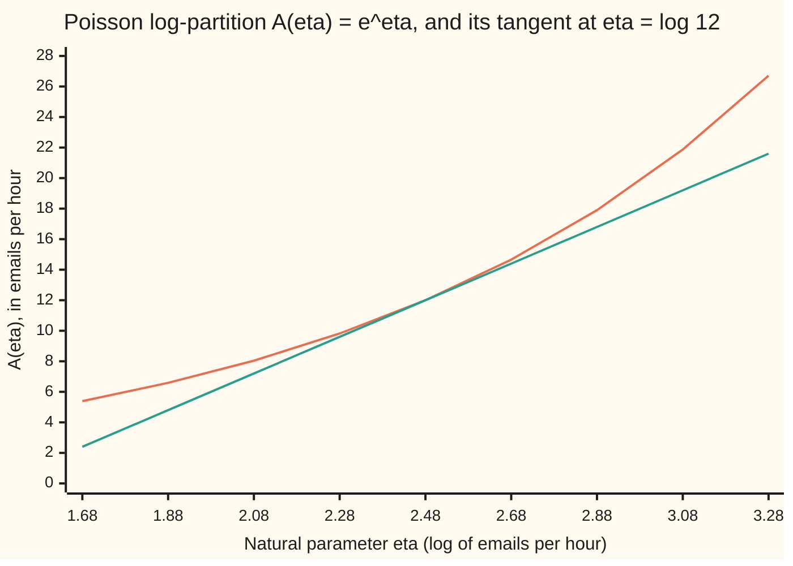

# Exponential families: one formula behind the binomial, Poisson, normal and gamma

[Syllabus](../../../SYLLABUS.md) → [Probability and statistics](../README.md) → [Sampling and Estimation](../README.md#s07) → Exponential families

---

## General Overview

A help desk receives emails at an average of 12 an hour. The count in one hour follows the Poisson law ([Poisson](../03-Discrete%20Distributions/04-poisson.md)). Its usual formula mixes the average, 12, into two places: a power and an exponential.

Rewrite that formula so the data meet the unknown in one place only: the count gets multiplied by one number, the log of the average, here 2.484907. Everything else that depends on the unknown sits in one function, called the **log-partition function**. For the help desk it is just "the average", 12.

That single function does a surprising amount of work. Its slope gives the average count: 12. Its curvature (how fast the slope changes) gives the variance: 12 again. No sums over every possible count are needed.

The same rewrite works for three more laws. They are the poll of 1,000 voters (a binomial count), a share's daily return (a normal law) and the wait until three emails arrive (a gamma law). Laws that fit this one template are called an **exponential family**.

Membership brings four gifts at once:

- the mean and variance come from two derivatives of one function;
- one total of the data carries everything the data say about the unknown;
- the log-likelihood has at most one peak, and when it has one, it is where the model's average matches the data's average;
- there is a prior that updates by simple addition (a **conjugate prior**).

**An exponential family writes a law as a weight times exp(natural parameter × statistic − log-partition function); the slope of the log-partition function is the mean, and its curvature is the variance.**

**What kind of fact this is:** a definition (the template), plus theorems about every law that fits it. The derivative rules, the sufficient total, the rule of at most one peak and the conjugate update are proved on this card in Why it works. Treating a real help desk as Poisson is a model.

### The picture: the log-partition function and its slope at the help desk



The orange curve is the log-partition function $`A(\eta) = e^\eta`$. The green line is its tangent at the help desk's value, $`\eta = \log 12`$ (labelled 2.48 on the axis). The tangent's slope is 12: that is the mean count. The curve bends upward and stays above the tangent everywhere. That bend is the variance, and it is why the log-likelihood has at most one peak.

---

## The formula

A law belongs to an **exponential family** when its chance (or density) of each value $`x`$ can be written as

```math
p(x \mid \eta) = h(x)\, \exp\big(\eta\, T(x) - A(\eta)\big), \qquad A(\eta) = \log \sum_x h(x)\, e^{\eta\, T(x)}
```

For a continuous law the sum is an integral. The two facts that make the template useful:

```math
A'(\eta) = E[T(X)], \qquad A''(\eta) = \mathrm{Var}(T(X))
```

**Read it aloud:** the chance of $`x`$ is a weight times e to the power (eta times T of x, minus A of eta). The slope of A is the average of T, and its curvature is the variance of T.

Here $`\log`$ is the natural logarithm, written ln on the earlier cards of this shelf, and $`p(x \mid \eta)`$ is the chance that [Sufficient statistics](09-sufficient-statistics-and-factorisation.md) writes $`f(x;\theta)`$. $`E`$ and $`\mathrm{Var}`$ are the mean and variance ([Expectation](../02-Random%20Variables/02-expectation.md), [Variance](../02-Random%20Variables/03-variance-and-standard-deviation.md)).

| Symbol | Plain meaning | In our example | Push it up and the answer… |
| --- | --- | --- | --- |
| $`x`$, $`X`$, $`p(x \mid \eta)`$ | one observed value; X, the value before it is seen; the chance of x when the natural parameter is η (not the poll's share p) | emails in one hour | not a setting; it is the data |
| $`\lambda`$ | the usual parameter: the average rate | 12 emails an hour | mean and variance both rise |
| $`\eta`$ | the **natural parameter**: the number that multiplies the statistic | $`\log 12 = 2.484907`$ | mean rises, as $`e^\eta`$ |
| $`T(x)`$ | the **sufficient statistic**: the function of the data that meets $`\eta`$ | the count itself, $`x`$ | not a setting |
| $`h(x)`$ | the **base weight**: the part that does not involve the unknown | $`1/x!`$ | not a setting |
| $`Z(\eta)`$ | the total of all the weights $`h(x)\, e^{\eta T(x)}`$ | $`e^{12}`$ | rises |
| $`A(\eta)`$ | the **log-partition function**, $`\log Z`$; its slope $`A'`$ is the mean and its curvature $`A''`$ the variance of $`T(X)`$ | $`A = A' = A'' = 12`$ | all three rise, as $`e^\eta`$ |
| $`n`$ | number of independent observations | 8 hours | the log-likelihood peak gets sharper |
| $`\ell(\eta)`$, $`\hat\eta`$ | the **log-likelihood**: log of the chance of all the data, read as a function of $`\eta`$; $`\hat\eta`$ is where it peaks | $`\hat\eta`$ = 2.484907 | |
| $`p`$, $`\mu`$, $`\sigma`$, $`\beta`$ | the other laws' usual parameters: yes-share, mean, spread, rate | 0.52; 0.05 and 1.2 percent; 12 an hour | each law's mean moves with its own parameter |
| $`\tau`$ | prior's pseudo-total: counts the prior "has already seen" | 24 emails | posterior mean rises |
| $`\nu`$ | prior's pseudo-size: how much data the prior is worth | 2 hours | posterior leans more on the prior |

### Four laws, one template

Each law below has its other numbers fixed (the poll's 1,000 calls, the normal's spread of 1.2 percent, the gamma's shape of 3). Then one natural parameter is left.

| Law and example | $`\eta`$ | $`T(x)`$ | $`h(x)`$ | $`A(\eta)`$ | Mean $`A'`$ | Variance $`A''`$ |
| --- | --- | --- | --- | --- | --- | --- |
| Poisson: emails in an hour, mean 12 | $`\log \lambda`$ = 2.4849 | $`x`$ | $`1/x!`$ | $`e^\eta`$ | 12 | 12 |
| Binomial: yes votes among 1,000, share 0.52 | $`\log \frac{p}{1-p}`$ = 0.0800 | $`x`$ | $`\binom{1000}{x}`$ | $`1000 \log(1 + e^\eta)`$ | 520 | 249.6 |
| Normal: daily return in percent, mean 0.05, spread 1.2 | $`\mu / \sigma^2`$ = 0.0347 | $`x`$ | $`e^{-x^2/(2\sigma^2)} / \sqrt{2\pi\sigma^2}`$ | $`\sigma^2 \eta^2 / 2`$ | 0.05 | 1.44 |
| Gamma: hours until 3 emails, rate 12 an hour | $`-\beta`$ = −12 | $`x`$ | $`x^2 / 2`$ | $`-3 \log(-\eta)`$ | 0.25 | 0.0208 |

In the binomial row, $`p`$ is the share voting yes and $`\eta`$ is its **log-odds**, the log of yes-chance over no-chance. In the normal row, $`\mu`$ is the mean and $`\sigma`$ the spread. In the gamma row, $`\beta`$ is the rate of emails per hour ([Gamma and beta](../04-Continuous%20Distributions/07-gamma-and-beta-distributions.md)).

The poll's variance 249.6 gives the standard error of the share: $`\sqrt{249.6}/1000 = 0.015799`$, the 0.0158 of [Maximum likelihood](04-maximum-likelihood.md). The gamma wait has mean 0.25 hours, 15 minutes, and standard deviation 8.6603 minutes.

When the normal's spread is unknown too, the template takes two statistics, $`x`$ and $`x^2`$, with two natural parameters $`\mu/\sigma^2`$ and $`-1/(2\sigma^2)`$. Every result below carries over, with vectors in place of single numbers.

### When it holds

- **The set of possible values does not depend on the unknown.** A uniform law from 0 up to an unknown top value fails this. Its best summary is the sample maximum, not a total, and none of the four gifts apply. (It does have a conjugate prior, the Pareto law of [Heavy tails](../04-Continuous%20Distributions/08-heavy-tails-pareto-and-cauchy.md), but that updates by taking a maximum, not by adding totals.)
- **The unknown meets the data only through the product $`\eta\, T(x)`$.** If the unknown also sits inside $`h(x)`$, the factorisation in Step 4 breaks and the total is no longer enough.
- **The other numbers are fixed or get their own statistic.** The poll's 1,000 calls and the gamma's shape 3 are held fixed. Let the normal's spread vary without adding $`x^2`$ and the model cannot fit spread at all.
- **The total defining $`A`$ is finite.** For the Poisson it is finite for every $`\eta`$. For the gamma it needs $`\eta < 0`$: at $`\eta = +12`$ the wait would have to grow without bound.
- **For Steps 4 to 6, the observations are independent with one shared $`\eta`$.** A desk whose busy hours cluster breaks this, and the log-likelihood no longer splits into a sum.

---

## Why it works

### Step 0: the log of a total of weights has the weighted average as its slope

Give each possible value $`x`$ a weight $`h(x)\, e^{\eta x}`$. The chances are these weights divided by their total. The log-partition function is the log of that total.

Turning the dial $`\eta`$ up multiplies each weight by an amount that grows with $`x`$. Big values gain the most. The rate at which the log-total grows is therefore the weighted average of $`x`$: the mean. Every other result on this card follows from that one fact plus the product rule for independent data.

### Step 1: put the Poisson law into the template

The usual Poisson formula is $`e^{-\lambda}\lambda^x / x!`$. Write $`\lambda^x`$ as $`e^{x \log \lambda}`$:

```math
\frac{e^{-\lambda}\lambda^x}{x!} = \frac{1}{x!}\, \exp\big(x \log \lambda - \lambda\big)
```

Now read off the parts. The natural parameter is $`\eta = \log \lambda`$. The statistic is $`T(x) = x`$. The base weight is $`h(x) = 1/x!`$. The leftover, $`\lambda`$, must be written in terms of $`\eta`$: $`A(\eta) = e^\eta`$.

For the help desk, $`\eta = \log 12 = 2.484907`$ and $`A(\eta) = 12`$. The code also builds $`A`$ the slow way, as the log of $`\sum_x e^{\eta x}/x!`$ over 200 counts, and gets 12.000000.

### Step 2: the first derivative is the mean

Call the total $`Z(\eta) = \sum_x h(x)\, e^{\eta\, T(x)}`$, so $`A = \log Z`$. Differentiate the total term by term: each term gains a factor $`T(x)`$. Then

```math
A'(\eta) = \frac{Z'(\eta)}{Z(\eta)} = \sum_x T(x)\, \frac{h(x)\, e^{\eta T(x)}}{Z(\eta)} = \sum_x T(x)\, p(x \mid \eta) = E[T(X)]
```

For the help desk, $`A'(\eta) = e^\eta = 12`$. That is the mean count, with no sum over counts needed.

### Step 3: the second derivative is the variance

Differentiate again. The answer is the average of $`T^2`$ minus the square of the average of $`T`$, which is the variance:

```math
A''(\eta) = E[T(X)^2] - \big(E[T(X)]\big)^2 = \mathrm{Var}(T(X)) \ge 0
```

For the help desk, $`A''(\eta) = e^\eta = 12`$: the Poisson's mean equals its variance, as on [Poisson](../03-Discrete%20Distributions/04-poisson.md). A variance is never negative, so $`A`$ always bends upward. That shape is called **convex**.

<details>
<summary>The second derivative, line by line, and the link to the moment generating function</summary>

Differentiate $`A' = Z'/Z`$ with the quotient rule:

$`\displaystyle A''(\eta) = \frac{Z''(\eta)}{Z(\eta)} - \left(\frac{Z'(\eta)}{Z(\eta)}\right)^2.`$

Each derivative of $`Z`$ brings down one more factor of $`T(x)`$. So $`Z''/Z = E[T^2]`$ and $`Z'/Z = E[T]`$, which gives the variance.

The same total gives the moment generating function ([Moment generating functions](../02-Random%20Variables/07-moment-generating-functions.md)). Multiply each weight by $`e^{tT(x)}`$ and the total becomes $`Z(\eta + t)`$:

$`\displaystyle E\big[e^{t\,T(X)}\big] = \frac{Z(\eta + t)}{Z(\eta)} = \exp\big(A(\eta + t) - A(\eta)\big).`$

So $`A(\eta + t) - A(\eta)`$ is the log of the moment generating function. Its derivatives at $`t = 0`$ are the cumulants: the mean, the variance and the higher ones. For the help desk at $`t = 0.1`$, $`\exp(12(e^{0.1} - 1)) = 3.532660`$, and summing $`e^{0.1x}p(x)`$ over the counts gives the same 3.532660.

</details>

### Step 4: the total of the statistic is sufficient

Take $`n`$ independent observations. Their joint chance is the product of single chances. The exponentials multiply, so their powers add:

```math
\prod_{i=1}^{n} p(x_i \mid \eta) = \Big(\prod_{i=1}^{n} h(x_i)\Big)\, \exp\Big(\eta \sum_{i=1}^{n} T(x_i) - n A(\eta)\Big)
```

The unknown $`\eta`$ meets the data only through the total $`\sum T(x_i)`$. By the factorisation theorem ([Sufficient statistics](09-sufficient-statistics-and-factorisation.md)), that total is a **sufficient statistic**: it carries everything the sample says about $`\eta`$.

Test it on two weeks at the help desk. Week 1's eight hours bring 11, 14, 9, 12, 15, 10, 13, 12 emails. Week 2's bring 6, 18, 12, 12, 20, 4, 12, 12. Both total 96. The gap between their log-likelihoods is 7.411591 at $`\eta`$ = 1, 2, 2.5 and 3 alike. The gap does not move, so the two weeks point to exactly the same $`\eta`$.

### Step 5: at most one peak, where the model's mean matches the data's mean

Take the log of Step 4's product. The **log-likelihood** is

```math
\ell(\eta) = \eta \sum_{i=1}^{n} T(x_i) - n A(\eta) + \text{a constant}
```

Its slope is $`\sum T(x_i) - n A'(\eta)`$. Setting the slope to zero gives the maximum likelihood estimate $`\hat\eta`$ ([Maximum likelihood](04-maximum-likelihood.md)):

```math
A'(\hat\eta) = \frac{1}{n} \sum_{i=1}^{n} T(x_i)
```

In words: pick the parameter whose model mean equals the sample mean. That is exactly the [Method of moments](05-method-of-moments.md) on the statistic $`T`$, so in an exponential family the two methods agree.

The curvature of $`\ell`$ is $`-n A''(\eta) = -n \times \text{variance}`$. That is negative everywhere, so $`\ell`$ bends downward everywhere (it is **concave**). A concave curve has at most one peak, and any point where the slope is zero is that peak.

For week 1, the sample mean is 96 / 8 = 12, so $`\hat\eta = \log 12 = 2.484907`$. A search over $`\lambda`$ that uses no calculus finds 12.000000 too. The curvature at the peak is $`-8 \times 12 = -96`$. Flipped in sign, 96 is the Fisher information about $`\eta`$ in the eight hours ([Fisher information](07-fisher-information-and-cramer-rao.md)).

### Step 6: the conjugate prior has the same shape, read in the parameter

Step 4's likelihood is $`\exp(\eta \sum T - nA(\eta))`$, read as a function of $`\eta`$. Choose a prior with the same shape, using two numbers of its own: a pseudo-total $`\tau`$ and a pseudo-size $`\nu`$:

```math
\pi(\eta) \propto \exp\big(\tau\, \eta - \nu\, A(\eta)\big)
```

Here $`\pi`$ is the prior density and $`\propto`$ means "equal up to a constant factor". Multiply prior by likelihood and the powers add again:

```math
\pi(\eta \mid \text{data}) \propto \exp\Big(\big(\tau + \textstyle\sum T(x_i)\big)\, \eta - (\nu + n)\, A(\eta)\Big)
```

The posterior is in the same family as the prior. Updating is addition: the data's total goes on $`\tau`$, the sample size goes on $`\nu`$. The prior acts like $`\nu`$ earlier observations that totalled $`\tau`$.

For the Poisson, a window of several hours has mean (hours × $`\lambda`$), so its $`A`$ is (hours × $`e^\eta`$) and $`\nu`$ counts hours. Rewritten in $`\lambda`$, the prior is a gamma law with shape $`\tau`$ and rate $`\nu`$.

The help desk on [Gamma-Poisson](../10-Bayesian%20Inference/04-gamma-poisson.md) starts from shape 24 and rate 2: 24 pseudo-emails in 2 pseudo-hours. It then sees 28 emails in 2 hours and 17 in 1 hour. The update gives shape 24 + 45 = 69 and rate 2 + 3 = 5, a posterior mean of 13.8 and standard deviation 1.661325. A brute-force integral of prior times likelihood gives the same two numbers.

The same rule, applied to the other rows of the table, gives [Beta-binomial](../10-Bayesian%20Inference/02-beta-binomial.md) and [Normal-normal](../10-Bayesian%20Inference/03-normal-normal.md). Those cards work the cases in full.

<details>
<summary>Why the prior in eta becomes a gamma law in lambda</summary>

The prior in $`\eta`$ is proportional to $`\exp(\tau\eta - \nu e^\eta)`$. Put $`\lambda = e^\eta`$, so $`d\eta = d\lambda / \lambda`$. A density changes by that factor when its variable changes:

$`\displaystyle \exp(\tau \log\lambda - \nu\lambda)\, \frac{1}{\lambda} = \lambda^{\tau - 1}\, e^{-\nu\lambda}.`$

That is the gamma density with shape $`\tau`$ and rate $`\nu`$, up to its constant. Its mean is $`\tau/\nu`$: 24/2 = 12 before the data and 69/5 = 13.8 after.

</details>

---

## Worked numbers, by hand

The help desk: Poisson, mean 12 an hour, and the week-1 sample of eight hours.

| Step | Arithmetic | Value |
| --- | --- | --- |
| natural parameter | $`\eta = \log 12`$ | 2.484907 |
| log-partition function | $`A(\eta) = e^{2.484907}`$ | 12 |
| mean, slope of $`A`$ | $`A'(\eta) = e^{\eta}`$ | 12 |
| variance, curvature of $`A`$ | $`A''(\eta) = e^{\eta}`$ | 12 |
| sufficient statistic, week 1 | 11 + 14 + 9 + 12 + 15 + 10 + 13 + 12 | 96 |
| estimate: solve $`A'(\hat\eta)`$ = sample mean | $`e^{\hat\eta} = 96/8`$, so $`\hat\eta = \log 12`$ | 2.484907 |
| curvature of the log-likelihood | $`-n A''(\hat\eta) = -8 \times 12`$ | −96 |
| conjugate update | $`(24 + 45)/(2 + 3)`$ | 13.8 |
| **mean and variance of one hour's count** | **both from $`A(\eta) = e^\eta`$** | **12 and 12** |

The slope and curvature of one function, $`e^\eta`$, give the help desk's average load and its hour-to-hour spread, without summing a single chance.

### What breaks if you drop a piece

| Mistake | Comes out at | What went wrong |
| --- | --- | --- |
| Differentiate $`A = \lambda`$ with respect to $`\lambda`$, not $`\eta`$ | mean 1 email (right: 12) | The derivative rule holds only in the natural parameter. |
| Put the share $`p = 0.52`$ where the log-odds belongs in the poll | 627.147766 yes votes (right: 520) | The poll's natural parameter is $`\log(0.52/0.48) = 0.0800`$, not 0.52. |
| Gamma wait with $`\eta = +12`$ instead of $`-12`$ | −0.25 hours (right: 0.25) | The rate enters with a minus sign; a wait cannot be negative. |
| Conjugate update adds the 45 emails but not the 3 hours | 34.5 an hour (right: 13.8) | $`\nu`$ counts the size of the data; leaving it out treats 45 emails as if they came in 2 hours. |

---

## Code, from first principles, and it actually runs

The scripts write all four laws in the template and reach each mean and variance by three independent roads. The first is the closed-form derivatives of $`A`$. The second builds $`A`$ by brute force from its definition, as a sum or a Simpson integral, and differentiates it numerically. The third sums or integrates the moments straight from the law's usual formula. They also check the moment generating function two ways. They find the estimate by a golden-section search, which uses no calculus, and compare it with the sample mean. They test sufficiency on two weeks with the same total, and they check the conjugate update against a brute-force posterior integral. Log-factorials are built by adding logs; nothing imported knows the answer.

### Python

```python
# Exponential families -- the check behind the card.  Standard library only.
# Four laws written as h(x) exp(eta*T(x) - A(eta)).  Three roads to each mean
# and variance: A's derivatives in closed form, A built by brute force from its
# definition (a sum or a Simpson integral) and differentiated numerically, and
# the moments summed or integrated straight from the usual formula of the law.
from math import exp, log, sqrt, pi

LF = [0.0]                                   # log factorials, built by adding logs
for k in range(1, 1001):
    LF.append(LF[-1] + log(k))

def simpson(f, a, b, n=20000):
    h = (b - a) / n
    s = f(a) + f(b)
    for i in range(1, n):
        s += (4 if i % 2 else 2) * f(a + i * h)
    return s * h / 3

def logsumexp(v):
    m = max(v)
    return m + log(sum(exp(x - m) for x in v))

LAM, N, P, MU, SIG, K, B = 12.0, 1000, 0.52, 0.05, 1.2, 3, 12.0
# A(eta) = log of the total of h(x) e^(eta x): the definition, done by brute force
def A_pois(e):  return logsumexp([e * x - LF[x] for x in range(200)])
def A_binom(e): return logsumexp([e * x + LF[N] - LF[x] - LF[N - x] for x in range(N + 1)])
def A_norm(e):  return log(simpson(lambda x: exp(e * x - x * x / (2 * SIG * SIG)) / sqrt(2 * pi * SIG * SIG), -20.0, 20.0))
def A_gamma(e): return log(simpson(lambda x: x ** (K - 1) * exp(e * x) / exp(LF[K - 1]), 0.0, 6.0))

def d1(A, e, h=1e-3): return (A(e + h) - A(e - h)) / (2 * h)
def d2(A, e, h=1e-3): return (A(e + h) - 2 * A(e) + A(e - h)) / (h * h)

def disc_moments(pmf, xs):
    m = sum(x * pmf(x) for x in xs)
    return m, sum((x - m) ** 2 * pmf(x) for x in xs)
def cont_moments(f, a, b):
    m = simpson(lambda x: x * f(x), a, b)
    return m, simpson(lambda x: (x - m) ** 2 * f(x), a, b)

pois = lambda x: exp(-LAM + x * log(LAM) - LF[x])                  # the usual formulas
binom = lambda x: exp(LF[N] - LF[x] - LF[N - x] + x * log(P) + (N - x) * log(1 - P))
norm = lambda x: exp(-(x - MU) ** 2 / (2 * SIG * SIG)) / sqrt(2 * pi * SIG * SIG)
gam = lambda x: B ** K * x ** (K - 1) * exp(-B * x) / exp(LF[K - 1])

laws = [  # name, eta, brute A, closed A'(eta), closed A''(eta), moments from the usual formula
    ("Poisson help desk", log(LAM), A_pois, LAM, LAM, disc_moments(pois, range(200))),
    ("binomial poll", log(P / (1 - P)), A_binom, N * P, N * P * (1 - P), disc_moments(binom, range(N + 1))),
    ("normal return", MU / SIG ** 2, A_norm, MU, SIG ** 2, cont_moments(norm, -20.0, 20.0)),
    ("gamma wait (h)", -B, A_gamma, -K / (-B), K / B ** 2, cont_moments(gam, 0.0, 6.0)),
]
eta = log(LAM)
print("help desk, Poisson with mean 12: eta = log 12".ljust(44) + f"{eta:12.6f}")
print("A(eta) = e^eta".ljust(44) + f"{exp(eta):12.6f}")
print("A(eta) by brute sum of e^(eta x)/x!".ljust(44) + f"{A_pois(eta):12.6f}")
mgf_sum = sum(exp(0.1 * x) * pois(x) for x in range(200))
print("mgf at t=0.1: sum of e^(tx) p(x)".ljust(44) + f"{mgf_sum:12.6f}")
print("mgf at t=0.1: exp(A(eta+t) - A(eta))".ljust(44) + f"{exp(exp(eta + 0.1) - exp(eta)):12.6f}")
print("law                     eta    A' closed  A' numeric  mean summed A'' closed A'' numeric   var summed")
for name, e, A, m, v, (bm, bv) in laws:
    nm, nv = d1(A, e), d2(A, e)
    print(f"{name:<18}{e:9.4f}" + "".join(f"{z:12.4f}" for z in (m, nm, bm, v, nv, bv)))
    assert abs(nm - m) < 1e-4 * max(1, abs(m)) and abs(bm - m) < 1e-6 * max(1, abs(m)), name + " mean"
    assert abs(nv - v) < 1e-4 * max(1, v) and abs(bv - v) < 1e-6 * max(1, v), name + " variance"
print("poll standard error sqrt(A'')/1000".ljust(44) + f"{sqrt(N * P * (1 - P)) / N:12.6f}")
print("gamma wait in minutes: mean, sd".ljust(44) + f"{60 * K / B:12.4f}{60 * sqrt(K) / B:12.4f}")

hours = [11, 14, 9, 12, 15, 10, 13, 12]          # eight observed hours, total 96
other = [6, 18, 12, 12, 20, 4, 12, 12]           # a different week, same total 96
def loglik(data, e): return sum(x * e - exp(e) - LF[x] for x in data)
lo, hi, g = 1.0, 40.0, (sqrt(5) - 1) / 2         # golden-section search on lambda, no calculus
for _ in range(200):
    a, b = hi - g * (hi - lo), lo + g * (hi - lo)
    if loglik(hours, log(a)) < loglik(hours, log(b)): lo = a
    else: hi = b
lam_hat = (lo + hi) / 2
xbar = sum(hours) / len(hours)
curv = (loglik(hours, log(lam_hat) + 1e-3) - 2 * loglik(hours, log(lam_hat)) + loglik(hours, log(lam_hat) - 1e-3)) / 1e-6
print("eight hours " + " ".join(map(str, hours)) + ", total " + str(sum(hours)))
print("MLE of lambda by golden-section search".ljust(44) + f"{lam_hat:12.6f}")
print("sample mean, where A'(eta) = mean of x".ljust(44) + f"{xbar:12.6f}")
print("eta-hat = log of the MLE".ljust(44) + f"{log(lam_hat):12.6f}")
print("curvature of log-lik at eta-hat, numeric".ljust(44) + f"{curv:12.4f}")
print("curvature, -n A''(eta-hat) = -8 x 12".ljust(44) + f"{-len(hours) * xbar:12.4f}")
gaps = [loglik(hours, e) - loglik(other, e) for e in (1.0, 2.0, 2.5, 3.0)]
print("log-lik gap to week 2, eta = 1, 2, 2.5, 3  " + " ".join(f"{z:.6f}" for z in gaps))
assert abs(lam_hat - xbar) < 1e-6, "MLE must match the mean (moment matching)"
assert abs(curv + len(hours) * xbar) < 1e-3, "curvature must be -n A''"
assert all(d2(lambda e: loglik(hours, e), e) < 0 for e in (-2.0, 0.0, 2.0, 4.0)), "log-lik concave"
assert max(gaps) - min(gaps) < 1e-9, "only the total matters: gap must not depend on eta"

a0, b0, counts, spans = 24.0, 2.0, (28, 17), (2.0, 1.0)  # gamma prior; 28 emails in 2 h, 17 in 1 h
a1, b1 = a0 + sum(counts), b0 + sum(spans)
def post(l):  # prior density times both Poisson chances, written in the usual way
    if l <= 0: return 0.0
    w = a0 * log(b0) + (a0 - 1) * log(l) - b0 * l - LF[int(a0) - 1]
    for c, t in zip(counts, spans):
        w += -t * l + c * log(t * l) - LF[c]
    return exp(w)
Z = simpson(post, 0.0, 60.0)
pm = simpson(lambda l: l * post(l), 0.0, 60.0) / Z
psd = sqrt(simpson(lambda l: (l - pm) ** 2 * post(l), 0.0, 60.0) / Z)
print("posterior shape, rate: 24+45, 2+3".ljust(44) + f"{a1:12.4f}{b1:12.4f}")
print("posterior mean: shape/rate".ljust(44) + f"{a1 / b1:12.6f}")
print("posterior mean: brute-force integral".ljust(44) + f"{pm:12.6f}")
print("posterior sd: sqrt(shape)/rate".ljust(44) + f"{sqrt(a1) / b1:12.6f}")
print("posterior sd: brute-force integral".ljust(44) + f"{psd:12.6f}")
assert abs(pm - a1 / b1) < 1e-6 and abs(psd - sqrt(a1) / b1) < 1e-6, "conjugate update"

print("wrong: differentiate A = lambda in lambda".ljust(44) + f"{d1(lambda l: l, LAM):12.6f}")
print("wrong: p = 0.52 put where the log-odds goes".ljust(44) + f"{N * exp(P) / (1 + exp(P)):12.6f}")
print("wrong: gamma with eta = +12".ljust(44) + f"{-K / B:12.6f}")
print("wrong: add the emails, forget the hours".ljust(44) + f"{a1 / b0:12.6f}")
print("try: mean 3: eta, A', A''".ljust(44) + "".join(f"{z:12.6f}" for z in (log(3), d1(A_pois, log(3)), d2(A_pois, log(3)))))
print("try: poll at 50%: eta, A''".ljust(44) + f"{0.0:12.4f}{d2(A_binom, 0.0):12.4f}")
print("try: prior shape 240, rate 20: post. mean".ljust(44) + f"{(240 + 45) / (20 + 3):12.6f}")
print("try: gamma shape 1: mean, variance (h)".ljust(44) + f"{1 / B:12.6f}{1 / B ** 2:12.6f}")
grid = [eta + 0.2 * k for k in range(-4, 5)]
print("chart, eta     " + " ".join(f"{e:6.2f}" for e in grid))
print("chart, A(eta)  " + " ".join(f"{A_pois(e):6.2f}" for e in grid))
print("chart, tangent " + " ".join(f"{LAM + LAM * (e - eta):6.2f}" for e in grid))
print("ALL CHECKS PASS")
```

**Ran 2026-11-23 on macOS, Python 3.14.10, standard library only. All checks passed. Output, pasted from the run:**

```
help desk, Poisson with mean 12: eta = log 12    2.484907
A(eta) = e^eta                                 12.000000
A(eta) by brute sum of e^(eta x)/x!            12.000000
mgf at t=0.1: sum of e^(tx) p(x)                3.532660
mgf at t=0.1: exp(A(eta+t) - A(eta))            3.532660
law                     eta    A' closed  A' numeric  mean summed A'' closed A'' numeric   var summed
Poisson help desk    2.4849     12.0000     12.0000     12.0000     12.0000     12.0000     12.0000
binomial poll        0.0800    520.0000    520.0000    520.0000    249.6000    249.6000    249.6000
normal return        0.0347      0.0500      0.0500      0.0500      1.4400      1.4400      1.4400
gamma wait (h)     -12.0000      0.2500      0.2500      0.2500      0.0208      0.0208      0.0208
poll standard error sqrt(A'')/1000              0.015799
gamma wait in minutes: mean, sd                  15.0000      8.6603
eight hours 11 14 9 12 15 10 13 12, total 96
MLE of lambda by golden-section search         12.000000
sample mean, where A'(eta) = mean of x         12.000000
eta-hat = log of the MLE                        2.484907
curvature of log-lik at eta-hat, numeric        -96.0000
curvature, -n A''(eta-hat) = -8 x 12            -96.0000
log-lik gap to week 2, eta = 1, 2, 2.5, 3  7.411591 7.411591 7.411591 7.411591
posterior shape, rate: 24+45, 2+3                69.0000      5.0000
posterior mean: shape/rate                     13.800000
posterior mean: brute-force integral           13.800000
posterior sd: sqrt(shape)/rate                  1.661325
posterior sd: brute-force integral              1.661325
wrong: differentiate A = lambda in lambda       1.000000
wrong: p = 0.52 put where the log-odds goes   627.147766
wrong: gamma with eta = +12                    -0.250000
wrong: add the emails, forget the hours        34.500000
try: mean 3: eta, A', A''                       1.098612    3.000000    3.000000
try: poll at 50%: eta, A''                        0.0000    250.0000
try: prior shape 240, rate 20: post. mean      12.391304
try: gamma shape 1: mean, variance (h)          0.083333    0.006944
chart, eta       1.68   1.88   2.08   2.28   2.48   2.68   2.88   3.08   3.28
chart, A(eta)    5.39   6.59   8.04   9.82  12.00  14.66  17.90  21.87  26.71
chart, tangent   2.40   4.80   7.20   9.60  12.00  14.40  16.80  19.20  21.60
ALL CHECKS PASS
```

The three roads agree to four decimals for all four laws. The golden-section search lands on the sample mean, and the brute-force posterior lands on shape over rate.

### Rust

The same checks with the same inputs and labels, standard library only.

```rust
// Exponential families -- the same check as exponential_families_check.py, in Rust.
// Standard library only, no crates.  Four laws written as h(x) exp(eta*T(x) - A(eta)).
// Three roads to each mean and variance: A's derivatives in closed form, A built by
// brute force from its definition (a sum or a Simpson integral) and differentiated
// numerically, and the moments summed or integrated straight from the usual formula.
// Compile: rustc --edition 2021 -O exponential_families_check.rs -o /tmp/expfam
use std::f64::consts::PI;

const LAM: f64 = 12.0;
const N: usize = 1000;
const P: f64 = 0.52;
const MU: f64 = 0.05;
const SIG: f64 = 1.2;
const K: usize = 3;
const B: f64 = 12.0;

fn simpson(f: &dyn Fn(f64) -> f64, a: f64, b: f64) -> f64 {
    let n = 20000;
    let h = (b - a) / n as f64;
    let mut s = f(a) + f(b);
    for i in 1..n {
        s += if i % 2 == 1 { 4.0 } else { 2.0 } * f(a + i as f64 * h);
    }
    s * h / 3.0
}
fn logsumexp(v: &[f64]) -> f64 {
    let m = v.iter().cloned().fold(f64::NEG_INFINITY, f64::max);
    m + v.iter().map(|x| (x - m).exp()).sum::<f64>().ln()
}
fn d1(a: &dyn Fn(f64) -> f64, e: f64) -> f64 { let h = 1e-3; (a(e + h) - a(e - h)) / (2.0 * h) }
fn d2(a: &dyn Fn(f64) -> f64, e: f64) -> f64 { let h = 1e-3; (a(e + h) - 2.0 * a(e) + a(e - h)) / (h * h) }
fn disc_moments(p: &dyn Fn(usize) -> f64, top: usize) -> (f64, f64) {
    let m: f64 = (0..top).map(|x| x as f64 * p(x)).sum();
    (m, (0..top).map(|x| (x as f64 - m).powi(2) * p(x)).sum())
}
fn cont_moments(f: &dyn Fn(f64) -> f64, a: f64, b: f64) -> (f64, f64) {
    let m = simpson(&|x| x * f(x), a, b);
    (m, simpson(&|x| (x - m).powi(2) * f(x), a, b))
}
fn label(s: &str, vals: &[f64], dp: usize) {
    let mut line = format!("{:<44}", s);
    for v in vals { line += &format!("{:12.*}", dp, v); }
    println!("{}", line);
}

fn main() {
    let mut lf = vec![0.0f64];
    for k in 1..=1000 { let last = lf[k - 1]; lf.push(last + (k as f64).ln()); }
    let lf = &lf;
    let a_pois = |e: f64| logsumexp(&(0..200).map(|x| e * x as f64 - lf[x]).collect::<Vec<_>>());
    let a_binom = |e: f64| logsumexp(&(0..=N).map(|x| e * x as f64 + lf[N] - lf[x] - lf[N - x]).collect::<Vec<_>>());
    let a_norm = |e: f64| simpson(&|x: f64| (e * x - x * x / (2.0 * SIG * SIG)).exp() / (2.0 * PI * SIG * SIG).sqrt(), -20.0, 20.0).ln();
    let a_gamma = |e: f64| simpson(&|x: f64| x.powi(K as i32 - 1) * (e * x).exp() / lf[K - 1].exp(), 0.0, 6.0).ln();
    let pois = |x: usize| (-LAM + x as f64 * LAM.ln() - lf[x]).exp();
    let binom = |x: usize| (lf[N] - lf[x] - lf[N - x] + x as f64 * P.ln() + (N - x) as f64 * (1.0 - P).ln()).exp();
    let norm = |x: f64| (-(x - MU).powi(2) / (2.0 * SIG * SIG)).exp() / (2.0 * PI * SIG * SIG).sqrt();
    let gam = |x: f64| B.powi(K as i32) * x.powi(K as i32 - 1) * (-B * x).exp() / lf[K - 1].exp();
    let kf = K as f64;
    let laws: Vec<(&str, f64, &dyn Fn(f64) -> f64, f64, f64, (f64, f64))> = vec![
        ("Poisson help desk", LAM.ln(), &a_pois, LAM, LAM, disc_moments(&pois, 200)),
        ("binomial poll", (P / (1.0 - P)).ln(), &a_binom, N as f64 * P, N as f64 * P * (1.0 - P), disc_moments(&binom, N + 1)),
        ("normal return", MU / (SIG * SIG), &a_norm, MU, SIG * SIG, cont_moments(&norm, -20.0, 20.0)),
        ("gamma wait (h)", -B, &a_gamma, -kf / (-B), kf / (B * B), cont_moments(&gam, 0.0, 6.0)),
    ];
    let eta = LAM.ln();
    label("help desk, Poisson with mean 12: eta = log 12", &[eta], 6);
    label("A(eta) = e^eta", &[eta.exp()], 6);
    label("A(eta) by brute sum of e^(eta x)/x!", &[a_pois(eta)], 6);
    let mgf_sum: f64 = (0..200).map(|x| (0.1 * x as f64).exp() * pois(x)).sum();
    label("mgf at t=0.1: sum of e^(tx) p(x)", &[mgf_sum], 6);
    label("mgf at t=0.1: exp(A(eta+t) - A(eta))", &[((eta + 0.1).exp() - eta.exp()).exp()], 6);
    println!("law                     eta    A' closed  A' numeric  mean summed A'' closed A'' numeric   var summed");
    for (name, e, a, m, v, (bm, bv)) in &laws {
        let (nm, nv) = (d1(*a, *e), d2(*a, *e));
        let mut line = format!("{:<18}{:9.4}", name, e);
        for z in [*m, nm, *bm, *v, nv, *bv] { line += &format!("{:12.4}", z); }
        println!("{}", line);
        assert!((nm - m).abs() < 1e-4 * m.abs().max(1.0) && (bm - m).abs() < 1e-6 * m.abs().max(1.0), "{} mean", name);
        assert!((nv - v).abs() < 1e-4 * v.max(1.0) && (bv - v).abs() < 1e-6 * v.max(1.0), "{} variance", name);
    }
    label("poll standard error sqrt(A'')/1000", &[(N as f64 * P * (1.0 - P)).sqrt() / N as f64], 6);
    label("gamma wait in minutes: mean, sd", &[60.0 * kf / B, 60.0 * kf.sqrt() / B], 4);

    let hours = [11usize, 14, 9, 12, 15, 10, 13, 12];
    let other = [6usize, 18, 12, 12, 20, 4, 12, 12];
    let loglik = |d: &[usize], e: f64| -> f64 { d.iter().map(|&x| x as f64 * e - e.exp() - lf[x]).sum() };
    let (mut lo, mut hi, g) = (1.0f64, 40.0f64, (5.0f64.sqrt() - 1.0) / 2.0);
    for _ in 0..200 {
        let (a, b) = (hi - g * (hi - lo), lo + g * (hi - lo));
        if loglik(&hours, a.ln()) < loglik(&hours, b.ln()) { lo = a } else { hi = b }
    }
    let lam_hat = (lo + hi) / 2.0;
    let n = hours.len() as f64;
    let xbar = hours.iter().sum::<usize>() as f64 / n;
    let lh = lam_hat.ln();
    let curv = (loglik(&hours, lh + 1e-3) - 2.0 * loglik(&hours, lh) + loglik(&hours, lh - 1e-3)) / 1e-6;
    let hs: Vec<String> = hours.iter().map(|x| x.to_string()).collect();
    println!("eight hours {}, total {}", hs.join(" "), hours.iter().sum::<usize>());
    label("MLE of lambda by golden-section search", &[lam_hat], 6);
    label("sample mean, where A'(eta) = mean of x", &[xbar], 6);
    label("eta-hat = log of the MLE", &[lh], 6);
    label("curvature of log-lik at eta-hat, numeric", &[curv], 4);
    label("curvature, -n A''(eta-hat) = -8 x 12", &[-n * xbar], 4);
    let gaps: Vec<f64> = [1.0, 2.0, 2.5, 3.0].iter().map(|&e| loglik(&hours, e) - loglik(&other, e)).collect();
    let gs: Vec<String> = gaps.iter().map(|z| format!("{:.6}", z)).collect();
    println!("log-lik gap to week 2, eta = 1, 2, 2.5, 3  {}", gs.join(" "));
    assert!((lam_hat - xbar).abs() < 1e-6, "MLE must match the mean (moment matching)");
    assert!((curv + n * xbar).abs() < 1e-3, "curvature must be -n A''");
    assert!([-2.0, 0.0, 2.0, 4.0].iter().all(|&e| d2(&|t| loglik(&hours, t), e) < 0.0), "log-lik concave");
    let gmax = gaps.iter().cloned().fold(f64::MIN, f64::max);
    let gmin = gaps.iter().cloned().fold(f64::MAX, f64::min);
    assert!(gmax - gmin < 1e-9, "only the total matters: gap must not depend on eta");

    let (a0, b0, counts, spans) = (24.0f64, 2.0f64, [28usize, 17], [2.0f64, 1.0]);
    let (a1, b1) = (a0 + 45.0, b0 + 3.0);
    let post = |l: f64| -> f64 {
        if l <= 0.0 { return 0.0; }
        let mut w = a0 * b0.ln() + (a0 - 1.0) * l.ln() - b0 * l - lf[a0 as usize - 1];
        for (c, t) in counts.iter().zip(spans.iter()) { w += -t * l + *c as f64 * (t * l).ln() - lf[*c]; }
        w.exp()
    };
    let z = simpson(&post, 0.0, 60.0);
    let pm = simpson(&|l| l * post(l), 0.0, 60.0) / z;
    let psd = (simpson(&|l| (l - pm).powi(2) * post(l), 0.0, 60.0) / z).sqrt();
    label("posterior shape, rate: 24+45, 2+3", &[a1, b1], 4);
    label("posterior mean: shape/rate", &[a1 / b1], 6);
    label("posterior mean: brute-force integral", &[pm], 6);
    label("posterior sd: sqrt(shape)/rate", &[a1.sqrt() / b1], 6);
    label("posterior sd: brute-force integral", &[psd], 6);
    assert!((pm - a1 / b1).abs() < 1e-6 && (psd - a1.sqrt() / b1).abs() < 1e-6, "conjugate update");

    label("wrong: differentiate A = lambda in lambda", &[d1(&|l| l, LAM)], 6);
    label("wrong: p = 0.52 put where the log-odds goes", &[N as f64 * P.exp() / (1.0 + P.exp())], 6);
    label("wrong: gamma with eta = +12", &[-kf / B], 6);
    label("wrong: add the emails, forget the hours", &[a1 / b0], 6);
    let l3 = 3.0f64.ln();
    label("try: mean 3: eta, A', A''", &[l3, d1(&a_pois, l3), d2(&a_pois, l3)], 6);
    label("try: poll at 50%: eta, A''", &[0.0, d2(&a_binom, 0.0)], 4);
    label("try: prior shape 240, rate 20: post. mean", &[(240.0 + 45.0) / (20.0 + 3.0)], 6);
    label("try: gamma shape 1: mean, variance (h)", &[1.0 / B, 1.0 / (B * B)], 6);
    let grid: Vec<f64> = (-4..5).map(|k| eta + 0.2 * k as f64).collect();
    let row = |f: &dyn Fn(f64) -> f64| grid.iter().map(|&e| format!("{:6.2}", f(e))).collect::<Vec<_>>().join(" ");
    println!("chart, eta     {}", row(&|e| e));
    println!("chart, A(eta)  {}", row(&|e| a_pois(e)));
    println!("chart, tangent {}", row(&|e| LAM + LAM * (e - eta)));
    println!("ALL CHECKS PASS");
}
```

**Ran 2026-11-23 on macOS, rustc 1.98.1, no crates. All checks passed. Output, pasted from the run:**

```
help desk, Poisson with mean 12: eta = log 12    2.484907
A(eta) = e^eta                                 12.000000
A(eta) by brute sum of e^(eta x)/x!            12.000000
mgf at t=0.1: sum of e^(tx) p(x)                3.532660
mgf at t=0.1: exp(A(eta+t) - A(eta))            3.532660
law                     eta    A' closed  A' numeric  mean summed A'' closed A'' numeric   var summed
Poisson help desk    2.4849     12.0000     12.0000     12.0000     12.0000     12.0000     12.0000
binomial poll        0.0800    520.0000    520.0000    520.0000    249.6000    249.6000    249.6000
normal return        0.0347      0.0500      0.0500      0.0500      1.4400      1.4400      1.4400
gamma wait (h)     -12.0000      0.2500      0.2500      0.2500      0.0208      0.0208      0.0208
poll standard error sqrt(A'')/1000              0.015799
gamma wait in minutes: mean, sd                  15.0000      8.6603
eight hours 11 14 9 12 15 10 13 12, total 96
MLE of lambda by golden-section search         12.000000
sample mean, where A'(eta) = mean of x         12.000000
eta-hat = log of the MLE                        2.484907
curvature of log-lik at eta-hat, numeric        -96.0000
curvature, -n A''(eta-hat) = -8 x 12            -96.0000
log-lik gap to week 2, eta = 1, 2, 2.5, 3  7.411591 7.411591 7.411591 7.411591
posterior shape, rate: 24+45, 2+3                69.0000      5.0000
posterior mean: shape/rate                     13.800000
posterior mean: brute-force integral           13.800000
posterior sd: sqrt(shape)/rate                  1.661325
posterior sd: brute-force integral              1.661325
wrong: differentiate A = lambda in lambda       1.000000
wrong: p = 0.52 put where the log-odds goes   627.147766
wrong: gamma with eta = +12                    -0.250000
wrong: add the emails, forget the hours        34.500000
try: mean 3: eta, A', A''                       1.098612    3.000000    3.000000
try: poll at 50%: eta, A''                        0.0000    250.0000
try: prior shape 240, rate 20: post. mean      12.391304
try: gamma shape 1: mean, variance (h)          0.083333    0.006944
chart, eta       1.68   1.88   2.08   2.28   2.48   2.68   2.88   3.08   3.28
chart, A(eta)    5.39   6.59   8.04   9.82  12.00  14.66  17.90  21.87  26.71
chart, tangent   2.40   4.80   7.20   9.60  12.00  14.40  16.80  19.20  21.60
ALL CHECKS PASS
```

### Lean

Lean proves the card's main facts for any base weight and statistic, with one natural parameter.

- Take any $`\eta`$ where the total defining $`A`$ stays finite nearby. Then each chance is the base weight times $`\exp(\eta\, T(x) - A(\eta))`$.
- Take the same $`\eta`$. Then $`A'(\eta)`$ is the mean of $`T(X)`$, and $`A''(\eta)`$ is its variance.
- Take $`n`$ observations with one shared $`\eta`$. Then the log-likelihood $`\ell`$ is concave wherever the total defining $`A`$ stays finite nearby.
- Suppose $`\hat\eta`$ is in that range, and the mean of $`T(X)`$ there equals the sample mean. Then $`\hat\eta`$ is a highest point of $`\ell`$ there.
- Take the prior $`\exp(\tau\, \eta - \nu\, A(\eta))`$ and $`n`$ observations. Then prior times likelihood keeps that shape, with $`\tau + \sum T(x_i)`$ and $`\nu + n`$ in their places.
- Take $`\tau = \nu = 0`$. Then this is Step 4's product, where $`\eta`$ meets the data only through the total.
- The hand arithmetic holds exactly, as fractions. That covers both weeks' total of 96, the curvature −96, the update to 69/5 and the slip to 69/2.
- It also covers the poll's 520 and 249.6, the gamma's 0.25 hours and 15 minutes, and three of the Try changing answers.

Fitting the four laws into the template, the decimals, the brute-force sums and the searches are left to the Python and Rust checks.

```lean
-- Exponential families: for a law with chance exp(η T(x) − A(η)) against a fixed base weight, the slope of A is the mean of T, its curvature is the variance, the log-likelihood is concave with its peak where model mean meets sample mean, and a same-shape prior updates by addition.
import Mathlib.Probability.Moments.Tilted
import Mathlib.Probability.Moments.Variance
import Mathlib.Analysis.Convex.Function
import Mathlib.Analysis.SpecialFunctions.Exp

open MeasureTheory ProbabilityTheory Real
open scoped ENNReal

/-- **Slope of the log-partition function is the mean; curvature is the variance.**
The base weight `h(x)` is the measure `μ` (counting weights `h(x)` for a discrete law, the
density `h(x) dx` for a continuous one), `T` is the statistic, and the log-partition function
is `A(η) = log ∑ h(x) e^{η T(x)}`, which is Mathlib's `cgf T μ η = log ∫ exp (η * T x) ∂μ`.
The only hypothesis is the card's: the total defining `A` is finite (for every parameter near
`η`, so that `A` can be differentiated there). Then the law `p(· | η)` (Mathlib's tilted measure
`μ.tilted (η * T ·)`) gives each set the chance `∫ h(x) exp (η T(x) − A(η))`, the mean of `T`
under that law is `A'(η)`, and the variance of `T` under that law is `A''(η)`. -/
theorem log_partition_slope_is_mean_and_curvature_is_variance
    {Ω : Type*} [MeasurableSpace Ω] (μ : Measure Ω) (T : Ω → ℝ) {η : ℝ}
    (hη : η ∈ interior (integrableExpSet T μ)) :
    (∀ s : Set Ω, MeasurableSet s →
        μ.tilted (η * T ·) s = ∫⁻ x in s, ENNReal.ofReal (exp (η * T x - cgf T μ η)) ∂μ) ∧
    deriv (cgf T μ) η = ∫ x, T x ∂(μ.tilted (η * T ·)) ∧
    iteratedDeriv 2 (cgf T μ) η = Var[T; μ.tilted (η * T ·)] := by
  refine ⟨fun s hs => tilted_mul_apply_cgf' hs (interior_subset (s := integrableExpSet T μ) hη),
    (integral_tilted_mul_self hη).symm, (variance_tilted_mul hη).symm⟩

/-- **The log-likelihood has at most one peak, where the model's mean matches the data's.**
For `n` observations `x 1, …, x n` with one shared natural parameter, the log-likelihood (up to
a constant) is `ℓ(η) = η ∑ T(xᵢ) − n A(η)`. It is concave on the natural parameters where the
total defining `A` is finite, and any such `η̂` at which the model mean of `T` equals the sample
mean `(1/n) ∑ T(xᵢ)` is the peak: the maximum likelihood estimate is moment matching. -/
theorem log_likelihood_concave_and_peak_at_moment_match
    {Ω : Type*} [MeasurableSpace Ω] (μ : Measure Ω) (T : Ω → ℝ) {n : ℕ} (x : Fin n → Ω) :
    ConcaveOn ℝ (interior (integrableExpSet T μ))
        (fun η => η * ∑ i, T (x i) - n * cgf T μ η) ∧
    ∀ ηhat ∈ interior (integrableExpSet T μ),
      ∫ y, T y ∂(μ.tilted (ηhat * T ·)) = (∑ i, T (x i)) / n →
      IsMaxOn (fun η => η * ∑ i, T (x i) - n * cgf T μ η)
        (interior (integrableExpSet T μ)) ηhat := by
  set D := interior (integrableExpSet T μ) with hD
  set S := ∑ i, T (x i) with hS
  have hDc : Convex ℝ D := convex_integrableExpSet.interior
  have hconv : ConvexOn ℝ D (cgf T μ) := by
    refine convexOn_of_deriv2_nonneg hDc ?_ ?_ ?_ ?_
    · exact analyticOn_cgf.continuousOn
    · rw [hD, interior_interior]; exact analyticOn_cgf.differentiableOn
    · rw [hD, interior_interior]
      exact (analyticOnNhd_cgf.deriv).differentiableOn
    · intro y hy
      rw [hD, interior_interior] at hy
      rw [← iteratedDeriv_eq_iterate, ← variance_tilted_mul hy]
      exact variance_nonneg _ _
  have hn : (0 : ℝ) ≤ n := Nat.cast_nonneg n
  refine ⟨⟨hDc, fun a ha b hb p q hp hq hpq => ?_⟩, fun ηhat hηhat hmean => ?_⟩
  · have h1 := hconv.2 ha hb hp hq hpq
    simp only [smul_eq_mul] at h1 ⊢
    have h2 := mul_le_mul_of_nonneg_left h1 hn
    nlinarith
  · have hm : (n : ℝ) * deriv (cgf T μ) ηhat = S := by
      rw [← integral_tilted_mul_self hηhat, hmean]
      rcases Nat.eq_zero_or_pos n with h0 | hpos
      · subst h0; simp [hS]
      · have : (n : ℝ) ≠ 0 := by positivity
        field_simp
    have hda : HasDerivAt (cgf T μ) (deriv (cgf T μ) ηhat) ηhat :=
      ((analyticAt_cgf hηhat).differentiableAt).hasDerivAt
    have tangent : ∀ y ∈ D, cgf T μ ηhat + deriv (cgf T μ) ηhat * (y - ηhat) ≤ cgf T μ y := by
      intro y hy
      rcases lt_trichotomy ηhat y with hlt | heq | hgt
      · have := hconv.le_slope_of_hasDerivAt hηhat hy hlt hda
        rw [slope_def_field, le_div_iff₀ (by linarith)] at this
        linarith
      · subst heq; simp
      · have := hconv.slope_le_of_hasDerivAt hy hηhat hgt hda
        rw [slope_def_field, div_le_iff₀ (by linarith)] at this
        linarith
    intro y hy
    have ht := mul_le_mul_of_nonneg_left (tangent y hy) hn
    have h3 : (n : ℝ) * deriv (cgf T μ) ηhat * (y - ηhat) = S * (y - ηhat) := by rw [hm]
    show y * S - n * cgf T μ y ≤ ηhat * S - n * cgf T μ ηhat
    nlinarith

/-- **The total is sufficient, and the conjugate prior updates by addition.** With `n`
independent observations sharing one `η`, the joint chance is `(∏ h(xᵢ)) exp (η ∑ T(xᵢ) − n A(η))`,
so `η` meets the data only through the total `∑ T(xᵢ)`. A prior of the same shape,
`exp (τ η − ν A(η))`, times this likelihood is `(∏ h(xᵢ)) exp ((τ + ∑ T(xᵢ)) η − (ν + n) A(η))`:
the data's total is added to `τ` and the sample size to `ν`. -/
theorem conjugate_prior_updates_by_addition {Ω : Type*} (A : ℝ → ℝ) (h T : Ω → ℝ)
    (τ ν η : ℝ) {n : ℕ} (x : Fin n → Ω) :
    exp (τ * η - ν * A η) * ∏ i, (h (x i) * exp (η * T (x i) - A η))
      = (∏ i, h (x i)) * exp ((τ + ∑ i, T (x i)) * η - (ν + n) * A η) := by
  rw [Finset.prod_mul_distrib, ← Real.exp_sum, mul_comm, mul_assoc, ← Real.exp_add]
  congr 2
  rw [Finset.sum_sub_distrib, ← Finset.mul_sum]
  simp only [Finset.sum_const, Finset.card_univ, Fintype.card_fin, nsmul_eq_mul]
  ring

/-- Week 1 and week 2 at the help desk both total 96 emails in eight hours. -/
example : 11 + 14 + 9 + 12 + 15 + 10 + 13 + 12 = 96 ∧
    6 + 18 + 12 + 12 + 20 + 4 + 12 + 12 = 96 := by
  decide

/-- Week 1's sample mean is 96 / 8 = 12, and the log-likelihood's curvature at the peak is
`-n A'' = -8 × 12 = -96`. -/
example : (96 : ℚ) / 8 = 12 ∧ -(8 : ℤ) * 12 = -96 := by
  norm_num

/-- Gamma-Poisson update: prior shape 24 and rate 2 (prior mean 24 / 2 = 12), then 28 emails
in 2 hours and 17 in 1 hour give shape 69 and rate 5, posterior mean 69 / 5. Forgetting the
3 hours gives 69 / 2 instead. A prior of shape 240 and rate 20 gives 285 / 23. -/
example : (24 : ℚ) / 2 = 12 ∧ 24 + (28 + 17) = (69 : ℕ) ∧ 2 + (2 + 1) = (5 : ℕ) ∧
    ((24 + 45 : ℚ) / (2 + 3) = 69 / 5) ∧ ((24 + 45 : ℚ) / 2 = 69 / 2) ∧
    ((240 + 45 : ℚ) / (20 + 3) = 285 / 23) := by
  norm_num

/-- The poll: 1,000 calls at share 13/25 give mean 520 and variance 1248/5; a dead-even poll
gives variance 250. -/
example : (1000 : ℚ) * (13 / 25) = 520 ∧ (1000 : ℚ) * (13 / 25) * (12 / 25) = 1248 / 5 ∧
    (1000 : ℚ) * (1 / 2) * (1 / 2) = 250 := by
  norm_num

/-- The gamma wait for 3 emails at rate 12 an hour: mean 3/12 = 1/4 hour (15 minutes),
variance 3/144 = 1/48; for one email, mean 1/12 and variance 1/144. -/
example : (3 : ℚ) / 12 = 1 / 4 ∧ 60 * ((3 : ℚ) / 12) = 15 ∧ (3 : ℚ) / 12 ^ 2 = 1 / 48 ∧
    (1 : ℚ) / 12 ^ 2 = 1 / 144 := by
  norm_num

#print axioms log_partition_slope_is_mean_and_curvature_is_variance
#print axioms log_likelihood_concave_and_peak_at_moment_match
#print axioms conjugate_prior_updates_by_addition
```

**Checked 2026-11-23 on macOS, Lean 4.36.0-rc2, Mathlib v4.36.0-rc2. Every proof is complete and uses only Lean's standard axioms. Output, pasted from the run:**

```
'log_partition_slope_is_mean_and_curvature_is_variance' depends on axioms: [propext, Classical.choice, Quot.sound]
'log_likelihood_concave_and_peak_at_moment_match' depends on axioms: [propext, Classical.choice, Quot.sound]
'conjugate_prior_updates_by_addition' depends on axioms: [propext, Classical.choice, Quot.sound]
```

> [!TIP]
> **Try changing**
> Guess the direction first. Then run it.
> - **A quieter desk.** Set `LAM = 3.0`. The natural parameter drops to 1.098612, and the mean and variance are both 3.000000. The Poisson keeps mean equal to variance at every rate.
> - **A dead-even poll.** Set `P = 0.5`. The log-odds is 0, and the variance rises to 250.0000, the largest any share can give. An even race is the hardest to pin down.
> - **A more confident prior.** Make the prior shape 240 and rate 20: still 12 an hour, now worth 20 hours. The same 45 emails in 3 hours move the posterior mean only to 12.391304, not 13.8.
> - **Wait for one email, not three.** Set `K = 1`. The gamma becomes the exponential law. The mean wait is 0.083333 hours and the variance 0.006944.

---

## The usual mistake

> [!warning]
> **Differentiating the log-partition function with respect to the usual parameter.** The rules "slope = mean, curvature = variance" hold only in the natural parameter $`\eta`$. For the help desk, $`A = \lambda`$ differentiated in $`\lambda`$ gives a "mean" of 1, not 12. First rewrite the law so the unknown multiplies the statistic; then differentiate in that multiplier.
>
> Smaller traps:
> - **Using the plain share as the natural parameter.** For a binomial the natural parameter is the log-odds. Using $`p = 0.52`$ in the poll's $`A'`$ gives 627.147766 yes votes instead of 520.
> - **Losing the minus sign of the gamma.** Its natural parameter is minus the rate. With $`\eta = +12`$ the "mean wait" comes out at −0.25 hours.
> - **Updating the total but not the size.** A conjugate update adds to both $`\tau`$ and $`\nu`$. Adding 45 emails without 3 hours gives 34.5 an hour instead of 13.8.
> - **Assuming every common law is in the family.** The uniform law from 0 up to an unknown top value is not: its possible values move with that top value, and its sufficient statistic is the sample maximum, not a total.

---

## Where you meet it in real life

- **Generalised linear models.** Logistic regression and Poisson regression model the natural parameter as a straight line in the predictors. Insurers fit claim counts this way, and lenders fit default chances ([Logistic regression](../09-Regression/05-logistic-regression.md)). The concave log-likelihood of Step 5 is why the fitting software finds one answer.
- **Running totals in monitoring software.** A dashboard that tracks an email or error rate stores only two numbers: events so far and hours so far. Step 4 says nothing else is needed. Step 6 turns them into an updated belief by addition.
- **Physics.** The Boltzmann law of statistical mechanics gives each state of a gas a chance that falls off exponentially with its energy, faster at low temperature. It is an exponential family with the energy as its statistic. Its normalising total is the partition function, which is where "log-partition" gets its name.
- **Machine learning.** The softmax output layer of a classifier is a multinomial law in this template. The cross-entropy loss it is trained on is minus the log-likelihood of Step 5.
- **A/B tests.** Conversion counts are binomial, so a beta prior updates by adding successes and failures. That is Step 6 applied to the poll row of the table.

> **Say it back**
> An exponential family writes a law as a fixed weight times e to the power (natural parameter times a statistic, minus the log-partition function). The Poisson, binomial, normal and gamma all fit once their other numbers are fixed. The log-partition function's slope is the mean and its curvature is the variance: 12 and 12 for the help desk with natural parameter log 12. The total of the statistic carries everything the sample says. The log-likelihood has at most one peak, and any peak sits where the model's mean matches the sample mean. A prior of the same shape updates by addition. All four facts come from the exponential in the template turning products into sums.

---

## What this builds on

- [Sufficient statistics](09-sufficient-statistics-and-factorisation.md): the factorisation theorem, which Step 4 applies to read off the total as sufficient.
- [Poisson](../03-Discrete%20Distributions/04-poisson.md): the help desk's law, and the fact that its mean equals its variance, which Step 3 recovers from one derivative.
- [Normal](../04-Continuous%20Distributions/04-normal-distribution.md): the bell curve with its mean and spread, one row of the table.
- [Gamma and beta](../04-Continuous%20Distributions/07-gamma-and-beta-distributions.md): the gamma wait in the table, and the gamma and beta laws that turn out to be conjugate priors.
- [Moment generating functions](../02-Random%20Variables/07-moment-generating-functions.md): moments from derivatives, which the log-partition function delivers directly.

## Where this goes next

- [Rao-Blackwell and Lehmann-Scheffe](11-rao-blackwell-and-lehmann-scheffe.md): uses the sufficient total from Step 4 to build the best unbiased estimators.
- [Logistic regression](../09-Regression/05-logistic-regression.md): the binomial row with its natural parameter written as a straight line in the predictors.
- [Beta-binomial](../10-Bayesian%20Inference/02-beta-binomial.md), [Normal-normal](../10-Bayesian%20Inference/03-normal-normal.md) and [Gamma-Poisson](../10-Bayesian%20Inference/04-gamma-poisson.md): Step 6's conjugate update worked in full for three rows of the table.
- [Generalised linear models](../09-Regression/10-generalised-linear-models.md): one fitting method for every row of the table, with the natural parameter as a straight line.
- [Jeffreys priors](../10-Bayesian%20Inference/08-jeffreys-priors-and-invariance.md): a prior built from the Fisher information $`A''(\eta)`$ that does not depend on how the parameter is written.

The question this card leaves open: when there are thousands of natural parameters, can the log-partition function still be computed, or must it be approximated?

---

## Sources

Verified 2026-11-23: every link below resolves to the publisher's page.

- Casella, George, and Roger L. Berger. *Statistical Inference*, 2nd ed. Duxbury, 2002; reissued by Chapman & Hall/CRC. [Publisher page](https://www.routledge.com/Statistical-Inference/Casella-Berger/p/book/9781032593036). Section 3.4 sets out exponential families and the mean and variance identities used here.
- Lehmann, E. L., and George Casella. *Theory of Point Estimation*, 2nd ed. Springer, 1998. [doi:10.1007/b98854](https://doi.org/10.1007/b98854). Section 1.5 treats exponential families, their sufficient statistics and the moment results.
- Brown, Lawrence D. *Fundamentals of Statistical Exponential Families, with Applications in Statistical Decision Theory*. IMS Lecture Notes, vol. 9, 1986. [doi:10.1214/lnms/1215466757](https://doi.org/10.1214/lnms/1215466757). The full theory: convexity of the log-partition function and the natural parameter space.
- Koopman, B. O. "On Distributions Admitting a Sufficient Statistic." *Transactions of the American Mathematical Society* 39, no. 3 (1936): 399–409. [doi:10.1090/S0002-9947-1936-1501854-3](https://doi.org/10.1090/S0002-9947-1936-1501854-3). Shows that laws with a fixed-size sufficient statistic have this exponential form.
- Diaconis, Persi, and Donald Ylvisaker. "Conjugate Priors for Exponential Families." *The Annals of Statistics* 7, no. 2 (1979): 269–281. [doi:10.1214/aos/1176344611](https://doi.org/10.1214/aos/1176344611). The conjugate prior of Step 6 and what its two numbers mean.
