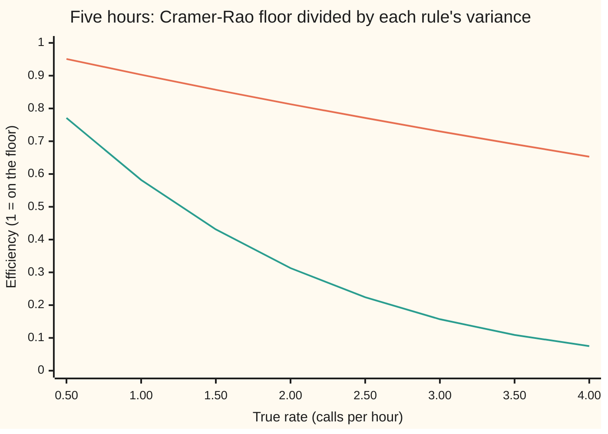

# Rao-Blackwell and Lehmann-Scheffe: improving an estimator by conditioning, and the best unbiased one

[Syllabus](../../../SYLLABUS.md) → [Probability and statistics](../README.md) → [Sampling and Estimation](../README.md#s07) → Rao-Blackwell and Lehmann-Scheffe

---

## General Overview

A help desk logs its calls for five hours: 2, 3, 0, 1 and 4 calls, ten in all. The manager wants one number: the chance that an hour brings no calls at all. That chance says how often the desk sits idle, which decides whether its worker can take on other jobs in quiet hours.

Calls arrive at random, so each hour's count is modelled as Poisson ([Poisson](../03-Discrete%20Distributions/04-poisson.md)) with an unknown average rate λ (lambda) per hour. The chance of an empty hour is then $`e^{-\lambda}`$. The rate is unknown, so this chance must be estimated from the five counts.

Here is a crude rule that is right on average: look at hour 1 only, and answer 1 if it was empty, 0 if not. Hour 1 had 2 calls, so the rule answers 0. It is unbiased (its average answer equals the true chance, whatever λ is), and it is nearly useless, because it can only say 0 or 1.

Now improve it. Ask: given that the five hours held 10 calls in total, what is the average answer of the crude rule? Each of the 10 calls is equally likely to have fallen in any of the five hours. Hour 1 is empty only if all 10 calls missed it, and each misses with chance 4/5. So the improved answer is $`(4/5)^{10} = 0.107374`$.

That step is **Rao–Blackwell**: replace a rough unbiased rule by its average given a summary that holds all the information about λ. The result stays unbiased and never scatters more. If the true rate is 2 calls an hour, its variance falls from 0.117020 to 0.009008.

**Lehmann–Scheffé** then says when to stop improving. If the summary is also complete (defined below), the improved rule is the best possible: no unbiased rule has a smaller variance, at any rate λ.

**Averaging an unbiased rule given a sufficient statistic keeps it unbiased and never raises its variance; when that statistic is also complete, the result is the one unbiased rule with the least variance.**

**What kind of fact this is:** two theorems, both proved on this card in Why it works; sufficiency and completeness are definitions.

### The picture: four unbiased answers, and the floor

Variance of each rule if the true rate is λ = 2 calls an hour, the rate the data suggest (10 calls in 5 hours):

```
crude rule "was hour 1 empty?"  ########################################  0.117020
fraction of empty hours         ########                                  0.023404
Rao-Blackwell rule (4/5)^T      ###                                       0.009008
Cramer-Rao floor                ##                                        0.007326
```

The fraction of empty hours (1 empty hour in 5, so 0.2) is also unbiased and much better than the crude rule. The Rao–Blackwell rule beats both. It still sits above the Cramér–Rao floor, and Lehmann–Scheffé says that gap cannot be closed by any unbiased rule.

---

## The formula

Notation first, in words. An **estimator** or **rule** is any recipe that turns the data into a guess. $`E[\,W \mid T\,]`$ is the conditional expectation from [Conditional expectation](../02-Random%20Variables/05-conditional-expectation-in-tables.md): the average of W among all data sets that share the same value of T.

A **statistic** T is **sufficient** when, once T is known, the rest of the data has a law that does not depend on the unknown ([Sufficient statistics](09-sufficient-statistics-and-factorisation.md)). Here T is the total number of calls.

The Rao–Blackwell theorem, for any unbiased rule W and sufficient statistic T:

```math
\varphi(T) = E[\,W \mid T\,], \qquad E[\varphi(T)] = E[W], \qquad \mathrm{Var}(\varphi(T)) = \mathrm{Var}(W) - E\big[\mathrm{Var}(W \mid T)\big] \le \mathrm{Var}(W)
```

**Read it aloud:** the improved rule φ (phi) is the crude rule's average given T; it has the same average as the crude rule, and its variance is the crude variance minus the average scatter left inside each value of T.

A statistic T is **complete** when the only function of T that averages zero at every value of the unknown is zero itself:

```math
E_\lambda[\,g(T)\,] = 0 \ \text{ for every } \lambda > 0 \quad\Longrightarrow\quad g(t) = 0 \ \text{ for every possible } t
```

**Read it aloud:** if a function of T averages zero whatever the rate is, then that function is zero.

The Lehmann–Scheffé theorem: if T is sufficient and complete, and φ(T) is unbiased for θ, then for every unbiased rule U and every λ,

```math
\mathrm{Var}(\varphi(T)) \le \mathrm{Var}(U), \quad\text{with equality only when } U = \varphi(T)
```

**Read it aloud:** an unbiased function of a complete sufficient statistic is the unique best unbiased rule, often written UMVUE (uniformly minimum-variance unbiased estimator).

For the help desk, with n hours and total T:

```math
\varphi(T) = \Big(1 - \frac{1}{n}\Big)^{T}, \qquad \mathrm{Var}(\varphi(T)) = e^{-2\lambda}\big(e^{\lambda/n} - 1\big), \qquad \text{floor} = \frac{\lambda\, e^{-2\lambda}}{n}
```

**Read it aloud:** the best unbiased guess is (1 − 1/n) to the power of the total; its variance is e to the −2λ times (e to the λ/n, minus 1), which is always above the floor λe^{−2λ}/n.

| Symbol | Plain meaning | In our example | Push it up and the answer… |
| --- | --- | --- | --- |
| $`\lambda`$ | the unknown average calls per hour (lambda) | taken as 2 for the variances | the empty-hour chance falls |
| $`\theta`$ | the target: chance of an empty hour, $`e^{-\lambda}`$ (theta) | 0.135335 at λ = 2 | — |
| $`n`$ | the number of hours watched | 5 | the best rule moves closer to the floor |
| $`X_1, \dots, X_n`$ | the calls in each hour | 2, 3, 0, 1, 4 | — |
| $`T`$, $`t`$ | the total calls, $`X_1 + \dots + X_n`$; one value of it | 10 | the estimate $`(4/5)^T`$ falls |
| $`W`$ | the crude rule: 1 if hour 1 was empty, else 0 | 0 | — |
| $`\varphi`$ | the improved rule $`E[W \mid T]`$ (phi) | $`(4/5)^{10} = 0.107374`$ | — |
| $`U`$; $`g`$ | any other unbiased rule; any function of the statistic being tested for completeness | the fraction of empty hours, 0.2; $`X_1 - X_2`$, a function of the full list, fails the test | — |
| $`\tau`$ | a general target, any smooth function of the unknown (tau) | $`e^{-\lambda}`$ | — |
| $`I`$, $`S`$ | Fisher information and score, from [Fisher information](07-fisher-information-and-cramer-rao.md) | $`I = n/\lambda`$ | the floor falls |
| $`E`$, $`E_\lambda`$, $`\mathrm{Var}`$, $`\mathrm{Cov}`$, $`E[\cdot \mid T]`$ | average; average when the rate is λ; variance; covariance, how two quantities move together; average given T | $`E[W] = 0.135335`$ | — |
| $`K`$, $`p`$, $`\hat p`$ | house poll: yes answers among n voters; the true share; the observed share K/n | 520 of 1,000; unknown; 0.52 | — |

### When it holds

- **The starting rule is unbiased.** Conditioning keeps the average, so a biased start gives a biased result. Conditioning the plug-in guess $`e^{-T/5}`$ on T returns it unchanged, with average 0.163214 against the true 0.135335.
- **The statistic is sufficient.** Otherwise $`E[W \mid T]`$ depends on λ and cannot be computed from the data. Conditioning on hour 2's count gives 0.367879 if λ = 1 and 0.135335 if λ = 2: not a rule at all.
- **For the "best" claim, the statistic is also complete.** The full list of five counts is sufficient but not complete, because $`X_1 - X_2`$ averages zero at every λ. Conditioning on it returns W itself, with variance still 0.117020.
- **The variance of the starting rule is finite.** The proof subtracts variances; on this card every rule is between 0 and 1, so this always holds.
- **Unbiased at every λ.** As on the Fisher information card, a rule unbiased at one rate only, such as "always answer 0.135335", is outside the theorem.

---

## Why it works

### Step 0: average away what does not depend on the unknown

Once the total T is known, how the calls are spread across the five hours is pure chance with no trace of λ in it. A rule that reacts to that spread is reacting to noise. Averaging the rule over the spread removes the noise and keeps the signal. The average of an average is the same average, so nothing is lost on the mean; and removing noise cannot add scatter.

### Step 1: sufficiency makes the conditional average a real rule

Given T = t, find the chance that hour 1 is empty. Hour 1 is Poisson with mean λ, the other four hours together are Poisson with mean 4λ, and the total is Poisson with mean 5λ (sums of independent Poisson counts are Poisson, [Adding counts](../03-Discrete%20Distributions/06-sums-of-discrete-variables.md)). Hour 1 empty and total t means the other four hours hold all t calls:

```math
\varphi(t) = P(X_1 = 0 \mid T = t) = \frac{e^{-\lambda}\cdot e^{-4\lambda}(4\lambda)^{t}/t!}{e^{-5\lambda}(5\lambda)^t/t!} = \Big(\frac45\Big)^{t}, \qquad \varphi(10) = 0.107374
```

Every λ cancels. The same cancellation happens for any count in hour 1, and for any pattern across the five hours: given the total, each call lands in each hour with chance 1/5, whatever the rate. That is what makes T sufficient, and it is why $`E[W \mid T]`$ can be computed without knowing λ.

The code checks this from the definition: it lists every way to split 10 calls over five hours, weights each by its Poisson chance, and gets 0.107374 at λ = 0.7, 2 and 3.5 alike.

### Step 2: the average is kept

By the tower rule (the average of the conditional averages is the overall average) from [Conditional expectation](../02-Random%20Variables/05-conditional-expectation-in-tables.md), $`E[\varphi(T)] = E\big[E[W \mid T]\big] = E[W] = e^{-\lambda}`$. So φ(T) is unbiased.

A direct check: T is Poisson with mean 5λ, so $`E[(4/5)^T] = \sum_t e^{-5\lambda}(4\lambda)^t/t! = e^{-5\lambda}e^{4\lambda} = e^{-\lambda}`$. At λ = 2 the code sums over T and gets 0.135335, which is $`e^{-2}`$.

### Step 3: the variance can only fall

Split the crude rule into the improved rule plus what is left over: $`W = \varphi(T) + (W - \varphi(T))`$. The leftover averages zero within every value of T, so it is uncorrelated with anything that depends on T only. Variances of uncorrelated parts add:

```math
\mathrm{Var}(W) = \mathrm{Var}(\varphi(T)) + E\big[\mathrm{Var}(W \mid T)\big]
```

This is the split into "spread between groups" plus "spread within groups" from the conditional expectation card. The second part is an average of variances, so it is never negative. Hence $`\mathrm{Var}(\varphi(T)) \le \mathrm{Var}(W)`$, with equality only when W never varies within a value of T, that is, when W is already a function of T.

At λ = 2: 0.117020 = 0.009008 + 0.108012. Conditioning removed most of the crude rule's variance.

<details>
<summary>Detailed proof: why the leftover is uncorrelated with φ(T)</summary>

Write θ for the common average. Expand the square:

$`\displaystyle \mathrm{Var}(W) = E\big[(\varphi - \theta)^2\big] + 2\,E\big[(\varphi - \theta)(W - \varphi)\big] + E\big[(W - \varphi)^2\big].`$

In the middle term, condition on T. Given T, the factor $`\varphi(T) - \theta`$ is a fixed number, and $`E[W - \varphi(T) \mid T] = \varphi(T) - \varphi(T) = 0`$. So the middle term is the average of zero, which is zero.

The last term, conditioned on T, is $`E[(W - \varphi(T))^2 \mid T] = \mathrm{Var}(W \mid T)`$. Its average is $`E[\mathrm{Var}(W \mid T)]`$. For the crude rule, given T = t, W is 1 with chance $`(4/5)^t`$, so $`\mathrm{Var}(W \mid T = t) = (4/5)^t - (4/5)^{2t}`$. The code sums this over the Poisson law of T and gets 0.108012.

</details>

### Step 4: the total number of calls is complete

Suppose a function g of T averages zero at every rate λ. Write the average out:

```math
E_\lambda[g(T)] = e^{-5\lambda}\sum_{t=0}^{\infty} g(t)\,\frac{5^t}{t!}\,\lambda^t = 0 \quad\text{for every } \lambda > 0
```

The factor $`e^{-5\lambda}`$ is never zero, so the power series in λ is zero for every positive λ. A power series that is zero on a whole interval has every coefficient zero. So $`g(t)\,5^t/t! = 0`$, and g(t) = 0 for every t. T is complete.

The full list of counts fails this test: $`g = X_1 - X_2`$ averages zero at every λ but is not zero. More generally, the natural summary of a full-rank exponential family ([Exponential families](10-exponential-families.md)) is complete. Full rank means the natural parameters can vary over an open interval (one parameter) or an open box (several), as the Poisson's natural parameter can take any real value. The proof is a similar uniqueness argument (zero average at every value of the unknown forces g to be zero); it is not given on this card, and section 1.6 of Lehmann and Casella, listed under Sources, proves it. The Poisson total is one case.

### Step 5: Lehmann–Scheffé, the best unbiased rule

Take any unbiased rule U. Condition it on T: by Steps 2 and 3, $`E[U \mid T]`$ is unbiased and has variance at most Var(U).

Now compare $`E[U \mid T]`$ with φ(T). Both are functions of T, and both average $`e^{-\lambda}`$ at every λ. Their difference g(T) therefore averages zero at every λ, and by completeness it is zero. So every unbiased rule, once conditioned, lands on the same φ(T):

```math
\mathrm{Var}(U) \;\ge\; \mathrm{Var}\big(E[U \mid T]\big) = \mathrm{Var}(\varphi(T))
```

The code illustrates both steps. Conditioning the fraction of empty hours on T = 10 also gives 0.107374: a different start, the same end, as completeness requires. And among 300 random unbiased rules, built as φ(T) plus noise that averages zero within each total, the least variance is 0.009008, φ's own, and none is biased at λ = 0.5, 2 or 3.5. That search shows Step 3 at work: such noise can only add its average square to the variance. It does not test completeness, which is what rules out unbiased rules of any other kind; Step 4 proves that.

The [Fisher information](07-fisher-information-and-cramer-rao.md) card proved the coin's case of this by direct counting in "The other door": the plain fraction of heads is the best unbiased rule. That card names both theorems; this card proves them in general.

### Step 6: the best unbiased rule need not reach Cramér–Rao

For a target τ(λ) (tau, any smooth function of the unknown) instead of λ itself, the covariance step of the Fisher information card gives Cov(U, S) = τ′(λ). So the floor is $`\tau'(\lambda)^2 / I(\lambda)`$. Here τ = $`e^{-\lambda}`$, the Poisson information is I = n/λ, and the floor is $`\lambda e^{-2\lambda}/n`$ = 0.007326 at λ = 2.

The floor is reached only by a rule that is a constant plus a multiple of the score $`S = (T - n\lambda)/\lambda`$, that is, a straight-line function of T. The rule $`(4/5)^T`$ is curved in T, so it misses:

```math
\frac{\text{floor}}{\mathrm{Var}(\varphi)} = \frac{\lambda/n}{e^{\lambda/n} - 1} < 1, \quad\text{because } e^{\lambda/n} - 1 > \lambda/n
```

At λ = 2, n = 5 the ratio, called the **efficiency**, is 0.813298. Nothing unbiased can do better, so the floor is simply out of reach here. It is approached as the hours pile up: 0.903331 for 10 hours, 0.980133 for 50.



First line (orange): the best unbiased rule $`(4/5)^T`$. Second line (green): the fraction of empty hours. Both fall as the rate rises, because empty hours grow rare and five hours say less about them. The gap between the orange line and 1 is the part of the floor no unbiased rule can reach.

---

## Worked numbers, by hand

The five counts 2, 3, 0, 1, 4.

| Step | Arithmetic | Value |
| --- | --- | --- |
| total calls T | 2 + 3 + 0 + 1 + 4 | 10 |
| crude rule: was hour 1 empty? | hour 1 had 2 calls | 0 |
| fraction of empty hours | 1 / 5 | 0.2 |
| chance one call misses hour 1 | 1 − 1/5 | 0.8 |
| **best unbiased estimate** | 0.8 to the power 10 | **0.107374** |

The best unbiased guess at the chance of an empty hour is about 11 percent.

How much better is it? The variances need a true rate; take λ = 2, the rate the data suggest.

| Step | Arithmetic | Value |
| --- | --- | --- |
| target θ | $`e^{-2}`$ | 0.135335 |
| crude variance | 0.135335 × 0.864665 | 0.117020 |
| fraction of empty hours | 0.117020 / 5 | 0.023404 |
| improved variance | $`e^{-4}(e^{0.4} - 1)`$ = 0.018316 × 0.491825 | 0.009008 |
| leftover inside each total | 0.117020 − 0.009008 | 0.108012 |
| Cramér–Rao floor | 2 × 0.018316 / 5 | 0.007326 |
| efficiency | 0.007326 / 0.009008 | 0.813298 |

The house poll shows the same move. In the shelf's poll, K = 520 of n = 1,000 voters favour one side, and the target is the variance of one answer, p(1 − p). A crude unbiased rule: 1 if voter 1 says yes and voter 2 says no, else 0. Given K = 520 yes answers, the chance of that pattern is 520/1,000 × 480/999:

```math
E[\,W \mid K\,] = \frac{K(n - K)}{n(n-1)} = \frac{520 \times 480}{1{,}000 \times 999} = 0.249850
```

The plug-in $`\hat p(1 - \hat p)`$ gives 0.52 × 0.48 = 0.249600 on this poll, but it is slightly low on average: over all possible polls with p = 0.52 it averages 0.249350, not 0.249600. The conditioned rule averages exactly 0.249600, so it is unbiased; the code checks this by summing over all 1,001 possible counts. The n − 1 in the ordinary sample variance comes from the same correction.

### What breaks if you drop a piece

| Mistake | Comes out at | What went wrong |
| --- | --- | --- |
| Start from a biased rule: plug the estimated rate into $`e^{-\lambda}`$ | average 0.163214, true 0.135335 | $`e^{-T/5}`$ is already a function of T, so conditioning changes nothing and its bias stays |
| Condition on a statistic that is not sufficient: hour 2's count | 0.367879 if λ = 1, 0.135335 if λ = 2 | the answer depends on the unknown, so it is not a rule anyone can compute |
| Condition on a sufficient statistic that is not complete: all five counts | variance 0.117020, no gain | the full data already determine W, so the average given them is W itself |
| Expect the best unbiased rule to sit on the Cramér–Rao floor | floor 0.007326, best 0.009008 | the floor needs a straight-line function of T; $`(4/5)^T`$ is curved |

---

## Code, from first principles, and it actually runs

The scripts reach the improved rule and its variance by four roads.

1. Road one is the closed forms: $`(4/5)^T`$, $`e^{-2\lambda}(e^{\lambda/n} - 1)`$ and the floor.
2. Road two takes the conditional average from its definition: it lists every way to split the total over five hours, weights each split by its Poisson chances at three different rates, and divides. It also sums over the Poisson law of T for the mean and variance.
3. Road three simulates 200,000 five-hour days from a SplitMix64 generator (a small, standard random-number generator) with seed 20261123.
4. Road four builds 300 other unbiased rules, φ(T) plus random noise that averages zero within each total up to 8, and keeps the least variance.

Then the scripts compute the house poll by counting arrangements, the efficiency for more hours, and every chart point.

### Python

```python
# Rao-Blackwell and Lehmann-Scheffe -- the check behind the card.
# Five hours of help-desk calls: 2, 3, 0, 1, 4, total T = 10.  Each hour's count
# is Poisson with unknown rate lam; the target e^(-lam) is the chance of an empty
# hour.  Roads: closed forms; every split of a total; a simulation; a search.
from math import exp, factorial, lgamma, log, prod
M64, state = 2**64 - 1, 20261123

def next64():                                  # SplitMix64 with a stated seed
    global state
    state = (state + 0x9E3779B97F4A7C15) & M64
    z = state
    z = ((z ^ (z >> 30)) * 0xBF58476D1CE4E5B9) & M64
    z = ((z ^ (z >> 27)) * 0x94D049BB133111EB) & M64
    return z ^ (z >> 31)

def unif(): return (next64() >> 11) / 2**53

def draw(lam):                                 # Poisson count by inversion
    u, k, p = unif(), 0, exp(-lam)
    c = p
    while u > c:
        k += 1
        p *= lam / k
        c += p
    return k

def pois(lam, k): return exp(-lam) * lam**k / factorial(k)

def splits(t, parts):                          # every ordered way to share t calls
    if parts == 1:
        yield (t,)
        return
    for first in range(t + 1):
        for rest in splits(t - first, parts - 1):
            yield (first,) + rest

def row(label, x): print(f"{label:<46}{x:.6f}")

N, counts, LAM = 5, [2, 3, 0, 1, 4], 2.0; T = sum(counts)
crude = 1.0 if counts[0] == 0 else 0.0
frac = sum(1 for c in counts if c == 0) / N
rb = (1 - 1 / N) ** T
print("data: counts 2 3 0 1 4, total T =", T)
row("crude rule: was hour 1 empty?", crude)
row("fraction of empty hours", frac)
row("plug-in e^(-T/5)", exp(-T / N))
row("1 Rao-Blackwell (4/5)^T, formula", rb)

def cond_mean(rule, t, lam):                   # E[rule | T = t] from the definition
    num = den = 0.0
    for x in splits(t, N):
        w = prod(pois(lam, xi) for xi in x)
        num += rule(x) * w
        den += w
    return num / den
first = lambda x: 1.0 if x[0] == 0 else 0.0
share = lambda x: sum(1 for xi in x if xi == 0) / N
for lam in (0.7, 2.0, 3.5):
    row(f"2 E[crude | T=10] by enumeration, lam={lam}", cond_mean(first, T, lam))
    assert abs(cond_mean(first, T, lam) - rb) < 1e-12
row("2 E[fraction | T=10] by enumeration", cond_mean(share, T, LAM))
assert abs(cond_mean(share, T, LAM) - rb) < 1e-12

theta = exp(-LAM)                              # moments at the true rate lam = 2
pT = [pois(N * LAM, t) for t in range(120)]
m = [(1 - 1 / N) ** t for t in range(120)]
mean_rb = sum(p * v for p, v in zip(pT, m))
var_rb = sum(p * v * v for p, v in zip(pT, m)) - mean_rb**2
inner = sum(p * (v - v * v) for p, v in zip(pT, m))   # E[Var(crude | T)]
var_crude, var_frac = theta * (1 - theta), theta * (1 - theta) / N
var_form = exp(-2 * LAM) * (exp(LAM / N) - 1)
cr = LAM * exp(-2 * LAM) / N
plug = sum(p * exp(-t / N) for t, p in enumerate(pT))
print("at true rate lam = 2, target e^(-2) =", f"{theta:.6f}")
row("mean of (4/5)^T, sum over T", mean_rb)
print(f"  e^(-2 lam) = {exp(-2 * LAM):.6f}  e^(lam/n) - 1 = {exp(LAM / N) - 1:.6f}  1 - theta = {1 - theta:.6f}")
row("variance of crude rule theta(1-theta)", var_crude)
row("  average leftover variance E[Var(W|T)]", inner)
row("  variance of (4/5)^T, sum over T", var_rb)
row("  variance of (4/5)^T, formula", var_form)
row("variance of fraction of empty hours", var_frac)
row("Cramer-Rao floor lam e^(-2 lam)/n", cr)
row("efficiency floor / variance of (4/5)^T", cr / var_rb)
row("mean of plug-in e^(-T/5), sum over T", plug)
row("  closed form exp(n lam (e^(-1/n) - 1))", exp(N * LAM * (exp(-1 / N) - 1)))
assert abs(mean_rb - theta) < 1e-12 and abs(var_rb - var_form) < 1e-12
assert abs(inner + var_rb - var_crude) < 1e-12
assert var_rb > cr and var_rb < var_frac < var_crude and plug - theta > 0.02
row("E[crude | X2] at lam = 1 (not a statistic)", pois(1.0, 0))   # hour 2 says nothing
row("E[crude | X2] at lam = 2", pois(2.0, 0))                        # about hour 1

R, s = 200000, [[0.0, 0.0] for _ in range(3)]  # crude, fraction, (4/5)^T
for _ in range(R):
    x = [draw(LAM) for _ in range(N)]
    for i, v in enumerate((first(x), share(x), (1 - 1 / N) ** sum(x))):
        s[i][0] += v
        s[i][1] += v * v
for name, (a, b), exact in zip(("crude", "fraction", "(4/5)^T"), s, (var_crude, var_frac, var_rb)):
    mu, var = a / R, b / R - (a / R) ** 2
    print(f"3 simulated {name:<9} mean {mu:.6f}  variance {var:.6f}")
    assert abs(mu - theta) < 4 * (var / R) ** 0.5 and abs(var - exact) < 0.05 * exact

groups, best, worst_bias = [], 1.0, 0.0       # search: (4/5)^T plus noise, t <= 8
for t in range(9):
    groups.append((t, [factorial(t) / (N**t * prod(factorial(v) for v in x)) for x in splits(t, N)]))
for _ in range(300):
    noise, size = [], 0.2 * unif()
    for t, wt in groups:
        u = [size * (2 * unif() - 1) for _ in wt]
        c = sum(a * b for a, b in zip(u, wt))
        noise.append([a - c for a in u])       # averages zero given T = t
    ex2 = sum(pT[t] * m[t] ** 2 for t in range(9, 120))
    for (t, wt), u in zip(groups, noise):
        ex2 += pT[t] * sum(w * (m[t] + a) ** 2 for w, a in zip(wt, u))
    best = min(best, ex2 - theta**2)
    for lam in (0.5, 2.0, 3.5):
        mean = sum(pois(N * lam, t) * m[t] for t in range(120))
        mean += sum(pois(N * lam, t) * w * a for (t, wt), u in zip(groups, noise) for w, a in zip(wt, u))
        worst_bias = max(worst_bias, abs(mean - exp(-lam)))
row("4 search: 300 unbiased rules, least variance", best)
row("  largest bias at lam = 0.5, 2, 3.5", worst_bias)
assert best >= var_rb - 1e-12 and worst_bias < 1e-12

n, k = 1000, 520                               # house poll: estimate p(1-p)
umvue = k * (n - k) / (n * (n - 1))
count = exp(lgamma(n - 1) - lgamma(k) - lgamma(n - k) - lgamma(n + 1) + lgamma(k + 1) + lgamma(n - k + 1))
row("poll: P(1 yes, 2 no | K=520) by counting", count)
row("  formula K(n-K)/(n(n-1))", umvue)
row("  plug-in p-hat(1-p-hat)", 0.52 * 0.48)
lp = [lgamma(n + 1) - lgamma(j + 1) - lgamma(n - j + 1) + j * log(0.52) + (n - j) * log(0.48) for j in range(n + 1)]
row("  mean of K(n-K)/(n(n-1)) at p = 0.52", sum(exp(a) * j * (n - j) / (n * (n - 1)) for j, a in enumerate(lp)))
row("  mean of plug-in at p = 0.52", sum(exp(a) * j * (n - j) / n**2 for j, a in enumerate(lp)))
assert abs(count - umvue) < 1e-12
for nn in (5, 10, 20, 50):
    print(f"n = {nn:2d} hours: efficiency at lam = 2  {(LAM / nn) / (exp(LAM / nn) - 1):.6f}")
lams = [0.5 * i for i in range(1, 9)]
print("chart, lam      ", " ".join(f"{v:.2f}" for v in lams))
print("chart, (4/5)^T  ", " ".join(f"{(v / N) / (exp(v / N) - 1):.3f}" for v in lams))
print("chart, fraction ", " ".join(f"{v / (exp(v) - 1):.3f}" for v in lams))
print("ALL CHECKS PASS")
```

**Ran 2026-11-23 on macOS, Python 3.14.10, standard library only. All checks passed. Output, pasted from the run:**

```
data: counts 2 3 0 1 4, total T = 10
crude rule: was hour 1 empty?                 0.000000
fraction of empty hours                       0.200000
plug-in e^(-T/5)                              0.135335
1 Rao-Blackwell (4/5)^T, formula              0.107374
2 E[crude | T=10] by enumeration, lam=0.7     0.107374
2 E[crude | T=10] by enumeration, lam=2.0     0.107374
2 E[crude | T=10] by enumeration, lam=3.5     0.107374
2 E[fraction | T=10] by enumeration           0.107374
at true rate lam = 2, target e^(-2) = 0.135335
mean of (4/5)^T, sum over T                   0.135335
  e^(-2 lam) = 0.018316  e^(lam/n) - 1 = 0.491825  1 - theta = 0.864665
variance of crude rule theta(1-theta)         0.117020
  average leftover variance E[Var(W|T)]       0.108012
  variance of (4/5)^T, sum over T             0.009008
  variance of (4/5)^T, formula                0.009008
variance of fraction of empty hours           0.023404
Cramer-Rao floor lam e^(-2 lam)/n             0.007326
efficiency floor / variance of (4/5)^T        0.813298
mean of plug-in e^(-T/5), sum over T          0.163214
  closed form exp(n lam (e^(-1/n) - 1))       0.163214
E[crude | X2] at lam = 1 (not a statistic)    0.367879
E[crude | X2] at lam = 2                      0.135335
3 simulated crude     mean 0.134275  variance 0.116245
3 simulated fraction  mean 0.135325  variance 0.023492
3 simulated (4/5)^T   mean 0.135256  variance 0.009070
4 search: 300 unbiased rules, least variance  0.009008
  largest bias at lam = 0.5, 2, 3.5           0.000000
poll: P(1 yes, 2 no | K=520) by counting      0.249850
  formula K(n-K)/(n(n-1))                     0.249850
  plug-in p-hat(1-p-hat)                      0.249600
  mean of K(n-K)/(n(n-1)) at p = 0.52         0.249600
  mean of plug-in at p = 0.52                 0.249350
n =  5 hours: efficiency at lam = 2  0.813298
n = 10 hours: efficiency at lam = 2  0.903331
n = 20 hours: efficiency at lam = 2  0.950833
n = 50 hours: efficiency at lam = 2  0.980133
chart, lam       0.50 1.00 1.50 2.00 2.50 3.00 3.50 4.00
chart, (4/5)^T   0.951 0.903 0.857 0.813 0.771 0.730 0.691 0.653
chart, fraction  0.771 0.582 0.431 0.313 0.224 0.157 0.109 0.075
ALL CHECKS PASS
```

### Rust

```rust
// Rao-Blackwell and Lehmann-Scheffe -- the same check in Rust, std only.
// Five hours of help-desk calls: 2, 3, 0, 1, 4, total T = 10.  Each hour's count
// is Poisson with unknown rate lam; the target is e^(-lam), the chance of an
// empty hour.  Roads: closed forms; every split of a total, enumerated; a seeded
// simulation (SplitMix64, same seed); a search of unbiased rules; the house poll.
const N: usize = 5;

struct Rng(u64);
impl Rng {
    fn next64(&mut self) -> u64 {
        self.0 = self.0.wrapping_add(0x9E3779B97F4A7C15);
        let mut z = self.0;
        z = (z ^ (z >> 30)).wrapping_mul(0xBF58476D1CE4E5B9);
        z = (z ^ (z >> 27)).wrapping_mul(0x94D049BB133111EB);
        z ^ (z >> 31)
    }
    fn unif(&mut self) -> f64 { (self.next64() >> 11) as f64 / 9007199254740992.0 }
    fn draw(&mut self, lam: f64) -> u32 {
        let (u, mut k, mut p) = (self.unif(), 0u32, (-lam).exp());
        let mut c = p;
        while u > c { k += 1; p *= lam / k as f64; c += p; }
        k
    }
}

fn fact(k: u32) -> f64 { (1..=k).fold(1.0, |a, i| a * i as f64) }
fn pois(lam: f64, k: u32) -> f64 { (-lam).exp() * lam.powf(k as f64) / fact(k) }
fn splits(t: u32, parts: usize) -> Vec<Vec<u32>> {
    if parts == 1 { return vec![vec![t]]; }
    let mut out = Vec::new();
    for first in 0..=t {
        for rest in splits(t - first, parts - 1) { out.push([vec![first], rest].concat()); }
    }
    out
}
fn row(label: &str, x: f64) { println!("{:<46}{:.6}", label, x); }
fn first(x: &[u32]) -> f64 { if x[0] == 0 { 1.0 } else { 0.0 } }
fn share(x: &[u32]) -> f64 { x.iter().filter(|&&v| v == 0).count() as f64 / N as f64 }
fn cond_mean(rule: fn(&[u32]) -> f64, t: u32, lam: f64) -> f64 {
    let (mut num, mut den) = (0.0, 0.0);
    for x in splits(t, N) {
        let w = x.iter().fold(1.0, |a, &xi| a * pois(lam, xi));
        num += rule(&x) * w;
        den += w;
    }
    num / den
}
fn lgam(x: f64) -> f64 {                        // log of the gamma function, Lanczos
    let g = [676.5203681218851, -1259.1392167224028, 771.32342877765313, -176.61502916214059,
        12.507343278686905, -0.13857109526572012, 9.9843695780195716e-6, 1.5056327351493116e-7];
    let (x, mut a) = (x - 1.0, 0.99999999999980993);
    for (i, c) in g.iter().enumerate() { a += c / (x + i as f64 + 1.0); }
    let t = x + 7.5;
    0.5 * (2.0 * std::f64::consts::PI).ln() + (x + 0.5) * t.ln() - t + a.ln()
}

fn main() {
    let mut rng = Rng(20261123);
    let (counts, lam0) = ([2u32, 3, 0, 1, 4], 2.0f64);
    let (nf, t_obs) = (N as f64, counts.iter().sum::<u32>());
    let rb = (1.0 - 1.0 / nf).powf(t_obs as f64);
    println!("data: counts 2 3 0 1 4, total T = {}", t_obs);
    row("crude rule: was hour 1 empty?", first(&counts));
    row("fraction of empty hours", share(&counts));
    row("plug-in e^(-T/5)", (-(t_obs as f64) / nf).exp());
    row("1 Rao-Blackwell (4/5)^T, formula", rb);
    for lam in [0.7, 2.0, 3.5] {
        let c = cond_mean(first, t_obs, lam);
        row(&format!("2 E[crude | T=10] by enumeration, lam={:?}", lam), c);
        assert!((c - rb).abs() < 1e-12);
    }
    let cf = cond_mean(share, t_obs, lam0);
    row("2 E[fraction | T=10] by enumeration", cf);
    assert!((cf - rb).abs() < 1e-12);
    let theta = (-lam0).exp();
    let pt: Vec<f64> = (0..120).map(|t| pois(nf * lam0, t)).collect();
    let m: Vec<f64> = (0..120).map(|t| (1.0 - 1.0 / nf).powf(t as f64)).collect();
    let mean_rb: f64 = (0..120).map(|t| pt[t] * m[t]).sum();
    let var_rb = (0..120).map(|t| pt[t] * m[t] * m[t]).sum::<f64>() - mean_rb * mean_rb;
    let inner: f64 = (0..120).map(|t| pt[t] * (m[t] - m[t] * m[t])).sum();
    let (var_crude, var_frac) = (theta * (1.0 - theta), theta * (1.0 - theta) / nf);
    let var_form = (-2.0 * lam0).exp() * ((lam0 / nf).exp() - 1.0);
    let cr = lam0 * (-2.0 * lam0).exp() / nf;
    let plug: f64 = (0..120).map(|t| pt[t] * (-(t as f64) / nf).exp()).sum();
    println!("at true rate lam = 2, target e^(-2) = {:.6}", theta);
    row("mean of (4/5)^T, sum over T", mean_rb);
    println!("  e^(-2 lam) = {:.6}  e^(lam/n) - 1 = {:.6}  1 - theta = {:.6}", (-2.0 * lam0).exp(), (lam0 / nf).exp() - 1.0, 1.0 - theta);
    row("variance of crude rule theta(1-theta)", var_crude);
    row("  average leftover variance E[Var(W|T)]", inner);
    row("  variance of (4/5)^T, sum over T", var_rb);
    row("  variance of (4/5)^T, formula", var_form);
    row("variance of fraction of empty hours", var_frac);
    row("Cramer-Rao floor lam e^(-2 lam)/n", cr);
    row("efficiency floor / variance of (4/5)^T", cr / var_rb);
    row("mean of plug-in e^(-T/5), sum over T", plug);
    row("  closed form exp(n lam (e^(-1/n) - 1))", (nf * lam0 * ((-1.0 / nf).exp() - 1.0)).exp());
    assert!((mean_rb - theta).abs() < 1e-12 && (var_rb - var_form).abs() < 1e-12);
    assert!((inner + var_rb - var_crude).abs() < 1e-12);
    assert!(var_rb > cr && var_rb < var_frac && var_frac < var_crude && plug - theta > 0.02);
    row("E[crude | X2] at lam = 1 (not a statistic)", pois(1.0, 0));
    row("E[crude | X2] at lam = 2", pois(2.0, 0));
    let (r, mut s) = (200000usize, [[0.0f64; 2]; 3]);
    for _ in 0..r {
        let x: Vec<u32> = (0..N).map(|_| rng.draw(lam0)).collect();
        let vals = [first(&x), share(&x), (1.0 - 1.0 / nf).powf(x.iter().sum::<u32>() as f64)];
        for i in 0..3 { s[i][0] += vals[i]; s[i][1] += vals[i] * vals[i]; }
    }
    let (names, exact) = (["crude", "fraction", "(4/5)^T"], [var_crude, var_frac, var_rb]);
    for i in 0..3 {
        let (rf, mu) = (r as f64, s[i][0] / r as f64);
        let var = s[i][1] / rf - mu * mu;
        println!("3 simulated {:<9} mean {:.6}  variance {:.6}", names[i], mu, var);
        assert!((mu - theta).abs() < 4.0 * (var / rf).sqrt() && (var - exact[i]).abs() < 0.05 * exact[i]);
    }
    let groups: Vec<Vec<f64>> = (0..9u32).map(|t| splits(t, N).iter()
        .map(|x| fact(t) / (nf.powf(t as f64) * x.iter().fold(1.0, |a, &v| a * fact(v)))).collect()).collect();
    let (mut best, mut worst_bias) = (1.0f64, 0.0f64);
    for _ in 0..300 {
        let size = 0.2 * rng.unif();
        let mut noise: Vec<Vec<f64>> = Vec::new();
        for wt in &groups {
            let u: Vec<f64> = wt.iter().map(|_| size * (2.0 * rng.unif() - 1.0)).collect();
            let c: f64 = u.iter().zip(wt).map(|(a, b)| a * b).sum();
            noise.push(u.iter().map(|a| a - c).collect());
        }
        let mut ex2: f64 = (9..120).map(|t| pt[t] * m[t] * m[t]).sum();
        for (t, wt) in groups.iter().enumerate() {
            ex2 += pt[t] * wt.iter().zip(&noise[t]).map(|(w, a)| w * (m[t] + a) * (m[t] + a)).sum::<f64>();
        }
        best = best.min(ex2 - theta * theta);
        for lam in [0.5, 2.0, 3.5] {
            let mut mean: f64 = (0..120).map(|t| pois(nf * lam, t as u32) * m[t]).sum();
            for (t, wt) in groups.iter().enumerate() {
                for (w, a) in wt.iter().zip(&noise[t]) { mean += pois(nf * lam, t as u32) * w * a; }
            }
            worst_bias = worst_bias.max((mean - (-lam).exp()).abs());
        }
    }
    row("4 search: 300 unbiased rules, least variance", best);
    row("  largest bias at lam = 0.5, 2, 3.5", worst_bias);
    assert!(best >= var_rb - 1e-12 && worst_bias < 1e-12);
    let (n, k) = (1000.0f64, 520.0f64);
    let umvue = k * (n - k) / (n * (n - 1.0));
    let count = (lgam(n - 1.0) - lgam(k) - lgam(n - k) - lgam(n + 1.0) + lgam(k + 1.0) + lgam(n - k + 1.0)).exp();
    row("poll: P(1 yes, 2 no | K=520) by counting", count);
    row("  formula K(n-K)/(n(n-1))", umvue);
    row("  plug-in p-hat(1-p-hat)", 0.52 * 0.48);
    let (mut mean_u, mut mean_plug) = (0.0, 0.0);
    for j in 0..=1000 {
        let jf = j as f64;
        let lp = lgam(n + 1.0) - lgam(jf + 1.0) - lgam(n - jf + 1.0) + jf * 0.52f64.ln() + (n - jf) * 0.48f64.ln();
        mean_u += lp.exp() * jf * (n - jf) / (n * (n - 1.0));
        mean_plug += lp.exp() * jf * (n - jf) / (n * n);
    }
    row("  mean of K(n-K)/(n(n-1)) at p = 0.52", mean_u);
    row("  mean of plug-in at p = 0.52", mean_plug);
    assert!((count - umvue).abs() < 1e-9);
    for nn in [5.0f64, 10.0, 20.0, 50.0] {
        println!("n = {:2} hours: efficiency at lam = 2  {:.6}", nn as u32, (lam0 / nn) / ((lam0 / nn).exp() - 1.0));
    }
    let lams: Vec<f64> = (1..9).map(|i| 0.5 * i as f64).collect();
    let join = |f: &dyn Fn(f64) -> String| lams.iter().map(|&v| f(v)).collect::<Vec<_>>().join(" ");
    println!("chart, lam       {}", join(&|v| format!("{:.2}", v)));
    println!("chart, (4/5)^T   {}", join(&|v| format!("{:.3}", (v / nf) / ((v / nf).exp() - 1.0))));
    println!("chart, fraction  {}", join(&|v| format!("{:.3}", v / (v.exp() - 1.0))));
    println!("ALL CHECKS PASS");
}
```

**Ran 2026-11-23 on macOS, rustc 1.98.1, no crates. All checks passed. Output, pasted from the run:**

```
data: counts 2 3 0 1 4, total T = 10
crude rule: was hour 1 empty?                 0.000000
fraction of empty hours                       0.200000
plug-in e^(-T/5)                              0.135335
1 Rao-Blackwell (4/5)^T, formula              0.107374
2 E[crude | T=10] by enumeration, lam=0.7     0.107374
2 E[crude | T=10] by enumeration, lam=2.0     0.107374
2 E[crude | T=10] by enumeration, lam=3.5     0.107374
2 E[fraction | T=10] by enumeration           0.107374
at true rate lam = 2, target e^(-2) = 0.135335
mean of (4/5)^T, sum over T                   0.135335
  e^(-2 lam) = 0.018316  e^(lam/n) - 1 = 0.491825  1 - theta = 0.864665
variance of crude rule theta(1-theta)         0.117020
  average leftover variance E[Var(W|T)]       0.108012
  variance of (4/5)^T, sum over T             0.009008
  variance of (4/5)^T, formula                0.009008
variance of fraction of empty hours           0.023404
Cramer-Rao floor lam e^(-2 lam)/n             0.007326
efficiency floor / variance of (4/5)^T        0.813298
mean of plug-in e^(-T/5), sum over T          0.163214
  closed form exp(n lam (e^(-1/n) - 1))       0.163214
E[crude | X2] at lam = 1 (not a statistic)    0.367879
E[crude | X2] at lam = 2                      0.135335
3 simulated crude     mean 0.134275  variance 0.116245
3 simulated fraction  mean 0.135325  variance 0.023492
3 simulated (4/5)^T   mean 0.135256  variance 0.009070
4 search: 300 unbiased rules, least variance  0.009008
  largest bias at lam = 0.5, 2, 3.5           0.000000
poll: P(1 yes, 2 no | K=520) by counting      0.249850
  formula K(n-K)/(n(n-1))                     0.249850
  plug-in p-hat(1-p-hat)                      0.249600
  mean of K(n-K)/(n(n-1)) at p = 0.52         0.249600
  mean of plug-in at p = 0.52                 0.249350
n =  5 hours: efficiency at lam = 2  0.813298
n = 10 hours: efficiency at lam = 2  0.903331
n = 20 hours: efficiency at lam = 2  0.950833
n = 50 hours: efficiency at lam = 2  0.980133
chart, lam       0.50 1.00 1.50 2.00 2.50 3.00 3.50 4.00
chart, (4/5)^T   0.951 0.903 0.857 0.813 0.771 0.730 0.691 0.653
chart, fraction  0.771 0.582 0.431 0.313 0.224 0.157 0.109 0.075
ALL CHECKS PASS
```

The two outputs are identical line for line. The simulated variances, 0.116245, 0.023492 and 0.009070, each sit within one percent of the exact 0.117020, 0.023404 and 0.009008. The search's least variance prints as 0.009008 because a noise of size near zero reproduces φ itself; no rule went below it.

### Lean

Lean proves both theorems for any model with a sufficient statistic, and that the Poisson total is complete for any number of hours.

- Suppose W is an unbiased rule with finite variance, and T is sufficient. Then $`E[W \mid T]`$ is a rule that needs no λ, and it is still unbiased.
- Take the same W and T, with $`\varphi(T) = E[W \mid T]`$. Then $`\mathrm{Var}(\varphi(T)) = \mathrm{Var}(W) - E[\mathrm{Var}(W \mid T)]`$, so $`\mathrm{Var}(\varphi(T)) \le \mathrm{Var}(W)`$.
- Suppose T is sufficient and complete, φ(T) is unbiased, and U is any unbiased rule with finite variance. Then $`\mathrm{Var}(\varphi(T)) \le \mathrm{Var}(U)`$, with equality only when U = φ(T).
- Suppose T, the total of n hours, is Poisson with mean nλ, and g(T) averages zero at every λ > 0. Then g(t) = 0 for every whole number t.
- The hand arithmetic holds exactly, as fractions: the total of 10, the fraction 1/5, $`(4/5)^{10}`$, and the poll's 0.249850 and 0.249600.

Python and Rust cover the rest: the help desk's $`(4/5)^T`$, its variance, the Cramér–Rao floor and the efficiency.

```lean
-- Rao-Blackwell and Lehmann-Scheffe: averaging an unbiased rule given a sufficient statistic keeps it unbiased and never raises its variance, and when that statistic is also complete the result is the unique unbiased rule with the least variance; the Poisson total is complete.
import Mathlib.Probability.CondVar
import Mathlib.Probability.Kernel.CondDistrib
import Mathlib.Probability.Moments.Variance
import Mathlib.Probability.Distributions.Poisson.Basic
import Mathlib.Analysis.Analytic.OfScalars
import Mathlib.Analysis.Analytic.Uniqueness
import Mathlib.Analysis.Analytic.IsolatedZeros

open MeasureTheory ProbabilityTheory
open scoped NNReal

/-- **Rao–Blackwell.** The data live in a space `Ω`, the unknown is `θ`, and `P θ` is the law of
the data when the unknown is `θ`. The statistic `T` is sufficient: once `T = t` is known, the rest
of the data has one law `κ t` that does not depend on the unknown (for every `θ`, `κ` is a version
of the conditional law of the data given `T` under `P θ`). Let `W` be a rule with finite variance
that is unbiased for `target θ` at every `θ`. Then the improved rule `φ(t) = ∫ W d(κ t)` uses no
`θ`, and at every `θ`:
* `φ(T)` is the conditional expectation `E[W | T]`;
* `φ(T)` is still unbiased for `target θ`;
* `Var(φ(T)) = Var(W) − E[Var(W | T)]`;
* so `Var(φ(T)) ≤ Var(W)`. -/
theorem rao_blackwell
    {Θ Ω τ : Type*} [MeasurableSpace Ω] [StandardBorelSpace Ω] [Nonempty Ω] {mτ : MeasurableSpace τ}
    (P : Θ → Measure Ω) [∀ θ, IsProbabilityMeasure (P θ)]
    (T : Ω → τ) (hT : Measurable T)
    (κ : Kernel τ Ω) (hsuff : ∀ θ, condDistrib id T (P θ) =ᵐ[(P θ).map T] κ)
    (target : Θ → ℝ) (W : Ω → ℝ) (hW2 : ∀ θ, MemLp W 2 (P θ))
    (hWunb : ∀ θ, ∫ ω, W ω ∂(P θ) = target θ) :
    ∀ θ,
      (P θ)[W | mτ.comap T] =ᵐ[P θ] (fun ω => ∫ ω', W ω' ∂(κ (T ω))) ∧
      ∫ ω, (∫ ω', W ω' ∂(κ (T ω))) ∂(P θ) = target θ ∧
      Var[fun ω => ∫ ω', W ω' ∂(κ (T ω)); P θ] =
        Var[W; P θ] - ∫ ω, (Var[W; P θ | mτ.comap T]) ω ∂(P θ) ∧
      Var[fun ω => ∫ ω', W ω' ∂(κ (T ω)); P θ] ≤ Var[W; P θ] := by
  intro θ
  have hm : mτ.comap T ≤ ‹MeasurableSpace Ω› := hT.comap_le
  have h1 := condExp_ae_eq_integral_condDistrib_id (μ := P θ) hT ((hW2 θ).integrable one_le_two)
  have hκ : ∀ᵐ ω ∂(P θ), condDistrib id T (P θ) (T ω) = κ (T ω) :=
    ae_of_ae_map hT.aemeasurable (hsuff θ)
  have hce : (P θ)[W | mτ.comap T] =ᵐ[P θ] (fun ω => ∫ ω', W ω' ∂(κ (T ω))) := by
    filter_upwards [h1, hκ] with ω h1ω hκω
    rw [h1ω, hκω]
  have htot := integral_condVar_add_variance_condExp hm (hW2 θ)
  rw [variance_congr hce] at htot
  have hnn : 0 ≤ ∫ ω, (Var[W; P θ | mτ.comap T]) ω ∂(P θ) := by
    apply integral_nonneg_of_ae
    exact condExp_nonneg (Filter.Eventually.of_forall fun ω => sq_nonneg _)
  refine ⟨hce, ?_, ?_, ?_⟩
  · rw [← integral_congr_ae hce, integral_condExp hm, hWunb]
  · linarith
  · linarith

/-- **Lehmann–Scheffé.** Same setting: `T` is sufficient, with the `θ`-free conditional law `κ`.
`T` is also complete: a function `g` of `T` whose average is zero at every `θ` is zero (almost
surely, at every `θ`). Let `φ(T)` be a function of `T` that is unbiased for `target θ` at every
`θ`. Then for every rule `U` (a measurable function of the data) with finite variance that is
unbiased for `target θ` at every `θ`, and at every `θ`: `Var(φ(T)) ≤ Var(U)`, with equality only
when `U = φ(T)`. So `φ(T)` is the unique unbiased rule with the least variance (the UMVUE). -/
theorem lehmann_scheffe
    {Θ Ω τ : Type*} [MeasurableSpace Ω] [StandardBorelSpace Ω] [Nonempty Ω] {mτ : MeasurableSpace τ}
    (P : Θ → Measure Ω) [∀ θ, IsProbabilityMeasure (P θ)]
    (T : Ω → τ) (hT : Measurable T)
    (κ : Kernel τ Ω) (hsuff : ∀ θ, condDistrib id T (P θ) =ᵐ[(P θ).map T] κ)
    (hcomplete : ∀ g : τ → ℝ, Measurable g → (∀ θ, Integrable (g ∘ T) (P θ)) →
      (∀ θ, ∫ ω, g (T ω) ∂(P θ) = 0) → ∀ θ, g ∘ T =ᵐ[P θ] 0)
    (target : Θ → ℝ) (φ : τ → ℝ) (hφm : Measurable φ)
    (hφint : ∀ θ, Integrable (φ ∘ T) (P θ)) (hφunb : ∀ θ, ∫ ω, φ (T ω) ∂(P θ) = target θ)
    (U : Ω → ℝ) (hUm : Measurable U) (hU2 : ∀ θ, MemLp U 2 (P θ))
    (hUunb : ∀ θ, ∫ ω, U ω ∂(P θ) = target θ) :
    ∀ θ, Var[φ ∘ T; P θ] ≤ Var[U; P θ] ∧
      (Var[U; P θ] = Var[φ ∘ T; P θ] → U =ᵐ[P θ] φ ∘ T) := by
  have hRB := rao_blackwell P T hT κ hsuff target U hU2 hUunb
  set ψ : τ → ℝ := fun t => ∫ ω', U ω' ∂(κ t) with hψ
  have hψm : Measurable ψ := (hUm.stronglyMeasurable.integral_kernel (κ := κ)).measurable
  have hm : mτ.comap T ≤ ‹MeasurableSpace Ω› := hT.comap_le
  have hψint : ∀ θ, Integrable (ψ ∘ T) (P θ) := fun θ =>
    integrable_condExp.congr (hRB θ).1
  have hg := hcomplete (ψ - φ) (hψm.sub hφm)
    (fun θ => (hψint θ).sub (hφint θ))
    (fun θ => by
      have := integral_sub (hψint θ) (hφint θ)
      simp only [Function.comp_def, Pi.sub_apply] at this ⊢
      rw [this, hφunb, (hRB θ).2.1, sub_self])
  intro θ
  have heq : φ ∘ T =ᵐ[P θ] ψ ∘ T := by
    filter_upwards [hg θ] with ω hω
    simp only [Function.comp_apply, Pi.sub_apply, Pi.zero_apply, sub_eq_zero] at hω ⊢
    exact hω.symm
  obtain ⟨hce, _, hvar, hle⟩ := hRB θ
  rw [variance_congr heq]
  refine ⟨hle, fun hUV => ?_⟩
  -- the integral of the conditional variance is zero
  have hint0 : ∫ ω, (Var[U; P θ | mτ.comap T]) ω ∂(P θ) = 0 := by
    have : Var[ψ ∘ T; P θ] = Var[U; P θ] := hUV.symm
    change Var[fun ω => ψ (T ω); P θ] = _ at this
    linarith
  have hsq : Integrable ((U - (P θ)[U | mτ.comap T]) ^ 2) (P θ) :=
    ((hU2 θ).sub ((hU2 θ).condExp one_le_two)).integrable_sq
  have hint1 : ∫ ω, ((U - (P θ)[U | mτ.comap T]) ^ 2) ω ∂(P θ) = 0 := by
    rw [← hint0, condVar, integral_condExp hm]
  have hz := (integral_eq_zero_iff_of_nonneg (fun ω => sq_nonneg _) hsq).1 hint1
  filter_upwards [hz, hce, heq] with ω hzω hceω heqω
  simp only [Pi.sub_apply, Pi.zero_apply, pow_eq_zero_iff two_ne_zero,
    sub_eq_zero] at hzω
  rw [hzω, hceω, heqω]; rfl

/-- **The Poisson total is complete.** With `n` hours, each Poisson with rate `λ`, the total `T` is
Poisson with mean `n λ`. If a function `g` of the total has average zero at every rate `λ > 0`,
then `g(t) = 0` for every whole number `t`. -/
theorem poisson_total_complete (n : ℕ) (hn : 0 < n) (g : ℕ → ℝ)
    (hint : ∀ lam : ℝ≥0, 0 < lam → Integrable g (poissonMeasure ((n : ℝ≥0) * lam)))
    (hzero : ∀ lam : ℝ≥0, 0 < lam → ∫ t, g t ∂(poissonMeasure ((n : ℝ≥0) * lam)) = 0) :
    ∀ t, g t = 0 := by
  set c : ℕ → ℝ := fun k => g k / (k.factorial : ℝ) with hc
  set p : FormalMultilinearSeries ℝ ℝ ℝ := FormalMultilinearSeries.ofScalars ℝ c with hp
  have hnpos : (0 : ℝ) < n := by exact_mod_cast hn
  -- summability at radius n
  have hsum : Summable fun k => ‖p k‖ * ((n : ℝ≥0) : ℝ) ^ k := by
    have h1 := (integrable_poissonMeasure_iff.1 (hint 1 one_pos)).mul_left (Real.exp n)
    refine h1.congr fun k => ?_
    simp only [hp, FormalMultilinearSeries.ofScalars_norm, hc, mul_one, NNReal.coe_natCast,
      Real.norm_eq_abs, abs_div, Nat.abs_cast]
    have : Real.exp n * Real.exp (-n) = 1 := by rw [← Real.exp_add]; simp
    field_simp
    rw [this]; ring
  have hrad : (0 : ENNReal) < p.radius := by
    refine lt_of_lt_of_le ?_ (p.le_radius_of_summable hsum)
    exact_mod_cast hn
  have hps : HasFPowerSeriesOnBall p.sum p 0 p.radius := p.hasFPowerSeriesOnBall hrad
  have hzero' : ∀ x : ℝ, 0 < x → p.sum x = 0 := by
    intro x hx
    obtain ⟨lam, hlamv⟩ : ∃ lam : ℝ≥0, (lam : ℝ) = x / n := ⟨⟨x / n, by positivity⟩, rfl⟩
    have hlampos : 0 < lam := by
      rw [← NNReal.coe_pos, hlamv]
      positivity
    have h := hzero lam hlampos
    rw [integral_poissonMeasure] at h
    have hr : (((n : ℝ≥0) * lam : ℝ≥0) : ℝ) = x := by
      rw [NNReal.coe_mul, hlamv, NNReal.coe_natCast]
      field_simp
    rw [hr] at h
    have h2 : p.sum x = ∑' k, c k • x ^ k := FormalMultilinearSeries.ofScalars_sum_eq c x
    rw [h2]
    have h3 : (∑' k, (Real.exp (-x) * x ^ k / (k.factorial : ℝ)) • g k)
        = Real.exp (-x) * ∑' k, c k • x ^ k := by
      rw [← tsum_mul_left]
      congr 1; ext k
      simp only [smul_eq_mul, hc]
      ring
    rw [h3] at h
    exact (mul_eq_zero.1 h).resolve_left (Real.exp_pos _).ne'
  have hfreq : ∃ᶠ z in nhdsWithin (0 : ℝ) {0}ᶜ, p.sum z = 0 := by
    have hev : ∀ᶠ z in nhdsWithin (0 : ℝ) (Set.Ioi 0), p.sum z = 0 :=
      Filter.mem_of_superset self_mem_nhdsWithin fun z hz => hzero' z hz
    exact (hev.frequently).filter_mono (nhdsWithin_mono _ fun z hz => ne_of_gt hz)
  have hev0 : p.sum =ᶠ[nhds 0] 0 := by
    rcases hps.analyticAt.eventually_eq_zero_or_eventually_ne_zero with h | h
    · exact h
    · exact absurd hfreq (Filter.not_frequently.2 h)
  have hp0 : p = 0 := hps.hasFPowerSeriesAt.eq_zero_of_eventually hev0
  have hc0 : c = 0 := (FormalMultilinearSeries.ofScalars_series_eq_zero ℝ).1 hp0
  intro t
  have := congrFun hc0 t
  simp only [hc, Pi.zero_apply, div_eq_zero_iff, Nat.cast_eq_zero] at this
  exact this.resolve_right (Nat.factorial_ne_zero t)

-- The card's whole-number worked examples, exactly.
-- The five hours 2, 3, 0, 1, 4 hold T = 10 calls.
example : 2 + 3 + 0 + 1 + 4 = 10 := by decide
-- The best unbiased estimate (4/5)^10, as an exact fraction (0.107374 on the card).
example : ((4 : ℚ) / 5) ^ 10 = 1048576 / 9765625 := by norm_num
-- The fraction of empty hours: 1 empty hour in 5.
example : ((1 : ℚ) / 5) = 1 / 5 := by norm_num
-- The house poll: E[W | K = 520] = K(n − K)/(n(n − 1)) = 520 × 480 / (1,000 × 999) (0.249850).
example : ((520 : ℚ) * (1000 - 520)) / (1000 * (1000 - 1)) = 416 / 1665 := by norm_num
-- The plug-in p-hat (1 − p-hat) = 0.52 × 0.48 = 0.2496.
example : ((52 : ℚ) / 100) * (48 / 100) = 156 / 625 := by norm_num

#print axioms rao_blackwell
#print axioms lehmann_scheffe
#print axioms poisson_total_complete
```

**Checked 2026-11-23 on macOS, Lean 4.36.0-rc2, Mathlib v4.36.0-rc2. Every proof is complete and uses only Lean's standard axioms. Output, pasted from the run:**

```
'rao_blackwell' depends on axioms: [propext, Classical.choice, Quot.sound]
'lehmann_scheffe' depends on axioms: [propext, Classical.choice, Quot.sound]
'poisson_total_complete' depends on axioms: [propext, Classical.choice, Quot.sound]
```

> [!TIP]
> **Try changing**
> - **More hours.** Guess first: with 50 hours instead of 5, how close does the best rule get to the floor at λ = 2? Read the n-table near the end of the output: efficiency 0.980133, up from 0.813298. The curve of $`(1 - 1/n)^T`$ straightens as n grows.
> - **A busier desk.** Guess first: does the best rule get closer to the floor or further away at λ = 4? Further: the chart line falls to 0.653, because λ/n grows and $`e^{\lambda/n} - 1`$ pulls further away from λ/n.
> - **A different start.** In road two, the fraction of empty hours is conditioned as well as the crude rule. Guess first: will it give a different answer? No: both print 0.107374, as Lehmann–Scheffé requires.
> - **Break the noise.** In road four, replace `a - c` with `a - 0`, so the noise no longer averages zero within each total. Guess what fails: the rules become biased, and the bias assertion stops the run.

---

## The usual mistake

> [!warning]
> **Conditioning on something that is not sufficient.** The improvement only works because, given T, the data's remaining spread has no λ in it. Condition the crude rule on hour 2's count instead and the "answer" is $`e^{-\lambda}`$ itself: 0.367879 if λ = 1, 0.135335 if λ = 2. That is the unknown, not an estimate.
>
> - **Conditioning a biased rule and calling the result unbiased.** Conditioning keeps the average, bias and all: the plug-in $`e^{-T/5}`$ still averages 0.163214 against 0.135335.
> - **Reading "best unbiased" as "on the Cramér–Rao floor".** The best unbiased variance here is 0.009008, above the floor of 0.007326. Lehmann–Scheffé proves 0.009008 cannot be beaten by unbiased rules.
> - **Reading "best unbiased" as "best".** A biased rule can have a smaller mean squared error ([Bias and variance](06-bias-variance-and-mean-squared-error.md)). Lehmann–Scheffé ranks unbiased rules only.
> - **Skipping completeness.** Conditioning on all five counts is legal, since they are sufficient, but gives back W with variance 0.117020. Sufficiency alone guarantees no loss, not the best rule.

---

## Where you meet it in real life

- **Staffing and reliability.** The chance of zero events in a period, zero calls, zero failures or zero defects, is $`e^{-\lambda}`$ under a Poisson model. With n periods and T events, $`(1 - 1/n)^T`$ is its best unbiased estimate.
- **Survey and poll variances.** The unbiased variance $`K(n - K)/(n(n - 1))`$ for a proportion, and the n − 1 in the sample variance, are conditioned rules of this kind. For the house poll the value is 0.249850.
- **Simulation.** Replacing a simulated 0-or-1 outcome by its exact conditional chance, given the rest of the run, is called Rao–Blackwellisation. It cuts the variance of Monte Carlo estimates at no extra cost in runs.
- **Checking a textbook estimator.** The sample mean of normal data, the sample proportion and the corrected sample variance are each certified as best unbiased by Lehmann–Scheffé, with a complete sufficient statistic from an exponential family.

> **Say it back**
> Start from any rule that is right on average, however crude. Replace it by its average given a sufficient statistic: the result can be computed from the data, stays right on average, and never scatters more, because variance splits into spread between and within values of the statistic. If the statistic is also complete, every unbiased rule conditions down to the same function of it, so that function has the least variance of all. For five hours with 10 calls, the crude "was hour 1 empty?" becomes $`(4/5)^{10} = 0.107374`$, with variance 0.009008 against the crude 0.117020 at λ = 2. It does not reach the Cramér–Rao floor of 0.007326, and nothing unbiased can.

---

## What this builds on

- [Sufficient statistics](09-sufficient-statistics-and-factorisation.md): the statistic whose conditional law of the data is free of the unknown, which makes $`E[W \mid T]`$ a real rule.
- [Exponential families](10-exponential-families.md): the families, the Poisson among them, whose natural summary is sufficient; this card adds that it is also complete.
- [Fisher information](07-fisher-information-and-cramer-rao.md): the Cramér–Rao floor, its proof by covariance, and the coin's direct-count case of both theorems.
- [Conditional expectation](../02-Random%20Variables/05-conditional-expectation-in-tables.md): the tower rule and the within-plus-between split of variance, the two facts the proof runs on.

## Where this goes next

- [Variance reduction](../11-Simulation/05-variance-reduction.md): the same within-plus-between split of variance, used there to cut simulation error with stratified draws.
- [Gamma-Poisson](../10-Bayesian%20Inference/04-gamma-poisson.md): the same kind of hourly counts, read by updating a belief about the rate instead of insisting on an unbiased rule.
- [Decision theory](../10-Bayesian%20Inference/07-risk-admissibility-and-steins-paradox.md): rules judged by their whole risk curve once bias is allowed, including Stein's paradox, where shrinking beats the plain readings everywhere.

This card found the best rule among those that are right on average; when a small bias buys a much smaller error, and how to choose between rules once bias is allowed, is the question [Decision theory](../10-Bayesian%20Inference/07-risk-admissibility-and-steins-paradox.md) takes up.

---

## Sources

Verified 2026-11-23: every link below resolves to the publisher's page.

- Rao, C. R. "Information and the Accuracy Attainable in the Estimation of Statistical Parameters." *Bulletin of the Calcutta Mathematical Society* 37 (1945): 81–91; reprinted in *Breakthroughs in Statistics*, Springer, 1992. [doi:10.1007/978-1-4612-0919-5_16](https://doi.org/10.1007/978-1-4612-0919-5_16). The first statement that conditioning on a sufficient statistic cannot raise the variance.
- Blackwell, David. "Conditional Expectation and Unbiased Sequential Estimation." *The Annals of Mathematical Statistics* 18, no. 1 (1947): 105–110. [doi:10.1214/aoms/1177730497](https://doi.org/10.1214/aoms/1177730497). The same improvement, proved independently through conditional expectation.
- Lehmann, E. L., and Henry Scheffé. "Completeness, Similar Regions, and Unbiased Estimation, Part I." *Sankhyā* 10 (1950): 305–340; reprinted in *Selected Works of E. L. Lehmann*, Springer, 2012. [doi:10.1007/978-1-4614-1412-4_23](https://doi.org/10.1007/978-1-4614-1412-4_23). Defines completeness and proves that an unbiased function of a complete sufficient statistic is the unique best unbiased rule.
- Lehmann, E. L., and George Casella. *Theory of Point Estimation*, 2nd ed. Springer, 1998. [doi:10.1007/b98854](https://doi.org/10.1007/b98854). Sections 1.6, 1.7 and 2.1: completeness of exponential families, Rao–Blackwell, and Lehmann–Scheffé in general form.
- Casella, George, and Roger L. Berger. *Statistical Inference*, 2nd ed. Chapman and Hall/CRC. [Publisher page](https://www.routledge.com/Statistical-Inference/Casella-Berger/p/book/9781032593036). Section 7.3.3: sufficiency, unbiasedness and the search for the best unbiased estimator, at textbook level.
