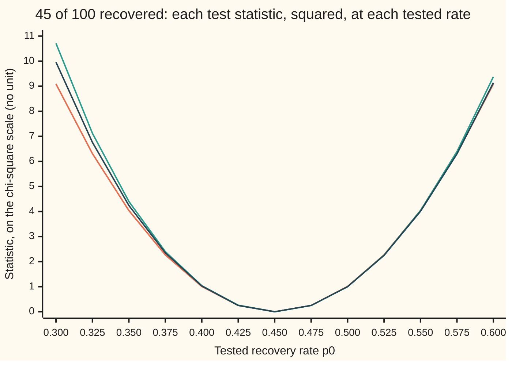

# Large-sample likelihood: why the MLE is nearly normal, and the Wald, score and likelihood-ratio tests

[Syllabus](../../../SYLLABUS.md) → [Probability and statistics](../README.md) → [Confidence Intervals and Tests](../README.md#s08) → Large-sample likelihood

---

## General Overview

A drug trial: 45 of 100 patients recover on the drug. An older treatment is known to cure 35% of such patients. Does the new drug beat 0.35, or could a drug that cures 35% easily produce 45 recoveries out of 100?

The best estimate of the drug's recovery rate is the **maximum-likelihood estimate**, or **MLE**: the rate that makes the data seen most likely ([Maximum likelihood](../07-Sampling%20and%20Estimation/04-maximum-likelihood.md)). Here it is 0.45. To test it against 0.35 we need to know how far a fresh trial's MLE would wander. This card proves the general answer. In large samples, the MLE lands near the truth (**consistency**). Its errors also follow a bell curve, the **normal law**, whose spread is set by the **Fisher information**: how sharply one patient's data pins the rate down.

That one fact gives three tests of "the rate is 0.35", each reading the same **log-likelihood curve** (the log of the chance of the data, plotted against the candidate rate) in a different way:

- **Wald test:** how far the MLE sits from 0.35, in units of the spread measured at the MLE. Here z = 0.10/0.04975 = 2.010.
- **Score test:** how steep the curve is at 0.35, in units of the spread measured at 0.35. Here z = 0.10/0.04770 = 2.097.
- **Likelihood-ratio test:** how far the curve drops from its peak to 0.35. Here twice the drop is 4.242, whose square root is 2.060.

All three say the same thing: 45 recoveries would be unusual for a 35% drug, with p-values from 0.036 to 0.044. They agree because, when the null is true or nearly true, they become the same statistic in large samples. They differ in where they read the curve.

[Hypothesis tests](03-hypothesis-tests-and-p-values.md) finds that the same 45 against 35 could easily be luck, with p = 0.149, and [Likelihood ratio tests](07-likelihood-ratio-tests.md) agrees. There the 35 came from a placebo arm of 100 patients, whose own luck widens the gap's spread to 0.0693. Here 0.35 is a known rate, so only the drug arm's luck counts, and the spread is 0.04770 to 0.04975.

**In large samples the maximum-likelihood estimate is close to normal, centred on the truth, with variance one over (n times the Fisher information); the Wald, score and likelihood-ratio tests are three readings of that one fact, and when the null is true they agree up to terms that vanish as n grows.**

**What kind of fact this is:** two theorems, consistency and asymptotic normality of the MLE for one parameter, proved on this card in Why it works under conditions listed in When it holds. The three tests built on them are methods whose 5% error rate is approximate. The checks compute the exact rate for this trial.

### The picture: three tests, one curve



Orange line: the Wald z squared. Teal line: the score z squared. Dark line: the likelihood-ratio statistic W. All three are 0 at the MLE, 0.45, and almost the same parabola near it. A test at the 5% level rejects a tested rate when its line passes 3.84, the square of the cutoff 1.959964 (3.8415). At 0.35 the three read 4.04, 4.40 and 4.24, so all three reject. Further from 0.45 they spread apart: at 0.30 they read 9.09, 10.71 and 9.96.

---

## The formula

Notation first. The unknown is written θ (theta) in general; in the trial it is the recovery rate p. The log-likelihood ℓ(θ) is the natural log of the chance of the data, read as a function of θ. Its slope is the **score**. The **Fisher information** I(θ) is the variance of one patient's score ([Fisher information](../07-Sampling%20and%20Estimation/07-fisher-information-and-cramer-rao.md)); for one recover-or-not patient it is $`I(p) = 1/\big(p(1-p)\big)`$. The Fisher information card wrote I for all n flips and $`I_1`$ for one; here I always means one patient's, so the whole trial carries $`nI`$.

The theorem, for n independent patients:

```math
\hat\theta \;\approx\; \text{Normal}\Big(\theta,\ \frac{1}{n\,I(\theta)}\Big) \quad\text{for large } n
```

**Read it aloud:** the MLE is close to a bell curve centred on the true value, with variance one over n times the information.

The three test statistics for the null value $`\theta_0`$ (the value being tested, here 0.35):

```math
z_{\text{Wald}} = (\hat\theta - \theta_0)\sqrt{n\,I(\hat\theta)}, \qquad z_{\text{score}} = \frac{\ell'(\theta_0)}{\sqrt{n\,I(\theta_0)}}, \qquad W = 2\big[\ell(\hat\theta) - \ell(\theta_0)\big]
```

**Read it aloud:** Wald divides the distance by the spread at the estimate; score divides the slope at the null by its own spread at the null; W is twice the drop in log-likelihood.

When the null is true, $`z_{\text{Wald}}`$ and $`z_{\text{score}}`$ are each close to a standard normal, and W is close to the square of one ([Likelihood ratio tests](07-likelihood-ratio-tests.md) proves this, Wilks' rule). The signed root $`z_{\text{LR}} = \pm\sqrt W`$ takes the sign of $`\hat\theta - \theta_0`$. Reject at the 5% level when $`\lvert z\rvert \ge 1.96`$, or equivalently $`W \ge 3.84`$.

For the trial, with $`\hat p = 0.45`$ and $`p_0 = 0.35`$, the first two become

```math
z_{\text{Wald}} = \frac{\hat p - p_0}{\sqrt{\hat p(1-\hat p)/n}} = \frac{0.10}{0.04975}, \qquad z_{\text{score}} = \frac{\hat p - p_0}{\sqrt{p_0(1-p_0)/n}} = \frac{0.10}{0.04770}
```

| Symbol | Plain meaning | In our example | Push it up and the answer… |
| --- | --- | --- | --- |
| $`x`$, $`n`$ | recoveries and patients | 45, 100 | larger n: every z grows like $`\sqrt n`$ |
| $`\theta`$, $`\theta_*`$, $`p`$, $`\tilde\theta`$, $`\delta`$ | the unknown in general; its true value; in the trial, the drug's recovery rate; a point between the MLE and the truth (Step 3); a small distance (Step 1) | unknown; in Step 1's table, $`\theta_* = 0.45`$ and $`\delta = 0.05`$ | — |
| $`\theta_0`$, $`p_0`$ | the value being tested, the null | 0.35 | nearer 0.45: every z shrinks |
| $`\hat\theta`$, $`\hat p`$ | the MLE, the value that makes the data most likely | 0.45 | further from 0.35: every z grows |
| $`\ell`$, $`f(y;\theta)`$, $`Y`$ | the log-likelihood, $`x\ln p + (n-x)\ln(1-p)`$, the sum of $`\ln f`$ over patients; one patient's chance of outcome y (1 recovered, 0 not); that outcome as a random draw | drops 2.1212 from 0.45 to 0.35 | — |
| $`\ell'`$, $`\ell''`$ | the score, the slope of ℓ; the curvature, ℓ's second derivative | slope 43.9560 at the null; $`-\ell''`$ is 404.0404 at the MLE | a steeper slope at the null: the null fits worse |
| $`I(\theta)`$, $`I_1`$ | Fisher information of one patient; the Fisher information card's name for it, where I meant all n | 4.0404 at 0.45; 4.3956 at 0.35 | more information: a tighter bell |
| $`\mathrm{se}`$ | standard error, $`1/\sqrt{n I}`$: the spread of the MLE | 0.04975 at 0.45; 0.04770 at 0.35 | wider: every z shrinks |
| $`z_{\text{Wald}}`$, $`z_{\text{score}}`$ | the Wald and score statistics | 2.0101, 2.0966 | past 1.96: reject at 5% |
| $`W`$, $`z_{\text{LR}}`$ | the likelihood-ratio statistic and its signed root | 4.2423, 2.0597 | past 3.84 (or 1.96): reject at 5% |
| $`\alpha`$, $`c`$, $`\Phi`$ | error rate allowed; its cutoff, $`\Phi(c) = 1 - \alpha/2`$; the bell curve's area left of a point | 0.05, 1.959964 | smaller α: larger c |
| $`K(\theta)`$, $`E`$ | the long-run average log-likelihood per patient, when the truth is $`\theta_*`$; E, an average over outcomes drawn from the truth | −0.688139 at the truth, 0.45 | highest at the truth |

### When it holds

These are the **regularity conditions**: the assumptions the proof uses, one at a time.

- **Independent patients, all from one model.** Correlated patients, such as members of one family, carry less information than their count suggests, and every standard error comes out too small.
- **Different values give different laws (identifiability).** If two values of θ give the same chance to every outcome, no amount of data can tell them apart, and the MLE need not settle anywhere.
- **The set of possible outcomes does not depend on θ.** For draws uniform between 0 and θ, the largest draw is the MLE. It is never above θ and misses by about θ/n, not $`\theta/\sqrt n`$: at θ = 2 and n = 100, its spread is 0.0196, not the 0.2000 the bell rule would give (a formal information of $`1/\theta^2`$ per draw makes $`1/\sqrt{nI} = \theta/\sqrt n`$).
- **The true value strictly inside the range, and a smooth log-likelihood with positive information.** The proof expands ℓ as a parabola around an interior peak. When the null sits on the edge of the allowed range, as when a model forbids the drug from doing worse than placebo, W is 0 about half the time and its chi-square tail must be halved ([Likelihood ratio tests](07-likelihood-ratio-tests.md), the null on the edge).
- **Enough data.** Every statement is a limit. At n = 100 the exact error rate of the 5% Wald test of 0.35 is 0.0597, not 0.05. A rash with true rate 0.02, well inside the range, still shows in 0 of 100 patients in 0.1326 of trials. Then the MLE sits on the edge, its estimated spread is 0, and the Wald z is infinite. That chance vanishes as n grows.

---

## Why it works

### Step 0: the average log-likelihood settles, and near its peak it is a parabola

Two facts carry the whole proof. First, the log-likelihood divided by n is an average over patients. By the [Law of large numbers](../06-Limit%20Theorems%20in%20Practice/01-law-of-large-numbers.md) it settles on a fixed curve, and that curve peaks at the truth. So the MLE, the peak of the random curve, lands near the truth. Second, near the peak the random curve is close to a parabola. The peak's position is then a simple ratio: the slope at the truth, which is a sum over patients and so bell-shaped, divided by the curvature, which settles. A bell-shaped number divided by a settled number is bell-shaped.

### Step 1: consistency, the MLE lands near the truth

Call the truth $`\theta_*`$, and write $`f(y;\theta)`$ for the chance one patient's outcome y (1 if recovered, 0 if not) has under θ. Each patient adds $`\ln f(y;\theta)`$ to ℓ. By the law of large numbers, $`\ell(\theta)/n`$ settles on

```math
K(\theta) = E_{\theta_*}\big[\ln f(Y;\theta)\big],
```

the average log-chance of a random patient's outcome Y when the truth is $`\theta_*`$ (E is an average; its subscript names the truth it averages under). For the trial with truth 0.45, $`K(\theta) = 0.45\ln\theta + 0.55\ln(1-\theta)`$. It reads −0.693285 at 0.40, −0.688139 at 0.45 and −0.693147 at 0.50. The peak is at the truth.

That always happens. For any θ, by Jensen's inequality (the average of a log is at most the log of the average),

```math
K(\theta) - K(\theta_*) = E_{\theta_*}\Big[\ln\frac{f(Y;\theta)}{f(Y;\theta_*)}\Big] \;\le\; \ln E_{\theta_*}\Big[\frac{f(Y;\theta)}{f(Y;\theta_*)}\Big] = \ln\sum_y f(y;\theta) = \ln 1 = 0.
```

Equality needs the ratio to be constant, which means the same law. Identifiability rules that out, so $`K(\theta) < K(\theta_*)`$ for every $`\theta \ne \theta_*`$.

Now fix a small distance δ. At the two points $`\theta_* \pm \delta`$, the averages $`\ell/n`$ converge to values strictly below $`K(\theta_*)`$. So, with chance tending to 1, ℓ is higher at $`\theta_*`$ than at both $`\theta_* - \delta`$ and $`\theta_* + \delta`$. A smooth curve that is higher in the middle than at both ends has a peak between them. So the log-likelihood has a peak within δ of the truth. For the trial, ℓ is concave (its second derivative, $`-x/p^2 - (n-x)/(1-p)^2`$, is negative), so that peak is the MLE itself. In models with several peaks, this argument gives a consistent peak; Wald (1949) proves the overall maximum is consistent under extra conditions.

The checks show the squeeze at truth 0.45, exactly, from the binomial chances:

| Patients n | Chance the MLE misses 0.45 by more than 0.05 |
| --- | --- |
| 10 | 0.5276 |
| 100 | 0.2688 |
| 1,000 | 0.0013 |
| 10,000 | 0.0000 |

### Step 2: the score at the truth is bell-shaped

The score $`\ell'(\theta_*)`$ is a sum of n independent pieces, one per patient. [Fisher information](../07-Sampling%20and%20Estimation/07-fisher-information-and-cramer-rao.md) shows each piece averages 0 and has variance $`I(\theta_*)`$. By the [Central limit theorem](../06-Limit%20Theorems%20in%20Practice/02-central-limit-theorem.md),

```math
\frac{\ell'(\theta_*)}{\sqrt{n\,I(\theta_*)}} \;\approx\; \text{Normal}(0, 1).
```

For the trial's model the checks confirm the variance by brute force. At 0.35 they average the squared score over all 101 possible counts, weighted by their binomial chances, and get 439.5605. That is $`n\,I(0.35) = 100/(0.35 \times 0.65)`$.

### Step 3: the MLE is the score divided by the curvature

The MLE is an interior peak, so the slope there is 0. [Taylor's theorem](../../06-Calculus%20and%20analysis/03-What%20Derivatives%20Tell%20You/05-taylors-theorem.md) with the mean-value remainder links that zero slope to the slope at the truth:

```math
0 = \ell'(\hat\theta) = \ell'(\theta_*) + (\hat\theta - \theta_*)\,\ell''(\tilde\theta)
```

for some point $`\tilde\theta`$ between $`\hat\theta`$ and $`\theta_*`$. Rearranged, after multiplying by $`\sqrt n`$:

```math
\sqrt n\,(\hat\theta - \theta_*) = \frac{\ell'(\theta_*)/\sqrt n}{-\ell''(\tilde\theta)/n}.
```

The top is close to Normal(0, I) by Step 2. The bottom is an average curvature at a point squeezed onto $`\theta_*`$ by Step 1, so by the law of large numbers it settles on $`I(\theta_*)`$; the average of minus the second derivative of one patient's log-chance equals the information. Dividing a Normal(0, I) by I gives Normal(0, 1/I). Slutsky's theorem ([Delta method](../06-Limit%20Theorems%20in%20Practice/05-delta-method-and-slutsky.md)) makes "divide by a number that settles" legal in the limit. That is the theorem:

```math
\sqrt n\,(\hat\theta - \theta_*) \;\to\; \text{Normal}\Big(0,\ \frac{1}{I(\theta_*)}\Big).
```

<details>
<summary>Detailed proof: the curvature step, with the conditions it uses</summary>

Write $`g(y;\theta) = \ln f(y;\theta)`$ for one patient's log-chance, and assume g has three derivatives in θ, with the third bounded near $`\theta_*`$ by some $`M(y)`$ of finite average.

**Curvature at the truth.** Differentiate $`\sum_y f(y;\theta) = 1`$ twice; the outcome set does not move with θ, so the derivative passes inside the sum. The first derivative gives $`E[g'] = 0`$, the score's zero average. The second gives $`E[g''] + E[(g')^2] = 0`$, so $`E[-g''] = I(\theta)`$. By the law of large numbers, $`-\ell''(\theta_*)/n \to I(\theta_*)`$.

**Curvature nearby.** For $`\tilde\theta`$ between $`\hat\theta`$ and $`\theta_*`$,

$`\displaystyle \Big\lvert \frac{\ell''(\tilde\theta)}{n} - \frac{\ell''(\theta_*)}{n} \Big\rvert \le \lvert\hat\theta - \theta_*\rvert \cdot \frac{1}{n}\sum_{i=1}^n M(y_i).`$

Here $`y_i`$ is patient i's outcome. The average of the M values settles on a finite number, and $`\lvert\hat\theta - \theta_*\rvert \to 0`$ by Step 1, so the right side tends to 0.

**Assemble.** The top of Step 3's ratio tends in law to Normal(0, I), meaning its chances settle on that bell's; the bottom tends to I > 0, and Slutsky's theorem gives the ratio's limit, Normal(0, 1/I).

Each condition was used once: independence for the law of large numbers and the central limit theorem; identifiability for Step 1; a fixed outcome set for the zero-average score and $`E[-g''] = I`$; an interior truth for $`\ell'(\hat\theta) = 0`$; three smooth derivatives for the remainder; I > 0 for dividing.

</details>

For the trial, $`\hat p`$ is exactly an average of 0s and 1s, so the theorem is the central limit theorem itself. The checks measure how close the exact binomial law of $`\hat p`$ is to the bell. "Largest gap" is the largest difference between the two cumulative curves. "Within 1.96 sd" is the chance $`\hat p`$ lands within 1.96 standard deviations of 0.45, which the bell puts at 0.95.

| Patients n | sd of $`\hat p`$, $`\sqrt{0.45 \times 0.55/n}`$ | Within 1.96 sd | Largest gap to the bell |
| --- | --- | --- | --- |
| 10 | 0.15732 | 0.9494 | 0.1291 |
| 100 | 0.04975 | 0.9444 | 0.0413 |
| 1,000 | 0.01573 | 0.9475 | 0.0131 |
| 10,000 | 0.00497 | 0.9500 | 0.0041 |

The gap shrinks like $`1/\sqrt n`$: ten times the patients, about a third of the gap.

### Step 4: three tests, three ways to read one curve

Under the null $`\theta_* = \theta_0`$, Step 3 says $`(\hat\theta - \theta_0)\sqrt{n I(\theta_0)}`$ is close to a standard normal. Each test makes that usable in its own way.

- **Wald** replaces the unknown $`I(\theta_0)`$ by $`I(\hat\theta)`$, the information at the estimate. Slutsky's theorem allows the swap, since $`\hat\theta`$ settles on $`\theta_0`$. In the trial, $`I(0.45) = 4.0404`$ per patient, so the spread is $`1/\sqrt{404.0404} = 0.04975`$ and $`z_{\text{Wald}} = 2.0101`$. Wald measures the horizontal distance from peak to null.
- **Score** never fits the model. It measures the slope at the null, 43.9560 per unit of p, and divides by that slope's own spread under the null, $`\sqrt{439.5605} = 20.9657`$. That gives $`z_{\text{score}} = 2.0966`$. Step 2 is exactly its justification.
- **Likelihood ratio** measures the height of the drop, 2.1212, and doubles it: W = 4.2423. Expanding ℓ around the peak gives $`W \approx n I\,(\hat\theta - \theta_0)^2`$, the square of the other two. [Likelihood ratio tests](07-likelihood-ratio-tests.md) proves this as Wilks' rule.

For the trial the first two differ only in the spread. The ratio of the two spreads, 0.04975/0.04770, is 1.0430, so $`z_{\text{score}} = 1.0430 \times z_{\text{Wald}}`$. When the null is true, $`\hat p`$ is close to $`p_0`$. The two spreads then agree, and so do the tests. Here $`\hat p`$ sits 0.10 from $`p_0`$, so the spreads, and the two tests, differ by that factor.

The checks also reach the statistics a second way. A golden-section search (repeatedly cutting an interval around the peak) finds the peak, 0.450000. Finite differences (slopes from nearby points) give the slope 43.9560 and the curvature 404.0404. These reproduce 2.0101 and 2.0966 without the closed forms. For W, whose formula is the drop itself, the second road checks only where the peak is.

### Step 5: each test gives an interval

A 95% interval keeps every tested value the 5% test does not reject. On the chart, that is every rate where a line stays under 3.84.

- **Wald interval:** $`0.45 \pm 1.96 \times 0.04975`$, from 0.3525 to 0.5475.
- **Score interval:** 0.3561 to 0.5476. This is the Wilson interval, derived on [Intervals for a proportion](02-intervals-for-proportions.md) as an inverted score test.
- **Likelihood-ratio interval:** 0.3547 to 0.5478, found by bisection (halving an interval that holds the answer). It has no closed form.

### Step 6: which to trust

All three are approximations, so the honest referee is the exact binomial law at 0.35. Adding up binomial chances, the checks find each 5% test's real false-alarm rate:

| Test | Rejects counts | Exact false-alarm rate at 0.35 |
| --- | --- | --- |
| Wald | ≤ 26 or ≥ 45 | 0.0597 |
| Score | ≤ 25 or ≥ 45 | 0.0457 |
| Likelihood ratio | ≤ 25 or ≥ 45 | 0.0457 |

Wald rejects too often here, because a low count produces a small estimated spread and so a large z. The exact two-sided p-value for 45, twice the chance of 45 or more at 0.35, is 0.0492; it also rejects.

A second difference is the scale. Rewrite the trial in log-odds, $`\ln\big(p/(1-p)\big)`$, the scale of logistic regression. The likelihood-ratio statistic is unchanged, because the curve's peak and its value at the null do not depend on how p is labelled. The score z is also unchanged: the slope and its spread both pick up the same factor $`p_0(1-p_0)`$, which cancels. The Wald z changes, to 2.0814. Wald assumes the MLE is a bell on whichever scale it is computed, and a bell on one scale is bent on another, so the answer depends on the choice.

---

## Worked numbers, by hand

The drug arm: 45 of 100 recovered; test $`p_0 = 0.35`$.

| Step | Arithmetic | Value |
| --- | --- | --- |
| MLE | 45 / 100 | 0.45 |
| spread at the MLE | $`\sqrt{0.45 \times 0.55 / 100}`$ | 0.04975 |
| spread at the null | $`\sqrt{0.35 \times 0.65 / 100}`$ | 0.04770 |
| Wald z | 0.10 / 0.04975 | 2.0101 |
| score z | 0.10 / 0.04770 | 2.0966 |
| drop in log-likelihood | 45 ln(0.45/0.35) + 55 ln(0.55/0.65) | 2.1212 |
| W | 2 × 2.1212 | 4.2423 |
| signed root of W | $`\sqrt{4.2423}`$ | 2.0597 |
| p-values, $`2\big(1 - \Phi(\lvert z\rvert)\big)`$ | Wald, score, LR | 0.0444, 0.0360, 0.0394 |
| **verdict at 5%** | every $`\lvert z\rvert`$ ≥ 1.96 | **all three reject p = 0.35** |

What it means: if the drug cured only 35%, a count of 45 or more would turn up in about 1 trial in 40 (0.0246), so the trial is evidence that the drug beats a known rate of 0.35. The three tests disagree only in the second decimal of z.

### What breaks if you drop a piece

| Mistake | Comes out at | What went wrong |
| --- | --- | --- |
| Use one patient's information, forgetting the n | z = 0.2010, p = 0.8407 | The spread of the MLE is $`1/\sqrt{nI}`$; dropping n makes the trial look like one patient |
| Read W = 4.2423 as a z | p = 0.000022 | W is on the chi-square scale, a squared z; compare it with 3.84, or take its root |
| Wald on 0 rashes in 100, testing 0.02 | z infinite | Too little data: the MLE lands on the edge (chance 0.1326 at n = 100) though the truth, 0.02, is inside the range, and its estimated spread is 0. Score gives z = −1.4286 (p 0.1531), and W = 4.0405 (p 0.0444) |
| Bell rule for uniform draws from 0 to θ = 2, n = 100 | spread 0.2000 | The outcome range moves with θ; the true spread of the largest draw is 0.0196, and it is below θ in every one of 20,000 simulated trials |

---

## Code, from first principles, and it actually runs

The scripts build every tool themselves: the bell curve's area by a Taylor series, checked against Simpson's rule (adding thin slices under the curve); the MLE by golden-section search; slopes and curvature by finite differences; interval ends by bisection; random numbers by a SplitMix64 generator with seed 20261123, identical in both languages. The Wald and score statistics are reached by two roads: the closed forms, and the search with finite differences on the raw log-likelihood. For W the second road checks only the peak. The log-odds Wald and score z are checked the same way, on the log-likelihood rewritten in log-odds. The exact false-alarm rates and the exact p-value also take two roads: the binomial law by the ratio rule over the counts each test rejects, and the law built one patient at a time over cutoffs on the count solved in closed form (the likelihood-ratio test rejects the same counts as the score test). The uniform failure case is simulated 20,000 times against its exact mean and spread. Step 1's consistency table and the zero-rash numbers are computed on one road each. Step 3's table is asserted only loosely: every gap below $`1/\sqrt n`$, and every "within 1.96 sd" share within 0.01 of the bell's 0.95. Every number on the card is printed below.

### Python

```python
# Large-sample likelihood -- the check behind the card.  Standard library only.
# Drug arm: 45 of 100 recovered.  Test p0 = 0.35 by the Wald, score and likelihood-ratio routes.
from math import log, exp, sqrt, pi

def Phi(x):                                   # bell-curve area left of x, Taylor series of erf
    if abs(x) > 8: return 0.0 if x < 0 else 1.0   # the series loses all precision this far out
    y = x / sqrt(2.0); t, s, k = y, 0.0, 0
    while abs(t) > 1e-17:
        s, k = s + t / (2 * k + 1), k + 1
        t *= -y * y / k
    return 0.5 + s / sqrt(pi)

def Phi_simpson(x, m=2000):                   # second road: Simpson's rule on the bell-curve height
    h, f = x / m, lambda u: exp(-u * u / 2) / sqrt(2 * pi)
    return 0.5 + (f(0) + f(x) + sum((4 if i % 2 else 2) * f(i * h) for i in range(1, m))) * h / 3

def p2(z): return 2 * (1 - Phi(abs(z)))       # two-sided p-value of a z statistic
def xlogy(a, b): return a * log(b) if a > 0 else 0.0
def ll(k, n, p): return xlogy(k, p) + xlogy(n - k, 1 - p)       # log-likelihood, k of n
def stats(k, n, p0):                          # closed forms: Wald z, score z, likelihood ratio W
    q = k / n
    zw = (q - p0) / sqrt(q * (1 - q) / n) if 0 < k < n else float("inf")
    zs = (q - p0) / sqrt(p0 * (1 - p0) / n)
    return zw, zs, 2 * (ll(k, n, q) - ll(k, n, p0))
def golden_max(f, a=1e-9, b=1 - 1e-9):        # golden-section search: no closed-form estimate used
    g = (sqrt(5) - 1) / 2
    for _ in range(200):
        c, d = b - g * (b - a), a + g * (b - a)
        a, b = (a, d) if f(c) > f(d) else (c, b)
    return (a + b) / 2
def bisect(f, a, b):                          # root of f between a and b, f changing sign
    for _ in range(200):
        m = (a + b) / 2
        a, b = (m, b) if (f(a) > 0) == (f(m) > 0) else (a, m)
    return (a + b) / 2
def log_pmf(n, p):                            # binomial log-chances by the ratio rule, no factorials
    out = [n * log(1 - p)]
    for k in range(n): out.append(out[-1] + log((n - k) / (k + 1)) + log(p / (1 - p)))
    return out
def splitmix(s):
    s = (s + 0x9E3779B97F4A7C15) & 0xFFFFFFFFFFFFFFFF
    z = ((s ^ (s >> 30)) * 0xBF58476D1CE4E5B9) & 0xFFFFFFFFFFFFFFFF
    z = ((z ^ (z >> 27)) * 0x94D049BB133111EB) & 0xFFFFFFFFFFFFFFFF
    return s, (z ^ (z >> 31)) >> 11

x, n, p0, c = 45, 100, 0.35, 1.959964
ph = x / n
# ---- road 1: closed forms ----
zw, zs, W = stats(x, n, p0)
print(f"spread at p-hat {sqrt(ph * (1 - ph) / n):.5f}; spread at p0 {sqrt(p0 * (1 - p0) / n):.5f}")
print(f"Wald z = {zw:.4f}  score z = {zs:.4f}  W = {W:.4f}  sqrt W = {sqrt(W):.4f}")
print(f"cutoff c = {c}, c^2 = {c * c:.4f}; score z / Wald z = spread ratio {zs / zw:.4f}")
print(f"p-values: Wald {p2(zw):.4f}  score {p2(zs):.4f}  LR {p2(sqrt(W)):.4f}")
rb = (x + 35) / (2 * n); sb = sqrt(2 * rb * (1 - rb) / n)   # Hypothesis tests: 35 of 100 on a placebo arm, pooled
print(f"two arms, 35 of 100 on placebo: pooled spread of the gap {sb:.4f}, p {p2((ph - p0) / sb):.3f}")
print(f"Phi(1.96): series {Phi(1.96):.10f}  Simpson {Phi_simpson(1.96):.10f}")
assert abs(Phi(1.96) - Phi_simpson(1.96)) < 1e-10
assert abs(p2(c) - 0.05) < 1e-6                # the cutoff leaves 5% in the two tails
# ---- road 2: the same three numbers from the curve itself, by search and finite differences ----
f = lambda p: ll(x, n, p)
q = golden_max(f); h = 1e-4
U = (f(p0 + h) - f(p0 - h)) / (2 * h)                       # score: slope at p0
J = -(f(q + h) - 2 * f(q) + f(q - h)) / h ** 2              # observed information: curvature at the peak
lp = log_pmf(n, p0)                                          # expected information: average squared score
I0 = sum(exp(lp[k]) * ((ll(k, n, p0 + h) - ll(k, n, p0 - h)) / (2 * h)) ** 2 for k in range(n + 1))
print(f"search: p-hat {q:.6f}; score at p0 {U:.4f}; curvature at p-hat {J:.4f}; E[score^2] at p0 {I0:.4f}, root {sqrt(I0):.4f}")
print(f"per patient: I(p-hat) = {J / n:.4f}  I(p0) = {I0 / n:.4f}; drop in log-lik {f(q) - f(p0):.4f}")
zw2, zs2, W2 = (q - p0) * sqrt(J), U / sqrt(I0), 2 * (f(q) - f(p0))
print(f"search: Wald z = {zw2:.4f}  score z = {zs2:.4f}  W = {W2:.4f}")
assert abs(zw - zw2) < 1e-5 and abs(zs - zs2) < 1e-5 and abs(W - W2) < 1e-8
# ---- intervals: keep every p0 each test does not reject ----
ints = {}
for i, name in enumerate(("Wald", "score", "LR")):
    g = lambda p: (stats(x, n, p)[i] ** 2 if i < 2 else stats(x, n, p)[2]) - c * c
    ints[name] = (bisect(g, 0.2, ph), bisect(g, ph, 0.8))
    print(f"{name} interval {ints[name][0]:.4f} to {ints[name][1]:.4f}")
se = sqrt(ph * (1 - ph) / n); mid = (ph + c * c / (2 * n)) / (1 + c * c / n)
hw = c * sqrt(ph * (1 - ph) / n + c * c / (4 * n * n)) / (1 + c * c / n)
assert abs(ints["Wald"][0] - (ph - c * se)) < 1e-9 and abs(ints["score"][1] - (mid + hw)) < 1e-9
# ---- road 3: exact enumeration under p0 = 0.35 ----
pm, dp = [exp(v) for v in lp], [1.0]          # second road to the law: add one patient at a time
for _ in range(n): dp = [a * (1 - p0) + b * p0 for a, b in zip(dp + [0.0], [0.0] + dp)]
A, B, s = 1 + c * c / n, 2 * p0 + c * c / n, c * sqrt(n * p0 * (1 - p0))   # cutoffs on the count, in closed form
r = n * sqrt(B * B - 4 * A * p0 * p0) / (2 * A)                             # Wald: n (q - p0)^2 = c^2 q (1 - q)
cut = ((n * B / (2 * A) - r, n * B / (2 * A) + r), (n * p0 - s, n * p0 + s), (n * p0 - s, n * p0 + s))  # LR: the score's
for i, name in enumerate(("Wald", "score", "LR")):
    rej = [k for k in range(n + 1) if (abs(stats(k, n, p0)[i]) >= c if i < 2 else stats(k, n, p0)[2] >= c * c)]
    size = sum(pm[k] for k in rej)
    print(f"exact size of 5% {name} test at p0: {size:.4f}  (rejects counts <= {max(k for k in rej if k < 35)}, >= {min(k for k in rej if k > 35)})")
    assert abs(size - sum(dp[k] for k in range(n + 1) if not cut[i][0] < k < cut[i][1])) < 1e-12
up = sum(pm[x:])
print(f"exact binomial at p0: P(count >= 45) = {up:.4f}; two-sided p = {2 * up:.4f}")
assert abs(up - sum(dp[x:])) < 1e-12
# ---- consistency and normality: truth 0.45, growing n ----
K = lambda t: 0.45 * log(t) + 0.55 * log(1 - t)
print(f"average log-lik limit K: K(0.40) = {K(0.40):.6f}  K(0.45) = {K(0.45):.6f}  K(0.50) = {K(0.50):.6f}")
assert K(0.45) > K(0.40) and K(0.45) > K(0.50)
for m in (10, 100, 1000, 10000):
    pmf = [exp(v) for v in log_pmf(m, 0.45)]; sd = sqrt(0.45 * 0.55 / m)
    off = sum(pmf[k] for k in range(m + 1) if abs(k / m - 0.45) > 0.05 + 1e-12)
    cov = sum(pmf[k] for k in range(m + 1) if abs(k / m - 0.45) <= c * sd + 1e-12)
    cdf, gap = 0.0, 0.0
    for k in range(m + 1):
        z = (k / m - 0.45) / sd
        gap = max(gap, abs(cdf - Phi(z)), abs(cdf + pmf[k] - Phi(z))); cdf += pmf[k]
    print(f"n={m}: sd {sd:.5f}; P(off by > 0.05) {off:.4f}; P(within 1.96 sd) {cov:.4f}; max gap to bell {gap:.4f}")
    assert gap < 1.0 / sqrt(m) and abs(cov - 0.95) < 0.01
# ---- road 4: where it fails -- uniform on (0, theta), MLE = largest draw, simulated ----
th, m, R, st, S, S2, below = 2.0, 100, 20000, 20261123, 0.0, 0.0, 0
for _ in range(R):
    mx = 0.0
    for _ in range(m):
        st, u = splitmix(st); mx = max(mx, th * u / 2 ** 53)
    S, S2, below = S + mx, S2 + mx * mx, below + (mx < th)
mean, sdv = S / R, sqrt(S2 / R - (S / R) ** 2)
ex_mean, ex_sd = m * th / (m + 1), th * sqrt(m / ((m + 1) ** 2 * (m + 2)))
print(f"uniform, theta 2, n 100: mean {mean:.4f} (exact {ex_mean:.4f}); sd {sdv:.4f} (exact {ex_sd:.4f}); below theta {below / R:.4f}")
print(f"uniform: the bell rule's sd theta/sqrt(n) = {th / sqrt(m):.4f}")
assert abs(mean - ex_mean) < 4 * ex_sd / sqrt(R) and abs(sdv - ex_sd) < 0.05 * ex_sd
# ---- what breaks ----
lg = lambda p: log(p / (1 - p))
fe = lambda e: f(1 / (1 + exp(-e)))                                # the same log-likelihood, read on the log-odds scale
zl, zsl = (lg(ph) - lg(p0)) * sqrt(n * ph * (1 - ph)), (fe(lg(p0) + h) - fe(lg(p0) - h)) / (2 * h) / sqrt(n * p0 * (1 - p0))
Jl = -(fe(lg(q) + h) - 2 * fe(lg(q)) + fe(lg(q) - h)) / h ** 2    # curvature on log-odds, at the searched peak
print(f"breaks: Wald on log-odds {zl:.4f} (p {p2(zl):.4f}); score on log-odds {zsl:.4f}")
assert abs(zl - (lg(q) - lg(p0)) * sqrt(Jl)) < 1e-5 and abs(zsl - zs) < 1e-5
print(f"breaks: one patient's information z = {(ph - p0) / sqrt(ph * (1 - ph)):.4f} (p {p2((ph - p0) / sqrt(ph * (1 - ph))):.4f}); W read as z, p = {p2(W):.6f}")
zw0, zs0, W0 = stats(0, 100, 0.02)
print(f"breaks: 0 of 100, test 0.02: Wald z {zw0}; score z {zs0:.4f} (p {p2(zs0):.4f}); W {W0:.4f} (p {p2(sqrt(W0)):.4f}); P(0 of 100 at 0.02) {exp(log_pmf(100, 0.02)[0]):.4f}")
# ---- the chart: each statistic, squared, against the candidate p ----
grid = [0.30 + 0.025 * i for i in range(13)]
print("chart, p:", ", ".join(f"{p:.3f}" for p in grid))
for i, name in enumerate(("Wald z^2", "score z^2", "W")):
    print(f"chart, {name}:", ", ".join(f"{stats(x, n, p)[i] ** (2 if i < 2 else 1):.2f}" for p in grid))
# ---- try changing ----
for k, nn, t in ((90, 200, 0.35), (40, 100, 0.35), (45, 100, 0.25)):
    a, b, w = stats(k, nn, t)
    print(f"try {k}/{nn} vs {t}: Wald {a:.4f}  score {b:.4f}  root W {sqrt(w):.4f}")
print("ALL CHECKS PASS")
```

**Ran 2026-11-23 on macOS, Python 3.14.10, standard library only. All checks passed. Output, pasted from the run:**

```
spread at p-hat 0.04975; spread at p0 0.04770
Wald z = 2.0101  score z = 2.0966  W = 4.2423  sqrt W = 2.0597
cutoff c = 1.959964, c^2 = 3.8415; score z / Wald z = spread ratio 1.0430
p-values: Wald 0.0444  score 0.0360  LR 0.0394
two arms, 35 of 100 on placebo: pooled spread of the gap 0.0693, p 0.149
Phi(1.96): series 0.9750021049  Simpson 0.9750021049
search: p-hat 0.450000; score at p0 43.9560; curvature at p-hat 404.0404; E[score^2] at p0 439.5605, root 20.9657
per patient: I(p-hat) = 4.0404  I(p0) = 4.3956; drop in log-lik 2.1212
search: Wald z = 2.0101  score z = 2.0966  W = 4.2423
Wald interval 0.3525 to 0.5475
score interval 0.3561 to 0.5476
LR interval 0.3547 to 0.5478
exact size of 5% Wald test at p0: 0.0597  (rejects counts <= 26, >= 45)
exact size of 5% score test at p0: 0.0457  (rejects counts <= 25, >= 45)
exact size of 5% LR test at p0: 0.0457  (rejects counts <= 25, >= 45)
exact binomial at p0: P(count >= 45) = 0.0246; two-sided p = 0.0492
average log-lik limit K: K(0.40) = -0.693285  K(0.45) = -0.688139  K(0.50) = -0.693147
n=10: sd 0.15732; P(off by > 0.05) 0.5276; P(within 1.96 sd) 0.9494; max gap to bell 0.1291
n=100: sd 0.04975; P(off by > 0.05) 0.2688; P(within 1.96 sd) 0.9444; max gap to bell 0.0413
n=1000: sd 0.01573; P(off by > 0.05) 0.0013; P(within 1.96 sd) 0.9475; max gap to bell 0.0131
n=10000: sd 0.00497; P(off by > 0.05) 0.0000; P(within 1.96 sd) 0.9500; max gap to bell 0.0041
uniform, theta 2, n 100: mean 1.9802 (exact 1.9802); sd 0.0193 (exact 0.0196); below theta 1.0000
uniform: the bell rule's sd theta/sqrt(n) = 0.2000
breaks: Wald on log-odds 2.0814 (p 0.0374); score on log-odds 2.0966
breaks: one patient's information z = 0.2010 (p 0.8407); W read as z, p = 0.000022
breaks: 0 of 100, test 0.02: Wald z inf; score z -1.4286 (p 0.1531); W 4.0405 (p 0.0444); P(0 of 100 at 0.02) 0.1326
chart, p: 0.300, 0.325, 0.350, 0.375, 0.400, 0.425, 0.450, 0.475, 0.500, 0.525, 0.550, 0.575, 0.600
chart, Wald z^2: 9.09, 6.31, 4.04, 2.27, 1.01, 0.25, 0.00, 0.25, 1.01, 2.27, 4.04, 6.31, 9.09
chart, score z^2: 10.71, 7.12, 4.40, 2.40, 1.04, 0.26, 0.00, 0.25, 1.00, 2.26, 4.04, 6.39, 9.38
chart, W: 9.96, 6.76, 4.24, 2.35, 1.03, 0.25, 0.00, 0.25, 1.00, 2.25, 4.01, 6.30, 9.14
try 90/200 vs 0.35: Wald 2.8427  score 2.9650  root W 2.9129
try 40/100 vs 0.35: Wald 1.0206  score 1.0483  root W 1.0380
try 45/100 vs 0.25: Wald 4.0202  score 4.6188  root W 4.3340
ALL CHECKS PASS
```

### Rust

```rust
// Large-sample likelihood -- the check behind the card.  Rust std only, no crates.
// Drug arm: 45 of 100 recovered.  Test p0 = 0.35 by the Wald, score and likelihood-ratio routes.
use std::f64::consts::PI;

fn phi(x: f64) -> f64 { // bell-curve area left of x, Taylor series of erf
    if x.abs() > 8.0 { return if x < 0.0 { 0.0 } else { 1.0 }; } // the series loses all precision this far out
    let y = x / 2f64.sqrt();
    let (mut t, mut s, mut k) = (y, 0.0, 0.0);
    while t.abs() > 1e-17 { s += t / (2.0 * k + 1.0); k += 1.0; t *= -y * y / k; }
    0.5 + s / PI.sqrt()
}
fn phi_simpson(x: f64, m: usize) -> f64 { // second road: Simpson's rule on the bell-curve height
    let h = x / m as f64;
    let f = |u: f64| (-u * u / 2.0).exp() / (2.0 * PI).sqrt();
    let inner: f64 = (1..m).map(|i| (if i % 2 == 1 { 4.0 } else { 2.0 }) * f(i as f64 * h)).sum();
    0.5 + (f(0.0) + f(x) + inner) * h / 3.0
}
fn p2(z: f64) -> f64 { 2.0 * (1.0 - phi(z.abs())) } // two-sided p-value of a z statistic
fn xlogy(a: f64, b: f64) -> f64 { if a > 0.0 { a * b.ln() } else { 0.0 } }
fn ll(k: f64, n: f64, p: f64) -> f64 { xlogy(k, p) + xlogy(n - k, 1.0 - p) } // log-likelihood, k of n
fn stats(k: usize, n: usize, p0: f64) -> [f64; 3] { // closed forms: Wald z, score z, likelihood ratio W
    let (kf, nf) = (k as f64, n as f64);
    let q = kf / nf;
    let zw = if k > 0 && k < n { (q - p0) / (q * (1.0 - q) / nf).sqrt() } else { f64::INFINITY };
    let zs = (q - p0) / (p0 * (1.0 - p0) / nf).sqrt();
    [zw, zs, 2.0 * (ll(kf, nf, q) - ll(kf, nf, p0))]
}
fn golden_max<F: Fn(f64) -> f64>(f: F) -> f64 { // golden-section search: no closed-form estimate used
    let g = (5f64.sqrt() - 1.0) / 2.0;
    let (mut a, mut b) = (1e-9, 1.0 - 1e-9);
    for _ in 0..200 {
        let (c, d) = (b - g * (b - a), a + g * (b - a));
        if f(c) > f(d) { b = d } else { a = c }
    }
    (a + b) / 2.0
}
fn bisect<F: Fn(f64) -> f64>(f: F, mut a: f64, mut b: f64) -> f64 { // root of f between a and b
    for _ in 0..200 {
        let m = (a + b) / 2.0;
        if (f(a) > 0.0) == (f(m) > 0.0) { a = m } else { b = m }
    }
    (a + b) / 2.0
}
fn log_pmf(n: usize, p: f64) -> Vec<f64> { // binomial log-chances by the ratio rule, no factorials
    let mut out = vec![n as f64 * (1.0 - p).ln()];
    for k in 0..n { let last = out[k]; out.push(last + ((n - k) as f64 / (k + 1) as f64).ln() + (p / (1.0 - p)).ln()); }
    out
}
fn splitmix(s: &mut u64) -> u64 {
    *s = s.wrapping_add(0x9E3779B97F4A7C15);
    let mut z = (*s ^ (*s >> 30)).wrapping_mul(0xBF58476D1CE4E5B9);
    z = (z ^ (z >> 27)).wrapping_mul(0x94D049BB133111EB);
    (z ^ (z >> 31)) >> 11
}
fn sq(i: usize, s: [f64; 3]) -> f64 { if i < 2 { s[i] * s[i] } else { s[2] } } // z^2 for Wald and score, W for LR

fn main() {
    let (x, n, p0, c) = (45usize, 100usize, 0.35f64, 1.959964f64);
    let (xf, nf, ph) = (x as f64, n as f64, x as f64 / n as f64);
    let names = ["Wald", "score", "LR"];
    // ---- road 1: closed forms ----
    let [zw, zs, w] = stats(x, n, p0);
    println!("spread at p-hat {:.5}; spread at p0 {:.5}", (ph * (1.0 - ph) / nf).sqrt(), (p0 * (1.0 - p0) / nf).sqrt());
    println!("Wald z = {:.4}  score z = {:.4}  W = {:.4}  sqrt W = {:.4}", zw, zs, w, w.sqrt());
    println!("cutoff c = {}, c^2 = {:.4}; score z / Wald z = spread ratio {:.4}", c, c * c, zs / zw);
    println!("p-values: Wald {:.4}  score {:.4}  LR {:.4}", p2(zw), p2(zs), p2(w.sqrt()));
    let rb = (xf + 35.0) / (2.0 * nf); let sb = (2.0 * rb * (1.0 - rb) / nf).sqrt(); // Hypothesis tests: 35 of 100 on a placebo arm, pooled
    println!("two arms, 35 of 100 on placebo: pooled spread of the gap {:.4}, p {:.3}", sb, p2((ph - p0) / sb));
    println!("Phi(1.96): series {:.10}  Simpson {:.10}", phi(1.96), phi_simpson(1.96, 2000));
    assert!((phi(1.96) - phi_simpson(1.96, 2000)).abs() < 1e-10);
    assert!((p2(c) - 0.05).abs() < 1e-6); // the cutoff leaves 5% in the two tails
    // ---- road 2: the same three numbers from the curve itself, by search and finite differences ----
    let f = |p: f64| ll(xf, nf, p);
    let (q, h) = (golden_max(f), 1e-4);
    let u = (f(p0 + h) - f(p0 - h)) / (2.0 * h); // score: slope at p0
    let j = -(f(q + h) - 2.0 * f(q) + f(q - h)) / (h * h); // observed information: curvature at the peak
    let lp = log_pmf(n, p0); // expected information: average squared score
    let i0: f64 = (0..=n).map(|k| { let kf = k as f64; lp[k].exp() * ((ll(kf, nf, p0 + h) - ll(kf, nf, p0 - h)) / (2.0 * h)).powi(2) }).sum();
    println!("search: p-hat {:.6}; score at p0 {:.4}; curvature at p-hat {:.4}; E[score^2] at p0 {:.4}, root {:.4}", q, u, j, i0, i0.sqrt());
    println!("per patient: I(p-hat) = {:.4}  I(p0) = {:.4}; drop in log-lik {:.4}", j / nf, i0 / nf, f(q) - f(p0));
    let (zw2, zs2, w2) = ((q - p0) * j.sqrt(), u / i0.sqrt(), 2.0 * (f(q) - f(p0)));
    println!("search: Wald z = {:.4}  score z = {:.4}  W = {:.4}", zw2, zs2, w2);
    assert!((zw - zw2).abs() < 1e-5 && (zs - zs2).abs() < 1e-5 && (w - w2).abs() < 1e-8);
    // ---- intervals: keep every p0 each test does not reject ----
    let mut ints = [(0.0, 0.0); 3];
    for i in 0..3 {
        let g = |p: f64| sq(i, stats(x, n, p)) - c * c;
        ints[i] = (bisect(g, 0.2, ph), bisect(g, ph, 0.8));
        println!("{} interval {:.4} to {:.4}", names[i], ints[i].0, ints[i].1);
    }
    let (se, mid) = ((ph * (1.0 - ph) / nf).sqrt(), (ph + c * c / (2.0 * nf)) / (1.0 + c * c / nf));
    let hw = c * (ph * (1.0 - ph) / nf + c * c / (4.0 * nf * nf)).sqrt() / (1.0 + c * c / nf);
    assert!((ints[0].0 - (ph - c * se)).abs() < 1e-9 && (ints[1].1 - (mid + hw)).abs() < 1e-9);
    // ---- road 3: exact enumeration under p0 = 0.35 ----
    let (pm, mut dp): (Vec<f64>, Vec<f64>) = (lp.iter().map(|v| v.exp()).collect(), vec![1.0]); // second road: one patient at a time
    for _ in 0..n { let mut nx = vec![0.0; dp.len() + 1]; for (k, &v) in dp.iter().enumerate() { nx[k] += v * (1.0 - p0); nx[k + 1] += v * p0; } dp = nx; }
    let (a2, b2, s) = (1.0 + c * c / nf, 2.0 * p0 + c * c / nf, c * (nf * p0 * (1.0 - p0)).sqrt()); // cutoffs on the count, in closed form
    let r = nf * (b2 * b2 - 4.0 * a2 * p0 * p0).sqrt() / (2.0 * a2); // Wald: n (q - p0)^2 = c^2 q (1 - q)
    let cut = [(nf * b2 / (2.0 * a2) - r, nf * b2 / (2.0 * a2) + r), (nf * p0 - s, nf * p0 + s), (nf * p0 - s, nf * p0 + s)]; // LR: the score's
    for i in 0..3 {
        let rej: Vec<usize> = (0..=n).filter(|&k| { let s = stats(k, n, p0); if i < 2 { s[i].abs() >= c } else { s[2] >= c * c } }).collect();
        let size: f64 = rej.iter().map(|&k| pm[k]).sum();
        let (lo, hi) = (rej.iter().filter(|&&k| k < 35).max().unwrap(), rej.iter().filter(|&&k| k > 35).min().unwrap());
        println!("exact size of 5% {} test at p0: {:.4}  (rejects counts <= {}, >= {})", names[i], size, lo, hi);
        assert!((size - (0..=n).filter(|&k| !(cut[i].0 < k as f64 && (k as f64) < cut[i].1)).map(|k| dp[k]).sum::<f64>()).abs() < 1e-12);
    }
    let up: f64 = pm[x..].iter().sum();
    println!("exact binomial at p0: P(count >= 45) = {:.4}; two-sided p = {:.4}", up, 2.0 * up);
    assert!((up - dp[x..].iter().sum::<f64>()).abs() < 1e-12);
    // ---- consistency and normality: truth 0.45, growing n ----
    let kk = |t: f64| 0.45 * t.ln() + 0.55 * (1.0 - t).ln();
    println!("average log-lik limit K: K(0.40) = {:.6}  K(0.45) = {:.6}  K(0.50) = {:.6}", kk(0.40), kk(0.45), kk(0.50));
    assert!(kk(0.45) > kk(0.40) && kk(0.45) > kk(0.50));
    for m in [10usize, 100, 1000, 10000] {
        let pmf: Vec<f64> = log_pmf(m, 0.45).iter().map(|v| v.exp()).collect();
        let sd = (0.45 * 0.55 / m as f64).sqrt();
        let (mut off, mut cov, mut cdf, mut gap) = (0.0, 0.0, 0.0f64, 0.0f64);
        for k in 0..=m {
            let d = (k as f64 / m as f64 - 0.45).abs();
            if d > 0.05 + 1e-12 { off += pmf[k]; }
            if d <= c * sd + 1e-12 { cov += pmf[k]; }
        }
        for k in 0..=m {
            let z = (k as f64 / m as f64 - 0.45) / sd;
            gap = gap.max((cdf - phi(z)).abs()).max((cdf + pmf[k] - phi(z)).abs());
            cdf += pmf[k];
        }
        println!("n={}: sd {:.5}; P(off by > 0.05) {:.4}; P(within 1.96 sd) {:.4}; max gap to bell {:.4}", m, sd, off, cov, gap);
        assert!(gap < 1.0 / (m as f64).sqrt() && (cov - 0.95).abs() < 0.01);
    }
    // ---- road 4: where it fails -- uniform on (0, theta), MLE = largest draw, simulated ----
    let (th, m, r) = (2.0f64, 100usize, 20000usize);
    let (mut st, mut s1, mut s2, mut below) = (20261123u64, 0.0f64, 0.0f64, 0usize);
    for _ in 0..r {
        let mut mx = 0.0f64;
        for _ in 0..m { mx = mx.max(th * splitmix(&mut st) as f64 / 9007199254740992.0); }
        s1 += mx; s2 += mx * mx; below += (mx < th) as usize;
    }
    let (rf, mf) = (r as f64, m as f64);
    let (mean, sdv) = (s1 / rf, (s2 / rf - (s1 / rf).powi(2)).sqrt());
    let (ex_mean, ex_sd) = (mf * th / (mf + 1.0), th * (mf / ((mf + 1.0).powi(2) * (mf + 2.0))).sqrt());
    println!("uniform, theta 2, n 100: mean {:.4} (exact {:.4}); sd {:.4} (exact {:.4}); below theta {:.4}", mean, ex_mean, sdv, ex_sd, below as f64 / rf);
    println!("uniform: the bell rule's sd theta/sqrt(n) = {:.4}", th / mf.sqrt());
    assert!((mean - ex_mean).abs() < 4.0 * ex_sd / rf.sqrt() && (sdv - ex_sd).abs() < 0.05 * ex_sd);
    // ---- what breaks ----
    let lg = |p: f64| (p / (1.0 - p)).ln();
    let fe = |e: f64| f(1.0 / (1.0 + (-e).exp())); // the same log-likelihood, read on the log-odds scale
    let (zl, zsl) = ((lg(ph) - lg(p0)) * (nf * ph * (1.0 - ph)).sqrt(), (fe(lg(p0) + h) - fe(lg(p0) - h)) / (2.0 * h) / (nf * p0 * (1.0 - p0)).sqrt());
    let jl = -(fe(lg(q) + h) - 2.0 * fe(lg(q)) + fe(lg(q) - h)) / (h * h); // curvature on log-odds, at the searched peak
    println!("breaks: Wald on log-odds {:.4} (p {:.4}); score on log-odds {:.4}", zl, p2(zl), zsl);
    assert!((zl - (lg(q) - lg(p0)) * jl.sqrt()).abs() < 1e-5 && (zsl - zs).abs() < 1e-5);
    let z1 = (ph - p0) / (ph * (1.0 - ph)).sqrt();
    println!("breaks: one patient's information z = {:.4} (p {:.4}); W read as z, p = {:.6}", z1, p2(z1), p2(w));
    let [zw0, zs0, w0] = stats(0, 100, 0.02);
    println!("breaks: 0 of 100, test 0.02: Wald z {}; score z {:.4} (p {:.4}); W {:.4} (p {:.4}); P(0 of 100 at 0.02) {:.4}", zw0, zs0, p2(zs0), w0, p2(w0.sqrt()), log_pmf(100, 0.02)[0].exp());
    // ---- the chart: each statistic, squared, against the candidate p ----
    let grid: Vec<f64> = (0..13).map(|i| 0.30 + 0.025 * i as f64).collect();
    println!("chart, p: {}", grid.iter().map(|p| format!("{:.3}", p)).collect::<Vec<_>>().join(", "));
    for (i, name) in ["Wald z^2", "score z^2", "W"].iter().enumerate() {
        println!("chart, {}: {}", name, grid.iter().map(|&p| format!("{:.2}", sq(i, stats(x, n, p)))).collect::<Vec<_>>().join(", "));
    }
    // ---- try changing ----
    for (k, nn, t) in [(90usize, 200usize, 0.35f64), (40, 100, 0.35), (45, 100, 0.25)] {
        let [a, b, v] = stats(k, nn, t);
        println!("try {}/{} vs {}: Wald {:.4}  score {:.4}  root W {:.4}", k, nn, t, a, b, v.sqrt());
    }
    println!("ALL CHECKS PASS");
}
```

**Ran 2026-11-23 on macOS, rustc 1.98.1, no crates. All checks passed. Output, pasted from the run:**

```
spread at p-hat 0.04975; spread at p0 0.04770
Wald z = 2.0101  score z = 2.0966  W = 4.2423  sqrt W = 2.0597
cutoff c = 1.959964, c^2 = 3.8415; score z / Wald z = spread ratio 1.0430
p-values: Wald 0.0444  score 0.0360  LR 0.0394
two arms, 35 of 100 on placebo: pooled spread of the gap 0.0693, p 0.149
Phi(1.96): series 0.9750021049  Simpson 0.9750021049
search: p-hat 0.450000; score at p0 43.9560; curvature at p-hat 404.0404; E[score^2] at p0 439.5605, root 20.9657
per patient: I(p-hat) = 4.0404  I(p0) = 4.3956; drop in log-lik 2.1212
search: Wald z = 2.0101  score z = 2.0966  W = 4.2423
Wald interval 0.3525 to 0.5475
score interval 0.3561 to 0.5476
LR interval 0.3547 to 0.5478
exact size of 5% Wald test at p0: 0.0597  (rejects counts <= 26, >= 45)
exact size of 5% score test at p0: 0.0457  (rejects counts <= 25, >= 45)
exact size of 5% LR test at p0: 0.0457  (rejects counts <= 25, >= 45)
exact binomial at p0: P(count >= 45) = 0.0246; two-sided p = 0.0492
average log-lik limit K: K(0.40) = -0.693285  K(0.45) = -0.688139  K(0.50) = -0.693147
n=10: sd 0.15732; P(off by > 0.05) 0.5276; P(within 1.96 sd) 0.9494; max gap to bell 0.1291
n=100: sd 0.04975; P(off by > 0.05) 0.2688; P(within 1.96 sd) 0.9444; max gap to bell 0.0413
n=1000: sd 0.01573; P(off by > 0.05) 0.0013; P(within 1.96 sd) 0.9475; max gap to bell 0.0131
n=10000: sd 0.00497; P(off by > 0.05) 0.0000; P(within 1.96 sd) 0.9500; max gap to bell 0.0041
uniform, theta 2, n 100: mean 1.9802 (exact 1.9802); sd 0.0193 (exact 0.0196); below theta 1.0000
uniform: the bell rule's sd theta/sqrt(n) = 0.2000
breaks: Wald on log-odds 2.0814 (p 0.0374); score on log-odds 2.0966
breaks: one patient's information z = 0.2010 (p 0.8407); W read as z, p = 0.000022
breaks: 0 of 100, test 0.02: Wald z inf; score z -1.4286 (p 0.1531); W 4.0405 (p 0.0444); P(0 of 100 at 0.02) 0.1326
chart, p: 0.300, 0.325, 0.350, 0.375, 0.400, 0.425, 0.450, 0.475, 0.500, 0.525, 0.550, 0.575, 0.600
chart, Wald z^2: 9.09, 6.31, 4.04, 2.27, 1.01, 0.25, 0.00, 0.25, 1.01, 2.27, 4.04, 6.31, 9.09
chart, score z^2: 10.71, 7.12, 4.40, 2.40, 1.04, 0.26, 0.00, 0.25, 1.00, 2.26, 4.04, 6.39, 9.38
chart, W: 9.96, 6.76, 4.24, 2.35, 1.03, 0.25, 0.00, 0.25, 1.00, 2.25, 4.01, 6.30, 9.14
try 90/200 vs 0.35: Wald 2.8427  score 2.9650  root W 2.9129
try 40/100 vs 0.35: Wald 1.0206  score 1.0483  root W 1.0380
try 45/100 vs 0.25: Wald 4.0202  score 4.6188  root W 4.3340
ALL CHECKS PASS
```

### Lean

Lean proves the MLE's bell for recover-or-not patients, the peak of K at the truth for finite outcome sets, and the score formula.

- Take independent patients from one model, each recovering with chance p strictly between 0 and 1. Then $`\sqrt n\,(\hat p - p)`$ tends in law to $`\text{Normal}\big(0,\ 1/I(p)\big)`$.
- Take a model with finitely many outcomes, each possible under every θ, and different values giving different laws. Then $`K(\theta) < K(\theta_*)`$ for every $`\theta \ne \theta_*`$.
- Take x recoveries in $`n > 0`$ patients, and a null $`p_0`$ strictly between 0 and 1. Then $`z_{\text{score}}`$ equals $`(\hat p - p_0)/\sqrt{p_0(1-p_0)/n}`$.
- In the trial, $`nI`$ is exactly 40000/99 at the MLE and 40000/91 at the null.
- The slope of ℓ at the null is exactly 4000/91, about 43.9560.
- Wald z squared is exactly 400/99, about 4.0404. Score z squared is exactly 400/91, about 4.3956.

The likelihood-ratio statistic W, the intervals, the exact false-alarm rates and the uniform failure case are left to the Python and Rust checks.

```lean
-- Large-sample likelihood: for recover-or-not patients the MLE is asymptotically normal with variance one over the Fisher information, the average log-likelihood peaks only at the truth, and the score statistic equals the trial's closed form.
import Mathlib.Probability.CentralLimitTheorem
import Mathlib.Probability.IdentDistrib
import Mathlib.Analysis.SpecialFunctions.Log.Deriv
import Mathlib.Analysis.SpecialFunctions.Pow.Real
import Mathlib.Tactic.NormNum

open MeasureTheory ProbabilityTheory Filter Finset

/-- Fisher information of one recover-or-not patient with recovery rate `p`:
`I(p) = 1 / (p (1 - p))`. -/
noncomputable def bernFisherInfo (p : ℝ) : ℝ := 1 / (p * (1 - p))

/-- The trial's log-likelihood for `x` recoveries in `n` patients:
`ℓ(p) = x ln p + (n - x) ln (1 - p)`. -/
noncomputable def binLogLik (x n : ℕ) (p : ℝ) : ℝ :=
  (x : ℝ) * Real.log p + ((n : ℝ) - x) * Real.log (1 - p)

/-- The Wald statistic `z = (p̂ - p₀) √(n I(p̂))`, with `p̂ = x / n` the MLE. -/
noncomputable def waldZ (x n : ℕ) (p₀ : ℝ) : ℝ :=
  ((x : ℝ) / n - p₀) * Real.sqrt (n * bernFisherInfo ((x : ℝ) / n))

/-- The score statistic `z = ℓ'(p₀) / √(n I(p₀))`: the slope of the log-likelihood at the
null, divided by its own spread under the null. -/
noncomputable def scoreZ (x n : ℕ) (p₀ : ℝ) : ℝ :=
  deriv (binLogLik x n) p₀ / Real.sqrt (n * bernFisherInfo p₀)

/-- The long-run average log-likelihood per patient, `K(θ) = E_{θ*}[ln f(Y; θ)]`, for a model
`f` giving each value `θ` a law on a finite set of outcomes, when the truth is `θ*`. -/
noncomputable def avgLogLik {Θ Y : Type*} [Fintype Y] (f : Θ → Y → ℝ) (θstar θ : Θ) : ℝ :=
  ∑ y, f θstar y * Real.log (f θ y)

theorem binLogLik_deriv (x n : ℕ) (p₀ : ℝ) (h0 : 0 < p₀) (h1 : p₀ < 1) :
    deriv (binLogLik x n) p₀ = (x : ℝ) / p₀ - ((n : ℝ) - x) / (1 - p₀) := by
  have hd : HasDerivAt (binLogLik x n)
      ((x : ℝ) * p₀⁻¹ + ((n : ℝ) - x) * ((-1) / (1 - p₀))) p₀ := by
    unfold binLogLik
    have h2 : HasDerivAt (fun p : ℝ => 1 - p) (-1) p₀ := by
      simpa using (hasDerivAt_id p₀).const_sub 1
    exact ((Real.hasDerivAt_log h0.ne').const_mul _).add
      ((h2.log (by linarith)).const_mul _)
  rw [hd.deriv]
  ring

#print axioms binLogLik_deriv

/-- **The MLE is nearly normal, with variance one over n times the Fisher information.**
Patients are independent and all follow one model: each recovers (outcome 1) or not
(outcome 0), with recovery chance `p` strictly between 0 and 1. The MLE after `n` patients is
the fraction who recovered, `p̂ₙ = (X₁ + ⋯ + Xₙ)/n`. Then `√n (p̂ₙ - p)` converges in law to
a normal with mean 0 and variance `1 / I(p) = p(1 - p)`. -/
theorem mle_asymptotically_normal_bernoulli
    {Ω Ω' : Type*} [MeasurableSpace Ω] [MeasurableSpace Ω']
    {P : Measure Ω} {P' : Measure Ω'} [IsProbabilityMeasure P] [IsProbabilityMeasure P']
    (X : ℕ → Ω → ℝ) (p : ℝ) (hp0 : 0 < p) (hp1 : p < 1)
    (hmeas : ∀ k, Measurable (X k))
    (hval : ∀ k ω, X k ω = 0 ∨ X k ω = 1)
    (hrate : P.real {ω | X 0 ω = 1} = p)
    (hindep : iIndepFun X P)
    (hident : ∀ k, IdentDistrib (X k) (X 0) P P)
    (Z : Ω' → ℝ) (hZ : HasLaw Z (gaussianReal 0 (1 / bernFisherInfo p).toNNReal) P') :
    TendstoInDistribution
      (fun (n : ℕ) ω => Real.sqrt n * ((∑ k ∈ range n, X k ω) / n - p))
      atTop Z (fun _ => P) P' := by
  have hS : MeasurableSet {ω | X 0 ω = 1} := hmeas 0 (measurableSet_singleton 1)
  have hind : X 0 = {ω | X 0 ω = 1}.indicator 1 := by
    funext ω
    rcases hval 0 ω with h | h <;> simp [Set.indicator, h]
  have hsq : X 0 ^ 2 = X 0 := by
    funext ω
    rcases hval 0 ω with h | h <;> simp [h]
  have hmean : P[X 0] = p := by
    rw [hind, integral_indicator_one hS, hrate]
  have hL2 : MemLp (X 0) 2 P := by
    refine memLp_of_bounded (a := 0) (b := 1) (Filter.Eventually.of_forall fun ω => ?_)
      (hmeas 0).aestronglyMeasurable 2
    rcases hval 0 ω with h | h <;> simp [h]
  have hvar : Var[X 0; P] = 1 / bernFisherInfo p := by
    rw [variance_eq_sub hL2, hsq, hmean, bernFisherInfo]
    field_simp
  rw [← hvar] at hZ
  have key := tendstoInDistribution_inv_sqrt_mul_sum_sub hZ hL2 hindep hident
  rw [hmean] at key
  convert key using 2 with n
  funext ω
  rcases Nat.eq_zero_or_pos n with hn | hn
  · subst hn; simp
  · have hn' : (0 : ℝ) < n := by exact_mod_cast hn
    have hs : 0 < Real.sqrt n := Real.sqrt_pos.mpr hn'
    have hsq' : Real.sqrt n * Real.sqrt n = n := Real.mul_self_sqrt hn'.le
    rw [eq_comm, inv_mul_eq_iff_eq_mul₀ hs.ne', ← mul_assoc, hsq']
    field_simp

/-- **The average log-likelihood peaks only at the truth (the heart of consistency).**
Take a model that gives each value `θ` a law `f θ` on a finite set of outcomes, every outcome
possible under every value (the outcome set does not move with `θ`), and different values
giving different laws (identifiability). Then for every `θ ≠ θ*`,
`K(θ) = E_{θ*}[ln f(Y; θ)]` is strictly below `K(θ*)`. -/
theorem avg_loglik_lt_at_truth {Θ Y : Type*} [Fintype Y] (f : Θ → Y → ℝ)
    (hpos : ∀ θ y, 0 < f θ y) (hsum : ∀ θ, ∑ y, f θ y = 1)
    (hident : Function.Injective f) {θ θstar : Θ} (hne : θ ≠ θstar) :
    avgLogLik f θstar θ < avgLogLik f θstar θstar := by
  have hne' : f θ ≠ f θstar := fun h => hne (hident h)
  obtain ⟨y0, hy0⟩ : ∃ y, f θ y ≠ f θstar y := by
    by_contra h
    push Not at h
    exact hne' (funext h)
  have hlt : ∑ y, f θstar y * (Real.log (f θ y) - Real.log (f θstar y))
      < ∑ y, (f θ y - f θstar y) := by
    apply Finset.sum_lt_sum
    · intro y _
      have hq := hpos θstar y
      have hr : 0 < f θ y / f θstar y := div_pos (hpos θ y) hq
      have := Real.log_le_sub_one_of_pos hr
      rw [Real.log_div (hpos θ y).ne' hq.ne'] at this
      have h2 := mul_le_mul_of_nonneg_left this hq.le
      have e : f θstar y * (f θ y / f θstar y - 1) = f θ y - f θstar y := by
        field_simp
      rw [mul_sub]
      linarith
    · refine ⟨y0, Finset.mem_univ _, ?_⟩
      have hq := hpos θstar y0
      have hr : 0 < f θ y0 / f θstar y0 := div_pos (hpos θ y0) hq
      have hr1 : f θ y0 / f θstar y0 ≠ 1 := by
        intro h
        exact hy0 ((div_eq_one_iff_eq hq.ne').mp h)
      have := Real.log_lt_sub_one_of_pos hr hr1
      rw [Real.log_div (hpos θ y0).ne' hq.ne'] at this
      have h2 := mul_lt_mul_of_pos_left this hq
      have e : f θstar y0 * (f θ y0 / f θstar y0 - 1) = f θ y0 - f θstar y0 := by
        field_simp
      rw [mul_sub]
      linarith
  rw [Finset.sum_sub_distrib, hsum, hsum, sub_self] at hlt
  unfold avgLogLik
  have : ∑ y, f θstar y * (Real.log (f θ y) - Real.log (f θstar y))
      = ∑ y, f θstar y * Real.log (f θ y) - ∑ y, f θstar y * Real.log (f θstar y) := by
    rw [← Finset.sum_sub_distrib]
    congr 1; funext y; ring
  linarith

/-- **The score statistic for the trial.** For `x` recoveries in `n > 0` patients and a null
rate `p₀` strictly between 0 and 1, the slope of the log-likelihood at `p₀` divided by
`√(n I(p₀))` is `(p̂ - p₀) / √(p₀(1 - p₀)/n)`, with `p̂ = x / n`. -/
theorem score_z_eq_closed_form (x n : ℕ) (hn : 0 < n) (p₀ : ℝ) (h0 : 0 < p₀) (h1 : p₀ < 1) :
    scoreZ x n p₀ = ((x : ℝ) / n - p₀) / Real.sqrt (p₀ * (1 - p₀) / n) := by
  unfold scoreZ
  rw [binLogLik_deriv x n p₀ h0 h1, bernFisherInfo]
  have hn' : (0 : ℝ) < n := by exact_mod_cast hn
  have hq : 0 < p₀ * (1 - p₀) := mul_pos h0 (by linarith)
  have h1' : (0:ℝ) < 1 - p₀ := by linarith
  rw [Real.sqrt_div' _ hn'.le, mul_one_div, Real.sqrt_div' _ hq.le]
  have e3 : (x : ℝ) / p₀ - ((n : ℝ) - x) / (1 - p₀) = ((x : ℝ) - n * p₀) / (p₀ * (1 - p₀)) := by
    field_simp
    ring
  rw [e3]
  have hsn : 0 < Real.sqrt n := Real.sqrt_pos.mpr hn'
  have hsq : 0 < Real.sqrt (p₀ * (1 - p₀)) := Real.sqrt_pos.mpr hq
  have e1 : Real.sqrt n * Real.sqrt n = n := Real.mul_self_sqrt hn'.le
  have e2 : Real.sqrt (p₀ * (1 - p₀)) * Real.sqrt (p₀ * (1 - p₀)) = p₀ * (1 - p₀) :=
    Real.mul_self_sqrt hq.le
  generalize Real.sqrt (n : ℝ) = a at *
  generalize Real.sqrt (p₀ * (1 - p₀)) = b at *
  rw [← e2, ← e1]
  field_simp

-- The trial: 45 of 100 recovered, null rate 0.35 = 7/20, MLE 0.45 = 9/20.
-- Information of the whole trial at the MLE and at the null: 404.0404 and 439.5604.
example : (100 : ℝ) * bernFisherInfo (9 / 20) = 40000 / 99 := by
  unfold bernFisherInfo; norm_num
example : (100 : ℝ) * bernFisherInfo (7 / 20) = 40000 / 91 := by
  unfold bernFisherInfo; norm_num
-- The slope of the log-likelihood at the null, 43.9560.
example : (45 : ℝ) / (7 / 20) - 55 / (1 - 7 / 20) = 4000 / 91 := by norm_num
-- Wald z squared is 4.0404 and score z squared is 4.3956, as on the chart at 0.35.
example : waldZ 45 100 (7 / 20) ^ 2 = 400 / 99 := by
  unfold waldZ bernFisherInfo
  rw [mul_pow, Real.sq_sqrt (by norm_num)]
  norm_num
example : scoreZ 45 100 (7 / 20) ^ 2 = 400 / 91 := by
  rw [score_z_eq_closed_form 45 100 (by norm_num) (7 / 20) (by norm_num) (by norm_num),
    div_pow, Real.sq_sqrt (by norm_num)]
  norm_num

#print axioms mle_asymptotically_normal_bernoulli
#print axioms avg_loglik_lt_at_truth
#print axioms score_z_eq_closed_form
```

**Checked 2026-11-23 on macOS, Lean 4.36.0-rc2, Mathlib v4.36.0-rc2. Every proof is complete and uses only Lean's standard axioms. Output, pasted from the run:**

```
'binLogLik_deriv' depends on axioms: [propext, Classical.choice, Quot.sound]
'mle_asymptotically_normal_bernoulli' depends on axioms: [propext, Classical.choice, Quot.sound]
'avg_loglik_lt_at_truth' depends on axioms: [propext, Classical.choice, Quot.sound]
'score_z_eq_closed_form' depends on axioms: [propext, Classical.choice, Quot.sound]
```

> [!TIP]
> **Try changing**
> - **Twice the trial: 90 of 200, still testing 0.35.** Guess first: do the three tests move closer together? The z values grow by about $`\sqrt 2`$, to 2.8427, 2.9650 and 2.9129, but the score-to-Wald ratio stays 1.0430. More data sharpens the evidence. It does not make the tests agree when the null is false.
> - **A count near the null: 40 of 100.** Guess first: do the three move closer together? Wald 1.0206, score 1.0483, root of W 1.0380. Yes: near the null the three nearly coincide, as Step 4 predicts.
> - **A null far away: test 0.25 with 45 of 100.** Guess first: do the three still agree? Wald 4.0202, score 4.6188, root of W 4.3340. No: far from the peak the parabola stops fitting, and the three spread apart, though all reject.

---

## The usual mistake

> [!warning]
> **Trusting the Wald test because it is printed by default.** Regression software reports a Wald z for every coefficient because it needs only the fitted model. It is the least reliable of the three. It rejects too often in small or lopsided samples (0.0597 instead of 0.05 here). It changes with the scale (2.0101 on rates, 2.0814 on log-odds). It breaks when the estimate lands on the edge (infinite at 0 of 100). When a Wald p-value is near the line, check it with the score or likelihood-ratio test.
>
> - **Forgetting the n.** The spread is $`1/\sqrt{n I}`$, not $`1/\sqrt I`$: without the n, z = 0.2010 and p = 0.8407.
> - **Mixing scales.** W is a squared z. Comparing 4.2423 with 1.96, or reading it as a z, gives p = 0.000022 instead of 0.0394.
> - **Applying the bell rule when the outcome range moves with θ.** For uniform draws from 0 to θ, the MLE always falls short of θ, and its spread is 0.0196, not 0.2000.

---

## Where you meet it in real life

- **Regression output.** The "z value" column in logistic and Poisson regression output is a Wald statistic. The "deviance" drop when a variable is added is a likelihood-ratio statistic.
- **Survival trials.** The log-rank test, used to compare survival curves in cancer trials, is the score test of the Cox model for a treatment effect of zero.
- **Genetic association studies.** Scans of hundreds of thousands of genetic markers often use score tests. The null model is fitted once and reused for every marker, and no marker's own fit is needed.
- **A/B tests on conversion rates.** The usual "two-proportion z test" on a website experiment is a score test, with the spread measured under "no difference".

> **Say it back**
> The log-likelihood, averaged over patients, settles on a curve that peaks at the truth, so the MLE lands near the truth. Near that peak the curve is a parabola, so the MLE is the bell-shaped score divided by a curvature that settles, which makes it nearly normal with variance one over n times the information. The Wald test measures the distance to the null with the spread at the estimate, the score test measures the slope at the null with the spread at the null, and the likelihood-ratio test measures the drop in height. For 45 of 100 against 0.35 they give 2.010, 2.097 and 2.060, all rejecting at 5%. They agree near the null, and Wald is the least reliable when they do not.

---

## What this builds on

- [Fisher information](../07-Sampling%20and%20Estimation/07-fisher-information-and-cramer-rao.md): the score's zero average and its variance, the information, which set the bell's width here.
- [Likelihood ratio tests](07-likelihood-ratio-tests.md): the likelihood-ratio statistic and Wilks' rule, used here as the third of the three tests.
- [Delta method](../06-Limit%20Theorems%20in%20Practice/05-delta-method-and-slutsky.md): Slutsky's theorem, which lets the settled curvature and the estimated information stand in for the true ones.
- [Central limit theorem](../06-Limit%20Theorems%20in%20Practice/02-central-limit-theorem.md): the bell for the score, a sum over patients.
- [Intervals for a proportion](02-intervals-for-proportions.md): the Wald and Wilson intervals, here recognised as the inverted Wald and score tests.

## Where this goes next

This is the last card on the shelf, and no later card is written yet. The natural next step is the same theory with several parameters: the information becomes a matrix, and each test becomes a quadratic form compared with a chi-square law.

The question left open: in small samples or at the edge of the range, where none of the three can be trusted, what exact or corrected test should replace them?

---

## Sources

Verified 2026-11-23: every link below resolves to the publisher's page.

- Wald, Abraham. "Tests of Statistical Hypotheses Concerning Several Parameters When the Number of Observations Is Large." *Transactions of the American Mathematical Society* 54 (1943): 426–482. [DOI](https://doi.org/10.1090/S0002-9947-1943-0012401-3). The Wald test and its large-sample law.
- Rao, C. Radhakrishna. "Large Sample Tests of Statistical Hypotheses Concerning Several Parameters with Applications to Problems of Estimation." *Mathematical Proceedings of the Cambridge Philosophical Society* 44 (1948): 50–57. [DOI](https://doi.org/10.1017/S0305004100023987). The score test.
- Wald, Abraham. "Note on the Consistency of the Maximum Likelihood Estimate." *The Annals of Mathematical Statistics* 20 (1949): 595–601. [DOI](https://doi.org/10.1214/aoms/1177729952). Consistency of the overall maximum, beyond the local-peak argument of Step 1.
- van der Vaart, A. W. *Asymptotic Statistics*. Cambridge University Press, 1998. [Publisher page](https://doi.org/10.1017/CBO9780511802256). Chapter 5 (M- and Z-estimators) for consistency and asymptotic normality; chapter 16 for likelihood ratio tests.
- Casella, George, and Roger L. Berger. *Statistical Inference*, 2nd ed. Routledge. [Publisher page](https://www.routledge.com/Statistical-Inference/Casella-Berger/p/book/9781032593036). Chapter 10, Asymptotic Evaluations: the three tests side by side at textbook level.
