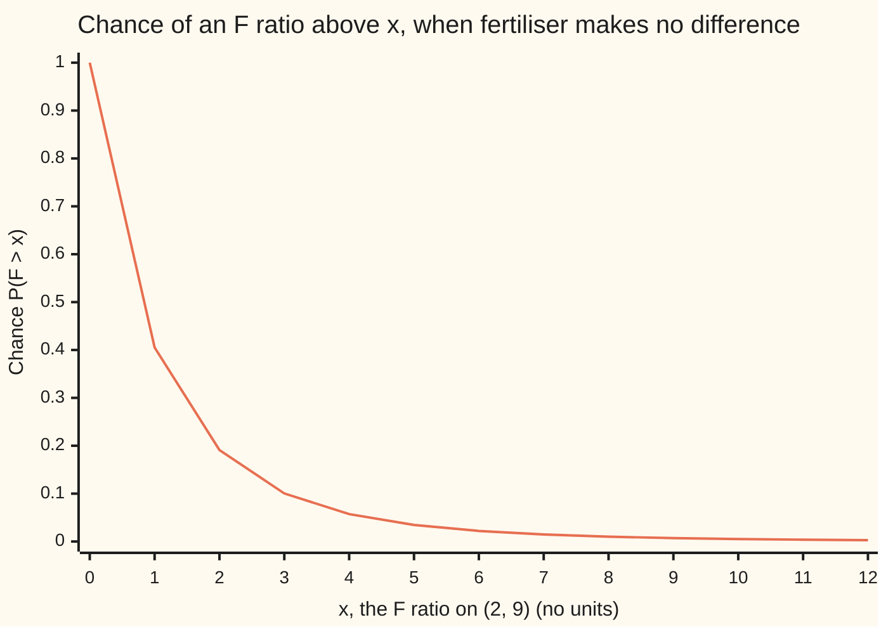

# Analysis of variance: comparing several means by splitting the spread

[Syllabus](../../../SYLLABUS.md) → [Probability and statistics](../README.md) → [Regression](../README.md#s09) → Analysis of variance

---

## General Overview

A farm trial tests three fertilisers. Each one goes on four plots, chosen at random from twelve. At harvest each plot's yield is weighed, in kilograms.

| Fertiliser | Plot 1 | Plot 2 | Plot 3 | Plot 4 | Average |
| --- | --- | --- | --- | --- | --- |
| A | 20 | 22 | 19 | 23 | 21 |
| B | 25 | 27 | 24 | 28 | 26 |
| C | 22 | 21 | 23 | 22 | 22 |

B looks best. But plots differ even under one fertiliser: A's plots run from 19 to 23. Is a gap of 5 kg between averages large, or is it the plot-to-plot wobble again?

A t-test compares two groups ([t-tests](../08-Confidence%20Intervals%20and%20Tests/05-t-tests-and-comparing-means.md)). Three groups would need three t-tests, and three tests raise three chances of a false alarm. **Analysis of variance** (ANOVA for short) asks one question instead: do the averages differ by more than the plots alone explain?

It answers by splitting the total spread of the twelve yields into two parts. One part is how far the group averages sit from the overall average. The other is how far each plot sits from its own group's average. Here the split is 78 = 56 + 22. Scaled fairly, the first part is 11.45 times the second. If the fertilisers made no difference, a ratio that large would turn up about 3 times in 1,000 trials (p = 0.003361).

**Split the total squared spread into a between-groups part and a within-groups part; each part, divided by its degrees of freedom, estimates the same plot noise when the groups truly share one mean, so their ratio F sits near 1 by chance and far above 1 when the means differ; the same ratio tests whether any set of predictors can be dropped from a linear model.**

**What kind of fact this is:** a theorem and a method. The split is exact algebra (Pythagoras for perpendicular pieces), proved in Why it works. The F law of the ratio is a theorem that needs normal, independent plots with one common spread; it is proved in a fold below from results on [The reference distributions](../07-Sampling%20and%20Estimation/03-chi-square-t-and-f-distributions.md). The test built on it is a method.

### The picture: one spread, cut in two

```
total spread     ███████████████████████████████████████  78
between groups   ████████████████████████████             56
within groups    ███████████                              22
```

Each bar is a sum of squared distances, in kg squared. The between part is most of the total: the averages differ by much more than plots within a group do.

---

## The formula

Notation first, in words.

- $`y_{gi}`$ is the yield of plot $`i`$ under fertiliser $`g`$.
- A bar means an average. $`\bar y_g`$ is group $`g`$'s average; $`\bar y`$, with no subscript, is the **grand mean**, the average of all twelve plots.
- There are $`k`$ groups of $`n_g`$ plots each, $`n`$ plots in all.
- A **sum of squares** (SS) adds up squared distances. A **mean square** (MS) is a sum of squares divided by its **degrees of freedom** (df): the number of independent directions the distances could take.

The split:

```math
\underbrace{\sum_{g}\sum_{i} (y_{gi} - \bar y)^2}_{\mathrm{SST}} = \underbrace{\sum_{g} n_g (\bar y_g - \bar y)^2}_{\mathrm{SSB}} + \underbrace{\sum_{g}\sum_{i} (y_{gi} - \bar y_g)^2}_{\mathrm{SSW}}
```

**Read it aloud:** the total squared spread round the grand mean equals the squared spread of the group averages, counted once per plot, plus the squared spread of plots round their own group's average.

The test statistic:

```math
F = \frac{\mathrm{MSB}}{\mathrm{MSW}} = \frac{\mathrm{SSB}/(k-1)}{\mathrm{SSW}/(n-k)} \sim F(k-1,\, n-k) \text{ when all group means are equal}
```

**Read it aloud:** divide each part by its degrees of freedom and take the ratio; if the fertilisers all have the same true mean, that ratio follows the F law with $`k - 1`$ and $`n - k`$ degrees of freedom.

The general form, for any linear model ([Multiple regression](03-multiple-regression-and-gauss-markov.md)): fit a full model with $`p`$ coefficients and a reduced model that drops $`q`$ of them. Write $`\mathrm{RSS}`$ for a fit's residual sum of squares, the squared misses added up.

```math
F = \frac{(\mathrm{RSS}_0 - \mathrm{RSS}_1)/q}{\mathrm{RSS}_1/(n-p)} \sim F(q,\, n-p) \text{ when the dropped coefficients are all zero}
```

**Read it aloud:** how much the misses grow when the $`q`$ columns are dropped, per column dropped, against the full model's misses per leftover degree of freedom.

One-way ANOVA is this test with the reduced model "one mean for everyone" and the full model "one mean per group".

| Symbol | Plain meaning | In our example | Push it up and the answer… |
| --- | --- | --- | --- |
| $`y_{gi}`$ | yield of plot $`i`$ under fertiliser $`g`$ | 19 to 28 kg | — |
| $`\bar y_g`$ | group $`g`$'s average | 21, 26, 22 kg | spread them apart: F rises |
| $`\bar y`$ | grand mean, all plots | 23 kg | — |
| $`k`$, $`n_g`$ or $`m`$, $`n`$ | groups; plots per group ($`m`$ when every group has the same number); plots in all | 3; 4; 12 | more plots: smaller p for the same gap |
| SSB | between-groups sum of squares | 56 on 2 df | F rises |
| SSW, $`S_g^2`$ | within-groups sum of squares; group $`g`$'s sample variance, its within piece over $`m - 1`$ | 22 on 9 df; within pieces 10, 10, 2, each over 3 | F falls |
| SST | total sum of squares round the grand mean | 78 on 11 df | — |
| $`F`$ | the ratio MSB / MSW of the mean squares (each SS over its df) | 28 / 2.4444 = 11.4545 | p-value falls |
| $`\sigma`$, $`\mu_g`$, $`\bar\mu`$, $`E[\cdot]`$ | true plot noise spread; group $`g`$'s true mean; their size-weighted average; the average over repeated trials | unknown; MSW = 2.4444 estimates $`\sigma^2`$ | bigger $`\sigma`$: F falls |
| $`F(\nu_1, \nu_2)`$, $`\chi^2_\nu`$ | the F law with $`\nu_1`$ (nu one) numerator and $`\nu_2`$ denominator degrees of freedom; the chi-square law on $`\nu`$ | $`F(2, 9)`$; 5 percent cutoff 4.2565 | — |
| $`\mathrm{RSS}_0`$, $`\mathrm{RSS}_1`$ | squared misses of the reduced and the full fit | 78 and 22 | a bigger gap: F rises |
| $`q`$, $`p`$ | coefficients dropped; coefficients in the full model | 2; 3 | — |

### When it holds

- **Independent plots.** If neighbouring plots share soil, they act like fewer plots. MSW then understates the noise, F comes out too big and false alarms rise.
- **One common spread in every group.** Here C's plots spread far less than A's or B's (within pieces 2 against 10 and 10). With 4 plots per group that is not alarming. With very unequal spreads and unequal group sizes, the real false-alarm rate can drift far from 5 percent. Welch's version of ANOVA drops this assumption and is then the safer test.
- **Normal plot noise, or enough plots.** The exact F law needs normal noise. A permutation test, which assumes only that the plots could have been dealt to fertilisers in any order, gives p = 0.002944 here against F's 0.003361: the normal assumption barely matters for these data.
- **Nested models only.** The general test compares a model with a smaller model inside it. Two models that each have a column the other lacks need another tool, such as [AIC and BIC](11-aic-and-bic.md).
- **Groups and comparisons fixed in advance.** Choosing which groups to compare after looking at the averages makes every p-value too small.

---

## Why it works

### Step 0: two estimates of one noise

Suppose the fertilisers make no difference. Then all twelve plots come from one population with one spread, $`\sigma`$ (sigma).

- Within a group, plots differ only by that noise. So SSW, divided by its 9 degrees of freedom, estimates $`\sigma^2`$.
- A group average of 4 plots has variance $`\sigma^2/4`$. So the three averages also scatter by noise alone, and 4 times their squared spread, divided by 2 degrees of freedom, estimates $`\sigma^2`$ too.

Two estimates of the same number have a ratio near 1. If the fertilisers do differ, the averages are pushed apart and only the between estimate grows. A large ratio is evidence of real differences.

### Step 1: the split is Pythagoras

Each plot's distance from the grand mean breaks into two steps: from the grand mean to its group average, then from the group average to the plot.

```math
y_{gi} - \bar y = (\bar y_g - \bar y) + (y_{gi} - \bar y_g)
```

Square and add over all twelve plots. The cross term is $`2\sum_g (\bar y_g - \bar y)\sum_i (y_{gi} - \bar y_g)`$. Inside each group the distances from the group's own average add to zero, so the cross term vanishes. What is left is SST = SSB + SSW.

In geometry this is Pythagoras ([Projection](../../03-Algebra/06-Dot%20Products%20and%20Best%20Fits/02-orthogonal-projection.md)). Write the twelve yields as one point in twelve directions. Replacing each plot by its group average is the projection (perpendicular shadow) onto the columns that mark each group. Replacing every plot by the grand mean is the projection onto the column of 1s alone. The two legs, fit-to-fit and fit-to-data, are perpendicular: the checks find their dot product below 1e-9.

On the data, A's plots sit −1, 1, −2, 2 from 21, so A's within piece is 1 + 1 + 4 + 4 = 10. The between pieces are 4 × (21 − 23)² = 16, 4 × 9 = 36 and 4 × 1 = 4, adding to 56.

### Step 2: what each mean square averages

Write $`\mu_g`$ (mu g) for group $`g`$'s true mean and $`\bar\mu`$ for their average, weighted by group size. Then, over repeated trials:

```math
E[\mathrm{MSW}] = \sigma^2, \qquad E[\mathrm{MSB}] = \sigma^2 + \frac{1}{k-1}\sum_g n_g(\mu_g - \bar\mu)^2
```

**Read it aloud:** the within mean square averages the plot noise, always; the between mean square averages the plot noise plus a term that is zero only when all true means are equal.

So F has a "no difference" value near 1 and is pushed up by any real difference. That is why the test uses only the upper tail.

<details>
<summary>Detailed proof: the F law under equal means, for equal group sizes</summary>

Assume the plots are independent and normal, all with spread $`\sigma`$, and all with the same true mean. Let each group hold $`m`$ plots.

**Within.** Write $`S_g^2`$ for group $`g`$'s sample variance: its within piece divided by $`m - 1`$. The reference distributions card proves that a normal sample's scaled variance $`(m-1)S_g^2/\sigma^2`$ is chi-square on $`m - 1`$ degrees of freedom and independent of that sample's average. Group $`g`$'s within piece is $`(m-1)S_g^2`$. The groups are independent, and independent chi-squares add their degrees of freedom. So:

$`\displaystyle \frac{\mathrm{SSW}}{\sigma^2} \sim \chi^2_{k(m-1)} = \chi^2_{n-k}`$

**Between.** The $`k`$ group averages are independent normals with spread $`\sigma/\sqrt m`$. They are a normal sample of size $`k`$, so the same result says their scaled variance is chi-square on $`k - 1`$:

$`\displaystyle \frac{\mathrm{SSB}}{\sigma^2} = \frac{m\sum_g (\bar y_g - \bar y)^2}{\sigma^2} = \frac{(k-1)\cdot(\text{variance of the averages})}{\sigma^2/m} \sim \chi^2_{k-1}`$

**Independent.** SSB is built from the group averages only. SSW is built from the within-group variances only. Each group's variance is independent of its own average, and the groups are independent of one another, so SSB and SSW are independent.

**The ratio.** Two independent chi-squares, each divided by its degrees of freedom, have an F ratio, by the reference card's definition. The $`\sigma^2`$ cancels:

$`\displaystyle F = \frac{\mathrm{SSB}/(k-1)}{\mathrm{SSW}/(n-k)} \sim F(k-1, n-k)`$

**The means.** Without the equal-means assumption, $`E[(y_{gi} - \bar y_g)^2]`$ summed in a group is $`(m-1)\sigma^2`$, giving $`E[\mathrm{MSW}] = \sigma^2`$. Each average $`\bar y_g`$ has mean $`\mu_g`$ and variance $`\sigma^2/m`$, so $`E[\sum_g(\bar y_g - \bar y)^2] = (k-1)\sigma^2/m + \sum_g(\mu_g - \bar\mu)^2`$. Multiplying by $`m/(k-1)`$ gives Step 2's formula.

Unequal group sizes need the projection form of the same argument: the noise splits into perpendicular pieces of 2 and 9 directions, each chi-square (Cochran's theorem, in Seber and Lee, below).

</details>

### Step 3: read the ratio against the F law

Here F = 28 / 2.4444 = 11.4545 on (2, 9). With 2 numerator degrees of freedom the F tail has a closed form:

```math
P(F > x) = \left(1 + \frac{2x}{\nu_2}\right)^{-\nu_2/2}, \qquad P(F > 11.4545) = \left(1 + \frac{2 \times 11.4545}{9}\right)^{-4.5} = 0.003361
```

The 5 percent cutoff on (2, 9) is 4.2565. The observed 11.4545 is far beyond it.



The line is the tail chance of the F law on (2, 9). It passes 0.05 at the cutoff, 4.2565. The trial's ratio, 11.4545, lies between 11 (0.0038) and 12 (0.0029), where the line is almost on the floor.

### Step 4: the same test drops predictors from a regression

Write the trial as a regression. The columns are a column of 1s, a column marking B's plots (1 for B, 0 otherwise) and one marking C's. Columns like these are **indicator columns**. Least squares on them fits each plot its group average, so $`\mathrm{RSS}_1`$ = 22. The reduced model keeps only the 1s, fits the grand mean, and leaves $`\mathrm{RSS}_0`$ = 78. Dropping $`q`$ = 2 columns from $`p`$ = 3:

```math
F = \frac{(78 - 22)/2}{22/(12 - 3)} = 11.4545
```

The same number, by a different road. The between sum of squares is exactly how much the misses grow when the group columns are dropped.

The test works for any predictors. On the shelf's twelve house sales ([Multiple regression](03-multiple-regression-and-gauss-markov.md)), price on area alone leaves squared misses of 5187.1012. Adding age and distance cuts them to 460.8341, with 4 coefficients. Do age and distance matter, together?

```math
F = \frac{(5187.1012 - 460.8341)/2}{460.8341/8} = 41.0236 \text{ on } (2, 8), \qquad p = 0.000062
```

Yes: dropping both would throw away real information. The proof is Step 1's argument with the group columns replaced by any columns: the full fit's misses are perpendicular to all its columns, so the extra misses and the full misses are perpendicular pieces of the noise ([Regression error bars](02-regression-inference.md) does the one-column case).

With two groups, F is the square of the pooled t ratio. A against B alone gives pooled t = 3.8730, and 3.8730² = 15.0000 = F on (1, 6). A two-sided t-test and a one-sided F test on one dropped column are the same test.

### Step 5: after the F test, which groups differ?

F says the three means are not all equal. It does not say which ones differ. The usual next step is a t-test for each pair, using MSW = 2.4444 as the shared noise estimate, on 9 degrees of freedom. With three pairs, multiply each p-value by 3, the **Bonferroni correction** ([Many tests](../08-Confidence%20Intervals%20and%20Tests/08-multiple-testing.md)):

| Pair | Gap, kg | t on 9 df | p | p times 3 |
| --- | --- | --- | --- | --- |
| B − A | 5.00 | 4.5227 | 0.001441 | 0.004324 |
| C − A | 1.00 | 0.9045 | 0.389283 | 1.000000 |
| B − C | 4.00 | 3.6181 | 0.005588 | 0.016764 |

B beats both A and C. A and C cannot be told apart.

Without the correction, three pairwise tests at 5 percent raise at least one false alarm 0.11334 of the time when no fertiliser does anything (simulated, ± 0.00100). That is why the single F test comes first.

---

## Worked numbers, by hand

| Step | Arithmetic | Value |
| --- | --- | --- |
| group averages | (20 + 22 + 19 + 23)/4, and so on | 21, 26, 22 |
| grand mean | (21 + 26 + 22)/3, equal groups | 23 |
| between pieces | 4 × (−2)², 4 × 3², 4 × (−1)² | 16, 36, 4 |
| SSB | 16 + 36 + 4 | 56 |
| within pieces | A: 1 + 1 + 4 + 4; B: the same; C: 0 + 1 + 1 + 0 | 10, 10, 2 |
| SSW | 10 + 10 + 2 | 22 |
| check | SSB + SSW against SST | 56 + 22 = 78 |
| mean squares | 56 / 2; 22 / 9 | 28 and 2.4444 |
| F | 28 / 2.4444 | 11.4545 |
| p-value | (1 + 2 × 11.4545 / 9)^(−4.5) | **0.003361** |

The ANOVA table, as software prints it:

| Source | SS | df | Mean square | F |
| --- | --- | --- | --- | --- |
| between | 56.00 | 2 | 28.0000 | 11.4545 |
| within | 22.00 | 9 | 2.4444 | |
| total | 78.00 | 11 | | |

If the fertilisers truly made no difference, a ratio this large would appear in about 3 trials in 1,000, so the trial is strong evidence that they differ.

### What breaks if you drop a piece

| Mistake | Comes out at | What went wrong |
| --- | --- | --- |
| Ratio of sums of squares, not mean squares | 56 / 22 = 2.5455, p 0.1330 | Ignores that 9 within directions are compared with only 2 between |
| Noise measured round the grand mean: SST over the same 9 df, 78 / 9 | F 3.2308, p 0.0876 | The denominator now contains the fertiliser effect it is meant to judge |
| F read on (9, 2) instead of (2, 9) | p 0.0828 | Numerator degrees of freedom come first |
| Three unadjusted pairwise t-tests instead of one F | false alarm 0.11334, not 0.05 | Three chances to be fooled, not one |

The code prints all four.

---

## Code, from first principles, and it actually runs

The F ratio comes by two roads that share no arithmetic. Road 1 adds the group sums of squares. Road 2 solves the least-squares normal equations for the full and the reduced model and takes the drop in squared misses. The tail chance comes three ways: the closed form for 2 numerator degrees of freedom, the beta series of the reference distributions card, and Simpson's rule (a numerical integration) on the F density. Road 3 counts all 34,650 ways to deal the twelve yields into three groups of four: 102 of them give a between sum of squares of 56 or more. Road 4 simulates 100,000 fields with no fertiliser effect, using a written-out SplitMix64 generator (seed 20261123) and the Box–Muller recipe, which turns two uniform draws into two normal ones. The same fields measure the false-alarm rate of three unadjusted pairwise tests. Each pairwise t, squared, is checked against the nested-model F for merging that pair's two groups into one. The last block runs the general test on the twelve house sales and prints the mistakes.

### Python

```python
# Analysis of variance and the F-test -- the check behind the card.  Standard library only.
# Three fertilisers, four plots each, yields in kg per plot.  Roads: group sums of squares;
# least squares on the full and reduced models; an exact permutation count; a seeded simulation.
from math import sqrt, log, cos, sin, atan, pi
Y = {"A": [20, 22, 19, 23], "B": [25, 27, 24, 28], "C": [22, 21, 23, 22]}
y = [float(v) for g in "ABC" for v in Y[g]]
n, k, grand = 12, 3, sum(y) / 12
def dot(u, v):
    s = 0.0
    for a, b in zip(u, v):
        s += a * b
    return s
def solve(M, rhs):                           # elimination; X^T X needs no pivoting
    m = len(M)
    A = [row[:] + [r] for row, r in zip(M, rhs)]
    for c in range(m):
        for i in range(c + 1, m):
            f = A[i][c] / A[c][c]
            for j in range(c, m + 1):
                A[i][j] -= f * A[c][j]
    x = [0.0] * m
    for c in range(m - 1, -1, -1):
        x[c] = (A[c][m] - dot(A[c][c + 1:m], x[c + 1:])) / A[c][c]
    return x
def rss(cols, v):                            # least squares: fitted values and squared misses
    b = solve([[dot(a, c) for c in cols] for a in cols], [dot(a, v) for a in cols])
    fit = [dot([c[i] for c in cols], b) for i in range(len(v))]
    return fit, sum((v[i] - fit[i]) ** 2 for i in range(len(v)))
def anova(groups):                           # between SS, within SS, F, group means
    allv = [v for g in groups for v in g]
    gm, ms = sum(allv) / len(allv), [sum(g) / len(g) for g in groups]
    ssb = sum(len(g) * (m - gm) ** 2 for g, m in zip(groups, ms))
    ssw = sum((v - m) ** 2 for g, m in zip(groups, ms) for v in g)
    return ssb, ssw, (ssb / (len(groups) - 1)) / (ssw / (len(allv) - len(groups))), ms
gh = lambda m: sqrt(pi) if m == 1 else 1.0 if m == 2 else (m / 2 - 1) * gh(m - 2)   # Gamma(m/2)
f_dens = lambda x, a, b: (gh(a + b) / (gh(a) * gh(b)) * (a / b) ** (a / 2) * x ** (a / 2 - 1) * (1 + a * x / b) ** (-(a + b) / 2))
def beta_cdf(z, a, b):                       # needs a whole-number b
    if b != int(b):
        return 1 - beta_cdf(1 - z, b, a)
    term = s = 1.0
    for j in range(1, int(b)):
        term *= (a + j - 1) / j * (1 - z)
        s += term
    return z ** a * s
def f_tail(x, a, b):                         # P(F > x) on (a, b), through the beta share
    return 1 - beta_cdf(a * x / (b + a * x), a / 2, b / 2)
def t_tail2(t, v):                           # P(|T| > t), odd v
    th = atan(t / sqrt(v))
    c, w, s = cos(th), 1.0, 0.0
    for j in range((v - 1) // 2):
        s += w * c ** (2 * j + 1)
        w *= (2 * j + 2) / (2 * j + 3)
    return 1 - 2 / pi * (th + sin(th) * s)
# Road 1: group means and the two sums of squares
ssb, ssw, F, ms = anova([Y[g] for g in "ABC"])
mean = dict(zip("ABC", ms))
sst, msb, msw = sum((v - grand) ** 2 for v in y), ssb / (k - 1), ssw / (n - k)
for g in "ABC":
    print(f"group {g}: mean {mean[g]:.2f}, between piece {4 * (mean[g] - grand) ** 2:.2f}, within piece {sum((v - mean[g]) ** 2 for v in Y[g]):.2f}")
print(f"{'source':<10}{'SS':>8}{'df':>5}{'mean square':>13}{'F':>9}")
print(f"{'between':<10}{ssb:>8.2f}{k - 1:>5}{msb:>13.4f}{F:>9.4f}")
print(f"{'within':<10}{ssw:>8.2f}{n - k:>5}{msw:>13.4f}")
print(f"{'total':<10}{sst:>8.2f}{n - 1:>5}   grand mean {grand:.2f}")
# Road 2: the same F as a nested-model test, from two least-squares fits
one, dB, dC = [1.0] * n, [1.0 * (4 <= i < 8) for i in range(n)], [1.0 * (i >= 8) for i in range(n)]
(fit_f, rss_f), (fit_r, rss_r) = rss([one, dB, dC], y), rss([one], y)
F2 = ((rss_r - rss_f) / 2) / (rss_f / (n - k))
cross = dot([a - b for a, b in zip(fit_f, fit_r)], [a - b for a, b in zip(y, fit_f)])
print(f"nested fits: RSS one mean {rss_r:.4f}, three means {rss_f:.4f}; F {F2:.4f}; fit-to-fit . miss below 1e-9: {'yes' if abs(cross) < 1e-9 else 'no'}")
# Tail chances three ways, and the 5 percent cutoff
p_closed, p_beta = (1 + 2 * F / 9) ** -4.5, f_tail(F, 2, 9)   # F(2, 9) has a closed-form tail
h = F / 20000                                # Simpson's rule on the density, 0 to F
p_simp = 1 - h / 3 * sum((1 if i in (0, 20000) else 4 if i % 2 else 2) * f_dens(i * h, 2, 9) for i in range(20001))
cut = 4.5 * (0.05 ** (-1 / 4.5) - 1)
print(f"P(F > {F:.4f}) on (2, 9): closed form {p_closed:.6f}; beta series {p_beta:.6f}; Simpson {p_simp:.6f}")
print(f"5 percent cutoff on (2, 9): {cut:.4f}; tail there {f_tail(cut, 2, 9):.4f}")
print("chart, tail on (2, 9) at x = 0..12: " + " ".join(f"{f_tail(x, 2, 9):.4f}" for x in range(13)))
# Road 3: exact permutation count over every way to deal the 12 yields into three plots of 4
obs, yi = sum(sum(Y[g]) ** 2 for g in "ABC"), [int(v) for v in y]
full, hits, total = (1 << n) - 1, 0, 0
for a in range(1 << n):
    rest = full & ~a
    s = rest if bin(a).count("1") == 4 else 0
    while s:
        if bin(s).count("1") == 4:
            sa, sb = (sum(yi[i] for i in range(n) if m >> i & 1) for m in (a, s))
            sc = sum(yi) - sa - sb
            total += 1
            hits += sa * sa + sb * sb + sc * sc >= obs
        s = (s - 1) & rest
print(f"permutation: {total} deals, {hits} with between SS at least 56; p {hits / total:.6f}")
# F = t^2 for two groups, then pairwise follow-up tests on the pooled spread
_, w_ab, F_ab, _ = anova([Y["A"], Y["B"]])
t_ab = (mean["B"] - mean["A"]) / sqrt(w_ab / 6 * 0.5)
print(f"A against B alone: pooled t {t_ab:.4f}, t squared {t_ab * t_ab:.4f}, F {F_ab:.4f}")
lo, hi = 1.0, 4.0
for _ in range(100):                         # t cutoff on 9 df, by bisection
    lo, hi = ((lo + hi) / 2, hi) if t_tail2((lo + hi) / 2, 9) > 0.05 else (lo, (lo + hi) / 2)
tcut = (lo + hi) / 2
for g, q, merged in [("B", "A", dC), ("C", "A", dB), ("B", "C", [b + c for b, c in zip(dB, dC)])]:
    t = (mean[g] - mean[q]) / sqrt(msw * 0.5)
    print(f"pair {g}-{q}: gap {mean[g] - mean[q]:.2f}, t {t:.4f} on 9, p {t_tail2(t, 9):.6f}, times 3 {min(1, 3 * t_tail2(t, 9)):.6f}")
    assert abs(t * t - (rss([one, merged], y)[1] - rss_f) / (rss_f / 9)) < 1e-9   # t squared = F for merging the pair
# Road 4: simulation under "no fertiliser effect", normal plots, SplitMix64 seed 20261123
MASK, state = (1 << 64) - 1, 20261123
def uniform():
    global state
    state = (state + 0x9E3779B97F4A7C15) & MASK
    z = ((state ^ (state >> 30)) * 0xBF58476D1CE4E5B9) & MASK
    z = ((z ^ (z >> 27)) * 0x94D049BB133111EB) & MASK
    return ((z ^ (z >> 31)) >> 11) / 2.0 ** 53
R, big, over, fam = 100000, 0, 0, 0
for _ in range(R):
    v = []
    for _ in range(6):                       # Box-Muller: two uniforms, two normals
        u1, u2 = 1.0 - uniform(), uniform()
        r = sqrt(-2 * log(u1))
        v += [r * cos(2 * pi * u2), r * sin(2 * pi * u2)]
    _, w, f, m = anova([v[0:4], v[4:8], v[8:12]])
    big, over = big + (f > F), over + (f > cut)
    fam += max(abs(m[0] - m[1]), abs(m[0] - m[2]), abs(m[1] - m[2])) / sqrt(w / 9 * 0.5) > tcut
se = lambda q: sqrt(q * (1 - q) / R)
print(f"simulated {R} null fields: F > {F:.4f} {big / R:.5f} ({se(big / R):.5f}); F > cutoff {over / R:.5f} ({se(over / R):.5f})")
print(f"t cutoff on 9 df {tcut:.4f}; three unadjusted pairwise tests, any false alarm {fam / R:.5f} ({se(fam / R):.5f})")
# The general test on the shelf's twelve house sales: drop age and distance, keep area
AREA = [62.0, 75, 80, 88, 95, 104, 110, 118, 125, 136, 148, 160]
AGE = [35.0, 12, 28, 5, 40, 18, 8, 30, 15, 22, 10, 3]
DIST = [0.5, 1.8, 0.6, 1.4, 0.9, 2.6, 1.0, 1.5, 3.0, 2.2, 2.4, 3.6]
PRICE = [124.0, 140, 172, 200, 180, 171, 260, 210, 226, 250, 301, 298]
r4, r2 = rss([one, AREA, AGE, DIST], PRICE)[1], rss([one, AREA], PRICE)[1]
Fh = ((r2 - r4) / 2) / (r4 / 8)
print(f"houses: RSS area only {r2:.4f}, area, age and distance {r4:.4f}; F {Fh:.4f} on (2, 8), p {f_tail(Fh, 2, 8):.6f}")
print(f"mistake, sums not mean squares: ratio {ssb / ssw:.4f}, p {f_tail(ssb / ssw, 2, 9):.4f}; F read on (9, 2): p {f_tail(F, 9, 2):.4f}")
print(f"mistake, spread measured round the grand mean: F {msb / (sst / 9):.4f}, p {f_tail(msb / (sst / 9), 2, 9):.4f}")
assert ssb == 56 and ssw == 22 and abs(sst - ssb - ssw) < 1e-9 and abs(cross) < 1e-9   # Pythagoras
assert abs(F2 - F) < 1e-9 and abs(rss_r - sst) < 1e-9 and abs(rss_f - ssw) < 1e-9 and abs(r4 - 460.8341) < 1e-4
assert abs(p_closed - p_beta) < 1e-12 and abs(p_simp - p_closed) < 1e-7 and abs(f_tail(Fh, 2, 8) - (1 + Fh / 4) ** -4) < 1e-12
assert abs(big / R - p_closed) < 4 * se(p_closed) and abs(over / R - 0.05) < 4 * se(0.05)
assert abs(t_ab * t_ab - F_ab) < 1e-9 and total == 34650 and abs(hits / total - p_closed) < 0.001 and fam / R > 0.07 and abs(tcut - 2.262157) < 1e-6
print("ALL CHECKS PASS")
```

**Ran 2026-11-23 on macOS, Python 3.14.10, standard library only. All checks passed. Output, pasted from the run:**

```
group A: mean 21.00, between piece 16.00, within piece 10.00
group B: mean 26.00, between piece 36.00, within piece 10.00
group C: mean 22.00, between piece 4.00, within piece 2.00
source          SS   df  mean square        F
between      56.00    2      28.0000  11.4545
within       22.00    9       2.4444
total        78.00   11   grand mean 23.00
nested fits: RSS one mean 78.0000, three means 22.0000; F 11.4545; fit-to-fit . miss below 1e-9: yes
P(F > 11.4545) on (2, 9): closed form 0.003361; beta series 0.003361; Simpson 0.003361
5 percent cutoff on (2, 9): 4.2565; tail there 0.0500
chart, tail on (2, 9) at x = 0..12: 1.0000 0.4053 0.1911 0.1004 0.0572 0.0346 0.0221 0.0147 0.0101 0.0071 0.0052 0.0038 0.0029
permutation: 34650 deals, 102 with between SS at least 56; p 0.002944
A against B alone: pooled t 3.8730, t squared 15.0000, F 15.0000
pair B-A: gap 5.00, t 4.5227 on 9, p 0.001441, times 3 0.004324
pair C-A: gap 1.00, t 0.9045 on 9, p 0.389283, times 3 1.000000
pair B-C: gap 4.00, t 3.6181 on 9, p 0.005588, times 3 0.016764
simulated 100000 null fields: F > 11.4545 0.00338 (0.00018); F > cutoff 0.04957 (0.00069)
t cutoff on 9 df 2.2622; three unadjusted pairwise tests, any false alarm 0.11334 (0.00100)
houses: RSS area only 5187.1012, area, age and distance 460.8341; F 41.0236 on (2, 8), p 0.000062
mistake, sums not mean squares: ratio 2.5455, p 0.1330; F read on (9, 2): p 0.0828
mistake, spread measured round the grand mean: F 3.2308, p 0.0876
ALL CHECKS PASS
```

### Rust

Same numbers, same labels, built with `rustc --edition 2021 -O`.

```rust
// Analysis of variance and the F-test -- the same check as the Python, in Rust.  No crates.
// Three fertilisers, four plots each, yields in kg per plot.  Roads: group sums of squares;
// least squares on the full and reduced models; an exact permutation count; a seeded simulation.
use std::f64::consts::PI;
fn dot(u: &[f64], v: &[f64]) -> f64 { u.iter().zip(v).fold(0.0, |s, (a, b)| s + a * b) }
fn solve(mut a: Vec<Vec<f64>>) -> Vec<f64> {   // elimination on [M | rhs]; X^T X needs no pivoting
    let m = a.len();
    for c in 0..m {
        for i in c + 1..m {
            let f = a[i][c] / a[c][c];
            for j in c..=m { let t = f * a[c][j]; a[i][j] -= t; }
        }
    }
    let mut x = vec![0.0; m];
    for c in (0..m).rev() { x[c] = (a[c][m] - dot(&a[c][c + 1..m], &x[c + 1..])) / a[c][c]; }
    x
}
fn rss(cols: &[Vec<f64>], v: &[f64]) -> (Vec<f64>, f64) {   // fitted values and squared misses
    let b = solve(cols.iter().map(|r| cols.iter().map(|c| dot(r, c)).chain([dot(r, v)]).collect()).collect());
    let fit: Vec<f64> = (0..v.len()).map(|i| dot(&cols.iter().map(|c| c[i]).collect::<Vec<f64>>(), &b)).collect();
    let s = (0..v.len()).fold(0.0, |s, i| s + (v[i] - fit[i]).powi(2));
    (fit, s)
}
fn anova(groups: &[&[f64]]) -> (f64, f64, f64, Vec<f64>) {   // between SS, within SS, F, means
    let (all, k) = (groups.concat(), groups.len());
    let (gm, cnt) = (all.iter().fold(0.0, |s, v| s + v) / all.len() as f64, all.len());
    let ms: Vec<f64> = groups.iter().map(|g| g.iter().fold(0.0, |s, v| s + v) / g.len() as f64).collect();
    let (mut ssb, mut ssw) = (0.0, 0.0);
    for (g, m) in groups.iter().zip(&ms) { ssb += g.len() as f64 * (m - gm).powi(2); }
    for (g, m) in groups.iter().zip(&ms) { for v in g.iter() { ssw += (v - m).powi(2); } }
    (ssb, ssw, (ssb / (k - 1) as f64) / (ssw / (cnt - k) as f64), ms)
}
fn gh(m: u32) -> f64 { if m == 1 { PI.sqrt() } else if m == 2 { 1.0 } else { (m as f64 / 2.0 - 1.0) * gh(m - 2) } }
fn f_dens(x: f64, a: u32, b: u32) -> f64 {
    let (af, bf) = (a as f64, b as f64);
    gh(a + b) / (gh(a) * gh(b)) * (af / bf).powf(af / 2.0) * x.powf(af / 2.0 - 1.0) * (1.0 + af * x / bf).powf(-(af + bf) / 2.0)
}
fn beta_cdf(z: f64, a: f64, b: f64) -> f64 {   // needs a whole-number b
    if b != b.trunc() { return 1.0 - beta_cdf(1.0 - z, b, a); }
    let (mut term, mut s) = (1.0, 1.0);
    for j in 1..b as i64 { term *= (a + j as f64 - 1.0) / j as f64 * (1.0 - z); s += term; }
    z.powf(a) * s
}
fn f_tail(x: f64, a: f64, b: f64) -> f64 { 1.0 - beta_cdf(a * x / (b + a * x), a / 2.0, b / 2.0) }
fn t_tail2(t: f64, v: u32) -> f64 {           // P(|T| > t), odd v
    let th = (t / (v as f64).sqrt()).atan();
    let (c, mut w, mut s) = (th.cos(), 1.0, 0.0);
    for j in 0..(v - 1) / 2 { s += w * c.powi(2 * j as i32 + 1); w *= (2 * j + 2) as f64 / (2 * j + 3) as f64; }
    1.0 - 2.0 / PI * (th + th.sin() * s)
}
struct Rng(u64);
impl Rng {
    fn uniform(&mut self) -> f64 {            // SplitMix64
        self.0 = self.0.wrapping_add(0x9E3779B97F4A7C15);
        let mut z = (self.0 ^ (self.0 >> 30)).wrapping_mul(0xBF58476D1CE4E5B9);
        z = (z ^ (z >> 27)).wrapping_mul(0x94D049BB133111EB);
        ((z ^ (z >> 31)) >> 11) as f64 / 2f64.powi(53)
    }
}
fn main() {
    let ya = [20.0, 22.0, 19.0, 23.0]; let yb = [25.0, 27.0, 24.0, 28.0]; let yc = [22.0, 21.0, 23.0, 22.0];
    let y: Vec<f64> = ya.iter().chain(&yb).chain(&yc).cloned().collect();
    let (n, k) = (12usize, 3usize);
    let grand = y.iter().fold(0.0, |s, v| s + v) / 12.0;
    // Road 1: group means and the two sums of squares
    let (ssb, ssw, f, ms) = anova(&[&ya, &yb, &yc]);
    let mut sst = 0.0;
    for v in &y { sst += (v - grand).powi(2); }
    let (msb, msw) = (ssb / (k - 1) as f64, ssw / (n - k) as f64);
    for (j, g) in [ya, yb, yc].iter().enumerate() {
        let wp = g.iter().fold(0.0, |s, v| s + (v - ms[j]).powi(2));
        println!("group {}: mean {:.2}, between piece {:.2}, within piece {:.2}", ["A", "B", "C"][j], ms[j], 4.0 * (ms[j] - grand).powi(2), wp);
    }
    println!("{:<10}{:>8}{:>5}{:>13}{:>9}", "source", "SS", "df", "mean square", "F");
    println!("{:<10}{:>8.2}{:>5}{:>13.4}{:>9.4}", "between", ssb, k - 1, msb, f);
    println!("{:<10}{:>8.2}{:>5}{:>13.4}", "within", ssw, n - k, msw);
    println!("{:<10}{:>8.2}{:>5}   grand mean {:.2}", "total", sst, n - 1, grand);
    // Road 2: the same F as a nested-model test, from two least-squares fits
    let one = vec![1.0; n];
    let db: Vec<f64> = (0..n).map(|i| if (4..8).contains(&i) { 1.0 } else { 0.0 }).collect();
    let dc: Vec<f64> = (0..n).map(|i| if i >= 8 { 1.0 } else { 0.0 }).collect();
    let (fit_f, rss_f) = rss(&[one.clone(), db.clone(), dc.clone()], &y);
    let (fit_r, rss_r) = rss(&[one.clone()], &y);
    let f2 = ((rss_r - rss_f) / 2.0) / (rss_f / (n - k) as f64);
    let cross = dot(&(0..n).map(|i| fit_f[i] - fit_r[i]).collect::<Vec<f64>>(), &(0..n).map(|i| y[i] - fit_f[i]).collect::<Vec<f64>>());
    println!("nested fits: RSS one mean {:.4}, three means {:.4}; F {:.4}; fit-to-fit . miss below 1e-9: {}", rss_r, rss_f, f2, if cross.abs() < 1e-9 { "yes" } else { "no" });
    // Tail chances three ways, and the 5 percent cutoff
    let (p_closed, p_beta) = ((1.0 + 2.0 * f / 9.0).powf(-4.5), f_tail(f, 2.0, 9.0));
    let h = f / 20000.0;                       // Simpson's rule on the density, 0 to F
    let mut acc = 0.0;
    for i in 0..=20000 { acc += (if i == 0 || i == 20000 { 1.0 } else if i % 2 == 1 { 4.0 } else { 2.0 }) * f_dens(i as f64 * h, 2, 9); }
    let p_simp = 1.0 - h / 3.0 * acc;
    let cut = 4.5 * (0.05f64.powf(-1.0 / 4.5) - 1.0);
    println!("P(F > {:.4}) on (2, 9): closed form {:.6}; beta series {:.6}; Simpson {:.6}", f, p_closed, p_beta, p_simp);
    println!("5 percent cutoff on (2, 9): {:.4}; tail there {:.4}", cut, f_tail(cut, 2.0, 9.0));
    let chart: Vec<String> = (0..13).map(|x| format!("{:.4}", f_tail(x as f64, 2.0, 9.0))).collect();
    println!("chart, tail on (2, 9) at x = 0..12: {}", chart.join(" "));
    // Road 3: exact permutation count over every way to deal the 12 yields into three plots of 4
    let yi: Vec<i64> = y.iter().map(|v| *v as i64).collect();
    let all: i64 = yi.iter().sum();
    let obs: i64 = [0, 4, 8].iter().map(|&j| yi[j..j + 4].iter().sum::<i64>().pow(2)).sum();
    let (full, mut hits, mut total) = ((1u32 << n) - 1, 0u32, 0u32);
    for a in 0..(1u32 << n) {
        let rest = full & !a;
        let mut s = if a.count_ones() == 4 { rest } else { 0 };
        while s != 0 {
            if s.count_ones() == 4 {
                let sum = |m: u32| (0..n).filter(|i| m >> i & 1 == 1).map(|i| yi[i]).sum::<i64>();
                let (sa, sb) = (sum(a), sum(s));
                let sc = all - sa - sb;
                total += 1;
                if sa * sa + sb * sb + sc * sc >= obs { hits += 1; }
            }
            s = (s - 1) & rest;
        }
    }
    println!("permutation: {} deals, {} with between SS at least 56; p {:.6}", total, hits, hits as f64 / total as f64);
    // F = t^2 for two groups, then pairwise follow-up tests on the pooled spread
    let (_, w_ab, f_ab, _) = anova(&[&ya, &yb]);
    let t_ab = (ms[1] - ms[0]) / (w_ab / 6.0 * 0.5).sqrt();
    println!("A against B alone: pooled t {:.4}, t squared {:.4}, F {:.4}", t_ab, t_ab * t_ab, f_ab);
    let (mut lo, mut hi) = (1.0, 4.0);
    for _ in 0..100 { let mid = (lo + hi) / 2.0; if t_tail2(mid, 9) > 0.05 { lo = mid } else { hi = mid } }   // t cutoff, 9 df
    let tcut = (lo + hi) / 2.0;
    let bc: Vec<f64> = (0..n).map(|i| db[i] + dc[i]).collect();
    for (g, q, name, merged) in [(1, 0, "B-A", &dc), (2, 0, "C-A", &db), (1, 2, "B-C", &bc)] {
        let t = (ms[g] - ms[q]) / (msw * 0.5).sqrt();
        let p = t_tail2(t, 9);
        println!("pair {}: gap {:.2}, t {:.4} on 9, p {:.6}, times 3 {:.6}", name, ms[g] - ms[q], t, p, (3.0 * p).min(1.0));
        assert!((t * t - (rss(&[one.clone(), merged.clone()], &y).1 - rss_f) / (rss_f / 9.0)).abs() < 1e-9);   // t squared = F for merging the pair
    }
    // Road 4: simulation under "no fertiliser effect", normal plots, SplitMix64 seed 20261123
    let mut rng = Rng(20261123);
    let r_n = 100000u32;
    let (mut big, mut over, mut fam) = (0u32, 0u32, 0u32);
    for _ in 0..r_n {
        let mut v = Vec::with_capacity(12);
        for _ in 0..6 {                        // Box-Muller: two uniforms, two normals
            let (u1, u2) = (1.0 - rng.uniform(), rng.uniform());
            let r = (-2.0 * u1.ln()).sqrt();
            v.extend([r * (2.0 * PI * u2).cos(), r * (2.0 * PI * u2).sin()]);
        }
        let (_, w, fs, m) = anova(&[&v[0..4], &v[4..8], &v[8..12]]);
        big += (fs > f) as u32; over += (fs > cut) as u32;
        let gap = (m[0] - m[1]).abs().max((m[0] - m[2]).abs()).max((m[1] - m[2]).abs());
        if gap / (w / 9.0 * 0.5).sqrt() > tcut { fam += 1; }
    }
    let rf = r_n as f64;
    let se = |q: f64| (q * (1.0 - q) / rf).sqrt();
    let (pb, po, pf) = (big as f64 / rf, over as f64 / rf, fam as f64 / rf);
    println!("simulated {} null fields: F > {:.4} {:.5} ({:.5}); F > cutoff {:.5} ({:.5})", r_n, f, pb, se(pb), po, se(po));
    println!("t cutoff on 9 df {:.4}; three unadjusted pairwise tests, any false alarm {:.5} ({:.5})", tcut, pf, se(pf));
    // The general test on the shelf's twelve house sales: drop age and distance, keep area
    let area = vec![62.0, 75.0, 80.0, 88.0, 95.0, 104.0, 110.0, 118.0, 125.0, 136.0, 148.0, 160.0];
    let age = vec![35.0, 12.0, 28.0, 5.0, 40.0, 18.0, 8.0, 30.0, 15.0, 22.0, 10.0, 3.0];
    let dist = vec![0.5, 1.8, 0.6, 1.4, 0.9, 2.6, 1.0, 1.5, 3.0, 2.2, 2.4, 3.6];
    let price = [124.0, 140.0, 172.0, 200.0, 180.0, 171.0, 260.0, 210.0, 226.0, 250.0, 301.0, 298.0];
    let r4 = rss(&[one.clone(), area.clone(), age, dist], &price).1;
    let r2 = rss(&[one.clone(), area], &price).1;
    let fh = ((r2 - r4) / 2.0) / (r4 / 8.0);
    println!("houses: RSS area only {:.4}, area, age and distance {:.4}; F {:.4} on (2, 8), p {:.6}", r2, r4, fh, f_tail(fh, 2.0, 8.0));
    println!("mistake, sums not mean squares: ratio {:.4}, p {:.4}; F read on (9, 2): p {:.4}", ssb / ssw, f_tail(ssb / ssw, 2.0, 9.0), f_tail(f, 9.0, 2.0));
    println!("mistake, spread measured round the grand mean: F {:.4}, p {:.4}", msb / (sst / 9.0), f_tail(msb / (sst / 9.0), 2.0, 9.0));
    assert!(ssb == 56.0 && ssw == 22.0 && (sst - ssb - ssw).abs() < 1e-9 && cross.abs() < 1e-9);   // Pythagoras
    assert!((f2 - f).abs() < 1e-9 && (rss_r - sst).abs() < 1e-9 && (rss_f - ssw).abs() < 1e-9 && (r4 - 460.8341).abs() < 1e-4);
    assert!((p_closed - p_beta).abs() < 1e-12 && (p_simp - p_closed).abs() < 1e-7 && (f_tail(fh, 2.0, 8.0) - (1.0 + fh / 4.0).powf(-4.0)).abs() < 1e-12);
    assert!((pb - p_closed).abs() < 4.0 * se(p_closed) && (po - 0.05).abs() < 4.0 * se(0.05));
    assert!((t_ab * t_ab - f_ab).abs() < 1e-9 && total == 34650 && (hits as f64 / total as f64 - p_closed).abs() < 0.001 && pf > 0.07 && (tcut - 2.262157).abs() < 1e-6);
    println!("ALL CHECKS PASS");
}
```

**Ran 2026-11-23 on macOS, rustc 1.98.1, no crates. All checks passed. Output, pasted from the run:**

```
group A: mean 21.00, between piece 16.00, within piece 10.00
group B: mean 26.00, between piece 36.00, within piece 10.00
group C: mean 22.00, between piece 4.00, within piece 2.00
source          SS   df  mean square        F
between      56.00    2      28.0000  11.4545
within       22.00    9       2.4444
total        78.00   11   grand mean 23.00
nested fits: RSS one mean 78.0000, three means 22.0000; F 11.4545; fit-to-fit . miss below 1e-9: yes
P(F > 11.4545) on (2, 9): closed form 0.003361; beta series 0.003361; Simpson 0.003361
5 percent cutoff on (2, 9): 4.2565; tail there 0.0500
chart, tail on (2, 9) at x = 0..12: 1.0000 0.4053 0.1911 0.1004 0.0572 0.0346 0.0221 0.0147 0.0101 0.0071 0.0052 0.0038 0.0029
permutation: 34650 deals, 102 with between SS at least 56; p 0.002944
A against B alone: pooled t 3.8730, t squared 15.0000, F 15.0000
pair B-A: gap 5.00, t 4.5227 on 9, p 0.001441, times 3 0.004324
pair C-A: gap 1.00, t 0.9045 on 9, p 0.389283, times 3 1.000000
pair B-C: gap 4.00, t 3.6181 on 9, p 0.005588, times 3 0.016764
simulated 100000 null fields: F > 11.4545 0.00338 (0.00018); F > cutoff 0.04957 (0.00069)
t cutoff on 9 df 2.2622; three unadjusted pairwise tests, any false alarm 0.11334 (0.00100)
houses: RSS area only 5187.1012, area, age and distance 460.8341; F 41.0236 on (2, 8), p 0.000062
mistake, sums not mean squares: ratio 2.5455, p 0.1330; F read on (9, 2): p 0.0828
mistake, spread measured round the grand mean: F 3.2308, p 0.0876
ALL CHECKS PASS
```

The two outputs match line for line, the simulation included, because both draw the same SplitMix64 numbers.

### Lean

Lean proves the card's exact identities for any yields, groups and group sizes, and checks the trial's sums.

- Take any yields in any number of groups. Then $`\mathrm{SST} = \mathrm{SSB} + \mathrm{SSW}`$, the split of Step 1.
- Take any fit with one constant per group. Then its squared misses are at least SSW, and the group averages give exactly SSW.
- Take any fit with one constant for all plots. Then its squared misses are at least SST, and the grand mean gives exactly SST.
- Take $`k`$ groups and those two fits. Then F is the general test with $`\mathrm{RSS}_0`$ = SST, $`\mathrm{RSS}_1`$ = SSW, $`q = k - 1`$ and $`p = k`$.
- Take two groups, each with at least one plot. Then F on $`(1, n - 2)`$ is the square of the pooled t ratio.
- The trial's sums hold exactly: averages 21, 26 and 22, grand mean 23, SSB 56, SSW 22 and SST 78.
- F comes out at exactly 126/11, about 11.4545.
- The hand arithmetic for A against B alone, $`5^2/((20/6)(1/4 + 1/4))`$, gives exactly 15.

The F law, the mean-square averages, p-values, permutation count, simulations, pairwise tests and house sales are left to the Python and Rust checks.

```lean
-- Analysis of variance: the total sum of squares round the grand mean splits exactly into the between-groups and within-groups sums of squares, these are the misses of the one-mean and one-mean-per-group least-squares fits, and with two groups the F ratio is the square of the pooled t ratio.
import Mathlib.Algebra.BigOperators.Fin
import Mathlib.Algebra.Order.BigOperators.Group.Finset
import Mathlib.Analysis.Real.Sqrt
import Mathlib.Order.Bounds.Defs
import Mathlib.Tactic.NormNum
import Mathlib.Tactic.FinCases

/-! Notation as on the card. There are `k` groups, indexed by a finite type `G`; group `g` has
`n g` plots, and `y g i` is the yield of plot `i` under fertiliser `g`. A bar is an average:
`ȳ_g` is group `g`'s average and `ȳ` the grand mean of all plots. `SST`, `SSB` and `SSW` are the
total, between-groups and within-groups sums of squares. The F ratio is
`(SSB / (k − 1)) / (SSW / (n − k))`, with `n` the number of plots in all. The F law of this ratio
under equal true means needs a distribution Mathlib does not have, so it is not stated here. -/

open Finset

noncomputable section

namespace OneWayANOVA

variable {G : Type*} [Fintype G] {n : G → ℕ}

/-- `n`, the number of plots in all: `∑ n_g`, as a real number. -/
def plots (n : G → ℕ) : ℝ := ∑ g, (n g : ℝ)

/-- Group `g`'s average, `ȳ_g = (∑ᵢ y_{gi}) / n_g`. -/
def groupMean (y : (g : G) → Fin (n g) → ℝ) (g : G) : ℝ := (∑ i, y g i) / n g

/-- The grand mean, `ȳ = (∑_g ∑ᵢ y_{gi}) / n`, the average of all plots. -/
def grandMean (y : (g : G) → Fin (n g) → ℝ) : ℝ := (∑ g, ∑ i, y g i) / plots n

/-- `SST = ∑_g ∑ᵢ (y_{gi} − ȳ)²`, the total squared spread round the grand mean. -/
def SST (y : (g : G) → Fin (n g) → ℝ) : ℝ := ∑ g, ∑ i, (y g i - grandMean y) ^ 2

/-- `SSB = ∑_g n_g (ȳ_g − ȳ)²`, the squared spread of the group averages, once per plot. -/
def SSB (y : (g : G) → Fin (n g) → ℝ) : ℝ := ∑ g, (n g : ℝ) * (groupMean y g - grandMean y) ^ 2

/-- `SSW = ∑_g ∑ᵢ (y_{gi} − ȳ_g)²`, the squared spread of plots round their own group's average. -/
def SSW (y : (g : G) → Fin (n g) → ℝ) : ℝ := ∑ g, ∑ i, (y g i - groupMean y g) ^ 2

/-- The F ratio `MSB / MSW = (SSB / (k − 1)) / (SSW / (n − k))`, with `k` groups. -/
def Fstat (y : (g : G) → Fin (n g) → ℝ) : ℝ :=
  (SSB y / ((Fintype.card G : ℝ) - 1)) / (SSW y / (plots n - Fintype.card G))

/-- The pooled t ratio for two groups, `0` and `1`:
`(ȳ₁ − ȳ₀) / √(s_p² (1/n₀ + 1/n₁))`, where `s_p² = SSW / (n − 2)` is the pooled spread. -/
def pooledT {m : Fin 2 → ℕ} (y : (g : Fin 2) → Fin (m g) → ℝ) : ℝ :=
  (groupMean y 1 - groupMean y 0) /
    Real.sqrt (SSW y / (plots m - 2) * (1 / (m 0 : ℝ) + 1 / (m 1 : ℝ)))

/-- Expanding a sum of squared misses from a constant `c`. -/
lemma expand_sq {ι : Type*} (s : Finset ι) (f : ι → ℝ) (c : ℝ) :
    ∑ i ∈ s, (f i - c) ^ 2 = ∑ i ∈ s, f i ^ 2 - 2 * c * ∑ i ∈ s, f i + (s.card : ℝ) * c ^ 2 := by
  simp only [sub_sq, sum_add_distrib, sum_sub_distrib, sum_const, nsmul_eq_mul, mul_sum]
  congr 1; congr 1; apply sum_congr rfl; intro i _; ring

/-- Squared misses from any constant `c` = squared misses from the average + `card · (avg − c)²`. -/
lemma split_sq {ι : Type*} (s : Finset ι) (f : ι → ℝ) (c : ℝ) :
    ∑ i ∈ s, (f i - c) ^ 2 = ∑ i ∈ s, (f i - (∑ j ∈ s, f j) / s.card) ^ 2
      + (s.card : ℝ) * ((∑ j ∈ s, f j) / s.card - c) ^ 2 := by
  rw [expand_sq, expand_sq]
  rcases Nat.eq_zero_or_pos s.card with h | h
  · have : s = ∅ := Finset.card_eq_zero.mp h
    subst this; simp
  · have : (s.card : ℝ) ≠ 0 := by positivity
    field_simp; ring

omit [Fintype G] in
/-- Within one group, squared misses from `c` split round the group average. -/
lemma group_split (y : (g : G) → Fin (n g) → ℝ) (g : G) (c : ℝ) :
    ∑ i, (y g i - c) ^ 2 = ∑ i, (y g i - groupMean y g) ^ 2 + (n g : ℝ) * (groupMean y g - c) ^ 2 := by
  have h := split_sq (univ : Finset (Fin (n g))) (y g) c
  simpa [groupMean, Finset.card_univ, Fintype.card_fin] using h

/-- Over all plots, squared misses from `c` split round the grand mean. -/
lemma grand_split (y : (g : G) → Fin (n g) → ℝ) (c : ℝ) :
    ∑ g, ∑ i, (y g i - c) ^ 2 = SST y + plots n * (grandMean y - c) ^ 2 := by
  have hs : ∀ f : (g : G) → Fin (n g) → ℝ, ∑ g, ∑ i, f g i =
      ∑ x ∈ (univ : Finset G).sigma (fun g => (univ : Finset (Fin (n g)))), f x.1 x.2 := fun f => by
    rw [Finset.sum_sigma]
  have hc : plots n = (((univ : Finset G).sigma (fun g => (univ : Finset (Fin (n g))))).card : ℝ) := by
    simp [plots]
  have h := split_sq ((univ : Finset G).sigma (fun g => (univ : Finset (Fin (n g)))))
    (fun x => y x.1 x.2) c
  rw [SST, grandMean, hs, hs, hs (fun g i => y g i), hc]
  exact h

#print axioms expand_sq
#print axioms split_sq
#print axioms group_split
#print axioms grand_split

/-- **The split is Pythagoras.** For any yields in any number of groups, the total squared
spread round the grand mean equals the squared spread of the group averages, counted once per
plot, plus the squared spread of plots round their own group's average:
`SST = SSB + SSW`. -/
theorem total_ss_eq_between_ss_add_within_ss (y : (g : G) → Fin (n g) → ℝ) :
    SST y = SSB y + SSW y := by
  rw [SST, SSB, SSW, ← sum_add_distrib]
  refine sum_congr rfl fun g _ => ?_
  rw [group_split y g (grandMean y), add_comm]

/-- **One-way ANOVA is the nested-model test.** Fitting one constant per group by least squares
leaves squared misses `RSS₁ = SSW` (the smallest possible, reached at the group averages);
fitting one constant for everyone leaves `RSS₀ = SST` (reached at the grand mean). So the F ratio
is the general test `((RSS₀ − RSS₁) / q) / (RSS₁ / (n − p))` with `p = k` coefficients in the
full model and `q = k − 1` dropped. -/
theorem anova_F_eq_nested_model_F (y : (g : G) → Fin (n g) → ℝ) :
    IsLeast {r | ∃ c : G → ℝ, r = ∑ g, ∑ i, (y g i - c g) ^ 2} (SSW y) ∧
      IsLeast {r | ∃ c : ℝ, r = ∑ g, ∑ i, (y g i - c) ^ 2} (SST y) ∧
      Fstat y = ((SST y - SSW y) / ((Fintype.card G : ℝ) - 1)) /
        (SSW y / (plots n - Fintype.card G)) := by
  refine ⟨⟨⟨groupMean y, rfl⟩, ?_⟩, ⟨⟨grandMean y, rfl⟩, ?_⟩, ?_⟩
  · rintro r ⟨c, rfl⟩
    rw [SSW]
    refine sum_le_sum fun g _ => ?_
    rw [group_split y g (c g)]
    have : 0 ≤ (n g : ℝ) * (groupMean y g - c g) ^ 2 := by positivity
    linarith
  · rintro r ⟨c, rfl⟩
    rw [grand_split y c]
    have : 0 ≤ plots n * (grandMean y - c) ^ 2 :=
      mul_nonneg (sum_nonneg fun g _ => Nat.cast_nonneg _) (sq_nonneg _)
    linarith
  · rw [Fstat, total_ss_eq_between_ss_add_within_ss]
    ring

/-- **With two groups, F is the pooled t ratio squared.** If both groups have at least one plot,
the F ratio on `(1, n − 2)` equals the square of the pooled two-sample t ratio. -/
theorem two_group_F_eq_pooled_t_sq {m : Fin 2 → ℕ} (y : (g : Fin 2) → Fin (m g) → ℝ)
    (h0 : 0 < m 0) (h1 : 0 < m 1) :
    Fstat y = pooledT y ^ 2 := by
  have hm0 : (1 : ℝ) ≤ m 0 := by exact_mod_cast h0
  have hm1 : (1 : ℝ) ≤ m 1 := by exact_mod_cast h1
  have hp : plots m = (m 0 : ℝ) + m 1 := by simp [plots, Fin.sum_univ_two]
  have hW : 0 ≤ SSW y := by
    exact sum_nonneg fun g _ => sum_nonneg fun i _ => sq_nonneg _
  have hm0' : (0 : ℝ) < m 0 := by linarith
  have hm1' : (0 : ℝ) < m 1 := by linarith
  have hnn : 0 ≤ SSW y / (plots m - 2) * (1 / (m 0 : ℝ) + 1 / (m 1 : ℝ)) := by
    rw [hp]
    have : 0 ≤ (m 0 : ℝ) + m 1 - 2 := by linarith
    positivity
  have hB : SSB y = (groupMean y 1 - groupMean y 0) ^ 2 / (1 / (m 0 : ℝ) + 1 / (m 1 : ℝ)) := by
    have hg : grandMean y = (m 0 * groupMean y 0 + m 1 * groupMean y 1) / ((m 0 : ℝ) + m 1) := by
      have e0 : (m 0 : ℝ) * groupMean y 0 = ∑ i, y 0 i := by
        unfold groupMean; field_simp
      have e1 : (m 1 : ℝ) * groupMean y 1 = ∑ i, y 1 i := by
        unfold groupMean; field_simp
      rw [grandMean, hp, Fin.sum_univ_two, e0, e1]
    rw [SSB, Fin.sum_univ_two, hg]
    have : (m 0 : ℝ) ≠ 0 := by positivity
    have : (m 1 : ℝ) ≠ 0 := by positivity
    have : (m 0 : ℝ) + m 1 ≠ 0 := by positivity
    field_simp
    ring
  rw [pooledT, div_pow, Real.sq_sqrt hnn, Fstat, hB]
  simp only [Fintype.card_fin]
  norm_num
  rw [div_div, mul_comm]

/-! The card's trial: three fertilisers, four plots each, yields in kilograms.
A: 20, 22, 19, 23; B: 25, 27, 24, 28; C: 22, 21, 23, 22. -/

/-- The card's yields, group `0` = A, `1` = B, `2` = C. -/
def trial : (g : Fin 3) → Fin ((fun _ => 4) g) → ℝ :=
  ![![20, 22, 19, 23], ![25, 27, 24, 28], ![22, 21, 23, 22]]

-- Group averages 21, 26, 22 and grand mean 23.
example : groupMean trial 0 = 21 ∧ groupMean trial 1 = 26 ∧ groupMean trial 2 = 22 := by
  simp [groupMean, trial, Fin.sum_univ_succ]
  norm_num
example : grandMean trial = 23 := by
  simp [grandMean, plots, trial, Fin.sum_univ_succ]
  norm_num
-- SSB = 56, SSW = 22, SST = 78 = 56 + 22.
example : SSB trial = 56 := by
  simp [SSB, groupMean, grandMean, plots, trial, Fin.sum_univ_succ]
  norm_num
example : SSW trial = 22 := by
  simp [SSW, groupMean, trial, Fin.sum_univ_succ]
  norm_num
example : SST trial = 78 := by
  simp [SST, grandMean, plots, trial, Fin.sum_univ_succ]
  norm_num
-- F = 28 / (22 / 9) = 126 / 11, about 11.4545.
example : Fstat trial = 126 / 11 := by
  simp [Fstat, SSB, SSW, groupMean, grandMean, plots, trial, Fin.sum_univ_succ]
  norm_num
-- The hand arithmetic, in whole numbers: between pieces 16, 36, 4; within pieces 10, 10, 2.
example : 4 * (21 - 23) ^ 2 + 4 * (26 - 23) ^ 2 + 4 * (22 - 23) ^ 2 = (56 : ℤ) := by norm_num
example : ((1 + 1 + 4 + 4) + (1 + 1 + 4 + 4) + (0 + 1 + 1 + 0) : ℤ) = 22 := by norm_num
example : (56 : ℤ) + 22 = 78 := by norm_num
-- A against B alone: pooled t² = F = 15.
example : (5 : ℚ) ^ 2 / ((20 / 6) * (1 / 4 + 1 / 4)) = 15 := by norm_num

#print axioms total_ss_eq_between_ss_add_within_ss
#print axioms anova_F_eq_nested_model_F
#print axioms two_group_F_eq_pooled_t_sq

end OneWayANOVA
```

**Checked 2026-11-23 on macOS, Lean 4.36.0-rc2, Mathlib v4.36.0-rc2. Every proof is complete and uses only Lean's standard axioms. Output, pasted from the run:**

```
'OneWayANOVA.expand_sq' depends on axioms: [propext, Classical.choice, Quot.sound]
'OneWayANOVA.split_sq' depends on axioms: [propext, Classical.choice, Quot.sound]
'OneWayANOVA.group_split' depends on axioms: [propext, Classical.choice, Quot.sound]
'OneWayANOVA.grand_split' depends on axioms: [propext, Classical.choice, Quot.sound]
'OneWayANOVA.total_ss_eq_between_ss_add_within_ss' depends on axioms: [propext, Classical.choice, Quot.sound]
'OneWayANOVA.anova_F_eq_nested_model_F' depends on axioms: [propext, Classical.choice, Quot.sound]
'OneWayANOVA.two_group_F_eq_pooled_t_sq' depends on axioms: [propext, Classical.choice, Quot.sound]
```

> [!TIP]
> **Try changing**
> Guess first, then run it. The asserts are pinned to the trial's numbers, so some changes stop the run after the printing.
> - **Add 10 kg to every plot.** Guess: nothing in the test changes, because every distance is unchanged. Every line prints as before except the group averages and the grand mean, and all checks pass.
> - **Double the plot noise.** Make A 19, 23, 17, 25; B 24, 28, 22, 30; C 22, 20, 24, 22. Guess: the averages stay put, SSW becomes 88, F falls to 2.8636 and p rises to 0.109029. The first assert stops the run.
> - **Move C up to B.** Make C 26, 25, 27, 26. Guess: SSB grows to 66.67, F to 13.6364 and p falls to 0.001888. The first assert stops the run.
> - **Change the seed.** Set the seed to 1. Guess: the simulated rates move within their standard errors (0.00338 becomes 0.00310), and all checks still pass.

---

## The usual mistake

> [!warning]
> **Reading a significant F as "every group differs".** F tests one claim: all the true means are equal. Rejecting it says at least one differs. Here B differs from A and from C, but A and C, 1 kg apart, cannot be told apart (corrected p 1.000000). Which groups differ is a second question, with its own multiple-testing price.
>
> - **Dividing sums of squares instead of mean squares.** 56 / 22 = 2.5455 gives p 0.1330 and misses a real effect.
> - **Measuring the noise round the grand mean.** Dividing the total 78 by the same 9 degrees of freedom gives F 3.2308 and p 0.0876: the fertiliser effect leaks into the noise estimate.
> - **Swapping the degrees of freedom.** On (9, 2) the same 11.4545 reads as p 0.0828.
> - **Running every pairwise t-test first.** With three pairs and no correction, false alarms rise from 0.05 to 0.11334.

---

## Where you meet it in real life

- **Field trials.** Crop scientists compare varieties and fertilisers on randomised plots. ANOVA was invented for exactly this work in the 1920s.
- **Drug trials with several doses.** Placebo, low dose and high dose are three groups. One F test asks whether dose matters at all before any pair is compared.
- **Manufacturing.** Parts from several machines or suppliers are measured. ANOVA asks whether the machine explains more of the variation than part-to-part noise does.
- **Every regression printout.** The "F-statistic" line at the bottom is Step 4's test with every predictor except the constant dropped. Tests of "do these three columns matter together?" use the same formula.

> **Say it back**
> The total squared spread of the data splits exactly into a between-groups part and a within-groups part, because the two pieces are perpendicular. Each part divided by its degrees of freedom estimates the plot noise when the groups share one mean. Their ratio, F, is near 1 by chance and large when the means differ; under normal noise it follows the F law. For the fertilisers, F = 11.4545 on (2, 9) and p = 0.003361. The same ratio, built from the growth in squared misses, tests whether any set of columns can be dropped from a linear model.

---

## What this builds on

- [The reference distributions](../07-Sampling%20and%20Estimation/03-chi-square-t-and-f-distributions.md): the chi-square and F laws, and the independence of a normal sample's average and variance, which the F law of this card rests on.
- [t-tests](../08-Confidence%20Intervals%20and%20Tests/05-t-tests-and-comparing-means.md): the pooled two-sample test, which ANOVA extends to more groups; its t squared is this card's F.
- [Multiple regression](03-multiple-regression-and-gauss-markov.md): the design matrix and the least-squares fit, which Step 4 compares with and without some columns.
- [Regression error bars](02-regression-inference.md): the residual spread on n − p degrees of freedom, the denominator of every F test here.
- [Projection](../../03-Algebra/06-Dot%20Products%20and%20Best%20Fits/02-orthogonal-projection.md): the perpendicular shadow, which makes the split of the spread exact.

## Where this goes next

- [Blocking and factorial designs](../13-Survival%2C%20Design%20and%20Causality/05-blocking-and-factorial-designs.md): two or more factors at once, and blocks of similar plots, each with its own line in the ANOVA table.
- [Generalised linear models](10-generalised-linear-models.md): counts and yes-or-no outcomes, where the drop in squared misses becomes a drop in deviance.
- [AIC and BIC](11-aic-and-bic.md): comparing models that are not nested, where the F test does not apply.
- [Mixed-effects models](12-mixed-effects-models.md): groups treated as a random sample, such as farms drawn from a region, rather than fixed fertilisers.

The F test says whether the group means differ; the open question is how to plan a trial, by blocking and balancing, so that a real difference is not hidden by plot noise.

---

## Sources

Verified 2026-11-23: every link below resolves to the publisher's page.

- R. A. Fisher and W. A. Mackenzie, "Studies in crop variation. II. The manurial response of different potato varieties", *The Journal of Agricultural Science* 13 (1923), 311–320. [doi:10.1017/S0021859600003592](https://doi.org/10.1017/S0021859600003592). The first published analysis of variance, on a fertiliser trial.
- Henry Scheffé, *The Analysis of Variance*, Wiley, 1959; Wiley Classics Library reissue, 1999. [Publisher's page](https://www.wiley.com/en-us/The+Analysis+of+Variance-p-9780471345053). The one-way layout, its F test and multiple comparisons, in the linear-model form of Step 4.
- George A. F. Seber and Alan J. Lee, *Linear Regression Analysis*, 2nd ed., Wiley, 2003. [doi:10.1002/9780471722199](https://doi.org/10.1002/9780471722199). Chapter 4: the general F test for nested linear models, and the projection proof for unequal group sizes.
- George Casella and Roger L. Berger, *Statistical Inference*, 2nd ed., Duxbury, 2002; reissued by Chapman and Hall/CRC, 2024. [doi:10.1201/9781003456285](https://doi.org/10.1201/9781003456285). Chapter 11: one-way ANOVA, the sums-of-squares split and the F law under normal errors.
