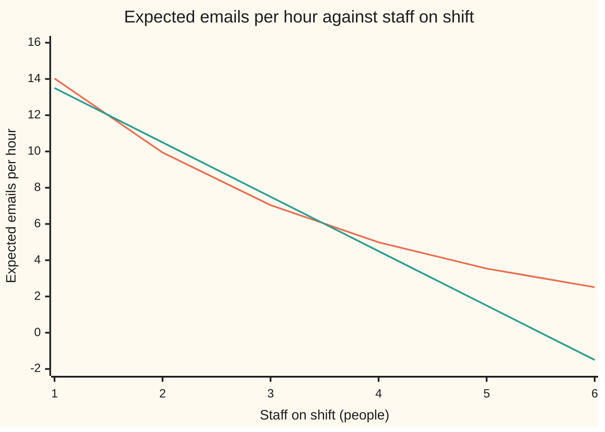

# Generalised linear models: one recipe for counts, proportions and positive amounts

[Syllabus](../../../SYLLABUS.md) → [Probability and statistics](../README.md) → [Regression](../README.md#s09) → Generalised linear models

---

## General Overview

A help desk logs how many emails arrive in one hour, and how many staff were on shift that hour. Four hours on a quiet morning:

| Staff on shift | 1 | 2 | 3 | 4 |
| --- | --- | --- | --- | --- |
| Emails that hour | 14 | 10 | 7 | 5 |

More staff, fewer emails: customers who get fast replies stop chasing. How strong is the effect, and what should a 6-person shift expect?

A straight line fitted by least squares says each extra person removes 3 emails: 16.5 − 3 × staff. At 6 staff it predicts −1.5 emails. A count cannot be negative. The line is also wrong about the noise: a count of 14 wobbles more than a count of 5, and least squares treats every point as equally reliable.

A **generalised linear model** (GLM) fixes both faults with one recipe. It keeps the straight line, but draws it on the log scale of the expected count, where every number is allowed. It treats each count as a Poisson count, whose spread grows with its size. Fitted to these four hours, it says each extra person **multiplies** the expected count by 0.7086, a cut of nearly 3 emails in 10. At 6 staff it expects 2.51 emails: small, but never negative.

The same recipe with other choices of scale and noise gives least squares for ordinary amounts, [Logistic regression](05-logistic-regression.md) for proportions, and gamma regression for positive amounts such as claim sizes.

**A generalised linear model draws a straight line on a chosen scale of the mean, lets the data scatter around that mean the way counts, proportions or amounts really scatter, and fits the line by a short run of weighted least-squares fits; for the help desk each extra person multiplies the expected emails by 0.7086.**

**What kind of fact this is:** a model, an assumption that fits well enough, not a law. The fitting method is a theorem: the card proves in Why it works that each reweighted least-squares step is a Newton step on the likelihood.

### The picture: two fits, extended to 6 staff



First line (orange): the Poisson GLM, a curve that shrinks by the same factor, 0.7086, for each extra person and never reaches zero. Second line (green): the least-squares straight line, which drops 3 emails per person and goes negative at 6 staff. The observed counts were 14, 10, 7 and 5 at 1 to 4 staff; both fits pass close to them and separate outside the data.

---

## The formula

Notation first. A subscript i numbers the hours, from 1 to $`n`$ = 4. For hour i, $`x_i`$ is the staff on shift and $`y_i`$ the emails counted. The **mean** $`\mu_i`$ is the expected count for that hour: the long-run average of many hours like it.

A GLM has three parts.

```math
\underbrace{y_i \sim \mathrm{Poisson}(\mu_i)}_{\text{random part}}, \qquad \underbrace{\eta_i = \beta_0 + \beta_1 x_i}_{\text{linear predictor}}, \qquad \underbrace{g(\mu_i) = \ln \mu_i = \eta_i}_{\text{link}}
```

**Read it aloud:** each hour's count is a Poisson count with mean mu; a straight line in staff gives a score eta; the log of the mean equals that score.

- The **random part** names the family of the response. Here it is Poisson: a count whose variance equals its mean ([Poisson](../03-Discrete%20Distributions/04-poisson.md)).
- The **linear predictor** $`\eta_i`$ is the same straight line as in [Multiple regression](03-multiple-regression-and-gauss-markov.md), with coefficients $`\beta_0, \beta_1`$.
- The **link** $`g`$ connects the mean to the line. The log link makes the mean $`e^{\eta}`$, which is always positive.

The families all come from the [Exponential families](../07-Sampling%20and%20Estimation/10-exponential-families.md) card. What the recipe needs from each is one fact: its **variance function** $`V(\mu)`$, the variance of a response with mean $`\mu`$ (times a fixed scale, 1 for Poisson).

| Response | Family | Variance function V(μ) | Canonical link | Example |
| --- | --- | --- | --- | --- |
| any amount | normal | 1 | identity, μ | least squares |
| a proportion | binomial | μ(1 − μ) | logit, ln(μ/(1 − μ)) | [Logistic regression](05-logistic-regression.md) |
| a count | Poisson | μ | log, ln μ | this card |
| a positive amount | gamma | μ² | inverse, 1/μ (the log link is common in practice) | insurance claim sizes |

The **canonical link** is the one with $`g'(\mu)\,V(\mu) = 1`$: its slope is one over the variance function. Then the linear predictor is the family's natural parameter, and fitting is cleanest (Step 5).

The fit is found by **iteratively reweighted least squares** (IRLS). From a current guess $`\beta`$, compute each hour's weight and **working response**, then refit the line by weighted least squares:

```math
w_i = \frac{1}{V(\mu_i)\,g'(\mu_i)^2}, \qquad z_i = \eta_i + (y_i - \mu_i)\,g'(\mu_i), \qquad \beta_{\text{new}} = (X^T W X)^{-1} X^T W z
```

**Read it aloud:** weight each hour by one over its variance on the link scale, nudge each score toward its data point, and refit the straight line to the nudged scores with those weights; repeat until nothing moves.

Here $`X`$ is the table with one row $`(1, x_i)`$ per hour, $`W`$ the table with the weights on its diagonal and zeros elsewhere, and $`z`$ the list of working responses. For Poisson with the log link, $`g'(\mu) = 1/\mu`$, so $`w_i = \mu_i`$ and $`z_i = \eta_i + (y_i - \mu_i)/\mu_i`$.

The fit is judged by the **deviance**, twice the log-likelihood the model gives up against a model that fits every point exactly:

```math
D = 2\sum_{i=1}^{n}\Big[\,y_i \ln\frac{y_i}{\mu_i} - (y_i - \mu_i)\Big]
```

**Read it aloud:** in each hour, the count times the log of observed over fitted, minus the gap; add them up and double.

| Symbol | Plain meaning | In our example | Push it up and the answer… |
| --- | --- | --- | --- |
| $`n`$, $`i`$ | the number of hours, and the hour's position in the list | 4 | more hours: smaller standard errors |
| $`x_i`$, $`y_i`$ | staff on shift in hour i, and emails counted in that hour | 1, 2, 3, 4 and 14, 10, 7, 5 | more staff: the expected count falls |
| $`\mu_i`$, $`\eta_i`$ | the expected count in hour i, and its score on the link scale, $`\ln \mu_i`$ | fitted 14.0260, 9.9394, 7.0434, 4.9913 | a higher score: a higher mean |
| $`\beta_0`$, $`\beta_1`$, $`\beta_{\text{new}}`$ | intercept and slope of the line on the log scale; the next guess in the climb | 2.9853 and −0.3444 | slope nearer 0: staff matter less |
| $`g`$, $`g'`$, $`V(\mu)`$ | the link and its slope; the variance function, the variance of a response with mean μ | $`\ln \mu`$, $`1/\mu`$, and μ | a larger V: more noise per unit of mean |
| $`w_i`$, $`z_i`$ | hour i's IRLS weight and working response | step 1: 9 and 2.7528 for hour 1 | heavier hours pull the line harder |
| $`X`$, $`W`$, $`z`$ | the predictor table (entry $`x_{ij}`$ in row i, column j), the weight table, the list of working responses | rows (1, 1) to (1, 4) | — |
| $`\ell`$, $`\ell_i`$ | the log-likelihood, and one hour's share of it | — | — |
| $`D`$ | the deviance: the fit the model gives up against a perfect fit | 0.0007; 5.0823 with staff left out | a worse fit |
| $`X^2`$, $`\phi`$ | Pearson's sum of squared gaps over means; the dispersion, variance over mean | 0.000701 and 0.000351 | φ over 1: standard errors too small |
| $`t_i`$ | the exposure: hours observed, entering as the offset $`\ln t_i`$ | offset example: 1, 2, 1, 3 hours | a longer watch: a larger expected total |
| $`\theta`$, $`b`$, $`c`$, $`u_i`$ | in the proof only: the natural parameter, the function whose slope gives the mean, the leftover term, and hour i's scaled gap | Poisson: $`\theta = \ln\mu`$, $`b(\theta) = e^{\theta}`$ | — |

### When it holds

- **Hours independent of each other.** The likelihood multiplies one chance per hour. If an outage floods three hours in a row, the counts cluster and the standard errors come out too small.
- **Variance equal to the mean.** Poisson counts have this property. Real counts often vary more, which is **overdispersion** (Step 9). Then the fit is still sound but its standard errors are too small; on a noisier week below, from 0.1587 to 0.2051.
- **The log of the mean is straight in staff.** The model says every extra person cuts the count by the same factor. If the fifth person adds almost nothing, the fit overstates the gain at the top of the range.
- **Equal exposure, or an offset.** Counts over different lengths of time are not comparable until the length enters the model (Step 8). Dropping it here turns a multiplier of 0.7087 into 0.9310.
- **Enough counts for the chi-square rules.** The deviance tests use chi-square laws that hold when expected counts are not tiny. Means of 5 to 14, as here, are borderline but usable; means near 1 are not.

---

## Why it works

### Step 0: separate the noise, the line and the scale

Least squares makes three choices at once: the mean is a straight line, the noise is bell-shaped, and every point has the same spread. Counts break the second and third, and the first fails near zero.

A GLM makes the three choices separately. The family says how the data scatter around their mean. The link picks the scale on which the mean is a straight line. The line itself stays the familiar one. Since $`e^{\eta}`$ is positive for every $`\eta`$, a straight line on the log scale can never give a negative expected count.

### Step 1: the likelihood and its slopes

A Poisson count $`y`$ with mean $`\mu`$ has chance $`e^{-\mu}\mu^{y}/y!`$. Independence multiplies the chances; logs add them:

```math
\ell(\beta_0, \beta_1) = \sum_{i=1}^{n}\big[\,y_i \ln\mu_i - \mu_i - \ln y_i!\,\big], \qquad \ln\mu_i = \beta_0 + \beta_1 x_i
```

**Read it aloud:** the log-likelihood adds, over the hours, the log of the chance the model gives to the count actually seen.

Differentiate. Moving $`\beta_0`$ by one moves every $`\ln\mu_i`$ by one, so $`\mu_i`$ grows at rate $`\mu_i`$. Moving $`\beta_1`$ moves $`\ln\mu_i`$ by $`x_i`$. The slopes, set to zero, are the **likelihood equations**:

```math
\sum_{i=1}^{n} (y_i - \mu_i) = 0, \qquad \sum_{i=1}^{n} x_i\,(y_i - \mu_i) = 0
```

**Read it aloud:** at the best fit, observed minus expected balances out overall, and again when weighted by staff.

The first equation says the fitted counts add to the 36 emails seen. They do: 14.0260 + 9.9394 + 7.0434 + 4.9913 = 36.0000. The means bend through the exponential, so no formula solves these equations. They are solved by climbing.

### Step 2: one peak

Differentiate once more. The curvature of $`\ell`$ in the direction of the two coefficients is minus the table $`X^T W X`$ with weights $`w_i = \mu_i`$. Along any straight path through the coefficients, the second derivative is minus a sum of positive weights times squares. So $`\ell`$ is concave, shaped like a dome ([Convex functions](../../06-Calculus%20and%20analysis/07-Several%20Variables/09-convex-functions.md)), with at most one top. The argument is the one on [Logistic regression](05-logistic-regression.md), Step 4, with $`\mu_i`$ in place of $`p_i(1 - p_i)`$.

### Step 3: a Newton step is a weighted least-squares fit

[Newton's method](../../06-Calculus%20and%20analysis/03-What%20Derivatives%20Tell%20You/06-newtons-method.md) replaces $`\ell`$ near the current guess by its quadratic approximation and jumps to that quadratic's top. The step is the inverse curvature times the slopes:

```math
\beta_{\text{new}} = \beta + (X^T W X)^{-1} X^T (y - \mu) = (X^T W X)^{-1} X^T W\big[X\beta + W^{-1}(y - \mu)\big] = (X^T W X)^{-1} X^T W z
```

**Read it aloud:** the Newton step equals a weighted least-squares fit of the working responses, because the bracket is exactly the list of working responses.

The middle form pulls $`X^T W`$ out front. Row by row, the bracket is $`\eta_i + (y_i - \mu_i)/\mu_i`$, which is $`z_i`$. So each Newton step is a least-squares fit with weights $`\mu_i`$ to the working responses. The weights change after every step, hence "iteratively reweighted".

The working response has a plain meaning. It is the data point moved onto the link scale by a first-order Taylor step: $`g(y_i) \approx g(\mu_i) + (y_i - \mu_i)\,g'(\mu_i)`$. Taking $`\ln y_i`$ directly would fail for a count of 0; the working response never does.

### Step 4: the first step, and the climb

Start where no staff effect exists: every hour at the average count, 36 ÷ 4 = 9. So $`\beta_0 = \ln 9 = 2.1972`$ and $`\beta_1 = 0`$. Every mean is 9, so every weight is 9: equal weights, and the first IRLS step is ordinary least squares on the working responses. Worked numbers, below, does it by hand. The slope comes out at −1/3, printed −0.3333.

Later steps change the weights, because the fitted means are no longer equal:

| IRLS step | Slope $`\beta_1`$ |
| --- | --- |
| 1 | −0.3333333333 |
| 2 | −0.3436438018 |
| 3 | −0.3444049997 |
| 4 | −0.3444069497 |

By step 4 the slope agrees to ten digits with a separate road: put the intercept from the first likelihood equation into the second, which leaves one equation in $`\beta_1`$, and solve it by bisection. Both give −0.3444069497. Newton's method roughly doubles the number of correct digits each step near the top, which is why so few steps are needed.

### Step 5: any family, any link

The same derivation works for every family in the table. For a general link, the slope of $`\ell`$ in a coefficient is a sum of $`x_i (y_i - \mu_i)/(V(\mu_i) g'(\mu_i))`$. The average curvature, the [Fisher information](../07-Sampling%20and%20Estimation/07-fisher-information-and-cramer-rao.md), is $`X^T W X`$ with the weights in the formula. A step with the average curvature in place of the observed one is called **Fisher scoring**, and it is a weighted least-squares fit to the working responses, as in Step 3.

With the canonical link, $`g'(\mu)V(\mu) = 1`$, the slopes reduce to $`\sum x_i(y_i - \mu_i)`$, and the observed and average curvature are the same. Fisher scoring and Newton's method then coincide. Poisson with the log link is canonical: $`(1/\mu) \times \mu = 1`$. So is logistic regression, which is why that card could call its Newton steps IRLS.

The normal family with the identity link has weight 1 and working response $`y_i`$, so IRLS is one plain least-squares fit, done in one step. On the help-desk data it returns the straight line of the overview, intercept 16.5000 and slope −3.0000, matching the closed form of [Least squares](01-least-squares-regression.md). Least squares is the simplest GLM.

<details>
<summary>Detailed proof: Fisher scoring is weighted least squares for any family and link</summary>

Write the family's log-chance for one response, hour i's share $`\ell_i`$ of the log-likelihood, as $`(y\theta - b(\theta))/\phi + c(y, \phi)`$, the exponential-family form. Its mean is $`b'(\theta) = \mu`$ and its variance is $`\phi\, b''(\theta) = \phi\, V(\mu)`$.

**Slopes.** By the chain rule through $`\theta`$, $`\mu`$ and $`\eta`$:

$`\displaystyle \frac{\partial \ell_i}{\partial \beta_j} = \frac{y_i - \mu_i}{\phi}\cdot\frac{d\theta_i}{d\mu_i}\cdot\frac{d\mu_i}{d\eta_i}\cdot x_{ij} = \frac{(y_i - \mu_i)\, x_{ij}}{\phi\, V(\mu_i)\, g'(\mu_i)}`$

since $`d\theta/d\mu = 1/b''(\theta) = 1/V(\mu)`$ and $`d\mu/d\eta = 1/g'(\mu)`$.

**Average curvature.** The slope has mean zero, so the average of minus the second derivative equals the average square of the slope. For one response that is $`x_{ij}x_{ik}\,\mathrm{Var}(y_i)/(\phi V g')^2 = x_{ij}x_{ik}/(\phi V g'^2)`$. Summed, it is $`X^T W X/\phi`$ with $`w_i = 1/(V(\mu_i) g'(\mu_i)^2)`$.

**The step.** Fisher scoring moves to $`\beta + (X^T W X)^{-1} X^T u`$, where $`u_i = (y_i - \mu_i)/(V g')`$; the scale $`\phi`$ cancels. Since $`u_i = w_i\,(y_i - \mu_i)\, g'(\mu_i)`$, factor out $`W`$:

$`\displaystyle \beta_{\text{new}} = (X^T W X)^{-1} X^T W\big[X\beta + (y - \mu)\, g'(\mu)\big] = (X^T W X)^{-1} X^T W z`$

**Canonical link.** If $`g'(\mu) = 1/V(\mu)`$, then $`\theta = \eta`$ up to a constant. The slope becomes $`(y_i - \mu_i)x_{ij}/\phi`$, and its derivative is $`-x_{ij}\,(d\mu_i/d\eta_i)/\phi`$, which contains no $`y_i`$. The observed curvature equals its average, so Fisher scoring is Newton's method.

</details>

### Step 6: read the slope as a multiplier

Add one person. The log of the expected count changes by $`\beta_1`$ = −0.3444, so the expected count is multiplied by $`e^{-0.3444}`$ = 0.7086. The fitted counts show it: 14.0260, 9.9394, 7.0434, 4.9913, each about 0.71 times the one before.

The change in emails is not fixed. From 1 to 2 staff the fit drops by 4.0866 emails, and by less at each step after. The multiplier is fixed; the drop in emails depends on where the count starts.

The standard error comes from the bend of the dome at its top, the inverse of $`X^T W X`$ ([Maximum likelihood](../07-Sampling%20and%20Estimation/04-maximum-likelihood.md)): 0.1566 for the slope. A second road measures the bend of the log-likelihood directly, by finite differences, and agrees. The 95% interval for the multiplier is $`e^{-0.3444 \pm 1.96 \times 0.1566}`$, from 0.5214 to 0.9632. With only four hours it is wide: the data allow anything from a steep cut to a slight one.

### Step 7: deviance, the GLM's sum of squares

The **saturated model** gives every hour its own mean, $`\mu_i = y_i`$, and fits perfectly. The deviance is twice the log-likelihood a model gives up against it: $`D = 2(\ell_{\text{saturated}} - \ell_{\text{model}})`$. The $`\ln y_i!`$ terms cancel, which leaves the formula above. For the normal family the deviance is the residual sum of squares, so it plays the role that sum plays in [Analysis of variance](09-analysis-of-variance-and-the-f-test.md).

Two uses:

- **Compare nested models** (one model is the other with some coefficients removed). The **null model** has no staff effect, every mean 9; its deviance is 5.0823 on 3 degrees of freedom (4 hours minus 1 coefficient). The staff model's deviance is 0.0007 on 2. The drop, 5.0816, is exactly the likelihood ratio statistic, twice the log-likelihood gained, computed separately as 5.0816. By [Likelihood ratio tests](../08-Confidence%20Intervals%20and%20Tests/07-likelihood-ratio-tests.md) it behaves like a chi-square variable with 1 degree of freedom when staff make no difference; the chance of a drop this large is 0.0242. The Wald test, slope over its standard error, gives z = −2.1995 and a chance of 0.0278: close, not equal.
- **Judge the fit.** Compare the residual deviance with a chi-square law on $`n - 2`$ degrees of freedom. Here 0.0007 on 2 gives a chance of 0.9996 of a deviance at least this large: an almost perfect fit. Real counts are rarely this tidy.

### Step 8: offsets for unequal exposure

Suppose the log mixes lengths of time: 14 emails over 1 hour with 1 person, 20 over 2 hours with 2, 7 over 1 hour with 3, 15 over 3 hours with 4. The rates per hour are the same as before, but the totals are not comparable.

The fix is an **offset**: a term added to the linear predictor with its coefficient fixed at 1. If $`t_i`$ is the exposure, the hours observed, then the expected total is $`t_i`$ times an hourly rate:

```math
\ln\mu_i = \ln t_i + \beta_0 + \beta_1 x_i
```

**Read it aloud:** the log of the expected total is the log of the hours watched plus the usual line, so the line describes the hourly rate.

With the offset, the slope is −0.3444, multiplier 0.7087, almost the earlier answer; the fit now weights each row by its hours, so it is not identical. Without the offset, the slope is −0.0715, multiplier 0.9310: the long observation periods at 2 and 4 staff inflate their totals and hide most of the staff effect.

### Step 9: overdispersion

A Poisson model insists that the variance equals the mean. Check it with Pearson's $`X^2 = \sum (y_i - \mu_i)^2/\mu_i`$ divided by $`n - 2`$, the hours minus the coefficients. This ratio, the **dispersion** $`\phi`$, should be near 1. Here it is 0.000351: no excess noise.

A noisier week at the same desk counted 18, 7, 10 and 3. Its fitted slope is −0.4691 and its dispersion is 1.6717. The model-based standard error, 0.1587, assumes a dispersion of 1. Scaling it by $`\sqrt{\phi}`$ gives 0.2051, the **quasi-Poisson** standard error (Wedderburn, 1974). Ignoring overdispersion makes intervals too narrow and tests too eager. With 2 degrees of freedom, the dispersion estimate itself is rough. With more data, the alternative is a negative binomial family, whose variance grows faster than the mean.

---

## Worked numbers, by hand

One IRLS step from the start $`\beta_0 = \ln 9`$, $`\beta_1 = 0`$.

| Step | Arithmetic | Value |
| --- | --- | --- |
| mean count | (14 + 10 + 7 + 5) ÷ 4 = 36 ÷ 4 | 9.0000 |
| starting line | $`\beta_0 = \ln 9`$, $`\beta_1 = 0`$ | 2.1972, 0 |
| starting means and weights | $`\mu_i = e^{2.1972} = 9`$, $`w_i = \mu_i`$ | 9 each |
| working responses | $`z_i = \ln 9 + (y_i - 9)/9`$, so ln 9 plus 0.5556, 0.1111, −0.2222, −0.4444 | 2.7528, 2.3083, 1.9750, 1.7528 |
| slope, equal weights | $`\sum (x_i - 2.5)(z_i - \ln 9) \div \sum (x_i - 2.5)^2`$ = −1.6667 ÷ 5 | −0.3333 |
| intercept | mean of z, which is ln 9 = 2.1972, minus slope × 2.5 | 3.0306 |
| same step by Newton | slopes of ℓ: 0 and −15; inverse curvature times slopes, added to the start | 3.0306, −0.3333 |
| three more IRLS steps | reweight with the new means each time | $`\beta_0`$ = 2.9853, $`\beta_1`$ = −0.3444 |
| multiplier per extra person | $`e^{-0.3444}`$ | **0.7086** |
| expected at 6 staff | $`e^{2.9853 - 6 \times 0.3444}`$ | 2.5065 |

The mean of z is ln 9 because the four deviations add to zero. Each extra person on shift goes with nearly 3 in 10 fewer emails per hour, and a 6-person shift should expect about 2 or 3.

### What breaks if you drop a piece

| Mistake | Comes out at | What went wrong |
| --- | --- | --- |
| A straight line by least squares, used at 6 staff | −1.5000 emails; the Poisson GLM gives 2.5065 | a line on the count scale runs below zero |
| The slope read as emails per person | −0.3444 emails; the fit drops 4.0866 from 1 to 2 staff | the slope lives on the log scale; it multiplies, it does not subtract |
| The offset dropped when hours differ | multiplier 0.9310; with the offset 0.7087 | longer observation periods look like busier hours |
| The noisy week's standard error taken at face value | 0.1587; scaled by the dispersion 0.2051 | the variance is larger than the mean, so the Poisson errors are too small |
| $`e^{\beta_0}`$ read as the count with 1 person | 19.7928; the fit gives 14.0260 | the intercept is the score at 0 staff, outside the data |

The code prints every number in this table.

---

## Code, from first principles, and it actually runs

Both programs fit the four hours with one IRLS function that takes a family, Poisson or normal. Three roads reach the fit: IRLS, a Newton step built from the slope and curvature formulas, and bisection on the slope equation. The deviance drop is computed from its formula and from log-likelihoods; the standard error from $`X^T W X`$ and from finite differences. The normal CDF is a Taylor series, checked by Simpson's rule. Then come least squares as a GLM, the offset and the noisy week. Each of those fits is checked against its own two likelihood equations, and the noisy week's dispersion against a second form of Pearson's sum, $`\sum y_i^2/\mu_i - \sum y_i`$, which equals $`X^2`$ at the fit.

### Python

```python
# Generalised linear models -- the check behind the card.  Standard library only.
# Help-desk emails per hour against staff on shift, fitted as a Poisson GLM with a log link.
# Roads: IRLS, a Newton step from the slope and curvature formulas, and a one-unknown root search;
# the deviance from its formula and from log-likelihoods; least squares as the same recipe.
import math

def irls(x, y, off, b, steps, family="poisson"):
    trace = []
    for _ in range(steps):
        eta = [b[0] + b[1] * xi + o for xi, o in zip(x, off)]
        if family == "poisson":   # log link: mu = e^eta, V(mu) = mu, g'(mu) = 1/mu, weight mu
            mu = [math.exp(e) for e in eta]
            z = [e - o + (yi - m) / m for e, o, yi, m in zip(eta, off, y, mu)]
            w = mu
        else:                     # normal family, identity link: weight 1, working response y
            z, w = list(y), [1.0] * len(y)
        s0 = sum(w); s1 = sum(wi * xi for wi, xi in zip(w, x)); s2 = sum(wi * xi * xi for wi, xi in zip(w, x))
        t0 = sum(wi * zi for wi, zi in zip(w, z)); t1 = sum(wi * xi * zi for wi, xi, zi in zip(w, x, z))
        det = s0 * s2 - s1 * s1
        b = [(s2 * t0 - s1 * t1) / det, (s0 * t1 - s1 * t0) / det]
        trace.append(b)
    return b, trace

def means(x, off, b): return [math.exp(b[0] + b[1] * xi + o) for xi, o in zip(x, off)]
def deviance(y, mu): return 2 * sum((yi * math.log(yi / m) if yi > 0 else 0.0) - (yi - m) for yi, m in zip(y, mu))
def loglik(y, mu): return sum(yi * math.log(m) - m - sum(math.log(k) for k in range(2, yi + 1)) for yi, m in zip(y, mu))
def phi(v):               # normal CDF from the Taylor series of erf
    u = v / math.sqrt(2); term = u; s = u
    for n in range(1, 120):
        term *= -u * u / n; s += term / (2 * n + 1)
    return 0.5 + s / math.sqrt(math.pi)
def info_inv11(x, mu):    # the slope's entry of the inverse of the information table X'WX
    s0 = sum(mu); s1 = sum(m * xi for m, xi in zip(mu, x)); s2 = sum(m * xi * xi for m, xi in zip(mu, x))
    return s0 / (s0 * s2 - s1 * s1)
f4 = lambda v: f"{0.0 if abs(v) < 5e-5 else v:.4f}"
j4 = lambda vs: " ".join(f4(v) for v in vs)

x, y, n = [1, 2, 3, 4], [14, 10, 7, 5], 4
zero = [0.0] * n
ybar = sum(y) / n
b_start = [math.log(ybar), 0.0]
print("data: staff", x, "emails", y, "| mean", f4(ybar), "| start b0 = ln(mean)", f4(b_start[0]))

# ---- one IRLS step by hand: every mean is 9, every weight 9, so the step is plain least squares ----
zs = [b_start[0] + (yi - ybar) / ybar for yi in y]
print("step 1 working response z:", j4(zs), "| weights all", f4(ybar))
print("  z - ln(mean):", j4([(yi - ybar) / ybar for yi in y]), "| mean staff 2.5000 | Sxz",
      f4(sum((xi - 2.5) * (zi - b_start[0]) for xi, zi in zip(x, zs))), "| Sxx 5.0000")
b1, _ = irls(x, y, zero, b_start, 1)
hand_slope = sum((xi - 2.5) * (yi - ybar) for xi, yi in zip(x, y)) / ybar / 5.0
print("after step 1: b0", f4(b1[0]), "b1", f4(b1[1]), "| by hand, Sxz/Sxx =", f4(hand_slope))
assert abs(b1[1] - hand_slope) < 1e-12

# ---- road 1 and road 2: the same step as Newton's method on the log-likelihood ----
mu0 = means(x, zero, b_start)
g0 = sum(yi - m for yi, m in zip(y, mu0)); g1 = sum(xi * (yi - m) for xi, yi, m in zip(x, y, mu0))
h00 = sum(mu0); h01 = sum(m * xi for m, xi in zip(mu0, x)); h11 = sum(m * xi * xi for m, xi in zip(mu0, x))
det = h00 * h11 - h01 * h01
newton = [b_start[0] + (h11 * g0 - h01 * g1) / det, b_start[1] + (h00 * g1 - h01 * g0) / det]
print("Newton step from slopes", f4(g0), f4(g1), "->", f4(newton[0]), f4(newton[1]))
assert abs(newton[0] - b1[0]) < 1e-12 and abs(newton[1] - b1[1]) < 1e-12

b, trace = irls(x, y, zero, b_start, 25)
print("IRLS slope b1 after steps 1-4:", " ".join(f"{t[1]:.10f}" for t in trace[:4]))
mu = means(x, zero, b)
print("fit: b0", f4(b[0]), "b1", f4(b[1]), "| multiplier e^b1", f4(math.exp(b[1])), "| e^b0", f4(math.exp(b[0])))
print("fitted means:", j4(mu), "| sum", f4(sum(mu)), "observed", sum(y))
assert abs(sum(mu) - sum(y)) < 1e-9

# ---- road 3: the intercept equation solved exactly, then one unknown by bisection ----
def slope_eq(c):
    a = math.log(sum(y) / sum(math.exp(c * xi) for xi in x))
    return sum(xi * (yi - math.exp(a + c * xi)) for xi, yi in zip(x, y))
lo, hi = -2.0, 2.0
for _ in range(200):
    mid = (lo + hi) / 2
    if slope_eq(mid) > 0: lo = mid
    else: hi = mid
print("bisection on the slope equation: b1", f"{lo:.10f}", "| IRLS", f"{b[1]:.10f}")
assert abs(lo - b[1]) < 1e-9

# ---- standard error, Wald interval ----
se = math.sqrt(info_inv11(x, mu))
zw = b[1] / se
print("SE(b1)", f4(se), "| z", f4(zw), "| two-sided p", f4(2 * phi(zw)))
print("95% interval for the multiplier:", f4(math.exp(b[1] - 1.96 * se)), "to", f4(math.exp(b[1] + 1.96 * se)))
lo_z, steps = -8.0, 4000; h = (zw - lo_z) / steps     # Simpson's rule on the bell curve, a second road to Phi
simpson = sum((1 if k in (0, steps) else 4 if k % 2 else 2) * math.exp(-(lo_z + k * h) ** 2 / 2)
              for k in range(steps + 1)) * h / 3 / math.sqrt(2 * math.pi)
assert abs(simpson - phi(zw)) < 1e-4
def prof(c):              # log-likelihood with the intercept set by its own equation: a second road to the SE
    a = math.log(sum(y) / sum(math.exp(c * xi) for xi in x)); return loglik(y, [math.exp(a + c * xi) for xi in x])
dc = 1e-4; curv = (prof(b[1] + dc) - 2 * prof(b[1]) + prof(b[1] - dc)) / dc ** 2
assert abs(1 / math.sqrt(-curv) - se) < 1e-5

# ---- deviance, two roads ----
D0 = deviance(y, [ybar] * n); D = deviance(y, mu); drop = D0 - D
lr = 2 * (loglik(y, mu) - loglik(y, [ybar] * n))
p_drop = 2 * (1 - phi(math.sqrt(drop)))
print("null deviance", f4(D0), "on 3 df | residual deviance", f4(D), "on 2 df")
print("drop", f4(drop), "| 2 x log-likelihood gain", f4(lr), "| chi-square(1) p", f4(p_drop))
print("residual deviance chi-square(2) p", f4(math.exp(-D / 2)))
assert abs(drop - lr) < 1e-9
x2 = sum((yi - m) ** 2 / m for yi, m in zip(y, mu))
print("Pearson X2", f"{x2:.6f}", "| dispersion X2/(n-2)", f"{x2 / 2:.6f}")

# ---- prediction, and the same recipe as least squares ----
print("Poisson prediction at 6 staff", f4(math.exp(b[0] + 6 * b[1])))
bl, _ = irls(x, y, zero, [0.0, 0.0], 1, family="normal")
ols_b1 = sum((xi - 2.5) * (yi - ybar) for xi, yi in zip(x, y)) / 5.0
print("normal family, identity link, one step: b0", f4(bl[0]), "b1", f4(bl[1]), "| closed form b1", f4(ols_b1))
print("straight-line prediction at 6 staff", f4(bl[0] + 6 * bl[1]))
print("chart, staff 1-6: Poisson", " ".join(f"{math.exp(b[0] + b[1] * s):.2f}" for s in range(1, 7)),
      "| line", " ".join(f"{bl[0] + bl[1] * s:.2f}" for s in range(1, 7)))
assert abs(bl[1] - ols_b1) < 1e-12

# ---- an offset for exposure: totals over different hours ----
hours, tot = [1, 2, 1, 3], [14, 20, 7, 15]
logh = [math.log(t) for t in hours]
bo, _ = irls(x, tot, logh, [math.log(sum(tot) / sum(hours)), 0.0], 25)
bn, _ = irls(x, tot, zero, [math.log(sum(tot) / n), 0.0], 25)
print("hours", hours, "totals", tot, "| with offset ln(hours): b1", f4(bo[1]), "multiplier", f4(math.exp(bo[1])))
print("offset dropped: b1", f4(bn[1]), "multiplier", f4(math.exp(bn[1])))
eqs = lambda ys, f: abs(sum(yi - m for yi, m in zip(ys, f))) + abs(sum(xi * (yi - m) for xi, yi, m in zip(x, ys, f)))
assert eqs(tot, means(x, logh, bo)) < 1e-9 and eqs(tot, means(x, zero, bn)) < 1e-9   # both fits solve their likelihood equations

# ---- overdispersion: a noisier week ----
yn = [18, 7, 10, 3]
bw, _ = irls(x, yn, zero, [math.log(sum(yn) / n), 0.0], 25)
mw = means(x, zero, bw)
phw = sum((yi - m) ** 2 / m for yi, m in zip(yn, mw)) / 2
sw = math.sqrt(info_inv11(x, mw))
print("noisy week", yn, ": b1", f4(bw[1]), "| dispersion", f4(phw), "| SE", f4(sw), "-> scaled", f4(sw * math.sqrt(phw)))
assert eqs(yn, mw) < 1e-9 and abs(phw * (n - 2) - (sum(yi * yi / m for yi, m in zip(yn, mw)) - sum(yn))) < 1e-9   # X2 = sum y^2/mu - sum y at the fit

# ---- what breaks ----
print("mistake: b1 read as emails per person", f4(b[1]), "| fitted change 1 -> 2 staff", f4(mu[1] - mu[0]))
print("ALL CHECKS PASS")
```

**Ran 2026-11-23 on macOS, Python 3.14.10, standard library only. All checks passed. Output, pasted from the run:**

```
data: staff [1, 2, 3, 4] emails [14, 10, 7, 5] | mean 9.0000 | start b0 = ln(mean) 2.1972
step 1 working response z: 2.7528 2.3083 1.9750 1.7528 | weights all 9.0000
  z - ln(mean): 0.5556 0.1111 -0.2222 -0.4444 | mean staff 2.5000 | Sxz -1.6667 | Sxx 5.0000
after step 1: b0 3.0306 b1 -0.3333 | by hand, Sxz/Sxx = -0.3333
Newton step from slopes 0.0000 -15.0000 -> 3.0306 -0.3333
IRLS slope b1 after steps 1-4: -0.3333333333 -0.3436438018 -0.3444049997 -0.3444069497
fit: b0 2.9853 b1 -0.3444 | multiplier e^b1 0.7086 | e^b0 19.7928
fitted means: 14.0260 9.9394 7.0434 4.9913 | sum 36.0000 observed 36
bisection on the slope equation: b1 -0.3444069497 | IRLS -0.3444069497
SE(b1) 0.1566 | z -2.1995 | two-sided p 0.0278
95% interval for the multiplier: 0.5214 to 0.9632
null deviance 5.0823 on 3 df | residual deviance 0.0007 on 2 df
drop 5.0816 | 2 x log-likelihood gain 5.0816 | chi-square(1) p 0.0242
residual deviance chi-square(2) p 0.9996
Pearson X2 0.000701 | dispersion X2/(n-2) 0.000351
Poisson prediction at 6 staff 2.5065
normal family, identity link, one step: b0 16.5000 b1 -3.0000 | closed form b1 -3.0000
straight-line prediction at 6 staff -1.5000
chart, staff 1-6: Poisson 14.03 9.94 7.04 4.99 3.54 2.51 | line 13.50 10.50 7.50 4.50 1.50 -1.50
hours [1, 2, 1, 3] totals [14, 20, 7, 15] | with offset ln(hours): b1 -0.3444 multiplier 0.7087
offset dropped: b1 -0.0715 multiplier 0.9310
noisy week [18, 7, 10, 3] : b1 -0.4691 | dispersion 1.6717 | SE 0.1587 -> scaled 0.2051
mistake: b1 read as emails per person -0.3444 | fitted change 1 -> 2 staff -4.0866
ALL CHECKS PASS
```

### Rust

```rust
// Generalised linear models -- the check behind the card.  std only, no crates.
// Help-desk emails per hour against staff on shift, fitted as a Poisson GLM with a log link.
// Roads: IRLS, a Newton step from the slope and curvature formulas, and a one-unknown root search;
// the deviance from its formula and from log-likelihoods; least squares as the same recipe.

fn irls(x: &[f64], y: &[f64], off: &[f64], b0: [f64; 2], steps: usize, poisson: bool) -> ([f64; 2], Vec<[f64; 2]>) {
    let mut b = b0;
    let mut trace = Vec::new();
    for _ in 0..steps {
        let (mut s0, mut s1, mut s2, mut t0, mut t1) = (0.0, 0.0, 0.0, 0.0, 0.0);
        for i in 0..x.len() {
            let eta = b[0] + b[1] * x[i] + off[i];
            // log link: mu = e^eta, weight mu, working response eta - offset + (y - mu)/mu;
            // normal family, identity link: weight 1, working response y
            let mu = if poisson { eta.exp() } else { 1.0 };
            let (w, z) = if poisson { (mu, eta - off[i] + (y[i] - mu) / mu) } else { (1.0, y[i]) };
            s0 += w; s1 += w * x[i]; s2 += w * x[i] * x[i]; t0 += w * z; t1 += w * x[i] * z;
        }
        let det = s0 * s2 - s1 * s1;
        b = [(s2 * t0 - s1 * t1) / det, (s0 * t1 - s1 * t0) / det];
        trace.push(b);
    }
    (b, trace)
}

fn means(x: &[f64], off: &[f64], b: [f64; 2]) -> Vec<f64> {
    x.iter().zip(off).map(|(xi, o)| (b[0] + b[1] * xi + o).exp()).collect()
}
fn deviance(y: &[f64], mu: &[f64]) -> f64 {
    2.0 * y.iter().zip(mu).map(|(yi, m)| (if *yi > 0.0 { yi * (yi / m).ln() } else { 0.0 }) - (yi - m)).sum::<f64>()
}
fn loglik(y: &[f64], mu: &[f64]) -> f64 {
    y.iter().zip(mu).map(|(yi, m)| {
        yi * m.ln() - m - (2..=(*yi as u64)).map(|k| (k as f64).ln()).sum::<f64>()
    }).sum()
}
fn phi(v: f64) -> f64 {
    // normal CDF from the Taylor series of erf
    let u = v / 2f64.sqrt();
    let (mut term, mut s) = (u, u);
    for n in 1..120 {
        term *= -u * u / n as f64;
        s += term / (2 * n + 1) as f64;
    }
    0.5 + s / std::f64::consts::PI.sqrt()
}
fn info_inv11(x: &[f64], mu: &[f64]) -> f64 {
    let s0: f64 = mu.iter().sum();
    let s1: f64 = mu.iter().zip(x).map(|(m, xi)| m * xi).sum();
    let s2: f64 = mu.iter().zip(x).map(|(m, xi)| m * xi * xi).sum();
    s0 / (s0 * s2 - s1 * s1)
}
fn f4(v: f64) -> String { format!("{:.4}", if v.abs() < 5e-5 { 0.0 } else { v }) }
fn j4(vs: &[f64]) -> String { vs.iter().map(|v| f4(*v)).collect::<Vec<_>>().join(" ") }
fn ints(vs: &[f64]) -> String { format!("{:?}", vs.iter().map(|v| *v as i64).collect::<Vec<_>>()) }

fn main() {
    let (x, y, n, zero) = ([1.0, 2.0, 3.0, 4.0], [14.0, 10.0, 7.0, 5.0], 4.0, [0.0; 4]);
    let ybar = y.iter().sum::<f64>() / n;
    let b_start = [ybar.ln(), 0.0];
    println!("data: staff {} emails {} | mean {} | start b0 = ln(mean) {}", ints(&x), ints(&y), f4(ybar), f4(b_start[0]));

    // ---- one IRLS step by hand: every mean is 9, every weight 9, so the step is plain least squares ----
    let zs: Vec<f64> = y.iter().map(|yi| b_start[0] + (yi - ybar) / ybar).collect();
    println!("step 1 working response z: {} | weights all {}", j4(&zs), f4(ybar));
    let sxz: f64 = (0..4).map(|i| (x[i] - 2.5) * (zs[i] - b_start[0])).sum();
    println!("  z - ln(mean): {} | mean staff 2.5000 | Sxz {} | Sxx 5.0000", j4(&y.map(|yi| (yi - ybar) / ybar)), f4(sxz));
    let (b1, _) = irls(&x, &y, &zero, b_start, 1, true);
    let hand_slope = x.iter().zip(&y).map(|(xi, yi)| (xi - 2.5) * (yi - ybar)).sum::<f64>() / ybar / 5.0;
    println!("after step 1: b0 {} b1 {} | by hand, Sxz/Sxx = {}", f4(b1[0]), f4(b1[1]), f4(hand_slope));
    assert!((b1[1] - hand_slope).abs() < 1e-12);

    // ---- road 1 and road 2: the same step as Newton's method on the log-likelihood ----
    let mu0 = means(&x, &zero, b_start);
    let (g0, g1): (f64, f64) = ((0..4).map(|i| y[i] - mu0[i]).sum(), (0..4).map(|i| x[i] * (y[i] - mu0[i])).sum());
    let (h00, h01): (f64, f64) = (mu0.iter().sum(), (0..4).map(|i| mu0[i] * x[i]).sum());
    let h11: f64 = (0..4).map(|i| mu0[i] * x[i] * x[i]).sum();
    let det = h00 * h11 - h01 * h01;
    let newton = [b_start[0] + (h11 * g0 - h01 * g1) / det, b_start[1] + (h00 * g1 - h01 * g0) / det];
    println!("Newton step from slopes {} {} -> {} {}", f4(g0), f4(g1), f4(newton[0]), f4(newton[1]));
    assert!((newton[0] - b1[0]).abs() < 1e-12 && (newton[1] - b1[1]).abs() < 1e-12);

    let (b, trace) = irls(&x, &y, &zero, b_start, 25, true);
    println!("IRLS slope b1 after steps 1-4: {}", trace[..4].iter().map(|t| format!("{:.10}", t[1])).collect::<Vec<_>>().join(" "));
    let mu = means(&x, &zero, b);
    println!("fit: b0 {} b1 {} | multiplier e^b1 {} | e^b0 {}", f4(b[0]), f4(b[1]), f4(b[1].exp()), f4(b[0].exp()));
    let (ysum, musum): (f64, f64) = (y.iter().sum(), mu.iter().sum());
    println!("fitted means: {} | sum {} observed {}", j4(&mu), f4(musum), ysum as i64);
    assert!((musum - ysum).abs() < 1e-9);

    // ---- road 3: the intercept equation solved exactly, then one unknown by bisection ----
    let slope_eq = |c: f64| -> f64 {
        let a = (ysum / x.iter().map(|xi| (c * xi).exp()).sum::<f64>()).ln();
        (0..4).map(|i| x[i] * (y[i] - (a + c * x[i]).exp())).sum()
    };
    let (mut lo, mut hi) = (-2.0, 2.0);
    for _ in 0..200 {
        let mid = (lo + hi) / 2.0; if slope_eq(mid) > 0.0 { lo = mid; } else { hi = mid; }
    }
    println!("bisection on the slope equation: b1 {:.10} | IRLS {:.10}", lo, b[1]);
    assert!((lo - b[1]).abs() < 1e-9);

    // ---- standard error, Wald interval ----
    let se = info_inv11(&x, &mu).sqrt();
    let zw = b[1] / se;
    println!("SE(b1) {} | z {} | two-sided p {}", f4(se), f4(zw), f4(2.0 * phi(zw)));
    println!("95% interval for the multiplier: {} to {}", f4((b[1] - 1.96 * se).exp()), f4((b[1] + 1.96 * se).exp()));
    let (lo_z, steps) = (-8.0, 4000usize);
    let h = (zw - lo_z) / steps as f64; // Simpson's rule on the bell curve, a second road to Phi
    let simpson: f64 = (0..=steps).map(|k| {
        let (c, t) = (if k == 0 || k == steps { 1.0 } else if k % 2 == 1 { 4.0 } else { 2.0 }, lo_z + k as f64 * h);
        c * (-t * t / 2.0).exp()
    }).sum::<f64>() * h / 3.0 / (2.0 * std::f64::consts::PI).sqrt();
    assert!((simpson - phi(zw)).abs() < 1e-4);
    // log-likelihood with the intercept set by its own equation: a second road to the SE
    let prof = |c: f64| -> f64 {
        let a = (ysum / x.iter().map(|xi| (c * xi).exp()).sum::<f64>()).ln();
        loglik(&y, &x.iter().map(|xi| (a + c * xi).exp()).collect::<Vec<f64>>())
    };
    let (dc, mid) = (1e-4, prof(b[1]));
    let curv = (prof(b[1] + dc) - 2.0 * mid + prof(b[1] - dc)) / (dc * dc);
    assert!((1.0 / (-curv).sqrt() - se).abs() < 1e-5);

    // ---- deviance, two roads ----
    let flat = [ybar; 4];
    let (d0, d) = (deviance(&y, &flat), deviance(&y, &mu));
    let drop = d0 - d;
    let lr = 2.0 * (loglik(&y, &mu) - loglik(&y, &flat));
    let p_drop = 2.0 * (1.0 - phi(drop.sqrt()));
    println!("null deviance {} on 3 df | residual deviance {} on 2 df", f4(d0), f4(d));
    println!("drop {} | 2 x log-likelihood gain {} | chi-square(1) p {}", f4(drop), f4(lr), f4(p_drop));
    println!("residual deviance chi-square(2) p {}", f4((-d / 2.0).exp()));
    assert!((drop - lr).abs() < 1e-9);
    let x2: f64 = (0..4).map(|i| (y[i] - mu[i]).powi(2) / mu[i]).sum();
    println!("Pearson X2 {:.6} | dispersion X2/(n-2) {:.6}", x2, x2 / 2.0);

    // ---- prediction, and the same recipe as least squares ----
    println!("Poisson prediction at 6 staff {}", f4((b[0] + 6.0 * b[1]).exp()));
    let (bl, _) = irls(&x, &y, &zero, [0.0, 0.0], 1, false);
    let ols_b1 = x.iter().zip(&y).map(|(xi, yi)| (xi - 2.5) * (yi - ybar)).sum::<f64>() / 5.0;
    println!("normal family, identity link, one step: b0 {} b1 {} | closed form b1 {}", f4(bl[0]), f4(bl[1]), f4(ols_b1));
    println!("straight-line prediction at 6 staff {}", f4(bl[0] + 6.0 * bl[1]));
    assert!((bl[1] - ols_b1).abs() < 1e-12);
    let pc: Vec<String> = (1..=6).map(|s| format!("{:.2}", (b[0] + b[1] * s as f64).exp())).collect();
    let lc: Vec<String> = (1..=6).map(|s| format!("{:.2}", bl[0] + bl[1] * s as f64)).collect();
    println!("chart, staff 1-6: Poisson {} | line {}", pc.join(" "), lc.join(" "));

    // ---- an offset for exposure: totals over different hours ----
    let (hours, tot) = ([1.0, 2.0, 1.0, 3.0], [14.0, 20.0, 7.0, 15.0]);
    let (logh, tsum): (Vec<f64>, f64) = (hours.iter().map(|t: &f64| t.ln()).collect(), tot.iter().sum());
    let (bo, _) = irls(&x, &tot, &logh, [(tsum / hours.iter().sum::<f64>()).ln(), 0.0], 25, true);
    let (bn, _) = irls(&x, &tot, &zero, [(tsum / n).ln(), 0.0], 25, true);
    println!("hours {} totals {} | with offset ln(hours): b1 {} multiplier {}", ints(&hours), ints(&tot), f4(bo[1]), f4(bo[1].exp()));
    println!("offset dropped: b1 {} multiplier {}", f4(bn[1]), f4(bn[1].exp()));
    let eqs = |yy: &[f64], f: &[f64]| (0..4).map(|i| yy[i] - f[i]).sum::<f64>().abs() + (0..4).map(|i| x[i] * (yy[i] - f[i])).sum::<f64>().abs();
    assert!(eqs(&tot, &means(&x, &logh, bo)) < 1e-9 && eqs(&tot, &means(&x, &zero, bn)) < 1e-9); // both fits solve their likelihood equations

    // ---- overdispersion: a noisier week ----
    let yn = [18.0, 7.0, 10.0, 3.0];
    let (bw, _) = irls(&x, &yn, &zero, [(yn.iter().sum::<f64>() / n).ln(), 0.0], 25, true);
    let mw = means(&x, &zero, bw); // fitted means, then the dispersion: Pearson X2 over n - 2
    let phw: f64 = (0..4).map(|i| (yn[i] - mw[i]).powi(2) / mw[i]).sum::<f64>() / 2.0;
    let sw = info_inv11(&x, &mw).sqrt(); println!("noisy week {} : b1 {} | dispersion {} | SE {} -> scaled {}", ints(&yn), f4(bw[1]), f4(phw), f4(sw), f4(sw * phw.sqrt()));
    assert!(eqs(&yn, &mw) < 1e-9 && (phw * (n - 2.0) - ((0..4).map(|i| yn[i] * yn[i] / mw[i]).sum::<f64>() - yn.iter().sum::<f64>())).abs() < 1e-9); // X2 = sum y^2/mu - sum y

    // ---- what breaks ----
    println!("mistake: b1 read as emails per person {} | fitted change 1 -> 2 staff {}", f4(b[1]), f4(mu[1] - mu[0]));
    println!("ALL CHECKS PASS");
}
```

**Ran 2026-11-23 on macOS, rustc 1.98.1, no crates. All checks passed. Output, pasted from the run:**

```
data: staff [1, 2, 3, 4] emails [14, 10, 7, 5] | mean 9.0000 | start b0 = ln(mean) 2.1972
step 1 working response z: 2.7528 2.3083 1.9750 1.7528 | weights all 9.0000
  z - ln(mean): 0.5556 0.1111 -0.2222 -0.4444 | mean staff 2.5000 | Sxz -1.6667 | Sxx 5.0000
after step 1: b0 3.0306 b1 -0.3333 | by hand, Sxz/Sxx = -0.3333
Newton step from slopes 0.0000 -15.0000 -> 3.0306 -0.3333
IRLS slope b1 after steps 1-4: -0.3333333333 -0.3436438018 -0.3444049997 -0.3444069497
fit: b0 2.9853 b1 -0.3444 | multiplier e^b1 0.7086 | e^b0 19.7928
fitted means: 14.0260 9.9394 7.0434 4.9913 | sum 36.0000 observed 36
bisection on the slope equation: b1 -0.3444069497 | IRLS -0.3444069497
SE(b1) 0.1566 | z -2.1995 | two-sided p 0.0278
95% interval for the multiplier: 0.5214 to 0.9632
null deviance 5.0823 on 3 df | residual deviance 0.0007 on 2 df
drop 5.0816 | 2 x log-likelihood gain 5.0816 | chi-square(1) p 0.0242
residual deviance chi-square(2) p 0.9996
Pearson X2 0.000701 | dispersion X2/(n-2) 0.000351
Poisson prediction at 6 staff 2.5065
normal family, identity link, one step: b0 16.5000 b1 -3.0000 | closed form b1 -3.0000
straight-line prediction at 6 staff -1.5000
chart, staff 1-6: Poisson 14.03 9.94 7.04 4.99 3.54 2.51 | line 13.50 10.50 7.50 4.50 1.50 -1.50
hours [1, 2, 1, 3] totals [14, 20, 7, 15] | with offset ln(hours): b1 -0.3444 multiplier 0.7087
offset dropped: b1 -0.0715 multiplier 0.9310
noisy week [18, 7, 10, 3] : b1 -0.4691 | dispersion 1.6717 | SE 0.1587 -> scaled 0.2051
mistake: b1 read as emails per person -0.3444 | fitted change 1 -> 2 staff -4.0866
ALL CHECKS PASS
```

### Lean

Lean proves three facts about Poisson regression with the log link, for any table $`X`$ and any counts.

- Suppose the table $`X^T W X`$ can be inverted, with weights $`w_i = \mu_i`$. Then the Newton step equals the weighted least-squares fit of the working responses.
- The log-likelihood $`\ell`$ is concave in the coefficients, shaped like a dome, for any table and any counts.
- Take any coefficients. Then the slopes of $`\ell`$ are the sums $`\sum_i x_{ij}(y_i - \mu_i)`$, so the likelihood equations are those slopes set to zero.
- The hand numbers hold exactly: the mean count 9, the starting slopes 0 and −15, and the first step's slope −1/3 by both roads.
- The least-squares line holds exactly too: slope −3, intercept 16.5, and −1.5 emails at 6 staff.

The later IRLS steps, the fitted slope −0.3444, standard errors, deviances, offsets and dispersion are left to the Python and Rust checks.

```lean
-- Generalised linear models: for Poisson regression with the log link, each iteratively reweighted least-squares step is exactly a Newton step on the log-likelihood, the log-likelihood is concave, and its slopes are the likelihood-equation sums.
import Mathlib.Analysis.Convex.SpecificFunctions.Basic
import Mathlib.Analysis.SpecialFunctions.ExpDeriv
import Mathlib.Analysis.SpecialFunctions.Log.Basic
import Mathlib.LinearAlgebra.Matrix.NonsingularInverse
import Mathlib.Data.Nat.Factorial.Basic
import Mathlib.Algebra.BigOperators.Fin
import Mathlib.Tactic.NormNum
import Mathlib.Tactic.FinCases

open Real Finset Matrix

/-! Setup. There are `n` hours and `p` coefficients. `X` is the predictor table, with entry
`X i j` in row `i`, column `j` (for the help desk: rows `(1, x i)`, so `p = 2`). `β` is the list
of coefficients and `y i` is the count in hour `i`. The linear predictor is `η = X β`, the log
link makes the mean `μ i = e^(η i)`, and each count is Poisson with that mean. -/

/-- The mean of hour `i` under the log link: `μ i = e^(η i)` with `η = X β`. -/
noncomputable def poissonMean {n p : ℕ} (X : Matrix (Fin n) (Fin p) ℝ) (β : Fin p → ℝ)
    (i : Fin n) : ℝ :=
  Real.exp ((X *ᵥ β) i)

/-- The Poisson log-likelihood `ℓ(β) = ∑ i, (y i * ln μ i - μ i - ln (y i)!)`, with `ln μ i = (X β) i`. -/
noncomputable def poissonLogLik {n p : ℕ} (X : Matrix (Fin n) (Fin p) ℝ) (y : Fin n → ℕ)
    (β : Fin p → ℝ) : ℝ :=
  ∑ i, ((y i : ℝ) * (X *ᵥ β) i - poissonMean X β i - Real.log ((y i).factorial : ℝ))

/-- The working response of hour `i`: `z i = η i + (y i - μ i) / μ i`, the count moved onto the
log scale by a first-order Taylor step. -/
noncomputable def workingResponse {n p : ℕ} (X : Matrix (Fin n) (Fin p) ℝ) (y : Fin n → ℕ)
    (β : Fin p → ℝ) (i : Fin n) : ℝ :=
  (X *ᵥ β) i + ((y i : ℝ) - poissonMean X β i) / poissonMean X β i

/-- A finite sum of concave functions is concave (helper). -/
theorem glm_concaveOn_sum {ι E : Type*} [AddCommGroup E] [Module ℝ E] (u : Finset ι)
    (f : ι → E → ℝ) (hf : ∀ i ∈ u, ConcaveOn ℝ Set.univ (f i)) :
    ConcaveOn ℝ Set.univ (fun x => ∑ i ∈ u, f i x) := by
  refine ⟨convex_univ, ?_⟩
  intro x _ z _ a b ha hb hab
  simp only [smul_eq_mul, Finset.mul_sum, ← Finset.sum_add_distrib]
  refine Finset.sum_le_sum fun i hi => ?_
  have := (hf i hi).2 (Set.mem_univ x) (Set.mem_univ z) ha hb hab
  simpa [smul_eq_mul] using this

/-- **IRLS is Newton's method.** For Poisson regression with the log link, take the weights
`W = diag(μ)`. When the table `Xᵀ W X` can be inverted, the Newton step
`β + (Xᵀ W X)⁻¹ Xᵀ (y - μ)` (inverse curvature times the slopes, added to the current guess)
equals the weighted least-squares fit `(Xᵀ W X)⁻¹ Xᵀ W z` of the working responses `z`. -/
theorem irls_step_eq_newton_step {n p : ℕ} (X : Matrix (Fin n) (Fin p) ℝ) (y : Fin n → ℕ)
    (β : Fin p → ℝ)
    (hA : IsUnit (Xᵀ * diagonal (poissonMean X β) * X).det) :
    β + (Xᵀ * diagonal (poissonMean X β) * X)⁻¹ *ᵥ
        (Xᵀ *ᵥ (fun i => (y i : ℝ) - poissonMean X β i)) =
      (Xᵀ * diagonal (poissonMean X β) * X)⁻¹ *ᵥ
        ((Xᵀ * diagonal (poissonMean X β)) *ᵥ workingResponse X y β) := by
  have hμ : ∀ i, poissonMean X β i ≠ 0 := fun i => (Real.exp_pos _).ne'
  set A := Xᵀ * diagonal (poissonMean X β) * X with hAdef
  have hz : (Xᵀ * diagonal (poissonMean X β)) *ᵥ workingResponse X y β =
      A *ᵥ β + Xᵀ *ᵥ (fun i => (y i : ℝ) - poissonMean X β i) := by
    rw [hAdef, ← Matrix.mulVec_mulVec, ← Matrix.mulVec_mulVec, ← Matrix.mulVec_mulVec,
      ← Matrix.mulVec_add]
    congr 1
    ext i
    simp only [Matrix.mulVec_diagonal, Pi.add_apply, workingResponse]
    field_simp [hμ i]
  rw [hz, Matrix.mulVec_add, Matrix.mulVec_mulVec β A⁻¹ A, Matrix.nonsing_inv_mul _ hA,
    Matrix.one_mulVec]

/-- **One peak.** The Poisson log-likelihood is concave in the coefficients, for any predictor
table and any counts, so it has at most one top. -/
theorem poisson_loglik_concave {n p : ℕ} (X : Matrix (Fin n) (Fin p) ℝ) (y : Fin n → ℕ) :
    ConcaveOn ℝ Set.univ (poissonLogLik X y) := by
  have hterm : ∀ i ∈ (Finset.univ : Finset (Fin n)), ConcaveOn ℝ Set.univ
      (fun β : Fin p → ℝ => (y i : ℝ) * (X *ᵥ β) i - poissonMean X β i
        - Real.log ((y i).factorial : ℝ)) := by
    intro i _
    let g : (Fin p → ℝ) →ₗ[ℝ] ℝ := (LinearMap.proj i).comp (Matrix.mulVecLin X)
    have hg : ∀ β, g β = (X *ᵥ β) i := fun β => rfl
    have h1 : ConcaveOn ℝ Set.univ (fun β : Fin p → ℝ => (y i : ℝ) * (X *ᵥ β) i) := by
      have := ((y i : ℝ) • g).concaveOn (convex_univ (𝕜 := ℝ))
      convert this using 1
      funext β
      simp [hg]
    have h2 : ConvexOn ℝ Set.univ (fun β : Fin p → ℝ => poissonMean X β i) := by
      have := convexOn_exp.comp_linearMap g
      simpa [Function.comp_def, hg, poissonMean] using this
    have h3 := (h1.sub h2).sub (convexOn_const (Real.log ((y i).factorial : ℝ))
      (convex_univ (𝕜 := ℝ)))
    exact h3
  exact glm_concaveOn_sum _ _ hterm

/-- **The slopes of the log-likelihood.** Moving the coefficients from `β` in any direction `d`,
the log-likelihood changes at the rate `∑ i, (y i - μ i) * (X d) i`. So the slopes are the sums
`∑ i, X i j * (y i - μ i)`, and setting them to zero gives the likelihood equations. -/
theorem poisson_loglik_slope {n p : ℕ} (X : Matrix (Fin n) (Fin p) ℝ) (y : Fin n → ℕ)
    (β d : Fin p → ℝ) :
    HasDerivAt (fun t : ℝ => poissonLogLik X y (β + t • d))
      (∑ i, ((y i : ℝ) - poissonMean X β i) * (X *ᵥ d) i) 0 := by
  have hexp : ∀ t : ℝ, poissonLogLik X y (β + t • d) =
      ∑ i, ((y i : ℝ) * ((X *ᵥ β) i + t * (X *ᵥ d) i) - Real.exp ((X *ᵥ β) i + t * (X *ᵥ d) i)
        - Real.log ((y i).factorial : ℝ)) := by
    intro t
    simp [poissonLogLik, poissonMean, Matrix.mulVec_add, Matrix.mulVec_smul]
  simp_rw [hexp]
  have hlin : ∀ i, HasDerivAt (fun t : ℝ => (X *ᵥ β) i + t * (X *ᵥ d) i) ((X *ᵥ d) i) 0 := by
    intro i
    simpa using ((hasDerivAt_id (0 : ℝ)).mul_const ((X *ᵥ d) i)).const_add ((X *ᵥ β) i)
  apply HasDerivAt.fun_sum
  intro i _
  have h1 := (hlin i).const_mul (y i : ℝ)
  have h2 := (hlin i).exp
  have h3 := (h1.sub h2).sub_const (Real.log ((y i).factorial : ℝ))
  convert h3 using 1
  simp [poissonMean]
  ring

/-! The help-desk data: staff `1, 2, 3, 4`, emails `14, 10, 7, 5`. -/

-- The mean count is 36 ÷ 4 = 9, the starting mean of every hour.
example : ((14 + 10 + 7 + 5 : ℚ)) / 4 = 9 := by norm_num

-- At the start (every mean 9) the slopes of ℓ are 0 and −15.
example : ((14 - 9) + (10 - 9) + (7 - 9) + (5 - 9) : ℚ) = 0 := by norm_num
example : (1 * (14 - 9) + 2 * (10 - 9) + 3 * (7 - 9) + 4 * (5 - 9) : ℚ) = -15 := by norm_num

-- First IRLS step, equal weights: slope = ∑ (x i - 2.5)(z i - ln 9) ÷ ∑ (x i - 2.5)², with
-- z i - ln 9 = (y i - 9)/9; this is −1.6667 ÷ 5 = −1/3.
example : ((-3/2 : ℚ) * (5/9) + (-1/2) * (1/9) + (1/2) * (-2/9) + (3/2) * (-4/9)) /
    ((-3/2 : ℚ)^2 + (-1/2)^2 + (1/2)^2 + (3/2)^2) = -1/3 := by norm_num

-- The same step by Newton: with every weight 9, `Xᵀ W X = [[36, 90], [90, 270]]`, and the step
-- (5/6, −1/3) added to (ln 9, 0) solves `Xᵀ W X · step = slopes = (0, −15)`.
example : !![(36 : ℚ), 90; 90, 270] *ᵥ ![5/6, -1/3] = ![0, -15] := by
  ext i; fin_cases i <;> simp [Matrix.mulVec, dotProduct, Fin.sum_univ_two] <;> norm_num

-- Least squares as a GLM (normal family, identity link): slope −15 ÷ 5 = −3, intercept
-- 9 + 3 × 2.5 = 16.5, and the line predicts 16.5 − 3 × 6 = −1.5 emails at 6 staff.
example : ((-3/2 : ℚ) * 5 + (-1/2) * 1 + (1/2) * (-2) + (3/2) * (-4)) /
    ((-3/2 : ℚ)^2 + (-1/2)^2 + (1/2)^2 + (3/2)^2) = -3 := by norm_num
example : (9 : ℚ) - (-3) * (5/2) = 33/2 := by norm_num
example : (33/2 : ℚ) - 3 * 6 = -3/2 := by norm_num

#print axioms glm_concaveOn_sum
#print axioms irls_step_eq_newton_step
#print axioms poisson_loglik_concave
#print axioms poisson_loglik_slope
```

**Checked 2026-11-23 on macOS, Lean 4.36.0-rc2, Mathlib v4.36.0-rc2. Every proof is complete and uses only Lean's standard axioms. Output, pasted from the run:**

```
'glm_concaveOn_sum' depends on axioms: [propext, Classical.choice, Quot.sound]
'irls_step_eq_newton_step' depends on axioms: [propext, Classical.choice, Quot.sound]
'poisson_loglik_concave' depends on axioms: [propext, Classical.choice, Quot.sound]
'poisson_loglik_slope' depends on axioms: [propext, Classical.choice, Quot.sound]
```

> [!TIP]
> **Try changing**
> - Guess first: multiply every count by 10, to 140, 100, 70 and 50. Set `y` on the `x, y, n` line. The slope stays −0.3444 and the multiplier 0.7086, since only ratios matter. The standard error falls by $`\sqrt{10}`$ to 0.0495, and the deviance drop grows tenfold to 50.8156: more counts, more certainty.
> - Guess first: start IRLS at $`\beta_0 = \beta_1 = 0`$ instead of at the log of the mean. Replace `b_start` with `[0.0, 0.0]` in the 25-step `irls` call. The first step lands on slope −3.0000, the least-squares slope of the working responses, which start as the counts minus 1, and then crawls: −2.9976, −2.9911, −2.9737. By step 14 it agrees with −0.3444 to six digits. A sensible start saves ten steps.
> - Guess first: change the 4-staff count from 5 to 9. The slope weakens to −0.1817, multiplier 0.8339. The deviance drop falls to 1.6275, a chance of 0.2020: no longer convincing evidence of a staff effect from four hours.

---

## The usual mistake

> [!warning]
> **Reading a GLM coefficient on the scale of the data.** The slope −0.3444 is a change in the log of the expected count. It does not mean 0.34 fewer emails per person. It means the count is multiplied by 0.7086 per person, which is 4.0866 fewer emails going from 1 to 2 staff and fewer still at the top of the range. Convert through the link before reading a coefficient.
>
> - **Forgetting the exposure.** Totals over different lengths of time need an offset, the log of the time. Without one, the help-desk multiplier comes out at 0.9310 instead of 0.7087.
> - **Trusting Poisson standard errors on noisy counts.** Check the dispersion first. In the noisy week it is 1.6717, and the honest standard error is 0.2051, not 0.1587.
> - **Fitting a straight line to counts.** It predicts −1.5000 emails at 6 staff. Counts need a log link.

---

## Where you meet it in real life

- **Insurance pricing.** Claim counts per policy-year are modelled by Poisson GLMs with the log of the years insured as an offset, and claim sizes by gamma GLMs with a log link. The two multipliers combine into a premium.
- **Public health.** Disease counts by region are fitted with the log of the population as an offset, so a coefficient reads as a rate ratio: how many times the rate in one group exceeds another.
- **Traffic safety.** Crashes per road section are counts with strong overdispersion; engineers fit negative binomial GLMs with traffic volume as the exposure.
- **Fitting software.** Statistical packages fit GLMs by IRLS, the method on this card. [Fisher metric](../../23-Differential%20geometry%20and%20Lie%20groups/07-Geometric%20Analysis%20and%20Physics/09-information-geometry-and-the-fisher-metric.md) shows Fisher scoring as a step along the natural geometry of a family of models.

> **Say it back**
> A generalised linear model keeps the straight line but draws it on a chosen scale of the mean, the link, and lets the data scatter the way their family does. For counts, the family is Poisson and the link is the log, so each unit of a predictor multiplies the expected count by a fixed factor. The fit is a short run of weighted least-squares fits, each one a Newton step on the likelihood. Deviance plays the part of the sum of squares: drops in deviance compare nested models, and the residual deviance judges the fit. Unequal exposure needs an offset, and extra noise needs a dispersion correction.

---

## What this builds on

- [Logistic regression](05-logistic-regression.md): the binomial GLM with the logit link, fitted by the same Newton steps; this card names the pattern and changes the family.
- [Exponential families](../07-Sampling%20and%20Estimation/10-exponential-families.md): the families a GLM can use, each with a mean, a variance function and a natural parameter that the canonical link matches.
- [Multiple regression](03-multiple-regression-and-gauss-markov.md): the linear predictor and the weighted least-squares fit that IRLS repeats.
- [Likelihood ratio tests](../08-Confidence%20Intervals%20and%20Tests/07-likelihood-ratio-tests.md): the chi-square rule that turns a drop in deviance into a test.
- [Newton's method](../../06-Calculus%20and%20analysis/03-What%20Derivatives%20Tell%20You/06-newtons-method.md): the climb that each IRLS step carries out.

## Where this goes next

- [AIC and BIC](11-aic-and-bic.md): choosing among GLMs that are not nested, by deviance plus a charge per coefficient.
- [Mixed-effects models](12-mixed-effects-models.md): when hours come in groups, such as days or offices, each group gets its own shift in the line.
- [Cox regression in outline](../13-Survival%2C%20Design%20and%20Causality/03-cox-proportional-hazards-in-outline.md): coefficients read as multipliers again, now on the rate at which events such as failures happen.

This card fits one count per hour with independent noise. When the same office is watched day after day, its hours share something the model does not see. [Mixed-effects models](12-mixed-effects-models.md) gives each group its own level for scores that scatter on a bell curve; how a GLM for counts should do the same, while still learning one staff effect from all offices, is the question this card leaves open.

---

## Sources

Verified 2026-11-23: every link below resolves to the publisher's page.

- Nelder, J. A., and R. W. M. Wedderburn. "Generalized Linear Models." *Journal of the Royal Statistical Society, Series A* 135, no. 3 (1972): 370–384. [doi:10.2307/2344614](https://doi.org/10.2307/2344614). The paper that unified the families under one model and fitted them all by iteratively reweighted least squares.
- Wedderburn, R. W. M. "Quasi-likelihood Functions, Generalized Linear Models, and the Gauss–Newton Method." *Biometrika* 61, no. 3 (1974): 439–447. [doi:10.1093/biomet/61.3.439](https://doi.org/10.1093/biomet/61.3.439). Fitting when only the mean and variance function are trusted, the basis of the dispersion correction.
- McCullagh, P., and J. A. Nelder. *Generalized Linear Models*, 2nd ed. Chapman & Hall, 1989; reissued by Routledge, 2019. [doi:10.1201/9780203753736](https://doi.org/10.1201/9780203753736). The standard account: families, links, deviance, offsets and overdispersion.
- Agresti, Alan. *Foundations of Linear and Generalized Linear Models*. Wiley, 2015. [Publisher page](https://www.wiley.com/en-us/Foundations+of+Linear+and+Generalized+Linear+Models-p-9781118730034). Poisson regression, Fisher scoring and the deviance, worked from linear models up.
