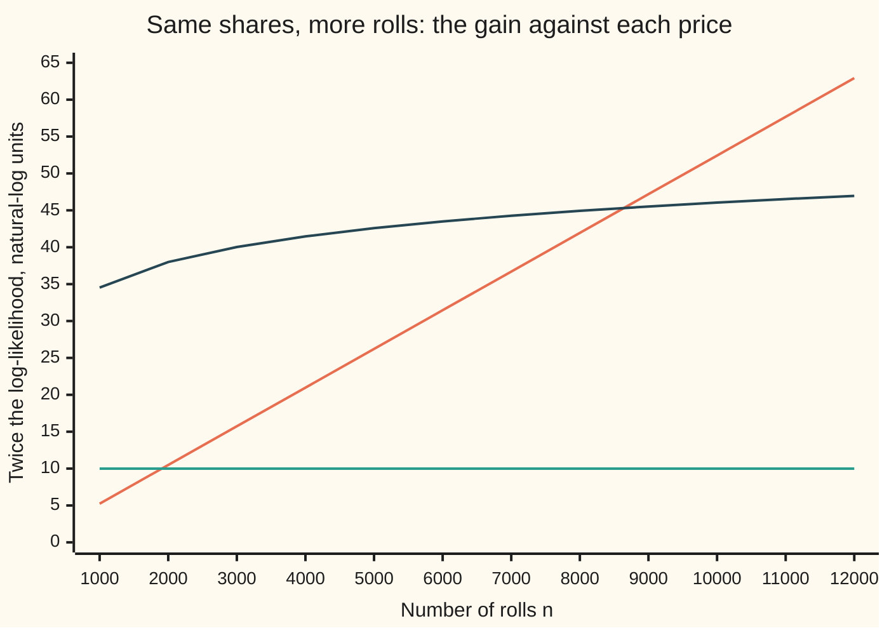

# AIC and BIC: scoring models by fit minus a price for each parameter

[Syllabus](../../../SYLLABUS.md) → [Probability and statistics](../README.md) → [Regression](../README.md#s09) → AIC and BIC

---

## General Overview

A casino inspector rolls a die 600 times. The six faces come up 88, 97, 100, 104, 99 and 112 times. A fair die would give about 100 each. Is this die fair, or loaded?

Two models compete. The **fair model** says every face has chance 1/6. It has nothing to adjust. The **free model** lets each face have its own chance, so it can match the counts exactly: 88/600, 97/600, and so on. Six chances that must add to 1 leave five free **parameters**: numbers the model sets from the data.

The free model always fits better. It can copy the fair model, or do better. The real question is whether its five extra numbers buy enough fit to be worth having. AIC and BIC answer by giving each model one score: badness of fit plus a price for every parameter. The lower score wins.

Badness of fit is measured as minus twice the log of the model's best **likelihood**: the chance it gives the data seen, with its parameters set as well as they can be ([Maximum likelihood](../07-Sampling%20and%20Estimation/04-maximum-likelihood.md)). The free model gains 3.146 in twice the log-likelihood. The **Akaike information criterion (AIC)** charges 2 per parameter, so 10. The **Bayesian information criterion (BIC)** charges the natural log of the number of rolls per parameter, so 5 × ln 600 = 31.98. Both prices exceed the gain, so both prefer the fair die: AIC by 6.85, BIC by 28.84.

```
What the free model gains, and what each criterion charges for it

gain in fit, 2 × log-likelihood  ███                                  3.146
AIC price, 2 × 5                 ██████████                          10.000
BIC price, 5 × ln 600            ████████████████████████████████    31.985
```

The two prices come from two different questions. AIC asks which model will predict a fresh 600 rolls best. BIC asks which model is more probably the true one. With few parameters and lots of data the questions part ways, and the prices with them.

**Score each model by minus twice its best log-likelihood plus a price per parameter: 2 for AIC, which estimates how well the model will predict new data, and the log of the sample size for BIC, which approximates how probable the model is given the data.**

**What kind of fact this is:** two approximations, each derived on this card in Why it works. AIC's price of 2 per parameter is a large-sample estimate of how much a fitted model flatters itself. BIC's price of ln n per parameter is the leading term of a large-sample approximation to a Bayesian quantity. Neither is a test, and neither gives a p-value.

---

## The formula

Notation first. A hat marks an estimate. $`\hat\ell`$ is a model's best log-likelihood: the natural log of its likelihood at the best-fitting parameters. $`k`$ counts the model's free parameters and $`n`$ the observations, here rolls.

```math
\mathrm{AIC} = -2\hat\ell + 2k, \qquad \mathrm{BIC} = -2\hat\ell + k\ln n
```

**Read it aloud:** each score is minus twice the best log-likelihood plus a price per parameter: 2 for AIC, the log of the sample size for BIC; the model with the lower score wins.

Only differences between models fed the same data mean anything. Unlike the likelihood ratio and F tests, AIC and BIC need no nesting (one model being a special case of the other): any two models fitted to the same data can be scored. For the die, with the free model's gain in fit written $`G`$:

```math
\Delta\mathrm{AIC} = \mathrm{AIC}_{\text{free}} - \mathrm{AIC}_{\text{fair}} = 2k - G, \qquad \Delta\mathrm{BIC} = k\ln n - G, \qquad G = 2\big(\hat\ell_{\text{free}} - \hat\ell_{\text{fair}}\big) = 2\sum_{j=1}^{6} c_j \ln\frac{c_j}{n/6}
```

**Read it aloud:** the free model's score minus the fair model's is its price minus its gain in fit; a positive difference means the fair die wins.

$`G`$ is the likelihood ratio statistic $`W`$ of [Likelihood ratio tests](../08-Confidence%20Intervals%20and%20Tests/07-likelihood-ratio-tests.md), written in its cell-by-cell form.

| Symbol | Plain meaning | In our example | Push it up and the answer… |
| --- | --- | --- | --- |
| $`n`$ | number of observations | 600 rolls | BIC's price rises; AIC's does not |
| $`c_j`$ | count of face $`j`$ | 88, 97, 100, 104, 99, 112 | further from 100: G grows |
| $`\theta_j`$, $`\hat\theta_j`$ | chance of face $`j`$, and its best fit, the observed share | fair: 1/6; free: 88/600 … 112/600 | — |
| $`k`$ | free parameters, the gap in parameter count when comparing | fair 0, free 5 | each criterion charges more |
| $`\hat\ell`$, $`T`$, $`L`$ | best log-likelihood, the expected log-likelihood the fitted model gives fresh data (Step 2), and the likelihood $`L(\theta)`$ at any parameter values | fair −1075.0557, free −1073.4828 | better fit, lower score |
| $`G`$ | twice the log-likelihood the free model gains | 3.1458 | the free model gains ground |
| AIC, BIC | the two scores, $`-2\hat\ell + 2k`$ and $`-2\hat\ell + k\ln n`$ | fair 2150.111 on both; free 2156.966 and 2178.950 | that model looks worse |
| $`W`$, $`\chi^2_k`$ | Wilks' likelihood ratio statistic, and the chi-square law with $`k`$ degrees of freedom it follows, which averages $`k`$ | G is W for the fair model | — |
| $`\Delta`$ | free model's score minus fair model's | ΔAIC 6.854, ΔBIC 28.839 | stronger case for the fair die |
| $`D`$, $`g`$, $`f`$ | Kullback–Leibler divergence: how far a model's chances $`f`$ sit from the true chances $`g`$ (Step 1) | — | the model predicts worse |
| $`m`$, $`\pi`$ | marginal likelihood (the data's chance averaged over the prior), and the prior: chances spread over the parameters before the data | uniform prior; ln m = −1085.4961 for the free model | that model is more probable |
| $`I`$, $`J`$ | Fisher information per observation: how sharply one roll pins the parameters; $`J`$ is its other form, the variance of one roll's score | — | the likelihood's peak is narrower |

### When it holds

- **The models are fitted by maximum likelihood to the same data.** Drop some rolls for one model and not the other, and the scores differ by those rolls' log-likelihood, which has nothing to do with which model is better.
- **Many observations per parameter.** Both prices come from large-sample expansions. AIC's small-sample correction, AICc, adds $`2k(k+1)/(n-k-1)`$; for the die that is only 0.1010, but it grows fast when $`n`$ is only a few times $`k`$.
- **AIC: the model is close to the truth.** The price of exactly 2 per parameter assumes the model family contains the truth or comes near it. Far from it, the true price is a trace of two information matrices, and 2k can be badly off.
- **BIC: the prior is smooth and does not depend on n.** BIC drops terms that do not grow with $`n`$, such as the prior's height at the fit. Here that dropped part is about 4 in log units (Step 3).
- **Smooth models with parameters inside their range.** As for Wilks' rule, a parameter on the edge of its range (a variance of 0, a mixture weight of 0) breaks both expansions.

---

## Why it works

### Step 0: a fitted model has seen its own noise, so its fit flatters it

The free model sets its five numbers to match these 600 rolls, chance wobbles included. On a fresh 600 rolls it would do worse, because those wobbles will not repeat. So the fit on the data used for fitting is too good, and each parameter adds to the flattery. [Overfitting](08-cross-validation-and-overfitting.md) measured this gap for least squares by holding data out. AIC estimates it from the parameter count instead. BIC arrives at a price per parameter from a different direction: averaging the fit over every value the parameters could have taken.

### Step 1: the target is the log-likelihood on fresh data

Score a fitted model by the log-likelihood it would give a fresh sample of the same size from the same source. A higher expected fresh log-likelihood means better predictions.

This target has a second name. Write $`g`$ for the true chances of the faces and $`f`$ for a model's chances. The **Kullback–Leibler divergence** is

```math
D(g\,\|\,f) = \sum_{j} g_j \ln\frac{g_j}{f_j}
```

**Read it aloud:** the average, over outcomes drawn from the truth, of the log of how much likelier the truth makes each outcome than the model does.

It is never negative, and it is zero only when the model's chances equal the truth's. The expected fresh log-likelihood per observation is $`\sum_j g_j \ln f_j`$, which is $`\sum_j g_j \ln g_j - D(g\,\|\,f)`$. The first part is the same for every model. So ranking models by expected fresh log-likelihood is ranking them by how close they come to the truth, in this sense. That is the "information" in the names.

The fresh log-likelihood cannot be computed, because the truth $`g`$ is unknown. The log-likelihood on the data in hand can be computed, but it is too high (Step 0). AIC is the second number, corrected.

### Step 2: the flattery averages k, so subtract k

The key result: when the model contains the truth and $`n`$ is large, the fit on the data in hand beats the expected fresh fit by $`k`$ on average. So $`\hat\ell - k`$ estimates the fresh log-likelihood without bias, to first order. Multiply by −2 to put it on the same scale as $`G`$, and you have AIC.

The $`k`$ comes in two halves of $`k/2`$:

1. **The fit climbs above the truth.** On the data in hand, the best-fitting parameters beat the true ones by $`\tfrac12 W`$, where $`W`$ is the likelihood ratio statistic for "parameters at their true values". By Wilks' rule, $`W`$ behaves like a chi-square variable with $`k`$ degrees of freedom, which averages $`k`$. So this half averages $`k/2`$.
2. **The fit falls below the truth on fresh data.** On fresh data the true parameters are the best on average, and the fitted ones miss them. The loss is a squared distance in units of the noise. It is the same kind of chi-square variable, so it averages $`k/2`$ too.

For the die, the check simulates thousands of 600-roll experiments and measures the gap directly. The free model's fit beats its expected fresh fit by 5.050 (standard error 0.041) on a fair die, and by 4.962 (0.069) on a die loaded like the data. Theory says $`k = 5`$.

<details>
<summary>Detailed derivation: the two halves of the k</summary>

Take $`n`$ independent observations from a model with $`k`$ parameters $`\theta`$ that contains the truth, at $`\theta_0`$. Write $`\ell(\theta; y)`$ for the log-likelihood of the data $`y`$, $`\hat\theta`$ for its maximiser, and $`y'`$ for a fresh sample of the same size. The target is the fresh fit $`T = E_{y'}\,\ell(\hat\theta; y')`$, with $`\hat\theta`$ held fixed. Split the gap into three pieces:

$`\displaystyle \ell(\hat\theta; y) - T = \big[\ell(\hat\theta; y) - \ell(\theta_0; y)\big] + \big[\ell(\theta_0; y) - E_{y'}\,\ell(\theta_0; y')\big] + \big[E_{y'}\,\ell(\theta_0; y') - T\big].`$

**The middle piece averages 0.** $`y`$ and $`y'`$ come from the same source, and $`\theta_0`$ does not depend on either.

**The first piece is half of Wilks' statistic.** It is $`\tfrac12 W`$ for the hypothesis $`\theta = \theta_0`$, which pins all $`k`$ parameters. By Wilks' rule ([Likelihood ratio tests](../08-Confidence%20Intervals%20and%20Tests/07-likelihood-ratio-tests.md)), $`W`$ is close to $`\chi^2_k`$, whose average is $`k`$. So this piece averages about $`k/2`$.

**The last piece is a squared distance.** The expected fresh log-likelihood $`E_{y'}\,\ell(\theta; y')`$ is a smooth function of $`\theta`$, highest at $`\theta_0`$, with curvature $`-nI`$ there; $`I`$ is the Fisher information per observation. Taylor's theorem around the peak, where the slope is 0, gives

$`\displaystyle E_{y'}\,\ell(\theta_0; y') - E_{y'}\,\ell(\hat\theta; y') \approx \tfrac12 (\hat\theta - \theta_0)^{\mathsf T}\, nI\, (\hat\theta - \theta_0).`$

By [Large-sample likelihood](../08-Confidence%20Intervals%20and%20Tests/09-mle-asymptotics-wald-and-score-tests.md), $`\hat\theta - \theta_0`$ is close to a normal vector with covariance $`(nI)^{-1}`$. So the quadratic form is close to a sum of $`k`$ squared standard normals, $`\chi^2_k`$ again, and this piece averages about $`k/2`$.

Adding: $`E\big[\ell(\hat\theta; y) - T\big] \approx k`$. So $`\hat\ell - k`$ estimates $`T`$, and $`-2(\hat\ell - k) = \mathrm{AIC}`$.

If the model does not contain the truth, the two halves become $`\tfrac12\,\mathrm{tr}(J I^{-1})`$ each. Here $`J`$ is the variance of one observation's score and $`I`$ the average curvature. They are equal, and the trace is $`k`$, only when the model is right. Using the trace gives a refinement called TIC; AIC keeps $`k`$.

</details>

### Step 3: BIC averages the likelihood over the prior instead of maximising it

A Bayesian compares models by the chance each gives the data before any fitting. That is the **marginal likelihood**:

```math
m = \int L(\theta)\,\pi(\theta)\,d\theta
```

**Read it aloud:** the likelihood averaged over every parameter value, weighted by the prior: how much chance the model spread on these data before seeing them.

The fair model has no parameters, so its marginal likelihood is its likelihood: $`\ln m = -1075.0557`$. The free model must spread its prior over every possible set of six chances. Most of them fit 600 rolls badly.

How much of the prior survives? With $`n`$ observations the likelihood is a narrow bump around $`\hat\theta`$, about $`1/\sqrt n`$ wide in each parameter. Averaging a bump of height $`L(\hat\theta)`$ and width $`1/\sqrt n`$ over a prior that spreads across a range of fixed size gives roughly $`L(\hat\theta) \times (1/\sqrt n)^k`$. Take logs:

```math
\ln m \approx \hat\ell - \tfrac{k}{2}\ln n = -\tfrac12\,\mathrm{BIC}
```

**Read it aloud:** the log marginal likelihood is the best log-likelihood minus half a log of the sample size per parameter, plus terms that do not grow with n.

Each parameter costs $`\tfrac12 \ln n`$ in log marginal likelihood because the data pin it down to a fraction $`1/\sqrt n`$ of where the prior allowed it to be. More data, narrower bump, bigger price. The difference in BIC between two models is then about −2 times the log of the **Bayes factor**: the ratio of their marginal likelihoods.

The exact calculation is possible for the die. With a uniform prior on the six chances, the free model's marginal likelihood has a closed form:

```math
m = \frac{5!\; c_1!\, c_2! \cdots c_6!}{(n+5)!}
```

**Read it aloud:** five factorial times the product of the counts' factorials, over the factorial of the rolls plus five.

For the 600 rolls, $`\ln m = -1085.4961`$. The full Laplace approximation (below) gives −1085.4761. BIC's leading term gives −1089.4751, 3.9790 too low. That gap is the prior's height and the bump's shape, which BIC drops. It does not shrink with more data: at 6,000 rolls with the same shares it is 3.9970.

So the log Bayes factor for fair against free is 10.4404 exactly, against BIC's 14.4194. Both say the fair die is overwhelmingly favoured. With even odds before the rolls, the free model's chance after them is 2.923e-05 exactly, 5.467e-07 by BIC. BIC gets the direction and the rough size right, not the precise odds.

<details>
<summary>Detailed derivation: the Laplace approximation and the die's exact marginal likelihood</summary>

**Laplace's method.** Near its peak, the log-likelihood is a parabola: $`\ell(\theta) \approx \hat\ell - \tfrac12 (\theta - \hat\theta)^{\mathsf T}\, nI\, (\theta - \hat\theta)`$. The prior barely changes across the narrow bump, so it can be taken out at $`\hat\theta`$. Below, $`2\pi`$ uses the number π = 3.14159, not the prior. The integral of a bell-shaped bump with curvature matrix $`nI`$ is $`(2\pi)^{k/2}\det(nI)^{-1/2}`$. So

$`\displaystyle \ln m \approx \hat\ell + \ln \pi(\hat\theta) + \tfrac{k}{2}\ln(2\pi) - \tfrac{k}{2}\ln n - \tfrac12 \ln\det I.`$

Only $`\hat\ell`$ and $`-\tfrac{k}{2}\ln n`$ grow with $`n`$. Dropping the rest leaves $`-\tfrac12\,\mathrm{BIC}`$, with an error that stays of fixed size as $`n`$ grows.

**For the die.** Take the first five chances as the parameters; the sixth is 1 minus their sum. The uniform prior has height $`5! = 120`$ on the set of allowed chances. The Fisher information per roll has determinant $`1/(\theta_1\theta_2\cdots\theta_6)`$. So the Laplace approximation is

$`\displaystyle \ln m \approx \hat\ell + \ln 120 + \tfrac52\ln(2\pi) - \tfrac52\ln n + \tfrac12\sum_{j=1}^{6}\ln\hat\theta_j = -1085.4761.`$

**Exactly.** The chance of one particular sequence of rolls with these counts is $`\theta_1^{c_1}\cdots\theta_6^{c_6}`$. Its average over the uniform prior is a Dirichlet integral, $`5!\,c_1!\cdots c_6!/(n+5)!`$. The check sums the logs of the integers in each factorial, so no library function supplies the answer: $`\ln m = -1085.4961`$.

</details>

### Step 4: why AIC and BIC disagree, and when

The two scores differ only in the price per parameter: 2 against $`\ln n`$. From $`n = 8`$ on, BIC charges more, since $`\ln n`$ passes 2 at $`n = 7.389`$. For the die's 5 extra parameters, AIC charges 10 at any sample size. BIC charges 31.98 at 600 rolls and 46.96 at 12,000.

They disagree whenever the gain $`G`$ lands between the two prices: here between 10 and 31.98. Then AIC picks the free model and BIC the fair one.

The different prices reflect different goals:

- **AIC aims at prediction.** It will sometimes pick a model that is too big, because a slightly too-big model costs little in prediction. On a truly fair die, AIC picks the free model whenever $`G > 10`$. In large samples that happens with chance 0.0752, whatever the number of rolls; the check's 6,000 simulated experiments give 0.0713.
- **BIC aims at the true model.** When one of the candidates is true, BIC's chance of picking it tends to 1 as $`n`$ grows: it is **consistent**. On the fair die its chance of wrongly picking the free model is 5.983e-06 at 600 rolls, and falls further as $`n`$ grows. None of the 6,000 simulated experiments did.
- **The cost of BIC's caution.** When a real effect is small, BIC needs much more data to see it. A die loaded exactly like these counts is detected by AIC from 1,908 rolls and by BIC only from 8,645 (How the verdicts move, below).

---

## Worked numbers, by hand

The die: 600 rolls, counts 88, 97, 100, 104, 99, 112. The fair model expects 100 of each.

| Step | Arithmetic | Value |
| --- | --- | --- |
| cell terms $`2c_j\ln(c_j/100)`$ | 2 × 88 × ln 0.88, …, 2 × 112 × ln 1.12 | −22.4987, −5.9091, 0.0000, 8.1579, −1.9900, 25.3856 |
| gain $`G`$ | sum of the six | 3.1458 |
| fair model, $`\hat\ell`$ | 600 × ln(1/6) | −1075.0557 |
| free model, $`\hat\ell`$ | −1075.0557 + 3.1458 / 2 | −1073.4828 |
| AIC, fair | 2 × 1075.0557 + 0 | 2150.111 |
| AIC, free | 2 × 1073.4828 + 2 × 5 | 2156.966 |
| BIC, free | 2 × 1073.4828 + 5 × ln 600 = 2146.966 + 31.985 | 2178.950 |
| **ΔAIC** | 10 − 3.1458 | **6.854** |
| **ΔBIC** | 31.985 − 3.1458 | **28.839** |

Both differences are positive, so both criteria prefer the fair die. In AIC's terms, the free model's expected log-likelihood on fresh rolls is estimated at −1073.4828 − 5 = −1078.483, below the fair model's −1075.056. Fitting five chances to these rolls would make predictions of the next 600 rolls worse, not better.

AIC differences are often turned into **Akaike weights**, $`e^{-\Delta/2}`$ normalised to add to 1: a rough share of support for each model. The free model's weight is 0.0315.

For comparison, the likelihood ratio test gives $`G = 3.1458`$ against a chi-square with 5 degrees of freedom: p = 0.6775, far from the 5% cutoff of 11.0705. All three methods agree here. Pearson's $`X^2`$, the sum of (count − 100)² / 100, is 3.1400, close to $`G`$, as the parabola argument on [Likelihood ratio tests](../08-Confidence%20Intervals%20and%20Tests/07-likelihood-ratio-tests.md) predicts.

### What breaks if you drop a piece

| Mistake | Comes out at | What went wrong |
| --- | --- | --- |
| Count all six chances as parameters | ΔAIC 8.854, ΔBIC 35.236 | The six chances add to 1, so only five are free |
| BIC with $`n = 6`$, the number of faces | price 8.959, ΔBIC 5.813: now below AIC's | $`n`$ counts observations, the 600 rolls |
| BIC with log base 10 | price 13.891, ΔBIC 10.745 | Both formulas use natural logs; base 10 shrinks the price |
| Drop the 2 on the log-likelihood | gain 1.573 against 10, margin 8.427 | The price 2k is set for twice the log-likelihood; halving the gain tilts every comparison toward the small model |

Here the verdict survives each mistake. With a closer call, such as the heavier six in Try changing, each one can flip it.

---

## How the verdicts move with more rolls

Keep the shares fixed, 88/600 through 112/600, and roll more. Every count scales up, so the gain $`G`$ grows in direct proportion to $`n`$: 3.1458 per 600 rolls. AIC's price stays at 10. BIC's price grows only as $`\ln n`$.

| Rolls | Gain $`G`$ | ΔAIC | ΔBIC | AIC picks | BIC picks |
| ---: | ---: | ---: | ---: | --- | --- |
| 600 | 3.146 | 6.854 | 28.839 | fair | fair |
| 2,400 | 12.583 | −2.583 | 26.333 | free | fair |
| 6,000 | 31.458 | −21.458 | 12.039 | free | fair |



Orange line: the free model's gain $`G`$, a straight line through 0. Teal line: AIC's price, flat at 10. Dark line: BIC's price, $`5\ln n`$, rising ever more slowly. The gain first beats AIC's price at 1,908 rolls and BIC's at 8,645; by 12,000 rolls it reaches 62.92 against BIC's 46.96, and both pick the free model. Between the two, the criteria disagree. Any real load, however small, makes $`G`$ grow in step with $`n`$, so it eventually beats $`\ln n`$ too: BIC always gets there, later.

---

## Code, from first principles, and it actually runs

The scripts compute both scores for the die and check every step by a second road. The gain $`G`$ comes from two log-likelihoods and again cell by cell, and 20,000 random nearby sets of chances confirm none beats the observed shares. AIC's price is checked by simulation: thousands of 600-roll experiments, with random numbers from a SplitMix64 generator written out in both languages, measure how much the fit flatters itself. BIC is checked against the exact marginal likelihood, built from sums of logs of integers, and against the full Laplace approximation. The chi-square tail uses the bell curve's area by a Taylor series, and the 5% cutoff comes from bisection (halving an interval that holds the answer). The two switch points are checked by recomputing $`G`$ from the counts scaled to that many rolls. Every number on the card, including every chart point, is printed below.

### Python

```python
# AIC and BIC -- the check behind the card.  Standard library only.
# Is a die fair?  600 rolls with counts 88, 97, 100, 104, 99, 112.
# Fair model: every face 1/6, no free parameter.  Free model: six shares summing to 1, five free.
from math import log, exp, sqrt, pi, ceil

def Phi(x):                                   # bell-curve area left of x, Taylor series of erf
    y = x / sqrt(2.0)
    t, s, n = y, 0.0, 0
    while abs(t) > 1e-17:
        s, n = s + t / (2 * n + 1), n + 1
        t *= -y * y / n
    return 0.5 + s / sqrt(pi)

def tail5(x):                                 # chance a chi-square with 5 degrees of freedom exceeds x
    return 2 * (1 - Phi(sqrt(x))) + sqrt(2 * x / pi) * exp(-x / 2) * (1 + x / 3)

def bisect(f, lo, hi):                        # root of f between lo and hi, f(lo) and f(hi) of opposite sign
    for _ in range(200):
        mid = (lo + hi) / 2
        lo, hi = (mid, hi) if (f(lo) > 0) == (f(mid) > 0) else (lo, mid)
    return (lo + hi) / 2

def loglik(c, p): return sum(ci * log(pi_) for ci, pi_ in zip(c, p))
def lnfact(m): return sum(log(i) for i in range(2, m + 1))   # ln m!, summed log by log

def splitmix(state):
    state = (state + 0x9E3779B97F4A7C15) & 0xFFFFFFFFFFFFFFFF
    z = state
    z = ((z ^ (z >> 30)) * 0xBF58476D1CE4E5B9) & 0xFFFFFFFFFFFFFFFF
    z = ((z ^ (z >> 27)) * 0x94D049BB133111EB) & 0xFFFFFFFFFFFFFFFF
    return state, (z ^ (z >> 31)) >> 11

def scores(c):                                # gain G, AIC margin and BIC margin (fair model's lead)
    n = sum(c)
    G = 2 * (loglik(c, [ci / n for ci in c]) - loglik(c, [1 / 6] * 6))
    return G, 10 - G, 5 * log(n) - G

c = [88, 97, 100, 104, 99, 112]; n = sum(c); k = 5
l0 = loglik(c, [1 / 6] * 6)                   # fair model: nothing to fit
lhat = loglik(c, [ci / n for ci in c])        # free model: best shares are the observed fractions
G = 2 * (lhat - l0)
cells = [2 * ci * log(ci / 100) for ci in c]  # road 2 for G: cell by cell, 2 O ln(O/E)
print("cells 2*O*ln(O/100):", " ".join(f"{v:.4f}" for v in cells))
print(f"loglik fair = {l0:.4f}; free = {lhat:.4f}; gain G = {G:.4f} (cells sum {sum(cells):.4f})")
X2 = sum((ci - 100) ** 2 / 100 for ci in c)
print(f"Pearson X^2 = {X2:.4f}; LRT p = {tail5(G):.4f}; 5% cutoff = {bisect(lambda x: tail5(x) - 0.05, 0.1, 50):.4f}")
s, best = 20261123, lhat                      # road 3: random nearby shares never beat the fractions
for _ in range(20000):
    q = []
    for ci in c:
        s, r = splitmix(s)
        q.append(ci / n * (1 + 0.02 * (r / 2 ** 53 - 0.5)))
    best = max(best, loglik(c, [qi / sum(q) for qi in q]))
assert best == lhat and abs(G - sum(cells)) < 1e-9 and abs(G - X2) < 0.02
aic0, aic1 = -2 * l0, -2 * lhat + 2 * k
bic0, bic1 = -2 * l0, -2 * lhat + k * log(n)
print(f"AIC fair = {aic0:.3f}; AIC free = {aic1:.3f}; difference = {aic1 - aic0:.3f}")
print(f"BIC fair = {bic0:.3f}; BIC free = {bic1:.3f}; difference = {bic1 - bic0:.3f}; 5 ln 600 = {k * log(n):.3f}")
print(f"AIC as fresh loglik: fair {l0:.3f}, free {lhat - k:.3f}; Akaike weight of free = {1 / (1 + exp((aic1 - aic0) / 2)):.4f}")
print(f"AICc extra penalty 2k(k+1)/(n-k-1) = {2 * k * (k + 1) / (n - k - 1):.4f}")
assert abs(aic1 - aic0 - 6.854) < 5e-4
assert abs(bic1 - bic0 - 28.839) < 5e-4
# ---- BIC road: exact log marginal likelihood, uniform prior on the shares (Dirichlet(1,...,1)) ----
lm_exact = lnfact(5) + sum(lnfact(ci) for ci in c) - lnfact(n + 5)
lm_laplace = lhat + log(120) + 2.5 * log(2 * pi) - 2.5 * log(n) + 0.5 * sum(log(ci / n) for ci in c)
lm_bic = lhat - 2.5 * log(n)
print(f"ln marginal lik, free: exact {lm_exact:.4f}; Laplace {lm_laplace:.4f}; BIC form {lm_bic:.4f}")
print(f"ln Bayes factor fair:free: exact {l0 - lm_exact:.4f}; Laplace {l0 - lm_laplace:.4f}; BIC/2 {(bic1 - bic0) / 2:.4f}")
print(f"chance free model is right, even prior odds: exact {1 / (1 + exp(l0 - lm_exact)):.3e}; BIC {1 / (1 + exp((bic1 - bic0) / 2)):.3e}")
c10 = [10 * ci for ci in c]                   # ten times the rolls: BIC's dropped constant stays put
gap10 = lnfact(5) + sum(lnfact(ci) for ci in c10) - lnfact(10 * n + 5) - (loglik(c10, [ci / n for ci in c]) - 2.5 * log(10 * n))
print(f"exact minus BIC form: {lm_exact - lm_bic:.4f} at 600 rolls, {gap10:.4f} at 6000 rolls")
assert abs(lm_exact - lm_laplace) < 0.05
assert abs(gap10 - (lm_exact - lm_bic)) < 0.05
# ---- AIC road: simulate the optimism, training loglik minus expected fresh loglik ----
def simulate(p, reps, s):
    opt, pick_a, pick_b, cum = [], 0, 0, [sum(p[:j + 1]) for j in range(5)] + [1.0]
    for _ in range(reps):
        cnt = [0] * 6
        for _ in range(n):
            s, r = splitmix(s)
            u = r / 2 ** 53
            cnt[next(j for j in range(6) if u < cum[j])] += 1
        if min(cnt) == 0: continue
        th = [x / n for x in cnt]
        opt.append(loglik(cnt, th) - n * sum(pj * log(t) for pj, t in zip(p, th)))
        g = scores(cnt)[0]
        pick_a, pick_b = pick_a + (g > 10), pick_b + (g > 5 * log(n))
    m = sum(opt) / len(opt)
    se = sqrt(sum((o - m) ** 2 for o in opt) / (len(opt) - 1) / len(opt))
    return m, se, pick_a / reps, pick_b / reps
mf, sef, af, bf = simulate([1 / 6] * 6, 6000, 7)
ml, sel, al, bl = simulate([ci / n for ci in c], 3000, 11)
print(f"optimism, fair die: {mf:.3f} (se {sef:.3f}); die loaded like the data: {ml:.3f} (se {sel:.3f}); theory k = 5")
print(f"fair die, share choosing free: AIC {af:.4f} (theory {tail5(10):.4f}); BIC {bf:.4f} (theory {tail5(5 * log(n)):.3e})")
assert abs(mf - 5) < 3 * sef + 0.1 and abs(ml - 5) < 3 * sel + 0.1 and abs(af - tail5(10)) < 0.01
# ---- the chart: same shares, more rolls; G grows in step with n, the penalties do not ----
gpr = G / n
print("chart n:", " ".join(str(m) for m in range(1000, 12001, 1000)))
print("chart G:", " ".join(f"{gpr * m:.2f}" for m in range(1000, 12001, 1000)))
print("chart AIC penalty:", " ".join(f"{2 * k:.2f}" for m in range(1000, 12001, 1000)))
print("chart BIC penalty:", " ".join(f"{5 * log(m):.2f}" for m in range(1000, 12001, 1000)))
na, nb = ceil(10 / gpr), bisect(lambda m: gpr * m - 5 * log(m), 1000, 100000)   # first whole n past AIC's price; BIC's crossing
print(f"AIC switches to free at n = {na}; BIC switches at n = {ceil(nb)}; ln n passes 2 at n = {exp(2):.3f}")
scaled = lambda m: scores([ci * m / n for ci in c])   # road 2: G recomputed from the counts scaled to m rolls
assert scaled(na)[1] < 0 < scaled(na - 1)[1] and abs(scaled(nb)[2]) < 1e-6 and abs(scaled(6000)[0] - gpr * 6000) < 1e-9
# ---- what breaks ----
print(f"count 6 parameters: AIC margin {12 - G:.3f}, BIC margin {6 * log(n) - G:.3f}")
print(f"BIC with n = 6 faces: penalty {5 * log(6):.3f}, margin {5 * log(6) - G:.3f}")
print(f"BIC with log10: penalty {5 * log(n) / log(10):.3f}, margin {5 * log(n) / log(10) - G:.3f}")
print(f"drop the 2 on the loglik: {G / 2:.3f} against 10, margin {10 - G / 2:.3f}")
# ---- try changing ----
for name, t in [("x4 rolls", [4 * ci for ci in c]), ("x10 rolls", [10 * ci for ci in c]),
                ("heavier six", [85, 90, 95, 100, 100, 130])]:
    g, a, b = scores(t)
    print(f"try {name} (n = {sum(t)}): G = {g:.3f}, AIC margin {a:.3f}, BIC margin {b:.3f}, LRT p {tail5(g):.4f}")
print("ALL CHECKS PASS")
```

**Ran 2026-11-23 on macOS, Python 3.14.10, standard library only. All checks passed. Output, pasted from the run:**

```
cells 2*O*ln(O/100): -22.4987 -5.9091 0.0000 8.1579 -1.9900 25.3856
loglik fair = -1075.0557; free = -1073.4828; gain G = 3.1458 (cells sum 3.1458)
Pearson X^2 = 3.1400; LRT p = 0.6775; 5% cutoff = 11.0705
AIC fair = 2150.111; AIC free = 2156.966; difference = 6.854
BIC fair = 2150.111; BIC free = 2178.950; difference = 28.839; 5 ln 600 = 31.985
AIC as fresh loglik: fair -1075.056, free -1078.483; Akaike weight of free = 0.0315
AICc extra penalty 2k(k+1)/(n-k-1) = 0.1010
ln marginal lik, free: exact -1085.4961; Laplace -1085.4761; BIC form -1089.4751
ln Bayes factor fair:free: exact 10.4404; Laplace 10.4204; BIC/2 14.4194
chance free model is right, even prior odds: exact 2.923e-05; BIC 5.467e-07
exact minus BIC form: 3.9790 at 600 rolls, 3.9970 at 6000 rolls
optimism, fair die: 5.050 (se 0.041); die loaded like the data: 4.962 (se 0.069); theory k = 5
fair die, share choosing free: AIC 0.0713 (theory 0.0752); BIC 0.0000 (theory 5.983e-06)
chart n: 1000 2000 3000 4000 5000 6000 7000 8000 9000 10000 11000 12000
chart G: 5.24 10.49 15.73 20.97 26.22 31.46 36.70 41.94 47.19 52.43 57.67 62.92
chart AIC penalty: 10.00 10.00 10.00 10.00 10.00 10.00 10.00 10.00 10.00 10.00 10.00 10.00
chart BIC penalty: 34.54 38.00 40.03 41.47 42.59 43.50 44.27 44.94 45.52 46.05 46.53 46.96
AIC switches to free at n = 1908; BIC switches at n = 8645; ln n passes 2 at n = 7.389
count 6 parameters: AIC margin 8.854, BIC margin 35.236
BIC with n = 6 faces: penalty 8.959, margin 5.813
BIC with log10: penalty 13.891, margin 10.745
drop the 2 on the loglik: 1.573 against 10, margin 8.427
try x4 rolls (n = 2400): G = 12.583, AIC margin -2.583, BIC margin 26.333, LRT p 0.0276
try x10 rolls (n = 6000): G = 31.458, AIC margin -21.458, BIC margin 12.039, LRT p 0.0000
try heavier six (n = 600): G = 11.876, AIC margin -1.876, BIC margin 20.109, LRT p 0.0365
ALL CHECKS PASS
```

### Rust

```rust
// AIC and BIC -- the check behind the card.  Rust std only, no crates.
// Is a die fair?  600 rolls with counts 88, 97, 100, 104, 99, 112.
// Fair model: every face 1/6, no free parameter.  Free model: six shares summing to 1, five free.
use std::f64::consts::PI;

fn phi(x: f64) -> f64 { // bell-curve area left of x, Taylor series of erf
    let y = x / 2f64.sqrt();
    let (mut t, mut s, mut n) = (y, 0.0, 0.0);
    while t.abs() > 1e-17 { s += t / (2.0 * n + 1.0); n += 1.0; t *= -y * y / n; }
    0.5 + s / PI.sqrt()
}
fn tail5(x: f64) -> f64 { // chance a chi-square with 5 degrees of freedom exceeds x
    2.0 * (1.0 - phi(x.sqrt())) + (2.0 * x / PI).sqrt() * (-x / 2.0).exp() * (1.0 + x / 3.0)
}
fn bisect<F: Fn(f64) -> f64>(f: F, mut lo: f64, mut hi: f64) -> f64 {
    for _ in 0..200 {
        let mid = (lo + hi) / 2.0;
        if (f(lo) > 0.0) == (f(mid) > 0.0) { lo = mid } else { hi = mid }
    }
    (lo + hi) / 2.0
}
fn loglik(c: &[f64], p: &[f64]) -> f64 { c.iter().zip(p).map(|(ci, pi)| ci * pi.ln()).fold(0.0, |a, b| a + b) }
fn lnfact(m: u64) -> f64 { (2..=m).map(|i| (i as f64).ln()).fold(0.0, |a, b| a + b) } // ln m!
fn splitmix(state: u64) -> (u64, u64) {
    let state = state.wrapping_add(0x9E3779B97F4A7C15);
    let mut z = state;
    z = (z ^ (z >> 30)).wrapping_mul(0xBF58476D1CE4E5B9);
    z = (z ^ (z >> 27)).wrapping_mul(0x94D049BB133111EB);
    (state, (z ^ (z >> 31)) >> 11)
}
fn shares(c: &[f64]) -> Vec<f64> { let n: f64 = c.iter().fold(0.0, |a, b| a + b); c.iter().map(|x| x / n).collect() }
fn scores(c: &[f64]) -> (f64, f64, f64) { // gain G, AIC margin, BIC margin (fair model's lead)
    let n: f64 = c.iter().fold(0.0, |a, b| a + b);
    let g = 2.0 * (loglik(c, &shares(c)) - loglik(c, &[1.0 / 6.0; 6]));
    (g, 10.0 - g, 5.0 * n.ln() - g)
}
fn sci(x: f64) -> String { // Python's {:.3e}: two-digit signed exponent
    let s = format!("{:.3e}", x);
    let (m, e) = s.split_once('e').unwrap();
    let e: i32 = e.parse().unwrap();
    format!("{}e{}{:02}", m, if e < 0 { '-' } else { '+' }, e.abs())
}
fn join(v: &[f64], d: usize) -> String { v.iter().map(|x| format!("{:.*}", d, x)).collect::<Vec<_>>().join(" ") }

fn simulate(p: &[f64], reps: usize, mut s: u64, n: usize) -> (f64, f64, f64, f64) {
    let mut cum: Vec<f64> = (0..5).map(|j| p[..j + 1].iter().fold(0.0, |a, b| a + b)).collect();
    cum.push(1.0);
    let (mut opt, mut pa, mut pb) = (Vec::new(), 0usize, 0usize);
    let nf = n as f64;
    for _ in 0..reps {
        let mut cnt = [0.0f64; 6];
        for _ in 0..n {
            let (s2, r) = splitmix(s); s = s2;
            let u = r as f64 / 2f64.powi(53);
            let j = (0..6).find(|&j| u < cum[j]).unwrap();
            cnt[j] += 1.0;
        }
        if cnt.iter().any(|&x| x == 0.0) { continue; }
        let th: Vec<f64> = cnt.iter().map(|x| x / nf).collect();
        let fresh = nf * p.iter().zip(&th).map(|(pj, t)| pj * t.ln()).fold(0.0, |a, b| a + b);
        opt.push(loglik(&cnt, &th) - fresh);
        let g = scores(&cnt).0;
        if g > 10.0 { pa += 1 }
        if g > 5.0 * nf.ln() { pb += 1 }
    }
    let k = opt.len() as f64;
    let m = opt.iter().fold(0.0, |a, b| a + b) / k;
    let se = (opt.iter().map(|o| (o - m) * (o - m)).fold(0.0, |a, b| a + b) / (k - 1.0) / k).sqrt();
    (m, se, pa as f64 / reps as f64, pb as f64 / reps as f64)
}

fn main() {
    let c = [88.0, 97.0, 100.0, 104.0, 99.0, 112.0];
    let n = 600.0f64; let k = 5.0;
    let l0 = loglik(&c, &[1.0 / 6.0; 6]); // fair model: nothing to fit
    let lhat = loglik(&c, &shares(&c));   // free model: best shares are the observed fractions
    let g = 2.0 * (lhat - l0);
    let cells: Vec<f64> = c.iter().map(|ci| 2.0 * ci * (ci / 100.0).ln()).collect();
    let csum = cells.iter().fold(0.0, |a, b| a + b);
    println!("cells 2*O*ln(O/100): {}", join(&cells, 4));
    println!("loglik fair = {:.4}; free = {:.4}; gain G = {:.4} (cells sum {:.4})", l0, lhat, g, csum);
    let x2 = c.iter().map(|ci| (ci - 100.0) * (ci - 100.0) / 100.0).fold(0.0, |a, b| a + b);
    println!("Pearson X^2 = {:.4}; LRT p = {:.4}; 5% cutoff = {:.4}", x2, tail5(g), bisect(|x| tail5(x) - 0.05, 0.1, 50.0));
    let (mut s, mut best) = (20261123u64, lhat); // random nearby shares never beat the fractions
    for _ in 0..20000 {
        let mut q = Vec::new();
        for ci in c.iter() { let (s2, r) = splitmix(s); s = s2; q.push(ci / n * (1.0 + 0.02 * (r as f64 / 2f64.powi(53) - 0.5))); }
        best = best.max(loglik(&c, &shares(&q)));
    }
    assert!(best == lhat && (g - csum).abs() < 1e-9 && (g - x2).abs() < 0.02);
    let (aic0, aic1) = (-2.0 * l0, -2.0 * lhat + 2.0 * k);
    let (bic0, bic1) = (-2.0 * l0, -2.0 * lhat + k * n.ln());
    println!("AIC fair = {:.3}; AIC free = {:.3}; difference = {:.3}", aic0, aic1, aic1 - aic0);
    println!("BIC fair = {:.3}; BIC free = {:.3}; difference = {:.3}; 5 ln 600 = {:.3}", bic0, bic1, bic1 - bic0, k * n.ln());
    println!("AIC as fresh loglik: fair {:.3}, free {:.3}; Akaike weight of free = {:.4}", l0, lhat - k, 1.0 / (1.0 + ((aic1 - aic0) / 2.0).exp()));
    println!("AICc extra penalty 2k(k+1)/(n-k-1) = {:.4}", 2.0 * k * (k + 1.0) / (n - k - 1.0));
    assert!((aic1 - aic0 - 6.854).abs() < 5e-4);
    assert!((bic1 - bic0 - 28.839).abs() < 5e-4);
    // ---- BIC road: exact log marginal likelihood, uniform prior on the shares ----
    let ci_u: Vec<u64> = c.iter().map(|&x| x as u64).collect();
    let lm_exact = lnfact(5) + ci_u.iter().map(|&x| lnfact(x)).fold(0.0, |a, b| a + b) - lnfact(605);
    let lm_laplace = lhat + 120f64.ln() + 2.5 * (2.0 * PI).ln() - 2.5 * n.ln() + 0.5 * c.iter().map(|ci| (ci / n).ln()).fold(0.0, |a, b| a + b);
    let lm_bic = lhat - 2.5 * n.ln();
    println!("ln marginal lik, free: exact {:.4}; Laplace {:.4}; BIC form {:.4}", lm_exact, lm_laplace, lm_bic);
    println!("ln Bayes factor fair:free: exact {:.4}; Laplace {:.4}; BIC/2 {:.4}", l0 - lm_exact, l0 - lm_laplace, (bic1 - bic0) / 2.0);
    println!("chance free model is right, even prior odds: exact {}; BIC {}", sci(1.0 / (1.0 + (l0 - lm_exact).exp())), sci(1.0 / (1.0 + ((bic1 - bic0) / 2.0).exp())));
    let c10: Vec<f64> = c.iter().map(|ci| 10.0 * ci).collect(); // ten times the rolls
    let gap10 = lnfact(5) + ci_u.iter().map(|&x| lnfact(10 * x)).fold(0.0, |a, b| a + b) - lnfact(6005) - (loglik(&c10, &shares(&c)) - 2.5 * (10.0 * n).ln());
    println!("exact minus BIC form: {:.4} at 600 rolls, {:.4} at 6000 rolls", lm_exact - lm_bic, gap10);
    assert!((lm_exact - lm_laplace).abs() < 0.05);
    assert!((gap10 - (lm_exact - lm_bic)).abs() < 0.05);
    // ---- AIC road: simulate the optimism ----
    let (mf, sef, af, bf) = simulate(&[1.0 / 6.0; 6], 6000, 7, 600);
    let (ml, sel, _, _) = simulate(&shares(&c), 3000, 11, 600);
    println!("optimism, fair die: {:.3} (se {:.3}); die loaded like the data: {:.3} (se {:.3}); theory k = 5", mf, sef, ml, sel);
    println!("fair die, share choosing free: AIC {:.4} (theory {:.4}); BIC {:.4} (theory {})", af, tail5(10.0), bf, sci(tail5(5.0 * n.ln())));
    assert!((mf - 5.0).abs() < 3.0 * sef + 0.1 && (ml - 5.0).abs() < 3.0 * sel + 0.1 && (af - tail5(10.0)).abs() < 0.01);
    // ---- the chart ----
    let gpr = g / n;
    let ns: Vec<f64> = (1..=12).map(|i| 1000.0 * i as f64).collect();
    println!("chart n: {}", join(&ns, 0));
    println!("chart G: {}", join(&ns.iter().map(|m| gpr * m).collect::<Vec<_>>(), 2));
    println!("chart AIC penalty: {}", join(&ns.iter().map(|_| 2.0 * k).collect::<Vec<_>>(), 2));
    println!("chart BIC penalty: {}", join(&ns.iter().map(|m| 5.0 * m.ln()).collect::<Vec<_>>(), 2));
    let (na, nb) = ((10.0 / gpr).ceil(), bisect(|m| gpr * m - 5.0 * m.ln(), 1000.0, 100000.0)); // first whole n past AIC's price; BIC's crossing
    println!("AIC switches to free at n = {:.0}; BIC switches at n = {:.0}; ln n passes 2 at n = {:.3}", na, nb.ceil(), 2f64.exp());
    let scaled = |m: f64| scores(&c.iter().map(|ci| ci * m / n).collect::<Vec<f64>>()); // road 2: G from the counts scaled to m rolls
    assert!(scaled(na).1 < 0.0 && 0.0 < scaled(na - 1.0).1 && scaled(nb).2.abs() < 1e-6 && (scaled(6000.0).0 - gpr * 6000.0).abs() < 1e-9);
    // ---- what breaks ----
    println!("count 6 parameters: AIC margin {:.3}, BIC margin {:.3}", 12.0 - g, 6.0 * n.ln() - g);
    println!("BIC with n = 6 faces: penalty {:.3}, margin {:.3}", 5.0 * 6f64.ln(), 5.0 * 6f64.ln() - g);
    println!("BIC with log10: penalty {:.3}, margin {:.3}", 5.0 * n.ln() / 10f64.ln(), 5.0 * n.ln() / 10f64.ln() - g);
    println!("drop the 2 on the loglik: {:.3} against 10, margin {:.3}", g / 2.0, 10.0 - g / 2.0);
    // ---- try changing ----
    let tries: [(&str, Vec<f64>); 3] = [("x4 rolls", c.iter().map(|x| 4.0 * x).collect()),
        ("x10 rolls", c10.clone()), ("heavier six", vec![85.0, 90.0, 95.0, 100.0, 100.0, 130.0])];
    for (name, t) in tries.iter() {
        let (gg, a, b) = scores(t);
        println!("try {} (n = {}): G = {:.3}, AIC margin {:.3}, BIC margin {:.3}, LRT p {:.4}", name, t.iter().fold(0.0, |a, b| a + b), gg, a, b, tail5(gg));
    }
    println!("ALL CHECKS PASS");
}
```

**Ran 2026-11-23 on macOS, rustc 1.98.1, no crates. All checks passed. Output, pasted from the run:**

```
cells 2*O*ln(O/100): -22.4987 -5.9091 0.0000 8.1579 -1.9900 25.3856
loglik fair = -1075.0557; free = -1073.4828; gain G = 3.1458 (cells sum 3.1458)
Pearson X^2 = 3.1400; LRT p = 0.6775; 5% cutoff = 11.0705
AIC fair = 2150.111; AIC free = 2156.966; difference = 6.854
BIC fair = 2150.111; BIC free = 2178.950; difference = 28.839; 5 ln 600 = 31.985
AIC as fresh loglik: fair -1075.056, free -1078.483; Akaike weight of free = 0.0315
AICc extra penalty 2k(k+1)/(n-k-1) = 0.1010
ln marginal lik, free: exact -1085.4961; Laplace -1085.4761; BIC form -1089.4751
ln Bayes factor fair:free: exact 10.4404; Laplace 10.4204; BIC/2 14.4194
chance free model is right, even prior odds: exact 2.923e-05; BIC 5.467e-07
exact minus BIC form: 3.9790 at 600 rolls, 3.9970 at 6000 rolls
optimism, fair die: 5.050 (se 0.041); die loaded like the data: 4.962 (se 0.069); theory k = 5
fair die, share choosing free: AIC 0.0713 (theory 0.0752); BIC 0.0000 (theory 5.983e-06)
chart n: 1000 2000 3000 4000 5000 6000 7000 8000 9000 10000 11000 12000
chart G: 5.24 10.49 15.73 20.97 26.22 31.46 36.70 41.94 47.19 52.43 57.67 62.92
chart AIC penalty: 10.00 10.00 10.00 10.00 10.00 10.00 10.00 10.00 10.00 10.00 10.00 10.00
chart BIC penalty: 34.54 38.00 40.03 41.47 42.59 43.50 44.27 44.94 45.52 46.05 46.53 46.96
AIC switches to free at n = 1908; BIC switches at n = 8645; ln n passes 2 at n = 7.389
count 6 parameters: AIC margin 8.854, BIC margin 35.236
BIC with n = 6 faces: penalty 8.959, margin 5.813
BIC with log10: penalty 13.891, margin 10.745
drop the 2 on the loglik: 1.573 against 10, margin 8.427
try x4 rolls (n = 2400): G = 12.583, AIC margin -2.583, BIC margin 26.333, LRT p 0.0276
try x10 rolls (n = 6000): G = 31.458, AIC margin -21.458, BIC margin 12.039, LRT p 0.0000
try heavier six (n = 600): G = 11.876, AIC margin -1.876, BIC margin 20.109, LRT p 0.0365
ALL CHECKS PASS
```

### Lean

Lean proves the die's score formulas for any counts above 0, and BIC's switch at 8 for every $`n`$.

- Take any die counts, all above 0. Then no chances above 0 that add to 1 beat the observed shares' log-likelihood.
- Take the same counts. Then $`G`$ equals its cell-by-cell sum in The formula, and $`G`$ is never negative.
- Take the same counts. Then $`\Delta\mathrm{AIC} = 10 - G`$ and $`\Delta\mathrm{BIC} = 5\ln n - G`$.
- BIC's price per parameter, $`\ln n`$, is above AIC's 2 exactly when $`n`$ is at least 8.
- Take counts with $`G`$ above 0, and multiply every count by the same whole number. Then $`G`$ is multiplied by that number.
- Take the same counts. Then for every large enough multiple, BIC picks the free model.
- The small sums hold exactly: 600 rolls, Pearson's $`X^2 = 314/100`$, 2,400 and 6,000 rolls, and the heavier six's 600 rolls.
- So do AIC's price 2 × 5 = 10, AICc's extra 10/99, and the prior height 5! = 120.

The decimals, the marginal likelihoods, the simulations and the large-sample prices are left to the Python and Rust checks.

```lean
-- AIC and BIC: for a die's counts, the free model's best fit is the observed shares, each criterion's difference is its price minus the gain G, BIC's price per parameter beats AIC's exactly from n = 8 on, and any real load eventually wins under BIC.
import Mathlib.Analysis.SpecialFunctions.Log.Basic
import Mathlib.Analysis.SpecialFunctions.Pow.Asymptotics
import Mathlib.Algebra.BigOperators.Fin
import Mathlib.Order.Filter.AtTopBot.Basic
import Mathlib.Tactic.NormNum
import Mathlib.Analysis.Complex.ExponentialBounds
import Mathlib.Algebra.BigOperators.Field

open Finset Filter

/-- The log-likelihood of a die's counts `c j` (face `j` came up `c j` times) under chances
`θ j`: `ℓ(θ) = ∑ⱼ cⱼ ln θⱼ`. -/
noncomputable def logLik (c : Fin 6 → ℕ) (θ : Fin 6 → ℝ) : ℝ :=
  ∑ j, (c j : ℝ) * Real.log (θ j)

/-- The number of rolls `n = c₁ + ⋯ + c₆`. -/
def rolls (c : Fin 6 → ℕ) : ℕ := ∑ j, c j

/-- The free model's fitted chances: the observed shares `cⱼ / n`. -/
noncomputable def freeFit (c : Fin 6 → ℕ) : Fin 6 → ℝ := fun j => (c j : ℝ) / rolls c

/-- The fair model's chances: `1/6` for every face, nothing to fit. -/
noncomputable def fair : Fin 6 → ℝ := fun _ => 1 / 6

/-- The free model's gain in fit, cell by cell: `G = 2 ∑ⱼ cⱼ ln(cⱼ / (n/6))`. -/
noncomputable def gain (c : Fin 6 → ℕ) : ℝ :=
  2 * ∑ j, (c j : ℝ) * Real.log ((c j : ℝ) / ((rolls c : ℝ) / 6))

/-- Akaike's score: `AIC = -2ℓ̂ + 2k`. -/
noncomputable def aic (ℓ : ℝ) (k : ℕ) : ℝ := -2 * ℓ + 2 * k

/-- Schwarz's score: `BIC = -2ℓ̂ + k ln n`. -/
noncomputable def bic (ℓ : ℝ) (k n : ℕ) : ℝ := -2 * ℓ + k * Real.log n


/-- Helper: the gain is twice the log-likelihood gap, for any counts. -/
theorem aicbic_gain_eq (c : Fin 6 → ℕ) :
    gain c = 2 * (logLik c (freeFit c) - logLik c fair) := by
  unfold gain logLik freeFit fair
  rw [← Finset.sum_sub_distrib]
  congr 1
  refine Finset.sum_congr rfl (fun j _ => ?_)
  by_cases hj : c j = 0
  · simp [hj]
  · have hcj : (0 : ℝ) < c j := by exact_mod_cast Nat.pos_of_ne_zero hj
    have hn : (0 : ℝ) < rolls c := by
      have : c j ≤ rolls c := by
        unfold rolls
        exact Finset.single_le_sum (fun i _ => Nat.zero_le (c i)) (Finset.mem_univ j)
      exact_mod_cast lt_of_lt_of_le (Nat.pos_of_ne_zero hj) this
    rw [← mul_sub, ← Real.log_div (by positivity) (by norm_num)]
    congr 2
    field_simp

/-- Helper: the rolls of scaled counts. -/
theorem aicbic_rolls_scale (c : Fin 6 → ℕ) (t : ℕ) :
    ((rolls fun j => t * c j : ℕ) : ℝ) = t * rolls c := by
  unfold rolls
  rw [← Finset.mul_sum]
  push_cast
  ring

/-- **The die's two scores: price minus gain.** Take a die's counts `c₁, …, c₆`, all positive
(the fitted chances lie inside their range), from `n` rolls. Among all chances `θ` inside
their range that add to 1, the free model's best log-likelihood is reached at the observed
shares `cⱼ / n`. Its gain over the fair model, `G = 2(ℓ̂_free - ℓ̂_fair)`, equals the cell-by-cell
sum `2 ∑ⱼ cⱼ ln(cⱼ/(n/6))` and is never negative: the free model always fits at least as well.
Scoring both models on the same rolls, with 5 free parameters against 0,
`ΔAIC = AIC_free - AIC_fair = 2·5 - G` and `ΔBIC = BIC_free - BIC_fair = 5 ln n - G`. -/
theorem aic_bic_difference_eq_price_minus_gain (c : Fin 6 → ℕ) (hc : ∀ j, 0 < c j) :
    IsGreatest {ℓ | ∃ θ : Fin 6 → ℝ, (∀ j, 0 < θ j) ∧ ∑ j, θ j = 1 ∧ ℓ = logLik c θ}
        (logLik c (freeFit c)) ∧
      gain c = 2 * (logLik c (freeFit c) - logLik c fair) ∧
      0 ≤ gain c ∧
      aic (logLik c (freeFit c)) 5 - aic (logLik c fair) 0 = 2 * 5 - gain c ∧
      bic (logLik c (freeFit c)) 5 (rolls c) - bic (logLik c fair) 0 (rolls c)
        = 5 * Real.log (rolls c) - gain c := by
  have hn : (0 : ℝ) < rolls c := by
    have : 0 < rolls c := by
      unfold rolls
      exact Finset.sum_pos (fun j _ => hc j) Finset.univ_nonempty
    exact_mod_cast this
  have hmax : IsGreatest {ℓ | ∃ θ : Fin 6 → ℝ, (∀ j, 0 < θ j) ∧ ∑ j, θ j = 1 ∧ ℓ = logLik c θ}
      (logLik c (freeFit c)) := by
    constructor
    · refine ⟨freeFit c, fun j => ?_, ?_, rfl⟩
      · unfold freeFit
        have : (0 : ℝ) < c j := by exact_mod_cast hc j
        positivity
      · unfold freeFit
        rw [← Finset.sum_div]
        have : ((∑ j, (c j : ℝ))) = rolls c := by unfold rolls; push_cast; rfl
        rw [this, div_self hn.ne']
    · rintro ℓ ⟨θ, hθ, hs, rfl⟩
      rw [← sub_nonpos]
      unfold logLik
      rw [← Finset.sum_sub_distrib]
      calc ∑ j, ((c j : ℝ) * Real.log (θ j) - (c j : ℝ) * Real.log (freeFit c j))
          ≤ ∑ j, ((rolls c : ℝ) * θ j - c j) := by
            refine Finset.sum_le_sum (fun j _ => ?_)
            have ha : (0 : ℝ) < c j := by exact_mod_cast hc j
            have hp : 0 < freeFit c j := by unfold freeFit; positivity
            have h := Real.log_le_sub_one_of_pos (div_pos (hθ j) hp)
            rw [Real.log_div (hθ j).ne' hp.ne'] at h
            have h2 := mul_le_mul_of_nonneg_left h ha.le
            have h3 : (c j : ℝ) * (θ j / freeFit c j - 1) = (rolls c : ℝ) * θ j - c j := by
              unfold freeFit
              field_simp
            rw [mul_sub, h3] at h2
            exact h2
        _ = 0 := by
            rw [Finset.sum_sub_distrib, ← Finset.mul_sum, hs]
            have : ((∑ j, (c j : ℝ))) = rolls c := by unfold rolls; push_cast; rfl
            rw [this, mul_one, sub_self]
  have hg := aicbic_gain_eq c
  have hfair : logLik c fair ≤ logLik c (freeFit c) :=
    hmax.2 ⟨fair, fun _ => by unfold fair; norm_num, by simp [fair], rfl⟩
  refine ⟨hmax, hg, by rw [hg]; linarith, ?_, ?_⟩
  · unfold aic; rw [hg]; push_cast; ring
  · unfold bic; rw [hg]; push_cast; ring

/-- **BIC charges more than AIC exactly from n = 8 on.** Per parameter, BIC's price `ln n`
exceeds AIC's price 2 exactly when the sample size `n` is at least 8, since `ln n` passes 2
at `n = e² ≈ 7.389`. -/
theorem bic_price_gt_aic_price_iff (n : ℕ) : (2 : ℝ) < Real.log n ↔ 8 ≤ n := by
  have he2 : Real.exp 2 = Real.exp 1 ^ 2 := by rw [← Real.exp_nat_mul]; norm_num
  have hlo : (7 : ℝ) < Real.exp 2 := by
    rw [he2]; nlinarith [Real.exp_one_gt_d9]
  have hhi : Real.exp 2 < 8 := by
    rw [he2]; nlinarith [Real.exp_one_lt_d9, Real.exp_pos 1]
  constructor
  · intro h
    by_contra hn
    push Not at hn
    rcases Nat.eq_zero_or_pos n with h0 | hpos
    · subst h0; simp at h; linarith
    · have hnr : (0 : ℝ) < n := by exact_mod_cast hpos
      rw [Real.lt_log_iff_exp_lt hnr] at h
      have : (n : ℝ) ≤ 7 := by exact_mod_cast Nat.lt_succ_iff.mp hn
      linarith
  · intro h
    have hnr : (8 : ℝ) ≤ n := by exact_mod_cast h
    rw [Real.lt_log_iff_exp_lt (by linarith)]
    linarith

/-- **Same shares, more rolls: the gain grows in step with n, and BIC always gets there.**
Multiplying every count by `t` multiplies the gain by `t`. So if the counts show any real load
(`G > 0`), then for all large enough `t` the free model's BIC on the counts `t·cⱼ` is below the
fair model's: the gain eventually beats BIC's price `5 ln(t n)`, which grows only as a log. -/
theorem gain_scales_and_bic_eventually_picks_free (c : Fin 6 → ℕ) (hG : 0 < gain c) :
    (∀ t : ℕ, gain (fun j => t * c j) = t * gain c) ∧
      ∀ᶠ t : ℕ in atTop,
        bic (logLik (fun j => t * c j) (freeFit fun j => t * c j)) 5 (rolls fun j => t * c j)
          < bic (logLik (fun j => t * c j) fair) 0 (rolls fun j => t * c j) := by
  have hscale : ∀ t : ℕ, gain (fun j => t * c j) = t * gain c := by
    intro t
    unfold gain
    rw [aicbic_rolls_scale]
    rw [Finset.mul_sum, Finset.mul_sum, Finset.mul_sum]
    refine Finset.sum_congr rfl (fun j _ => ?_)
    rcases Nat.eq_zero_or_pos t with h0 | ht
    · subst h0; simp
    · have htr : (t : ℝ) ≠ 0 := by exact_mod_cast ht.ne'
      push_cast
      have : (t : ℝ) * c j / (t * rolls c / 6) = c j / (rolls c / 6) := by
        field_simp
      rw [this]; ring
  refine ⟨hscale, ?_⟩
  set G := gain c with hGdef
  have hn : (0 : ℝ) < rolls c := by
    rcases Nat.eq_zero_or_pos (rolls c) with h0 | hpos
    · exfalso
      have hz : ∀ j, c j = 0 := by
        intro j
        have : c j ≤ rolls c := by
          unfold rolls
          exact Finset.single_le_sum (fun i _ => Nat.zero_le (c i)) (Finset.mem_univ j)
        omega
      have : gain c = 0 := by unfold gain; simp [hz]
      linarith
    · exact_mod_cast hpos
  set n : ℝ := (rolls c : ℝ) with hndef
  have hε : 0 < G / (10 * n) := by positivity
  have hlog := (Real.isLittleO_log_id_atTop.bound hε)
  have htend : Tendsto (fun t : ℕ => (t : ℝ) * n) atTop atTop :=
    Tendsto.atTop_mul_const hn tendsto_natCast_atTop_atTop
  filter_upwards [htend.eventually hlog, eventually_ge_atTop 1] with t ht ht1
  have htr : (1 : ℝ) ≤ t := by exact_mod_cast ht1
  have hg := aicbic_gain_eq (fun j => t * c j)
  rw [hscale t] at hg
  unfold bic
  rw [aicbic_rolls_scale]
  simp only [id, Real.norm_eq_abs] at ht
  have hpos : (0 : ℝ) < t * n := by positivity
  rw [abs_of_pos hpos] at ht
  have hl := le_trans (le_abs_self _) ht
  have key : 5 * Real.log (t * n) ≤ t * G / 2 := by
    have : G / (10 * n) * (t * n) = t * G / 10 := by field_simp
    nlinarith
  push_cast
  nlinarith

/-- The card's die: counts 88, 97, 100, 104, 99, 112. -/
def dieCounts : Fin 6 → ℕ := ![88, 97, 100, 104, 99, 112]

-- 600 rolls in all.
example : rolls dieCounts = 600 := by decide

-- Pearson's X² numerator: (−12)² + (−3)² + 0² + 4² + (−1)² + 12² = 314, so X² = 314/100 = 3.14.
example : ∑ j, ((dieCounts j : ℤ) - 100) ^ 2 = 314 := by decide

-- Four and ten times the rolls, same shares: 2,400 and 6,000 rolls.
example : rolls (fun j => 4 * dieCounts j) = 2400 := by decide
example : rolls (fun j => 10 * dieCounts j) = 6000 := by decide

-- The heavier six, 85, 90, 95, 100, 100, 130, is still 600 rolls.
example : rolls ![85, 90, 95, 100, 100, 130] = 600 := by decide

-- AIC's price for 5 parameters is 2 × 5 = 10; counting six chances wrongly gives 12.
example : 2 * 5 = 10 ∧ 2 * 6 = 12 := by norm_num

-- AICc's extra penalty 2k(k+1)/(n−k−1) for k = 5, n = 600 is 60/594 = 10/99 (0.1010).
example : (2 * 5 * (5 + 1) : ℚ) / (600 - 5 - 1) = 10 / 99 := by norm_num

-- The uniform prior's height on the five free chances is 5! = 120.
example : Nat.factorial 5 = 120 := by decide

#print axioms aicbic_gain_eq
#print axioms aicbic_rolls_scale
#print axioms aic_bic_difference_eq_price_minus_gain
#print axioms bic_price_gt_aic_price_iff
#print axioms gain_scales_and_bic_eventually_picks_free
```

**Checked 2026-11-23 on macOS, Lean 4.36.0-rc2, Mathlib v4.36.0-rc2. Every proof is complete and uses only Lean's standard axioms. Output, pasted from the run:**

```
'aicbic_gain_eq' depends on axioms: [propext, Classical.choice, Quot.sound]
'aicbic_rolls_scale' depends on axioms: [propext, Classical.choice, Quot.sound]
'aic_bic_difference_eq_price_minus_gain' depends on axioms: [propext, Classical.choice, Quot.sound]
'bic_price_gt_aic_price_iff' depends on axioms: [propext, Classical.choice, Quot.sound]
'gain_scales_and_bic_eventually_picks_free' depends on axioms: [propext, Classical.choice, Quot.sound]
```

> [!TIP]
> **Try changing**
> - **Four times the rolls, same shares (2,400 rolls).** Guess first: does the verdict change? G = 12.583. AIC now prefers the free model by 2.583; BIC still prefers the fair die by 26.333. The likelihood ratio test gives p = 0.0276.
> - **Ten times the rolls (6,000).** Guess first. G = 31.458: AIC prefers free by 21.458, BIC still prefers fair by 12.039, while the likelihood ratio test's p rounds to 0.0000.
> - **A heavier six at 600 rolls: 85, 90, 95, 100, 100, 130.** Guess first. G = 11.876: AIC prefers free by 1.876, BIC prefers fair by 20.109, and the likelihood ratio test rejects fairness at 5% with p = 0.0365.
> - **Set n to 7 or 8 in BIC's price.** Guess first: which criterion is stricter? Per parameter, ln 7 is below 2 and ln 8 above it; the switch is at 7.389.

---

## The usual mistake

> [!warning]
> **Treating AIC and BIC as two estimates of one thing, so that one must be wrong when they disagree.** They answer different questions. AIC asks which model will predict new data better; BIC asks which model is more probably true. At 2,400 rolls with these shares, AIC prefers the free model by 2.583 and BIC the fair die by 26.333. Both are right about their own question. Choose the criterion by the question, before looking at the scores.
>
> - **Comparing scores across different data.** Only differences on the same observations mean anything. A model fitted after dropping rows with missing values cannot be compared with one fitted on all rows.
> - **Taking n as something other than the number of observations.** Using the 6 faces gives a BIC price of 8.959, below AIC's 10, and a margin of 5.813 instead of 28.839.
> - **Counting parameters carelessly.** Six chances that add to 1 are five parameters, not six: counting six moves ΔAIC from 6.854 to 8.854. A fitted noise variance in regression is a parameter too.
> - **Reading an AIC difference as a p-value or a probability.** ΔAIC = 6.854 is a difference in estimated prediction quality. The Akaike weight 0.0315 is a rough share of support, not the chance that the free model is true.

---

## Where you meet it in real life

- **Choosing regression variables.** Software prints AIC and BIC beside every fitted model. For least squares with bell-shaped errors, $`-2\hat\ell`$ is $`n\ln(\text{RSS}/n)`$ plus a constant, where RSS is the sum of squared residuals; for [Logistic regression](05-logistic-regression.md) and [Generalised linear models](10-generalised-linear-models.md), it is the deviance.
- **Time-series order.** How many past values an autoregressive model should use is usually chosen by AIC, as in [Spectral estimation](../../13-Engineering%20mathematics/05-Signals/06-spectral-estimation-and-periodograms.md).
- **Ecology and wildlife studies.** Ranking a set of plausible models by AIC differences and Akaike weights, instead of testing one against another, is standard practice there.
- **Genetics and evolution.** Choosing among models of how DNA letters mutate, before building a family tree of species, is done by AIC or BIC.
- **Clustering.** How many groups a mixture of bell curves should have is commonly chosen by BIC.

> **Say it back**
> A model with more parameters always fits its own data better, so fit alone cannot choose between models. AIC and BIC score each model as minus twice its best log-likelihood plus a price per parameter. AIC's price of 2 corrects for how much a fitted model flatters itself, so it estimates how well the model will predict new data. BIC's price of ln n comes from averaging the likelihood over the prior, so it approximates how probable the model is. For the die, the free model gains 3.146 but pays 10 under AIC and 31.98 under BIC, so both keep the fair die; with enough rolls, or a closer call, the two can disagree.

---

## What this builds on

- [Likelihood ratio tests](../08-Confidence%20Intervals%20and%20Tests/07-likelihood-ratio-tests.md): the gain $`G`$ is Wilks' statistic, and its chi-square law gives the first half of AIC's price.
- [Maximum likelihood](../07-Sampling%20and%20Estimation/04-maximum-likelihood.md): the best-fitting chances, the observed shares, and the likelihood both criteria start from.
- [Overfitting](08-cross-validation-and-overfitting.md): the gap between fit on seen and unseen data, which AIC estimates without holding data out.
- [Large-sample likelihood](../08-Confidence%20Intervals%20and%20Tests/09-mle-asymptotics-wald-and-score-tests.md): the fitted parameters' near-normal law, which gives the second half of AIC's price and the bell-shaped bump in BIC's derivation.

## Where this goes next

- [Mixed-effects models](12-mixed-effects-models.md): groups whose means are pulled toward a shared mean, by a share set by two variances.
- [KL divergence](../../14-Applied%20and%20computational/03-Information%20Theory/03-kl-divergence-and-cross-entropy.md): the divergence of Step 1, in its own right, as wasted bits.
- [Bayes factors](../10-Bayesian%20Inference/09-bayes-factors-and-model-comparison.md): the exact marginal likelihoods that BIC approximates, and how the prior moves them.

AIC and BIC choose one model; whether to choose at all, or to average the predictions of several models weighted by their support, is a question this card leaves open.

---

## Sources

Verified 2026-11-23: every link below resolves to the publisher's page.

- Akaike, Hirotugu. "A New Look at the Statistical Model Identification." *IEEE Transactions on Automatic Control* 19 (1974): 716–723. [DOI 10.1109/TAC.1974.1100705](https://doi.org/10.1109/TAC.1974.1100705). AIC, as an estimate of expected log-likelihood on new data.
- Schwarz, Gideon. "Estimating the Dimension of a Model." *The Annals of Statistics* 6 (1978): 461–464. [DOI 10.1214/aos/1176344136](https://doi.org/10.1214/aos/1176344136). BIC, as the leading terms of the log marginal likelihood.
- Kass, Robert E., and Adrian E. Raftery. "Bayes Factors." *Journal of the American Statistical Association* 90 (1995): 773–795. [DOI 10.1080/01621459.1995.10476572](https://doi.org/10.1080/01621459.1995.10476572). The Laplace approximation behind BIC, and why its error stays of fixed size.
- Burnham, Kenneth P., and David R. Anderson. *Model Selection and Multimodel Inference*, 2nd ed. Springer, 2002. [DOI 10.1007/b97636](https://doi.org/10.1007/b97636). The Kullback–Leibler derivation of AIC, AICc, the trace refinement and Akaike weights.
