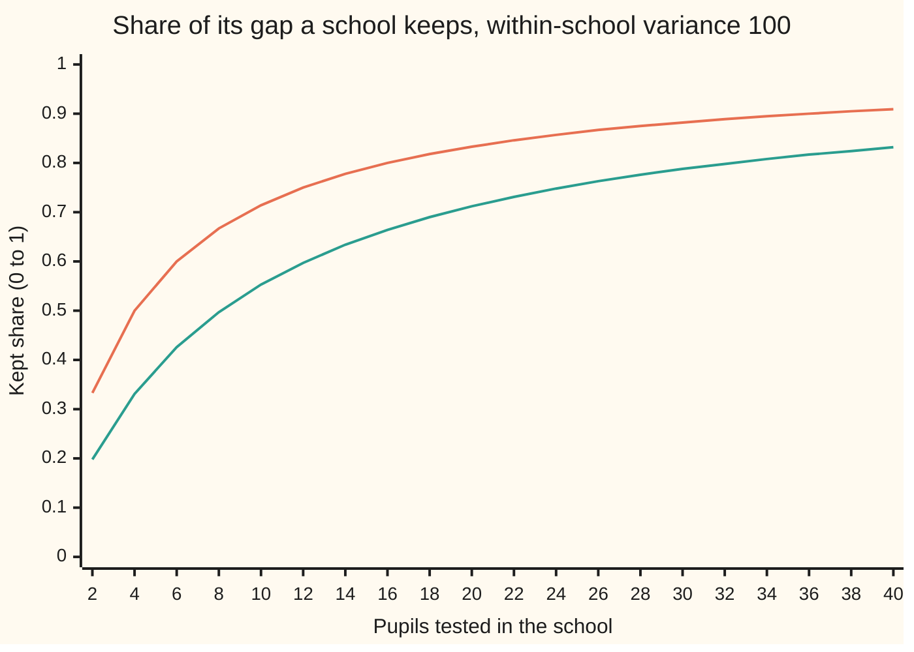

# Mixed-effects models: groups that share a mean, and the pull of each group toward it

[Syllabus](../../../SYLLABUS.md) → [Probability and statistics](../README.md) → [Regression](../README.md#s09) → Mixed-effects models

---

## General Overview

A district compares three schools on one maths test. School A tested 4 pupils and averaged 70. School B tested 25 and averaged 80. School C tested 9 and averaged 75. Records from many years say two things. Pupils in one school scatter around their school's mean with variance 100 (a typical stray of 10 points). The true school means scatter around the district's mean with variance 25 (a typical stray of 5 points).

Is School A really 10 points worse than School B? Its mean rests on 4 pupils. The luck in a 4-pupil mean has variance 100/4 = 25, a typical stray of 5 points, so an ordinary school could easily average 70 on such a small sample. School B's mean rests on 25 pupils, so luck moves it much less.

A **mixed-effects model** handles this. It treats the schools as a group that shares one overall mean, with each school's true mean drawn around it. Then each school's best estimate keeps part of its gap from the overall mean and gives up the rest. School A keeps half its gap. School B keeps 0.862 of its gap, and School C keeps 0.692. The smaller the school, the harder the pull toward the middle. This is called **partial pooling**: between treating every school alone and treating them all as one.

**Each group's estimate keeps the share τ²/(τ² + σ²/n) of its gap from the overall mean, where τ² is the real spread between groups, σ²/n is the luck in a mean of n members, and the share is large when the group is big or the groups really differ.**

**What kind of fact this is:** the random-intercept model is a model: an assumption that fits well enough, not a law. Given the two variances and the overall mean, that the shrunken mean is the best predictor of a school's true mean is a theorem, proved on this card in Why it works (Step 2). With the overall mean estimated, it is the best linear unbiased predictor: a result of Henderson's, stated here, not proved. The variance estimates are a method, stated here and checked by simulation.

### The picture: each school's gap from the overall mean, before and after the pull

The overall mean is 75.88 (Step 3 explains why it is not the plain average). Each bar is a school's gap from it, one `#` per quarter point.

```
A raw gap ########################  -5.88
A kept    ############              -2.94
B raw gap ################           4.12
B kept    ##############             3.55
C raw gap ####                      -0.88
C kept    ##                        -0.61
```

School A loses half its gap. School B, with 25 pupils, keeps most of its gap.

---

## The formula

Notation first, in words.

- Schools are numbered $`j`$ = 1 to $`k`$, here A, B and C, so $`k`$ = 3. School $`j`$ tested $`n_j`$ pupils, numbered $`i`$; $`N`$ = 38 pupils in all.
- $`y_{ij}`$ is the score of pupil $`i`$ in school $`j`$, and $`\bar y_j`$ (y-bar) is school $`j`$'s raw mean.
- $`\mu`$ (mu) is the district's overall mean. $`b_j`$ is school $`j`$'s **random effect**: its true gap from $`\mu`$. $`\varepsilon_{ij}`$ (epsilon) is the pupil's own gap from the school's true mean.
- $`\theta_j = \mu + b_j`$ (theta) is school $`j`$'s true mean. A hat marks an estimate.
- $`N(0, v)`$ is the normal law with average 0 and variance $`v`$ ([Bivariate normal](../05-Transformations%20and%20Joint%20Laws/05-bivariate-normal-and-conditioning.md) uses it throughout).

The **random-intercept model** says each score is the overall mean, plus the school's effect, plus the pupil's own luck:

```math
y_{ij} = \mu + b_j + \varepsilon_{ij}, \qquad b_j \sim N(0, \tau^2), \qquad \varepsilon_{ij} \sim N(0, \sigma^2), \text{ all independent}
```

**Read it aloud:** a pupil's score is the district mean, shifted by a school effect that varies between schools with variance tau squared, plus a pupil effect that varies within a school with variance sigma squared.

"Mixed" means the model mixes two kinds of term. The **fixed effect** $`\mu`$ is one unknown number. The **random effect** $`b_j`$ is a draw from a law, and the model estimates that law's variance rather than each school's number from scratch.

The shrunken school mean, the card's answer:

```math
\hat\theta_j = \hat\mu + \lambda_j\,(\bar y_j - \hat\mu), \qquad \lambda_j = \frac{\tau^2}{\tau^2 + \sigma^2 / n_j}, \qquad \hat\mu = \frac{\sum_j w_j\,\bar y_j}{\sum_j w_j}, \qquad w_j = \frac{1}{\tau^2 + \sigma^2/n_j}
```

**Read it aloud:** start at the overall mean and move toward the school's raw mean by the share lambda; lambda compares the real spread between schools with the luck in this school's mean, and the overall mean weights each school by one over the total variance of its raw mean.

| Symbol | Plain meaning | In our example | Push it up and the answer… |
| --- | --- | --- | --- |
| $`y_{ij}`$ | score of pupil $`i`$ in school $`j`$ | 38 scores, not listed: only the school means and the within-school sum of squares, 3500, are used | — |
| $`\mu`$, $`\hat\mu`$ | the district's overall mean; its estimate | $`\hat\mu`$ = 75.88 | every shrunken mean moves with it |
| $`b_j`$, $`\theta_j`$ | school $`j`$'s true gap from $`\mu`$; its true mean $`\mu + b_j`$ | unknown | — |
| $`\varepsilon_{ij}`$ | the pupil's own gap from the school's true mean | unknown | — |
| $`\sigma^2`$ | within-school variance | 100 | means get noisier, shares fall |
| $`\tau^2`$ | between-school variance | 25 | schools really differ, shares rise |
| $`n_j`$, $`N`$, $`k`$ | pupils in school $`j`$; pupils in all; number of schools | 4, 25, 9; 38; 3 | a bigger school keeps more of its gap |
| $`\bar y_j`$ | school $`j`$'s raw mean | 70, 80, 75 | its shrunken mean rises, by $`\lambda_j`$ per point |
| $`\lambda_j`$ | share of the gap school $`j`$ keeps | 0.5, 0.862, 0.692 | less pull toward $`\hat\mu`$ |
| $`\hat\theta_j`$ | shrunken mean of school $`j`$ | 72.94, 79.43, 75.27 | — |
| $`w_j`$ | weight of school $`j`$ in $`\hat\mu`$ | 0.02000, 0.03448, 0.02769 | that school pulls $`\hat\mu`$ harder |
| MSW, MSB, $`n_0`$ | within-school and between-school mean squares; average school size, adjusted for unequal sizes | 100.00, 217.43, 9.50 | used only to estimate $`\tau^2`$ |

### The picture: how the kept share grows with school size



Orange: between-school variance 25, the district's figure. Green: between-school variance 12.36, the estimate from these three schools alone (Step 5). The share rises fast at first and then levels off: past about 20 pupils, more pupils change little. It never reaches 1, because some pull always remains.

### When it holds

- **The schools are exchangeable.** Nothing known in advance marks one school as different. If School B is a selective school, pulling it toward the others is wrong; give it a fixed term, such as a column for "selective", and pool only what is left.
- **The variances are known or well estimated.** With three schools, an estimate of $`\tau^2`$ is very rough (Step 5). A low estimate pulls every school too hard; a high one barely pulls at all.
- **One within-school variance for all schools.** If School A's pupils scatter twice as widely, its mean is noisier than $`\sigma^2/n_j`$ says, and it keeps too much of its gap.
- **School effects and pupil effects are independent.** If a school's effect moves with the kind of pupil it takes, the overall mean and the shares are both off. Including the pupil's prior attainment as a fixed column is the usual repair.
- **Normality is not needed for the formula.** Among all predictors that are fixed weighted sums of the data and right on average, the shrunken mean has the smallest error, using only means and variances. Normality adds that it is the best predictor of any kind, and makes the error bars exact.

---

## Why it works

### Step 0: a school's gap is part real and part luck, so keep the real part

School A's raw mean sits 5.88 below the overall mean. Two things make up that gap. One is the school's true effect, which varies between schools with variance 25. The other is the luck of which 4 pupils sat the test, which has variance 100/4 = 25.

So the raw gap's variance is 25 + 25 = 50, and half of it is real. The best guess at the real part keeps half the gap. For School B the luck is only 100/25 = 4, so the real part is 25 out of 29, and it keeps 0.862.

### Step 1: what the model says about one school's raw mean

Average the model over school $`j`$'s pupils. The pupil effects average to $`\bar\varepsilon_j`$, which has variance $`\sigma^2/n_j`$:

```math
\bar y_j = \mu + b_j + \bar\varepsilon_j, \qquad \mathrm{Var}(\bar y_j) = \tau^2 + \frac{\sigma^2}{n_j}, \qquad \mathrm{Cov}(b_j, \bar y_j) = \tau^2
```

The covariance is $`\tau^2`$ because $`\bar y_j`$ contains $`b_j`$ once and the rest is independent of it.

The model also says two pupils in the same school are correlated. They share $`b_j`$, so their covariance is $`\tau^2`$. Their correlation is $`\tau^2/(\tau^2 + \sigma^2)`$ = 25/125 = 0.200: the **intraclass correlation**, the share of score variance that lies between schools. Ordinary least squares assumes this is 0. That is why it treats 38 pupils as 38 independent pieces of news when they are not.

### Step 2: the shrinkage is a conditional mean

The pair $`(b_j, \bar y_j)`$ is bivariate normal. On [Bivariate normal](../05-Transformations%20and%20Joint%20Laws/05-bivariate-normal-and-conditioning.md), fixing one variable moves the other's mean in a straight line. The slope is their covariance divided by the variance of the one fixed. Here:

```math
E[\,b_j \mid \bar y_j\,] = \frac{\tau^2}{\tau^2 + \sigma^2/n_j}\,(\bar y_j - \mu) = \lambda_j\,(\bar y_j - \mu), \qquad \mathrm{Var}(\,b_j \mid \bar y_j\,) = \tau^2 (1 - \lambda_j) = \lambda_j\,\frac{\sigma^2}{n_j}
```

Add $`\mu`$ and this is the shrunken mean. The leftover variance $`\lambda_j\,\sigma^2/n_j`$ is smaller than the raw mean's $`\sigma^2/n_j`$, by the factor $`\lambda_j`$. For School A it is 0.5 × 25.000, half the raw mean's.

Without normality the same slope is still the best straight-line predictor, the one with the smallest average squared error. The derivation is the one-predictor least-squares slope on [Least squares](01-least-squares-regression.md), applied to the population. That is why the formula needs only means and variances.

### Step 3: the overall mean weights each school by one over its total variance

The three raw means all estimate $`\mu`$, with variances 25 + 25.000 = 50, 25 + 4.000 = 29 and 25 + 11.111 = 36.111. Averaging estimates with unequal variances is the weighted fit of [Multiple regression](03-multiple-regression-and-gauss-markov.md): weight each by one over its variance. The result has the smallest variance among unbiased weighted averages.

So $`\hat\mu`$ = 6.2355 / 0.08218 = 75.88, with variance 1 / 0.08218 = 12.17.

The pupil-weighted mean, 77.76, counts School B 25/4 times as much as School A. That is too much. Each school brings its own $`\tau^2`$ of real difference, however many pupils it tests, so even an infinitely large school would count only $`1/\tau^2`$.

Estimating $`\mu`$ adds error to each shrunken mean. The part $`1 - \lambda_j`$ of $`\hat\theta_j`$ rests on $`\hat\mu`$, so the error variance becomes:

```math
\mathrm{Var}(\hat\theta_j - \theta_j) = \lambda_j\,\frac{\sigma^2}{n_j} + (1 - \lambda_j)^2\,\mathrm{Var}(\hat\mu)
```

The two parts add because the first error is uncorrelated with every raw mean, and so with $`\hat\mu`$. For School A: 0.5 × 25.000 + 0.5² × 12.17 = 15.542, against 25.000 for the raw mean.

### Step 4: the same answer as a penalised least-squares fit

A second road came from animal breeding in the 1950s. Fit the school effects by least squares, but charge each effect a penalty for its size. The penalty is its square divided by $`\tau^2`$:

```math
\text{minimise}\quad \sum_{j}\sum_{i} \frac{(y_{ij} - \mu - b_j)^2}{\sigma^2} \;+\; \sum_j \frac{b_j^2}{\tau^2}
```

Setting the slope in each unknown to zero gives four linear equations in $`\mu`$, $`b_A`$, $`b_B`$ and $`b_C`$: **Henderson's mixed-model equations**. Their solution is $`\hat\mu`$ = 75.88 and the same shrunken means. The checks solve them by elimination as road 2.

The penalty is the ridge penalty of [Regularisation](06-ridge-and-lasso.md), with its strength set by the two variances: $`\sigma^2/\tau^2`$ = 100/25 = 4. A school whose mean is noisy gains little fit from a large effect, so the penalty wins and pulls it in.

<details>
<summary>Detailed proof: Henderson's equations give the shrinkage formula and the weighted overall mean</summary>

Differentiate the penalised sum with respect to $`b_j`$ and set it to zero. Only school $`j`$'s pupils involve $`b_j`$:

$`\displaystyle \frac{n_j}{\sigma^2}\,\mu + \Big(\frac{n_j}{\sigma^2} + \frac{1}{\tau^2}\Big)\, b_j = \frac{n_j\,\bar y_j}{\sigma^2}`$

Solve for $`b_j`$, then multiply top and bottom by $`\tau^2 \sigma^2 / n_j`$:

$`\displaystyle b_j = \frac{n_j/\sigma^2}{n_j/\sigma^2 + 1/\tau^2}\,(\bar y_j - \mu) = \frac{\tau^2}{\tau^2 + \sigma^2/n_j}\,(\bar y_j - \mu) = \lambda_j\,(\bar y_j - \mu)`$

Differentiate with respect to $`\mu`$. Every pupil involves $`\mu`$:

$`\displaystyle \sum_j n_j\,(\bar y_j - \mu - b_j) = 0`$

Put in $`b_j = \lambda_j (\bar y_j - \mu)`$. Each term becomes $`n_j (1 - \lambda_j)(\bar y_j - \mu)`$. Now $`1 - \lambda_j = (\sigma^2/n_j)/(\tau^2 + \sigma^2/n_j)`$, so $`n_j (1 - \lambda_j) = \sigma^2 w_j`$. The equation becomes

$`\displaystyle \sum_j w_j\,(\bar y_j - \mu) = 0, \qquad\text{so}\qquad \mu = \frac{\sum_j w_j\,\bar y_j}{\sum_j w_j}`$

That is $`\hat\mu`$ of Step 3. The penalised sum is a sum of squares with positive weights, so this stationary point is its minimum.

This algebra uses the one-way layout, where only school $`j`$'s pupils involve $`b_j`$. Henderson (1975) shows by a matrix argument that for any model of the form "fixed columns times fixed coefficients plus group columns times random effects", the same kind of equations give the best linear unbiased estimate of the fixed part and the **best linear unbiased predictor**, BLUP for short, of the random part.

</details>

### Step 5: estimating the two variances

So far $`\sigma^2`$ and $`\tau^2`$ were given. In practice they come from the data.

- **Within schools.** Take each pupil's gap from their own school's mean, square, and add over all pupils. Divide by $`N - k`$ = 35, since three school means were fitted. The pupils' scores are not listed here; the district's records supply this sum as 3500, so MSW = 100.00 repeats the district's long-run figure rather than testing it. The simulations below estimate it from simulated pupils' scores.
- **Between schools.** MSB is the spread of the school means around the pupil-weighted mean 77.76, as on [Analysis of variance](09-analysis-of-variance-and-the-f-test.md): here 217.43. On average it equals $`\sigma^2 + n_0\,\tau^2`$, where $`n_0 = (N - \sum_j n_j^2/N)/(k-1)`$ = 9.50 is an average school size, adjusted for unequal sizes. Solve for $`\tau^2`$:

```math
\hat\tau^2 = \frac{\mathrm{MSB} - \mathrm{MSW}}{n_0} = \frac{217.43 - 100.00}{9.50} = 12.36
```

A negative answer is set to zero: then the schools show no more spread than luck alone would give.

**REML** (restricted maximum likelihood) is the standard method in software. It chooses the variances that make the observed data most likely, after first removing the fixed part, so that fitting $`\mu`$ does not bias $`\sigma^2`$ downward. This is the same reason a sample variance divides by $`n - 1`$. On these schools REML gives $`\tau^2`$ = 12.36 and $`\sigma^2`$ = 99.92, almost the moment answer. That match is a feature of these data: on other data the two can differ a lot. This card states REML; it does not derive it.

Three schools give only two independent comparisons between school means, so any estimate of $`\tau^2`$ is rough. The checks simulate 20,000 districts of these three schools with true $`\tau^2`$ = 25:

| District | Mean of the $`\tau^2`$ estimates | Spread (sd) | Estimates below zero |
| --- | --- | --- | --- |
| 3 schools, 20,000 districts | 25.19 | 37.93 | 26.3% |
| 30 schools, 2,000 districts | 25.34 | 10.06 | — |

The estimate is right on average, but one district's value is nearly useless. That is why this card uses the district's long-run figure of 25, not 12.36. The within-school estimate is fine: it averages 99.96, since it rests on 35 degrees of freedom.

### Step 6, in outline: random slopes and repeated measures

The same idea extends in two common directions.

- **Random slopes.** Add a pupil's prior score as a column. Each school can then have its own slope as well as its own intercept, both drawn around district averages. Each school's slope is shrunk toward the district slope, in the same way and for the same reason.
- **Repeated measures.** Make the group a person instead of a school, and the members that person's measurements over time. Each patient's blood-pressure curve is pulled toward the average curve, most strongly for patients with few visits.

The general form, written down in 1982 for repeated measures, says the data equal fixed columns times fixed coefficients, plus group columns times random effects, plus noise. Henderson's equations and REML fit all of it.

---

## Worked numbers, by hand

| Step | Arithmetic | Value |
| --- | --- | --- |
| luck in each raw mean | 100/4, 100/25, 100/9 | 25.000, 4.000, 11.111 |
| kept share, School A | 25 / (25 + 25.000) | 0.500 |
| kept share, School B | 25 / (25 + 4.000) | 0.862 |
| kept share, School C | 25 / (25 + 11.111) | 0.692 |
| weights $`w_j`$ | 1/50, 1/29, 1/36.111 | 0.02000, 0.03448, 0.02769 |
| sums | 0.02000 + 0.03448 + 0.02769; then 0.02000 × 70 + 0.03448 × 80 + 0.02769 × 75 | 0.08218; 6.2355 |
| overall mean | 6.2355 / 0.08218 | 75.88 |
| School A | 75.88 + 0.500 × (70 − 75.88) | 72.94 |
| School B | 75.88 + 0.862 × (80 − 75.88) | 79.43 |
| School C | 75.88 + 0.692 × (75 − 75.88) | 75.27 |
| error variance, School A | 0.5 × 25.000 + 0.5² × 12.17 | **15.542, against 25.000 raw** |

The best estimate of School A's true mean is 72.94, not 70. On average across districts like this one, that estimate misses by a variance of 15.542 instead of 25.000.

The three error variances are 15.542, 3.680 and 8.844, against 25.000, 4.000 and 11.111 for the raw means. Over 20,000 simulated districts the shrunken means miss by 15.768, 3.685 and 8.902 on average, and the raw means by 25.109, 4.011 and 11.407: each within the simulation's own margin of the formula.

### What breaks if you drop a piece

| Mistake | Comes out at | What went wrong |
| --- | --- | --- |
| No pooling: report each raw mean | School A at 70, error variance 25.000 against 15.542 | Treats 4 pupils' luck as real difference |
| Complete pooling: every school at 75.88 | School B error variance 16.188 against 3.680 (School C: 20.320 against 8.844) | Throws away real differences between schools |
| One share for all, $`\tau^2/(\tau^2 + \sigma^2)`$ = 0.200 | 74.70, 76.70, 75.70 | Uses one pupil's variance instead of the mean's, $`\sigma^2/n_j`$: ignores that big schools' means are steadier |
| Pull toward the pupil-weighted mean 77.76 | 73.88, 79.69, 75.85 | School B dominates the centre; the weights should be $`w_j`$ |

The code prints all four.

---

## Code, from first principles, and it actually runs

The scripts compute the shrunken means by two roads that share no arithmetic. Road 1 is the share formula with the weighted overall mean. Road 2 builds Henderson's four mixed-model equations and solves them by elimination. They estimate $`\tau^2`$ two ways on the three schools: the moment formula, and REML found by a nested golden-section search, which narrows an interval around the maximum step by step. A third road is a simulation of 20,000 districts, pupil by pupil, from a SplitMix64 generator with seed 20261123 and Box–Muller normals, both written out. It confirms the error variances of raw and shrunken means and that the moment estimates are right on average. A last run of 2,000 districts of 30 schools shows the estimate firming up. The final block prints the what-breaks cases, the chart and the bars.

### Python

```python
# Mixed-effects models -- the check behind the card.  Standard library only: the solver,
# the REML search and the random numbers (SplitMix64, Box-Muller) are written out here.
# Three schools: mean score, pupils; within-school variance 100, between-school 25.
from math import sqrt, log, cos, sin, pi
MEAN, SIZE = [70.0, 80.0, 75.0], [4, 25, 9]
S2, T2, k, N = 100.0, 25.0, 3, 38
def kept(t2, s2, n): return t2 / (t2 + s2 / n)  # share of the gap a school keeps
def centre(t2, s2, means, sizes):               # best overall mean: weights 1 / (t2 + s2/n)
    w = [1.0 / (t2 + s2 / n) for n in sizes]
    return sum(a * b for a, b in zip(w, means)) / sum(w), w
def shrink(t2, s2, means, sizes, mu):
    return [mu + kept(t2, s2, n) * (m - mu) for m, n in zip(means, sizes)]
def solve(M, r):                                # Gaussian elimination, partial pivoting
    n, A = len(r), [row[:] + [v] for row, v in zip(M, r)]
    for c in range(n):
        p = max(range(c, n), key=lambda i: abs(A[i][c])); A[c], A[p] = A[p], A[c]
        for i in range(c + 1, n):
            f = A[i][c] / A[c][c]
            A[i] = [a - f * b for a, b in zip(A[i], A[c])]
    x = [0.0] * n
    for i in reversed(range(n)):
        x[i] = (A[i][n] - sum(A[i][j] * x[j] for j in range(i + 1, n))) / A[i][i]
    return x
lam = [kept(T2, S2, n) for n in SIZE]
mu, w = centre(T2, S2, MEAN, SIZE)
theta = shrink(T2, S2, MEAN, SIZE, mu)
vmu = 1.0 / sum(w)
print("school                     A        B        C")
print("pupils n             " + "".join(f"{n:>9d}" for n in SIZE))
print("noise of mean 100/n  " + "".join(f"{S2 / n:>9.3f}" for n in SIZE))
print("kept share           " + "".join(f"{v:>9.3f}" for v in lam))
print("weight 1/(25+100/n)  " + "".join(f"{v:>9.5f}" for v in w))
print(f"sum of weights {sum(w):.5f}, weighted sum of means {sum(a * b for a, b in zip(w, MEAN)):.4f}")
print(f"overall mean {mu:.2f}, its variance {vmu:.2f}, pupil-weighted mean {sum(m * n for m, n in zip(MEAN, SIZE)) / N:.2f}")
print("shrunken mean        " + "".join(f"{v:>9.2f}" for v in theta))
# road 2: Henderson's mixed-model equations, unknowns (mu, b_A, b_B, b_C)
M = [[sum(SIZE) / S2] + [n / S2 for n in SIZE]]
for j, n in enumerate(SIZE):
    M.append([n / S2] + [(n / S2 + 1.0 / T2) if i == j else 0.0 for i in range(k)])
rhs = [sum(m * n for m, n in zip(MEAN, SIZE)) / S2] + [m * n / S2 for m, n in zip(MEAN, SIZE)]
h = solve(M, rhs)
print("Henderson mu + b_j   " + "".join(f"{h[0] + b:>9.2f}" for b in h[1:]) + f"   mu {h[0]:.2f}")
pev = [l * S2 / n + (1 - l) ** 2 * vmu for l, n in zip(lam, SIZE)]
print("error var, raw mean  " + "".join(f"{S2 / n:>9.3f}" for n in SIZE))
print("error var, shrunken  " + "".join(f"{v:>9.3f}" for v in pev))
# estimating the variances from these schools: within SS 3500 over 35 degrees of freedom
SSW = 3500.0
ybar = sum(m * n for m, n in zip(MEAN, SIZE)) / N
msw = SSW / (N - k)
msb = sum(n * (m - ybar) ** 2 for m, n in zip(MEAN, SIZE)) / (k - 1)
n0 = (N - sum(n * n for n in SIZE) / N) / (k - 1)
t2mom = max(0.0, (msb - msw) / n0)
print(f"MSW {msw:.2f}, MSB {msb:.2f}, n0 {n0:.2f}, moment estimate of tau^2 {t2mom:.2f}")
def reml(t2, s2, means, sizes, ssw):            # REML log-likelihood from the summaries
    m, wt = centre(t2, s2, means, sizes)
    ll = -(sum(sizes) - len(sizes)) * log(s2) - ssw / s2 - log(sum(wt))
    for a, n, v in zip(means, sizes, wt):
        ll += log(v) - v * (a - m) ** 2 - log(n)
    return 0.5 * ll
def golden(f, a, b):
    g = (sqrt(5) - 1) / 2
    for _ in range(80):
        c, d = b - g * (b - a), a + g * (b - a)
        if f(c) > f(d): b = d
        else: a = c
    return (a + b) / 2
def fit_reml(means, sizes, ssw):
    best_s2 = lambda t: golden(lambda s: reml(t, s, means, sizes, ssw), 1.0, 1000.0)
    t = golden(lambda t: reml(t, best_s2(t), means, sizes, ssw), 0.0, 1000.0)
    return t, best_s2(t)
rt, rs = fit_reml(MEAN, SIZE, SSW)
print(f"REML estimates: tau^2 {rt:.2f}, sigma^2 {rs:.2f}")
state = 20261123                                # SplitMix64, seed 20261123
def unif():
    global state
    state = (state + 0x9E3779B97F4A7C15) % 2**64
    z = state
    z = ((z ^ (z >> 30)) * 0xBF58476D1CE4E5B9) % 2**64
    z = ((z ^ (z >> 27)) * 0x94D049BB133111EB) % 2**64
    return ((z ^ (z >> 31)) >> 11) / 2.0**53
def normal():                                   # Box-Muller, cosine half
    return sqrt(-2.0 * log(1.0 - unif())) * cos(2.0 * pi * unif())
def district(sizes, mu0=75.0):                  # true school means, raw means, within SS
    true, means, ssw = [], [], 0.0
    for n in sizes:
        t = mu0 + sqrt(T2) * normal()
        ys = [t + sqrt(S2) * normal() for _ in range(n)]
        m = sum(ys) / n
        true.append(t); means.append(m); ssw += sum((v - m) ** 2 for v in ys)
    return true, means, ssw
def moments(means, sizes, ssw):                 # unclipped moment estimates (tau^2, sigma^2)
    n_, k_ = sum(sizes), len(sizes)
    yb = sum(m * n for m, n in zip(means, sizes)) / n_
    mw = ssw / (n_ - k_)
    mb = sum(n * (m - yb) ** 2 for m, n in zip(means, sizes)) / (k_ - 1)
    return (mb - mw) / ((n_ - sum(n * n for n in sizes) / n_) / (k_ - 1)), mw
reps, raw_se, shr_se, t2s, s2s = 20000, [0.0] * k, [0.0] * k, [], []
for _ in range(reps):
    true, means, ssw = district(SIZE)
    m, _ = centre(T2, S2, means, SIZE)
    sh = shrink(T2, S2, means, SIZE, m)
    for j in range(k):
        raw_se[j] += (means[j] - true[j]) ** 2 / reps
        shr_se[j] += (sh[j] - true[j]) ** 2 / reps
    a, b = moments(means, SIZE, ssw); t2s.append(a); s2s.append(b)
avg = lambda v: sum(v) / len(v)
sd = lambda v: sqrt(avg([x * x for x in v]) - avg(v) ** 2)
print("simulated, raw       " + "".join(f"{v:>9.3f}" for v in raw_se))
print("simulated, shrunken  " + "".join(f"{v:>9.3f}" for v in shr_se))
neg = sum(1 for v in t2s if v < 0) / reps
print(f"3 schools x {reps}: tau^2 estimate mean {avg(t2s):.2f}, sd {sd(t2s):.2f}, below zero {100 * neg:.1f}%; sigma^2 mean {avg(s2s):.2f}")
big = SIZE * 10                                 # a district of 30 schools
t30 = [moments(d[1], big, d[2])[0] for d in (district(big) for _ in range(2000))]
print(f"30 schools x 2000: tau^2 estimate mean {avg(t30):.2f}, sd {sd(t30):.2f}")
# what breaks
cov = [wj * T2 * vmu for wj in w]               # Cov(overall mean, b_j)
pool = [vmu + T2 - 2 * c for c in cov]
print("error var, all at mu " + "".join(f"{v:>9.3f}" for v in pool))
same = [mu + kept(T2, S2, 1) * (m - mu) for m in MEAN]
print(f"one share {kept(T2, S2, 1):.3f} for all " + "".join(f"{v:>9.2f}" for v in same))
print("centred at 77.76     " + "".join(f"{v:>9.2f}" for v in shrink(T2, S2, MEAN, SIZE, ybar)))
print("shares with tau^2 = 12.36 " + " ".join(f"{kept(t2mom, S2, n):.3f}" for n in SIZE))
print("chart, n " + " ".join(str(n) for n in range(2, 41, 2)))
for t in (T2, t2mom):
    print(f"chart, tau^2 {t:.2f} " + " ".join(f"{kept(t, S2, n):.3f}" for n in range(2, 41, 2)))
for lab, m, s in zip("ABC", MEAN, theta):        # bars: gap from the overall mean
    print(f"bars, {lab} raw gap {'#' * round(abs(m - mu) * 4):<24} {m - mu:6.2f}")
    print(f"bars, {lab} kept    {'#' * round(abs(s - mu) * 4):<24} {s - mu:6.2f}")
assert max(abs(a - (h[0] + b)) for a, b in zip(theta, h[1:])) < 1e-9   # two roads agree
assert abs(h[0] - mu) < 1e-9                                           # same overall mean
assert [round(v, 3) for v in lam] == [0.5, 0.862, 0.692]               # the spec's shares
assert abs(rt - t2mom) < 0.05 and abs(rs - msw) < 1.0                  # REML near moments
for j in range(k):                                                     # simulation, 4 SE
    assert abs(raw_se[j] - S2 / SIZE[j]) < 4 * sqrt(2 / reps) * S2 / SIZE[j]
    assert abs(shr_se[j] - pev[j]) < 4 * sqrt(2 / reps) * pev[j]
    assert pev[j] < min(S2 / SIZE[j], pool[j])                          # partial pooling wins
assert abs(avg(t2s) - T2) < 4 * sd(t2s) / sqrt(reps)                   # unbiased on average
assert abs(avg(s2s) - S2) < 4 * sd(s2s) / sqrt(reps)
assert sd(t30) < sd(t2s) / 2                                           # more schools, firmer
print("ALL CHECKS PASS")
```

**Ran 2026-11-23 on macOS, Python 3.14.10, standard library only. All checks passed. Output, pasted from the run:**

```
school                     A        B        C
pupils n                     4       25        9
noise of mean 100/n     25.000    4.000   11.111
kept share               0.500    0.862    0.692
weight 1/(25+100/n)    0.02000  0.03448  0.02769
sum of weights 0.08218, weighted sum of means 6.2355
overall mean 75.88, its variance 12.17, pupil-weighted mean 77.76
shrunken mean            72.94    79.43    75.27
Henderson mu + b_j       72.94    79.43    75.27   mu 75.88
error var, raw mean     25.000    4.000   11.111
error var, shrunken     15.542    3.680    8.844
MSW 100.00, MSB 217.43, n0 9.50, moment estimate of tau^2 12.36
REML estimates: tau^2 12.36, sigma^2 99.92
simulated, raw          25.109    4.011   11.407
simulated, shrunken     15.768    3.685    8.902
3 schools x 20000: tau^2 estimate mean 25.19, sd 37.93, below zero 26.3%; sigma^2 mean 99.96
30 schools x 2000: tau^2 estimate mean 25.34, sd 10.06
error var, all at mu    25.000   16.188   20.320
one share 0.200 for all     74.70    76.70    75.70
centred at 77.76         73.88    79.69    75.85
shares with tau^2 = 12.36 0.331 0.756 0.527
chart, n 2 4 6 8 10 12 14 16 18 20 22 24 26 28 30 32 34 36 38 40
chart, tau^2 25.00 0.333 0.500 0.600 0.667 0.714 0.750 0.778 0.800 0.818 0.833 0.846 0.857 0.867 0.875 0.882 0.889 0.895 0.900 0.905 0.909
chart, tau^2 12.36 0.198 0.331 0.426 0.497 0.553 0.597 0.634 0.664 0.690 0.712 0.731 0.748 0.763 0.776 0.788 0.798 0.808 0.817 0.824 0.832
bars, A raw gap ########################  -5.88
bars, A kept    ############              -2.94
bars, B raw gap ################           4.12
bars, B kept    ##############             3.55
bars, C raw gap ####                      -0.88
bars, C kept    ##                        -0.61
ALL CHECKS PASS
```

### Rust

```rust
// Mixed-effects models -- the check behind the card.  std only: the solver, the REML
// search and the random numbers (SplitMix64, Box-Muller) are written out here.
// Three schools: mean score, pupils; within-school variance 100, between-school 25.
const S2: f64 = 100.0;
const T2: f64 = 25.0;
fn kept(t2: f64, s2: f64, n: usize) -> f64 { t2 / (t2 + s2 / n as f64) }
fn centre(t2: f64, s2: f64, means: &[f64], sizes: &[usize]) -> (f64, Vec<f64>) {
    let w: Vec<f64> = sizes.iter().map(|&n| 1.0 / (t2 + s2 / n as f64)).collect();
    let top: f64 = w.iter().zip(means).map(|(a, b)| a * b).sum();
    (top / w.iter().sum::<f64>(), w)
}
fn shrink(t2: f64, s2: f64, means: &[f64], sizes: &[usize], mu: f64) -> Vec<f64> {
    means.iter().zip(sizes).map(|(&m, &n)| mu + kept(t2, s2, n) * (m - mu)).collect()
}
fn solve(m: &[Vec<f64>], r: &[f64]) -> Vec<f64> {
    let n = r.len();
    let mut a: Vec<Vec<f64>> = m.iter().zip(r).map(|(row, &v)| { let mut x = row.clone(); x.push(v); x }).collect();
    for c in 0..n {
        let p = (c..n).fold(c, |p, i| if a[i][c].abs() > a[p][c].abs() { i } else { p });
        a.swap(c, p);
        for i in c + 1..n {
            let f = a[i][c] / a[c][c];
            for j in 0..=n { a[i][j] -= f * a[c][j]; }
        }
    }
    let mut x = vec![0.0; n];
    for i in (0..n).rev() { x[i] = (a[i][n] - (i + 1..n).map(|j| a[i][j] * x[j]).sum::<f64>()) / a[i][i]; }
    x
}
fn reml(t2: f64, s2: f64, means: &[f64], sizes: &[usize], ssw: f64) -> f64 {
    let (m, wt) = centre(t2, s2, means, sizes);
    let ntot: usize = sizes.iter().sum();
    let mut ll = -((ntot - sizes.len()) as f64) * s2.ln() - ssw / s2 - wt.iter().sum::<f64>().ln();
    for ((a, &n), v) in means.iter().zip(sizes).zip(&wt) { ll += v.ln() - v * (a - m).powi(2) - (n as f64).ln(); }
    0.5 * ll
}
fn golden<F: Fn(f64) -> f64>(f: F, mut a: f64, mut b: f64) -> f64 {
    let g = (5f64.sqrt() - 1.0) / 2.0;
    for _ in 0..80 {
        let (c, d) = (b - g * (b - a), a + g * (b - a));
        if f(c) > f(d) { b = d } else { a = c }
    }
    (a + b) / 2.0
}
struct Rng(u64);
impl Rng {
    fn unif(&mut self) -> f64 {
        self.0 = self.0.wrapping_add(0x9E3779B97F4A7C15);
        let mut z = self.0;
        z = (z ^ (z >> 30)).wrapping_mul(0xBF58476D1CE4E5B9);
        z = (z ^ (z >> 27)).wrapping_mul(0x94D049BB133111EB);
        ((z ^ (z >> 31)) >> 11) as f64 / 2f64.powi(53)
    }
    fn normal(&mut self) -> f64 { (-2.0 * (1.0 - self.unif()).ln()).sqrt() * (2.0 * std::f64::consts::PI * self.unif()).cos() }
    fn district(&mut self, sizes: &[usize]) -> (Vec<f64>, Vec<f64>, f64) {
        let (mut tr, mut means, mut ssw) = (vec![], vec![], 0.0);
        for &n in sizes {
            let t = 75.0 + T2.sqrt() * self.normal();
            let ys: Vec<f64> = (0..n).map(|_| t + S2.sqrt() * self.normal()).collect();
            let m = ys.iter().sum::<f64>() / n as f64;
            ssw += ys.iter().map(|v| (v - m).powi(2)).sum::<f64>();
            tr.push(t); means.push(m);
        }
        (tr, means, ssw)
    }
}
fn moments(means: &[f64], sizes: &[usize], ssw: f64) -> (f64, f64) {
    let (n, k) = (sizes.iter().sum::<usize>() as f64, sizes.len() as f64);
    let yb = means.iter().zip(sizes).map(|(m, &s)| m * s as f64).sum::<f64>() / n;
    let mw = ssw / (n - k);
    let mb = means.iter().zip(sizes).map(|(m, &s)| s as f64 * (m - yb).powi(2)).sum::<f64>() / (k - 1.0);
    let n0 = (n - sizes.iter().map(|&s| (s * s) as f64).sum::<f64>() / n) / (k - 1.0);
    ((mb - mw) / n0, mw)
}
fn row(label: &str, v: &[f64], d: usize) -> String {
    format!("{label}{}", v.iter().map(|x| format!("{:>9.*}", d, x)).collect::<String>())
}
fn avg(v: &[f64]) -> f64 { v.iter().sum::<f64>() / v.len() as f64 }
fn sd(v: &[f64]) -> f64 { (avg(&v.iter().map(|x| x * x).collect::<Vec<_>>()) - avg(v).powi(2)).sqrt() }
fn main() {
    let (mean, size, k, nn) = ([70.0, 80.0, 75.0], [4usize, 25, 9], 3usize, 38.0);
    let lam: Vec<f64> = size.iter().map(|&n| kept(T2, S2, n)).collect();
    let (mu, w) = centre(T2, S2, &mean, &size);
    let theta = shrink(T2, S2, &mean, &size, mu);
    let vmu = 1.0 / w.iter().sum::<f64>();
    let noise: Vec<f64> = size.iter().map(|&n| S2 / n as f64).collect();
    println!("school                     A        B        C");
    println!("pupils n             {}", size.iter().map(|n| format!("{n:>9}")).collect::<String>());
    println!("{}", row("noise of mean 100/n  ", &noise, 3));
    println!("{}", row("kept share           ", &lam, 3));
    println!("{}", row("weight 1/(25+100/n)  ", &w, 5));
    let wsum: f64 = w.iter().zip(&mean).map(|(a, b)| a * b).sum();
    println!("sum of weights {:.5}, weighted sum of means {:.4}", w.iter().sum::<f64>(), wsum);
    let ybar = mean.iter().zip(&size).map(|(m, &n)| m * n as f64).sum::<f64>() / nn;
    println!("overall mean {mu:.2}, its variance {vmu:.2}, pupil-weighted mean {ybar:.2}");
    println!("{}", row("shrunken mean        ", &theta, 2));
    // road 2: Henderson's mixed-model equations, unknowns (mu, b_A, b_B, b_C)
    let mut m = vec![std::iter::once(nn / S2).chain(size.iter().map(|&n| n as f64 / S2)).collect::<Vec<f64>>()];
    for (j, &n) in size.iter().enumerate() {
        m.push(std::iter::once(n as f64 / S2).chain((0..k).map(|i| if i == j { n as f64 / S2 + 1.0 / T2 } else { 0.0 })).collect());
    }
    let mut rhs = vec![ybar * nn / S2];
    rhs.extend(mean.iter().zip(&size).map(|(m, &n)| m * n as f64 / S2));
    let h = solve(&m, &rhs);
    let hb: Vec<f64> = h[1..].iter().map(|b| h[0] + b).collect();
    println!("{}   mu {:.2}", row("Henderson mu + b_j   ", &hb, 2), h[0]);
    let pev: Vec<f64> = lam.iter().zip(&size).map(|(l, &n)| l * S2 / n as f64 + (1.0 - l).powi(2) * vmu).collect();
    println!("{}", row("error var, raw mean  ", &noise, 3));
    println!("{}", row("error var, shrunken  ", &pev, 3));
    let ssw = 3500.0; // within-school SS: 3500 over 35 degrees of freedom
    let (t2raw, msw) = moments(&mean, &size, ssw);
    let msb = mean.iter().zip(&size).map(|(m, &n)| n as f64 * (m - ybar).powi(2)).sum::<f64>() / 2.0;
    let n0 = (nn - size.iter().map(|&n| (n * n) as f64).sum::<f64>() / nn) / 2.0;
    let t2mom = t2raw.max(0.0);
    println!("MSW {msw:.2}, MSB {msb:.2}, n0 {n0:.2}, moment estimate of tau^2 {t2mom:.2}");
    let best_s2 = |t: f64| golden(|s| reml(t, s, &mean, &size, ssw), 1.0, 1000.0);
    let rt = golden(|t| reml(t, best_s2(t), &mean, &size, ssw), 0.0, 1000.0);
    let rs = best_s2(rt);
    println!("REML estimates: tau^2 {rt:.2}, sigma^2 {rs:.2}");
    let (mut g, reps) = (Rng(20261123), 20000);
    let (mut raw_se, mut shr_se, mut t2s, mut s2s) = (vec![0.0; k], vec![0.0; k], vec![], vec![]);
    for _ in 0..reps {
        let (tr, ms, sw) = g.district(&size);
        let (c, _) = centre(T2, S2, &ms, &size);
        let sh = shrink(T2, S2, &ms, &size, c);
        for j in 0..k { raw_se[j] += (ms[j] - tr[j]).powi(2) / reps as f64; shr_se[j] += (sh[j] - tr[j]).powi(2) / reps as f64; }
        let (a, b) = moments(&ms, &size, sw);
        t2s.push(a); s2s.push(b);
    }
    println!("{}", row("simulated, raw       ", &raw_se, 3));
    println!("{}", row("simulated, shrunken  ", &shr_se, 3));
    let neg = t2s.iter().filter(|&&v| v < 0.0).count() as f64 / reps as f64;
    println!("3 schools x {reps}: tau^2 estimate mean {:.2}, sd {:.2}, below zero {:.1}%; sigma^2 mean {:.2}",
        avg(&t2s), sd(&t2s), 100.0 * neg, avg(&s2s));
    let big: Vec<usize> = (0..10).flat_map(|_| size).collect();
    let t30: Vec<f64> = (0..2000).map(|_| { let d = g.district(&big); moments(&d.1, &big, d.2).0 }).collect();
    println!("30 schools x 2000: tau^2 estimate mean {:.2}, sd {:.2}", avg(&t30), sd(&t30));
    let pool: Vec<f64> = w.iter().map(|wj| vmu + T2 - 2.0 * wj * T2 * vmu).collect();
    println!("{}", row("error var, all at mu ", &pool, 3));
    let same: Vec<f64> = mean.iter().map(|m| mu + kept(T2, S2, 1) * (m - mu)).collect();
    println!("{}", row(&format!("one share {:.3} for all ", kept(T2, S2, 1)), &same, 2));
    println!("{}", row("centred at 77.76     ", &shrink(T2, S2, &mean, &size, ybar), 2));
    let sh: Vec<String> = size.iter().map(|&n| format!("{:.3}", kept(t2mom, S2, n))).collect();
    println!("shares with tau^2 = 12.36 {}", sh.join(" "));
    let ns: Vec<usize> = (2..41).step_by(2).collect();
    println!("chart, n {}", ns.iter().map(|n| n.to_string()).collect::<Vec<_>>().join(" "));
    for t in [T2, t2mom] {
        let v: Vec<String> = ns.iter().map(|&n| format!("{:.3}", kept(t, S2, n))).collect();
        println!("chart, tau^2 {t:.2} {}", v.join(" "));
    }
    for ((lab, m), s) in ["A", "B", "C"].iter().zip(&mean).zip(&theta) {
        println!("bars, {lab} raw gap {:<24} {:6.2}", "#".repeat(((m - mu).abs() * 4.0).round() as usize), m - mu);
        println!("bars, {lab} kept    {:<24} {:6.2}", "#".repeat(((s - mu).abs() * 4.0).round() as usize), s - mu);
    }
    assert!(theta.iter().zip(&hb).all(|(a, b)| (a - b).abs() < 1e-9)); // two roads agree
    assert!((h[0] - mu).abs() < 1e-9);                                  // same overall mean
    let r3: Vec<f64> = lam.iter().map(|v| (v * 1000.0).round() / 1000.0).collect();
    assert!(r3 == vec![0.5, 0.862, 0.692]);                             // the spec's shares
    assert!((rt - t2mom).abs() < 0.05 && (rs - msw).abs() < 1.0);       // REML near moments
    for j in 0..k {                                                     // simulation, 4 SE
        let se = (2.0 / reps as f64).sqrt();
        assert!((raw_se[j] - noise[j]).abs() < 4.0 * se * noise[j]);
        assert!((shr_se[j] - pev[j]).abs() < 4.0 * se * pev[j]);
        assert!(pev[j] < noise[j].min(pool[j]));                        // partial pooling wins
    }
    assert!((avg(&t2s) - T2).abs() < 4.0 * sd(&t2s) / (reps as f64).sqrt());
    assert!((avg(&s2s) - S2).abs() < 4.0 * sd(&s2s) / (reps as f64).sqrt());
    assert!(sd(&t30) < sd(&t2s) / 2.0);                                 // more schools, firmer
    println!("ALL CHECKS PASS");
}
```

**Ran 2026-11-23 on macOS, rustc 1.98.1, no crates. All checks passed. Output, pasted from the run:**

```
school                     A        B        C
pupils n                     4       25        9
noise of mean 100/n     25.000    4.000   11.111
kept share               0.500    0.862    0.692
weight 1/(25+100/n)    0.02000  0.03448  0.02769
sum of weights 0.08218, weighted sum of means 6.2355
overall mean 75.88, its variance 12.17, pupil-weighted mean 77.76
shrunken mean            72.94    79.43    75.27
Henderson mu + b_j       72.94    79.43    75.27   mu 75.88
error var, raw mean     25.000    4.000   11.111
error var, shrunken     15.542    3.680    8.844
MSW 100.00, MSB 217.43, n0 9.50, moment estimate of tau^2 12.36
REML estimates: tau^2 12.36, sigma^2 99.92
simulated, raw          25.109    4.011   11.407
simulated, shrunken     15.768    3.685    8.902
3 schools x 20000: tau^2 estimate mean 25.19, sd 37.93, below zero 26.3%; sigma^2 mean 99.96
30 schools x 2000: tau^2 estimate mean 25.34, sd 10.06
error var, all at mu    25.000   16.188   20.320
one share 0.200 for all     74.70    76.70    75.70
centred at 77.76         73.88    79.69    75.85
shares with tau^2 = 12.36 0.331 0.756 0.527
chart, n 2 4 6 8 10 12 14 16 18 20 22 24 26 28 30 32 34 36 38 40
chart, tau^2 25.00 0.333 0.500 0.600 0.667 0.714 0.750 0.778 0.800 0.818 0.833 0.846 0.857 0.867 0.875 0.882 0.889 0.895 0.900 0.905 0.909
chart, tau^2 12.36 0.198 0.331 0.426 0.497 0.553 0.597 0.634 0.664 0.690 0.712 0.731 0.748 0.763 0.776 0.788 0.798 0.808 0.817 0.824 0.832
bars, A raw gap ########################  -5.88
bars, A kept    ############              -2.94
bars, B raw gap ################           4.12
bars, B kept    ##############             3.55
bars, C raw gap ####                      -0.88
bars, C kept    ##                        -0.61
ALL CHECKS PASS
```

### Lean

Lean proves the shrinkage formulas for every school size and variance, and checks the three schools' numbers as exact fractions.

- Suppose one school follows the random-intercept model, normal or not: effects of average 0, variances $`\tau^2`$ and $`\sigma^2`$, all independent. Then its raw mean has variance $`\tau^2 + \sigma^2/n_j`$, and covariance $`\tau^2`$ with its effect $`b_j`$.
- Take the same school, with $`\mu`$ known and used in place of $`\hat\mu`$. Then the shrunken mean misses the true mean $`\theta_j`$ by average squared error $`\lambda_j\sigma^2/n_j`$.
- Take the same school. Then no straight-line predictor $`a + c\,\bar y_j`$ has a smaller average squared error.
- Suppose $`\sigma^2`$ and $`\tau^2`$ are positive, and each school tested at least one pupil, with any scores. Then the penalised sum of Step 4 is smallest at $`\hat\mu`$ and $`b_j = \lambda_j(\bar y_j - \hat\mu)`$.
- For the three schools, the kept shares are exactly 1/2, 25/29 and 9/13.
- The overall mean is exactly 117540/1549, about 75.88.
- The shrunken means are exactly 112985/1549, 123040/1549 and 116595/1549, about 72.94, 79.43 and 75.27.
- The error variances are 24075/1549, 5700/1549 and 13700/1549, each below the raw mean's 25, 4 and 100/9.
- The moment estimate of $`\tau^2`$ is exactly 8925/722, about 12.36.

REML, the error formula with $`\hat\mu`$ estimated, the simulations and the pictures are left to the Python and Rust checks.

```lean
-- Mixed-effects models: in the random-intercept model the shrunken mean μ + λ(ȳ - μ), with λ = τ²/(τ² + σ²/n), is the best straight-line predictor of a group's true mean from its raw mean, with error variance λσ²/n, and Henderson's penalised least-squares fit gives these shrunken means around the weighted overall mean.
import Mathlib.Probability.Moments.Covariance
import Mathlib.Probability.Moments.Variance
import Mathlib.Probability.Independence.Basic
import Mathlib.Tactic

/-! Notation as on the card. One school has `n` pupils. `μ` is the district's overall mean,
`b` the school's random effect, `ε i` pupil `i`'s own gap from the school's true mean.
`τ2` is the between-school variance τ², `σ2` the within-school variance σ².
The school's raw mean is `ȳ = μ + b + (ε 1 + ... + ε n)/n` and its true mean is `θ = μ + b`.
The kept share is `λ = τ²/(τ² + σ²/n)` (`lam` here; `λ` is a reserved word in Lean). -/

open MeasureTheory ProbabilityTheory

noncomputable section

/-- Helper: in the random-intercept model, the mean of a product of two straight-line
combinations of `1`, `b` and `∑ i, ε i` follows from the variances alone. -/
lemma mixed_effects_bilin
    {Ω : Type*} [MeasurableSpace Ω] {P : Measure Ω} [IsProbabilityMeasure P]
    (n : ℕ) (τ2 σ2 : ℝ)
    (b : Ω → ℝ) (ε : Fin n → Ω → ℝ)
    (hbL2 : MemLp b 2 P) (hεL2 : ∀ i, MemLp (ε i) 2 P)
    (hbmean : ∫ ω, b ω ∂P = 0) (hεmean : ∀ i, ∫ ω, ε i ω ∂P = 0)
    (hbvar : variance b P = τ2) (hεvar : ∀ i, variance (ε i) P = σ2)
    (hind : iIndepFun ε P) (hbind : ∀ i, IndepFun b (ε i) P) (α β γ α' β' γ' : ℝ) :
    ∫ ω, (α + β * b ω + γ * ∑ i, ε i ω) * (α' + β' * b ω + γ' * ∑ i, ε i ω) ∂P
      = α * α' + β * β' * τ2 + γ * γ' * (n * σ2) := by
  set S : Ω → ℝ := ∑ i, ε i with hSdef
  have hSapp : ∀ ω, ∑ i, ε i ω = S ω := fun ω => by simp [hSdef, Finset.sum_apply]
  simp_rw [hSapp]
  have hSL2 : MemLp S 2 P := memLp_finsetSum' _ (fun i _ => hεL2 i)
  have hS1 : ∫ ω, S ω ∂P = 0 := by
    simp_rw [← hSapp]
    rw [integral_finsetSum _ (fun i _ => (hεL2 i).integrable (by norm_num))]
    simp [hεmean]
  have hbb : ∫ ω, b ω * b ω ∂P = τ2 := by
    have h := variance_eq_sub hbL2
    rw [hbvar, hbmean] at h
    rw [h]
    simp [sq]
  have hSvar : variance S P = n * σ2 := by
    rw [hSdef, IndepFun.variance_sum (fun i _ => hεL2 i)
      (fun i _ j _ hij => hind.indepFun hij)]
    simp [hεvar]
  have hSS : ∫ ω, S ω * S ω ∂P = n * σ2 := by
    have h := variance_eq_sub hSL2
    rw [hSvar, hS1] at h
    rw [h]
    simp [sq]
  have hbS : ∫ ω, b ω * S ω ∂P = 0 := by
    have h1 : covariance b S P = 0 := by
      rw [hSdef, covariance_sum_right hεL2 hbL2]
      exact Finset.sum_eq_zero fun i _ => (hbind i).covariance_eq_zero hbL2 (hεL2 i)
    rw [covariance_eq_sub hbL2 hSL2, hbmean, hS1] at h1
    simpa using h1
  have ib : Integrable b P := hbL2.integrable (by norm_num)
  have iS : Integrable S P := hSL2.integrable (by norm_num)
  have ibb : Integrable (fun ω => b ω * b ω) P := hbL2.integrable_mul hbL2
  have iSS : Integrable (fun ω => S ω * S ω) P := hSL2.integrable_mul hSL2
  have ibS : Integrable (fun ω => b ω * S ω) P := hbL2.integrable_mul hSL2
  have hexp : ∀ ω, (α + β * b ω + γ * S ω) * (α' + β' * b ω + γ' * S ω)
      = α * α' + ((α * β' + β * α') * b ω + ((α * γ' + γ * α') * S ω
        + (β * β' * (b ω * b ω) + ((β * γ' + γ * β') * (b ω * S ω)
        + γ * γ' * (S ω * S ω))))) := fun ω => by ring
  simp_rw [hexp]
  rw [integral_add (integrable_const _), integral_add (ib.const_mul _),
    integral_add (iS.const_mul _), integral_add (ibb.const_mul _),
    integral_add (ibS.const_mul _)]
  · simp only [integral_const, integral_const_mul, hbmean, hS1, hbb, hbS, hSS]
    simp
    ring
  all_goals first
    | exact (iSS.const_mul _)
    | exact ((ibS.const_mul _).add (iSS.const_mul _))
    | exact ((ibb.const_mul _).add ((ibS.const_mul _).add (iSS.const_mul _)))
    | exact ((iS.const_mul _).add ((ibb.const_mul _).add ((ibS.const_mul _).add (iSS.const_mul _))))
    | exact ((ib.const_mul _).add ((iS.const_mul _).add ((ibb.const_mul _).add
        ((ibS.const_mul _).add (iSS.const_mul _)))))


/-- **The kept share is the best straight-line predictor** (the card's main claim, Step 2,
and "Normality is not needed for the formula"). In the random-intercept model for one school,
with school effect `b` of average 0 and variance τ², pupil effects `ε i` of average 0 and one
common variance σ², all independent, the shrunken mean `μ + λ (ȳ - μ)` with
`λ = τ²/(τ² + σ²/n)` misses the school's true mean `θ = μ + b` by an average squared error
of exactly `λ σ²/n`, and no other straight-line predictor `a + c ȳ` does better. -/
theorem shrunken_mean_is_best_linear_predictor
    {Ω : Type*} [MeasurableSpace Ω] {P : Measure Ω} [IsProbabilityMeasure P]
    (n : ℕ) (hn : 0 < n) (μ τ2 σ2 : ℝ)
    (b : Ω → ℝ) (ε : Fin n → Ω → ℝ)
    (hbL2 : MemLp b 2 P) (hεL2 : ∀ i, MemLp (ε i) 2 P)
    (hbmean : ∫ ω, b ω ∂P = 0) (hεmean : ∀ i, ∫ ω, ε i ω ∂P = 0)
    (hbvar : variance b P = τ2) (hεvar : ∀ i, variance (ε i) P = σ2)
    (hind : iIndepFun ε P) (hbind : ∀ i, IndepFun b (ε i) P) :
    let ybar : Ω → ℝ := fun ω => μ + b ω + (∑ i, ε i ω) / n
    let θ : Ω → ℝ := fun ω => μ + b ω
    let lam : ℝ := τ2 / (τ2 + σ2 / n)
    (∫ ω, (θ ω - (μ + lam * (ybar ω - μ))) ^ 2 ∂P = lam * (σ2 / n)) ∧
    ∀ a c : ℝ, ∫ ω, (θ ω - (μ + lam * (ybar ω - μ))) ^ 2 ∂P ≤
      ∫ ω, (θ ω - (a + c * ybar ω)) ^ 2 ∂P := by
  intro ybar θ lam
  have hτ : 0 ≤ τ2 := hbvar ▸ variance_nonneg b P
  have hσ : 0 ≤ σ2 := (hεvar ⟨0, hn⟩) ▸ variance_nonneg _ _
  have hnR : (0 : ℝ) < n := by exact_mod_cast hn
  have B := mixed_effects_bilin n τ2 σ2 b ε hbL2 hεL2 hbmean hεmean hbvar hεvar hind hbind
  have hgen : ∀ a c : ℝ, ∫ ω, (θ ω - (a + c * ybar ω)) ^ 2 ∂P
      = ((1 - c) * μ - a) ^ 2 + (1 - c) ^ 2 * τ2 + c ^ 2 * (σ2 / n) := by
    intro a c
    have e : ∀ ω, (θ ω - (a + c * ybar ω)) ^ 2
        = (((1 - c) * μ - a) + (1 - c) * b ω + (-(c / n)) * ∑ i, ε i ω)
          * (((1 - c) * μ - a) + (1 - c) * b ω + (-(c / n)) * ∑ i, ε i ω) := fun ω => by
      simp only [θ, ybar]; ring
    simp_rw [e]
    rw [B]
    field_simp
  have hpred : ∀ ω, θ ω - (μ + lam * (ybar ω - μ)) = θ ω - ((1 - lam) * μ + lam * ybar ω) :=
    fun ω => by ring
  simp_rw [hpred, hgen]
  have hs0 : 0 ≤ σ2 / n := div_nonneg hσ hnR.le
  have hD2 : 0 ≤ τ2 * n + σ2 := by positivity
  rcases (add_nonneg hτ hs0).eq_or_lt with hD | hD
  · have h1 : τ2 = 0 := by linarith
    have h2 : σ2 / n = 0 := by linarith
    have hl : lam = 0 := by simp only [lam, h1, h2]; simp
    rw [hl, h1, h2]
    refine ⟨by ring, fun a c => ?_⟩
    nlinarith [sq_nonneg ((1 - c) * μ - a)]
  · have hD3 : τ2 * n + σ2 ≠ 0 := by
      have := mul_pos hD hnR
      rw [add_mul, div_mul_cancel₀ _ hnR.ne'] at this
      exact this.ne'
    refine ⟨?_, fun a c => ?_⟩
    · simp only [lam]
      field_simp
      ring
    · have hq : (1 - c) ^ 2 * τ2 + c ^ 2 * (σ2 / n) - lam * (σ2 / n)
          = (τ2 + σ2 / n) * (c - lam) ^ 2 := by
        simp only [lam]
        field_simp
        ring
      have hlam : (1 - lam) ^ 2 * τ2 + lam ^ 2 * (σ2 / n) = lam * (σ2 / n) := by
        simp only [lam]
        field_simp
        ring
      nlinarith [sq_nonneg ((1 - c) * μ - a), mul_nonneg hD.le (sq_nonneg (c - lam))]

/-- **What the model says about one school's raw mean** (Step 1). Under the same model the raw
mean `ȳ` has variance `τ² + σ²/n`, and its covariance with the school effect `b` is `τ²`. -/
theorem raw_mean_variance_and_covariance
    {Ω : Type*} [MeasurableSpace Ω] {P : Measure Ω} [IsProbabilityMeasure P]
    (n : ℕ) (hn : 0 < n) (μ τ2 σ2 : ℝ)
    (b : Ω → ℝ) (ε : Fin n → Ω → ℝ)
    (hbL2 : MemLp b 2 P) (hεL2 : ∀ i, MemLp (ε i) 2 P)
    (hbmean : ∫ ω, b ω ∂P = 0) (hεmean : ∀ i, ∫ ω, ε i ω ∂P = 0)
    (hbvar : variance b P = τ2) (hεvar : ∀ i, variance (ε i) P = σ2)
    (hind : iIndepFun ε P) (hbind : ∀ i, IndepFun b (ε i) P) :
    let ybar : Ω → ℝ := fun ω => μ + b ω + (∑ i, ε i ω) / n
    variance ybar P = τ2 + σ2 / n ∧ covariance b ybar P = τ2 := by
  intro ybar
  have hnR : (0 : ℝ) < n := by exact_mod_cast hn
  have B := mixed_effects_bilin n τ2 σ2 b ε hbL2 hεL2 hbmean hεmean hbvar hεvar hind hbind
  have hmean : ∫ ω, ybar ω ∂P = μ := by
    have e : ∀ ω, ybar ω = (μ + 1 * b ω + (1 / n) * ∑ i, ε i ω)
        * (1 + 0 * b ω + 0 * ∑ i, ε i ω) := fun ω => by simp only [ybar]; ring
    simp_rw [e]
    rw [B]
    ring
  have hm : AEMeasurable ybar P := by
    have h1 := fun i => (hεL2 i).aestronglyMeasurable.aemeasurable
    have h2 := hbL2.aestronglyMeasurable.aemeasurable
    fun_prop
  constructor
  · rw [variance_eq_integral hm, hmean]
    have e : ∀ ω, (ybar ω - μ) ^ 2 = (0 + 1 * b ω + (1 / n) * ∑ i, ε i ω)
        * (0 + 1 * b ω + (1 / n) * ∑ i, ε i ω) := fun ω => by simp only [ybar]; ring
    simp_rw [e]
    rw [B]
    field_simp
    ring
  · unfold covariance
    rw [hmean, hbmean]
    have e : ∀ ω, (b ω - 0) * (ybar ω - μ) = (0 + 1 * b ω + 0 * ∑ i, ε i ω)
        * (0 + 1 * b ω + (1 / n) * ∑ i, ε i ω) := fun ω => by simp only [ybar]; ring
    simp_rw [e]
    rw [B]
    ring

/-- **Henderson's mixed-model equations give the shrinkage formula** (Step 4 and its detailed
proof). For `k` schools, school `j` with `n j ≥ 1` pupils scoring `y j i`, and variances
`σ², τ² > 0`, the penalised sum
`∑ⱼ ∑ᵢ (y j i - μ - b j)² / σ² + ∑ⱼ (b j)² / τ²`
is smallest at the weighted overall mean `μ̂ = ∑ wⱼ ȳⱼ / ∑ wⱼ`, `wⱼ = 1/(τ² + σ²/nⱼ)`, and the
shrunken effects `b j = λⱼ (ȳⱼ - μ̂)`, `λⱼ = τ²/(τ² + σ²/nⱼ)`. -/
theorem henderson_equations_give_shrinkage
    {k : ℕ} (n : Fin k → ℕ) (hn : ∀ j, 0 < n j) (σ2 τ2 : ℝ) (hσ : 0 < σ2) (hτ : 0 < τ2)
    (y : (j : Fin k) → Fin (n j) → ℝ) :
    let ybar : Fin k → ℝ := fun j => (∑ i, y j i) / n j
    let w : Fin k → ℝ := fun j => 1 / (τ2 + σ2 / n j)
    let lam : Fin k → ℝ := fun j => τ2 / (τ2 + σ2 / n j)
    let μhat : ℝ := (∑ j, w j * ybar j) / ∑ j, w j
    let F : ℝ → (Fin k → ℝ) → ℝ := fun m bb =>
      (∑ j, ∑ i, (y j i - m - bb j) ^ 2 / σ2) + ∑ j, bb j ^ 2 / τ2
    ∀ (m : ℝ) (bb : Fin k → ℝ), F μhat (fun j => lam j * (ybar j - μhat)) ≤ F m bb := by
  intro ybar w lam μhat F m bb
  have hnR : ∀ j, (0 : ℝ) < n j := fun j => by exact_mod_cast hn j
  have hD : ∀ j, 0 < τ2 + σ2 / n j := fun j => by have := hnR j; positivity
  have hG : ∀ j (mm bj : ℝ), ∑ i, (y j i - mm - bj) ^ 2 / σ2
      = ((∑ i, y j i ^ 2) - 2 * (mm + bj) * (∑ i, y j i) + n j * (mm + bj) ^ 2) / σ2 := by
    intro j mm bj
    rw [← Finset.sum_div]
    congr 1
    have e : ∀ i, (y j i - mm - bj) ^ 2 = y j i ^ 2 - 2 * (mm + bj) * y j i + (mm + bj) ^ 2 :=
      fun i => by ring
    simp only [e, Finset.sum_add_distrib, Finset.sum_sub_distrib, ← Finset.mul_sum,
      Finset.sum_const, Finset.card_univ, Fintype.card_fin, nsmul_eq_mul]
  have hsum : ∑ j, w j * (ybar j - μhat) = 0 := by
    simp only [mul_sub, Finset.sum_sub_distrib, ← Finset.sum_mul]
    by_cases h0 : ∑ j, w j = 0
    · have hw : ∀ j ∈ Finset.univ, w j = 0 :=
        (Finset.sum_eq_zero_iff_of_nonneg (fun j _ => (one_div_pos.2 (hD j)).le)).1 h0
      rw [h0, Finset.sum_eq_zero (fun j hj => by rw [hw j hj, zero_mul])]
      ring
    · simp only [μhat]
      rw [mul_comm (∑ i, w i), div_mul_cancel₀ _ h0, sub_self]
  have key : ∀ j, (∑ i, (y j i - m - bb j) ^ 2 / σ2 + bb j ^ 2 / τ2)
      - (∑ i, (y j i - μhat - lam j * (ybar j - μhat)) ^ 2 / σ2
          + (lam j * (ybar j - μhat)) ^ 2 / τ2)
      = n j * (m - μhat + (bb j - lam j * (ybar j - μhat))) ^ 2 / σ2
        + (bb j - lam j * (ybar j - μhat)) ^ 2 / τ2
        - 2 * (m - μhat) * (w j * (ybar j - μhat)) := by
    intro j
    rw [hG, hG]
    have hy : ∑ i, y j i = n j * ybar j := by
      simp only [ybar]; field_simp [(hnR j).ne']
    rw [hy]
    simp only [w, lam]
    have h1 := hnR j
    have h2 := hD j
    field_simp
    ring
  have hF : ∀ mm (bb' : Fin k → ℝ),
      F mm bb' = ∑ j, (∑ i, (y j i - mm - bb' j) ^ 2 / σ2 + bb' j ^ 2 / τ2) := by
    intro mm bb'
    simp only [F, Finset.sum_add_distrib]
  rw [← sub_nonneg, hF, hF, ← Finset.sum_sub_distrib,
    Finset.sum_congr rfl (fun j _ => key j), Finset.sum_sub_distrib, ← Finset.mul_sum, hsum,
    mul_zero, sub_zero]
  exact Finset.sum_nonneg fun j _ => by have := hnR j; positivity

end

-- The card's schools: means 70, 80, 75 from 4, 25, 9 pupils; σ² = 100, τ² = 25.
-- Luck in each raw mean: 100/4 = 25, 100/25 = 4, 100/9.
example : (100 : ℚ) / 4 = 25 ∧ (100 : ℚ) / 25 = 4 := by norm_num
-- Kept shares: 25/(25 + 25) = 1/2, 25/(25 + 4) = 25/29 (0.862), 25/(25 + 100/9) = 9/13 (0.692).
example : (25 : ℚ) / (25 + 100 / 4) = 1 / 2 ∧ (25 : ℚ) / (25 + 100 / 25) = 25 / 29 ∧
    (25 : ℚ) / (25 + 100 / 9) = 9 / 13 := by norm_num
-- Weights 1/50, 1/29, 9/325, summing to 1549/18850.
example : (1 : ℚ) / (25 + 100 / 4) = 1 / 50 ∧ (1 : ℚ) / (25 + 100 / 25) = 1 / 29 ∧
    (1 : ℚ) / (25 + 100 / 9) = 9 / 325 ∧ (1 : ℚ) / 50 + 1 / 29 + 9 / 325 = 1549 / 18850 := by
  norm_num
-- Overall mean (1/50·70 + 1/29·80 + 9/325·75)/(1549/18850) = 117540/1549 (75.88), its variance
-- 18850/1549 (12.17).
example : ((1 : ℚ) / 50 * 70 + 1 / 29 * 80 + 9 / 325 * 75) / (1549 / 18850) = 117540 / 1549 := by
  norm_num
-- Shrunken means 112985/1549, 123040/1549, 116595/1549 (72.94, 79.43, 75.27).
example : (117540 / 1549 : ℚ) + 1 / 2 * (70 - 117540 / 1549) = 112985 / 1549 ∧
    (117540 / 1549 : ℚ) + 25 / 29 * (80 - 117540 / 1549) = 123040 / 1549 ∧
    (117540 / 1549 : ℚ) + 9 / 13 * (75 - 117540 / 1549) = 116595 / 1549 := by norm_num
-- Error variances λσ²/n + (1 - λ)² Var(μ̂): 24075/1549, 5700/1549, 13700/1549
-- (15.542, 3.680, 8.844), each below the raw 25, 4, 100/9.
example : (1 / 2 : ℚ) * 25 + (1 - 1 / 2) ^ 2 * (18850 / 1549) = 24075 / 1549 ∧
    (25 / 29 : ℚ) * 4 + (1 - 25 / 29) ^ 2 * (18850 / 1549) = 5700 / 1549 ∧
    (9 / 13 : ℚ) * (100 / 9) + (1 - 9 / 13) ^ 2 * (18850 / 1549) = 13700 / 1549 ∧
    (24075 / 1549 : ℚ) < 25 ∧ (5700 / 1549 : ℚ) < 4 ∧ (13700 / 1549 : ℚ) < 100 / 9 := by norm_num
-- Intraclass correlation 25/(25 + 100) = 1/5, also the one-share-for-all mistake; ridge strength 100/25 = 4.
example : (25 : ℚ) / (25 + 100) = 1 / 5 ∧ (100 : ℚ) / 25 = 4 := by norm_num
-- Pupils N = 38; pupil-weighted mean 2955/38 (77.76); MSW = 3500/35 = 100.
example : 4 + 25 + 9 = 38 ∧ 4 * 70 + 25 * 80 + 9 * 75 = 2955 ∧ 3500 / 35 = 100 := by decide
-- n₀ = (38 - (4² + 25² + 9²)/38)/2 = 19/2; MSB = 16525/76 (217.43); τ̂² = (MSB - 100)/n₀ = 8925/722 (12.36).
example : ((38 : ℚ) - (4 ^ 2 + 25 ^ 2 + 9 ^ 2) / 38) / 2 = 19 / 2 ∧
    ((4 : ℚ) * (70 - 2955 / 38) ^ 2 + 25 * (80 - 2955 / 38) ^ 2 + 9 * (75 - 2955 / 38) ^ 2) / 2
      = 16525 / 76 ∧
    ((16525 / 76 : ℚ) - 100) / (19 / 2) = 8925 / 722 := by norm_num

#print axioms mixed_effects_bilin
#print axioms shrunken_mean_is_best_linear_predictor
#print axioms raw_mean_variance_and_covariance
#print axioms henderson_equations_give_shrinkage
```

**Checked 2026-11-23 on macOS, Lean 4.36.0-rc2, Mathlib v4.36.0-rc2. Every proof is complete and uses only Lean's standard axioms. Output, pasted from the run:**

```
'mixed_effects_bilin' depends on axioms: [propext, Classical.choice, Quot.sound]
'shrunken_mean_is_best_linear_predictor' depends on axioms: [propext, Classical.choice, Quot.sound]
'raw_mean_variance_and_covariance' depends on axioms: [propext, Classical.choice, Quot.sound]
'henderson_equations_give_shrinkage' depends on axioms: [propext, Classical.choice, Quot.sound]
```

> [!TIP]
> **Try changing**
> Guess first, then run it.
> - **A worse School A.** Set `MEAN` to `[60, 80, 75]`. Guess: the shares do not change, since they never look at the raw means; School A still keeps half its gap, which is now larger. The REML-near-moments assert then stops the run: REML gives $`\tau^2`$ = 86.64 against the moment estimate's 63.89, so their close match on the real schools is a feature of those data, not a rule.
> - **Schools that really differ.** Set `T2` to 100. Guess: every share rises (School A to 100/125 = 0.8), the shrunken means move toward the raw ones, and the gain over raw means shrinks. The spec-shares assert then stops the run.
> - **Noisier pupils.** Set `S2` to 400. Guess: School A keeps only 25/125 = 0.2 of its gap. The spec-shares assert then stops the run.
> - **Fewer simulated districts.** Set `reps` to 200. Guess: the simulated error variances wander from the formula by more than a fifth in places (School B's raw mean: 3.100 against 4.000), yet the 4-standard-error asserts still pass, because their margins widen too.

---

## The usual mistake

> [!warning]
> **Trusting a between-group variance estimated from a handful of groups.** With three schools, the estimate of $`\tau^2`$ rests on two comparisons. Here it comes out at 12.36, half the long-run 25. Plugged in, it cuts the shares to 0.331, 0.756 and 0.527, and pulls School A far harder than the data justify. Across simulated districts the estimate has a spread of 37.93 around its true value of 25 and falls below zero 26.3% of the time. Use outside information, many more groups, or the Bayesian treatment that carries the uncertainty in $`\tau^2`$ forward.
>
> - **Reading the pull as unfair to small schools.** The shrunken mean is biased toward the middle for any one school, yet its average squared error is smaller: 15.542 against 25.000 for School A. A truly excellent small school does get pulled down; the method trades that for fewer flukes ranked at the top.
> - **Pulling toward the pupil-weighted mean.** The centre becomes 77.76 and School A lands at 73.88 instead of 72.94. The large school sets the centre on its own.
> - **One share for all schools.** Using $`\sigma^2`$ instead of $`\sigma^2/n_j`$ gives every school the share 0.200, so School B drops to 76.70 although its 25 pupils pin its mean well.
> - **Fitting school as ordinary dummy columns and calling it a mixed model.** One column per school with no penalty is no pooling: School A stays at 70.

---

## Where you meet it in real life

- **School and hospital league tables.** Value-added scores for schools and death rates for surgeons are often shrunken means, so that a unit with few cases is not ranked first or last on luck.
- **Animal breeding.** Henderson built these equations to rank dairy bulls by their daughters' milk yield. Bulls with few daughters are pulled toward the breed average. Breeding programmes still rank animals with BLUP.
- **Clinical trials across many centres.** Centre is a random effect, so the treatment effect is estimated across centres without letting one small centre's result dominate.
- **Medical follow-up studies.** Repeated measurements on each patient, such as blood pressure or lung function over years, are fitted with a random intercept and slope per patient.
- **Small-area statistics.** Survey estimates for small districts, such as income or unemployment, are pulled toward a model's prediction, most strongly where the local sample is small.

> **Say it back**
> A mixed-effects model treats groups, such as schools, as draws around one shared mean. A group's raw mean differs from the shared mean partly by real difference, with variance $`\tau^2`$, and partly by luck, with variance $`\sigma^2/n`$. The best estimate keeps the real share $`\tau^2/(\tau^2 + \sigma^2/n)`$ of the gap, so small groups are pulled hardest toward the middle. The overall mean weights each group by one over the total variance of its mean, and the whole fit equals least squares with a ridge-type penalty on the group effects. The variances are estimated from the data, but with few groups the between-group variance is very uncertain.

---

## What this builds on

- [Multiple regression](03-multiple-regression-and-gauss-markov.md): the fixed part of the model, and the weighted fit that counts each observation by one over its variance.
- [Regression error bars](02-regression-inference.md): why the pupils' variance is divided by degrees of freedom, not by the count.
- [Bivariate normal](../05-Transformations%20and%20Joint%20Laws/05-bivariate-normal-and-conditioning.md): the conditional mean on a straight line, which is the shrinkage formula of Step 2.
- [Multivariate normal](../05-Transformations%20and%20Joint%20Laws/06-multivariate-normal.md): the joint law of all 38 scores, with covariance $`\tau^2`$ between pupils of the same school.
- [Regularisation](06-ridge-and-lasso.md): the ridge penalty that Henderson's equations turn out to use.
- [Analysis of variance](09-analysis-of-variance-and-the-f-test.md): the within-group and between-group mean squares behind the moment estimate.

## Where this goes next

- [Hierarchical models](../10-Bayesian%20Inference/10-hierarchical-models-and-empirical-bayes.md): the Bayesian version of the same pooling, where $`\tau^2`$ gets its own law and its uncertainty is carried into every school's estimate.

This card takes the variances as known when it shrinks; the open question is how to shrink honestly when $`\tau^2`$ itself is poorly known.

---

## Sources

Verified 2026-11-23: every link below resolves to the publisher's page.

- C. R. Henderson, "Best linear unbiased estimation and prediction under a selection model", *Biometrics* 31 (1975), 423–447. [doi:10.2307/2529430](https://doi.org/10.2307/2529430). The mixed-model equations and the BLUP of Step 4.
- G. K. Robinson, "That BLUP is a good thing: the estimation of random effects", *Statistical Science* 6 (1991), 15–32. [doi:10.1214/ss/1177011926](https://doi.org/10.1214/ss/1177011926). A survey of shrunken predictors, their several derivations and their uses.
- H. D. Patterson and R. Thompson, "Recovery of inter-block information when block sizes are unequal", *Biometrika* 58 (1971), 545–554. [doi:10.1093/biomet/58.3.545](https://doi.org/10.1093/biomet/58.3.545). The origin of REML, stated in Step 5.
- Nan M. Laird and James H. Ware, "Random-effects models for longitudinal data", *Biometrics* 38 (1982), 963–974. [doi:10.2307/2529876](https://doi.org/10.2307/2529876). The general form with random slopes for repeated measures, Step 6.
- José C. Pinheiro and Douglas M. Bates, *Mixed-Effects Models in S and S-PLUS*, Springer, 2000. [doi:10.1007/b98882](https://doi.org/10.1007/b98882). Chapter 2 covers the theory of linear mixed models, including REML.
