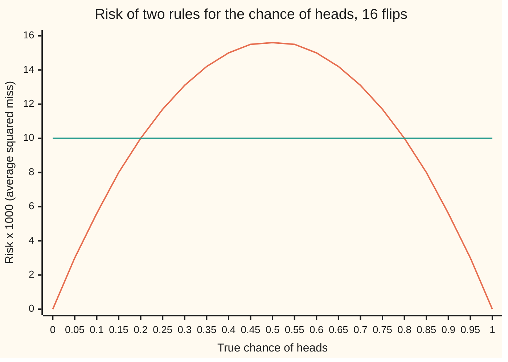
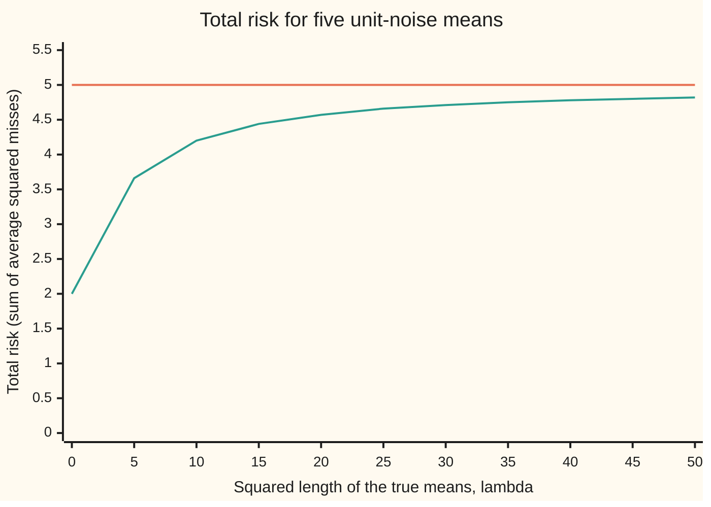

# Decision theory: risk, minimax, admissibility, and Stein's paradox

[Syllabus](../../../SYLLABUS.md) → [Probability and statistics](../README.md) → [Bayesian Inference](../README.md#s10) → Decision theory

---

## General Overview

A coin is flipped 16 times to estimate its chance of heads. Two rules are on the table. The plain fraction divides the heads by 16. A second rule adds 2 heads and 2 tails before dividing, so it reports (heads + 2)/20. With 11 heads, the plain fraction says 0.6875 and the second rule says 0.6500.

Which rule is better? It depends on the coin. Score each rule by its **risk**: its average squared miss over all the 16-flip records the coin could produce. The plain fraction's risk is small for a lopsided coin and reaches its worst, 0.015625, for a fair one. The second rule's risk is 0.01 for every coin. Neither curve sits below the other everywhere.

Decision theory turns "better" into three precise questions:

- **Worst case.** Which rule has the smallest worst-case risk? That rule is **minimax**. Here it is (heads + 2)/20, because its flat 0.01 beats the plain fraction's worst 0.015625.
- **Average case.** Which rule has the smallest risk averaged over a prior (a belief about the coin before the flips)? That rule is the **Bayes rule** for that prior.
- **Never beaten.** Is there another rule at least as good for every coin, and strictly better for some? If not, the rule is **admissible**.

The third question holds a surprise. A chain trials a new shelf layout in five stores. Each store's sales change is measured once, in percent, with measurement noise of standard deviation 1 point. The readings are 1.2, −0.4, 2.0, 0.3 and −1.1. The obvious estimate of each true change is its own reading. Yet the James-Stein rule keeps only 0.565 of each reading (0.678, −0.226, 1.130, 0.170, −0.622). It has a smaller total risk than the readings themselves, whatever the five true changes are. That is **Stein's paradox**.

**Judge an estimator by its whole risk curve: a Bayes rule with flat risk is minimax, a rule that another rule beats everywhere is inadmissible, and with three or more means the plain readings are beaten everywhere by shrinking them all toward zero.**

**What kind of fact this is:** definitions (risk, minimax, Bayes rule, admissible) and three theorems proved on this card in Why it works: a Bayes rule with constant risk is minimax, a unique Bayes rule is admissible, and the James-Stein rule beats the plain readings for three or more means.

### The picture: two risk curves for the 16-flip coin



Orange: the plain fraction, heads/16, with risk θ(1 − θ)/16, highest at a fair coin. Teal: (heads + 2)/20, flat at 0.01. The curves cross at chances 0.20 and 0.80. Between them the flat rule wins; outside them the plain fraction wins.

---

## The formula

Notation first, in words. The unknown is $`\theta`$ (theta): the coin's chance of heads, or the list of five true sales changes. The data are $`X`$. An **estimator** $`\delta`$ (delta) is a rule that turns the data into a guess $`\delta(X)`$. The **loss** of a guess $`d`$ is its squared miss, $`L(\theta, d) = (d - \theta)^2`$; for a list it is the total of the squared misses.

The **risk** of a rule is its average loss when the truth is $`\theta`$, averaged over every data set that truth could produce:

```math
R(\theta, \delta) = E_\theta\big[(\delta(X) - \theta)^2\big]
```

**Read it aloud:** the risk of a rule at a given truth is its expected squared miss when data come from that truth.

The **Bayes risk** $`r(\pi, \delta)`$ averages the risk over a prior $`\pi`$ (pi). A rule is **minimax** if its worst risk is the smallest possible. A rule $`\delta`$ is **admissible** if no rule $`\delta'`$ has

```math
R(\theta, \delta') \le R(\theta, \delta) \ \text{for every } \theta, \quad \text{with} \ R(\theta, \delta') < R(\theta, \delta) \ \text{for some } \theta
```

**Read it aloud:** a rule is admissible when no other rule is at least as good everywhere and strictly better somewhere. A rule that is beaten this way is **inadmissible**, and the winner **dominates** it.

For $`k`$ means, each seen once with unit normal noise, let $`S`$ be the sum of the squared readings. The **James-Stein rule** and its risk are

```math
\delta_{JS}(X) = \Big(1 - \frac{k-2}{S}\Big) X, \qquad R(\theta, \delta_{JS}) = k - (k-2)^2\, E_\theta\Big[\frac{1}{S}\Big] < k = R(\theta, X)
```

**Read it aloud:** multiply every reading by one minus (k minus 2) over the sum of squares; the total risk is k minus a positive amount, so it is always below the readings' total risk of k.

For the stores: S = 6.90, so the share kept is 1 − 3/6.90 = 0.5652.

| Symbol | Plain meaning | In our example | Push it up and the answer… |
| --- | --- | --- | --- |
| $`\theta`$ | the unknown truth: a chance of heads, or the list of five true changes | coin: any chance from 0 to 1; stores: unknown | coin: plain risk rises toward 0.5, then falls |
| $`X`$ | the data: heads in n flips, or the five readings | 11 heads; 1.2, −0.4, 2.0, 0.3, −1.1 | — |
| $`n`$ | the number of flips | 16 | every risk falls |
| $`\delta`$, $`d`$ | an estimator (a rule), and one guess it makes | heads/16, (heads + 2)/20 | — |
| $`L(\theta, d)`$ | loss: squared miss, totalled over a list | (0.65 − θ)² for 11 heads | — |
| $`R(\theta, \delta)`$ | risk: average loss when the truth is θ | 0.015625 for heads/16 at θ = 0.5 | the rule looks worse at that truth |
| $`\pi`$, $`r(\pi, \delta)`$ | a prior, and the Bayes risk (risk averaged over the prior) | Beta(2, 2); 0.0125 and 0.01 | — |
| $`a`$ | heads and tails added in the rule (X + a)/(n + 2a) | 2 | more pull toward 0.5 |
| $`k`$ | how many means are estimated together | 5 stores | the risk saving k − 2 at θ = 0 grows |
| $`S`$ | sum of the squared readings | 6.90 | less shrinking: the share kept rises |
| $`c`$ | the shrink constant in 1 − c/S; James-Stein uses k − 2 | 3 | beats the readings only for c between 0 and 2(k − 2) |
| $`Z`$, $`g`$, $`\varphi`$, $`x_i`$, $`\lambda`$, $`K`$, $`\tau`$ | helpers: Z one normal reading, g a smooth function in Stein's lemma, φ the bell-curve density, x_i one coordinate of the readings, λ the squared length of θ, K a Poisson count with mean λ/2, τ the spread of the true means in the empirical Bayes reading | λ = 6.9 if the truth equals the readings | larger λ: James-Stein risk climbs toward k |

### When it holds

- **Squared loss.** Every result here uses the squared miss. Under absolute loss the Bayes rule is the posterior median ([Credible intervals and decisions](05-credible-intervals-and-decisions.md)), and the minimax rule changes.
- **A Bayes rule with constant risk.** The minimax argument needs both. The plain fraction is a Bayes rule only in a limit and its risk is not flat, so the argument says nothing about it.
- **Normal noise with a known spread.** Stein's lemma uses the bell-curve shape. With unknown spread, the rule needs an estimate of it and a corrected constant.
- **Three or more means.** With one or two means the plain readings are admissible. The saving (k − 2)² is zero at k = 2, and the average of 1/S is infinite at θ = 0.
- **Total loss, not each mean's loss.** James-Stein lowers the sum of the squared misses. One mean's own risk can rise: 1.7081 against 1 in the check below.

---

## Why it works

### Step 0: a rule's quality is a curve, not a number

The truth θ is unknown, so a rule has a risk at every possible truth. Two curves can cross, as in the picture. There are then three honest ways to rank rules. Take the worst point of each curve (minimax). Average each curve over a prior (Bayes). Or discard only the rules whose curve lies above another curve everywhere (admissibility). The first two give a single winner. The third only removes losers.

### Step 1: each rule's risk is variance plus squared bias

[Bias and variance](../07-Sampling%20and%20Estimation/06-bias-variance-and-mean-squared-error.md) shows that mean squared error splits into variance plus squared bias. The heads count X is binomial: mean 16θ, variance 16θ(1 − θ).

The plain fraction has no bias, so its risk is its variance: 16θ(1 − θ)/16² = θ(1 − θ)/16. At a fair coin that is 0.25/16 = 0.015625.

The rule (X + 2)/20 has variance 16θ(1 − θ)/400. Its average is (16θ + 2)/20, so its bias is (2 − 4θ)/20. Add the two:

```math
\frac{16\theta - 16\theta^2 + 4 - 16\theta + 16\theta^2}{400} = \frac{4}{400} = 0.01
```

Every θ term cancels. The risk is 0.01 at every coin. The check confirms both risks by summing the squared miss over all 17 possible head counts.

The curves cross where θ(1 − θ)/16 = 0.01, that is θ(1 − θ) = 0.16, at θ = 0.20 and 0.80.

### Step 2: (X + 2)/20 is a Bayes rule

Take the prior Beta(2, 2): a mild belief that the coin is near fair. [Beta-binomial](02-beta-binomial.md) shows that X heads in 16 flips turn it into the posterior Beta(2 + X, 2 + 16 − X). Under squared loss the best single report is the posterior mean ([Credible intervals and decisions](05-credible-intervals-and-decisions.md), Step 4). That mean is (X + 2)/20.

So (X + 2)/20 has the smallest Bayes risk under Beta(2, 2). Its Bayes risk is its flat 0.01. The plain fraction's Bayes risk is the prior average of θ(1 − θ)/16. For Beta(2, 2) the average of θ(1 − θ) is 1/5, so this is 0.0125. Simpson's rule on the prior-weighted risk curve gives the same two numbers.

### Step 3: a Bayes rule with constant risk is minimax

Suppose some rule δ′ had a worst risk below 0.01. Then its risk is below 0.01 at every θ. So its average over the Beta(2, 2) prior is below 0.01 as well. But 0.01 is the smallest Bayes risk any rule can have under that prior, by Step 2. That is a contradiction. So no rule has a worst risk below 0.01, and (X + 2)/20 is minimax.

The argument is general. A Bayes rule whose risk is flat is minimax, because a flat curve's worst point equals its average.

A third road confirms it. The check searches every rule (X + a)/(16 + 2a) for the smallest worst-case risk. It lands on a = 2.0000, which is √16/2. For n flips the minimax rule adds √n/2 heads and √n/2 tails, and its flat risk is 1/(4(√n + 1)²). For n = 16 that is 1/100 = 0.01.

### Step 4: what admissibility rules out

Admissibility removes rules that are beaten everywhere. Two examples on the coin:

- **Throwing away data.** A rule that uses only the first 8 flips has risk θ(1 − θ)/8, twice the plain fraction's at every chance strictly between 0 and 1. It is inadmissible. Its worst risk is 0.03125.
- **A unique Bayes rule is admissible.** Suppose δ′ dominated (X + 2)/20. Then its Bayes risk would be at most 0.01. So δ′ would also be a Bayes rule. But under squared loss the Bayes rule is unique: the posterior mean. So δ′ is (X + 2)/20 itself, and nothing dominates it.

Admissible does not mean good. The rule "always say 0.5" ignores the flips. Its risk is 0 at a fair coin and 0.16 at θ = 0.1. No rule can match a risk of 0 at θ = 0.5 without always saying 0.5, so this rule is admissible too. Admissibility only removes clear losers.

The plain fraction is also admissible on the coin, a harder proof given in Lehmann and Casella (see Sources). One mean, one number: nothing beats the obvious answer everywhere. That changes with three means.

### Step 5: Stein's lemma moves the unknown out of the average

The obstacle in judging a rule for normal means is that its loss contains the unknown θ. Stein's lemma removes it. Let $`Z`$ be one normal reading with mean θ and spread 1, and $`g`$ a smooth function that does not grow too fast. Then

```math
E\big[(Z - \theta)\, g(Z)\big] = E\big[g'(Z)\big]
```

**Read it aloud:** the average of the reading's error times g equals the average slope of g.

The reason is one integration by parts. The bell curve's slope is −(z − θ) times its own height. So (z − θ) times the density is minus the density's slope. Integrate g against minus that slope, move the slope onto g, and the boundary terms vanish because the bell curve dies at both ends.

With $`k`$ readings, the same step applies one coordinate at a time. If $`g`$ sends the list of readings to a list of k numbers, then E[(X − θ) · g(X)] equals the average of the sum of each coordinate's slope (its divergence). Here a · b, the dot product of two lists, is the sum of the products of their matching entries.

<details>
<summary>Detailed proof: Stein's lemma by parts</summary>

Write $`\varphi`$ for the bell-curve density with mean θ and spread 1. Its slope is

$`\displaystyle \varphi'(z) = -(z - \theta)\,\varphi(z).`$

So

$`\displaystyle E[(Z-\theta)\,g(Z)] = \int g(z)\,(z-\theta)\,\varphi(z)\,dz = -\int g(z)\,\varphi'(z)\,dz.`$

Integrate by parts. The term $`g\varphi`$ vanishes at both ends when g grows slower than the bell curve shrinks. What remains is

$`\displaystyle \int g'(z)\,\varphi(z)\,dz = E[g'(Z)].`$

</details>

### Step 6: the James-Stein risk is k minus a positive amount

Write the rule as $`X - g(X)`$, with $`g(X) = (k-2)X/S`$. Write $`\lVert v \rVert^2`$ for the sum of the squares of a list v, so the loss is $`\lVert X - g - \theta \rVert^2`$. It expands into three pieces:

```math
\lVert X - g - \theta \rVert^2 = \lVert X - \theta \rVert^2 - 2\,(X - \theta)\cdot g + \lVert g \rVert^2
```

Average each piece:

1. The first is the readings' own total risk: k, one unit of noise variance per mean.
2. The second, by Stein's lemma, becomes −2 times the average divergence of g. The divergence of x/S is (k − 2)/S, so this piece is −2(k − 2)² E[1/S].
3. The third is (k − 2)² S/S², which averages to (k − 2)² E[1/S].

Add them: k − (k − 2)² E[1/S]. The amount subtracted is positive whenever k ≥ 3 and E[1/S] is finite, which it is for k ≥ 3. So the James-Stein risk is below k at every θ. The plain readings are inadmissible.

<details>
<summary>Detailed proof: the divergence, and why k − 2 is the best constant</summary>

Write $`x_i`$ for one coordinate. The slope of $`x_i/S`$ in $`x_i`$ is

$`\displaystyle \frac{1}{S} - \frac{2x_i^2}{S^2}.`$

Summing over the k coordinates gives

$`\displaystyle \frac{k}{S} - \frac{2S}{S^2} = \frac{k-2}{S}.`$

With a general constant c in place of k − 2, the same three pieces give

$`\displaystyle R = k - c\,\big(2(k-2) - c\big)\,E_\theta[1/S].`$

The saving $`c(2(k-2) - c)`$ is positive only for c between 0 and 2(k − 2), and largest at c = k − 2. For k = 1 or 2 no positive c works. The function x/S is not smooth at x = 0, but for k ≥ 3 the singularity is mild enough that the lemma still holds.

</details>

The same argument also hands over Stein's unbiased risk estimate, $`k - (k-2)^2/S`$. Its average is the risk at every θ, yet it uses only the data. The check averages it over simulated data as a separate road to the risk.

### Step 7: how much the shrinking saves

The sum S follows a noncentral chi-square law (the sum of k squared normals whose means are not zero). Its average of 1/S is a Poisson mixture: with λ the squared length of θ and K a Poisson count with mean λ/2,

```math
E_\theta\Big[\frac{1}{S}\Big] = E\Big[\frac{1}{k - 2 + 2K}\Big]
```

At θ = 0, K is always 0, so E[1/S] = 1/(k − 2). The risk is k − (k − 2) = 2, for any k ≥ 3. With 5 means that is 2 against 5: a 60% saving. With 100 means it is 2 against 100.

Far from zero, the saving fades and the risk climbs toward k without reaching it:



Orange: the plain readings, risk 5 at every truth. Teal: James-Stein, 2.00 at zero and 4.82 at λ = 50. If the true changes equalled the readings (λ = 6.9), the James-Stein risk would be 3.9294.

Two consequences:

- **Minimax does not imply admissible.** The plain readings have flat risk 5 and are minimax. James-Stein's risk approaches 5 far away but never reaches it. So the readings are minimax and still inadmissible.
- **The point of shrinkage is arbitrary.** Zero was chosen here. Shrinking toward any fixed list of k numbers works the same way, with the readings measured from that list.

James-Stein is itself inadmissible. When S < k − 2 its share goes negative and flips the readings' signs. The **positive-part** rule caps the share at zero and does better: risk 1.4000 at θ = 0, against James-Stein's 2.0000.

Why does pooling help, even for quantities that have nothing to do with each other? If the true changes were drawn from a bell curve centred on 0 with spread τ (tau), the Bayes rule would keep the share τ²/(1 + τ²) of each reading. The average of (k − 2)/S is exactly 1/(1 + τ²), so James-Stein estimates that share from the data. That reading belongs to [Hierarchical models](10-hierarchical-models-and-empirical-bayes.md).

---

## Worked numbers, by hand

| Step | Arithmetic | Value |
| --- | --- | --- |
| plain fraction, worst risk | 0.5 × 0.5 / 16 | 0.015625 |
| (X + 2)/20, variance part | 16θ(1 − θ) / 400 | — |
| (X + 2)/20, bias² part | (2 − 4θ)² / 400 | — |
| (X + 2)/20, total | 4 / 400, every θ | **0.01** |
| Bayes risk under Beta(2, 2), plain | (1/5) / 16 | 0.0125 |
| risks cross | θ(1 − θ) = 0.16 | θ = 0.20 and 0.80 |
| stores: sum of squares | 1.44 + 0.16 + 4.00 + 0.09 + 1.21 | 6.90 |
| share kept | 1 − 3 / 6.90 | **0.5652** |
| James-Stein estimates | 0.5652 × each reading | 0.678, −0.226, 1.130, 0.170, −0.622 |
| total risk at θ = 0 | 5 − 3² × (1/3) | 2 |

The coin's flat rule gives up some accuracy on lopsided coins to cap the worst case at 0.01. The stores' rule keeps 57% of each reading and lowers the total expected squared miss at every possible truth.

### What breaks if you drop a piece

| Mistake | Comes out at | What went wrong |
| --- | --- | --- |
| Use only the first 8 flips | worst risk 0.031250, twice 0.015625 | discarded data; dominated everywhere |
| Shrink by k = 5 instead of k − 2 = 3 | risk 3.3333 at θ = 0, not 2.0000 | still beats 5, but loses most of the saving |
| Shrink by c = 7, past 2(k − 2) = 6 | risk 7.3333 at θ = 0, worse than 5 | over-shrinking; the saving turns negative |
| Expect every mean to improve, at θ = (3, 0, 0, 0, 0) | the first mean's risk 1.7081, against 1 | only the total, 4.1311 against 5, is guaranteed |

---

## Code, from first principles, and it actually runs

The scripts take independent roads to each answer. For the coin: a closed form, an exact sum over all 17 head counts, Simpson's rule for the Bayes risks, and a search over the rules (X + a)/(16 + 2a) for the smallest worst risk. For the stores: a Poisson series for the James-Stein risk, a seeded simulation of the actual loss (100,000 draws at each of three truths), and Stein's unbiased risk estimate averaged over the same draws. Quadrature gives two more risks exactly, the positive-part rule's at θ = 0 and the first mean's own at θ = (3, 0, 0, 0, 0), and the simulation must agree with both. Random numbers come from SplitMix64 with seed 20261123, turned into normal draws by the Box-Muller formula, written out in both languages. The asserts compare roads that share no arithmetic.

### Python

```python
# Risk, minimax, admissibility and Stein's paradox -- the check behind the card.  Standard library only.
# Part 1: a coin flipped 16 times.  Each rule's risk (average squared miss) is computed two ways:
# a closed form, and an exact sum over all 17 possible head counts.  Minimax is found a third way,
# by searching the shrink rules (X + a)/(16 + 2a) for the smallest worst-case risk.
# Part 2: five means, each seen once with unit normal noise.  James-Stein risk comes from a
# Poisson series, from a seeded simulation of the actual loss, and from Stein's unbiased
# risk estimate averaged over the same draws.  Quadrature checks two more simulated risks.
import math
N, P = 16, 5
MASK = (1 << 64) - 1

def choose(n, k):
    out = 1
    for i in range(k):
        out = out * (n - i) // (i + 1)
    return out

def risk_sum(rule, p, n=N):                       # exact: sum over every head count x
    return sum(choose(n, x) * p ** x * (1 - p) ** (n - x) * (rule(x) - p) ** 2 for x in range(n + 1))

def plain(x): return x / N
def minimax(x): return (x + 2) / (N + 4)
def half(x): return x / 8                          # uses only the first 8 flips: x counts their heads

def simpson(g, lo, hi, n=2000):
    h = (hi - lo) / n
    return (g(lo) + g(hi) + sum((4 if i % 2 else 2) * g(lo + i * h) for i in range(1, n))) * h / 3

def beta22(p): return 6 * p * (1 - p)              # the Beta(2, 2) prior density
def worst(a, n=N):                                 # largest risk of (X + a)/(n + 2a) over a fine grid of p
    return max(risk_sum(lambda x: (x + a) / (n + 2 * a), i / 400, n) for i in range(401))
lo, hi = 0.0, 5.0
for _ in range(50):                                # ternary search for the a with the smallest worst risk
    m1, m2 = lo + (hi - lo) / 3, hi - (hi - lo) / 3
    lo, hi = (lo, m2) if worst(m1) < worst(m2) else (m1, hi)
a_best = (lo + hi) / 2
grid = [i / 20 for i in range(21)]
r_plain = [risk_sum(plain, p) for p in grid]
r_mm = [risk_sum(minimax, p) for p in grid]
r_half = [risk_sum(half, p, 8) for p in grid]
bayes_plain = simpson(lambda p: beta22(p) * risk_sum(plain, p), 0, 1, 400)
bayes_mm = simpson(lambda p: beta22(p) * risk_sum(minimax, p), 0, 1, 400)
a10 = math.sqrt(10) / 2

def einv(lam, p=P):                                # E[1/S], S noncentral chi-square: Poisson mixture
    s, w = 0.0, math.exp(-lam / 2)
    for k in range(400):
        s += w / (p - 2 + 2 * k)
        w *= lam / 2 / (k + 1)
    return s
def js_risk(lam, c=P - 2, p=P): return p - c * (2 * (p - 2) - c) * einv(lam, p)

X = [1.2, -0.4, 2.0, 0.3, -1.1]
S = sum(v * v for v in X)
share = 1 - (P - 2) / S

state = 20261123                                   # SplitMix64, then Box-Muller for normal draws
def uniform():
    global state
    state = (state + 0x9E3779B97F4A7C15) & MASK
    z = state
    z = ((z ^ (z >> 30)) * 0xBF58476D1CE4E5B9) & MASK
    z = ((z ^ (z >> 27)) * 0x94D049BB133111EB) & MASK
    return (((z ^ (z >> 31)) >> 11) + 0.5) / 2.0 ** 53
def normal():
    return math.sqrt(-2 * math.log(uniform())) * math.cos(2 * math.pi * uniform())
def simulate(theta, reps=100000):                  # mean and standard error of each loss
    acc = [[0.0, 0.0] for _ in range(5)]
    for _ in range(reps):
        x = [t + normal() for t in theta]
        s = sum(v * v for v in x)
        c, cp = 1 - (P - 2) / s, max(0.0, 1 - (P - 2) / s)
        losses = [sum((v - t) ** 2 for v, t in zip(x, theta)),
                  sum((c * v - t) ** 2 for v, t in zip(x, theta)),
                  P - (P - 2) ** 2 / s,            # Stein's unbiased risk estimate
                  sum((cp * v - t) ** 2 for v, t in zip(x, theta)),
                  (c * x[0] - theta[0]) ** 2]      # the first mean's own squared miss
        for j, l in enumerate(losses):
            acc[j][0] += l
            acc[j][1] += l * l
    return [(s1 / reps, math.sqrt((s2 / reps - (s1 / reps) ** 2) / reps)) for s1, s2 in acc]
sim_obs = simulate(X)
sim_zero = simulate([0.0] * 5)
sim_one = simulate([3.0, 0, 0, 0, 0])
lams = [5 * i for i in range(11)]
def first_mean(h=0.02):                            # exact: the first mean's own risk at theta = (3,0,0,0,0)
    xs, us = [-5 + (i + 0.5) * h for i in range(800)], [(j + 0.5) * h for j in range(500)]  # X1 ~ N(3,1); u = sqrt(R)
    return sum(math.exp(-(x - 3) ** 2 / 2) * ((1 - 3 / (x * x + u * u)) * x - 3) ** 2 * u ** 3 * math.exp(-u * u / 2)
               for x in xs for u in us) * h * h / (2 * math.sqrt(2 * math.pi))   # midpoint rule; R ~ chi-square(4)
first = first_mean()
jsp0 = simpson(lambda s: (s - 6 + 9 / s) * s ** 1.5 * math.exp(-s / 2) / (3 * math.sqrt(2 * math.pi)), 3, 80, 2000)  # JS+ at 0

def f(v, d=4): return f"{v:.{d}f}"
print("coin, n = 16")
print("plain X/16: risk at theta = 0.5, 0.2, 0.1", f(r_plain[10], 6), f(r_plain[4], 6), f(r_plain[2], 6))
print("  closed form theta(1-theta)/16 at 0.5, 0.1", f(0.25 / 16, 6), f(0.09 / 16, 6))
print("(X+2)/20: risk min and max over theta", f(min(r_mm), 6), f(max(r_mm), 6))
print("first 8 flips only: risk at 0.5, 0.1", f(r_half[10], 6), f(r_half[2], 6))
print("risks cross where theta(1-theta) = 0.16, theta =", f(0.5 - math.sqrt(0.25 - 0.16), 2), f(0.5 + math.sqrt(0.25 - 0.16), 2))
print("constant guess 0.5: risk at 0.5, 0.1", f(risk_sum(lambda x: 0.5, 0.5), 6), f(risk_sum(lambda x: 0.5, 0.1), 6))
print("Bayes risk under Beta(2,2): plain, (X+2)/20", f(bayes_plain, 6), f(bayes_mm, 6))
print("  closed form (1/5)/16", f(0.2 / 16, 6))
print("search: best a in (X+a)/(16+2a), worst risk", f(a_best), f(worst(a_best), 6))
print("  sqrt(16)/2, 1/(4(sqrt(16)+1)^2)", f(math.sqrt(16) / 2), f(1 / (4 * 25), 6))
print("(X+1)/18: worst risk", f(worst(1), 6))
print("11 heads of 16: plain, minimax", f(11 / 16), f(13 / 20))
print("house coin n = 10: minimax a, worst risk, plain worst", f(a10), f(1 / (4 * (math.sqrt(10) + 1) ** 2), 6), f(0.025, 6))
print("  7 of 10: plain, minimax, Beta(2,2) mean", f(0.7), f((7 + a10) / (10 + 2 * a10)), f(9 / 14))
print("five means, unit noise")
print("seen", " ".join(f(v, 1) for v in X), "sum of squares", f(S, 2))
print("share kept 1 - 3/S", f(share))
print("James-Stein estimates", " ".join(f(share * v, 3) for v in X))
print("risk at |theta|^2 = 0: series, 5 - 9/3", f(js_risk(0)), f(5 - 9 / 3))
print("risk at |theta|^2 = 6.9 (theta = the data)", f(js_risk(S)))
for name, sim in (("theta = data", sim_obs), ("theta = 0", sim_zero), ("theta = (3,0,0,0,0)", sim_one)):
    print(f"sim {name}: plain, JS, SURE, JS+, first mean")
    print("  " + "  ".join(f"{m:.4f}+-{se:.4f}" for m, se in sim))
print("exact at theta = (3,0,0,0,0): JS total, first mean by quadrature", f(js_risk(9)), f(first))
print("exact JS+ risk at theta = 0, by Simpson over S ~ chi-square(5)", f(jsp0))
print("constant c at theta = 0: c = 3, 5, 6, 7", " ".join(f(js_risk(0, c)) for c in (3, 5, 6, 7)))
print("risk at 0 for k = 3, 10, 100", " ".join(f(js_risk(0, p - 2, p)) for p in (3, 10, 100)))
print("figure, coin plain risk x1000 at theta = 0, 0.05, .., 1: " + ", ".join(f(1000 * r, 1) for r in r_plain))
print("figure, JS risk at |theta|^2 = 0, 5, .., 50: " + ", ".join(f(js_risk(l), 2) for l in lams))
assert all(abs(r - p * (1 - p) / 16) < 1e-12 for r, p in zip(r_plain, grid))     # sum against closed form
assert abs(max(r_mm) - 0.01) < 1e-12 and abs(min(r_mm) - 0.01) < 1e-12         # constant risk, by summing
assert abs(bayes_plain - 0.2 / 16) < 1e-9 and abs(bayes_mm - 0.01) < 1e-9        # Simpson against Beta moments
assert abs(a_best - 2) < 1e-3                                                   # search finds sqrt(n)/2
assert all(h > r for h, r in zip(r_half[1:-1], r_plain[1:-1]))                   # throwing flips away is dominated
assert abs(js_risk(0) - 2) < 1e-12 and max(js_risk(l) for l in lams) < 5       # series against chi-square mean
for sim, lam in ((sim_obs, S), (sim_zero, 0), (sim_one, 9)):
    assert abs(sim[1][0] - js_risk(lam)) < 4 * sim[1][1]                        # simulated loss against series
    assert abs(sim[2][0] - js_risk(lam)) < 4 * sim[2][1]                        # unbiased risk estimate too
    assert abs(sim[0][0] - 5) < 4 * sim[0][1]                                   # plain averages: risk 5
assert abs(sim_one[4][0] - first) < 4 * sim_one[4][1]                           # first mean: simulation against quadrature
assert abs(sim_zero[3][0] - jsp0) < 4 * sim_zero[3][1]                          # positive part: simulation against Simpson
print("ALL CHECKS PASS")
```

**Ran 2026-11-23 on macOS, Python 3.14.10, standard library only. All checks passed. Output, pasted from the run:**

```
coin, n = 16
plain X/16: risk at theta = 0.5, 0.2, 0.1 0.015625 0.010000 0.005625
  closed form theta(1-theta)/16 at 0.5, 0.1 0.015625 0.005625
(X+2)/20: risk min and max over theta 0.010000 0.010000
first 8 flips only: risk at 0.5, 0.1 0.031250 0.011250
risks cross where theta(1-theta) = 0.16, theta = 0.20 0.80
constant guess 0.5: risk at 0.5, 0.1 0.000000 0.160000
Bayes risk under Beta(2,2): plain, (X+2)/20 0.012500 0.010000
  closed form (1/5)/16 0.012500
search: best a in (X+a)/(16+2a), worst risk 2.0000 0.010000
  sqrt(16)/2, 1/(4(sqrt(16)+1)^2) 2.0000 0.010000
(X+1)/18: worst risk 0.012346
11 heads of 16: plain, minimax 0.6875 0.6500
house coin n = 10: minimax a, worst risk, plain worst 1.5811 0.014430 0.025000
  7 of 10: plain, minimax, Beta(2,2) mean 0.7000 0.6519 0.6429
five means, unit noise
seen 1.2 -0.4 2.0 0.3 -1.1 sum of squares 6.90
share kept 1 - 3/S 0.5652
James-Stein estimates 0.678 -0.226 1.130 0.170 -0.622
risk at |theta|^2 = 0: series, 5 - 9/3 2.0000 2.0000
risk at |theta|^2 = 6.9 (theta = the data) 3.9294
sim theta = data: plain, JS, SURE, JS+, first mean
  5.0027+-0.0100  3.9386+-0.0084  3.9259+-0.0035  3.8434+-0.0073  0.7944+-0.0032
sim theta = 0: plain, JS, SURE, JS+, first mean
  5.0132+-0.0101  2.0260+-0.0159  1.9872+-0.0166  1.4124+-0.0069  0.3995+-0.0033
sim theta = (3,0,0,0,0): plain, JS, SURE, JS+, first mean
  5.0095+-0.0101  4.1406+-0.0084  4.1292+-0.0024  4.0948+-0.0079  1.7163+-0.0072
exact at theta = (3,0,0,0,0): JS total, first mean by quadrature 4.1311 1.7081
exact JS+ risk at theta = 0, by Simpson over S ~ chi-square(5) 1.4000
constant c at theta = 0: c = 3, 5, 6, 7 2.0000 3.3333 5.0000 7.3333
risk at 0 for k = 3, 10, 100 2.0000 2.0000 2.0000
figure, coin plain risk x1000 at theta = 0, 0.05, .., 1: 0.0, 3.0, 5.6, 8.0, 10.0, 11.7, 13.1, 14.2, 15.0, 15.5, 15.6, 15.5, 15.0, 14.2, 13.1, 11.7, 10.0, 8.0, 5.6, 3.0, 0.0
figure, JS risk at |theta|^2 = 0, 5, .., 50: 2.00, 3.66, 4.20, 4.44, 4.57, 4.66, 4.71, 4.75, 4.78, 4.80, 4.82
ALL CHECKS PASS
```

### Rust

Same numbers, same labels, built with `rustc --edition 2021 -O`.

```rust
// Risk, minimax, admissibility and Stein's paradox -- the same check as the Python, in Rust.  No crates.
// Part 1: a coin flipped 16 times.  Each rule's risk (average squared miss) is computed two ways:
// a closed form, and an exact sum over all 17 possible head counts.  Minimax is found a third way,
// by searching the shrink rules (X + a)/(16 + 2a) for the smallest worst-case risk.
// Part 2: five means, each seen once with unit normal noise.  James-Stein risk comes from a
// Poisson series, from a seeded simulation of the actual loss, and from Stein's unbiased
// risk estimate averaged over the same draws.  Quadrature checks two more simulated risks.
const N: u64 = 16;
const P: usize = 5;

fn choose(n: u64, k: u64) -> f64 { (0..k).fold(1u64, |out, i| out * (n - i) / (i + 1)) as f64 }

// exact: sum over every head count x
fn risk_sum(rule: &dyn Fn(f64) -> f64, p: f64, n: u64) -> f64 {
    (0..=n)
        .map(|x| choose(n, x) * p.powi(x as i32) * (1.0 - p).powi((n - x) as i32) * (rule(x as f64) - p).powi(2))
        .sum()
}

fn simpson(g: &dyn Fn(f64) -> f64, lo: f64, hi: f64, n: usize) -> f64 {
    let h = (hi - lo) / n as f64;
    let mut s = g(lo) + g(hi);
    for i in 1..n {
        s += if i % 2 == 1 { 4.0 } else { 2.0 } * g(lo + i as f64 * h);
    }
    s * h / 3.0
}

fn beta22(p: f64) -> f64 { 6.0 * p * (1.0 - p) } // the Beta(2, 2) prior density

// largest risk of (X + a)/(n + 2a) over a fine grid of p
fn worst(a: f64, n: u64) -> f64 {
    (0..=400).map(|i| risk_sum(&|x| (x + a) / (n as f64 + 2.0 * a), i as f64 / 400.0, n)).fold(f64::MIN, f64::max)
}

// E[1/S], S noncentral chi-square: Poisson mixture
fn einv(lam: f64, p: usize) -> f64 {
    let (mut s, mut w) = (0.0, (-lam / 2.0).exp());
    for k in 0..400 {
        s += w / ((p - 2 + 2 * k) as f64);
        w *= lam / 2.0 / (k + 1) as f64;
    }
    s
}
fn js_risk(lam: f64, c: f64, p: usize) -> f64 {
    p as f64 - c * (2.0 * (p as f64 - 2.0) - c) * einv(lam, p)
}

// SplitMix64, then Box-Muller for normal draws
struct Rng(u64);
impl Rng {
    fn uniform(&mut self) -> f64 {
        self.0 = self.0.wrapping_add(0x9E3779B97F4A7C15);
        let mut z = self.0;
        z = (z ^ (z >> 30)).wrapping_mul(0xBF58476D1CE4E5B9);
        z = (z ^ (z >> 27)).wrapping_mul(0x94D049BB133111EB);
        (((z ^ (z >> 31)) >> 11) as f64 + 0.5) / 2f64.powi(53)
    }
    fn normal(&mut self) -> f64 {
        let u1 = self.uniform();
        let u2 = self.uniform();
        (-2.0 * u1.ln()).sqrt() * (2.0 * std::f64::consts::PI * u2).cos()
    }
}

// mean and standard error of each loss
fn simulate(rng: &mut Rng, theta: &[f64], reps: usize) -> Vec<(f64, f64)> {
    let mut acc = vec![(0.0f64, 0.0f64); 5];
    let pf = P as f64;
    for _ in 0..reps {
        let x: Vec<f64> = theta.iter().map(|t| t + rng.normal()).collect();
        let s: f64 = x.iter().map(|v| v * v).sum();
        let c = 1.0 - (pf - 2.0) / s;
        let cp = f64::max(0.0, c);
        let sq = |k: f64| -> f64 { x.iter().zip(theta).map(|(v, t)| (k * v - t).powi(2)).sum() };
        let losses = [sq(1.0), sq(c), pf - (pf - 2.0).powi(2) / s, sq(cp), (c * x[0] - theta[0]).powi(2)];
        for (j, l) in losses.iter().enumerate() {
            acc[j].0 += l;
            acc[j].1 += l * l;
        }
    }
    let r = reps as f64;
    acc.iter().map(|(s1, s2)| (s1 / r, ((s2 / r - (s1 / r).powi(2)) / r).sqrt())).collect()
}

fn f(v: f64, d: usize) -> String { format!("{:.*}", d, v) }

fn main() {
    let plain = |x: f64| x / N as f64;
    let minimax = |x: f64| (x + 2.0) / (N as f64 + 4.0);
    let (mut lo, mut hi) = (0.0f64, 5.0f64);
    for _ in 0..50 {
        // ternary search for the a with the smallest worst risk
        let (m1, m2) = (lo + (hi - lo) / 3.0, hi - (hi - lo) / 3.0);
        if worst(m1, N) < worst(m2, N) { hi = m2 } else { lo = m1 }
    }
    let a_best = (lo + hi) / 2.0;
    let grid: Vec<f64> = (0..=20).map(|i| i as f64 / 20.0).collect();
    let r_plain: Vec<f64> = grid.iter().map(|&p| risk_sum(&plain, p, N)).collect();
    let r_mm: Vec<f64> = grid.iter().map(|&p| risk_sum(&minimax, p, N)).collect();
    let r_half: Vec<f64> = grid.iter().map(|&p| risk_sum(&|x| x / 8.0, p, 8)).collect();
    let bayes_plain = simpson(&|p| beta22(p) * risk_sum(&plain, p, N), 0.0, 1.0, 400);
    let bayes_mm = simpson(&|p| beta22(p) * risk_sum(&minimax, p, N), 0.0, 1.0, 400);
    let a10 = 10f64.sqrt() / 2.0;
    let mx = |v: &Vec<f64>| v.iter().cloned().fold(f64::MIN, f64::max);
    let mn = |v: &Vec<f64>| v.iter().cloned().fold(f64::MAX, f64::min);

    let xs = [1.2, -0.4, 2.0, 0.3, -1.1];
    let s: f64 = xs.iter().map(|v| v * v).sum();
    let share = 1.0 - 3.0 / s;
    let js = |lam: f64| js_risk(lam, 3.0, P);
    let mut rng = Rng(20261123);
    let sim_obs = simulate(&mut rng, &xs, 100000);
    let sim_zero = simulate(&mut rng, &[0.0; 5], 100000);
    let sim_one = simulate(&mut rng, &[3.0, 0.0, 0.0, 0.0, 0.0], 100000);
    let lams: Vec<f64> = (0..=10).map(|i| 5.0 * i as f64).collect();
    // exact: the first mean's own risk at theta = (3,0,0,0,0), midpoint rule over X1 ~ N(3,1) and u = sqrt(R), R ~ chi-square(4)
    let cell = |x: f64, u: f64| (-(x - 3.0).powi(2) / 2.0).exp() * ((1.0 - 3.0 / (x * x + u * u)) * x - 3.0).powi(2) * u.powi(3) * (-u * u / 2.0).exp();
    let first = (0..800).map(|i| (0..500).map(|j| cell(-5.0 + (i as f64 + 0.5) * 0.02, (j as f64 + 0.5) * 0.02)).sum::<f64>()).sum::<f64>() * 0.02 * 0.02 / (2.0 * (2.0 * std::f64::consts::PI).sqrt());
    let jsp0 = simpson(&|s| (s - 6.0 + 9.0 / s) * s.powf(1.5) * (-s / 2.0).exp() / (3.0 * (2.0 * std::f64::consts::PI).sqrt()), 3.0, 80.0, 2000); // JS+ at 0
    let join = |v: Vec<String>, sep: &str| v.join(sep);

    println!("coin, n = 16");
    println!("plain X/16: risk at theta = 0.5, 0.2, 0.1 {} {} {}", f(r_plain[10], 6), f(r_plain[4], 6), f(r_plain[2], 6));
    println!("  closed form theta(1-theta)/16 at 0.5, 0.1 {} {}", f(0.25 / 16.0, 6), f(0.09 / 16.0, 6));
    println!("(X+2)/20: risk min and max over theta {} {}", f(mn(&r_mm), 6), f(mx(&r_mm), 6));
    println!("first 8 flips only: risk at 0.5, 0.1 {} {}", f(r_half[10], 6), f(r_half[2], 6));
    println!("risks cross where theta(1-theta) = 0.16, theta = {} {}", f(0.5 - (0.25f64 - 0.16).sqrt(), 2), f(0.5 + (0.25f64 - 0.16).sqrt(), 2));
    println!("constant guess 0.5: risk at 0.5, 0.1 {} {}", f(risk_sum(&|_| 0.5, 0.5, N), 6), f(risk_sum(&|_| 0.5, 0.1, N), 6));
    println!("Bayes risk under Beta(2,2): plain, (X+2)/20 {} {}", f(bayes_plain, 6), f(bayes_mm, 6));
    println!("  closed form (1/5)/16 {}", f(0.2 / 16.0, 6));
    println!("search: best a in (X+a)/(16+2a), worst risk {} {}", f(a_best, 4), f(worst(a_best, N), 6));
    println!("  sqrt(16)/2, 1/(4(sqrt(16)+1)^2) {} {}", f(16f64.sqrt() / 2.0, 4), f(1.0 / (4.0 * 25.0), 6));
    println!("(X+1)/18: worst risk {}", f(worst(1.0, N), 6));
    println!("11 heads of 16: plain, minimax {} {}", f(11.0 / 16.0, 4), f(13.0 / 20.0, 4));
    println!("house coin n = 10: minimax a, worst risk, plain worst {} {} {}", f(a10, 4), f(1.0 / (4.0 * (10f64.sqrt() + 1.0).powi(2)), 6), f(0.025, 6));
    println!("  7 of 10: plain, minimax, Beta(2,2) mean {} {} {}", f(0.7, 4), f((7.0 + a10) / (10.0 + 2.0 * a10), 4), f(9.0 / 14.0, 4));
    println!("five means, unit noise");
    println!("seen {} sum of squares {}", join(xs.iter().map(|&v| f(v, 1)).collect(), " "), f(s, 2));
    println!("share kept 1 - 3/S {}", f(share, 4));
    println!("James-Stein estimates {}", join(xs.iter().map(|&v| f(share * v, 3)).collect(), " "));
    println!("risk at |theta|^2 = 0: series, 5 - 9/3 {} {}", f(js(0.0), 4), f(5.0 - 9.0 / 3.0, 4));
    println!("risk at |theta|^2 = 6.9 (theta = the data) {}", f(js(s), 4));
    for (name, sim) in [("theta = data", &sim_obs), ("theta = 0", &sim_zero), ("theta = (3,0,0,0,0)", &sim_one)] {
        println!("sim {}: plain, JS, SURE, JS+, first mean", name);
        println!("  {}", join(sim.iter().map(|(m, se)| format!("{:.4}+-{:.4}", m, se)).collect(), "  "));
    }
    println!("exact at theta = (3,0,0,0,0): JS total, first mean by quadrature {} {}", f(js(9.0), 4), f(first, 4));
    println!("exact JS+ risk at theta = 0, by Simpson over S ~ chi-square(5) {}", f(jsp0, 4));
    println!("constant c at theta = 0: c = 3, 5, 6, 7 {}", join([3.0, 5.0, 6.0, 7.0].iter().map(|&c| f(js_risk(0.0, c, P), 4)).collect(), " "));
    println!("risk at 0 for k = 3, 10, 100 {}", join([3usize, 10, 100].iter().map(|&p| f(js_risk(0.0, p as f64 - 2.0, p), 4)).collect(), " "));
    println!("figure, coin plain risk x1000 at theta = 0, 0.05, .., 1: {}", join(r_plain.iter().map(|&r| f(1000.0 * r, 1)).collect(), ", "));
    println!("figure, JS risk at |theta|^2 = 0, 5, .., 50: {}", join(lams.iter().map(|&l| f(js(l), 2)).collect(), ", "));
    assert!(r_plain.iter().zip(&grid).all(|(r, p)| (r - p * (1.0 - p) / 16.0).abs() < 1e-12)); // sum against closed form
    assert!((mx(&r_mm) - 0.01).abs() < 1e-12 && (mn(&r_mm) - 0.01).abs() < 1e-12); // constant risk, by summing
    assert!((bayes_plain - 0.2 / 16.0).abs() < 1e-9 && (bayes_mm - 0.01).abs() < 1e-9); // Simpson against Beta moments
    assert!((a_best - 2.0).abs() < 1e-3); // search finds sqrt(n)/2
    assert!((1..20).all(|i| r_half[i] > r_plain[i])); // throwing flips away is dominated
    assert!((js(0.0) - 2.0).abs() < 1e-12 && lams.iter().all(|&l| js(l) < 5.0)); // series against chi-square mean
    for (sim, lam) in [(&sim_obs, s), (&sim_zero, 0.0), (&sim_one, 9.0)] {
        assert!((sim[1].0 - js(lam)).abs() < 4.0 * sim[1].1); // simulated loss against series
        assert!((sim[2].0 - js(lam)).abs() < 4.0 * sim[2].1); // unbiased risk estimate too
        assert!((sim[0].0 - 5.0).abs() < 4.0 * sim[0].1); // plain averages: risk 5
    }
    assert!((sim_one[4].0 - first).abs() < 4.0 * sim_one[4].1); // first mean: simulation against quadrature
    assert!((sim_zero[3].0 - jsp0).abs() < 4.0 * sim_zero[3].1); // positive part: simulation against Simpson
    println!("ALL CHECKS PASS");
}
```

**Ran 2026-11-23 on macOS, rustc 1.98.1, no crates. All checks passed. Output, pasted from the run:**

```
coin, n = 16
plain X/16: risk at theta = 0.5, 0.2, 0.1 0.015625 0.010000 0.005625
  closed form theta(1-theta)/16 at 0.5, 0.1 0.015625 0.005625
(X+2)/20: risk min and max over theta 0.010000 0.010000
first 8 flips only: risk at 0.5, 0.1 0.031250 0.011250
risks cross where theta(1-theta) = 0.16, theta = 0.20 0.80
constant guess 0.5: risk at 0.5, 0.1 0.000000 0.160000
Bayes risk under Beta(2,2): plain, (X+2)/20 0.012500 0.010000
  closed form (1/5)/16 0.012500
search: best a in (X+a)/(16+2a), worst risk 2.0000 0.010000
  sqrt(16)/2, 1/(4(sqrt(16)+1)^2) 2.0000 0.010000
(X+1)/18: worst risk 0.012346
11 heads of 16: plain, minimax 0.6875 0.6500
house coin n = 10: minimax a, worst risk, plain worst 1.5811 0.014430 0.025000
  7 of 10: plain, minimax, Beta(2,2) mean 0.7000 0.6519 0.6429
five means, unit noise
seen 1.2 -0.4 2.0 0.3 -1.1 sum of squares 6.90
share kept 1 - 3/S 0.5652
James-Stein estimates 0.678 -0.226 1.130 0.170 -0.622
risk at |theta|^2 = 0: series, 5 - 9/3 2.0000 2.0000
risk at |theta|^2 = 6.9 (theta = the data) 3.9294
sim theta = data: plain, JS, SURE, JS+, first mean
  5.0027+-0.0100  3.9386+-0.0084  3.9259+-0.0035  3.8434+-0.0073  0.7944+-0.0032
sim theta = 0: plain, JS, SURE, JS+, first mean
  5.0132+-0.0101  2.0260+-0.0159  1.9872+-0.0166  1.4124+-0.0069  0.3995+-0.0033
sim theta = (3,0,0,0,0): plain, JS, SURE, JS+, first mean
  5.0095+-0.0101  4.1406+-0.0084  4.1292+-0.0024  4.0948+-0.0079  1.7163+-0.0072
exact at theta = (3,0,0,0,0): JS total, first mean by quadrature 4.1311 1.7081
exact JS+ risk at theta = 0, by Simpson over S ~ chi-square(5) 1.4000
constant c at theta = 0: c = 3, 5, 6, 7 2.0000 3.3333 5.0000 7.3333
risk at 0 for k = 3, 10, 100 2.0000 2.0000 2.0000
figure, coin plain risk x1000 at theta = 0, 0.05, .., 1: 0.0, 3.0, 5.6, 8.0, 10.0, 11.7, 13.1, 14.2, 15.0, 15.5, 15.6, 15.5, 15.0, 14.2, 13.1, 11.7, 10.0, 8.0, 5.6, 3.0, 0.0
figure, JS risk at |theta|^2 = 0, 5, .., 50: 2.00, 3.66, 4.20, 4.44, 4.57, 4.66, 4.71, 4.75, 4.78, 4.80, 4.82
ALL CHECKS PASS
```

The two outputs match line for line. Each "sim" line gives five averages with their standard errors: the plain readings, James-Stein, Stein's unbiased risk estimate, the positive-part rule, and the first mean's own squared miss. Every James-Stein average sits within four standard errors of the exact series value, and the positive-part and first-mean averages sit within four of their quadratures.

### Lean

Lean proves three steps for every prior, every number of flips n and every k, and checks the worked arithmetic exactly.

- Suppose the loss is squared, a rule is a Bayes rule for some prior, and its risk is the same number C at every θ. Then it is minimax, and C is the smallest worst risk any rule can have.
- Take n flips, n at least 1, and the rule that adds √n/2 heads and √n/2 tails. Then its risk is 1/(4(√n + 1)²) at every chance of heads θ.
- Take k readings, not all zero, with sum of squares S. Then the divergence of x/S, the sum of each coordinate's slope, is exactly (k − 2)/S.
- The worked arithmetic for the coin: the flat 0.01, the worst 0.015625, the crossing at 0.20, and the Bayes risk 0.0125.
- The worked arithmetic for the stores: S = 6.90, the share kept 0.5652, and the risks 2, 3.3333 and 7.3333 at θ = 0.

Stein's lemma, the James-Stein risk curve, the search for the best a, the simulations and the quadratures are left to the Python and Rust checks.

```lean
-- Decision theory: a Bayes rule with constant squared-loss risk is minimax, the coin rule that adds √n/2 heads and √n/2 tails has the flat risk 1/(4(√n + 1)²), and the James-Stein shrink x/S has divergence (k − 2)/S.
import Mathlib.Probability.Decision.BayesEstimator
import Mathlib.Probability.Decision.Risk.Basic
import Mathlib.Analysis.SpecialFunctions.Pow.Real
import Mathlib.Analysis.Calculus.Deriv.Basic
import Mathlib.RingTheory.Polynomial.Bernstein
import Mathlib.Analysis.Calculus.Deriv.Inv
import Mathlib.Analysis.Calculus.Deriv.Add
import Mathlib.Analysis.Calculus.Deriv.Pow

open MeasureTheory ProbabilityTheory
open scoped ENNReal

/-- Squared loss: the loss of the guess `y` when the quantity of interest is `q θ` is the
squared miss `(y − q θ)²`. -/
noncomputable def sqLoss {Θ : Type*} (q : Θ → ℝ) : Θ → ℝ → ℝ≥0∞ :=
  fun θ y => ENNReal.ofReal ((y - q θ) ^ 2)

/-- Evaluating a Bernstein polynomial gives the binomial weight. -/
lemma bern_eval (n ν : ℕ) (θ : ℝ) :
    (bernsteinPolynomial ℝ n ν).eval θ = (n.choose ν : ℝ) * θ ^ ν * (1 - θ) ^ (n - ν) := by
  simp [bernsteinPolynomial]

#print axioms bern_eval

/-- Changing one coordinate changes the sum of squares by the difference of squares. -/
lemma sum_update_sq {k : ℕ} (x : Fin k → ℝ) (i : Fin k) (t : ℝ) :
    ∑ j, (Function.update x i t j) ^ 2 = t ^ 2 + (∑ j, x j ^ 2 - x i ^ 2) := by
  rw [← Finset.add_sum_erase _ _ (Finset.mem_univ i),
    ← Finset.add_sum_erase _ _ (Finset.mem_univ i)]
  simp only [Function.update_self]
  have : ∑ j ∈ Finset.univ.erase i, (Function.update x i t j) ^ 2 =
      ∑ j ∈ Finset.univ.erase i, x j ^ 2 :=
    Finset.sum_congr rfl fun j hj => by
      rw [Function.update_of_ne (Finset.ne_of_mem_erase hj)]
  rw [this]; ring

#print axioms sum_update_sq

/-- **A Bayes rule with constant risk is minimax (Step 3).** Under squared loss, let the rule
`κ` be a Bayes rule for a prior `π` (its risk averaged over `π` is the smallest any rule can
have) and let its risk be the same number `C` at every truth `θ`. Then `κ` is minimax: its
worst risk equals the minimax risk (the smallest worst risk over all rules), and that minimax
risk is `C`. -/
theorem bayes_rule_with_constant_risk_is_minimax {Θ 𝓧 : Type*} [MeasurableSpace Θ]
    [MeasurableSpace 𝓧] (q : Θ → ℝ) (P : Kernel Θ 𝓧) (κ : Kernel 𝓧 ℝ) [IsMarkovKernel κ]
    (π : Measure Θ) [IsProbabilityMeasure π] (C : ℝ≥0∞)
    (hBayes : IsBayesEstimator (sqLoss q) P κ π)
    (hconst : ∀ θ, ∫⁻ y, sqLoss q θ y ∂((κ ∘ₖ P) θ) = C) :
    (⨆ θ, ∫⁻ y, sqLoss q θ y ∂((κ ∘ₖ P) θ)) = minimaxRisk (sqLoss q) P ∧
      minimaxRisk (sqLoss q) P = C := by
  have havg : avgRisk (sqLoss q) P κ π = C := by
    simp only [avgRisk, hconst, lintegral_const, measure_univ, mul_one]
  have h1 : C ≤ minimaxRisk (sqLoss q) P := by
    rw [← havg, hBayes]; exact bayesRisk_le_minimaxRisk _ _ _
  have h2 : minimaxRisk (sqLoss q) P ≤ ⨆ θ, ∫⁻ y, sqLoss q θ y ∂((κ ∘ₖ P) θ) :=
    by unfold minimaxRisk; exact iInf₂_le κ ‹IsMarkovKernel κ›
  have h3 : (⨆ θ, ∫⁻ y, sqLoss q θ y ∂((κ ∘ₖ P) θ)) ≤ C := iSup_le fun θ => (hconst θ).le
  exact ⟨le_antisymm (h3.trans h1) h2, le_antisymm (h2.trans h3) h1⟩

/-- **The coin's minimax rule has flat risk (Steps 1 and 3).** With `n ≥ 1` flips of a coin
whose chance of heads is `θ`, the heads count `x` has the binomial law
`C(n, x) θ^x (1 − θ)^(n − x)`. The rule that adds `√n/2` heads and `√n/2` tails,
`(x + √n/2)/(n + √n)`, has average squared miss `1/(4(√n + 1)²)` whatever `θ` is.
For `n = 16` this is the rule `(x + 2)/20` with risk `1/100`. -/
theorem binomial_minimax_rule_has_constant_risk (n : ℕ) (hn : 0 < n) (θ : ℝ) :
    ∑ x ∈ Finset.range (n + 1),
        (n.choose x : ℝ) * θ ^ x * (1 - θ) ^ (n - x) *
          ((x + Real.sqrt n / 2) / (n + Real.sqrt n) - θ) ^ 2 =
      1 / (4 * (Real.sqrt n + 1) ^ 2) := by
  set b : ℕ → ℝ := fun x => (n.choose x : ℝ) * θ ^ x * (1 - θ) ^ (n - x) with hb
  have h0 : ∑ x ∈ Finset.range (n + 1), b x = 1 := by
    have := congrArg (Polynomial.eval θ) (bernsteinPolynomial.sum ℝ n)
    simpa [Polynomial.eval_finsetSum, bern_eval, hb] using this
  have h1 : ∑ x ∈ Finset.range (n + 1), (x : ℝ) * b x = n * θ := by
    have := congrArg (Polynomial.eval θ) (bernsteinPolynomial.sum_smul ℝ n)
    simpa [Polynomial.eval_finsetSum, bern_eval, hb, nsmul_eq_mul] using this
  have h2 : ∑ x ∈ Finset.range (n + 1), ((n : ℝ) * θ - x) ^ 2 * b x = n * θ * (1 - θ) := by
    have := congrArg (Polynomial.eval θ) (bernsteinPolynomial.variance ℝ n)
    simpa [Polynomial.eval_finsetSum, bern_eval, hb, nsmul_eq_mul, mul_assoc] using this
  set s := Real.sqrt n with hs
  have hs2 : s ^ 2 = n := Real.sq_sqrt (Nat.cast_nonneg n)
  have hspos : 0 < s := Real.sqrt_pos.mpr (by exact_mod_cast hn)
  have hD : (n : ℝ) + s ≠ 0 := by positivity
  have key : ∀ x ∈ Finset.range (n + 1),
      b x * ((x + s / 2) / (n + s) - θ) ^ 2 =
        (1 / (n + s) ^ 2) * (((n : ℝ) * θ - x) ^ 2 * b x) +
        (2 * s * (1 / 2 - θ) / (n + s) ^ 2) * ((x : ℝ) * b x) +
        ((s ^ 2 * (1 / 2 - θ) ^ 2 - 2 * s * (1 / 2 - θ) * n * θ) / (n + s) ^ 2) * b x := by
    intro x _
    field_simp
    ring
  rw [Finset.sum_congr rfl key, Finset.sum_add_distrib, Finset.sum_add_distrib,
    ← Finset.mul_sum, ← Finset.mul_sum, ← Finset.mul_sum, h0, h1, h2]
  have hn' : (n : ℝ) = s ^ 2 := hs2.symm
  rw [hn']
  have : s + 1 ≠ 0 := by positivity
  field_simp
  ring

/-- **The divergence of the James-Stein shrink (Step 6).** For a list `x` of `k` readings, not
all zero, with sum of squares `S = x₁² + ⋯ + x_k²`, the slope of `x_i / S` in `x_i`, summed
over the `k` coordinates, equals `(k − 2)/S`. -/
theorem james_stein_divergence (k : ℕ) (x : Fin k → ℝ) (hx : x ≠ 0) :
    ∑ i, deriv (fun t : ℝ => t / ∑ j, (Function.update x i t j) ^ 2) (x i) =
      ((k : ℝ) - 2) / ∑ j, x j ^ 2 := by
  set S := ∑ j, x j ^ 2 with hS
  have hSne : S ≠ 0 := by
    intro h0
    apply hx
    funext j
    have := (Finset.sum_eq_zero_iff_of_nonneg (fun j _ => sq_nonneg (x j))).mp h0 j
      (Finset.mem_univ j)
    simpa using this
  have hderiv : ∀ i, deriv (fun t : ℝ => t / ∑ j, (Function.update x i t j) ^ 2) (x i) =
      (S - 2 * x i ^ 2) / S ^ 2 := by
    intro i
    have hf : (fun t : ℝ => t / ∑ j, (Function.update x i t j) ^ 2) =
        fun t => t / (t ^ 2 + (S - x i ^ 2)) := by
      funext t; rw [sum_update_sq]
    rw [hf]
    have hden : x i ^ 2 + (S - x i ^ 2) ≠ 0 := by simpa using hSne
    have hd : HasDerivAt (fun t : ℝ => t ^ 2 + (S - x i ^ 2)) (2 * x i) (x i) := by
      have h2 : HasDerivAt (fun t : ℝ => t ^ 2 + (S - x i ^ 2))
          ((2 : ℕ) * x i ^ (2 - 1) + 0) (x i) :=
        HasDerivAt.add (hasDerivAt_pow 2 (x i)) (hasDerivAt_const (x i) (S - x i ^ 2))
      exact HasDerivAt.congr_deriv h2 (by norm_num)
    have := HasDerivAt.fun_div (hasDerivAt_id' (x := x i)) hd hden
    rw [this.deriv]
    have : x i ^ 2 + (S - x i ^ 2) = S := by ring
    rw [this]; ring
  rw [Finset.sum_congr rfl fun i _ => hderiv i, ← Finset.sum_div, Finset.sum_sub_distrib,
    ← Finset.mul_sum, ← hS]
  simp only [Finset.sum_const, Finset.card_univ, Fintype.card_fin, nsmul_eq_mul]
  field_simp

-- Step 1: for (X + 2)/20 with 16 flips, variance part plus squared bias part is 4/400.
example (θ : ℚ) : 16 * θ * (1 - θ) + (2 - 4 * θ) ^ 2 = 4 := by ring
-- The plain fraction's worst risk, at a fair coin: 0.5 × 0.5 / 16 = 0.015625.
example : (1 / 2 : ℚ) * (1 / 2) / 16 = 15625 / 1000000 := by norm_num
-- The minimax rule for 16 flips adds √16/2 = 2 heads and 2 tails; its risk 1/(4(4 + 1)²) = 0.01.
example : (4 : ℚ) / 2 = 2 ∧ (1 : ℚ) / (4 * (4 + 1) ^ 2) = 1 / 100 := by norm_num
-- Summing over all 17 head counts at a fair coin: (X + 2)/20 has risk 1/100, X/16 has 1/64.
example : ∑ x ∈ Finset.range 17, ((Nat.choose 16 x : ℚ) * (1 / 2) ^ 16 *
    ((x + 2) / 20 - 1 / 2) ^ 2) = 1 / 100 := by
  simp only [Finset.sum_range_succ, Finset.sum_range_zero]
  norm_num [Nat.choose]
example : ∑ x ∈ Finset.range 17, ((Nat.choose 16 x : ℚ) * (1 / 2) ^ 16 *
    ((x : ℚ) / 16 - 1 / 2) ^ 2) = 1 / 64 := by
  simp only [Finset.sum_range_succ, Finset.sum_range_zero]
  norm_num [Nat.choose]
-- The risks cross where θ(1 − θ) = 0.16: at θ = 0.2, θ(1 − θ)/16 = 0.01.
example : (1 / 5 : ℚ) * (1 - 1 / 5) = 16 / 100 ∧ (16 / 100 : ℚ) / 16 = 1 / 100 := by norm_num
-- Bayes risk of the plain fraction under Beta(2, 2): (1/5)/16 = 0.0125.
example : (1 / 5 : ℚ) / 16 = 125 / 10000 := by norm_num
-- 11 heads of 16: plain 11/16 = 0.6875, minimax (11 + 2)/20 = 0.65.
example : (11 : ℚ) / 16 = 6875 / 10000 ∧ ((11 : ℚ) + 2) / 20 = 65 / 100 := by norm_num
-- Stores, in hundredths: 1.44 + 0.16 + 4.00 + 0.09 + 1.21 = 6.90.
example : 144 + 16 + 400 + 9 + 121 = 690 := by decide
-- Share kept: 1 − 3/6.90 = 13/23 (0.5652...).
example : (1 : ℚ) - 3 / (690 / 100) = 13 / 23 := by norm_num
-- Total risk at θ = 0 for five means: 5 − 3² × (1/3) = 2.
example : (5 : ℚ) - 3 ^ 2 * (1 / 3) = 2 := by norm_num
-- With constant c in place of k − 2 = 3, at θ = 0 the risk is 5 − c(6 − c)/3: c = 5 gives 10/3, c = 7 gives 22/3.
example : (5 : ℚ) - 5 * (6 - 5) * (1 / 3) = 10 / 3 ∧ (5 : ℚ) - 7 * (6 - 7) * (1 / 3) = 22 / 3 := by
  norm_num

#print axioms bayes_rule_with_constant_risk_is_minimax
#print axioms binomial_minimax_rule_has_constant_risk
#print axioms james_stein_divergence
```

**Checked 2026-11-23 on macOS, Lean 4.36.0-rc2, Mathlib v4.36.0-rc2. Every proof is complete and uses only Lean's standard axioms. Output, pasted from the run:**

```
'bern_eval' depends on axioms: [propext, Classical.choice, Quot.sound]
'sum_update_sq' depends on axioms: [propext, Classical.choice, Quot.sound]
'bayes_rule_with_constant_risk_is_minimax' depends on axioms: [propext, Classical.choice, Quot.sound]
'binomial_minimax_rule_has_constant_risk' depends on axioms: [propext, Classical.choice, Quot.sound]
'james_stein_divergence' depends on axioms: [propext, Classical.choice, Quot.sound]
```

> [!TIP]
> **Try changing**
> Guess first, then read the line named. The check already prints each answer; editing `N`, `P` or a rule instead stops it at an assert, because the asserts are written for 16 flips, five means and a = 2.
> - Guess first: is (X + 1)/18, which adds one head and one tail, minimax for 16 flips? Read the `(X+1)/18` line. No: its risk is not flat, and its worst risk is 0.012346, above 0.01.
> - Guess first: how much does James-Stein save at θ = 0 with 100 means instead of 5? Read the `risk at 0 for k = 3, 10, 100` line. The risk is 2.0000 for every k, so the saving grows to 98.
> - Guess first: what is the minimax rule for the house coin's 10 flips? Read the two `house coin` lines. It adds 1.5811 heads and tails, with flat risk 0.014430 against the plain fraction's worst 0.025. For 7 heads it says 0.6519, between the plain 0.7000 and the Beta(2, 2) mean 0.6429.
> - Guess first: does capping the share at zero help at θ = 0? Compare the positive-part column with James-Stein's: 1.4124 against 2.0260 in the simulation, 1.4000 against 2.0000 exactly.

---

## The usual mistake

> [!warning]
> **Stein's paradox does not say each estimate improves.** It says the *total* squared miss falls. At θ = (3, 0, 0, 0, 0) the first mean's own risk rises from 1 to 1.7081, while the total falls from 5 to 4.1311. If one store's number matters on its own, shrinking it toward the other stores can hurt that number.
>
> Smaller traps:
> - **Minimax is not better everywhere.** At θ = 0.1 the plain fraction's risk is 0.005625, below the minimax rule's 0.01.
> - **Admissible is not good.** "Always say 0.5" is admissible, with risk 0.16 at θ = 0.1.
> - **Shrinking by k instead of k − 2.** At θ = 0 the risk is 3.3333 instead of 2.0000; past c = 6 it is worse than the readings.
> - **Using James-Stein for two means.** The constant k − 2 is 0, so nothing is shrunk; with one or two means the readings are admissible.

---

## Where you meet it in real life

- **Sports statistics.** Early-season batting averages, shrunk toward the league average, predict the rest of the season better than the raw averages. Efron and Morris made this the standard demonstration.
- **Government small-area estimates.** County or school-district rates built from small samples are pulled toward a regional rate, the same trade of a little bias for much less noise.
- **Insurance pricing.** Credibility rating blends a small group's own claims history with the whole book's average, weighted by how much data the group has.
- **Testing many variants.** An online shop comparing dozens of page designs shrinks each measured lift toward the overall average before ranking them, so lucky noise does not win.
- **Regression.** Ridge regression pulls every fitted coefficient toward zero for the same reason: with many coefficients, a common pull lowers the total error.

> **Say it back**
> A rule's risk is its average squared miss, and it is a curve over every possible truth. Minimax picks the rule with the lowest worst point; a Bayes rule with flat risk, such as (heads + 2)/20 for 16 flips, is minimax. A rule is admissible if no other rule is at least as good everywhere and better somewhere. For three or more normal means, shrinking every reading by the share 1 − (k − 2)/S lowers the total risk at every truth, so the plain readings are inadmissible. The proof is Stein's lemma, one integration by parts that turns the unknown error into an average slope.

---

## What this builds on

- [Bias and variance](../07-Sampling%20and%20Estimation/06-bias-variance-and-mean-squared-error.md): risk under squared loss is mean squared error, variance plus squared bias. That card states James-Stein in a fold; this card proves it.
- [Credible intervals and decisions](05-credible-intervals-and-decisions.md): loss, expected loss, and the posterior mean as the best report under squared loss.
- [Beta-binomial](02-beta-binomial.md): the Beta(2, 2) prior and the update that make (X + 2)/20 a posterior mean.
- [Multivariate normal](../05-Transformations%20and%20Joint%20Laws/06-multivariate-normal.md): a list of independent unit-noise readings, and the sum of squares S.
- [Rao-Blackwell and Lehmann-Scheffe](../07-Sampling%20and%20Estimation/11-rao-blackwell-and-lehmann-scheffe.md): the readings are the best unbiased estimates, so James-Stein wins only by accepting bias.

## Where this goes next

- [Jeffreys priors](08-jeffreys-priors-and-invariance.md): a principled default prior, whose Bayes rules can then be judged by the risk ideas here.
- [Hierarchical models](10-hierarchical-models-and-empirical-bayes.md): reads James-Stein as empirical Bayes, with the shrink share estimated from the spread of the group.

The open question: when the quantities are truly unrelated and each one matters on its own, should anyone accept a rule that wins only on the total?

---

## Sources

Verified 2026-11-23: every link below resolves to the publisher's page.

- Lehmann, E. L., and George Casella. *Theory of Point Estimation*, 2nd ed. Springer, 1998. [doi:10.1007/b98854](https://doi.org/10.1007/b98854). Chapters 4 and 5: Bayes and minimax rules, the binomial minimax rule, admissibility, and the James-Stein estimator.
- Stein, Charles M. "Estimation of the Mean of a Multivariate Normal Distribution." *The Annals of Statistics* 9, no. 6 (1981): 1135–1151. [doi:10.1214/aos/1176345632](https://doi.org/10.1214/aos/1176345632). Stein's lemma and the unbiased risk estimate used in Steps 5 and 6.
- Efron, Bradley, and Carl Morris. "Stein's Estimation Rule and Its Competitors—An Empirical Bayes Approach." *Journal of the American Statistical Association* 68, no. 341 (1973): 117–130. [doi:10.1080/01621459.1973.10481350](https://doi.org/10.1080/01621459.1973.10481350). The empirical Bayes reading and the positive-part rule.
- Efron, Bradley, and Carl Morris. "Stein's Paradox in Statistics." *Scientific American* 236, no. 5 (1977): 119–127. [doi:10.1038/scientificamerican0577-119](https://doi.org/10.1038/scientificamerican0577-119). A plain account of the paradox through batting averages.
