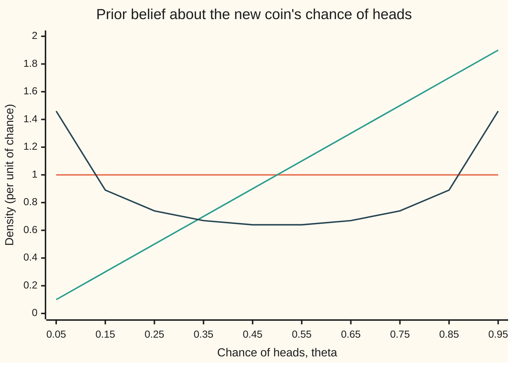

# Jeffreys priors: a 'know-nothing' prior that does not depend on how you write the parameter

[Syllabus](../../../SYLLABUS.md) → [Probability and statistics](../README.md) → [Bayesian Inference](../README.md#s10) → Jeffreys priors

---

## General Overview

The new coin from [Beta-binomial](02-beta-binomial.md) landed heads 7 times in 10 flips. Its unknown chance of heads is θ (theta). Suppose nobody has seen a coin from this mint before, so the prior should say "nothing known".

The obvious choice is a flat prior: every chance from 0 to 1 equally likely. After the flips it becomes Beta(8, 4), with mean 0.6667.

A second analyst cares about the chance of two heads in a row, which is θ². Knowing nothing about that, they put the flat prior on θ² instead. That looks like the same ignorance. It is not. Flat on θ says the coin favours tails with chance 0.5. Flat on θ² says 0.25. After the same 7 heads their posterior mean is 0.6923, not 0.6667. Two people who both "know nothing" disagree only because they wrote the parameter differently.

Harold Jeffreys fixed this in 1946. Build the prior from the model itself: take the Fisher information, the number that says how sharply the data can tell nearby values apart, and use its square root. The rule gives the same beliefs however the parameter is written. For the coin it gives Beta(1/2, 1/2). After 7 heads in 10 the posterior is Beta(7.5, 3.5), with mean 7.5/11 = 0.6818.

**The Jeffreys prior is the square root of the Fisher information; rewriting the parameter multiplies the information by the square of the stretch factor, so its root changes by exactly the stretch factor a density needs, and every way of writing the parameter gives the same beliefs.**

**What kind of fact this is:** the invariance is a theorem, proved on this card in Why it works. Using the Jeffreys prior as the default is a convention: a rule chosen for that property, not a law of nature.

### The picture: three priors that all claim to know nothing



Orange: flat on θ. Green: flat on θ², seen on the θ scale, where it becomes the slope 2θ and leans towards heads. Dark blue: the Jeffreys prior Beta(1/2, 1/2), which leans towards both ends, where a few flips already tell nearby chances apart well.

---

## The formula

Notation first, in words.

- θ is the unknown parameter, here the coin's chance of heads.
- φ (phi) is the same parameter written another way, φ = g(θ) for some map g that only rises or only falls. Examples: θ², or the log-odds log(θ/(1 − θ)).
- π(θ) is a prior density, the belief about θ before the data. The sign ∝ reads "is a constant multiple of".
- I(θ) is the Fisher information of one observation: the average of the squared score, where the score S is the slope of the log-likelihood ℓ in θ ([Fisher information](../07-Sampling%20and%20Estimation/07-fisher-information-and-cramer-rao.md)).

```math
\pi_J(\theta) \;\propto\; \sqrt{I(\theta)}
```

**Read it aloud:** the Jeffreys prior puts belief on each value in proportion to the square root of the information there.

Rewrite the parameter as φ, and the information changes by the square of the stretch factor dθ/dφ:

```math
I_\phi(\phi) = I_\theta(\theta)\left(\frac{d\theta}{d\phi}\right)^{2} \quad\Longrightarrow\quad \sqrt{I_\phi(\phi)} = \sqrt{I_\theta(\theta)}\,\left\lvert\frac{d\theta}{d\phi}\right\rvert
```

**Read it aloud:** the root of the information on the new scale is the root on the old scale times the stretch factor, which is exactly how a density must change ([Transforming a variable](../05-Transformations%20and%20Joint%20Laws/01-transforming-a-random-variable.md)).

A flat prior fails this test: 1 on the θ scale becomes $`\lvert d\theta/d\phi\rvert`$ on the φ scale, which is not 1.

The card's three models:

| Model | Information per observation | Jeffreys prior | Posterior | Example and posterior mean |
| --- | --- | --- | --- | --- |
| Coin, chance θ | $`1/(\theta(1-\theta))`$ | $`\theta^{-1/2}(1-\theta)^{-1/2}`$, Beta(1/2, 1/2) | Beta(s + 1/2, n − s + 1/2) | 7 heads in 10: 0.6818 |
| Poisson rate λ per hour | $`1/\lambda`$ | $`\lambda^{-1/2}`$, infinite area | Gamma(K + 1/2, H) | 45 emails in 3 hours: 15.1667 an hour |
| Normal spread σ, mean known | $`2/\sigma^2`$ | $`1/\sigma`$, infinite area | $`1/\sigma^2`$ ~ Gamma(n/2, Q/2) | 5 fill errors, Q = 16: E σ = 2.1277 ml |

| Symbol | Plain meaning | In our example | Push it up and the answer… |
| --- | --- | --- | --- |
| $`\theta`$ | the coin's unknown chance of heads | posterior mean 0.6818 | — |
| $`\phi`$, $`\psi`$ | the same parameter written another way; ψ = θ² is the chance of two heads in a row | log-odds, or θ² | — |
| $`\pi(\theta)`$, $`\pi_J`$ | a prior density; the Jeffreys prior | flat: 1; Jeffreys: 2.0000 at θ = 0.5 before scaling | more prior weight near a value pulls the posterior there |
| $`I(\theta)`$ | Fisher information of one observation | 4.0000 at θ = 0.5; 11.1111 at θ = 0.1 | data tell nearby values apart better there; the prior is higher |
| $`\ell`$, $`S`$ | the log-likelihood of one observation; its slope in θ, the score | ℓ = log θ for a head | — |
| $`d\theta/d\phi`$ | the stretch factor: how fast θ moves as φ moves | 1/(2θ) for φ = θ² | — |
| $`n`$, $`s`$ | number of observations; heads seen | 10 flips and 7 heads; 5 bottles | n up: the prior matters less |
| $`\lambda`$, $`K`$, $`H`$ | the email rate per hour; emails seen; hours watched | 45 emails in 3 hours | K up: the rate's posterior moves up |
| $`\sigma`$, $`x`$, $`Q`$, $`\tau`$ | the spread of the fill errors in ml; one error; their sum of squares; the precision τ = 1/σ² | Q = 16 ml² from 5 bottles | Q up: the spread's posterior moves up |
| $`u`$ | the even-information scale for the coin, u = arcsin √θ | I = 4.0000 at every θ | — |
| Beta(a, b), Gamma(A, B), B, Γ | beta and gamma laws, as on [Beta-binomial](02-beta-binomial.md) and [Gamma-Poisson](04-gamma-poisson.md); B and Γ are the beta and gamma functions that set their areas and averages | Beta(7.5, 3.5); Gamma(45.5, 3) | — |
| $`E`$ | posterior average | E θ = 0.6818 | — |

### When it holds

- **One parameter at a time.** With several unknowns the rule takes the root of the determinant of the information matrix. For a normal law with mean and spread both unknown, that gives 1/σ², which Jeffreys himself replaced with 1/σ. Reference priors, a later refinement, handle the several-parameter case more carefully.
- **The sampling plan is fixed before the data.** The information depends on how the data were collected. Flipping until the 7th head (which came on flip 10) has information $`7/(\theta^2(1-\theta))`$, so it gives the prior $`\theta^{-1}(1-\theta)^{-1/2}`$ and the posterior Beta(7, 3.5), mean 0.6667, not 0.6818. Both plans give the same likelihood for the same flips, yet the plan changes the prior, so it changes the answer.
- **A smooth model whose range does not depend on the parameter.** The Fisher information needs a log-likelihood with a slope. For a uniform law on a range of unknown width the theory behind it breaks, as on [Fisher information](../07-Sampling%20and%20Estimation/07-fisher-information-and-cramer-rao.md).
- **An improper prior needs a proper posterior.** The rate and spread priors have infinite area. They are usable only when the posterior has finite area, which must be checked for each data set (Step 6).

---

## Why it works

### Step 0: the same event must get the same chance, however it is labelled

"The coin favours tails" is one event. Written in θ it is θ < 0.5; written in θ² it is θ² < 0.25. Any honest rule for priors must give it one chance.

A density is chance per unit width. Rewriting the parameter stretches the widths, so the density must change by the stretch factor to keep each event's chance. A rule like "use 1" ignores the stretch, so it gives different chances on different scales. A rule that works must produce something that itself changes by the stretch factor. The square root of the Fisher information does.

### Step 1: a flat prior changes meaning under a new label

Put a flat prior on ψ = θ². Moving it to the θ scale multiplies by the stretch factor dψ/dθ = 2θ ([Transforming a variable](../05-Transformations%20and%20Joint%20Laws/01-transforming-a-random-variable.md)). So "flat on θ²" is the slope 2θ on θ, the green line in the picture, which is Beta(2, 1).

Its prior chance of θ < 0.5 is 0.25, against 0.5 for flat on θ. After 7 heads in 10, Beta(2, 1) becomes Beta(9, 4), mean 0.6923. Flat on θ gives Beta(8, 4), mean 0.6667. Both priors were meant to say nothing.

### Step 2: information changes by the square of the stretch factor

Write θ as a function of φ. The log-likelihood of an observation is the same number on either scale; only its input is labelled differently. By the chain rule, its slope in φ is its slope in θ times dθ/dφ:

```math
S_\phi = S_\theta \,\frac{d\theta}{d\phi}
```

Square both sides and average over the possible observations. The stretch factor does not depend on the observation, so it comes out of the average as a square. That gives the formula's first equation. Taking square roots gives the second.

### Step 3: the root changes like a density, so the prior does not depend on the label

A prior density on φ, carried back to θ, is multiplied by $`\lvert d\phi/d\theta\rvert`$. Start from Jeffreys on φ: $`\sqrt{I_\phi}`$. Carry it back:

```math
\sqrt{I_\phi(\phi)}\,\left\lvert\frac{d\phi}{d\theta}\right\rvert = \sqrt{I_\theta(\theta)}\,\left\lvert\frac{d\theta}{d\phi}\right\rvert\left\lvert\frac{d\phi}{d\theta}\right\rvert = \sqrt{I_\theta(\theta)}
```

The two stretch factors cancel. Jeffreys built on φ and Jeffreys built on θ are the same belief. The checks confirm it with information found by brute force on three scales:

| θ | $`\sqrt{I}`$ built on θ | built on θ², carried back | built on log-odds, carried back | flat on θ², carried back |
| --- | --- | --- | --- | --- |
| 0.1 | 3.3333 | 3.3333 | 3.3333 | 0.2000 |
| 0.5 | 2.0000 | 2.0000 | 2.0000 | 1.0000 |
| 0.9 | 3.3333 | 3.3333 | 3.3333 | 1.8000 |

The last column is the flat rule's failure: on the θ scale it is not flat at all. As a posterior number: the chance that the coin favours heads under Jeffreys is 0.8980, whether the prior is built on θ or on the log-odds.

### Step 4: Jeffreys is flat on the scale where information is constant

There is always a scale on which the information is the same everywhere. For the coin it is u = arcsin √θ, where I = 4 at every θ. On that scale the Jeffreys prior is flat.

This is what "know nothing" should mean. Equal steps on u are equally easy for the data to tell apart. So Jeffreys spreads belief evenly over values the data can distinguish, not evenly over numbers that happen to be written down. Near θ = 0 or 1 a few flips separate nearby chances well, so those chances get more of the prior.

The other two models have such scales too: √λ for the rate (information 4 per hour) and log σ for the spread (information 2). The checks integrate every posterior on these scales.

### Step 5: the three priors and their posteriors

**The coin.** One flip has information $`1/(\theta(1-\theta))`$ ([Fisher information](../07-Sampling%20and%20Estimation/07-fisher-information-and-cramer-rao.md)). Its root is $`\theta^{-1/2}(1-\theta)^{-1/2}`$, the shape of Beta(1/2, 1/2). Its area is the beta function B(1/2, 1/2), which equals the circle number π (not the prior π). That is finite, so this prior is a real distribution. The beta-binomial update adds 7 heads and 3 tails: Beta(7.5, 3.5).

**The Poisson rate.** One hour of watching gives a Poisson count with mean λ, and information 1/λ. The prior is $`\lambda^{-1/2}`$. In the gamma-Poisson update this is shape 1/2 and rate 0, so 45 emails in 3 hours give Gamma(45.5, 3), mean 15.1667 an hour.

**The normal spread.** For one fill error x with known mean 0, the log-likelihood is $`-\log\sigma - x^2/(2\sigma^2)`$ plus a constant. Its information is $`2/\sigma^2`$ and the prior is 1/σ. With 5 bottles and Q = 16 the posterior makes $`1/\sigma^2`$ a Gamma(5/2, 8) law.

<details>
<summary>Detailed working: the normal spread's information and posterior</summary>

The score is the slope in σ:

$`\displaystyle S = -\frac{1}{\sigma} + \frac{x^2}{\sigma^3} = \frac{x^2 - \sigma^2}{\sigma^3}`$

Its average is 0, since the average of x² is σ². Its average square is the variance of x² over σ⁶. For a normal law with mean 0 the variance of x² is 2σ⁴, so

$`\displaystyle I(\sigma) = \frac{2\sigma^4}{\sigma^6} = \frac{2}{\sigma^2}, \qquad \sqrt{I(\sigma)} \propto \frac{1}{\sigma}`$

With n errors and sum of squares Q, the likelihood is a constant times $`\sigma^{-n}e^{-Q/(2\sigma^2)}`$. Times the prior 1/σ:

$`\displaystyle \pi(\sigma \mid \text{data}) \propto \sigma^{-n-1}\,e^{-Q/(2\sigma^2)}`$

Write τ = 1/σ², so σ = τ^(−1/2) and the stretch factor is |dσ/dτ| = τ^(−3/2)/2. The density of τ is

$`\displaystyle \tau^{(n+1)/2}\,e^{-Q\tau/2}\,\tau^{-3/2} = \tau^{n/2-1}\,e^{-(Q/2)\tau}`$

That is the shape of Gamma(n/2, Q/2). Its averages give E σ² = (Q/2)/(n/2 − 1) = 5.3333 ml² and E σ = √(Q/2) Γ(n/2 − 1/2)/Γ(n/2) = 2.1277 ml.

</details>

### Step 6: improper priors, and when the posterior is still proper

The rate prior $`\lambda^{-1/2}`$ and the spread prior 1/σ have infinite area. Such a prior is called **improper**. It is not a probability law, and the evidence (the chance of the data averaged over the prior) means nothing under it. It is still usable when prior times likelihood has finite area.

- **Rate, Jeffreys.** Gamma(K + 1/2, H) is proper whenever some time was watched, H > 0, even with zero emails. A desk quiet for 3 hours gets posterior mean 0.5/3 = 0.1667 an hour.
- **Rate, flat on log λ.** The prior 1/λ gives Gamma(K, H). With zero emails the shape is 0 and the area is infinite. The checks show it: the area above √λ = 0.01, 0.0001 and 0.000001 is 7.5348, 16.7449 and 25.9552, growing without end.
- **Spread, Jeffreys.** Gamma(n/2, Q/2) is proper with one bottle, as long as its error is not zero. Its average of σ needs two bottles, and its average of σ² three.

---

## Worked numbers, by hand

| Step | Arithmetic | Value |
| --- | --- | --- |
| information per flip at θ = 0.5 | 1/(0.5 × 0.5) | 4 |
| Jeffreys prior | root of 1/(θ(1 − θ)) | Beta(1/2, 1/2) |
| add 7 heads and 3 tails | (0.5 + 7, 0.5 + 3) | Beta(7.5, 3.5) |
| posterior mean | 7.5/(7.5 + 3.5) = 7.5/11 | **0.6818** |
| posterior standard deviation | √(7.5 × 3.5/(11² × 12)) | 0.1345 |
| flat prior, for comparison | Beta(8, 4): 8/12 | 0.6667 |
| rate: 45 emails in 3 hours | Gamma(45.5, 3): 45.5/3 | 15.1667 an hour |
| spread: errors 1, −3, 2, −1, 1 ml | Q = 1 + 9 + 4 + 1 + 1 = 16; Gamma(2.5, 8) | E σ = 2.1277 ml |

With Jeffreys' prior, the coin's best guess is 0.6818, a little above the flat prior's 0.6667. The data dominate both, and the Jeffreys answer would be the same had the parameter been written as θ² or as log-odds.

The spread shows the label problem at its sharpest, because 5 bottles are few. All three priors below claim to know nothing:

```
posterior average of sigma, ml (plain estimate sqrt(Q/n) = 1.7889)
Jeffreys 1/sigma   █████████████████████             2.1277
flat in sigma      █████████████████████████         2.5066
flat in sigma^2    ████████████████████████████████  3.1915
```

The rate shows it mildly: flat on λ gives 15.3333, flat on log λ 15.0000, and Jeffreys 15.1667, between them.

### What breaks if you drop a piece

| Mistake | Comes out at | What went wrong |
| --- | --- | --- |
| Flat prior on θ² instead of θ | Beta(9, 4), mean 0.6923, not 0.6667 | "Flat" depends on the label; the two flat priors disagree |
| The information itself, not its root | $`1/(\theta(1-\theta))`$: Beta(7, 3), mean 0.7000 | That prior changes by the square of the stretch factor, so it is not invariant |
| Jeffreys from the flip-until-7th-head plan | Beta(7, 3.5), mean 0.6667 | The information, so the prior, depends on the sampling plan |
| Flat on log λ with zero emails | area 7.5348, 16.7449, 25.9552, … | The posterior is improper: no answer at all |

The code prints all four.

---

## Code, from first principles, and it actually runs

The scripts use only square roots, logarithms, exponentials and sines. They find every Fisher information by brute force: a finite-difference score, squared and averaged over the outcomes. They take four roads to the coin's answer: the conjugate formula; a grid integral on the even-information scale u; Jeffreys built on the log-odds scale and carried back; and a simulation of 200,000 coins drawn from Beta(1/2, 1/2) by θ = sin²(πU/2), keeping those that show 7 heads in 10. The rate and spread posteriors are each found by formula and by a grid integral.

### Python

```python
# Jeffreys priors -- the check behind the card.  Standard library: math only.
# Fisher information is found by brute force (finite-difference score, squared,
# averaged over outcomes), in three ways of writing the coin's chance.  Each
# posterior is found twice: by the conjugate formula, and by a grid integral on
# the scale where the information is constant.  The coin also gets a simulation.
from math import sqrt, log, exp, sin, asin, pi, lgamma

def midpoint(f, a, b, m=20000):                 # area under f from a to b
    h = (b - a) / m
    return h * sum(f(a + (i + 0.5) * h) for i in range(m))

def info(loglik, t, outcomes, d=1e-5):          # average squared score at t
    return sum(p * ((loglik(t + d, x) - loglik(t - d, x)) / (2 * d)) ** 2 for x, p in outcomes)

def flip_ll(th, x): return x * log(th) + (1 - x) * log(1 - th)
def coin_info(th, to_theta, at):               # parameter written as at -> theta
    return info(lambda a, x: flip_ll(to_theta(a), x), at, [(1, th), (0, 1 - th)])
sq = lambda a: sqrt(a)                          # psi = theta^2, back to theta
lo = lambda a: 1 / (1 + exp(-a))                # log-odds phi, back to theta

print("Fisher information per flip, by brute force, and Jeffreys mapped back to theta")
for th in (0.1, 0.3, 0.5, 0.7, 0.9):
    i_th = coin_info(th, lambda a: a, th)
    j_psi = sqrt(coin_info(th, sq, th * th)) * 2 * th                     # times |dpsi/dtheta|
    j_phi = sqrt(coin_info(th, lo, log(th / (1 - th)))) / (th * (1 - th))  # times |dphi/dtheta|
    exact = 1 / sqrt(th * (1 - th))
    print(f"theta {th:.1f}: I {i_th:.4f} (formula {1 / (th * (1 - th)):.4f}); sqrt I {exact:.4f}; "
          f"via theta^2 {j_psi:.4f}; via log-odds {j_phi:.4f}; flat-in-theta^2 gives {2 * th:.4f}")
    assert abs(i_th * th * (1 - th) - 1) < 1e-6 and abs(j_psi / exact - 1) < 1e-6 and abs(j_phi / exact - 1) < 1e-6

xs = [0.05 + 0.1 * i for i in range(10)]
print("figure, Jeffreys prior density: " + ", ".join(f"{1 / (pi * sqrt(x * (1 - x))):.2f}" for x in xs))
print("figure, flat-in-theta^2 prior density: " + ", ".join(f"{2 * x:.2f}" for x in xs))

# The coin on the even-information scale u, theta = sin^2 u: there Jeffreys is flat.
N, S = 10, 7
lik = lambda th: th ** S * (1 - th) ** (N - S)
def coin_post(w, g):                            # posterior average of g(theta), prior weight w(u)
    top = midpoint(lambda u: g(sin(u) ** 2) * w(u) * lik(sin(u) ** 2), 0, pi / 2)
    return top / midpoint(lambda u: w(u) * lik(sin(u) ** 2), 0, pi / 2)
priors = [("Jeffreys Beta(1/2,1/2)", 0.5, 0.5, lambda u: 1.0),
          ("flat in theta Beta(1,1)", 1, 1, lambda u: sin(2 * u)),
          ("flat in theta^2 Beta(2,1)", 2, 1, lambda u: 2 * sin(u) ** 2 * sin(2 * u)),
          ("I not its root Beta(0,0)", 0, 0, lambda u: 4 / sin(2 * u))]
print(f"coin, {S} heads in {N}: prior, posterior, mean by formula and by grid, P(theta > 0.5)")
means = {}
for name, a, b, w in priors:
    form = (a + S) / (a + b + N)
    grid = coin_post(w, lambda t: t)
    means[a] = form
    print(f"  {name}: Beta({a + S:g},{b + N - S:g}) mean {form:.4f} grid {grid:.4f} "
          f"P {coin_post(w, lambda t: 1.0 if t > 0.5 else 0.0):.4f}")
    assert abs(form - grid) < 1e-6
A, B = 7.5, 3.5
sd = sqrt(A * B / ((A + B) ** 2 * (A + B + 1)))
print(f"Jeffreys posterior sd {sd:.4f}; flat prior posterior sd {sqrt(32 / (144 * 13)):.4f}")
# Invariance: Jeffreys built directly on the log-odds scale, information by brute force.
wphi = lambda f: sqrt(coin_info(lo(f), lo, f))
top = midpoint(lambda f: (1.0 if f > 0 else 0.0) * wphi(f) * lik(lo(f)), -30, 30, 6000)
p_phi = top / midpoint(lambda f: wphi(f) * lik(lo(f)), -30, 30, 6000)
p_th = coin_post(lambda u: 1.0, lambda t: 1.0 if t > 0.5 else 0.0)
print(f"P(theta > 0.5) under Jeffreys built on theta {p_th:.4f}, built on log-odds {p_phi:.4f}")
assert abs(p_phi - p_th) < 1e-4
print(f"prior P(theta < 0.5): flat in theta {0.5:.4f}, flat in theta^2 {0.25:.4f}, Jeffreys "
      f"{midpoint(lambda u: 1.0, 0, pi / 4) / (pi / 2):.4f}")
print(f"Jeffreys prior P(theta < 0.1 or > 0.9) {2 * midpoint(lambda u: 1.0, 0, asin(sqrt(0.1))) / (pi / 2):.4f}; flat 0.2000")
# Wrong likelihood: flip until the 7th head (negative binomial) gives Beta(7, 3.5).
ths = (0.1, 0.5, 0.9)                           # its information, by brute force over f tails before the 7th head
inb = [info(lambda t, f: 7 * log(t) + f * log(1 - t), th, [(f, exp(lgamma(f + 7) - lgamma(7) - lgamma(f + 1) + 7 * log(th) + f * log(1 - th))) for f in range(3000)]) for th in ths]
fnb = [7 / (th * th * (1 - th)) for th in ths]
print(f"flip-until-7th-head information by brute force at theta 0.1, 0.5, 0.9: {inb[0]:.4f}, {inb[1]:.4f}, {inb[2]:.4f}; "
      f"formula 7/(theta^2(1-theta)) {fnb[0]:.4f}, {fnb[1]:.4f}, {fnb[2]:.4f}")
assert all(abs(i / f - 1) < 1e-6 for i, f in zip(inb, fnb))
print(f"Jeffreys for flip-until-7th-head: Beta(7,3.5) mean {7 / 10.5:.4f}; grid "
      f"{coin_post(lambda u: 1 / sin(u) ** 2 / (1 - sin(u) ** 2) ** 0.5 * sin(2 * u), lambda t: t):.4f}")
# Simulation: theta from Jeffreys by theta = sin^2(pi U / 2), ten flips, keep 7 heads.
MASK, state = (1 << 64) - 1, 20261123
def rnd():
    global state
    state = (state + 0x9E3779B97F4A7C15) & MASK
    z = state
    z = ((z ^ (z >> 30)) * 0xBF58476D1CE4E5B9) & MASK
    z = ((z ^ (z >> 27)) * 0x94D049BB133111EB) & MASK
    return ((z ^ (z >> 31)) >> 11) / 9007199254740992.0
kept, total = 0, 0.0
for _ in range(200000):
    th = sin(pi * rnd() / 2) ** 2
    if sum(1 for _ in range(N) if rnd() < th) == S:
        kept, total = kept + 1, total + th
print(f"simulation: 200000 coins, {kept} showed 7 heads, mean chance {total / kept:.4f}")
assert abs(total / kept - means[0.5]) < 4 * sd / sqrt(kept)

# Poisson rate: 45 emails in 3 hours.  Even-information scale v = sqrt(lambda).
K, H = 45, 3
print(f"Poisson rate: I(15) by brute force {info(lambda l, k: k * log(l) - l - lgamma(k + 1), 15.0, [(k, exp(k * log(15) - 15 - lgamma(k + 1))) for k in range(200)]):.4f}, formula {1 / 15:.4f}")
def rate_post(w, k, g):
    f = lambda v: w(v) * exp(k * log(v * v) - H * v * v - (k * log(k / H) - k if k else 0))
    return midpoint(lambda v: g(v * v) * f(v), 1e-9, 12) / midpoint(f, 1e-9, 12)
for name, a, w in [("Jeffreys lambda^(-1/2)", 0.5, lambda v: 1.0), ("flat in lambda", 1, lambda v: 2 * v),
                   ("flat in log lambda", 0, lambda v: 2 / v)]:
    g = rate_post(w, K, lambda l: l)
    print(f"  {name}: Gamma({K + a:g},{H}) mean {(K + a) / H:.4f} grid {g:.4f}")
    assert abs(g - (K + a) / H) < 1e-6
print(f"Jeffreys sd {sqrt(K + 0.5) / H:.4f}; zero emails in 3 hours: Jeffreys mean {0.5 / H:.4f} grid {rate_post(lambda v: 1.0, 0, lambda l: l):.4f}")
for eps in (1e-2, 1e-4, 1e-6):   # flat in log lambda, zero emails: area from sqrt(lambda) = eps up
    print(f"  flat in log lambda, zero emails, area above sqrt(lambda) = {eps:g}: "
          f"{midpoint(lambda t: 2 * exp(-H * exp(2 * t)), log(eps), log(12)):.4f}")

# Normal spread, mean known 0: fill errors 1, -3, 2, -1, 1 ml.  Scale t = log sigma.
X = [1, -3, 2, -1, 1]
n, Q = len(X), sum(x * x for x in X)
nll = lambda s, x: -log(s) - x * x / (2 * s * s)
i2 = midpoint(lambda x: exp(-x * x / 8) / sqrt(8 * pi) * ((nll(2 + 1e-5, x) - nll(2 - 1e-5, x)) / 2e-5) ** 2, -40, 40)
print(f"normal spread, n {n}, sum of squares {Q}: I(2) by brute force {i2:.4f}, formula 2/sigma^2 {2 / 4:.4f}")
def spread_post(w, g):
    f = lambda t: w(t) * exp(-n * t - Q / (2 * exp(2 * t)) + n * log(sqrt(Q / n)) + n / 2)
    return midpoint(lambda t: g(exp(t)) * f(t), -6, 20) / midpoint(f, -6, 20)
print(f"plain estimate sqrt(Q/n) {sqrt(Q / n):.4f} ml")
for name, a, w in [("Jeffreys 1/sigma", n / 2, lambda t: 1.0), ("flat in sigma", (n - 1) / 2, lambda t: exp(t)),
                   ("flat in sigma^2", (n - 2) / 2, lambda t: exp(2 * t))]:
    es = sqrt(Q / 2) * exp(lgamma(a - 0.5) - lgamma(a))
    gs, gv = spread_post(w, lambda s: s), spread_post(w, lambda s: s * s)
    print(f"  {name}: 1/sigma^2 ~ Gamma({a:g},{Q / 2:g}); E sigma {es:.4f} grid {gs:.4f}; "
          f"E sigma^2 {Q / 2 / (a - 1):.4f} grid {gv:.4f}")
    assert abs(es - gs) < 1e-5 and abs(Q / 2 / (a - 1) - gv) < 1e-4
assert abs(i2 - 0.5) < 1e-6
iu = [coin_info(th, lambda a: sin(a) ** 2, asin(sqrt(th))) for th in (0.1, 0.5, 0.9)]
iv = info(lambda v, k: k * log(v * v) - v * v - lgamma(k + 1), sqrt(15), [(k, exp(k * log(15) - 15 - lgamma(k + 1))) for k in range(200)])
it = midpoint(lambda x: exp(-x * x / 8) / sqrt(8 * pi) * ((nll(exp(log(2) + 1e-5), x) - nll(exp(log(2) - 1e-5), x)) / 2e-5) ** 2, -40, 40)
print(f"information on the even scales: u = asin(sqrt(theta)) at theta 0.1, 0.5, 0.9: {iu[0]:.4f}, {iu[1]:.4f}, {iu[2]:.4f}; "
      f"v = sqrt(lambda) at 15: {iv:.4f}; log sigma at 2: {it:.4f}")
print(f"try: 10 heads in 10, Jeffreys mean {10.5 / 11:.4f}, flat {11 / 12:.4f}; 70 in 100, Jeffreys {70.5 / 101:.4f}, flat {71 / 102:.4f}")
assert all(abs(x - 4) < 1e-5 for x in iu) and abs(iv - 4) < 1e-5 and abs(it - 2) < 1e-5
print("ALL CHECKS PASS")
```

**Ran 2026-11-23 on macOS, Python 3.14.10, standard library only. All checks passed. Output, pasted from the run:**

```
Fisher information per flip, by brute force, and Jeffreys mapped back to theta
theta 0.1: I 11.1111 (formula 11.1111); sqrt I 3.3333; via theta^2 3.3333; via log-odds 3.3333; flat-in-theta^2 gives 0.2000
theta 0.3: I 4.7619 (formula 4.7619); sqrt I 2.1822; via theta^2 2.1822; via log-odds 2.1822; flat-in-theta^2 gives 0.6000
theta 0.5: I 4.0000 (formula 4.0000); sqrt I 2.0000; via theta^2 2.0000; via log-odds 2.0000; flat-in-theta^2 gives 1.0000
theta 0.7: I 4.7619 (formula 4.7619); sqrt I 2.1822; via theta^2 2.1822; via log-odds 2.1822; flat-in-theta^2 gives 1.4000
theta 0.9: I 11.1111 (formula 11.1111); sqrt I 3.3333; via theta^2 3.3333; via log-odds 3.3333; flat-in-theta^2 gives 1.8000
figure, Jeffreys prior density: 1.46, 0.89, 0.74, 0.67, 0.64, 0.64, 0.67, 0.74, 0.89, 1.46
figure, flat-in-theta^2 prior density: 0.10, 0.30, 0.50, 0.70, 0.90, 1.10, 1.30, 1.50, 1.70, 1.90
coin, 7 heads in 10: prior, posterior, mean by formula and by grid, P(theta > 0.5)
  Jeffreys Beta(1/2,1/2): Beta(7.5,3.5) mean 0.6818 grid 0.6818 P 0.8980
  flat in theta Beta(1,1): Beta(8,4) mean 0.6667 grid 0.6667 P 0.8867
  flat in theta^2 Beta(2,1): Beta(9,4) mean 0.6923 grid 0.6923 P 0.9270
  I not its root Beta(0,0): Beta(7,3) mean 0.7000 grid 0.7000 P 0.9102
Jeffreys posterior sd 0.1345; flat prior posterior sd 0.1307
P(theta > 0.5) under Jeffreys built on theta 0.8980, built on log-odds 0.8980
prior P(theta < 0.5): flat in theta 0.5000, flat in theta^2 0.2500, Jeffreys 0.5000
Jeffreys prior P(theta < 0.1 or > 0.9) 0.4097; flat 0.2000
flip-until-7th-head information by brute force at theta 0.1, 0.5, 0.9: 777.7778, 56.0000, 86.4198; formula 7/(theta^2(1-theta)) 777.7778, 56.0000, 86.4198
Jeffreys for flip-until-7th-head: Beta(7,3.5) mean 0.6667; grid 0.6667
simulation: 200000 coins, 12995 showed 7 heads, mean chance 0.6822
Poisson rate: I(15) by brute force 0.0667, formula 0.0667
  Jeffreys lambda^(-1/2): Gamma(45.5,3) mean 15.1667 grid 15.1667
  flat in lambda: Gamma(46,3) mean 15.3333 grid 15.3333
  flat in log lambda: Gamma(45,3) mean 15.0000 grid 15.0000
Jeffreys sd 2.2485; zero emails in 3 hours: Jeffreys mean 0.1667 grid 0.1667
  flat in log lambda, zero emails, area above sqrt(lambda) = 0.01: 7.5348
  flat in log lambda, zero emails, area above sqrt(lambda) = 0.0001: 16.7449
  flat in log lambda, zero emails, area above sqrt(lambda) = 1e-06: 25.9552
normal spread, n 5, sum of squares 16: I(2) by brute force 0.5000, formula 2/sigma^2 0.5000
plain estimate sqrt(Q/n) 1.7889 ml
  Jeffreys 1/sigma: 1/sigma^2 ~ Gamma(2.5,8); E sigma 2.1277 grid 2.1277; E sigma^2 5.3333 grid 5.3333
  flat in sigma: 1/sigma^2 ~ Gamma(2,8); E sigma 2.5066 grid 2.5066; E sigma^2 8.0000 grid 8.0000
  flat in sigma^2: 1/sigma^2 ~ Gamma(1.5,8); E sigma 3.1915 grid 3.1915; E sigma^2 16.0000 grid 16.0000
information on the even scales: u = asin(sqrt(theta)) at theta 0.1, 0.5, 0.9: 4.0000, 4.0000, 4.0000; v = sqrt(lambda) at 15: 4.0000; log sigma at 2: 2.0000
try: 10 heads in 10, Jeffreys mean 0.9545, flat 0.9167; 70 in 100, Jeffreys 0.6980, flat 0.6961
ALL CHECKS PASS
```

### Rust

Same numbers, same labels, built with `rustc --edition 2021 -O`.

```rust
// Jeffreys priors -- the same check as the Python, in Rust.  No crates.
// Fisher information is found by brute force (finite-difference score, squared,
// averaged over outcomes), in three ways of writing the coin's chance.  Each
// posterior is found twice: by the conjugate formula, and by a grid integral on
// the scale where the information is constant.  The coin also gets a simulation.
use std::f64::consts::PI;

fn midpoint_m(f: &dyn Fn(f64) -> f64, a: f64, b: f64, m: usize) -> f64 {
    let h = (b - a) / m as f64;
    h * (0..m).map(|i| f(a + (i as f64 + 0.5) * h)).sum::<f64>()
}
fn midpoint(f: &dyn Fn(f64) -> f64, a: f64, b: f64) -> f64 { midpoint_m(f, a, b, 20000) }

fn info(ll: &dyn Fn(f64, f64) -> f64, t: f64, outcomes: &[(f64, f64)]) -> f64 {
    let d = 1e-5;
    outcomes.iter().map(|&(x, p)| p * ((ll(t + d, x) - ll(t - d, x)) / (2.0 * d)).powi(2)).sum()
}
fn flip_ll(th: f64, x: f64) -> f64 { x * th.ln() + (1.0 - x) * (1.0 - th).ln() }
fn coin_info(th: f64, to_theta: &dyn Fn(f64) -> f64, at: f64) -> f64 {
    info(&|a, x| flip_ll(to_theta(a), x), at, &[(1.0, th), (0.0, 1.0 - th)])
}
fn lo(a: f64) -> f64 { 1.0 / (1.0 + (-a).exp()) }

fn lgamma(x: f64) -> f64 {                       // Lanczos, g = 7, nine terms
    const C: [f64; 9] = [0.99999999999980993, 676.5203681218851, -1259.1392167224028,
        771.32342877765313, -176.61502916214059, 12.507343278686905,
        -0.13857109526572012, 9.9843695780195716e-6, 1.5056327351493116e-7];
    if x < 0.5 { return (PI / (PI * x).sin()).ln() - lgamma(1.0 - x) }
    let x = x - 1.0;
    let mut a = C[0];
    let t = x + 7.5;
    for i in 1..9 { a += C[i] / (x + i as f64) }
    0.5 * (2.0 * PI).ln() + (x + 0.5) * t.ln() - t + a.ln()
}

fn main() {
    println!("Fisher information per flip, by brute force, and Jeffreys mapped back to theta");
    for &th in &[0.1f64, 0.3, 0.5, 0.7, 0.9] {
        let i_th = coin_info(th, &|a| a, th);
        let j_psi = coin_info(th, &|a: f64| a.sqrt(), th * th).sqrt() * 2.0 * th;
        let j_phi = coin_info(th, &lo, (th / (1.0 - th)).ln()).sqrt() / (th * (1.0 - th));
        let exact = 1.0 / (th * (1.0 - th)).sqrt();
        println!("theta {:.1}: I {:.4} (formula {:.4}); sqrt I {:.4}; via theta^2 {:.4}; via log-odds {:.4}; flat-in-theta^2 gives {:.4}",
                 th, i_th, 1.0 / (th * (1.0 - th)), exact, j_psi, j_phi, 2.0 * th);
        assert!((i_th * th * (1.0 - th) - 1.0).abs() < 1e-6 && (j_psi / exact - 1.0).abs() < 1e-6 && (j_phi / exact - 1.0).abs() < 1e-6);
    }
    let xs: Vec<f64> = (0..10).map(|i| 0.05 + 0.1 * i as f64).collect();
    let jf: Vec<String> = xs.iter().map(|x| format!("{:.2}", 1.0 / (PI * (x * (1.0 - x)).sqrt()))).collect();
    let fq: Vec<String> = xs.iter().map(|x| format!("{:.2}", 2.0 * x)).collect();
    println!("figure, Jeffreys prior density: {}", jf.join(", "));
    println!("figure, flat-in-theta^2 prior density: {}", fq.join(", "));

    // The coin on the even-information scale u, theta = sin^2 u: there Jeffreys is flat.
    let (n, s) = (10.0f64, 7.0f64);
    let lik = |th: f64| th.powf(s) * (1.0 - th).powf(n - s);
    let coin_post = |w: &dyn Fn(f64) -> f64, g: &dyn Fn(f64) -> f64| -> f64 {
        let top = midpoint(&|u: f64| g(u.sin().powi(2)) * w(u) * lik(u.sin().powi(2)), 0.0, PI / 2.0);
        top / midpoint(&|u: f64| w(u) * lik(u.sin().powi(2)), 0.0, PI / 2.0)
    };
    let above = |t: f64| if t > 0.5 { 1.0 } else { 0.0 };
    let priors: Vec<(&str, f64, f64, Box<dyn Fn(f64) -> f64>)> = vec![
        ("Jeffreys Beta(1/2,1/2)", 0.5, 0.5, Box::new(|_u| 1.0)),
        ("flat in theta Beta(1,1)", 1.0, 1.0, Box::new(|u: f64| (2.0 * u).sin())),
        ("flat in theta^2 Beta(2,1)", 2.0, 1.0, Box::new(|u: f64| 2.0 * u.sin().powi(2) * (2.0 * u).sin())),
        ("I not its root Beta(0,0)", 0.0, 0.0, Box::new(|u: f64| 4.0 / (2.0 * u).sin()))];
    println!("coin, {} heads in {}: prior, posterior, mean by formula and by grid, P(theta > 0.5)", s, n);
    let mut jeff_mean = 0.0;
    for (name, a, b, w) in &priors {
        let form = (a + s) / (a + b + n);
        let grid = coin_post(w.as_ref(), &|t| t);
        if *a == 0.5 { jeff_mean = form }
        println!("  {}: Beta({},{}) mean {:.4} grid {:.4} P {:.4}", name, a + s, b + n - s, form, grid, coin_post(w.as_ref(), &above));
        assert!((form - grid).abs() < 1e-6);
    }
    let (aa, bb) = (7.5f64, 3.5f64);
    let sd = (aa * bb / ((aa + bb).powi(2) * (aa + bb + 1.0))).sqrt();
    println!("Jeffreys posterior sd {:.4}; flat prior posterior sd {:.4}", sd, (32.0f64 / (144.0 * 13.0)).sqrt());
    // Invariance: Jeffreys built directly on the log-odds scale, information by brute force.
    let wphi = |f: f64| coin_info(lo(f), &lo, f).sqrt();
    let top = midpoint_m(&|f: f64| (if f > 0.0 { 1.0 } else { 0.0 }) * wphi(f) * lik(lo(f)), -30.0, 30.0, 6000);
    let p_phi = top / midpoint_m(&|f: f64| wphi(f) * lik(lo(f)), -30.0, 30.0, 6000);
    let p_th = coin_post(&|_u| 1.0, &above);
    println!("P(theta > 0.5) under Jeffreys built on theta {:.4}, built on log-odds {:.4}", p_th, p_phi);
    assert!((p_phi - p_th).abs() < 1e-4);
    println!("prior P(theta < 0.5): flat in theta {:.4}, flat in theta^2 {:.4}, Jeffreys {:.4}",
             0.5, 0.25, midpoint(&|_u| 1.0, 0.0, PI / 4.0) / (PI / 2.0));
    println!("Jeffreys prior P(theta < 0.1 or > 0.9) {:.4}; flat 0.2000",
             2.0 * midpoint(&|_u| 1.0, 0.0, 0.1f64.sqrt().asin()) / (PI / 2.0));
    // Wrong likelihood: flip until the 7th head (negative binomial) gives Beta(7, 3.5).
    let inb: Vec<f64> = [0.1f64, 0.5, 0.9].iter().map(|&th| info(&|t, f| 7.0 * t.ln() + f * (1.0 - t).ln(), th, // its information, by brute force over f tails
        &(0..3000).map(|f| { let f = f as f64; (f, (lgamma(f + 7.0) - lgamma(7.0) - lgamma(f + 1.0) + 7.0 * th.ln() + f * (1.0 - th).ln()).exp()) }).collect::<Vec<_>>())).collect();
    let fnb: Vec<f64> = [0.1f64, 0.5, 0.9].iter().map(|&th| 7.0 / (th * th * (1.0 - th))).collect();
    println!("flip-until-7th-head information by brute force at theta 0.1, 0.5, 0.9: {:.4}, {:.4}, {:.4}; formula 7/(theta^2(1-theta)) {:.4}, {:.4}, {:.4}", inb[0], inb[1], inb[2], fnb[0], fnb[1], fnb[2]);
    assert!(inb.iter().zip(&fnb).all(|(i, f)| (i / f - 1.0).abs() < 1e-6));
    println!("Jeffreys for flip-until-7th-head: Beta(7,3.5) mean {:.4}; grid {:.4}", 7.0 / 10.5,
             coin_post(&|u: f64| 1.0 / u.sin().powi(2) / (1.0 - u.sin().powi(2)).powf(0.5) * (2.0 * u).sin(), &|t| t));
    // Simulation: theta from Jeffreys by theta = sin^2(pi U / 2), ten flips, keep 7 heads.
    let mut state: u64 = 20261123;
    let mut rnd = || {
        state = state.wrapping_add(0x9E3779B97F4A7C15);
        let mut z = state;
        z = (z ^ (z >> 30)).wrapping_mul(0xBF58476D1CE4E5B9);
        z = (z ^ (z >> 27)).wrapping_mul(0x94D049BB133111EB);
        ((z ^ (z >> 31)) >> 11) as f64 / 9007199254740992.0
    };
    let (mut kept, mut total) = (0u64, 0.0f64);
    for _ in 0..200000 {
        let th = (PI * rnd() / 2.0).sin().powi(2);
        let heads = (0..10).filter(|_| rnd() < th).count();
        if heads == 7 { kept += 1; total += th }
    }
    println!("simulation: 200000 coins, {} showed 7 heads, mean chance {:.4}", kept, total / kept as f64);
    assert!((total / kept as f64 - jeff_mean).abs() < 4.0 * sd / (kept as f64).sqrt());

    // Poisson rate: 45 emails in 3 hours.  Even-information scale v = sqrt(lambda).
    let (k, h) = (45.0f64, 3.0f64);
    let outc: Vec<(f64, f64)> = (0..200).map(|j| { let j = j as f64; (j, (j * 15f64.ln() - 15.0 - lgamma(j + 1.0)).exp()) }).collect();
    println!("Poisson rate: I(15) by brute force {:.4}, formula {:.4}",
             info(&|l, j| j * l.ln() - l - lgamma(j + 1.0), 15.0, &outc), 1.0 / 15.0);
    let rate_post = |w: &dyn Fn(f64) -> f64, k: f64, g: &dyn Fn(f64) -> f64| -> f64 {
        let off = if k > 0.0 { k * (k / h).ln() - k } else { 0.0 };
        let f = |v: f64| w(v) * (k * (v * v).ln() - h * v * v - off).exp();
        midpoint(&|v| g(v * v) * f(v), 1e-9, 12.0) / midpoint(&f, 1e-9, 12.0)
    };
    let rates: Vec<(&str, f64, Box<dyn Fn(f64) -> f64>)> = vec![
        ("Jeffreys lambda^(-1/2)", 0.5, Box::new(|_v| 1.0)), ("flat in lambda", 1.0, Box::new(|v: f64| 2.0 * v)),
        ("flat in log lambda", 0.0, Box::new(|v: f64| 2.0 / v))];
    for (name, a, w) in &rates {
        let g = rate_post(w.as_ref(), k, &|l| l);
        println!("  {}: Gamma({},{}) mean {:.4} grid {:.4}", name, k + a, h, (k + a) / h, g);
        assert!((g - (k + a) / h).abs() < 1e-6);
    }
    println!("Jeffreys sd {:.4}; zero emails in 3 hours: Jeffreys mean {:.4} grid {:.4}",
             (k + 0.5).sqrt() / h, 0.5 / h, rate_post(&|_v| 1.0, 0.0, &|l| l));
    for (eps, label) in [(1e-2f64, "0.01"), (1e-4, "0.0001"), (1e-6, "1e-06")] {
        println!("  flat in log lambda, zero emails, area above sqrt(lambda) = {}: {:.4}", label,
                 midpoint(&|t: f64| 2.0 * (-h * (2.0 * t).exp()).exp(), eps.ln(), 12f64.ln()));
    }

    // Normal spread, mean known 0: fill errors 1, -3, 2, -1, 1 ml.  Scale t = log sigma.
    let xd = [1.0f64, -3.0, 2.0, -1.0, 1.0];
    let (nb, q) = (xd.len() as f64, xd.iter().map(|x| x * x).sum::<f64>());
    let nll = |s: f64, x: f64| -s.ln() - x * x / (2.0 * s * s);
    let i2 = midpoint(&|x: f64| (-x * x / 8.0).exp() / (8.0 * PI).sqrt() * ((nll(2.0 + 1e-5, x) - nll(2.0 - 1e-5, x)) / 2e-5).powi(2), -40.0, 40.0);
    println!("normal spread, n {}, sum of squares {}: I(2) by brute force {:.4}, formula 2/sigma^2 {:.4}", nb, q, i2, 2.0 / 4.0);
    let spread_post = |w: &dyn Fn(f64) -> f64, g: &dyn Fn(f64) -> f64| -> f64 {
        let f = |t: f64| w(t) * (-nb * t - q / (2.0 * (2.0 * t).exp()) + nb * (q / nb).sqrt().ln() + nb / 2.0).exp();
        midpoint(&|t: f64| g(t.exp()) * f(t), -6.0, 20.0) / midpoint(&f, -6.0, 20.0)
    };
    println!("plain estimate sqrt(Q/n) {:.4} ml", (q / nb).sqrt());
    let spreads: Vec<(&str, f64, Box<dyn Fn(f64) -> f64>)> = vec![
        ("Jeffreys 1/sigma", nb / 2.0, Box::new(|_t| 1.0)), ("flat in sigma", (nb - 1.0) / 2.0, Box::new(|t: f64| t.exp())),
        ("flat in sigma^2", (nb - 2.0) / 2.0, Box::new(|t: f64| (2.0 * t).exp()))];
    for (name, a, w) in &spreads {
        let es = (q / 2.0).sqrt() * (lgamma(a - 0.5) - lgamma(*a)).exp();
        let (gs, gv) = (spread_post(w.as_ref(), &|s| s), spread_post(w.as_ref(), &|s| s * s));
        println!("  {}: 1/sigma^2 ~ Gamma({},{}); E sigma {:.4} grid {:.4}; E sigma^2 {:.4} grid {:.4}",
                 name, a, q / 2.0, es, gs, q / 2.0 / (a - 1.0), gv);
        assert!((es - gs).abs() < 1e-5 && (q / 2.0 / (a - 1.0) - gv).abs() < 1e-4);
    }
    assert!((i2 - 0.5).abs() < 1e-6);
    let iu: Vec<f64> = [0.1f64, 0.5, 0.9].iter().map(|&th| coin_info(th, &|a: f64| a.sin().powi(2), th.sqrt().asin())).collect();
    let iv = info(&|v, j| j * (v * v).ln() - v * v - lgamma(j + 1.0), 15f64.sqrt(), &outc);
    let it = midpoint(&|x: f64| (-x * x / 8.0).exp() / (8.0 * PI).sqrt() * ((nll((2f64.ln() + 1e-5).exp(), x) - nll((2f64.ln() - 1e-5).exp(), x)) / 2e-5).powi(2), -40.0, 40.0);
    println!("information on the even scales: u = asin(sqrt(theta)) at theta 0.1, 0.5, 0.9: {:.4}, {:.4}, {:.4}; v = sqrt(lambda) at 15: {:.4}; log sigma at 2: {:.4}",
             iu[0], iu[1], iu[2], iv, it);
    println!("try: 10 heads in 10, Jeffreys mean {:.4}, flat {:.4}; 70 in 100, Jeffreys {:.4}, flat {:.4}", 10.5 / 11.0, 11.0 / 12.0, 70.5 / 101.0, 71.0 / 102.0);
    assert!(iu.iter().all(|x| (x - 4.0).abs() < 1e-5) && (iv - 4.0).abs() < 1e-5 && (it - 2.0).abs() < 1e-5);
    println!("ALL CHECKS PASS");
}
```

**Ran 2026-11-23 on macOS, rustc 1.98.1, no crates. All checks passed. Output, pasted from the run:**

```
Fisher information per flip, by brute force, and Jeffreys mapped back to theta
theta 0.1: I 11.1111 (formula 11.1111); sqrt I 3.3333; via theta^2 3.3333; via log-odds 3.3333; flat-in-theta^2 gives 0.2000
theta 0.3: I 4.7619 (formula 4.7619); sqrt I 2.1822; via theta^2 2.1822; via log-odds 2.1822; flat-in-theta^2 gives 0.6000
theta 0.5: I 4.0000 (formula 4.0000); sqrt I 2.0000; via theta^2 2.0000; via log-odds 2.0000; flat-in-theta^2 gives 1.0000
theta 0.7: I 4.7619 (formula 4.7619); sqrt I 2.1822; via theta^2 2.1822; via log-odds 2.1822; flat-in-theta^2 gives 1.4000
theta 0.9: I 11.1111 (formula 11.1111); sqrt I 3.3333; via theta^2 3.3333; via log-odds 3.3333; flat-in-theta^2 gives 1.8000
figure, Jeffreys prior density: 1.46, 0.89, 0.74, 0.67, 0.64, 0.64, 0.67, 0.74, 0.89, 1.46
figure, flat-in-theta^2 prior density: 0.10, 0.30, 0.50, 0.70, 0.90, 1.10, 1.30, 1.50, 1.70, 1.90
coin, 7 heads in 10: prior, posterior, mean by formula and by grid, P(theta > 0.5)
  Jeffreys Beta(1/2,1/2): Beta(7.5,3.5) mean 0.6818 grid 0.6818 P 0.8980
  flat in theta Beta(1,1): Beta(8,4) mean 0.6667 grid 0.6667 P 0.8867
  flat in theta^2 Beta(2,1): Beta(9,4) mean 0.6923 grid 0.6923 P 0.9270
  I not its root Beta(0,0): Beta(7,3) mean 0.7000 grid 0.7000 P 0.9102
Jeffreys posterior sd 0.1345; flat prior posterior sd 0.1307
P(theta > 0.5) under Jeffreys built on theta 0.8980, built on log-odds 0.8980
prior P(theta < 0.5): flat in theta 0.5000, flat in theta^2 0.2500, Jeffreys 0.5000
Jeffreys prior P(theta < 0.1 or > 0.9) 0.4097; flat 0.2000
flip-until-7th-head information by brute force at theta 0.1, 0.5, 0.9: 777.7778, 56.0000, 86.4198; formula 7/(theta^2(1-theta)) 777.7778, 56.0000, 86.4198
Jeffreys for flip-until-7th-head: Beta(7,3.5) mean 0.6667; grid 0.6667
simulation: 200000 coins, 12995 showed 7 heads, mean chance 0.6822
Poisson rate: I(15) by brute force 0.0667, formula 0.0667
  Jeffreys lambda^(-1/2): Gamma(45.5,3) mean 15.1667 grid 15.1667
  flat in lambda: Gamma(46,3) mean 15.3333 grid 15.3333
  flat in log lambda: Gamma(45,3) mean 15.0000 grid 15.0000
Jeffreys sd 2.2485; zero emails in 3 hours: Jeffreys mean 0.1667 grid 0.1667
  flat in log lambda, zero emails, area above sqrt(lambda) = 0.01: 7.5348
  flat in log lambda, zero emails, area above sqrt(lambda) = 0.0001: 16.7449
  flat in log lambda, zero emails, area above sqrt(lambda) = 1e-06: 25.9552
normal spread, n 5, sum of squares 16: I(2) by brute force 0.5000, formula 2/sigma^2 0.5000
plain estimate sqrt(Q/n) 1.7889 ml
  Jeffreys 1/sigma: 1/sigma^2 ~ Gamma(2.5,8); E sigma 2.1277 grid 2.1277; E sigma^2 5.3333 grid 5.3333
  flat in sigma: 1/sigma^2 ~ Gamma(2,8); E sigma 2.5066 grid 2.5066; E sigma^2 8.0000 grid 8.0000
  flat in sigma^2: 1/sigma^2 ~ Gamma(1.5,8); E sigma 3.1915 grid 3.1915; E sigma^2 16.0000 grid 16.0000
information on the even scales: u = asin(sqrt(theta)) at theta 0.1, 0.5, 0.9: 4.0000, 4.0000, 4.0000; v = sqrt(lambda) at 15: 4.0000; log sigma at 2: 2.0000
try: 10 heads in 10, Jeffreys mean 0.9545, flat 0.9167; 70 in 100, Jeffreys 0.6980, flat 0.6961
ALL CHECKS PASS
```

The two outputs match line for line.

### Lean

Lean proves the stretch-factor rule and the invariance for any smooth one-parameter model, finds the coin's prior, and checks the card's worked numbers.

- Suppose θ = h(φ), where h has a slope at φ and every log-likelihood has a slope at θ. Then $`I_\phi(\phi) = I_\theta(\theta)\,(d\theta/d\phi)^2`$.
- Take the same h and φ. Then the root of the information on the new scale is the old root times $`\lvert d\theta/d\phi\rvert`$.
- Suppose φ = g(θ), a map h undoes g near θ, both have slopes, and every log-likelihood has a slope at θ. Then $`\sqrt{I_\phi(\phi)}\,\lvert d\phi/d\theta\rvert = \sqrt{I_\theta(\theta)}`$.
- Take 0 < θ < 1 and one flip of the coin. Then $`I(\theta) = 1/(\theta(1-\theta))`$.
- Take the same θ. Then $`\sqrt{I(\theta)}`$ is the Beta(1/2, 1/2) density times B(1/2, 1/2). So the coin's Jeffreys prior is Beta(1/2, 1/2).
- The information per flip is 4 at θ = 1/2 and 100/9 at θ = 1/10.
- For 7 heads in 10, the Jeffreys posterior mean is 15/22, with variance 35/1936. The flat prior gives 2/3, and flat on θ² gives 9/13.
- The information itself, not its root, gives 7/10. Flipping until the 7th head gives information 56 at θ = 1/2 and mean 2/3.
- For 45 emails in 3 hours, the posterior means are 91/6 (Jeffreys), 46/3 (flat on λ) and 15 (flat on log λ). With zero emails, Jeffreys gives 1/6.
- For the fill errors, Q = 16, and the information 2/σ² is 1/2 at σ = 2.
- The posterior means of σ² are 16/3 (Jeffreys), 8 (flat in σ) and 16 (flat in σ²).

Posterior updates, the Poisson and spread information, improper priors, grids and the simulation are left to the Python and Rust checks.

```lean
-- Jeffreys priors: rewriting the parameter multiplies the Fisher information by the square of the stretch factor, so the Jeffreys prior is the same belief on every scale, and for the coin it is Beta(1/2, 1/2).
import Mathlib.MeasureTheory.Integral.Bochner.Basic
import Mathlib.Analysis.Calculus.Deriv.Comp
import Mathlib.Probability.Distributions.Bernoulli
import Mathlib.Probability.Distributions.Beta
import Mathlib.Analysis.SpecialFunctions.Log.Deriv
import Mathlib.Analysis.SpecialFunctions.Gaussian.GaussianIntegral

open MeasureTheory ProbabilityTheory Filter Topology

/-- The Fisher information of one observation at `θ`: the average, under the law `P θ`, of the
squared score, where the score is the slope in `θ` of the log-likelihood `ℓ θ x`. -/
noncomputable def fisherInfo {Ω : Type*} [MeasurableSpace Ω] (P : ℝ → Measure Ω)
    (ℓ : ℝ → Ω → ℝ) (θ : ℝ) : ℝ :=
  ∫ x, (deriv (fun t => ℓ t x) θ) ^ 2 ∂(P θ)

/-- One flip of a coin with chance of heads `θ` (heads is `true`), using Mathlib's Bernoulli law;
outside `[0, 1]` the chance is clipped, which never matters for `0 < θ < 1`. -/
noncomputable def coinLaw (θ : ℝ) : Measure Bool :=
  bernoulliMeasure true false (Set.projIcc (0 : ℝ) 1 zero_le_one θ)

/-- The log-likelihood of one flip: `log θ` for a head, `log (1 - θ)` for a tail. -/
noncomputable def coinLogLik (θ : ℝ) (b : Bool) : ℝ :=
  if b then Real.log θ else Real.log (1 - θ)

/-- Rewrite the parameter as `φ`, with `θ = h φ`. If the model is smooth (each log-likelihood has
a slope at `h φ`) and the relabelling is smooth at `φ`, the information on the new scale is the
old information times the square of the stretch factor `dθ/dφ`, so its square root is the old
root times the stretch factor `|dθ/dφ|`: exactly how a density must change. -/
theorem fisher_info_scales_by_square_of_stretch_factor {Ω : Type*} [MeasurableSpace Ω]
    (P : ℝ → Measure Ω) (ℓ : ℝ → Ω → ℝ) (h : ℝ → ℝ) (φ : ℝ)
    (hh : DifferentiableAt ℝ h φ)
    (hℓ : ∀ x, DifferentiableAt ℝ (fun t => ℓ t x) (h φ)) :
    fisherInfo (fun ψ => P (h ψ)) (fun ψ x => ℓ (h ψ) x) φ
        = fisherInfo P ℓ (h φ) * (deriv h φ) ^ 2 ∧
      Real.sqrt (fisherInfo (fun ψ => P (h ψ)) (fun ψ x => ℓ (h ψ) x) φ)
        = Real.sqrt (fisherInfo P ℓ (h φ)) * |deriv h φ| := by
  have hd : ∀ x, deriv (fun t => ℓ (h t) x) φ = deriv (fun t => ℓ t x) (h φ) * deriv h φ := by
    intro x
    exact deriv_comp (h := h) (h₂ := fun t => ℓ t x) φ (hℓ x) hh
  have h1 : fisherInfo (fun ψ => P (h ψ)) (fun ψ x => ℓ (h ψ) x) φ
      = fisherInfo P ℓ (h φ) * (deriv h φ) ^ 2 := by
    unfold fisherInfo
    simp_rw [hd, mul_pow]
    exact integral_mul_const _ _
  refine ⟨h1, ?_⟩
  rw [h1, Real.sqrt_mul' _ (sq_nonneg _), Real.sqrt_sq_eq_abs]

/-- The Jeffreys prior does not depend on the label. Write the parameter as `φ = g θ`, with
`h` undoing `g` near `θ`. The Jeffreys prior built on the `φ` scale, `√I_φ`, carried back to the
`θ` scale by the stretch factor `|dφ/dθ|`, is the Jeffreys prior built on `θ`, `√I_θ`. -/
theorem jeffreys_prior_same_on_every_scale {Ω : Type*} [MeasurableSpace Ω]
    (P : ℝ → Measure Ω) (ℓ : ℝ → Ω → ℝ) (g h : ℝ → ℝ) (θ : ℝ)
    (hhg : ∀ᶠ t in 𝓝 θ, h (g t) = t)
    (hg : DifferentiableAt ℝ g θ) (hh : DifferentiableAt ℝ h (g θ))
    (hℓ : ∀ x, DifferentiableAt ℝ (fun t => ℓ t x) θ) :
    Real.sqrt (fisherInfo (fun ψ => P (h ψ)) (fun ψ x => ℓ (h ψ) x) (g θ)) * |deriv g θ|
      = Real.sqrt (fisherInfo P ℓ θ) := by
  have hθ : h (g θ) = θ := hhg.self_of_nhds
  have hℓ' : ∀ x, DifferentiableAt ℝ (fun t => ℓ t x) (h (g θ)) := by
    intro x; rw [hθ]; exact hℓ x
  have key := (fisher_info_scales_by_square_of_stretch_factor P ℓ h (g θ) hh hℓ').2
  have hc : deriv h (g θ) * deriv g θ = 1 := by
    have e : deriv (h ∘ g) θ = deriv (fun t => t) θ := Filter.EventuallyEq.deriv_eq hhg
    rw [deriv_comp θ hh hg, deriv_id''] at e
    exact e
  rw [key, hθ, mul_assoc, ← abs_mul, hc, abs_one, mul_one]

/-- The coin: one flip has Fisher information `1/(θ(1 - θ))`, and its square root is `π` times
the Beta(1/2, 1/2) density, so the Jeffreys prior for the coin is Beta(1/2, 1/2). -/
theorem coin_jeffreys_prior_is_beta_half_half (θ : ℝ) (h0 : 0 < θ) (h1 : θ < 1) :
    fisherInfo coinLaw coinLogLik θ = 1 / (θ * (1 - θ)) ∧
      Real.sqrt (fisherInfo coinLaw coinLogLik θ) = Real.pi * betaPDFReal (1 / 2) (1 / 2) θ := by
  have hθ1 : 0 < 1 - θ := by linarith
  have hproj : (Set.projIcc (0 : ℝ) 1 zero_le_one θ : ℝ) = θ := by
    rw [Set.projIcc_of_mem _ ⟨h0.le, h1.le⟩]
  have dT : deriv (fun t => coinLogLik t true) θ = 1 / θ := by
    simp only [coinLogLik, ite_true]
    rw [Real.deriv_log, one_div]
  have dF : deriv (fun t => coinLogLik t false) θ = -(1 / (1 - θ)) := by
    simp only [coinLogLik, Bool.false_eq_true, ite_false]
    have := ((hasDerivAt_id' θ).const_sub 1).log hθ1.ne'
    rw [this.deriv]
    simp; ring
  have hI : fisherInfo coinLaw coinLogLik θ = 1 / (θ * (1 - θ)) := by
    unfold fisherInfo coinLaw
    rw [integral_bernoulliMeasure, hproj, dT, dF]
    simp only [smul_eq_mul]
    field_simp
    ring
  refine ⟨hI, ?_⟩
  have hB : beta (1 / 2) (1 / 2) = Real.pi := by
    unfold beta
    rw [Real.Gamma_one_half_eq, show (1 / 2 : ℝ) + 1 / 2 = 1 by norm_num, Real.Gamma_one,
      div_one, Real.mul_self_sqrt Real.pi_pos.le]
  rw [hI, betaPDFReal, ite_eq_left_of_eq_true _ _ (eq_true ⟨h0, h1⟩), hB]
  have e : (1 / 2 : ℝ) - 1 = -(1 / 2) := by norm_num
  rw [e, Real.rpow_neg h0.le, Real.rpow_neg hθ1.le, ← Real.sqrt_eq_rpow, ← Real.sqrt_eq_rpow,
    Real.sqrt_div' _ (mul_pos h0 hθ1).le, Real.sqrt_one, Real.sqrt_mul h0.le]
  field_simp

-- Information per flip at θ = 1/2 and at θ = 1/10: 4 and 100/9 (the card's 11.1111).
example : (1 : ℚ) / ((1 / 2) * (1 - 1 / 2)) = 4 := by norm_num
example : (1 : ℚ) / ((1 / 10) * (1 - 1 / 10)) = 100 / 9 := by norm_num
-- The new coin, 7 heads in 10. Jeffreys Beta(1/2, 1/2) to Beta(7.5, 3.5): mean 7.5/11 = 15/22.
example : ((1 / 2 : ℚ) + 7) / ((1 / 2 + 7) + (1 / 2 + 3)) = 15 / 22 := by norm_num
-- Its posterior variance 7.5 × 3.5 / (11² × 12) = 35/1936 (standard deviation 0.1345).
example : ((15 / 2 : ℚ) * (7 / 2)) / (11 ^ 2 * 12) = 35 / 1936 := by norm_num
-- Flat on θ, Beta(1, 1) to Beta(8, 4): mean 2/3.
example : ((1 : ℚ) + 7) / ((1 + 7) + (1 + 3)) = 2 / 3 := by norm_num
-- Flat on θ², Beta(2, 1) to Beta(9, 4): mean 9/13 (the card's 0.6923).
example : ((2 : ℚ) + 7) / ((2 + 7) + (1 + 3)) = 9 / 13 := by norm_num
-- The information itself, not its root, Beta(0, 0) to Beta(7, 3): mean 7/10.
example : ((0 : ℚ) + 7) / ((0 + 7) + (0 + 3)) = 7 / 10 := by norm_num
-- Flip until the 7th head: information 7/(θ²(1 - θ)) is 56 at θ = 1/2; Beta(7, 3.5) has mean 2/3.
example : (7 : ℚ) / ((1 / 2) ^ 2 * (1 - 1 / 2)) = 56 := by norm_num
example : (7 : ℚ) / (7 + 7 / 2) = 2 / 3 := by norm_num
-- Poisson rate, 45 emails in 3 hours: Jeffreys Gamma(45.5, 3) mean 91/6 (15.1667 an hour);
-- flat on λ Gamma(46, 3) mean 46/3; flat on log λ Gamma(45, 3) mean 15; zero emails, Jeffreys 1/6.
example : ((1 / 2 : ℚ) + 45) / 3 = 91 / 6 := by norm_num
example : ((1 : ℚ) + 45) / 3 = 46 / 3 := by norm_num
example : ((0 : ℚ) + 45) / 3 = 15 := by norm_num
example : ((1 / 2 : ℚ) + 0) / 3 = 1 / 6 := by norm_num
-- Normal spread: fill errors 1, -3, 2, -1, 1 ml have sum of squares Q = 16.
example : (([1, -3, 2, -1, 1] : List ℤ).map (fun x => x ^ 2)).sum = 16 := by decide
-- Information 2/σ² is 1/2 at σ = 2.
example : (2 : ℚ) / 2 ^ 2 = 1 / 2 := by norm_num
-- E σ² = (Q/2)/(a - 1): Jeffreys a = 5/2 gives 16/3; flat in σ, a = 2, gives 8; flat in σ², a = 3/2, gives 16.
example : ((16 : ℚ) / 2) / (5 / 2 - 1) = 16 / 3 := by norm_num
example : ((16 : ℚ) / 2) / (2 - 1) = 8 := by norm_num
example : ((16 : ℚ) / 2) / (3 / 2 - 1) = 16 := by norm_num

#print axioms fisher_info_scales_by_square_of_stretch_factor
#print axioms jeffreys_prior_same_on_every_scale
#print axioms coin_jeffreys_prior_is_beta_half_half
```

**Checked 2026-11-23 on macOS, Lean 4.36.0-rc2, Mathlib v4.36.0-rc2. Every proof is complete and uses only Lean's standard axioms. Output, pasted from the run:**

```
'fisher_info_scales_by_square_of_stretch_factor' depends on axioms: [propext, Classical.choice, Quot.sound]
'jeffreys_prior_same_on_every_scale' depends on axioms: [propext, Classical.choice, Quot.sound]
'coin_jeffreys_prior_is_beta_half_half' depends on axioms: [propext, Classical.choice, Quot.sound]
```

> [!TIP]
> **Try changing**
> Guess first, then read the `try:` line or run it.
> - **An all-heads record.** Guess the posterior mean after 10 heads in 10. Jeffreys gives Beta(10.5, 0.5), mean 0.9545; the flat prior gives 0.9167. The prior still matters when the data sit at an edge.
> - **More flips.** At 70 heads in 100, Jeffreys gives 0.6980 and flat gives 0.6961. With enough data the choice of default prior hardly matters.
> - **A wrong weight.** In the `priors` list, change the Jeffreys weight on u from `1.0` to `sin(2 * u)`, the flat prior's weight, keeping the label. The grid now says 0.6667 while the formula says 0.6818, and the first coin assert fails.
> - **Change the seed.** Replace `20261123` with any other number. The simulated mean moves in the third decimal place; the formula and grid lines do not.

---

## The usual mistake

> [!warning]
> **Calling a flat prior "no information".** Flat is a statement about one way of writing the parameter. Flat on θ² is the slope 2θ on the θ scale, and it says the coin favours tails with chance 0.25, not 0.5. Which scale is "natural" is a choice, and the posterior follows that choice: 0.6667 or 0.6923 for the same 7 heads.
>
> - **Flat on the spread or on the variance.** With 5 bottles, flat on σ² gives E σ = 3.1915 ml and flat on σ gives 2.5066, against Jeffreys' 2.1277.
> - **Using an improper prior without checking the posterior.** Flat on log λ with a quiet desk gives no posterior: its area grows from 7.5348 to 16.7449 to 25.9552 as the cutoff shrinks.
> - **Thinking Jeffreys is nearly flat.** Beta(1/2, 1/2) puts 0.4097 of its weight below 0.1 or above 0.9; the flat prior puts 0.2000 there.
> - **Treating Jeffreys as fixed by the data alone.** It depends on the sampling plan: flipping until the 7th head gives mean 0.6667, not 0.6818.

---

## Where you meet it in real life

- **Intervals for a proportion.** The Jeffreys interval, the central 95% of Beta(s + 1/2, n − s + 1/2), is a standard way to report a pass rate, a defect rate or a poll share. It behaves well even for small samples and rates near 0 or 1.
- **Counting experiments in physics.** A detector that sees few or no events still needs a statement about the rate. The choice between $`\lambda^{-1/2}`$, 1/λ and flat priors changes upper limits on rare processes, which is why papers state the prior.
- **Instrument noise.** The prior 1/σ for a measurement spread gives the same answer whether errors are recorded in millilitres or litres, a property called scale invariance. It is the usual default for an unknown noise level.
- **Default priors in Bayesian work.** When a model needs a prior and no expert view exists, textbooks and some tools offer Jeffreys or a close relative as the default, so analysts should know what it assumes.

> **Say it back**
> A flat prior is flat only on one scale: flat on the coin's chance and flat on its square give 0.6667 and 0.6923 for the same 7 heads in 10. The Jeffreys prior is the square root of the Fisher information. Rewriting the parameter multiplies the information by the square of the stretch factor, so its root changes exactly as a density must, and the prior means the same thing on every scale. For the coin it is Beta(1/2, 1/2), giving Beta(7.5, 3.5) and mean 0.6818; for a Poisson rate it is λ^(−1/2), and for a normal spread 1/σ. The last two have infinite area, so each data set must give a posterior of finite area before the answer means anything.

---

## What this builds on

- [Fisher information](../07-Sampling%20and%20Estimation/07-fisher-information-and-cramer-rao.md): the score, the information as its average square, and the coin's $`1/(\theta(1-\theta))`$.
- [Bayesian updating](01-priors-posteriors-and-updating.md): posterior proportional to prior times likelihood, and the warning that a prior of infinite area needs checking.
- [Beta-binomial](02-beta-binomial.md): the add-the-counts update that turns Beta(1/2, 1/2) into Beta(7.5, 3.5).
- [Gamma-Poisson](04-gamma-poisson.md): the update that turns the rate prior into Gamma(45.5, 3).
- [Transforming a variable](../05-Transformations%20and%20Joint%20Laws/01-transforming-a-random-variable.md): the stretch-factor rule for moving a density to a new scale, which a prior must obey.

## Where this goes next

- [Bayes factors](09-bayes-factors-and-model-comparison.md): comparing models through the evidence, where an improper prior's arbitrary constant does real damage.
- [Hierarchical models](10-hierarchical-models-and-empirical-bayes.md): priors whose own settings are learned from many related groups, including priors on spreads like the one here.

This card gives one default prior for one parameter; with several parameters the square-root rule can mislead, and what should replace it is the question reference priors try to answer.

---

## Sources

Verified 2026-11-23: every link below resolves to the publisher's page.

- Jeffreys, Harold. "An Invariant Form for the Prior Probability in Estimation Problems." *Proceedings of the Royal Society of London, Series A* 186 (1946), 453–461. [DOI](https://doi.org/10.1098/rspa.1946.0056). The square-root rule and its invariance under a change of parameter.
- Kass, Robert E., and Larry Wasserman. "The Selection of Prior Distributions by Formal Rules." *Journal of the American Statistical Association* 91 (1996), 1343–1370. [DOI](https://doi.org/10.1080/01621459.1996.10477003). A survey of default priors: Jeffreys' rule, its several-parameter problems, improper posteriors and reference priors.
- Gelman, Andrew, et al. *Bayesian Data Analysis*, 3rd ed. Chapman and Hall/CRC, 2013. [Publisher page](https://www.routledge.com/Bayesian-Data-Analysis/Gelman-Carlin-Stern-Dunson-Vehtari-Rubin/p/book/9781439840955). Section 2.8 covers noninformative priors, Jeffreys' invariance principle and improper priors.
- Robert, Christian P. *The Bayesian Choice*, 2nd ed. Springer, 2007. [DOI](https://doi.org/10.1007/0-387-71599-1). Section 3.5 derives Jeffreys priors for standard models and discusses their limits.
