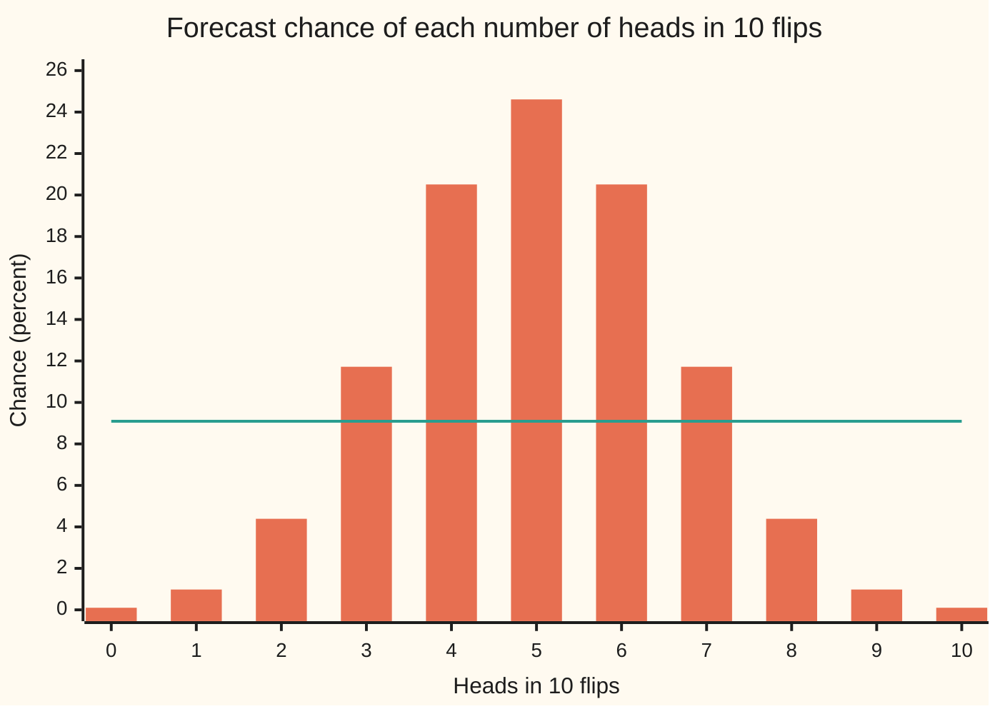

# Bayes factors: weighing two models by how well each predicted the data

[Syllabus](../../../SYLLABUS.md) → [Probability and statistics](../README.md) → [Bayesian Inference](../README.md#s10) → Bayes factors

---

## General Overview

A new coin is flipped 10 times and lands heads 7 times. Is the coin fair? Two stories compete.

- **The fair model.** The chance of heads is exactly 0.5.
- **The open model.** The chance of heads is unknown, and before the flips every value from 0 to 1 was equally plausible.

Before any flip, each model makes a forecast of how the 10 flips will come out. The fair model gives "7 heads" a chance of 120/1024 = 0.1172. The open model gives every count from 0 to 10 the same chance, 1/11 = 0.0909. The flips then came out 7 heads. The model that gave that outcome the higher chance has predicted better.

The ratio of the two chances, 0.1172/0.0909 = **1.29**, is the **Bayes factor**. It says the data favour the fair coin by 1.29 to 1. That is a small lean, but it points towards "fair", even though 7 in 10 looks lopsided. The open model spread its forecast over every possible count, so it gave the actual count only a thin share.

**A Bayes factor compares two models by the chance each gave, before the data arrived, to the data actually seen; multiply it by the prior odds and you get the posterior odds.**

**What kind of fact this is:** a theorem, proved in Why it works, that the Bayes factor turns prior odds into posterior odds. The two models and the prior inside the open model are modelling choices, and the answer depends on them.

### The picture: what each model forecast for 10 flips



Orange bars: the fair model's forecast, the binomial law with chance 0.5. Green line: the open model's forecast, flat at 9.09 percent for every count. At 7 heads the bar reaches 11.72 and the line 9.09. Their ratio is the Bayes factor. The fair model loses only at the extremes, 0 to 2 and 8 to 10 heads.

---

## The formula

Notation first. $`M_0`$ is the fair model and $`M_1`$ the open model. $`D`$ is the data: $`k`$ heads in $`n`$ flips. θ (theta) is the coin's chance of heads.

```math
B_{01} = \frac{P(D \mid M_0)}{P(D \mid M_1)}, \qquad P(D \mid M) = \int_0^1 P(D \mid \theta, M)\,\pi(\theta \mid M)\,d\theta
```

**Read it aloud:** the Bayes factor is the chance the fair model gave the data over the chance the open model gave it, and each model's chance is the likelihood averaged over the values of θ that model allows, weighted by its prior.

The averaged chance $`P(D \mid M)`$ is called the **marginal likelihood**, or the **evidence** for the model. For the fair model there is nothing to average: θ is 0.5.

The Bayes factor then converts odds:

```math
\frac{P(M_0 \mid D)}{P(M_1 \mid D)} = B_{01} \times \frac{P(M_0)}{P(M_1)}
```

**Read it aloud:** posterior odds equal the Bayes factor times prior odds.

| Symbol | Plain meaning | In our example | Push it up and the answer… |
| --- | --- | --- | --- |
| $`\theta`$ | the coin's chance of heads | 0.5 under the fair model; unknown under the open one | — |
| $`M_0`$, $`M_1`$ | the two models being compared | fair; open, θ uniform on 0 to 1 | — |
| $`n`$, $`k`$ | flips made, heads seen | 10 and 7 | n up at a fixed z: the Bayes factor for fair grows like √n |
| $`D`$ | the data, k heads in n flips | 7 heads in 10 | — |
| $`P(D \mid M)`$ | the evidence: the chance the model gave the data before seeing it | 0.1172 and 0.0909 | — |
| $`B_{01}`$ | the Bayes factor, fair over open; not the beta function B(α, β) of Step 2 | 1.2891 | above 1 favours fair, below 1 favours open |
| $`\pi(\theta \mid M_1)`$ | the open model's prior: how it spreads belief over θ | uniform, density 1 | — |
| $`a`$ | the number in a Beta(a, a) prior for the open model | 1, the uniform prior | a up: prior narrower round 0.5; the Bayes factor falls below 1 (0.9326 at a = 10), then climbs back towards 1 (0.9748 at a = 50) as the open model closes in on the fair one |
| $`h`$ | half-width of a uniform prior on 0.5 ± h | 0.5 | h up (prior wider): the Bayes factor for fair grows in proportion |
| $`P(M_0)`$ | prior probability that the coin is fair | 0.5, even odds | up: posterior probability of fair up |
| $`\hat\theta`$, $`\hat L`$ | the best-fit chance k/n, and the likelihood there | 0.7 and 0.2668 | — |
| $`z`$, $`\mathrm{BIC}`$, $`d`$ | the heads surplus k − n/2 in standard errors √n/2; the Bayesian information criterion, −2 ln L̂ + d ln n; and d, the number of free parameters | z = 1.2649; BIC 4.2880 and 4.9449; d = 0 and 1 | z up at fixed n: the Bayes factor for fair falls |

### When it holds

- **Both models give the data a real chance.** The evidence is a forecast. If a model's prior is improper (has infinite area, such as "flat on the whole line"), its evidence has no fixed scale and the Bayes factor is arbitrary.
- **The prior inside each model is chosen with care.** The Bayes factor changes with the open model's prior width. A Beta(0.5, 0.5) prior gives 1.7902; Beta(10, 10) gives 0.9326, which favours the open model.
- **The same data enter both models.** Compare 7 heads in 10 against 7 heads in 10. If one model is scored on the ordered record and the other on the count, the factor C(10, 7) = 120 does not cancel.
- **The flips are independent given θ.** Correlated flips make both evidences wrong, and their ratio can be wrong in either direction.
- **One of the models is a fair description.** The Bayes factor picks the better forecaster of the two. If both are poor, it still picks one.

---

## Why it works

### Step 0: a model that spreads its bets pays for it

A model with a free number makes a forecast for every value of that number, then averages them. The open model gives some weight to θ = 0.1, to θ = 0.9 and to everything between. Each of those forecasts is sharp, but most point away from 7 heads. Averaged, they give 7 heads a modest chance. The fair model makes one sharp forecast, and 7 heads sits in its shoulder. This automatic cost of flexibility is often called **Occam's razor**: a simpler model wins unless the data need the extra freedom.

### Step 1: Bayes' rule on models gives the odds form

Treat each model as a hypothesis with a prior probability. Bayes' rule ([Bayesian updating](01-priors-posteriors-and-updating.md)) gives each model's posterior:

```math
P(M_i \mid D) = \frac{P(D \mid M_i)\,P(M_i)}{P(D)}
```

Divide the line for $`M_0`$ by the line for $`M_1`$. The awkward $`P(D)`$ cancels, and the odds form in The formula is left. That is the whole proof. With even prior odds, 1.2891 to 1 becomes a posterior chance of fair of 1.2891/2.2891 = 0.5631.

The prior odds matter as much as the factor. If 9 in 10 new coins from this mint are fair, the prior odds are 9 and the posterior odds 11.6016: a chance of 0.9206 that this coin is fair. If only 1 in 10 is fair, the chance is 0.1253.

### Step 2: the two evidences, by hand

For the fair model the chance of 7 heads in 10 is the binomial chance:

```math
P(D \mid M_0) = \binom{10}{7}\left(\tfrac12\right)^{10} = \frac{120}{1024} = 0.1172
```

For the open model, average the binomial chance over the uniform prior. The integral is the beta integral of [Beta-binomial](02-beta-binomial.md). Here $`B(\alpha, \beta) = \int_0^1 u^{\alpha-1}(1-u)^{\beta-1}\,du`$ is the beta function (a different B from the Bayes factor $`B_{01}`$), and for whole numbers $`B(\alpha, \beta) = (\alpha-1)!\,(\beta-1)!/(\alpha+\beta-1)!`$:

```math
P(D \mid M_1) = \int_0^1 \binom{10}{7}\theta^7(1-\theta)^3\,d\theta = 120 \times B(8, 4) = 120 \times \frac{7!\,3!}{11!} = \frac{1}{11} = 0.0909
```

The answer does not depend on the 7. Under a uniform prior, every count from 0 to 10 has chance 1/11.

<details>
<summary>Why every count is equally likely under a uniform prior</summary>

For any $`k`$ from 0 to $`n`$, the beta integral gives

$`\displaystyle \int_0^1 \binom{n}{k}\theta^k(1-\theta)^{n-k}\,d\theta = \frac{n!}{k!\,(n-k)!}\cdot\frac{k!\,(n-k)!}{(n+1)!} = \frac{1}{n+1}.`$

A second way to see it, due to Bayes: throw $`n + 1`$ random points on a line from 0 to 1. Let the first be θ, and count how many of the other $`n`$ fall below it. That count is $`k`$ heads in $`n`$ flips with a uniform θ. The first point is equally likely to hold any of the $`n + 1`$ ranks, so each count has chance $`1/(n+1)`$.

For a Beta(a, a) prior the same integral gives a ratio of rising products, $`x(x+1)\cdots(x+j-1)`$:

$`\displaystyle P(D \mid M_1) = \binom{n}{k}\,\frac{a(a+1)\cdots(a+k-1)\;\cdot\;a(a+1)\cdots(a+n-k-1)}{2a(2a+1)\cdots(2a+n-1)}.`$

At a = 2 this is the evidence 0.1119 of [Beta-binomial](02-beta-binomial.md).

</details>

So $`B_{01} = (120/1024)/(1/11) = 1320/1024 = 1.2891`$. The reverse factor, open over fair, is 0.7758.

### Step 3: the evidence is the best fit times a penalty

The best-fit chance is $`\hat\theta`$ = 7/10 = 0.7. There the likelihood is $`\hat L`$ = 0.2668. If the two models were scored by their best fits alone, the ratio would be 0.1172/0.2668 = 0.4392. That favours the open model, and it always will, because the open model can always reach the fair model's θ = 0.5 and usually does better.

The evidence does not take the best fit. It averages. The likelihood is high only in a band of width about $`\sqrt{\hat\theta(1-\hat\theta)/n}`$ round $`\hat\theta`$, and the prior puts only a small share of its weight there. **Laplace's approximation** (replace the likelihood by a bell curve round its peak) makes this precise for large n:

```math
P(D \mid M_1) \approx \hat L \times \pi(\hat\theta \mid M_1)\sqrt{2\pi\,\hat\theta(1-\hat\theta)/n}
```

Here $`\pi(\hat\theta \mid M_1)`$ is the prior's density at the best fit, while the π inside the square root is the circle number, not the prior. For the coin: 0.2668 × 1 × √(2π × 0.21/10) = 0.0969, close to the true 0.0909. The second factor is the **Occam factor**: roughly, the share of the prior that survives the data. It shrinks like 1/√n.

### Step 4: BIC is the log of this, with the constant dropped

Take −2 times the logarithm of Laplace's formula. The terms that grow with $`n`$ are $`-2\ln\hat L`$ and $`\ln n`$; the rest stay bounded. Keep only the growing terms and you get the **Bayesian information criterion** of [AIC and BIC](../09-Regression/11-aic-and-bic.md):

```math
-2\ln P(D \mid M) \approx \mathrm{BIC} = -2\ln\hat L + d\ln n
```

Here $`d`$ is the number of free parameters: 0 for the fair model, 1 for the open one. So $`B_{01} \approx \exp\big((\mathrm{BIC}_1 - \mathrm{BIC}_0)/2\big)`$.

For the coin: BIC 4.2880 for fair and 4.9449 for open. Half the gap, exponentiated, is 1.3888, against the exact 1.2891. The dropped constant is $`\pi(\hat\theta)\sqrt{2\pi\hat\theta(1-\hat\theta)}`$: the prior density again, times a root that holds the circle number. Near θ = 0.5 with a uniform prior it is √(π/2) = 1.2533, so BIC overstates the Bayes factor for fair by that factor however large $`n`$ grows. BIC gets the growth right and the level slightly wrong.

### Step 5: Lindley's paradox, the p-value and the Bayes factor disagree

Now hold the surprise fixed and let $`n`$ grow. Each row below has heads 2 standard errors above half, z = 2.0000. The z-test of [Hypothesis tests](../08-Confidence%20Intervals%20and%20Tests/03-hypothesis-tests-and-p-values.md), which uses the normal approximation, gives a two-sided p-value of 0.0455 every time. The exact binomial p-values in the table are all just under 0.05. The test says "reject fair at the 5 percent level" in every row.

| Flips n | Heads k | p-value, exact | Bayes factor for fair | Lindley's formula | BIC version |
| ---: | ---: | ---: | ---: | ---: | ---: |
| 2,500 | 1,300 | 0.0477 | 5.4022 | 5.3991 | 6.7632 |
| 10,000 | 5,100 | 0.0466 | 10.7997 | 10.7982 | 13.5317 |
| 1,000,000 | 501,000 | 0.0456 | 107.9821 | 107.9819 | 135.3351 |

The Bayes factor says the opposite, and more firmly as $`n`$ grows. At 10,000 flips it favours fair by 10.7997 to 1, a posterior chance of 0.9153 at even odds. This clash is **Lindley's paradox**.

The reason is Step 3. With z fixed, the heads fraction sits 1/√n from 0.5: at 10,000 flips, 0.51. The fair model's forecast is centred right there. The open model spread its prior over 0 to 1, so only a sliver of it sits near 0.51. In numbers, with a normal approximation to the binomial chance:

```math
B_{01} \approx \sqrt{\frac{2n}{\pi}}\;e^{-z^2/2}
```

The p-value depends only on z. The Bayes factor carries the extra √n. Neither is wrong; they answer different questions. The p-value asks whether the data are surprising under fair. The Bayes factor asks whether "any chance from 0 to 1" forecast the data better than fair did. A coin at 0.51 makes data surprising under fair, but "uniform on 0 to 1" is a much worse description of it than "exactly 0.5".

### Picture: the same z = 2 at three sizes

```
Bayes factor for fair, z = 2 throughout (one # per 2 units)

n = 2,500       ###                                                     5.4022
n = 10,000      #####                                                   10.7997
n = 1,000,000   ######################################################  107.9821
```

The p-value is 0.05 or just under in every row. The bar grows like √n: 100 times more flips, 10 times the Bayes factor.

### Step 6: the prior width sets the answer

Keep the 10,000 flips and 5,100 heads. Replace the open model's prior by a uniform law on 0.5 ± h. The likelihood is high only in a band, 0.51 ± 0.005. Averaged over all θ from 0 to 1, the likelihood has area 1/(n + 1), about 0.9999 × 10⁻⁴. When the band lies inside 0.5 ± h, the prior density 1/(2h) scales that area, so the open model's evidence is about 1/(2h) × 0.9999 × 10⁻⁴ and the Bayes factor is proportional to h.

| Half-width h | Open model's evidence × 10⁴ | Bayes factor for fair |
| ---: | ---: | ---: |
| 0.5 | 0.9999 | 10.7997 |
| 0.1 | 4.9995 | 2.1599 |
| 0.02 | 24.4309 | 0.4420 |

A prior five times narrower gives a Bayes factor about five times smaller: 10.7997, then 2.1599. At h = 0.02 the open model wins, 1/0.4420 to 1. Lindley's paradox is the case h = 0.5: the wide prior lets the √n grow.

Posterior means barely notice the prior; Bayes factors do. Back at 7 heads in 10, with a Beta(a, a) prior for the open model:

| Prior | Prior sd | Evidence for open | Bayes factor for fair | Posterior mean of θ |
| --- | ---: | ---: | ---: | ---: |
| Beta(0.5, 0.5) | 0.3536 | 0.0655 | 1.7902 | 0.6818 |
| Beta(1, 1) | 0.2887 | 0.0909 | 1.2891 | 0.6667 |
| Beta(2, 2) | 0.2236 | 0.1119 | 1.0474 | 0.6429 |
| Beta(10, 10) | 0.1091 | 0.1257 | 0.9326 | 0.5667 |

From a = 0.5 to a = 2, the posterior mean moves only from 0.6818 to 0.6429. Over the same range the Bayes factor falls from 1.7902 to 1.0474. The posterior mean uses the prior only near the data, and its scale cancels. The evidence is that scale: how much prior weight sat near the data. Beta(0.5, 0.5) is the Jeffreys prior of [Jeffreys priors](08-jeffreys-priors-and-invariance.md); Beta(2, 2) is the prior of [Beta-binomial](02-beta-binomial.md).

---

## Worked numbers, by hand

The new coin: 7 heads in 10 flips, fair model against the open model with a uniform prior.

| Step | Arithmetic | Value |
| --- | --- | --- |
| evidence for fair | C(10, 7)/2¹⁰ = 120/1024 | 0.1172 |
| evidence for open | 120 × 7! 3!/11! = 1/11 | 0.0909 |
| **Bayes factor, fair over open** | **(120/1024) × 11 = 1320/1024** | **1.2891** |
| posterior odds, even prior | 1 × 1.2891 | 1.2891 |
| posterior chance of fair | 1.2891/2.2891 | 0.5631 |
| same, prior chance of fair 0.9 | 9 × 1.2891 = 11.6016; 11.6016/12.6016 | 0.9206 |
| p-value for fair, two-sided | 2 × 176/1024 | 0.3438 |
| BIC version | exp((4.9449 − 4.2880)/2) | 1.3888 |

The data lean towards the fair coin by 1.29 to 1. On the scale of Kass and Raftery (1 to 3 barely worth mentioning, 3 to 20 positive, 20 to 150 strong, over 150 very strong), ten flips cannot settle the question.

### What breaks if you drop a piece

The right answers: Bayes factor 1.2891 at 10 flips; 10.7997 at 10,000 flips with 5,100 heads; posterior chance of fair 0.5631 at even odds.

| Mistake | Comes out at | What went wrong |
| --- | --- | --- |
| Compare best fits instead of evidences | 0.4392, favouring the open model | the open model's best fit always beats fair; the Occam factor was dropped |
| Use the BIC version as exact | 1.3888 at 10 flips; 13.5317 instead of 10.7997 at 10,000 | BIC drops a constant, √(π/2) = 1.2533 here |
| Read the p-value as the chance of fair | 0.0466 at 10,000 flips | the posterior chance of fair is 0.9153 at even odds |
| Read the Bayes factor as the posterior odds when the prior odds are 9 | chance of fair 0.5631 | the posterior odds are 9 × 1.2891 = 11.6016, a chance of 0.9206 |

The code prints every row.

---

## Code, from first principles, and it actually runs

Nothing imported holds the answer: no statistics module, no random module, no gamma function. Four roads.

1. **Exact counts.** The evidences as binomial counts and rising products, for any Beta(a, a) prior.
2. **Integration.** Simpson's rule (a standard numerical integration rule) averages the likelihood over each prior. The substitution θ = sin²φ removes the infinite density of Beta(0.5, 0.5) at the ends. The rule never uses the beta integral, yet it recovers every evidence.
3. **Simulation.** A SplitMix64 generator (a small, written-out source of random bits, seed 20261123) plays each model 200,000 times: draw θ from the model, flip ten coins, count the runs with 7 heads.
4. **Large n.** Log-factorials two ways, by Stirling's series and term by term, against Lindley's formula and the BIC version.

The asserts set roads side by side, never a number against itself.

### Python

```python
# Bayes factors -- the check behind the card.  Nothing imported holds the answer.
# A new coin shows 7 heads in 10 flips.  M0: the coin is fair, theta = 1/2.
# M1: theta unknown, with a prior on it.  Bayes factor = P(data | M0) / P(data | M1).
# Roads: (1) exact counts and rising products; (2) Simpson's rule over the prior;
# (3) a seeded simulation of both models; (4) for big n, log-factorials two ways
# against Lindley's formula and BIC.
from math import log, exp, sqrt, pi, sin, cos

N, K = 10, 7

def rising(x, k):                            # x (x+1) ... (x+k-1), any real x
    out = 1.0
    for j in range(k):
        out *= x + j
    return out

def comb(n, k):
    out = 1
    for j in range(k):
        out = out * (n - j) // (j + 1)
    return out

def simpson(f, lo, hi, m=2000):
    h = (hi - lo) / m
    return sum((1 if i in (0, m) else 4 if i % 2 else 2) * f(lo + i * h) for i in range(m + 1)) * h / 3

def ev_beta(a, n=N, k=K):                    # road 1: P(k of n | theta ~ Beta(a, a))
    return comb(n, k) * rising(a, k) * rising(a, n - k) / rising(2 * a, n)

def ev_grid(a):                              # road 2: theta = sin^2(phi) makes every a >= 1/2 smooth
    w = lambda p: 2 * (sin(p) * cos(p)) ** (2 * a - 1)
    lik = lambda p: comb(N, K) * sin(p) ** (2 * K) * cos(p) ** (2 * (N - K))
    return simpson(lambda p: w(p) * lik(p), 0, pi / 2) / simpson(w, 0, pi / 2)

L0 = comb(N, K) / 2 ** N
L1 = ev_beta(1)
bf = L0 / L1
print(f"P(7 of 10 | fair) = {comb(N, K)}/{2 ** N} = {L0:.4f}")
print(f"P(7 of 10 | uniform prior) = 1/11 = {L1:.4f}; by grid {ev_grid(1):.4f}")
print("uniform prior, every count 0..10: " + ", ".join(f"{ev_beta(1, N, k):.4f}" for k in range(N + 1)))
print(f"Bayes factor fair : uniform = {comb(N, K) * 11}/{2 ** N} = {bf:.4f}; uniform : fair = {1 / bf:.4f}")
for q in (0.5, 0.9, 0.1):
    o = q / (1 - q) * bf
    print(f"prior P(fair) {q:.1f}: prior odds {q / (1 - q):.4f}, posterior odds {o:.4f}, P(fair | data) {o / (1 + o):.4f}")
tail = sum(comb(N, j) for j in range(K, N + 1))
print(f"two-sided p-value, exact: 2 x {tail}/{2 ** N} = {2 * tail / 2 ** N:.4f}")
th = K / N
Lhat = comb(N, K) * th ** K * (1 - th) ** (N - K)
bic0, bic1 = -2 * log(L0), -2 * log(Lhat) + log(N)
lap = Lhat * sqrt(2 * pi * th * (1 - th) / N)
print(f"best fit theta {th:.1f}: max likelihood {Lhat:.4f}; ratio of maxima {L0 / Lhat:.4f}")
print(f"BIC fair {bic0:.4f}, BIC free {bic1:.4f}; BIC Bayes factor {exp((bic1 - bic0) / 2):.4f}; "
      f"Laplace P(data | uniform) {lap:.4f}")
print("prior Beta(a,a) on theta under M1: a, sd, evidence, grid, Bayes factor fair : M1, posterior mean")
for a in (0.5, 1, 2, 10):
    print(f"  {a:>4}: {1 / (2 * sqrt(2 * a + 1)):.4f}, {ev_beta(a):.4f}, {ev_grid(a):.4f}, "
          f"{L0 / ev_beta(a):.4f}, {(a + K) / (2 * a + N):.4f}")

# road 3: simulation, SplitMix64 seed 20261123
MASK = (1 << 64) - 1
state = 20261123
def uniform():
    global state
    state = (state + 0x9E3779B97F4A7C15) & MASK
    z = state
    z = ((z ^ (z >> 30)) * 0xBF58476D1CE4E5B9) & MASK
    z = ((z ^ (z >> 27)) * 0x94D049BB133111EB) & MASK
    return (((z ^ (z >> 31)) >> 11) + 0.5) / 2.0 ** 53
R = 200_000
hit0 = hit1 = 0
for _ in range(R):
    th1 = uniform()
    hit1 += sum(uniform() < th1 for _ in range(N)) == K
    hit0 += sum(uniform() < 0.5 for _ in range(N)) == K
s0, s1 = hit0 / R, hit1 / R
se = lambda q: sqrt(q * (1 - q) / R)
print(f"simulated {R} coins per model, seed 20261123: P(7 of 10) fair {s0:.4f} ({se(s0):.4f}), "
      f"uniform {s1:.4f} ({se(s1):.4f}); Bayes factor {s0 / s1:.4f}")

# road 4: Lindley's paradox -- the same z = 2 at ever larger n
def lf_stirling(n):                          # ln n!, Stirling's series
    if n < 20:
        return sum(log(j) for j in range(2, n + 1))
    return n * log(n) - n + 0.5 * log(2 * pi * n) + 1 / (12 * n) - 1 / (360 * n ** 3)
def lf_sum(n):                               # ln n!, term by term
    return sum(log(j) for j in range(2, n + 1))
def lpmf(n, k, lf):                          # ln P(k of n | fair)
    return lf(n) - lf(k) - lf(n - k) - n * log(2)
def phi_tail(z):                             # P(Z > z) for a standard normal, by Simpson
    return 0.5 - simpson(lambda x: exp(-x * x / 2) / sqrt(2 * pi), 0, z, 400)
def exact_p(n, k):                           # 2 P(X >= k | fair), summed term by term
    t = exp(lpmf(n, k, lf_stirling))
    s, j = 0.0, k
    while j <= n and t > 1e-18 * s:
        s, t, j = s + t, t * (n - j) / (j + 1), j + 1
    return 2 * s
print("n, heads, z, p normal, p exact, BF fair:uniform (Stirling, log-sum), Lindley sqrt(2n/pi)e^(-z^2/2), BIC")
rows = []
for n, k in ((10, 7), (2_500, 1_300), (10_000, 5_100), (1_000_000, 501_000)):
    z = (k - n / 2) / (sqrt(n) / 2)
    b_st = exp(lpmf(n, k, lf_stirling)) * (n + 1)
    b_sum = exp(lpmf(n, k, lf_sum)) * (n + 1)
    lind = sqrt(2 * n / pi) * exp(-z * z / 2)
    t = k / n
    bicbf = exp(lpmf(n, k, lf_stirling) - (lf_stirling(n) - lf_stirling(k) - lf_stirling(n - k)
                + k * log(t) + (n - k) * log(1 - t))) * sqrt(n)
    rows.append((n, b_st, b_sum, lind, bicbf))
    print(f"  {n}, {k}, {z:.4f}, {2 * phi_tail(z):.4f}, {exact_p(n, k):.4f}, {b_st:.4f}, {b_sum:.4f}, "
          f"{lind:.4f}, {bicbf:.4f}")
print(f"  posterior P(fair) at n = 10000, even prior odds: {rows[2][1] / (1 + rows[2][1]):.4f}; "
      f"BIC / exact at n = 1000000: {rows[3][4] / rows[3][1]:.4f}, sqrt(pi/2) = {sqrt(pi / 2):.4f}")
print("n = 10000, 5100 heads; M1 uniform on 0.5 +/- h: h, P(data | M1) x 10^4, Bayes factor fair : M1")
n, k = 10_000, 5_100
bfw = []
for h in (0.5, 0.1, 0.02):
    lc = lf_stirling(n) - lf_stirling(k) - lf_stirling(n - k)
    f = lambda t: exp(lc + k * log(t) + (n - k) * log(1 - t)) if 0 < t < 1 else 0.0
    e = simpson(f, 0.5 - h, 0.5 + h, 4000) / (2 * h)
    bfw.append(rows[2][1] * (1 / (n + 1)) / e)
    print(f"  {h}: {1e4 * e:.4f}, {bfw[-1]:.4f}")
print("scale (Kass and Raftery): 1 to 3 barely worth mentioning, 3 to 20 positive, 20 to 150 strong, over 150 very strong")
print("try: 70 of 100 fair:uniform " + f"{exp(lpmf(100, 70, lf_sum)) * 101:.4f}; 5 of 10 {comb(10, 5) * 11 / 1024:.4f}; "
      f"10 of 10 {11 / 1024:.4f}; Beta(50,50) prior {L0 / ev_beta(50):.4f}")
print("figure, heads 0..10, fair, percent: " + ", ".join(f"{100 * comb(N, j) / 2 ** N:.2f}" for j in range(N + 1)))
print("figure, heads 0..10, uniform, percent: " + ", ".join(f"{100 * ev_beta(1, N, j):.2f}" for j in range(N + 1)))

# asserts: separate roads side by side
assert abs(L1 - 1 / 11) < 1e-12 and abs(ev_grid(1) - L1) < 1e-9
assert all(abs(ev_grid(a) - ev_beta(a)) < 1e-9 for a in (0.5, 2, 10))
assert abs(sum(ev_beta(1, N, j) for j in range(N + 1)) - 1) < 1e-12
assert abs(s0 - L0) < 4 * se(s0) and abs(s1 - L1) < 4 * se(s1)
assert all(abs(r[1] - r[2]) < 1e-6 * r[1] for r in rows)
assert abs(rows[3][3] / rows[3][1] - 1) < 1e-3 and abs(rows[3][4] / rows[3][1] - sqrt(pi / 2)) < 1e-2
assert abs(bfw[0] - rows[2][1]) < 1e-6 * rows[2][1]
assert abs(rows[0][1] - bf) < 1e-9 * bf
assert abs(lap - L1) < 0.1 * L1 and abs(exact_p(N, K) - 2 * tail / 2 ** N) < 1e-12
print("ALL CHECKS PASS")
```

**Ran 2026-11-23 on macOS, Python 3.14.10, standard library only. All checks passed. Output, pasted from the run:**

```
P(7 of 10 | fair) = 120/1024 = 0.1172
P(7 of 10 | uniform prior) = 1/11 = 0.0909; by grid 0.0909
uniform prior, every count 0..10: 0.0909, 0.0909, 0.0909, 0.0909, 0.0909, 0.0909, 0.0909, 0.0909, 0.0909, 0.0909, 0.0909
Bayes factor fair : uniform = 1320/1024 = 1.2891; uniform : fair = 0.7758
prior P(fair) 0.5: prior odds 1.0000, posterior odds 1.2891, P(fair | data) 0.5631
prior P(fair) 0.9: prior odds 9.0000, posterior odds 11.6016, P(fair | data) 0.9206
prior P(fair) 0.1: prior odds 0.1111, posterior odds 0.1432, P(fair | data) 0.1253
two-sided p-value, exact: 2 x 176/1024 = 0.3438
best fit theta 0.7: max likelihood 0.2668; ratio of maxima 0.4392
BIC fair 4.2880, BIC free 4.9449; BIC Bayes factor 1.3888; Laplace P(data | uniform) 0.0969
prior Beta(a,a) on theta under M1: a, sd, evidence, grid, Bayes factor fair : M1, posterior mean
   0.5: 0.3536, 0.0655, 0.0655, 1.7902, 0.6818
     1: 0.2887, 0.0909, 0.0909, 1.2891, 0.6667
     2: 0.2236, 0.1119, 0.1119, 1.0474, 0.6429
    10: 0.1091, 0.1257, 0.1257, 0.9326, 0.5667
simulated 200000 coins per model, seed 20261123: P(7 of 10) fair 0.1182 (0.0007), uniform 0.0914 (0.0006); Bayes factor 1.2935
n, heads, z, p normal, p exact, BF fair:uniform (Stirling, log-sum), Lindley sqrt(2n/pi)e^(-z^2/2), BIC
  10, 7, 1.2649, 0.2059, 0.3438, 1.2891, 1.2891, 1.1337, 1.3888
  2500, 1300, 2.0000, 0.0455, 0.0477, 5.4022, 5.4022, 5.3991, 6.7632
  10000, 5100, 2.0000, 0.0455, 0.0466, 10.7997, 10.7997, 10.7982, 13.5317
  1000000, 501000, 2.0000, 0.0455, 0.0456, 107.9821, 107.9821, 107.9819, 135.3351
  posterior P(fair) at n = 10000, even prior odds: 0.9153; BIC / exact at n = 1000000: 1.2533, sqrt(pi/2) = 1.2533
n = 10000, 5100 heads; M1 uniform on 0.5 +/- h: h, P(data | M1) x 10^4, Bayes factor fair : M1
  0.5: 0.9999, 10.7997
  0.1: 4.9995, 2.1599
  0.02: 24.4309, 0.4420
scale (Kass and Raftery): 1 to 3 barely worth mentioning, 3 to 20 positive, 20 to 150 strong, over 150 very strong
try: 70 of 100 fair:uniform 0.0023; 5 of 10 2.7070; 10 of 10 0.0107; Beta(50,50) prior 0.9748
figure, heads 0..10, fair, percent: 0.10, 0.98, 4.39, 11.72, 20.51, 24.61, 20.51, 11.72, 4.39, 0.98, 0.10
figure, heads 0..10, uniform, percent: 9.09, 9.09, 9.09, 9.09, 9.09, 9.09, 9.09, 9.09, 9.09, 9.09, 9.09
ALL CHECKS PASS
```

### Rust

Same numbers, same labels, built with `rustc --edition 2021 -O`.

```rust
// Bayes factors -- the same check as the Python, in Rust.  No crates.
// A new coin shows 7 heads in 10 flips.  M0: the coin is fair, theta = 1/2.
// M1: theta unknown, with a prior on it.  Bayes factor = P(data | M0) / P(data | M1).
// Roads: (1) exact counts and rising products; (2) Simpson's rule over the prior;
// (3) a seeded simulation of both models; (4) for big n, log-factorials two ways
// against Lindley's formula and BIC.
use std::f64::consts::PI;

const N: u64 = 10;
const K: u64 = 7;

fn rising(x: f64, k: u64) -> f64 { (0..k).map(|j| x + j as f64).product() } // x (x+1) ... (x+k-1)
fn comb(n: u64, k: u64) -> u64 { (0..k).fold(1, |v, j| v * (n - j) / (j + 1)) }
fn simpson(f: &dyn Fn(f64) -> f64, lo: f64, hi: f64, m: usize) -> f64 {
    let h = (hi - lo) / m as f64;
    (0..=m).map(|i| (if i == 0 || i == m { 1.0 } else if i % 2 == 1 { 4.0 } else { 2.0 }) * f(lo + i as f64 * h)).sum::<f64>() * h / 3.0
}
fn ev_beta(a: f64, n: u64, k: u64) -> f64 { // road 1: P(k of n | theta ~ Beta(a, a))
    comb(n, k) as f64 * rising(a, k) * rising(a, n - k) / rising(2.0 * a, n)
}
fn ev_grid(a: f64) -> f64 { // road 2: theta = sin^2(phi) makes every a >= 1/2 smooth
    let w = |p: f64| 2.0 * (p.sin() * p.cos()).powf(2.0 * a - 1.0);
    let lik = |p: f64| comb(N, K) as f64 * p.sin().powi(2 * K as i32) * p.cos().powi(2 * (N - K) as i32);
    simpson(&|p| w(p) * lik(p), 0.0, PI / 2.0, 2000) / simpson(&w, 0.0, PI / 2.0, 2000)
}
fn lf_sum(n: u64) -> f64 { (2..=n).map(|j| (j as f64).ln()).sum() } // ln n!, term by term
fn lf_stirling(n: u64) -> f64 { // ln n!, Stirling's series
    if n < 20 { return lf_sum(n) }
    let x = n as f64;
    x * x.ln() - x + 0.5 * (2.0 * PI * x).ln() + 1.0 / (12.0 * x) - 1.0 / (360.0 * x.powi(3))
}
fn lpmf(n: u64, k: u64, lf: fn(u64) -> f64) -> f64 { lf(n) - lf(k) - lf(n - k) - n as f64 * 2f64.ln() } // ln P(k of n | fair)
fn phi_tail(z: f64) -> f64 { 0.5 - simpson(&|x| (-x * x / 2.0).exp() / (2.0 * PI).sqrt(), 0.0, z, 400) }
fn exact_p(n: u64, k: u64) -> f64 { // 2 P(X >= k | fair), summed term by term
    let (mut t, mut s, mut j) = (lpmf(n, k, lf_stirling).exp(), 0.0, k);
    while j <= n && t > 1e-18 * s {
        s += t; t = t * (n - j) as f64 / (j + 1) as f64; j += 1;
    }
    2.0 * s
}
fn join(xs: &[f64], d: usize) -> String { xs.iter().map(|x| format!("{:.*}", d, x)).collect::<Vec<_>>().join(", ") }

struct SplitMix(u64); // SplitMix64, seed 20261123
impl SplitMix {
    fn uniform(&mut self) -> f64 {
        self.0 = self.0.wrapping_add(0x9E3779B97F4A7C15);
        let mut z = self.0;
        z = (z ^ (z >> 30)).wrapping_mul(0xBF58476D1CE4E5B9);
        z = (z ^ (z >> 27)).wrapping_mul(0x94D049BB133111EB);
        (((z ^ (z >> 31)) >> 11) as f64 + 0.5) / 2f64.powi(53)
    }
}

fn main() {
    let p2n = 2f64.powi(N as i32);
    let l0 = comb(N, K) as f64 / p2n;
    let l1 = ev_beta(1.0, N, K);
    let bf = l0 / l1;
    println!("P(7 of 10 | fair) = {}/{} = {:.4}", comb(N, K), 1u64 << N, l0);
    println!("P(7 of 10 | uniform prior) = 1/11 = {:.4}; by grid {:.4}", l1, ev_grid(1.0));
    println!("uniform prior, every count 0..10: {}", join(&(0..=N).map(|k| ev_beta(1.0, N, k)).collect::<Vec<_>>(), 4));
    println!("Bayes factor fair : uniform = {}/{} = {:.4}; uniform : fair = {:.4}", comb(N, K) * 11, 1u64 << N, bf, 1.0 / bf);
    for q in [0.5f64, 0.9, 0.1] {
        let o = q / (1.0 - q) * bf;
        println!("prior P(fair) {:.1}: prior odds {:.4}, posterior odds {:.4}, P(fair | data) {:.4}", q, q / (1.0 - q), o, o / (1.0 + o));
    }
    let tail: u64 = (K..=N).map(|j| comb(N, j)).sum();
    println!("two-sided p-value, exact: 2 x {}/{} = {:.4}", tail, 1u64 << N, 2.0 * tail as f64 / p2n);
    let th = K as f64 / N as f64;
    let lhat = comb(N, K) as f64 * th.powi(K as i32) * (1.0 - th).powi((N - K) as i32);
    let (bic0, bic1) = (-2.0 * l0.ln(), -2.0 * lhat.ln() + (N as f64).ln());
    let lap = lhat * (2.0 * PI * th * (1.0 - th) / N as f64).sqrt();
    println!("best fit theta {:.1}: max likelihood {:.4}; ratio of maxima {:.4}", th, lhat, l0 / lhat);
    println!("BIC fair {:.4}, BIC free {:.4}; BIC Bayes factor {:.4}; Laplace P(data | uniform) {:.4}", bic0, bic1, ((bic1 - bic0) / 2.0).exp(), lap);
    println!("prior Beta(a,a) on theta under M1: a, sd, evidence, grid, Bayes factor fair : M1, posterior mean");
    for (a, lab) in [(0.5f64, "0.5"), (1.0, "1"), (2.0, "2"), (10.0, "10")] {
        println!("  {:>4}: {:.4}, {:.4}, {:.4}, {:.4}, {:.4}", lab, 1.0 / (2.0 * (2.0 * a + 1.0).sqrt()), ev_beta(a, N, K), ev_grid(a), l0 / ev_beta(a, N, K), (a + K as f64) / (2.0 * a + N as f64));
    }

    // road 3: simulation, SplitMix64 seed 20261123
    let mut rng = SplitMix(20261123);
    let r = 200_000usize;
    let (mut hit0, mut hit1) = (0usize, 0usize);
    for _ in 0..r {
        let th1 = rng.uniform();
        hit1 += ((0..N).filter(|_| rng.uniform() < th1).count() as u64 == K) as usize;
        hit0 += ((0..N).filter(|_| rng.uniform() < 0.5).count() as u64 == K) as usize;
    }
    let (s0, s1) = (hit0 as f64 / r as f64, hit1 as f64 / r as f64);
    let se = |q: f64| (q * (1.0 - q) / r as f64).sqrt();
    println!("simulated {} coins per model, seed 20261123: P(7 of 10) fair {:.4} ({:.4}), uniform {:.4} ({:.4}); Bayes factor {:.4}", r, s0, se(s0), s1, se(s1), s0 / s1);

    // road 4: Lindley's paradox -- the same z = 2 at ever larger n
    println!("n, heads, z, p normal, p exact, BF fair:uniform (Stirling, log-sum), Lindley sqrt(2n/pi)e^(-z^2/2), BIC");
    let mut rows: Vec<(u64, f64, f64, f64, f64)> = Vec::new();
    for (n, k) in [(10u64, 7u64), (2_500, 1_300), (10_000, 5_100), (1_000_000, 501_000)] {
        let nf = n as f64;
        let z = (k as f64 - nf / 2.0) / (nf.sqrt() / 2.0);
        let b_st = lpmf(n, k, lf_stirling).exp() * (nf + 1.0);
        let b_sum = lpmf(n, k, lf_sum).exp() * (nf + 1.0);
        let lind = (2.0 * nf / PI).sqrt() * (-z * z / 2.0).exp();
        let t = k as f64 / nf;
        let bicbf = (lpmf(n, k, lf_stirling) - (lf_stirling(n) - lf_stirling(k) - lf_stirling(n - k) + k as f64 * t.ln() + (n - k) as f64 * (1.0 - t).ln())).exp() * nf.sqrt();
        rows.push((n, b_st, b_sum, lind, bicbf));
        println!("  {}, {}, {:.4}, {:.4}, {:.4}, {:.4}, {:.4}, {:.4}, {:.4}", n, k, z, 2.0 * phi_tail(z), exact_p(n, k), b_st, b_sum, lind, bicbf);
    }
    println!("  posterior P(fair) at n = 10000, even prior odds: {:.4}; BIC / exact at n = 1000000: {:.4}, sqrt(pi/2) = {:.4}", rows[2].1 / (1.0 + rows[2].1), rows[3].4 / rows[3].1, (PI / 2.0).sqrt());
    println!("n = 10000, 5100 heads; M1 uniform on 0.5 +/- h: h, P(data | M1) x 10^4, Bayes factor fair : M1");
    let (n, k) = (10_000u64, 5_100u64);
    let mut bfw = Vec::new();
    for h in [0.5f64, 0.1, 0.02] {
        let lc = lf_stirling(n) - lf_stirling(k) - lf_stirling(n - k);
        let f = |t: f64| if 0.0 < t && t < 1.0 { (lc + k as f64 * t.ln() + (n - k) as f64 * (1.0 - t).ln()).exp() } else { 0.0 };
        let e = simpson(&f, 0.5 - h, 0.5 + h, 4000) / (2.0 * h);
        bfw.push(rows[2].1 * (1.0 / (n as f64 + 1.0)) / e);
        println!("  {}: {:.4}, {:.4}", h, 1e4 * e, bfw[bfw.len() - 1]);
    }
    println!("scale (Kass and Raftery): 1 to 3 barely worth mentioning, 3 to 20 positive, 20 to 150 strong, over 150 very strong");
    println!("try: 70 of 100 fair:uniform {:.4}; 5 of 10 {:.4}; 10 of 10 {:.4}; Beta(50,50) prior {:.4}", lpmf(100, 70, lf_sum).exp() * 101.0, comb(10, 5) as f64 * 11.0 / 1024.0, 11.0 / 1024.0, l0 / ev_beta(50.0, N, K));
    println!("figure, heads 0..10, fair, percent: {}", join(&(0..=N).map(|j| 100.0 * comb(N, j) as f64 / p2n).collect::<Vec<_>>(), 2));
    println!("figure, heads 0..10, uniform, percent: {}", join(&(0..=N).map(|j| 100.0 * ev_beta(1.0, N, j)).collect::<Vec<_>>(), 2));

    // asserts: separate roads side by side
    assert!((l1 - 1.0 / 11.0).abs() < 1e-12 && (ev_grid(1.0) - l1).abs() < 1e-9);
    assert!([0.5, 2.0, 10.0].iter().all(|&a| (ev_grid(a) - ev_beta(a, N, K)).abs() < 1e-9));
    assert!(((0..=N).map(|j| ev_beta(1.0, N, j)).sum::<f64>() - 1.0).abs() < 1e-12);
    assert!((s0 - l0).abs() < 4.0 * se(s0) && (s1 - l1).abs() < 4.0 * se(s1));
    assert!(rows.iter().all(|r| (r.1 - r.2).abs() < 1e-6 * r.1));
    assert!((rows[3].3 / rows[3].1 - 1.0).abs() < 1e-3 && (rows[3].4 / rows[3].1 - (PI / 2.0).sqrt()).abs() < 1e-2);
    assert!((bfw[0] - rows[2].1).abs() < 1e-6 * rows[2].1);
    assert!((rows[0].1 - bf).abs() < 1e-9 * bf);
    assert!((lap - l1).abs() < 0.1 * l1 && (exact_p(N, K) - 2.0 * tail as f64 / p2n).abs() < 1e-12);
    println!("ALL CHECKS PASS");
}
```

**Ran 2026-11-23 on macOS, rustc 1.98.1, no crates. All checks passed. Output, pasted from the run:**

```
P(7 of 10 | fair) = 120/1024 = 0.1172
P(7 of 10 | uniform prior) = 1/11 = 0.0909; by grid 0.0909
uniform prior, every count 0..10: 0.0909, 0.0909, 0.0909, 0.0909, 0.0909, 0.0909, 0.0909, 0.0909, 0.0909, 0.0909, 0.0909
Bayes factor fair : uniform = 1320/1024 = 1.2891; uniform : fair = 0.7758
prior P(fair) 0.5: prior odds 1.0000, posterior odds 1.2891, P(fair | data) 0.5631
prior P(fair) 0.9: prior odds 9.0000, posterior odds 11.6016, P(fair | data) 0.9206
prior P(fair) 0.1: prior odds 0.1111, posterior odds 0.1432, P(fair | data) 0.1253
two-sided p-value, exact: 2 x 176/1024 = 0.3438
best fit theta 0.7: max likelihood 0.2668; ratio of maxima 0.4392
BIC fair 4.2880, BIC free 4.9449; BIC Bayes factor 1.3888; Laplace P(data | uniform) 0.0969
prior Beta(a,a) on theta under M1: a, sd, evidence, grid, Bayes factor fair : M1, posterior mean
   0.5: 0.3536, 0.0655, 0.0655, 1.7902, 0.6818
     1: 0.2887, 0.0909, 0.0909, 1.2891, 0.6667
     2: 0.2236, 0.1119, 0.1119, 1.0474, 0.6429
    10: 0.1091, 0.1257, 0.1257, 0.9326, 0.5667
simulated 200000 coins per model, seed 20261123: P(7 of 10) fair 0.1182 (0.0007), uniform 0.0914 (0.0006); Bayes factor 1.2935
n, heads, z, p normal, p exact, BF fair:uniform (Stirling, log-sum), Lindley sqrt(2n/pi)e^(-z^2/2), BIC
  10, 7, 1.2649, 0.2059, 0.3438, 1.2891, 1.2891, 1.1337, 1.3888
  2500, 1300, 2.0000, 0.0455, 0.0477, 5.4022, 5.4022, 5.3991, 6.7632
  10000, 5100, 2.0000, 0.0455, 0.0466, 10.7997, 10.7997, 10.7982, 13.5317
  1000000, 501000, 2.0000, 0.0455, 0.0456, 107.9821, 107.9821, 107.9819, 135.3351
  posterior P(fair) at n = 10000, even prior odds: 0.9153; BIC / exact at n = 1000000: 1.2533, sqrt(pi/2) = 1.2533
n = 10000, 5100 heads; M1 uniform on 0.5 +/- h: h, P(data | M1) x 10^4, Bayes factor fair : M1
  0.5: 0.9999, 10.7997
  0.1: 4.9995, 2.1599
  0.02: 24.4309, 0.4420
scale (Kass and Raftery): 1 to 3 barely worth mentioning, 3 to 20 positive, 20 to 150 strong, over 150 very strong
try: 70 of 100 fair:uniform 0.0023; 5 of 10 2.7070; 10 of 10 0.0107; Beta(50,50) prior 0.9748
figure, heads 0..10, fair, percent: 0.10, 0.98, 4.39, 11.72, 20.51, 24.61, 20.51, 11.72, 4.39, 0.98, 0.10
figure, heads 0..10, uniform, percent: 9.09, 9.09, 9.09, 9.09, 9.09, 9.09, 9.09, 9.09, 9.09, 9.09, 9.09
ALL CHECKS PASS
```

The two outputs are identical, simulation included, because both programs draw the same SplitMix64 numbers in the same order. The simulated Bayes factor is 1.2935, against the exact 1.2891. Each simulated evidence sits within two standard errors of the exact value.

### Lean

Lean proves the odds form for any two models, and the open model's evidence for every count, under uniform and Beta(a, a) priors.

- Take two models and some data, each model giving the data a real chance. Then the posterior odds equal the Bayes factor times the prior odds.
- Take n flips and any count k from 0 to n. Then the open model with a uniform prior gives k heads the chance $`1/(n+1)`$.
- Take a Beta(a, a) prior with a above 0, and k heads in n flips. Then the open model's evidence is the ratio of rising products in Step 2.
- The hand arithmetic holds exactly: 120/1024, 1/11, the Bayes factor 1320/1024, and posterior chances 165/293, 1485/1613 and 55/439.
- The p-value's count holds: 7 or more heads in 10 flips come up in 176 of the 1024 equally likely records.
- Take a = 1/2, 2, 10 and 50 at 7 heads in 10. Then the Bayes factors for fair are 256/143, 2145/2048, 42021/45056 and 121330189/124467200.
- The posterior means 15/22, 2/3, 9/14 and 17/30 hold exactly, and so do the Try changing cases for 5 and 10 heads.

The decimals, Laplace's approximation, BIC, Lindley's large-n rows, the prior-width table and the simulation are left to the Python and Rust checks.

```lean
-- Bayes factors: the posterior odds of two models equal the Bayes factor, the ratio of the chances each model gave the data, times the prior odds, and a uniform prior on a coin's chance gives every count of heads in n flips the same evidence 1/(n + 1).
import Mathlib.Probability.ConditionalProbability
import Mathlib.Probability.Distributions.Beta
import Mathlib.RingTheory.Polynomial.Pochhammer
import Mathlib.MeasureTheory.Integral.IntervalIntegral.Basic
import Mathlib.Tactic.NormNum

open MeasureTheory ProbabilityTheory

theorem gamma_add_nat_eq_mul_ascPochhammer (a : ℝ) (ha : 0 < a) (n : ℕ) :
    Real.Gamma (a + n) = Real.Gamma a * (ascPochhammer ℝ n).eval a := by
  induction n with
  | zero => simp
  | succ n ih =>
    rw [Nat.cast_succ, ← add_assoc, Real.Gamma_add_one (by positivity), ih,
      ascPochhammer_succ_eval]
    ring

theorem integral_betaPDFReal_eq_one (α β : ℝ) (hα : 0 < α) (hβ : 0 < β) :
    ∫ x, betaPDFReal α β x = 1 := by
  have hnn : ∀ x, 0 ≤ betaPDFReal α β x := by
    intro x
    by_cases hx : 0 < x ∧ x < 1
    · exact (betaPDFReal_pos hx.1 hx.2 hα hβ).le
    · simp [betaPDFReal, hx]
  rw [integral_eq_lintegral_of_nonneg_ae (Filter.Eventually.of_forall hnn)
    (measurable_betaPDFReal α β).aestronglyMeasurable]
  have : ∫⁻ x, ENNReal.ofReal (betaPDFReal α β x) = 1 := lintegral_betaPDF_eq_one hα hβ
  rw [this]; simp

theorem beta_shift_ratio (a : ℝ) (ha : 0 < a) (n k : ℕ) (hk : k ≤ n) :
    beta (a + k) (a + (n - k : ℕ)) / beta a a =
      (ascPochhammer ℝ k).eval a * (ascPochhammer ℝ (n - k)).eval a /
        (ascPochhammer ℝ n).eval (2 * a) := by
  have h2 : a + k + (a + (n - k : ℕ)) = 2 * a + n := by
    rw [Nat.cast_sub hk]; ring
  unfold beta
  rw [h2, gamma_add_nat_eq_mul_ascPochhammer a ha, gamma_add_nat_eq_mul_ascPochhammer a ha,
    gamma_add_nat_eq_mul_ascPochhammer (2 * a) (by positivity), two_mul]
  have g1 := Real.Gamma_pos_of_pos ha
  have g2 := Real.Gamma_pos_of_pos (add_pos ha ha)
  have p1 : 0 < (ascPochhammer ℝ n).eval (a + a) := ascPochhammer_pos n (a + a) (by positivity)
  field_simp

theorem beta_prior_evidence_aux (a : ℝ) (ha : 0 < a) (n k : ℕ) (hk : k ≤ n) :
    ∫ θ, (n.choose k : ℝ) * θ ^ k * (1 - θ) ^ (n - k) * betaPDFReal a a θ =
      (n.choose k : ℝ) * (ascPochhammer ℝ k).eval a * (ascPochhammer ℝ (n - k)).eval a /
        (ascPochhammer ℝ n).eval (2 * a) := by
  have hB := beta_pos ha ha
  have hB' := beta_pos (α := a + k) (β := a + (n - k : ℕ)) (by positivity) (by positivity)
  have key : ∀ θ, (n.choose k : ℝ) * θ ^ k * (1 - θ) ^ (n - k) * betaPDFReal a a θ =
      ((n.choose k : ℝ) * (beta (a + k) (a + (n - k : ℕ)) / beta a a)) *
        betaPDFReal (a + k) (a + (n - k : ℕ)) θ := by
    intro θ
    by_cases hθ : 0 < θ ∧ θ < 1
    · simp only [betaPDFReal, hθ, and_self, ↓reduceIte]
      have h1 : 0 < 1 - θ := by linarith [hθ.2]
      have e1 : θ ^ (a + k - 1) = θ ^ k * θ ^ (a - 1) := by
        rw [← Real.rpow_natCast, ← Real.rpow_add hθ.1]; ring_nf
      have e2 : (1 - θ) ^ (a + (n - k : ℕ) - 1) = (1 - θ) ^ (n - k) * (1 - θ) ^ (a - 1) := by
        rw [← Real.rpow_natCast, ← Real.rpow_add h1]; ring_nf
      rw [e1, e2]
      field_simp
    · simp [betaPDFReal, hθ]
  simp_rw [key]
  rw [integral_const_mul, integral_betaPDFReal_eq_one _ _ (by positivity) (by positivity),
    mul_one, beta_shift_ratio a ha n k hk]
  ring

#print axioms gamma_add_nat_eq_mul_ascPochhammer
#print axioms integral_betaPDFReal_eq_one
#print axioms beta_shift_ratio
#print axioms beta_prior_evidence_aux

/-- The Bayes factor turns prior odds into posterior odds. Take two models `M₀` and `M₁` (events
in one probability space, so each has a prior chance) and data `D`. If both models give the data
a real chance, `P(D | M₀) > 0` and `P(D | M₁) > 0`, then the posterior odds `P(M₀ | D) / P(M₁ | D)`
equal the Bayes factor `B₀₁ = P(D | M₀) / P(D | M₁)` times the prior odds `P(M₀) / P(M₁)`. -/
theorem bayes_factor_times_prior_odds_is_posterior_odds {Ω : Type*} [MeasurableSpace Ω]
    (μ : Measure Ω) [IsProbabilityMeasure μ] (M₀ M₁ D : Set Ω)
    (hM₀ : MeasurableSet M₀) (hM₁ : MeasurableSet M₁) (hD : MeasurableSet D)
    (h₀ : μ[D | M₀] ≠ 0) (h₁ : μ[D | M₁] ≠ 0) :
    μ[M₀ | D] / μ[M₁ | D] = (μ[D | M₀] / μ[D | M₁]) * (μ M₀ / μ M₁) := by
  rw [cond_apply hD, cond_apply hD, cond_apply hM₀, cond_apply hM₁] at *
  have hx : μ (M₀ ∩ D) ≠ 0 := fun h => h₀ (by simp [h])
  have hy : μ (M₁ ∩ D) ≠ 0 := fun h => h₁ (by simp [h])
  have ha : μ M₀ ≠ 0 := fun h => hx (measure_mono_null Set.inter_subset_left h)
  have hb : μ M₁ ≠ 0 := fun h => hy (measure_mono_null Set.inter_subset_left h)
  have hd : μ D ≠ 0 := fun h => hx (measure_mono_null Set.inter_subset_right h)
  rw [Set.inter_comm D M₀, Set.inter_comm D M₁]
  have fa : μ M₀ ≠ ⊤ := measure_ne_top _ _
  have fb : μ M₁ ≠ ⊤ := measure_ne_top _ _
  have fd : μ D ≠ ⊤ := measure_ne_top _ _
  have fx : μ (M₀ ∩ D) ≠ ⊤ := measure_ne_top _ _
  have fy : μ (M₁ ∩ D) ≠ ⊤ := measure_ne_top _ _
  rw [← ENNReal.toReal_eq_toReal_iff']
  · simp only [ENNReal.toReal_div, ENNReal.toReal_mul, ENNReal.toReal_inv]
    have : (μ M₀).toReal ≠ 0 := ENNReal.toReal_ne_zero.mpr ⟨ha, fa⟩
    have : (μ M₁).toReal ≠ 0 := ENNReal.toReal_ne_zero.mpr ⟨hb, fb⟩
    have : (μ D).toReal ≠ 0 := ENNReal.toReal_ne_zero.mpr ⟨hd, fd⟩
    have : (μ (M₀ ∩ D)).toReal ≠ 0 := ENNReal.toReal_ne_zero.mpr ⟨hx, fx⟩
    have : (μ (M₁ ∩ D)).toReal ≠ 0 := ENNReal.toReal_ne_zero.mpr ⟨hy, fy⟩
    field_simp
  · exact ENNReal.div_ne_top (ENNReal.mul_ne_top (ENNReal.inv_ne_top.mpr hd) fx)
      (mul_ne_zero (ENNReal.inv_ne_zero.mpr fd) hy)
  · exact ENNReal.mul_ne_top
      (ENNReal.div_ne_top (ENNReal.mul_ne_top (ENNReal.inv_ne_top.mpr ha) fx)
        (mul_ne_zero (ENNReal.inv_ne_zero.mpr fb) hy))
      (ENNReal.div_ne_top fa hb)

/-- The open model's evidence under a uniform prior. If the coin's chance θ is uniform on 0 to 1,
the chance of `k` heads in `n` independent flips, the binomial chance `C(n, k) θ^k (1 - θ)^(n - k)`
averaged over θ, is `1/(n + 1)` for every `k` from 0 to `n`. -/
theorem uniform_prior_evidence_eq_one_div_succ (n k : ℕ) (hk : k ≤ n) :
    ∫ θ in (0 : ℝ)..1, (n.choose k : ℝ) * θ ^ k * (1 - θ) ^ (n - k) = 1 / (n + 1) := by
  have h := beta_prior_evidence_aux 1 one_pos n k hk
  have hb : beta 1 1 = 1 := by
    simp [beta, Real.Gamma_one, Real.Gamma_add_one one_ne_zero]
  have hind : ∀ θ : ℝ, (n.choose k : ℝ) * θ ^ k * (1 - θ) ^ (n - k) * betaPDFReal 1 1 θ =
      (Set.Ioo (0 : ℝ) 1).indicator (fun θ => (n.choose k : ℝ) * θ ^ k * (1 - θ) ^ (n - k)) θ := by
    intro θ
    by_cases hθ : 0 < θ ∧ θ < 1
    · simp [betaPDFReal, hθ, hb]
    · rw [Set.indicator_of_notMem (show θ ∉ Set.Ioo (0 : ℝ) 1 from hθ)]
      simp [betaPDFReal, hθ]
  simp_rw [hind] at h
  rw [integral_indicator measurableSet_Ioo, ← integral_Ioc_eq_integral_Ioo,
    ← intervalIntegral.integral_of_le zero_le_one] at h
  rw [show (2 : ℝ) * 1 = 2 by norm_num] at h
  rw [h, ascPochhammer_eval_one, ascPochhammer_eval_one]
  have e := factorial_mul_ascPochhammer ℝ 1 n
  have e2 : ((1 : ℕ) + 1 : ℝ) = 2 := by norm_num
  rw [e2] at e
  simp only [Nat.factorial_one, Nat.cast_one, one_mul] at e
  rw [e, add_comm 1 n]
  have hc := Nat.choose_mul_factorial_mul_factorial hk
  have hc' : (n.choose k : ℝ) * (k.factorial : ℝ) * ((n - k).factorial : ℝ) = n.factorial := by
    exact_mod_cast hc
  rw [hc', Nat.factorial_succ, Nat.cast_mul]
  have : (n.factorial : ℝ) ≠ 0 := by positivity
  field_simp
  push_cast; ring

/-- The open model's evidence under a Beta(a, a) prior, with `a > 0`. The chance of `k` heads in
`n` independent flips, averaged over θ with the Beta(a, a) density, is the ratio of rising products
`C(n, k) · a(a+1)⋯(a+k-1) · a(a+1)⋯(a+n-k-1) / (2a(2a+1)⋯(2a+n-1))`. -/
theorem beta_prior_evidence_eq_rising_products (a : ℝ) (ha : 0 < a) (n k : ℕ) (hk : k ≤ n) :
    ∫ θ, (n.choose k : ℝ) * θ ^ k * (1 - θ) ^ (n - k) * betaPDFReal a a θ =
      (n.choose k : ℝ) * (ascPochhammer ℝ k).eval a * (ascPochhammer ℝ (n - k)).eval a /
        (ascPochhammer ℝ n).eval (2 * a) := by
  exact beta_prior_evidence_aux a ha n k hk

/-! The card's worked numbers, as exact whole numbers and fractions. -/

-- Evidence for fair: C(10, 7)/2^10 = 120/1024.
example : Nat.choose 10 7 = 120 ∧ 2 ^ 10 = 1024 := by decide

-- Evidence for open: 120 × 7! 3!/11! = 1/11.
example : (120 * Nat.factorial 7 * Nat.factorial 3 : ℚ) / Nat.factorial 11 = 1 / 11 := by
  norm_num [Nat.factorial]

-- Bayes factor, fair over open: (120/1024)/(1/11) = 1320/1024; reverse 1024/1320.
example : ((120 : ℚ) / 1024) / (1 / 11) = 1320 / 1024 := by norm_num
example : (1 : ℚ) / (1320 / 1024) = 1024 / 1320 := by norm_num

-- Posterior chance of fair at even odds: 1.2891/2.2891 = 165/293.
example : ((1320 : ℚ) / 1024) / (1 + 1320 / 1024) = 165 / 293 := by norm_num

-- Prior odds 9: posterior odds 9 × 1320/1024 = 1485/128, chance 1485/1613.
example : (9 : ℚ) * (1320 / 1024) = 1485 / 128 ∧ ((1485 : ℚ) / 128) / (1 + 1485 / 128) = 1485 / 1613 := by
  norm_num

-- Prior odds 1/9: posterior chance of fair 55/439.
example : ((1 : ℚ) / 9 * (1320 / 1024)) / (1 + 1 / 9 * (1320 / 1024)) = 55 / 439 := by norm_num

-- Two-sided p-value for fair: 2 × 176/1024, from C(10, 7) + C(10, 8) + C(10, 9) + C(10, 10) = 176.
example : (Finset.Icc 7 10).sum (fun j => Nat.choose 10 j) = 176 := by decide

-- Beta(a, a) priors at 7 heads in 10: evidence by rising products, then the Bayes factor for fair.
-- a = 1/2: evidence 2145/32768, Bayes factor 256/143.
example : (120 * (Finset.range 7).prod (fun j => (1 / 2 + j : ℚ)) *
      (Finset.range 3).prod (fun j => (1 / 2 + j : ℚ)) /
      (Finset.range 10).prod (fun j => (1 + j : ℚ))) = 2145 / 32768 ∧
    ((120 : ℚ) / 1024) / (2145 / 32768) = 256 / 143 := by
  norm_num [Finset.prod_range_succ]
-- a = 2: evidence 16/143, Bayes factor 2145/2048.
example : (120 * (Finset.range 7).prod (fun j => (2 + j : ℚ)) *
      (Finset.range 3).prod (fun j => (2 + j : ℚ)) /
      (Finset.range 10).prod (fun j => (4 + j : ℚ))) = 16 / 143 ∧
    ((120 : ℚ) / 1024) / (16 / 143) = 2145 / 2048 := by
  norm_num [Finset.prod_range_succ]
-- a = 10: evidence 1760/14007, Bayes factor 42021/45056, below 1.
example : (120 * (Finset.range 7).prod (fun j => (10 + j : ℚ)) *
      (Finset.range 3).prod (fun j => (10 + j : ℚ)) /
      (Finset.range 10).prod (fun j => (20 + j : ℚ))) = 1760 / 14007 ∧
    ((120 : ℚ) / 1024) / (1760 / 14007) = 42021 / 45056 := by
  norm_num [Finset.prod_range_succ]
-- a = 50: Bayes factor 121330189/124467200, close to 1.
example : ((120 : ℚ) / 1024) / (120 * (Finset.range 7).prod (fun j => (50 + j : ℚ)) *
      (Finset.range 3).prod (fun j => (50 + j : ℚ)) /
      (Finset.range 10).prod (fun j => (100 + j : ℚ))) = 121330189 / 124467200 := by
  norm_num [Finset.prod_range_succ]

-- Posterior means (a + 7)/(2a + 10) for a = 1/2, 1, 2, 10: 15/22, 2/3, 9/14, 17/30.
example : ((1 / 2 + 7 : ℚ) / (1 + 10) = 15 / 22) ∧ ((1 + 7 : ℚ) / (2 + 10) = 2 / 3) ∧
    ((2 + 7 : ℚ) / (4 + 10) = 9 / 14) ∧ ((10 + 7 : ℚ) / (20 + 10) = 17 / 30) := by norm_num

-- Try lines: 5 of 10 gives 252 × 11/1024 = 2772/1024; 10 of 10 gives 11/1024.
example : Nat.choose 10 5 * 11 = 2772 ∧ Nat.choose 10 10 * 11 = 11 := by decide

#print axioms bayes_factor_times_prior_odds_is_posterior_odds
#print axioms uniform_prior_evidence_eq_one_div_succ
#print axioms beta_prior_evidence_eq_rising_products
```

**Checked 2026-11-23 on macOS, Lean 4.36.0-rc2, Mathlib v4.36.0-rc2. Every proof is complete and uses only Lean's standard axioms. Output, pasted from the run:**

```
'gamma_add_nat_eq_mul_ascPochhammer' depends on axioms: [propext, Classical.choice, Quot.sound]
'integral_betaPDFReal_eq_one' depends on axioms: [propext, Classical.choice, Quot.sound]
'beta_shift_ratio' depends on axioms: [propext, Classical.choice, Quot.sound]
'beta_prior_evidence_aux' depends on axioms: [propext, Classical.choice, Quot.sound]
'bayes_factor_times_prior_odds_is_posterior_odds' depends on axioms: [propext, Classical.choice, Quot.sound]
'uniform_prior_evidence_eq_one_div_succ' depends on axioms: [propext, Classical.choice, Quot.sound]
'beta_prior_evidence_eq_rising_products' depends on axioms: [propext, Classical.choice, Quot.sound]
```

> [!TIP]
> **Try changing**
> Guess first, then read the `try:` line or run it.
> - **More flips, same fraction.** Guess the Bayes factor for 70 heads in 100. It is 0.0023: the same fraction, ten times the flips, now strongly favours the open model.
> - **A perfectly middling result.** 5 heads in 10 gives 2.7070. Even the best possible result for fair cannot favour it strongly in 10 flips.
> - **All heads.** 10 heads in 10 gives 0.0107, strong support for the open model.
> - **A narrow open model.** Give the open model a Beta(50, 50) prior. It almost becomes the fair model, and the Bayes factor is 0.9748, close to 1.

---

## The usual mistake

> [!warning]
> **Reading a small p-value as strong evidence against the null.** At 10,000 flips with 5,100 heads the p-value is 0.0466, yet the Bayes factor favours the fair coin by 10.7997 to 1, a posterior chance of fair of 0.9153 at even odds. The p-value measures surprise under fair. It says nothing about whether the alternative forecast the data any better.
>
> - **Best fits compared instead of evidences.** The ratio of best-fit likelihoods is 0.4392 and always favours the bigger model. Only the averaged likelihood charges for flexibility.
> - **A wide prior chosen "to be safe".** A wide prior in the alternative model is not neutral. Narrowing the open model to 0.5 ± 0.1 moves the Bayes factor from 10.7997 to 2.1599.
> - **BIC taken as the exact answer.** It is off by a constant: 13.5317 against 10.7997 at 10,000 flips.
> - **The Bayes factor reported as a probability.** 1.2891 is a ratio. It becomes a chance of fair, 0.5631, only after multiplying by prior odds of 1.

---

## Where you meet it in real life

- **Psychology and medicine.** Researchers report Bayes factors alongside p-values. Unlike a p-value, a Bayes factor can say "the data support no effect", which matters when checking whether a published finding replicates.
- **Cosmology.** Physicists compare models of the universe, for example dark energy that is constant against dark energy that changes over time. The extra parameter must earn its place through the evidence.
- **Choosing a regression model.** BIC, the large-sample shortcut to the Bayes factor, ranks regression models with different numbers of predictors ([AIC and BIC](../09-Regression/11-aic-and-bic.md)).
- **Very large data sets.** In web experiments with millions of users, tiny differences give tiny p-values. Lindley's paradox is a reminder to ask whether the effect is big enough to matter, and what alternative it is being compared with.

> **Say it back**
> A Bayes factor is the ratio of the chances two models gave the data before seeing it. For 7 heads in 10, the fair coin gave 0.1172 and the uniform-prior model 0.0909, a factor of 1.29 for fair. Multiplied by the prior odds, it gives the posterior odds. A model with a free number averages its forecast over that number, so flexibility costs; BIC is the large-sample shortcut to that cost. Because the cost grows like √n and depends on the prior's width, a small p-value and a Bayes factor for the null can appear together, which is Lindley's paradox.

---

## What this builds on

- [Beta-binomial](02-beta-binomial.md): the beta integral that gives the open model's evidence, and the evidence 0.1119 under a Beta(2, 2) prior.
- [Bayesian updating](01-priors-posteriors-and-updating.md): Bayes' rule, here applied to whole models instead of values of θ.
- [Hypothesis tests](../08-Confidence%20Intervals%20and%20Tests/03-hypothesis-tests-and-p-values.md): the p-value and z-test that Lindley's paradox sets against the Bayes factor.
- [AIC and BIC](../09-Regression/11-aic-and-bic.md): BIC as a penalised fit, which this card derives as the logarithm of the evidence.

## Where this goes next

- [Hierarchical models](10-hierarchical-models-and-empirical-bayes.md): empirical Bayes chooses a prior by making the evidence on this card as large as possible.

This card compared two models whose evidence could be worked by hand; how to compute the evidence when the integral has no closed form, and when no prior is easy to defend, stays open.

---

## Sources

Verified 2026-11-23: every link below resolves to the publisher's page.

- Kass, Robert E., and Adrian E. Raftery. "Bayes Factors." *Journal of the American Statistical Association* 90 (1995), 773–795. [DOI](https://doi.org/10.1080/01621459.1995.10476572). The standard review: definition, the scale for reading a factor, Laplace's approximation and the link to BIC.
- Lindley, D. V. "A Statistical Paradox." *Biometrika* 44 (1957), 187–192. [DOI](https://doi.org/10.1093/biomet/44.1-2.187). The clash between a significant test and a posterior that favours the null as the sample grows.
- Schwarz, Gideon. "Estimating the Dimension of a Model." *The Annals of Statistics* 6 (1978), 461–464. [DOI](https://doi.org/10.1214/aos/1176344136). BIC derived as the large-sample form of the evidence.
- Rouder, Jeffrey N., et al. "Bayesian t Tests for Accepting and Rejecting the Null Hypothesis." *Psychonomic Bulletin and Review* 16 (2009), 225–237. [DOI](https://doi.org/10.3758/PBR.16.2.225). Default Bayes factors for psychology, including support for a null.
- Trotta, Roberto. "Bayes in the Sky: Bayesian Inference and Model Selection in Cosmology." *Contemporary Physics* 49 (2008), 71–104. [DOI](https://doi.org/10.1080/00107510802066753). Bayes factors and the Occam factor in comparing cosmological models.
