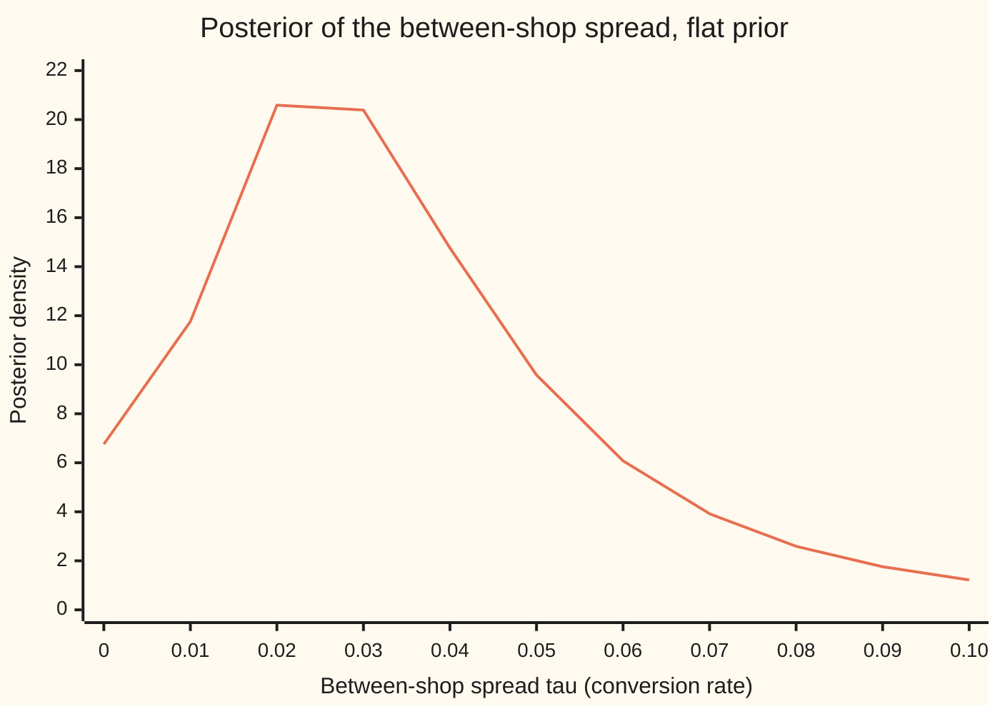

# Hierarchical models: many related groups, each borrowing strength from the rest

[Syllabus](../../../SYLLABUS.md) → [Probability and statistics](../README.md) → [Bayesian Inference](../README.md#s10) → Hierarchical models

---

## General Overview

A chain of five shops tries a new checkout layout for one week. Each shop reports its **conversion rate**: the share of visitors who buy. The rates are 0.10, 0.14, 0.08, 0.12 and 0.16. Shop 5 looks best at 16 percent.

Each rate rests on about 264 visitors, so each carries sampling luck. Its **sampling variance** (the variance of the rate around the shop's true rate) is 0.0004, a typical stray of 0.02, or 2 percentage points. A lead of a few points could be largely luck.

There are two crude answers. **No pooling** takes each rate at face value, so shop 5 is at 0.16. **Complete pooling** says the shops are all the same, so every shop is at the average, 0.12. A **hierarchical model** sits between them. It says each shop has its own true rate, and the five true rates are themselves drawn from one common law. The data then decide how far apart the true rates are.

Here the five rates spread out with variance 0.001. Luck alone would give 0.0004. So the true rates differ with variance 0.0006: 0.6 of the spread is real difference and 0.4 is luck. Each shop keeps 0.6 of its distance from 0.12, and shop 5 becomes **0.144**. Estimating the spread from the data like this is **empirical Bayes**. Giving the spread its own prior instead is **full Bayes**, and it moves shop 5 to 0.146.

**Treat related groups as draws from one law, learn that law's spread from all the groups together, and pull each group's estimate toward the common mean by the share of its gap that the spread says is luck.**

**What kind of fact this is:** a model, an assumption that fits well enough, not a law. Inside the model, the shrink formula given the spread, the moment estimate as the peak of the marginal likelihood, and James-Stein as an unbiased estimate of the pull are theorems proved on this card in Why it works. The risk comparisons are stated with their formulas and checked by simulation.

### The picture: each shop's distance from the average, before and after the pull

Each bar is a shop's distance from the mean 0.12, one `#` per 0.002. The number is the rate itself.

```
shop 1 raw     ##########            0.10
shop 1 pooled  ######                0.1080
shop 2 raw     ##########            0.14
shop 2 pooled  ######                0.1320
shop 3 raw     ####################  0.08
shop 3 pooled  ############          0.0960
shop 4 raw                           0.12
shop 4 pooled                        0.1200
shop 5 raw     ####################  0.16
shop 5 pooled  ############          0.1440
```

Every shop gives up the same 0.4 of its gap, because every rate has the same sampling variance. A shop with fewer visitors would give up more.

---

## The formula

Notation first, in words. Shops are numbered $`j`$ = 1 to $`k`$, with $`k`$ = 5. N(m, v) is the normal law with centre m and variance v, as on [Normal-normal](03-normal-normal.md). A vertical bar reads "given". E[· | y] is an average over the posterior, the belief after seeing the data y.

The **two-level model** has one line per level:

```math
y_j \mid \theta_j \sim N(\theta_j,\, \sigma^2), \qquad \theta_j \sim N(\mu,\, \tau^2), \qquad j = 1, \dots, k, \text{ all independent}
```

**Read it aloud:** each shop's measured rate scatters around its true rate with the sampling variance sigma squared, and the true rates scatter around a common mean mu with the between-shop variance tau squared.

If $`\mu`$ and $`\tau^2`$ were known, each shop's estimate would be

```math
\hat\theta_j = \mu + (1 - B)\,(y_j - \mu), \qquad B = \frac{\sigma^2}{\sigma^2 + \tau^2}
```

**Read it aloud:** start at the common mean and move toward the shop's own rate by the kept share one minus B, where B, the pulled share, is the luck's part of the total variance.

**Empirical Bayes** estimates the two unknowns from the five rates, with $`\bar y`$ (y-bar) the rates' average and $`S`$ the sum of their squared gaps from it:

```math
\hat\mu = \bar y, \qquad \hat\tau^2 = \max\Big(0,\ \frac{S}{k - 1} - \sigma^2\Big), \qquad S = \sum_{j=1}^{k} (y_j - \bar y)^2
```

**Read it aloud:** the common mean is the plain average; the between-shop variance is the rates' observed spread minus the part luck explains, and never below zero.

**James-Stein** estimates the pulled share directly, $`\hat B = (k - 3)\,\sigma^2 / S`$. **Full Bayes** gives $`\tau`$ a prior $`p(\tau)`$, here flat, and averages the kept share over the posterior of $`\tau`$:

```math
p(\tau \mid y) \propto p(\tau)\,(\sigma^2 + \tau^2)^{-(k-1)/2} \exp\Big(-\frac{S}{2(\sigma^2 + \tau^2)}\Big), \qquad \hat\theta_j = \bar y + E[\,1 - B \mid y\,]\,(y_j - \bar y)
```

**Read it aloud:** the plausibility of each between-shop spread is its prior times how well it explains the observed sum of squares; each shop keeps the posterior average of the kept share.

| Symbol | Plain meaning | In our example | Push it up and the answer… |
| --- | --- | --- | --- |
| $`y_j`$ | shop $`j`$'s measured conversion rate | 0.10, 0.14, 0.08, 0.12, 0.16 | its estimate rises by the kept share |
| $`\theta_j`$, $`\hat\theta_j`$ | shop $`j`$'s true rate, unknown; its estimate | shop 5: 0.144 (empirical Bayes) | — |
| $`\sigma^2`$ | sampling variance of one shop's rate, known | 0.0004 (264 visitors) | more luck: every shop pulled harder |
| $`\mu`$, $`\bar y`$ | common mean of the true rates; the rates' average | 0.12 | every estimate moves with it |
| $`\tau^2`$, $`\tau`$ | between-shop variance; its square root, the spread | 0.0006; 0.0245 | shops really differ: less pull |
| $`k`$, $`j`$ | number of shops; one shop's number | 5 | the spread is estimated better |
| $`S`$ | sum of squared gaps from the average | 0.004 | larger $`\hat\tau^2`$: less pull |
| $`B`$, $`1 - B`$ | pulled share; kept share | 0.4; 0.6 | — |
| $`\hat B`$ | an estimate of B from the data | 0.4 (moments), 0.2 (James-Stein) | — |
| $`p(\tau)`$, $`p(\tau \mid y)`$ | prior and posterior of the spread | flat; peak at 0.0245, mean 0.0399 | — |
| $`E[\,\cdot \mid y\,]`$ | an average over the posterior | kept share 0.6511 | — |
| $`V`$, $`c`$, $`m`$, $`X`$, $`\Gamma`$ | helpers: V = σ² + τ²; c the constant in 1 − cσ²/S; m degrees of freedom of a chi-square X; $`c_m`$ its density's constant; Γ the gamma function | V = 0.001 at the estimate; c = 2 (James-Stein), 4 (moments) | larger c: more pull |

### When it holds

- **The shops are exchangeable.** Nothing known in advance marks one shop as different. If shop 5 is a flagship store in a busy centre, pulling it toward the others is wrong. Give it its own term and pool only the rest.
- **The sampling variance is known.** Here it comes from the visitor count. If it is guessed too low, the observed spread looks real and shops are pulled too little.
- **The normal shape is close enough.** A rate near 0.12 from 264 visitors is close to normal. For a shop with 20 visitors or a rate near 0, use a beta law for the true rates, as on [Beta-binomial](02-beta-binomial.md).
- **There are enough groups to learn the spread.** Five rates give four comparisons. Even when the model is right, with $`\tau^2`$ = 0.0006, the moment estimate of $`\tau^2`$ comes out below zero in 19 percent of such weeks (0.1912 exactly), and then every shop is pulled all the way to the average. James-Stein needs at least four groups.
- **The groups share one mean.** If shop size or region predicts the rate, the pull should go toward a regression line, as on [Mixed-effects models](../09-Regression/12-mixed-effects-models.md), not toward one average.

---

## Why it works

### Step 0: the other shops tell you how much of a gap is luck

One shop alone cannot split its gap into real difference and luck. Five shops can. Luck has a known size, 0.0004. The five rates together show the total spread, 0.001. The difference is the real spread between shops. That is what "borrowing strength" means: each shop's estimate uses the other shops to learn how far apart true rates usually are.

### Step 1: given the spread, each shop is a normal-normal update

Fix $`\mu`$ and $`\tau^2`$. For shop $`j`$ the law $`N(\mu, \tau^2)`$ is a prior and its rate $`y_j`$ is one reading with variance $`\sigma^2`$. [Normal-normal](03-normal-normal.md) gives the posterior centre as a precision-weighted average, a precision being one over a variance.

- Prior precision: $`1/\tau^2`$ = 1666.7.
- Reading precision: $`1/\sigma^2`$ = 2500.0.
- Weight on the reading: 2500.0 / (2500.0 + 1666.7) = 0.6.

In symbols the weight is $`(1/\sigma^2)/(1/\sigma^2 + 1/\tau^2) = \tau^2/(\tau^2 + \sigma^2) = 1 - B`$. The posterior variance is $`(1 - B)\,\sigma^2`$ = 0.000240, below the raw 0.0004. With $`\mu`$ replaced by $`\bar y`$ it rises to 0.000272, because the average is itself uncertain. This is the formula of [Mixed-effects models](../09-Regression/12-mixed-effects-models.md). There a group's variance is one observation's variance divided by the group's count; here the shop's whole sampling variance $`\sigma^2`$ plays that part.

### Step 2: across shops, a rate varies by the spread plus the luck

Remove $`\theta_j`$: a shop's rate is the common mean, plus the shop's real difference, plus luck. The two parts are independent, so their variances add:

```math
y_j \sim N(\mu,\, \sigma^2 + \tau^2) \quad\text{independently, so}\quad E\Big[\frac{S}{k - 1}\Big] = \sigma^2 + \tau^2
```

The second part is the usual sample variance fact: dividing by $`k - 1`$ makes it unbiased. Set the observed spread 0.001 equal to $`\sigma^2 + \tau^2`$ and solve: $`\hat\tau^2`$ = 0.0006. This is the **moment estimate**.

A second road gives the same number. Average the joint law of the five rates over a flat prior on $`\mu`$. What remains, the **marginal likelihood** of $`\tau^2`$, is a constant times $`V^{-(k-1)/2} e^{-S/(2V)}`$ with $`V = \sigma^2 + \tau^2`$. Its slope in V is zero where $`V = S/(k - 1)`$, so its peak is again 0.0006. The checks find this peak by search.

### Step 3: James-Stein is empirical Bayes with an unbiased pull

Empirical Bayes needs the pulled share B, not $`\tau^2`$ itself. B has $`\sigma^2 + \tau^2`$ in its denominator, so the natural estimate puts the observed spread there: $`\hat B = (k - 1)\,\sigma^2/S`$ = 0.4. That is the moment answer again.

That estimate of B is biased upward. Under the model, $`S/(\sigma^2 + \tau^2)`$ follows the chi-square law with $`k - 1`$ degrees of freedom ([The reference distributions](../07-Sampling%20and%20Estimation/03-chi-square-t-and-f-distributions.md)). The average of one over a chi-square with m degrees is $`1/(m - 2)`$. With m = k − 1:

```math
E\Big[\frac{(k - 3)\,\sigma^2}{S}\Big] = \frac{(k - 3)\,\sigma^2}{(k - 3)(\sigma^2 + \tau^2)} = B
```

So $`(k - 3)\,\sigma^2/S`$ is an unbiased estimate of the pulled share. Put it into the Step 1 formula and the result is the **James-Stein rule** of [Decision theory](07-risk-admissibility-and-steins-paradox.md), shrinking toward the average. That card shrinks toward a fixed point, zero, and uses $`k - 2`$. Here the centre $`\bar y`$ is estimated from the same rates, which uses up one degree of freedom, so the constant is $`k - 3`$. For the shops: $`1 - 2 \times 0.0004/0.004`$ = 0.8, and shop 5 moves only to 0.152.

<details>
<summary>Detailed proof: the average of one over a chi-square</summary>

The chi-square density with m degrees of freedom is a constant $`c_m`$ times $`x^{m/2 - 1} e^{-x/2}`$ on x > 0, with $`c_m = 1/(2^{m/2}\,\Gamma(m/2))`$. Here Γ is the gamma function, with $`\Gamma(a + 1) = a\,\Gamma(a)`$. Multiply the density by 1/x:

$`\displaystyle E\Big[\frac{1}{X}\Big] = c_m \int_0^\infty x^{(m-2)/2 - 1} e^{-x/2}\,dx = \frac{c_m}{c_{m-2}}.`$

The integral is the chi-square density with m − 2 degrees, without its constant, so it equals $`1/c_{m-2}`$. The ratio is

$`\displaystyle \frac{2^{(m-2)/2}\,\Gamma((m-2)/2)}{2^{m/2}\,\Gamma(m/2)} = \frac{1}{2 \cdot (m-2)/2} = \frac{1}{m - 2}.`$

The integral is finite only when m > 2, so k − 1 > 2: James-Stein toward the average needs at least four groups.

</details>

### Step 4: how much each rule saves, on average

Score a rule by its total squared miss over the five shops, averaged over worlds drawn from the model with $`\tau^2`$ = 0.0006. All rules of the form "keep $`1 - c\,\sigma^2/S`$" share one formula. It comes from the Stein's lemma proof on [Decision theory](07-risk-admissibility-and-steins-paradox.md), run in k − 1 dimensions once the average is removed:

```math
\text{total risk} = k\,\sigma^2 - c\,\big(2(k - 3) - c\big)\,\sigma^4\,E\Big[\frac{1}{S}\Big]
```

The saving is positive for c between 0 and 2(k − 3), and largest at c = k − 3, James-Stein. The moment share uses c = k − 1 = 4, which here equals 2(k − 3) exactly. Without its floor at zero it saves nothing on average with five shops. The floor rescues it.

| Rule | Total squared miss (× 1e-4), exact | Simulated, 20,000 worlds |
| --- | --- | --- |
| Raw rates, no pooling | 20.000 | 20.013 |
| Moment share, no floor | 20.000 | 20.199 |
| James-Stein | 16.800 | 16.906 |
| Moment share with floor (plug-in empirical Bayes) | — | 15.863 |
| Full Bayes, flat prior on τ | — | 15.093 |
| True $`\tau^2`$ known | 13.600 | 13.661 |
| Complete pooling | 28.000 | 28.396 |

James-Stein, the moment share with its floor and full Bayes all beat the raw rates, and full Bayes comes closest to knowing the true spread. Not every pooling rule wins: the moment share without its floor only ties the raw rates, and complete pooling does worse, 28.000 against 20.000.

The two rules without a floor need care in the simulation. In a week where the five rates bunch together, S is tiny and their loss is about $`c^2\sigma^4/S`$, so with five shops that loss has infinite variance. Their simulated column swaps this term for its exact average, $`c^2\sigma^4/((k-3)V)`$ by Step 3. The average is unchanged, the variance becomes finite, and the check's standard errors are honest.

### Step 5: full Bayes keeps the spread uncertain

Empirical Bayes plugs in 0.0006 as if it were certain. Five rates cannot pin it down. Full Bayes gives $`\tau`$ a flat prior and lets the marginal likelihood of Step 2 weigh every value:



The orange line is the posterior density of $`\tau`$. It peaks at the empirical-Bayes value 0.0245 but has a long right tail, so its mean is 0.0399. Large spreads mean less pull, so the posterior average of the kept share is 0.6511, not 0.6.

Given $`\tau`$, a flat prior on $`\mu`$ gives $`\mu \mid \tau, y \sim N(\bar y, (\sigma^2 + \tau^2)/k)`$, so each shop's posterior centre is $`\bar y + (1 - B)(y_j - \bar y)`$. Averaging over $`\tau`$ gives the formula's $`E[1 - B \mid y]`$. For shop 5 that is 0.1460.

The uncertainty grows too. Shop 5's posterior spread is 0.0199, against 0.0165 for the plug-in answer, which ignores doubt about $`\tau`$. The raw rate's spread is 0.0200: with five shops, the pooling moves the centre but barely narrows the honest spread.

### Step 6, in outline: the Gibbs sampler

The integral over $`\tau`$ is one-dimensional here, so the checks do it by Simpson's rule. With more levels or unequal variances it is not, and the usual tool is a **Gibbs sampler**: a chain that redraws each unknown from its law given the others, in turn ([MCMC in outline](06-markov-chain-monte-carlo-in-outline.md)). For this model each round has three draws:

1. Each true rate $`\theta_j`$ from its Step 1 normal law, given $`\mu`$ and $`\tau^2`$.
2. The mean $`\mu`$ from $`N(\text{average of the } \theta_j,\ \tau^2/k)`$.
3. The variance $`\tau^2`$ from an inverse-gamma law: half the sum of squares of $`\theta_j - \mu`$, divided by a gamma draw with shape (k − 1)/2.

Over 200,000 rounds the chain's averages land on the Simpson answers: kept share 0.6534 ± 0.0019 against 0.6511, and shop 5 at 0.1462 ± 0.0001 against 0.1460, with spread 0.0199. Why the chain settles on the posterior is the subject of wing 11.

---

## Worked numbers, by hand

Five rates, each with sampling variance 0.0004.

| Step | Arithmetic | Value |
| --- | --- | --- |
| average $`\bar y`$ | (0.10 + 0.14 + 0.08 + 0.12 + 0.16) / 5 | 0.12 |
| gaps from the average | each rate − 0.12 | −0.02, 0.02, −0.04, 0, 0.04 |
| squared gaps | each gap squared | 0.0004, 0.0004, 0.0016, 0, 0.0016 |
| sum of squares $`S`$ | add them | 0.004 |
| observed spread | 0.004 / (5 − 1) | 0.001 |
| between-shop variance $`\hat\tau^2`$ | 0.001 − 0.0004 | 0.0006 |
| pulled share $`B`$ | 0.0004 / (0.0004 + 0.0006) | 0.4 |
| kept share $`1 - B`$ | 1 − 0.4 | 0.6 |
| all five estimates | 0.12 + 0.6 × gap | 0.108, 0.132, 0.096, 0.12, 0.144 |
| **shop 5** | 0.12 + 0.6 × 0.04 | **0.144** |

Shop 5's best estimate is 14.4 percent, not 16. It still ranks first, but every lead shrinks by the same share.

### What breaks if you drop a piece

| Mistake | Comes out at | What went wrong |
| --- | --- | --- |
| Use the observed spread 0.001 as $`\tau^2`$ | kept share 0.7143, shop 5 at 0.1486 | Counts the luck as real difference |
| Divide S by k, not k − 1 | $`\tau^2`$ 0.0004, kept share 0.5, shop 5 at 0.1400 | The spread is underestimated, because the average was fitted to the same rates |
| No pooling: report the raw rates | shop 5 at 0.16; total miss 20.000 against 15.863 (× 1e-4) | Treats 264 visitors' luck as real |
| Complete pooling: every shop at the average | shop 5 at 0.12; total miss 28.000 (× 1e-4) | Throws away real differences |

---

## Code, from first principles, and it actually runs

The scripts compute everything from the five rates. They take **three independent roads**. The between-shop variance comes from the moment formula and from a golden-section search of the marginal likelihood. Full Bayes comes from Simpson's rule over $`\tau`$ and from a Gibbs sampler with its own random numbers (SplitMix64 and Box-Muller), its error measured by batch means. A simulation of 20,000 five-shop worlds checks each rule's average total miss against the exact formulas (for the two rules without a floor, after the swap described under Step 4), and the share of negative estimates against the chi-square formula $`1 - e^{-0.8}(1 + 0.8)`$.

### Python

```python
# Hierarchical models and empirical Bayes -- the check behind the card.  Standard library only.
# Five shops' conversion rates, each with known sampling variance.  The between-shop variance is
# found two ways (moments, and a search of the marginal likelihood).  Full Bayes with a flat prior
# on the between-shop spread is done two ways (Simpson's rule over tau, and a Gibbs sampler).
# A simulation of many five-shop worlds checks the average total squared miss of each rule.
import math
Y = [0.10, 0.14, 0.08, 0.12, 0.16]
S2, K = 0.0004, 5                                   # sampling variance of each rate; number of shops
MASK = (1 << 64) - 1
ybar = sum(Y) / K
S = sum((v - ybar) ** 2 for v in Y)                 # sum of squared gaps from the mean
spread = S / (K - 1)
tau2 = max(0.0, spread - S2)                        # moment estimate of the between-shop variance
keep = tau2 / (tau2 + S2)
keep_js = 1 - (K - 3) * S2 / S                      # James-Stein toward the mean

def loglik(t2, s=S):                                # log marginal likelihood, mean integrated out
    v = S2 + t2
    return -(K - 1) / 2 * math.log(v) - s / (2 * v)
lo, hi = 0.0, 0.01                                  # golden-section search for its peak
for _ in range(100):
    a, b = hi - 0.618034 * (hi - lo), lo + 0.618034 * (hi - lo)
    lo, hi = (lo, b) if loglik(a) > loglik(b) else (a, hi)
t2_ml = (lo + hi) / 2

def simpson(g, a, b, n):
    h = (b - a) / n
    return (g(a) + g(b) + sum((4 if i % 2 else 2) * g(a + i * h) for i in range(1, n))) * h / 3
def post(t, s=S):                                   # posterior of tau, flat prior, scaled to peak 1
    return math.exp(loglik(t * t, s) - loglik(max(0.0, s / (K - 1) - S2), s))
def bayes(s, n=2000, top=5.0):                      # flat prior on tau: E[share], E[share^2], E[tau], E[var]
    z = simpson(lambda t: post(t, s), 0, top, n)
    m1 = simpson(lambda t: post(t, s) * t * t / (S2 + t * t), 0, top, n) / z
    m2 = simpson(lambda t: post(t, s) * (t * t / (S2 + t * t)) ** 2, 0, top, n) / z
    mt = simpson(lambda t: post(t, s) * t, 0, top, n) / z
    ev = simpson(lambda t: post(t, s) * (t * t / (S2 + t * t) * S2
                                         + (S2 / (S2 + t * t)) ** 2 * (S2 + t * t) / K), 0, top, n) / z
    return m1, m2, mt, ev
fb_keep, fb_keep2, fb_tau, fb_ev = bayes(S, 20000)
d5 = Y[4] - ybar
fb5 = ybar + fb_keep * d5
fb5_sd = math.sqrt(fb_ev + (fb_keep2 - fb_keep ** 2) * d5 * d5)
eb5_sd = math.sqrt(keep * S2 + (1 - keep) ** 2 * (S2 + tau2) / K)

state = 20261123                                    # SplitMix64, then Box-Muller for normal draws
def uniform():
    global state
    state = (state + 0x9E3779B97F4A7C15) & MASK
    z = state
    z = ((z ^ (z >> 30)) * 0xBF58476D1CE4E5B9) & MASK
    z = ((z ^ (z >> 27)) * 0x94D049BB133111EB) & MASK
    return (((z ^ (z >> 31)) >> 11) + 0.5) / 2.0 ** 53
def normal():
    return math.sqrt(-2 * math.log(uniform())) * math.cos(2 * math.pi * uniform())

ROUNDS, BATCH = 200000, 2000                        # Gibbs: theta, then mu, then tau^2, in turn
mu, t2 = ybar, spread                               # start at the raw spread, never zero
draws = [[0.0] * 4 for _ in range(ROUNDS // BATCH)]  # batch sums: share, tau, theta5, theta5^2
for r in range(ROUNDS + 1000):
    prec = 1 / S2 + 1 / t2
    theta = [(y / S2 + mu / t2) / prec + normal() / math.sqrt(prec) for y in Y]
    mu = sum(theta) / K + normal() * math.sqrt(t2 / K)
    ss = sum((th - mu) ** 2 for th in theta)
    t2 = ss / 2 / (-math.log(uniform() * uniform()))  # inverse gamma, shape (K-1)/2 = 2
    if r >= 1000:
        b = draws[(r - 1000) // BATCH]
        for j, v in enumerate((t2 / (S2 + t2), math.sqrt(t2), theta[4], theta[4] ** 2)):
            b[j] += v / BATCH
def batch_mean(j):
    m = [b[j] for b in draws]
    avg = sum(m) / len(m)
    return avg, math.sqrt(sum((x - avg) ** 2 for x in m) / (len(m) - 1) / len(m))
g_keep, g_tau, g5, g52 = (batch_mean(j) for j in range(4))
g5_sd = math.sqrt(g52[0] - g5[0] ** 2)

WORLDS, TRUE_MU = 20000, 0.12                       # worlds drawn with the estimated tau^2
names = ["raw", "known tau^2", "plug-in EB", "plug-in, no floor", "James-Stein", "full Bayes", "complete pooling"]
acc, below = [[0.0, 0.0] for _ in names], 0
for _ in range(WORLDS):
    th = [TRUE_MU + math.sqrt(tau2) * normal() for _ in range(K)]
    y = [t + math.sqrt(S2) * normal() for t in th]
    m = sum(y) / K
    s = sum((v - m) ** 2 for v in y)
    below += s / (K - 1) < S2
    shares = [1.0, keep, max(0.0, 1 - (K - 1) * S2 / s), 1 - (K - 1) * S2 / s, 1 - (K - 3) * S2 / s,
              bayes(s, 200, 0.5)[0], 0.0]
    for j, c in enumerate(shares):
        loss = sum((m + c * (v - m) - t) ** 2 for v, t in zip(y, th))
        if j in (3, 4):                             # no floor: swap the c^2 sigma^4/S tail for its exact average
            loss -= ((K - 1, K - 3)[j - 3] * S2) ** 2 * (1 / s - 1 / ((K - 3) * (S2 + tau2)))
        acc[j][0] += loss / WORLDS
        acc[j][1] += loss * loss / WORLDS
risk = [(a, math.sqrt((b - a * a) / WORLDS)) for a, b in acc]
B = S2 / (S2 + tau2)
exact = {0: K * S2, 1: K * (1 - B) * S2 + B * B * (S2 + tau2), 3: K * S2,
         4: K * S2 - (K - 3) * S2 * B, 6: (K - 1) * tau2 + S2}
p_below = 1 - math.exp(-0.8) * 1.8                  # chi-square, 4 degrees: P(below 1.6)
grid = [i / 100 for i in range(11)]
dens = [post(t) / simpson(post, 0, 5.0, 20000) for t in grid]

def f(v, d=4): return f"{v:.{d}f}"
def row(c): return " ".join(f(ybar + c * (v - ybar), 4) for v in Y)
print("five shops, rates", " ".join(f(v, 2) for v in Y), "sampling variance", S2)
print("visitors per shop that give variance 0.0004 at rate 0.12:", round(0.12 * 0.88 / S2))
print("mean", f(ybar), "sum of squares S", f(S, 6), "spread S/(k-1)", f(spread, 6))
print("gaps", " ".join(f(v - ybar) for v in Y), "squared", " ".join(f((v - ybar) ** 2) for v in Y))
print("tau^2 = spread - 0.0004:", f(tau2, 6), "tau", f(math.sqrt(tau2)))
print("marginal likelihood search: best tau^2", f(t2_ml, 6))
print("kept share tau^2/(tau^2+sigma^2)", f(keep), "pulled share", f(1 - keep))
print("precisions 1/tau^2, 1/sigma^2", f(1 / tau2, 1), f(1 / S2, 1), "share", f((1 / S2) / (1 / S2 + 1 / tau2)))
print("empirical Bayes estimates", row(keep))
print("  variance given tau^2: mu known", f(keep * S2, 6), "| mu estimated", f(eb5_sd ** 2, 6))
print("James-Stein share 1-(k-3)sigma^2/S", f(keep_js), "estimates", row(keep_js))
print("full Bayes, flat prior on tau, Simpson over tau")
print("  mean kept share", f(fb_keep), "mean tau", f(fb_tau), "estimates", row(fb_keep))
print("  shop 5: mean", f(fb5), "sd", f(fb5_sd), "| plug-in sd", f(eb5_sd), "| raw sd", f(math.sqrt(S2)))
print("Gibbs sampler,", ROUNDS, "rounds, batch-means standard errors")
print("  mean kept share", f"{g_keep[0]:.4f}+-{g_keep[1]:.4f}", "mean tau", f"{g_tau[0]:.4f}+-{g_tau[1]:.4f}")
print("  shop 5: mean", f"{g5[0]:.4f}+-{g5[1]:.4f}", "sd", f(g5_sd))
print("what breaks")
print("  forget to subtract sigma^2: share", f(spread / (spread + S2)), "shop 5", f(ybar + spread / (spread + S2) * d5))
print("  divide S by k: tau^2", f(S / K - S2, 6), "share", f((S / K - S2) / (S / K)), "shop 5", f(ybar + (S / K - S2) / (S / K) * d5))
print("  complete pooling: shop 5", f(ybar), "| no pooling: shop 5", f(Y[4]))
print("simulated worlds:", WORLDS, "with mean 0.12, tau^2 0.0006; total squared miss over 5 shops (x 1e-4)")
for j, n in enumerate(names):
    ex = f"   exact {exact[j] * 1e4:.3f}" if j in exact else ""
    print(f"  {n:<18}{risk[j][0] * 1e4:.3f}+-{risk[j][1] * 1e4:.3f}{ex}")
print("share of worlds with tau^2 estimate below zero (chi-square, 4 degrees, below 1.6)", f(below / WORLDS), "exact", f(p_below))
print("figure, posterior density of tau at 0, 0.01, .., 0.10: " + ", ".join(f(v, 2) for v in dens))
assert abs(t2_ml - tau2) < 1e-9                                       # search against moment formula
assert abs(keep - 0.6) < 1e-12 and abs(ybar + keep * d5 - 0.144) < 1e-12  # the spec's numbers
for (gm, se), exact_v in ((g_keep, fb_keep), (g_tau, fb_tau), (g5, fb5)):
    assert abs(gm - exact_v) < 4 * se                                 # Gibbs against Simpson
assert abs(g5_sd - fb5_sd) < 0.0005                                   # posterior spread, two roads
for j, ex in exact.items():
    assert abs(risk[j][0] - ex) < 4 * risk[j][1]                      # simulation against closed forms
assert abs(below / WORLDS - p_below) < 4 * math.sqrt(p_below * (1 - p_below) / WORLDS)
assert risk[5][0] < risk[4][0] < risk[0][0] and risk[2][0] < risk[0][0]  # pooling beats no pooling
print("ALL CHECKS PASS")
```

**Ran 2026-11-23 on macOS, Python 3.14.10, standard library only. All checks passed. Output, pasted from the run:**

```text
five shops, rates 0.10 0.14 0.08 0.12 0.16 sampling variance 0.0004
visitors per shop that give variance 0.0004 at rate 0.12: 264
mean 0.1200 sum of squares S 0.004000 spread S/(k-1) 0.001000
gaps -0.0200 0.0200 -0.0400 0.0000 0.0400 squared 0.0004 0.0004 0.0016 0.0000 0.0016
tau^2 = spread - 0.0004: 0.000600 tau 0.0245
marginal likelihood search: best tau^2 0.000600
kept share tau^2/(tau^2+sigma^2) 0.6000 pulled share 0.4000
precisions 1/tau^2, 1/sigma^2 1666.7 2500.0 share 0.6000
empirical Bayes estimates 0.1080 0.1320 0.0960 0.1200 0.1440
  variance given tau^2: mu known 0.000240 | mu estimated 0.000272
James-Stein share 1-(k-3)sigma^2/S 0.8000 estimates 0.1040 0.1360 0.0880 0.1200 0.1520
full Bayes, flat prior on tau, Simpson over tau
  mean kept share 0.6511 mean tau 0.0399 estimates 0.1070 0.1330 0.0940 0.1200 0.1460
  shop 5: mean 0.1460 sd 0.0199 | plug-in sd 0.0165 | raw sd 0.0200
Gibbs sampler, 200000 rounds, batch-means standard errors
  mean kept share 0.6534+-0.0019 mean tau 0.0400+-0.0002
  shop 5: mean 0.1462+-0.0001 sd 0.0199
what breaks
  forget to subtract sigma^2: share 0.7143 shop 5 0.1486
  divide S by k: tau^2 0.000400 share 0.5000 shop 5 0.1400
  complete pooling: shop 5 0.1200 | no pooling: shop 5 0.1600
simulated worlds: 20000 with mean 0.12, tau^2 0.0006; total squared miss over 5 shops (x 1e-4)
  raw               20.013+-0.090   exact 20.000
  known tau^2       13.661+-0.063   exact 13.600
  plug-in EB        15.863+-0.073
  plug-in, no floor 20.199+-0.089   exact 20.000
  James-Stein       16.906+-0.081   exact 16.800
  full Bayes        15.093+-0.071
  complete pooling  28.396+-0.128   exact 28.000
share of worlds with tau^2 estimate below zero (chi-square, 4 degrees, below 1.6) 0.1876 exact 0.1912
figure, posterior density of tau at 0, 0.01, .., 0.10: 6.76, 11.76, 20.59, 20.39, 14.76, 9.58, 6.08, 3.92, 2.59, 1.76, 1.22
ALL CHECKS PASS
```

### Rust

```rust
// Hierarchical models and empirical Bayes -- the same check as the Python, in Rust.  No crates.
// Five shops' conversion rates, each with known sampling variance.  The between-shop variance is
// found two ways (moments, and a search of the marginal likelihood).  Full Bayes with a flat prior
// on the between-shop spread is done two ways (Simpson's rule over tau, and a Gibbs sampler).
// A simulation of many five-shop worlds checks the average total squared miss of each rule.
const Y: [f64; 5] = [0.10, 0.14, 0.08, 0.12, 0.16];
const S2: f64 = 0.0004; // sampling variance of each rate
const K: f64 = 5.0; // number of shops

// compensated sum, the same algorithm as Python's built-in sum of floats
fn psum<I: Iterator<Item = f64>>(it: I) -> f64 {
    let (mut s, mut c) = (0.0f64, 0.0f64);
    for x in it {
        let t = s + x;
        c += if s.abs() >= x.abs() { (s - t) + x } else { (x - t) + s };
        s = t;
    }
    if c != 0.0 && c.is_finite() { s + c } else { s }
}
fn sq(x: f64) -> f64 { x.powf(2.0) }

// log marginal likelihood, mean integrated out
fn loglik(t2: f64, s: f64) -> f64 { let v = S2 + t2; -(K - 1.0) / 2.0 * v.ln() - s / (2.0 * v) }
fn simpson(g: &dyn Fn(f64) -> f64, a: f64, b: f64, n: usize) -> f64 {
    let h = (b - a) / n as f64;
    (g(a) + g(b) + psum((1..n).map(|i| if i % 2 == 1 { 4.0 } else { 2.0 } * g(a + i as f64 * h)))) * h / 3.0
}
// posterior of tau, flat prior, scaled to peak 1
fn post(t: f64, s: f64) -> f64 { (loglik(t * t, s) - loglik(f64::max(0.0, s / (K - 1.0) - S2), s)).exp() }
// flat prior on tau: E[kept share], E[share^2], E[tau], E[conditional variance of shop 5]
fn bayes(s: f64, n: usize, top: f64) -> (f64, f64, f64, f64) {
    let z = simpson(&|t| post(t, s), 0.0, top, n);
    let m1 = simpson(&|t| post(t, s) * t * t / (S2 + t * t), 0.0, top, n) / z;
    let m2 = simpson(&|t| post(t, s) * sq(t * t / (S2 + t * t)), 0.0, top, n) / z;
    let mt = simpson(&|t| post(t, s) * t, 0.0, top, n) / z;
    let ev = simpson(&|t| post(t, s) * (t * t / (S2 + t * t) * S2 + sq(S2 / (S2 + t * t)) * (S2 + t * t) / K), 0.0, top, n) / z;
    (m1, m2, mt, ev)
}

// SplitMix64, then Box-Muller for normal draws
struct Rng(u64);
impl Rng {
    fn uniform(&mut self) -> f64 {
        self.0 = self.0.wrapping_add(0x9E3779B97F4A7C15);
        let mut z = self.0;
        z = (z ^ (z >> 30)).wrapping_mul(0xBF58476D1CE4E5B9);
        z = (z ^ (z >> 27)).wrapping_mul(0x94D049BB133111EB);
        (((z ^ (z >> 31)) >> 11) as f64 + 0.5) / 2f64.powi(53)
    }
    fn normal(&mut self) -> f64 {
        let (u1, u2) = (self.uniform(), self.uniform());
        (-2.0 * u1.ln()).sqrt() * (2.0 * std::f64::consts::PI * u2).cos()
    }
}

fn f(v: f64, d: usize) -> String { format!("{:.*}", d, v) }
fn pm(m: (f64, f64)) -> String { format!("{:.4}+-{:.4}", m.0, m.1) }
fn main() {
    let ybar = psum(Y.iter().cloned()) / K;
    let s = psum(Y.iter().map(|v| sq(v - ybar))); // sum of squared gaps from the mean
    let spread = s / (K - 1.0);
    let tau2 = f64::max(0.0, spread - S2); // moment estimate of the between-shop variance
    let keep = tau2 / (tau2 + S2);
    let keep_js = 1.0 - (K - 3.0) * S2 / s; // James-Stein toward the mean
    let (mut lo, mut hi) = (0.0f64, 0.01f64); // golden-section search for the peak
    for _ in 0..100 {
        let (a, b) = (hi - 0.618034 * (hi - lo), lo + 0.618034 * (hi - lo));
        if loglik(a, s) > loglik(b, s) { hi = b } else { lo = a }
    }
    let t2_ml = (lo + hi) / 2.0;
    let (fb_keep, fb_keep2, fb_tau, fb_ev) = bayes(s, 20000, 5.0);
    let (d5, fb5) = (Y[4] - ybar, ybar + fb_keep * (Y[4] - ybar));
    let fb5_sd = (fb_ev + (fb_keep2 - sq(fb_keep)) * d5 * d5).sqrt();
    let eb5_sd = (keep * S2 + sq(1.0 - keep) * (S2 + tau2) / K).sqrt();
    let mut rng = Rng(20261123);
    let (rounds, batch) = (200000usize, 2000usize); // Gibbs: theta, then mu, then tau^2, in turn
    let (mut mu, mut t2) = (ybar, spread); // start at the raw spread, never zero
    let mut draws = vec![[0.0f64; 4]; rounds / batch]; // batch sums: share, tau, theta5, theta5^2
    for r in 0..rounds + 1000 {
        let prec = 1.0 / S2 + 1.0 / t2;
        let theta: Vec<f64> = Y.iter().map(|y| (y / S2 + mu / t2) / prec + rng.normal() / prec.sqrt()).collect();
        mu = psum(theta.iter().cloned()) / K + rng.normal() * (t2 / K).sqrt();
        let ss = psum(theta.iter().map(|th| sq(th - mu)));
        t2 = ss / 2.0 / (-(rng.uniform() * rng.uniform()).ln()); // inverse gamma, shape (K-1)/2 = 2
        if r >= 1000 {
            let b = &mut draws[(r - 1000) / batch];
            for (j, v) in [t2 / (S2 + t2), t2.sqrt(), theta[4], sq(theta[4])].iter().enumerate() {
                b[j] += v / batch as f64;
            }
        }
    }
    let batch_mean = |j: usize| -> (f64, f64) {
        let m: Vec<f64> = draws.iter().map(|b| b[j]).collect();
        let n = m.len() as f64;
        let avg = psum(m.iter().cloned()) / n;
        (avg, (psum(m.iter().map(|x| sq(x - avg))) / (n - 1.0) / n).sqrt())
    };
    let (g_keep, g_tau, g5, g52) = (batch_mean(0), batch_mean(1), batch_mean(2), batch_mean(3));
    let g5_sd = (g52.0 - sq(g5.0)).sqrt();
    let (worlds, true_mu) = (20000usize, 0.12); // worlds drawn with the estimated tau^2
    let names = ["raw", "known tau^2", "plug-in EB", "plug-in, no floor", "James-Stein", "full Bayes", "complete pooling"];
    let mut acc = vec![[0.0f64; 2]; names.len()];
    let mut below = 0usize;
    let wf = worlds as f64;
    for _ in 0..worlds {
        let th: Vec<f64> = (0..5).map(|_| true_mu + tau2.sqrt() * rng.normal()).collect();
        let y: Vec<f64> = th.iter().map(|t| t + S2.sqrt() * rng.normal()).collect();
        let m = psum(y.iter().cloned()) / K;
        let ssum = psum(y.iter().map(|v| sq(v - m)));
        if ssum / (K - 1.0) < S2 { below += 1 }
        let shares = [1.0, keep, f64::max(0.0, 1.0 - (K - 1.0) * S2 / ssum), 1.0 - (K - 1.0) * S2 / ssum,
                      1.0 - (K - 3.0) * S2 / ssum, bayes(ssum, 200, 0.5).0, 0.0];
        for (j, c) in shares.iter().enumerate() {
            let loss = psum(y.iter().zip(&th).map(|(v, t)| sq(m + c * (v - m) - t)));
            // no floor: swap the c^2 sigma^4/S tail for its exact average
            let loss = if j == 3 || j == 4 { loss - sq([K - 1.0, K - 3.0][j - 3] * S2) * (1.0 / ssum - 1.0 / ((K - 3.0) * (S2 + tau2))) } else { loss };
            acc[j][0] += loss / wf;
            acc[j][1] += loss * loss / wf;
        }
    }
    let risk: Vec<(f64, f64)> = acc.iter().map(|[a, b]| (*a, ((b - a * a) / wf).sqrt())).collect(); let bb = S2 / (S2 + tau2);
    let exact: Vec<(usize, f64)> = vec![(0, K * S2), (1, K * (1.0 - bb) * S2 + bb * bb * (S2 + tau2)), (3, K * S2),
                                        (4, K * S2 - (K - 3.0) * S2 * bb), (6, (K - 1.0) * tau2 + S2)];
    let p_below = 1.0 - (-0.8f64).exp() * 1.8; // chi-square, 4 degrees: P(below 1.6)
    let dens: Vec<String> = (0..11).map(|i| f(post(i as f64 / 100.0, s) / simpson(&|t| post(t, s), 0.0, 5.0, 20000), 2)).collect();
    let row = |c: f64| Y.iter().map(|v| f(ybar + c * (v - ybar), 4)).collect::<Vec<_>>().join(" ");
    println!("five shops, rates {} sampling variance {}", Y.iter().map(|v| f(*v, 2)).collect::<Vec<_>>().join(" "), S2);
    println!("visitors per shop that give variance 0.0004 at rate 0.12: {}", (0.12 * 0.88 / S2).round());
    println!("mean {} sum of squares S {} spread S/(k-1) {}", f(ybar, 4), f(s, 6), f(spread, 6));
    let gaps = |p: i32| Y.iter().map(|v| f((v - ybar).powf(p as f64), 4)).collect::<Vec<_>>().join(" ");
    println!("gaps {} squared {}", gaps(1), gaps(2));
    println!("tau^2 = spread - 0.0004: {} tau {}", f(tau2, 6), f(tau2.sqrt(), 4));
    println!("marginal likelihood search: best tau^2 {}", f(t2_ml, 6));
    println!("kept share tau^2/(tau^2+sigma^2) {} pulled share {}", f(keep, 4), f(1.0 - keep, 4));
    println!("precisions 1/tau^2, 1/sigma^2 {} {} share {}", f(1.0 / tau2, 1), f(1.0 / S2, 1), f((1.0 / S2) / (1.0 / S2 + 1.0 / tau2), 4));
    println!("empirical Bayes estimates {}", row(keep));
    println!("  variance given tau^2: mu known {} | mu estimated {}", f(keep * S2, 6), f(sq(eb5_sd), 6));
    println!("James-Stein share 1-(k-3)sigma^2/S {} estimates {}", f(keep_js, 4), row(keep_js));
    println!("full Bayes, flat prior on tau, Simpson over tau");
    println!("  mean kept share {} mean tau {} estimates {}", f(fb_keep, 4), f(fb_tau, 4), row(fb_keep));
    println!("  shop 5: mean {} sd {} | plug-in sd {} | raw sd {}", f(fb5, 4), f(fb5_sd, 4), f(eb5_sd, 4), f(S2.sqrt(), 4));
    println!("Gibbs sampler, {} rounds, batch-means standard errors", rounds);
    println!("  mean kept share {} mean tau {}", pm(g_keep), pm(g_tau));
    println!("  shop 5: mean {} sd {}", pm(g5), f(g5_sd, 4));
    let (sh, shk) = (spread / (spread + S2), (s / K - S2) / (s / K));
    println!("what breaks");
    println!("  forget to subtract sigma^2: share {} shop 5 {}", f(sh, 4), f(ybar + sh * d5, 4));
    println!("  divide S by k: tau^2 {} share {} shop 5 {}", f(s / K - S2, 6), f(shk, 4), f(ybar + shk * d5, 4));
    println!("  complete pooling: shop 5 {} | no pooling: shop 5 {}", f(ybar, 4), f(Y[4], 4));
    println!("simulated worlds: {} with mean 0.12, tau^2 0.0006; total squared miss over 5 shops (x 1e-4)", worlds);
    for (j, n) in names.iter().enumerate() {
        let ex = match exact.iter().find(|e| e.0 == j) { Some(e) => format!("   exact {:.3}", e.1 * 1e4), None => String::new() };
        println!("  {:<18}{:.3}+-{:.3}{}", n, risk[j].0 * 1e4, risk[j].1 * 1e4, ex);
    }
    println!("share of worlds with tau^2 estimate below zero (chi-square, 4 degrees, below 1.6) {} exact {}", f(below as f64 / wf, 4), f(p_below, 4));
    println!("figure, posterior density of tau at 0, 0.01, .., 0.10: {}", dens.join(", "));
    assert!((t2_ml - tau2).abs() < 1e-9); // search against moment formula
    assert!((keep - 0.6).abs() < 1e-12 && (ybar + keep * d5 - 0.144).abs() < 1e-12); // the spec's numbers
    for (g, ex) in [(g_keep, fb_keep), (g_tau, fb_tau), (g5, fb5)] {
        assert!((g.0 - ex).abs() < 4.0 * g.1); // Gibbs against Simpson
    }
    assert!((g5_sd - fb5_sd).abs() < 0.0005); // posterior spread, two roads
    for (j, ex) in &exact {
        assert!((risk[*j].0 - ex).abs() < 4.0 * risk[*j].1); // simulation against closed forms
    }
    assert!((below as f64 / wf - p_below).abs() < 4.0 * (p_below * (1.0 - p_below) / wf).sqrt());
    assert!(risk[5].0 < risk[4].0 && risk[4].0 < risk[0].0 && risk[2].0 < risk[0].0); // pooling beats no pooling
    println!("ALL CHECKS PASS");
}
```

**Ran 2026-11-23 on macOS, rustc 1.98.1, no crates. All checks passed. Output, pasted from the run:**

```text
five shops, rates 0.10 0.14 0.08 0.12 0.16 sampling variance 0.0004
visitors per shop that give variance 0.0004 at rate 0.12: 264
mean 0.1200 sum of squares S 0.004000 spread S/(k-1) 0.001000
gaps -0.0200 0.0200 -0.0400 0.0000 0.0400 squared 0.0004 0.0004 0.0016 0.0000 0.0016
tau^2 = spread - 0.0004: 0.000600 tau 0.0245
marginal likelihood search: best tau^2 0.000600
kept share tau^2/(tau^2+sigma^2) 0.6000 pulled share 0.4000
precisions 1/tau^2, 1/sigma^2 1666.7 2500.0 share 0.6000
empirical Bayes estimates 0.1080 0.1320 0.0960 0.1200 0.1440
  variance given tau^2: mu known 0.000240 | mu estimated 0.000272
James-Stein share 1-(k-3)sigma^2/S 0.8000 estimates 0.1040 0.1360 0.0880 0.1200 0.1520
full Bayes, flat prior on tau, Simpson over tau
  mean kept share 0.6511 mean tau 0.0399 estimates 0.1070 0.1330 0.0940 0.1200 0.1460
  shop 5: mean 0.1460 sd 0.0199 | plug-in sd 0.0165 | raw sd 0.0200
Gibbs sampler, 200000 rounds, batch-means standard errors
  mean kept share 0.6534+-0.0019 mean tau 0.0400+-0.0002
  shop 5: mean 0.1462+-0.0001 sd 0.0199
what breaks
  forget to subtract sigma^2: share 0.7143 shop 5 0.1486
  divide S by k: tau^2 0.000400 share 0.5000 shop 5 0.1400
  complete pooling: shop 5 0.1200 | no pooling: shop 5 0.1600
simulated worlds: 20000 with mean 0.12, tau^2 0.0006; total squared miss over 5 shops (x 1e-4)
  raw               20.013+-0.090   exact 20.000
  known tau^2       13.661+-0.063   exact 13.600
  plug-in EB        15.863+-0.073
  plug-in, no floor 20.199+-0.089   exact 20.000
  James-Stein       16.906+-0.081   exact 16.800
  full Bayes        15.093+-0.071
  complete pooling  28.396+-0.128   exact 28.000
share of worlds with tau^2 estimate below zero (chi-square, 4 degrees, below 1.6) 0.1876 exact 0.1912
figure, posterior density of tau at 0, 0.01, .., 0.10: 6.76, 11.76, 20.59, 20.39, 14.76, 9.58, 6.08, 3.92, 2.59, 1.76, 1.22
ALL CHECKS PASS
```

The two outputs match line for line, simulation included, because both programs draw the same SplitMix64 numbers in the same order.

### Lean

Lean proves the three theorems of Why it works for any allowed number of shops, and the hand arithmetic for these five.

- Take any common mean $`\mu`$, a sampling variance above zero and a between-shop variance above zero. Then the precision-weighted centre is $`\mu + (1 - B)(y_j - \mu)`$, with variance $`(1 - B)\,\sigma^2`$.
- Take $`k \ge 2`$ shops and $`S > 0`$. Then the marginal likelihood of Step 2 has one peak, at $`V = S/(k - 1)`$: every other V above zero gives less.
- Suppose $`S/(\sigma^2 + \tau^2)`$ is chi-square with $`k - 1`$ degrees, and $`k \ge 4`$. Then the average of $`(k - 3)\,\sigma^2/S`$ is exactly B.
- The hand arithmetic holds exactly as fractions: the average, S, both shares, the five estimates, James-Stein's 0.152 and two What breaks rows.

The full Bayes answers, the Gibbs sampler, the risk table, the simulated worlds and the figure are left to the Python and Rust checks.

```lean
-- Hierarchical models: given the spread, a group's normal-normal estimate keeps the share τ²/(σ²+τ²) of its gap from the mean, the marginal likelihood peaks at the moment estimate V = S/(k−1), and the James-Stein share (k−3)σ²/S is an unbiased estimate of the pulled share B.
import Mathlib.Probability.Distributions.Gamma
import Mathlib.Analysis.SpecialFunctions.Pow.Real
import Mathlib.Tactic.NormNum
import Mathlib.Tactic.FieldSimp

open MeasureTheory ProbabilityTheory Real

/-- The shrink formula given the spread (Step 1). Fix the common mean μ, the between-group
variance τ² > 0 and the known sampling variance σ² > 0, and let B = σ²/(σ² + τ²) be the
pulled share. The normal-normal posterior for a group with measured value y is the
precision-weighted average of the reading y (precision 1/σ²) and the prior centre μ
(precision 1/τ²), with variance one over the total precision. That centre is
μ + (1 − B)(y − μ): start at the common mean and keep the share 1 − B of the gap. Its
variance is (1 − B)σ², below the raw σ². -/
theorem shrink_formula_given_spread (μ y σ2 τ2 : ℝ) (hσ : 0 < σ2) (hτ : 0 < τ2) :
    let B := σ2 / (σ2 + τ2)
    (y / σ2 + μ / τ2) / (1 / σ2 + 1 / τ2) = μ + (1 - B) * (y - μ) ∧
      1 / (1 / σ2 + 1 / τ2) = (1 - B) * σ2 := by
  intro B
  have h1 : σ2 + τ2 ≠ 0 := by positivity
  simp only [B]
  constructor
  · field_simp
    ring
  · field_simp
    ring

/-- The moment estimate is the peak of the marginal likelihood (Step 2). With k ≥ 2 groups
and sum of squared gaps S > 0, the marginal likelihood of the total variance V = σ² + τ²,
up to a constant, is V^(−(k−1)/2) · exp(−S/(2V)) on V > 0. Its one and only peak is at
V = S/(k − 1): every other V > 0 gives a strictly smaller value. So the empirical-Bayes
between-group variance is S/(k − 1) − σ². -/
theorem marginal_likelihood_peak_at_moment_estimate (k : ℕ) (hk : 2 ≤ k) (S : ℝ) (hS : 0 < S) :
    let L : ℝ → ℝ := fun V => V ^ (-(((k : ℝ) - 1) / 2)) * exp (-(S / (2 * V)))
    0 < S / ((k : ℝ) - 1) ∧
      ∀ V : ℝ, 0 < V → V ≠ S / ((k : ℝ) - 1) → L V < L (S / ((k : ℝ) - 1)) := by
  intro L
  have hk' : (2 : ℝ) ≤ k := by exact_mod_cast hk
  have hm : 0 < (k : ℝ) - 1 := by linarith
  set m : ℝ := (k : ℝ) - 1 with hm_def
  have hV0 : 0 < S / m := div_pos hS hm
  refine ⟨hV0, ?_⟩
  intro V hV hne
  simp only [L]
  rw [rpow_def_of_pos hV, rpow_def_of_pos hV0, ← exp_add, ← exp_add, exp_lt_exp]
  have ht : 0 < S / m / V := div_pos hV0 hV
  have ht1 : S / m / V ≠ 1 := by
    intro h
    apply hne
    rw [div_eq_one_iff_eq hV.ne'] at h
    exact h.symm
  have hlog := log_lt_sub_one_of_pos ht ht1
  rw [log_div hV0.ne' hV.ne'] at hlog
  have key : S / (2 * (S / m)) = m / 2 := by field_simp
  rw [key]
  have e : S / m / V = (S / (2 * V)) * (2 / m) := by field_simp
  rw [e] at hlog
  have hmul := mul_lt_mul_of_pos_left hlog (by positivity : (0:ℝ) < m / 2)
  have e2 : m / 2 * (S / (2 * V) * (2 / m) - 1) = S / (2 * V) - m / 2 := by
    field_simp
  rw [e2] at hmul
  nlinarith [hmul]

/-- James-Stein is empirical Bayes with an unbiased pull (Step 3). Under the model,
S/(σ² + τ²) is a chi-square with k − 1 degrees of freedom, the gamma law with shape
(k − 1)/2 and rate 1/2; write S = (σ² + τ²)·X. With at least four groups, the average of
the James-Stein share (k − 3)σ²/S equals the pulled share B = σ²/(σ² + τ²) exactly. -/
theorem james_stein_share_unbiased (k : ℕ) (hk : 4 ≤ k) (σ2 τ2 : ℝ) (hσ : 0 < σ2)
    (hτ : 0 ≤ τ2) :
    ∫ x, ((k : ℝ) - 3) * σ2 / ((σ2 + τ2) * x) ∂(gammaMeasure (((k : ℝ) - 1) / 2) (1 / 2)) =
      σ2 / (σ2 + τ2) := by
  have hk' : (4 : ℝ) ≤ k := by exact_mod_cast hk
  set a : ℝ := ((k : ℝ) - 1) / 2 with ha_def
  have ha1 : 0 < a - 1 := by rw [ha_def]; linarith
  have ha : 0 < a := by linarith
  have hC : 0 < σ2 + τ2 := by linarith
  have hr : (0 : ℝ) < 1 / 2 := by norm_num
  set c : ℝ := ((k : ℝ) - 3) * σ2 with hc
  set C : ℝ := σ2 + τ2 with hC_def
  rw [gammaMeasure, integral_withDensity_eq_integral_toReal_smul
    (f := gammaPDF a (1/2)) (measurable_gammaPDFReal a _).ennreal_ofReal
    (ae_of_all _ fun _ => ENNReal.ofReal_lt_top)]
  have hfun : (fun x : ℝ => (gammaPDF a (1/2) x).toReal • (c / (C * x))) =
      fun x => gammaPDFReal a (1/2) x * (c / (C * x)) := by
    funext x
    rw [gammaPDF, ENNReal.toReal_ofReal (gammaPDFReal_nonneg ha hr x), smul_eq_mul]
  rw [hfun, ← setIntegral_eq_integral_of_forall_compl_eq_zero (s := Set.Ioi 0)]
  swap
  · intro x hx
    simp only [Set.mem_Ioi, not_lt] at hx
    rcases hx.lt_or_eq with h | h
    · simp [gammaPDFReal, not_le.mpr h]
    · simp [h]
  have hcongr : Set.EqOn (fun x : ℝ => gammaPDFReal a (1/2) x * (c / (C * x)))
      (fun x => ((1/2 : ℝ) ^ a / Gamma a * (c / C)) * (x ^ ((a - 1) - 1) * exp (-((1/2) * x))))
      (Set.Ioi 0) := by
    intro x hx
    simp only [Set.mem_Ioi] at hx
    simp only [gammaPDFReal, hx.le, ↓reduceIte]
    rw [rpow_sub_one hx.ne' (a - 1)]
    field_simp
  rw [setIntegral_congr_fun measurableSet_Ioi hcongr, integral_const_mul,
    integral_rpow_mul_exp_neg_mul_Ioi ha1 hr]
  have hG : Gamma a = (a - 1) * Gamma (a - 1) := by
    have := Gamma_add_one ha1.ne'
    rw [sub_add_cancel] at this
    exact this
  have hGp : 0 < Gamma (a - 1) := Gamma_pos_of_pos ha1
  have hpow : (1/2 : ℝ) ^ a * (1 / (1/2)) ^ (a - 1) = 1 / 2 := by
    rw [rpow_sub (by norm_num : (0:ℝ) < 1 / (1/2)), rpow_one, ← mul_div_assoc, ← mul_rpow (by norm_num) (by norm_num)]
    norm_num
  have hca : c = 2 * (a - 1) * σ2 := by rw [hc, ha_def]; ring
  rw [hG, hca]
  calc (1 / 2 : ℝ) ^ a / ((a - 1) * Gamma (a - 1)) * (2 * (a - 1) * σ2 / C) *
        ((1 / (1 / 2)) ^ (a - 1) * Gamma (a - 1))
      = ((1/2 : ℝ) ^ a * (1 / (1/2)) ^ (a - 1)) * 2 * σ2 / C := by
        field_simp
    _ = σ2 / C := by rw [hpow]; field_simp

/-! The card's worked numbers, with rates in thousandths (0.10 is 100) and variances in
millionths (0.0004 is 400), so every number is exact. -/

-- The average of the five rates is 0.12.
example : ((100 + 140 + 80 + 120 + 160 : ℚ) / 5) = 120 := by norm_num

-- The sum of squared gaps S is 0.004.
example : ((100 - 120) ^ 2 + (140 - 120) ^ 2 + (80 - 120) ^ 2 + (120 - 120) ^ 2
    + (160 - 120) ^ 2 : ℚ) = 4000 := by norm_num

-- Observed spread 0.001, between-shop variance 0.0006, pulled share 0.4, kept share 0.6.
example : (4000 : ℚ) / (5 - 1) = 1000 ∧ (1000 : ℚ) - 400 = 600 ∧
    (400 : ℚ) / (400 + 600) = 2 / 5 ∧ 1 - (2 : ℚ) / 5 = 3 / 5 := by norm_num

-- The five empirical-Bayes estimates 0.108, 0.132, 0.096, 0.12, 0.144.
example : ((120 : ℚ) + 3 / 5 * (100 - 120) = 108) ∧ ((120 : ℚ) + 3 / 5 * (140 - 120) = 132) ∧
    ((120 : ℚ) + 3 / 5 * (80 - 120) = 96) ∧ ((120 : ℚ) + 3 / 5 * (120 - 120) = 120) ∧
    ((120 : ℚ) + 3 / 5 * (160 - 120) = 144) := by norm_num

-- James-Stein keeps 1 − 2 × 0.0004/0.004 = 0.8 and moves shop 5 to 0.152.
example : (1 : ℚ) - (5 - 3) * 400 / 4000 = 4 / 5 ∧ (120 : ℚ) + 4 / 5 * (160 - 120) = 152 := by
  norm_num

-- What breaks: using the observed spread 0.001 as τ² keeps 0.001/0.0014 = 5/7 (0.7143);
-- dividing S by k gives τ² = 0.0004 and kept share 0.5, shop 5 at 0.140.
example : (1000 : ℚ) / (1000 + 400) = 5 / 7 ∧ (4000 : ℚ) / 5 - 400 = 400 ∧
    (400 : ℚ) / (400 + 400) = 1 / 2 ∧ (120 : ℚ) + 1 / 2 * (160 - 120) = 140 := by norm_num

#print axioms shrink_formula_given_spread
#print axioms marginal_likelihood_peak_at_moment_estimate
#print axioms james_stein_share_unbiased
```

**Checked 2026-11-23 on macOS, Lean 4.36.0-rc2, Mathlib v4.36.0-rc2. Every proof is complete and uses only Lean's standard axioms. Output, pasted from the run:**

```
'shrink_formula_given_spread' depends on axioms: [propext, Classical.choice, Quot.sound]
'marginal_likelihood_peak_at_moment_estimate' depends on axioms: [propext, Classical.choice, Quot.sound]
'james_stein_share_unbiased' depends on axioms: [propext, Classical.choice, Quot.sound]
```

> [!TIP]
> **Try changing**
> The first two edits change the data, so after printing the new numbers the check stops at the assert that pins the card's own 0.6 and 0.144. That stop is expected; the third edit runs to the end.
> - Guess first: if the sampling variance doubles, does shop 5 move toward 0.12 or away? Set `S2, K = 0.0008, 5`. The between-shop variance falls to 0.0002, the kept share to 0.2, and shop 5 lands at 0.128. Full Bayes keeps 0.4474.
> - Guess first: if shop 5 had reported 0.26, would it be pulled harder or less? Set its rate to `0.26` in `Y`. The spread jumps to 0.005, the kept share to 0.92, and shop 5 lands at 0.2504. A big gap is mostly real.
> - Guess first: how wrong is a short Gibbs run? Set `ROUNDS, BATCH = 4000, 200`. The kept share comes out at 0.6298 ± 0.0117, against 0.6511 exact.

---

## The usual mistake

> [!warning]
> **Treating the estimated spread as known.** The plug-in answer gives shop 5 a posterior spread of 0.0165. Full Bayes, which keeps the doubt about $`\tau`$, gives 0.0199. With five groups the spread is poorly known: its posterior mean is 0.0399 against the plug-in 0.0245, and in 19 percent of weeks (0.1912) the moment estimate is zero, which pulls every shop to the average with false confidence.
>
> Smaller traps:
> - **Forgetting to subtract the luck.** Using the observed spread 0.001 as $`\tau^2`$ keeps 0.7143 of each gap and leaves shop 5 at 0.1486.
> - **Dropping the floor at zero.** The moment share without its floor saves nothing with five shops: total miss 20.000, the same as the raw rates.
> - **Calling James-Stein and the moment answer the same number.** Both are empirical Bayes, but they estimate B differently: kept shares 0.8 and 0.6, shop 5 at 0.152 and 0.144.
> - **Pooling groups that are not alike.** A flagship store pulled toward small branches is biased; the formula assumes nothing marks one group as different.

---

## Where you meet it in real life

- **Online testing.** A shop comparing many page designs or many stores shrinks each measured lift toward the overall average before ranking them, so the luckiest variant does not win.
- **Sports statistics.** Early-season batting averages, pulled toward the league average, predict the rest of the season better than the raw averages. Efron and Morris used this as their main example.
- **Small-area estimates.** Government surveys estimate income or unemployment for counties with tiny samples by pulling each county toward a regional model.
- **Hospital and school comparisons.** Death rates per surgeon or results per school are reported as shrunken estimates, so a unit with few cases is not ranked top or bottom on luck.
- **Many tests at once.** Gene studies measure thousands of effects; empirical Bayes learns the spread of true effects from all of them and shrinks each one.

> **Say it back**
> A hierarchical model treats related groups as draws from one law with a mean and a between-group spread. Given that spread, each group's estimate keeps the share τ²/(τ² + σ²) of its gap from the mean, a normal-normal update. Empirical Bayes estimates the spread from all the groups: here 0.001 observed minus 0.0004 of luck leaves 0.0006, so shop 5 moves from 0.16 to 0.144. James-Stein is the same idea with an unbiased estimate of the pulled share. Full Bayes puts a prior on the spread, averages over it, and reports honest uncertainty.

---

## What this builds on

- [Normal-normal](03-normal-normal.md): the precision-weighted update that gives each shop's estimate once the spread is fixed.
- [Decision theory](07-risk-admissibility-and-steins-paradox.md): risk, Stein's paradox and the James-Stein rule, which this card reads as empirical Bayes.
- [Mixed-effects models](../09-Regression/12-mixed-effects-models.md): the same pull toward a shared mean, with the variances estimated by moments and REML instead of a prior.
- [MCMC in outline](06-markov-chain-monte-carlo-in-outline.md): sampling a posterior with no closed form, the idea behind the Gibbs sampler of Step 6.

## Where this goes next

- [MCMC](../../11-Stochastic%20processes%20and%20calculus/03-Markov%20Chains/07-markov-chain-monte-carlo.md): Gibbs sampling on several unknowns, and why the chain settles on the posterior.
- [MCMC as a tool](../../14-Applied%20and%20computational/02-Randomised%20and%20Approximate%20Algorithms/08-markov-chain-monte-carlo-for-computation.md): fitting larger hierarchical models with many unknowns and checking that the chains have settled.

The open question: with only a handful of groups, which prior on the spread is honest, when the data alone cannot rule out large values?

---

## Sources

Verified 2026-11-23: every link below resolves to the publisher's page.

- Gelman, Andrew, John B. Carlin, Hal S. Stern, David B. Dunson, Aki Vehtari, and Donald B. Rubin. *Bayesian Data Analysis*, 3rd ed. CRC Press, 2013. [doi:10.1201/b16018](https://doi.org/10.1201/b16018). Chapter 5: the hierarchical normal model, the marginal posterior of the spread, and the flat prior on τ.
- Efron, Bradley, and Carl Morris. "Stein's Estimation Rule and Its Competitors—An Empirical Bayes Approach." *Journal of the American Statistical Association* 68, no. 341 (1973): 117–130. [doi:10.1080/01621459.1973.10481350](https://doi.org/10.1080/01621459.1973.10481350). James-Stein as empirical Bayes, with the unbiased estimate of the pulled share.
- Efron, Bradley, and Carl Morris. "Data Analysis Using Stein's Estimator and Its Generalizations." *Journal of the American Statistical Association* 70, no. 350 (1975): 311–319. [doi:10.1080/01621459.1975.10479864](https://doi.org/10.1080/01621459.1975.10479864). Shrinking toward the average with the constant k − 3, applied to real data.
- Morris, Carl N. "Parametric Empirical Bayes Inference: Theory and Applications." *Journal of the American Statistical Association* 78, no. 381 (1983): 47–55. [doi:10.1080/01621459.1983.10477920](https://doi.org/10.1080/01621459.1983.10477920). The two-level normal model fitted by empirical Bayes, and how to widen its intervals.
- Efron, Bradley. *Large-Scale Inference: Empirical Bayes Methods for Estimation, Testing, and Prediction*. Cambridge University Press, 2010. [doi:10.1017/CBO9780511761362](https://doi.org/10.1017/CBO9780511761362). Chapter 1, "Empirical Bayes and the James–Stein Estimator".
