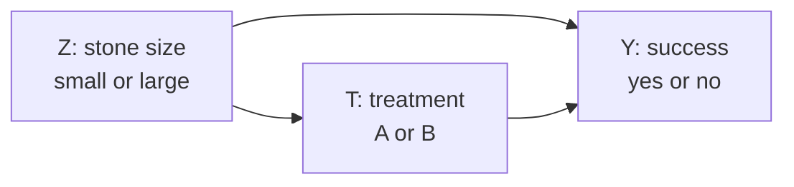
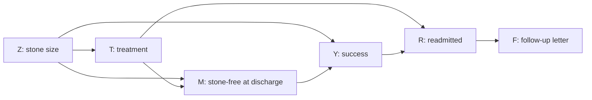

# Causal graphs: arrows for cause, and the back-door rule for which variables to adjust for

[Syllabus](../../../SYLLABUS.md) → [Probability and statistics](../README.md) → [Survival, Design and Causality](../README.md#s13) → Causal graphs

---

## General Overview

A 1986 hospital study compared two operations for kidney stones. Treatment A is open surgery. Treatment B is keyhole surgery through a small cut in the back. Doctors chose the operation; no lottery did. A succeeded for 273 of 350 patients, 78.0 percent. B succeeded for 289 of 350, 82.6 percent. B looks better by 4.6 points.

Split the patients by stone size and A wins in both groups. On small stones A succeeds 0.931 of the time against B's 0.867. On large stones A succeeds 0.730 against 0.688. Doctors sent most large, hard stones to open surgery: 263 of A's 350 patients had large stones, but only 80 of B's. Stone size pushed patients toward A and, separately, made success less likely.

[Confounding](07-confounding-and-simpsons-paradox.md) already explains that reversal and shows how to compare groups on a common mix. It leaves one question open: **which** variables should be held fixed? Holding the wrong one fixed can make the answer worse. This card answers the question with a picture.

The picture is a **causal graph**: one dot per variable, and an arrow from X to Y when X directly affects Y. A short rule read off the graph, the **back-door rule**, names the variables to adjust for. Here it names stone size, and the adjusted success rates are 83.3 percent for A and 77.9 percent for B. Had every patient received A, about 5.4 more in every 100 would have done well than if every patient had received B.

**Draw the causes as arrows, find every path from the treatment to the outcome that starts with an arrow into the treatment, and hold fixed a set of variables that blocks all of those paths while containing nothing the treatment causes; averaging the outcome over that set then gives what the treatment does.**

**What kind of fact this is:** a theorem, given the graph. For the three-dot graph the formula is proved on this card in Why it works; the general back-door rule is proved in *Causality*, chapter 3, and checked here on a six-dot model. The graph itself is an assumption about the world, which data alone cannot confirm.

### The picture: what the recorded data says about cause



Size points at the treatment because doctors chose by size. Size points at success because large stones are harder. The arrow from treatment to success is the effect the study wants. The path T ← Z → Y is the "back door": it links treatment and success through size, with no effect of the treatment in it.

---

## The formula

Notation first, in words. $`T`$ is the treatment, with value $`t`$ = A or B. $`Y`$ is the outcome: 1 for success, 0 for failure. $`Z`$ is stone size, with value $`z`$ = small or large. $`P(Y=1 \mid T=t, Z=z)`$ is the success rate among patients who got $`t`$ and had size $`z`$ ([Conditional probability](../01-Chance%20and%20Events/05-conditional-probability.md)).

The new symbol is $`\mathrm{do}(T=t)`$, read "set T to t". It means a world where someone forces every patient onto treatment $`t`$, whatever their size. $`P(Y=1 \mid \mathrm{do}(T=t))`$ is the success rate in that world. In the notation of [Randomised experiments](04-randomised-experiments-and-ab-tests.md), it is the share of patients whose potential outcome $`y_i(t)`$ is 1: what patient $`i`$ would show on treatment $`t`$.

```math
P(Y=1 \mid \mathrm{do}(T=t)) = \sum_z P(Y=1 \mid T=t,\, Z=z)\; P(Z=z)
```

**Read it aloud:** the success rate if everyone got treatment $`t`$ is the success rate seen on $`t`$ inside each size group, averaged with weights equal to each size group's share of all patients.

The formula is the standardised rate of [Confounding](07-confounding-and-simpsons-paradox.md). What is new is the license to use it. It is valid when the set $`Z`$ passes the **back-door rule** for the treatment $`T`$ and the outcome $`Y`$:

1. **Nothing in $`Z`$ is caused by $`T`$**, directly or down a chain of arrows. Such a variable is a **descendant** of $`T`$.
2. **$`Z`$ blocks every back-door path**: every path between $`T`$ and $`Y`$ whose first arrow points into $`T`$.

A **path** is any route along arrows, ignoring their direction, that visits no dot twice. Whether a set blocks a path depends on the shape at each dot along it, the **junctions** below. The **average treatment effect** is then $`\tau = P(Y=1 \mid \mathrm{do}(A)) - P(Y=1 \mid \mathrm{do}(B))`$.

### Three junctions, and what holding the middle fixed does

| Junction | Shape | The middle is a… | Path open when the middle is free? | Holding the middle fixed |
| --- | --- | --- | --- | --- |
| Fork | T ← Z → Y | **confounder**: a common cause | open: carries a false link | blocks it: adjust for it |
| Chain | T → M → Y | **mediator**: a step on the way | open: carries part of the effect | blocks it: removes that part of the effect |
| Collider | T → R ← Y | **collider**: a common result | blocked | opens it: creates a false link |

A set $`S`$ **blocks** a path if some junction on it is a fork or chain whose middle is in $`S`$, or a collider whose middle is outside $`S`$ and has no descendant in $`S`$. Two variables are **d-separated** by $`S`$ ("d" for directional) when $`S`$ blocks every path between them. The graph then promises that they are independent given $`S`$ ([Independence](../01-Chance%20and%20Events/07-independence.md)).

| Symbol | Plain meaning | In our example | Push it up and the answer… |
| --- | --- | --- | --- |
| $`T`$, $`t`$ | the treatment, and one of its values | A open surgery, B keyhole | — |
| $`Y`$ | the outcome: 1 success, 0 failure | 273 of A's 350 patients score 1 | — |
| $`Z`$, $`z`$ | stone size, and one of its values | small 357, large 343 patients | — |
| $`M`$ | stone-free at discharge, an invented mediator | chance 0.9655 for A on small stones | — |
| $`R`$, $`F`$ | readmitted to hospital, an invented collider; a follow-up letter to the family doctor, which readmission makes likelier | chance 0.50 for A after a failure; letter 0.90 after a readmission | — |
| $`S`$ | a set of variables held fixed | $`\{Z\}`$, $`\{Z, M\}`$, $`\{Z, R\}`$ | — |
| $`P(Y=1 \mid T=t, Z=z)`$ | success rate seen on $`t`$ at size $`z`$ | 0.931 for A, small | the adjusted rate for $`t`$ rises |
| $`P(Z=z)`$ | share of all patients with size $`z`$ | 0.510 small, 0.490 large | that size group counts more |
| $`\mathrm{do}(T=t)`$ | forcing every patient onto $`t`$: the arrow into $`T`$ is cut | — | — |
| $`P(Y=1 \mid \mathrm{do}(T=t))`$ | success rate if everyone got $`t`$ | 0.8325 for A, 0.7789 for B | — |
| $`y_i(t)`$ | potential outcome: patient $`i`$'s result on $`t`$ | seen for one treatment only | — |
| $`\tau`$ | average treatment effect, A minus B | +5.4 points | — |

### When it holds

- **The graph has every common cause of treatment and outcome.** If frailer patients were steered to keyhole surgery and also did worse, frailty is a second back-door path. Size alone no longer blocks it, and +5.4 points carries that bias. The table cannot show this.
- **No descendant of the treatment is held fixed.** Adjusting for size plus the invented mediator, stone-free at discharge, gives +0.0 points. Size plus the invented collider, readmission, gives +7.1 points.
- **Every size group got both treatments.** The formula needs $`P(Y=1 \mid T=t, Z=z)`$ for every $`z`$. With no small stones treated by A, that rate does not exist, and no formula can supply it. This is called **positivity**.
- **One patient's treatment does not change another's outcome.** The potential outcomes $`y_i(A)`$, $`y_i(B)`$ must be fixed facts about patient $`i`$, as in [Randomised experiments](04-randomised-experiments-and-ab-tests.md).
- **Each group is large enough to trust its rate.** The adjusted rate inherits the noise of every group's rate, and A's small-stone rate, 0.931, rests on only 87 patients.

---

## Why it works

### Step 0: forcing a treatment cuts the arrows into it

In the hospital, size chose the treatment. In the forced world, $`\mathrm{do}(T=t)`$, nobody looks at size; the arrow Z → T is gone. Everything else stays: large stones are still harder, and each operation still works as it did. The back-door formula rewrites the forced world using only rates seen in the real one.

### Step 1: a graph is a claim about how the joint chances factor

A causal graph claims that each variable depends only on its **parents**, the dots with arrows into it. The chance of a whole patient record is then a product, one factor per variable. For the three-dot graph:

```math
P(z, t, y) = P(z)\; P(t \mid z)\; P(y \mid t, z)
```

**Read it aloud:** first nature picks the stone size, then the doctor picks a treatment given the size, then the outcome follows from treatment and size.

This product is the multiplication rule from [Conditional probability](../01-Chance%20and%20Events/05-conditional-probability.md), taken in the order of the arrows. The order exists because a causal graph has no loop: nothing causes itself. [Directed graphs](../../04-Combinatorics%20and%20graphs/09-Graphs%20-%20Dots%20and%20Lines/06-directed-graphs-and-topological-order.md) proves that such a graph can be listed with every arrow pointing forward.

### Step 2: cut the arrow, then sum

Forcing $`T=t`$ replaces the doctor's factor $`P(t \mid z)`$ by 1 for the forced treatment and 0 for the other. The other two factors are unchanged, because the forced world keeps the same stones and the same operations. Add over sizes:

```math
P(Y=1 \mid \mathrm{do}(T=t)) = \sum_z P(z) \cdot 1 \cdot P(Y=1 \mid t, z)
```

That is the back-door formula. For A: 0.9310 × 357/700 + 0.7300 × 343/700 = 0.8325. For B: 0.8667 × 357/700 + 0.6875 × 343/700 = 0.7789.

The plain rate on A, by contrast, weights the size groups by A's own mix: 87/350 small and 263/350 large. That mix is heavy on large stones, so it drags A down to 0.780.

### Step 3: the three junctions, and why each behaves as it does

**A fork, T ← Z → Y.** Large stones make A likelier and success less likely, so A and failure travel together. Within one size, the factor $`P(t \mid z)`$ no longer depends on anything that touches $`Y`$; the false link disappears.

**A chain, T → M → Y.** Suppose open surgery works by clearing the stone fully before discharge, and clearing is what brings success. Among patients who left stone-free, the operation adds nothing further. Holding $`M`$ fixed hides exactly the effect the study wants.

**A collider, T → R ← Y.** Suppose open surgery and failure each make readmission likelier. Among readmitted patients, one who had keyhole surgery was probably readmitted for a failure. So holding readmission fixed links treatment to failure, adding a false link on top of the real effect. [Independence](../01-Chance%20and%20Events/07-independence.md) shows the same effect with two coins: learning "at least one head" makes two fair coins dependent.

**d-separation is these three rules applied to every junction on every path.** A path carries a link only if every junction on it lets it through. The theorem behind it: if $`S`$ d-separates two variables, they are independent given $`S`$ in every set of chances that factors as the graph says. Its proof is in *Causality*, chapter 1 (see Sources); this card checks it numerically instead.

### Step 4: a richer world to test the rule

The 1986 records hold only size, treatment and success. To test the rule on a mediator and a collider, the checks build a model world with three invented variables:

- $`M`$, stone-free at discharge. Success depends on the treatment only through $`M`$: 0.95 if stone-free, else 0.40 for small and 0.30 for large stones. The chance of leaving stone-free is solved so the model reproduces the recorded 2 × 2 × 2 table exactly: 0.9655 for A on small stones, 0.6616 for A on large, 0.8485 for B on small, 0.5962 for B on large.
- $`R`$, readmitted. After open surgery: 0.10 after a success, 0.50 after a failure. After keyhole surgery: 0.05 and 0.40.
- $`F`$, a follow-up letter to the family doctor. It goes to 0.90 of readmitted patients and 0.20 of the rest.



Eight arrows. The treatment reaches success only through $`M`$. Readmission is a common result of treatment and success, and the letter is a result of readmission: a descendant of the collider.

The graph's promises were checked against the model's chances. For each of the 15 pairs of variables and each of the 16 sets of the other four, the checks ask the graph "separated or connected?" and ask the numbers "independent or not?". Of the 240 statements, the graph calls 45 separated. The numbers agree on all 240. Seven of them:

| Pair | Held fixed | Graph says | Largest gap in the numbers |
| --- | --- | --- | --- |
| T and Y | nothing | connected | 0.011429 |
| T and Y | Z | connected, through M | 0.003086 |
| T and Y | Z, M | separated | 0.000000 |
| T and Y | Z, M, R | connected: the collider R is opened | 0.000121 |
| T and Y | Z, M, F | connected: F is a descendant of the collider R | 0.000066 |
| Z and R | T | connected, through Y | 0.003754 |
| Z and R | T, Y | separated | 0.000000 |

The "largest gap" is the biggest value of $`|P(a, b, s)\,P(s) - P(a, s)\,P(b, s)|`$ over every value of the pair $`a, b`$ and the held set $`s`$. It is zero exactly when the pair is independent given the set. The letter row tests the last clause of the blocking rule: holding a collider's descendant fixed opens the path through the collider, here more weakly than holding the collider itself.

### Step 5: why the back-door rule's two conditions are both needed

Each blocked back-door path removes a false link. Condition 2 removes all of them. Condition 1 keeps the adjustment from cutting a real effect or opening a new false link. The proof uses the potential outcomes of [Randomised experiments](04-randomised-experiments-and-ab-tests.md).

<details>
<summary>Detailed proof: the back-door rule gives the forced-world rate</summary>

Write $`Y(t)`$ for a patient's potential outcome on treatment $`t`$. Three facts carry the proof.

1. **Consistency.** A patient who got $`t`$ shows $`Y(t)`$. So among patients with $`T=t`$, the events $`Y(t)=1`$ and $`Y=1`$ are the same.
2. **Exchangeability given $`Z`$.** If $`Z`$ passes the back-door rule, then $`Y(t)`$ is independent of $`T`$ given $`Z`$. This is the graphical step, proved in *Causality*, chapter 3, and in *What If*, chapter 7 (see Sources). In words: once size is fixed, nothing left that steered the doctor also predicts the patient's result.
3. **Positivity.** Every size group has patients on both treatments, so each rate below exists.

Now split by size (the law of total probability), apply fact 2, then fact 1:

$`\displaystyle P(Y(t)=1) = \sum_z P(Y(t)=1 \mid Z=z)\,P(z) = \sum_z P(Y(t)=1 \mid T=t, Z=z)\,P(z) = \sum_z P(Y=1 \mid T=t, Z=z)\,P(z).`$

The left side is the forced-world rate $`P(Y=1 \mid \mathrm{do}(T=t))`$.

Why condition 1 matters: a descendant of $`T`$ is partly a result of the treatment. Holding a mediator fixed compares patients with equal stone clearance, which removes the path T → M → Y. Holding a collider fixed opens T → R ← Y, a new false link. Either way, fact 2 fails for that set.

</details>

The checks test the rule on all 8 sets that can be built from $`M`$, $`Z`$ and $`R`$. Each set gets the adjustment formula with that set in place of $`Z`$. The rule picks only $`\{Z\}`$, and only $`\{Z\}`$ recovers the true +5.4 points:

```
set held  negative |positive    gap, points
none      █████████|                -4.6
Z                  |███████████     +5.4
M                ██|                -1.2
Z, M               |                +0.0
R                ██|                -0.9
Z, R               |██████████████  +7.1
M, R               |█               +0.6
Z, M, R            |███             +1.6
```

One bar per set; each block is half a point. Only the Z bar, +5.4, is the true effect. Adding the mediator to Z drops it to 0.0; adding the collider pushes it to +7.1; holding nothing fixed gives −4.6.

---

## Worked numbers, by hand

The recorded counts, adjusting for stone size.

| Step | Arithmetic | Value |
| --- | --- | --- |
| size shares | 357 small and 343 large, of 700 | 0.510 and 0.490 |
| A, small stones | 81 of 87 | 0.9310 |
| A, large stones | 192 of 263 | 0.7300 |
| B, small stones | 234 of 270 | 0.8667 |
| B, large stones | 55 of 80 | 0.6875 |
| A, plain rate | 273 of 350 | 0.780 |
| B, plain rate | 289 of 350 | 0.826 |
| A, adjusted | 0.9310 × 357/700 + 0.7300 × 343/700 | 0.8325 |
| B, adjusted | 0.8667 × 357/700 + 0.6875 × 343/700 | 0.7789 |
| **effect, A minus B** | 0.8325 − 0.7789 | **+5.4 points** |

If the graph is right, open surgery would have succeeded for about 5 more patients in every 100 than keyhole surgery, the reverse of the plain comparison.

### What breaks if you drop a piece

| Mistake | Comes out at | What went wrong |
| --- | --- | --- |
| Hold nothing fixed | −4.6 points | The back door T ← Z → Y stays open |
| Hold size and stone-free at discharge | +0.0 points | Stone-free is a mediator; holding it removes the whole effect |
| Hold size and readmission | +7.1 points | Readmission is a collider; holding it opens T → R ← Y |
| Hold everything recorded: size, stone-free, readmission | +1.6 points | Both errors at once |

The last three rows use the model world of Step 4; the code prints every row.

---

## Code, from first principles, and it actually runs

Nothing is imported except the loop helper `product` in Python. The checks take five roads to the effect and the rule. The back-door formula runs on the recorded counts. The model world is enumerated exactly with the arrow into the treatment cut. A seeded randomised trial of 200,000 patients is run inside that model. d-separation is read from the graph for 240 statements and compared with independence computed from the model's chances. The back-door rule is compared with the bias of all 8 adjustment sets. Random numbers come from SplitMix64, a small generator written out in both languages, with seed 20261123, so both print the same digits. The simulated gap is asserted within four standard errors of the target, never exactly.

### Python

```python
# Causal graphs and back-door adjustment -- the check behind the card.  Standard
# library only.  Data: kidney-stone treatments A (open surgery) and B (keyhole surgery),
# cures by stone size (Charig et al., BMJ, 1986).  Three variables are invented for
# the lesson: M, stone-free at discharge, R, readmitted, and F, a follow-up letter;
# they leave the size-treatment-cure table exactly as recorded.
# Roads: the back-door formula on the counts; the cut-graph model enumerated
# exactly; a seeded randomised trial in that model; d-separation read from the
# graph against independence computed from the numbers; the back-door rule
# against the bias of every possible adjustment set.
from itertools import product

N_ = ["Z", "T", "M", "Y", "R", "F"]               # size, treatment, stone-free, cured, readmitted, follow-up letter
ARROWS = [(0, 1), (0, 2), (0, 3), (1, 2), (2, 3), (1, 4), (3, 4), (4, 5)]
CURE = {(0, 0): (81, 87), (0, 1): (192, 263), (1, 0): (234, 270), (1, 1): (55, 80)}  # (t, z): cured, n
NZ = [sum(CURE[(t, z)][1] for t in (0, 1)) for z in (0, 1)]; TOT = sum(NZ)
p = {k: c / n for k, (c, n) in CURE.items()}
print("treatment  size   cured/n  rate")
for (t, z), (c, n) in CURE.items():
    print(f"{'AB'[t]:<10} {['small', 'large'][z]:<6} {c:>3}/{n:<3}  {c / n:.3f}")
cn = [[sum(CURE[(t, z)][i] for z in (0, 1)) for i in (0, 1)] for t in (0, 1)]
naive = [c / n for c, n in cn]
print(f"pooled: A {cn[0][0]}/{cn[0][1]} = {naive[0]:.3f}, B {cn[1][0]}/{cn[1][1]} = {naive[1]:.3f}, gap A-B {100 * (naive[0] - naive[1]):+.1f} points; "
      f"size shares small {NZ[0]}/{TOT} = {NZ[0] / TOT:.3f}, large {NZ[1]}/{TOT} = {NZ[1] / TOT:.3f}")
# Road 1: the back-door formula on the counts, adjusting for size
adj = [sum(p[(t, z)] * NZ[z] / TOT for z in (0, 1)) for t in (0, 1)]
for t in (0, 1):
    print(f"back-door, {'AB'[t]}: {p[(t, 0)]:.4f} x {NZ[0]}/{TOT} + {p[(t, 1)]:.4f} x {NZ[1]}/{TOT} = {adj[t]:.4f} ({100 * adj[t]:.1f}%)")
TRUE_GAP = adj[0] - adj[1]
print(f"adjusted gap A-B {100 * TRUE_GAP:+.1f} points")

# The model: P(z) P(t|z) P(m|t,z) P(y|m,z) P(r|t,y).  Cure depends on treatment only through M.
H, L, PF = 0.95, [0.40, 0.30], [0.20, 0.90]        # P(cured | stone-free); P(cured | not), by size; P(letter | r)
PM = {(t, z): (p[(t, z)] - L[z]) / (H - L[z]) for t in (0, 1) for z in (0, 1)}
PR = {(0, 1): 0.10, (0, 0): 0.50, (1, 1): 0.05, (1, 0): 0.40}   # (t, y): P(readmitted)
print(f"model inputs: P(cured | stone-free) {H:.2f}; P(cured | not) small {L[0]:.2f}, large {L[1]:.2f}; "
      f"P(readmitted | cured, not): A {PR[(0, 1)]:.2f}, {PR[(0, 0)]:.2f}; B {PR[(1, 1)]:.2f}, {PR[(1, 0)]:.2f}; "
      f"P(follow-up letter | readmitted, not) {PF[1]:.2f}, {PF[0]:.2f}")
print("model, P(stone-free | t, z): " + ", ".join(f"{'AB'[t]} {['small', 'large'][z]} {PM[(t, z)]:.4f}" for t, z in PM))
def bern(q, v): return q if v else 1 - q
def joint(force=None):                             # force=t cuts the arrow into T and sets it
    out = {}
    for z, t, m, y, r, f in product((0, 1), repeat=6):
        pt = CURE[(t, z)][1] / NZ[z] if force is None else float(t == force)
        out[(z, t, m, y, r, f)] = (NZ[z] / TOT * pt * bern(PM[(t, z)], m)
                                   * bern(H if m else L[z], y) * bern(PR[(t, y)], r) * bern(PF[r], f))
    return out
J = joint()
def P(fix, J=J): return sum(q for k, q in J.items() if all(k[i] == v for i, v in fix.items()))
for t, z in CURE:                                  # the model reproduces the recorded table
    assert abs(P({1: t, 0: z, 3: 1}) / P({1: t, 0: z}) - p[(t, z)]) < 1e-12
do = [P({3: 1}, joint(t)) for t in (0, 1)]         # Road 2: the cut graph, enumerated
print(f"cut graph: P(cured | do A) {do[0]:.4f}, P(cured | do B) {do[1]:.4f}")
assert abs(do[0] - adj[0]) < 1e-12 and abs(do[1] - adj[1]) < 1e-12

# Road 3: a randomised trial in the model world, SplitMix64
M64, state = (1 << 64) - 1, 20261123
def uniform():
    global state
    state = (state + 0x9E3779B97F4A7C15) & M64
    z = state
    z = ((z ^ (z >> 30)) * 0xBF58476D1CE4E5B9) & M64
    z = ((z ^ (z >> 27)) * 0x94D049BB133111EB) & M64
    return ((z ^ (z >> 31)) >> 11) / 9007199254740992.0
NSIM, seed = 200000, state
cnt = [[0, 0], [0, 0]]                             # [t] = [cured, n]
for _ in range(NSIM):
    z = 1 if uniform() < NZ[1] / TOT else 0
    t = 1 if uniform() < 0.5 else 0
    m = 1 if uniform() < PM[(t, z)] else 0
    cnt[t][0] += 1 if uniform() < (H if m else L[z]) else 0
    cnt[t][1] += 1
sim = [c / n for c, n in cnt]
se = (sum(r * (1 - r) / c[1] for r, c in zip(sim, cnt))) ** 0.5
print(f"trial: seed {seed}, {NSIM} patients by coin; A {cnt[0][0]}/{cnt[0][1]} = {sim[0]:.4f}, "
      f"B {cnt[1][0]}/{cnt[1][1]} = {sim[1]:.4f}, gap {100 * (sim[0] - sim[1]):+.2f} points (SE {100 * se:.2f})")
assert abs(sim[0] - sim[1] - TRUE_GAP) < 4 * se

# Road 4: d-separation from the graph, against independence in the numbers
def desc(v):
    out, todo = set(), [v]
    while todo:
        for a, b in ARROWS:
            if a == todo[-1] and b not in out:
                out.add(b); todo.append(b); break
        else:
            todo.pop()
    return out
def paths(a, b, seen):                             # every simple path, ignoring direction
    if a == b:
        yield seen; return
    for u, v in ARROWS:
        for x, y in ((u, v), (v, u)):
            if x == a and y not in seen:
                yield from paths(y, b, seen + [y])
def blocked(path, S):
    for i in range(1, len(path) - 1):
        v = path[i]
        if (path[i - 1], v) in ARROWS and (path[i + 1], v) in ARROWS:   # a collider
            if v not in S and not (desc(v) & S): return True
        elif v in S: return True
    return False
def dsep(a, b, S): return all(blocked(q, S) for q in paths(a, b, [a]))
def gap_ci(a, b, S):                               # largest |P(a,b,s)P(s) - P(a,s)P(b,s)|
    g = 0.0
    for vals in product((0, 1), repeat=len(S) + 2):
        s = dict(zip(sorted(S), vals[2:]))
        g = max(g, abs(P({a: vals[0], b: vals[1], **s}) * P(s) - P({a: vals[0], **s}) * P({b: vals[1], **s})))
    return g
n_st = n_sep = 0
for a in range(6):
    for b in range(a + 1, 6):
        rest = [v for v in range(6) if v not in (a, b)]
        for k in range(16):
            S = {rest[i] for i in range(4) if k >> i & 1}
            sep, g = dsep(a, b, S), gap_ci(a, b, S)
            assert sep == (g < 1e-12)              # the graph rule against the numbers
            n_st += 1; n_sep += sep
print(f"d-separation: {n_st} statements, {n_sep} separated by the graph; numbers agree on all {n_st}")
for a, b, S in ((1, 3, set()), (1, 3, {0}), (1, 3, {0, 2}), (1, 3, {0, 2, 4}), (1, 3, {0, 2, 5}), (0, 4, {1}), (0, 4, {1, 3})):
    nm = "{" + ", ".join(N_[v] for v in sorted(S)) + "}"
    print(f"  {N_[a]} vs {N_[b]} given {nm:<10} graph: {'separated' if dsep(a, b, S) else 'connected':<9}  largest gap {gap_ci(a, b, S):.6f}")

# Road 5: the back-door rule against the bias of every adjustment set
def backdoor(S):
    return not (desc(1) & S) and all(blocked(q, S) for q in paths(1, 3, [1]) if (q[1], 1) in ARROWS)
bars = []
for k in range(8):
    S = sorted({[0, 2, 4][i] for i in range(3) if k >> i & 1})
    est = [sum(P({1: t, 3: 1, **dict(zip(S, v))}) / P({1: t, **dict(zip(S, v))}) * P(dict(zip(S, v)))
               for v in product((0, 1), repeat=len(S))) for t in (0, 1)]
    ok = backdoor(set(S))
    assert ok == (abs(est[0] - est[1] - TRUE_GAP) < 1e-12)
    bars.append(round(100 * (est[0] - est[1]), 9) + 0.0)
    nm = "{" + ", ".join(N_[v] for v in S) + "}"
    print(f"adjust for {nm:<10} A {est[0]:.4f}  B {est[1]:.4f}  gap {bars[-1]:+5.1f}  back-door {'yes' if ok else 'no'}")
assert abs(bars[0] - 100 * (naive[0] - naive[1])) < 1e-9   # holding nothing fixed gives the pooled gap
assert naive[0] < naive[1] and adj[0] > adj[1]                 # the reversal: B ahead pooled, A ahead adjusted
assert abs(bars[3]) < 1e-9                         # holding the mediator fixed erases the whole effect
print("bars, gap A-B in points: " + ", ".join(f"{b:.1f}" for b in bars))
print("ALL CHECKS PASS")
```

**Ran 2026-11-23 on macOS, Python 3.14.10, standard library only. All checks passed. Output, pasted from the run:**

```
treatment  size   cured/n  rate
A          small   81/87   0.931
A          large  192/263  0.730
B          small  234/270  0.867
B          large   55/80   0.688
pooled: A 273/350 = 0.780, B 289/350 = 0.826, gap A-B -4.6 points; size shares small 357/700 = 0.510, large 343/700 = 0.490
back-door, A: 0.9310 x 357/700 + 0.7300 x 343/700 = 0.8325 (83.3%)
back-door, B: 0.8667 x 357/700 + 0.6875 x 343/700 = 0.7789 (77.9%)
adjusted gap A-B +5.4 points
model inputs: P(cured | stone-free) 0.95; P(cured | not) small 0.40, large 0.30; P(readmitted | cured, not): A 0.10, 0.50; B 0.05, 0.40; P(follow-up letter | readmitted, not) 0.90, 0.20
model, P(stone-free | t, z): A small 0.9655, A large 0.6616, B small 0.8485, B large 0.5962
cut graph: P(cured | do A) 0.8325, P(cured | do B) 0.7789
trial: seed 20261123, 200000 patients by coin; A 83377/100199 = 0.8321, B 77661/99801 = 0.7782, gap +5.40 points (SE 0.18)
d-separation: 240 statements, 45 separated by the graph; numbers agree on all 240
  T vs Y given {}         graph: connected  largest gap 0.011429
  T vs Y given {Z}        graph: connected  largest gap 0.003086
  T vs Y given {Z, M}     graph: separated  largest gap 0.000000
  T vs Y given {Z, M, R}  graph: connected  largest gap 0.000121
  T vs Y given {Z, M, F}  graph: connected  largest gap 0.000066
  Z vs R given {T}        graph: connected  largest gap 0.003754
  Z vs R given {T, Y}     graph: separated  largest gap 0.000000
adjust for {}         A 0.7800  B 0.8257  gap  -4.6  back-door no
adjust for {Z}        A 0.8325  B 0.7789  gap  +5.4  back-door yes
adjust for {M}        A 0.7974  B 0.8098  gap  -1.2  back-door no
adjust for {Z, M}     A 0.8029  B 0.8029  gap  +0.0  back-door no
adjust for {R}        A 0.7973  B 0.8061  gap  -0.9  back-door no
adjust for {Z, R}     A 0.8380  B 0.7668  gap  +7.1  back-door no
adjust for {M, R}     A 0.8050  B 0.7992  gap  +0.6  back-door no
adjust for {Z, M, R}  A 0.8100  B 0.7938  gap  +1.6  back-door no
bars, gap A-B in points: -4.6, 5.4, -1.2, 0.0, -0.9, 7.1, 0.6, 1.6
ALL CHECKS PASS
```

### Rust

Same numbers, same labels, built with `rustc --edition 2021 -O`.

```rust
// Causal graphs and back-door adjustment -- the same check as the Python, in Rust.
// No crates.  Data: kidney-stone cures by treatment and stone size (Charig et al.,
// BMJ, 1986); M (stone-free), R (readmitted) and F (follow-up letter) are invented; they keep that table.
// Roads: back-door formula; cut graph enumerated; seeded randomised trial;
// d-separation against the numbers; the back-door rule against every adjustment set.
const NAMES: [&str; 6] = ["Z", "T", "M", "Y", "R", "F"]; // size, treatment, stone-free, cured, readmitted, follow-up letter
const ARROWS: [(usize, usize); 8] = [(0, 1), (0, 2), (0, 3), (1, 2), (2, 3), (1, 4), (3, 4), (4, 5)];
const CURE: [[(f64, f64); 2]; 2] = [[(81.0, 87.0), (192.0, 263.0)], [(234.0, 270.0), (55.0, 80.0)]]; // [t][z]
const H: f64 = 0.95; const L: [f64; 2] = [0.40, 0.30]; // P(cured | stone-free); P(cured | not stone-free), by size
const PR: [[f64; 2]; 2] = [[0.50, 0.10], [0.40, 0.05]]; const PF: [f64; 2] = [0.20, 0.90]; // [t][y]: P(readmitted); [r]: P(letter)
const AB: [&str; 2] = ["A", "B"]; const SIZE: [&str; 2] = ["small", "large"];

fn bern(q: f64, v: usize) -> f64 { if v == 1 { q } else { 1.0 - q } }
fn bit(k: usize, i: usize) -> usize { (k >> i) & 1 }

struct Model { nz: [f64; 2], tot: f64, pm: [[f64; 2]; 2] }
impl Model {
    fn joint(&self, force: Option<usize>) -> [f64; 64] { // index bits: Z T M Y R F; force cuts the arrow into T
        let mut j = [0.0; 64];
        for k in 0..64 {
            let (z, t, m, y, r, f) = (bit(k, 0), bit(k, 1), bit(k, 2), bit(k, 3), bit(k, 4), bit(k, 5));
            let pt = match force { None => CURE[t][z].1 / self.nz[z], Some(f) => if t == f { 1.0 } else { 0.0 } };
            j[k] = self.nz[z] / self.tot * pt * bern(self.pm[t][z], m)
                * bern(if m == 1 { H } else { L[z] }, y) * bern(PR[t][y], r) * bern(PF[r], f);
        }
        j
    }
}
fn prob(j: &[f64; 64], fix: &[(usize, usize)]) -> f64 {
    (0..64).filter(|&k| fix.iter().all(|&(i, v)| bit(k, i) == v)).map(|k| j[k]).sum()
}
fn desc(v: usize) -> Vec<usize> {
    let (mut out, mut todo) = (Vec::new(), vec![v]);
    while let Some(&top) = todo.last() {
        match ARROWS.iter().find(|&&(a, b)| a == top && !out.contains(&b)) {
            Some(&(_, b)) => { out.push(b); todo.push(b) }
            None => { todo.pop(); }
        }
    }
    out
}
fn paths(a: usize, b: usize, seen: Vec<usize>, out: &mut Vec<Vec<usize>>) { // every simple path, ignoring direction
    if a == b { out.push(seen); return }
    for &(u, v) in ARROWS.iter() {
        for (x, y) in [(u, v), (v, u)] {
            if x == a && !seen.contains(&y) { let mut s = seen.clone(); s.push(y); paths(y, b, s, out) }
        }
    }
}
fn all_paths(a: usize, b: usize) -> Vec<Vec<usize>> { let mut o = vec![]; paths(a, b, vec![a], &mut o); o }
fn blocked(path: &[usize], s: &[usize]) -> bool {
    for i in 1..path.len() - 1 {
        let v = path[i];
        if ARROWS.contains(&(path[i - 1], v)) && ARROWS.contains(&(path[i + 1], v)) { // a collider
            if !s.contains(&v) && !desc(v).iter().any(|d| s.contains(d)) { return true }
        } else if s.contains(&v) { return true }
    }
    false
}
fn dsep(a: usize, b: usize, s: &[usize]) -> bool { all_paths(a, b).iter().all(|q| blocked(q, s)) }
fn gap_ci(j: &[f64; 64], a: usize, b: usize, s: &[usize]) -> f64 { // largest |P(a,b,s)P(s) - P(a,s)P(b,s)|
    let mut g: f64 = 0.0;
    for k in 0..(1usize << (s.len() + 2)) {
        let fs: Vec<(usize, usize)> = s.iter().enumerate().map(|(i, &v)| (v, bit(k, i + 2))).collect();
        let with = |extra: &[(usize, usize)]| { let mut f = fs.clone(); f.extend_from_slice(extra); prob(j, &f) };
        g = g.max((with(&[(a, bit(k, 0)), (b, bit(k, 1))]) * with(&[]) - with(&[(a, bit(k, 0))]) * with(&[(b, bit(k, 1))])).abs());
    }
    g
}
fn setname(s: &[usize]) -> String { format!("{{{}}}", s.iter().map(|&v| NAMES[v]).collect::<Vec<_>>().join(", ")) }

struct Rng(u64); // SplitMix64
impl Rng {
    fn uniform(&mut self) -> f64 {
        self.0 = self.0.wrapping_add(0x9E3779B97F4A7C15);
        let mut z = self.0;
        z = (z ^ (z >> 30)).wrapping_mul(0xBF58476D1CE4E5B9);
        z = (z ^ (z >> 27)).wrapping_mul(0x94D049BB133111EB);
        ((z ^ (z >> 31)) >> 11) as f64 / 9007199254740992.0
    }
}

fn main() {
    let nz = [CURE[0][0].1 + CURE[1][0].1, CURE[0][1].1 + CURE[1][1].1];
    let tot = nz[0] + nz[1];
    let p = |t: usize, z: usize| CURE[t][z].0 / CURE[t][z].1;
    println!("treatment  size   cured/n  rate");
    for k in 0..4 { let (t, z) = (k / 2, k % 2);
        println!("{:<10} {:<6} {:>3}/{:<3}  {:.3}", AB[t], SIZE[z], CURE[t][z].0, CURE[t][z].1, p(t, z)) }
    let cn: Vec<[f64; 2]> = (0..2).map(|t| [CURE[t][0].0 + CURE[t][1].0, CURE[t][0].1 + CURE[t][1].1]).collect();
    let naive = [cn[0][0] / cn[0][1], cn[1][0] / cn[1][1]];
    println!("pooled: A {}/{} = {:.3}, B {}/{} = {:.3}, gap A-B {:+.1} points; size shares small {}/{} = {:.3}, large {}/{} = {:.3}",
             cn[0][0], cn[0][1], naive[0], cn[1][0], cn[1][1], naive[1], 100.0 * (naive[0] - naive[1]), nz[0], tot, nz[0] / tot, nz[1], tot, nz[1] / tot);
    // Road 1: the back-door formula on the counts, adjusting for size
    let adj: Vec<f64> = (0..2).map(|t| p(t, 0) * nz[0] / tot + p(t, 1) * nz[1] / tot).collect();
    for t in 0..2 { println!("back-door, {}: {:.4} x {}/{} + {:.4} x {}/{} = {:.4} ({:.1}%)", AB[t], p(t, 0), nz[0], tot,
                             p(t, 1), nz[1], tot, adj[t], 100.0 * adj[t]) }
    let true_gap = adj[0] - adj[1];
    println!("adjusted gap A-B {:+.1} points", 100.0 * true_gap);
    // The model: P(z) P(t|z) P(m|t,z) P(y|m,z) P(r|t,y).  Cure depends on treatment only through M.
    let mut pm = [[0.0; 2]; 2];
    for t in 0..2 { for z in 0..2 { pm[t][z] = (p(t, z) - L[z]) / (H - L[z]) } }
    let model = Model { nz, tot, pm };
    println!("model inputs: P(cured | stone-free) {:.2}; P(cured | not) small {:.2}, large {:.2}; P(readmitted | cured, not): A {:.2}, {:.2}; B {:.2}, {:.2}; \
              P(follow-up letter | readmitted, not) {:.2}, {:.2}", H, L[0], L[1], PR[0][1], PR[0][0], PR[1][1], PR[1][0], PF[1], PF[0]);
    let parts: Vec<String> = (0..4).map(|k| format!("{} {} {:.4}", AB[k / 2], SIZE[k % 2], pm[k / 2][k % 2])).collect();
    println!("model, P(stone-free | t, z): {}", parts.join(", "));
    let j = model.joint(None);
    for k in 0..4 { let (t, z) = (k / 2, k % 2); // the model reproduces the recorded table
        assert!((prob(&j, &[(1, t), (0, z), (3, 1)]) / prob(&j, &[(1, t), (0, z)]) - p(t, z)).abs() < 1e-12) }
    // Road 2: the cut graph, enumerated
    let d: Vec<f64> = (0..2).map(|t| prob(&model.joint(Some(t)), &[(3, 1)])).collect();
    println!("cut graph: P(cured | do A) {:.4}, P(cured | do B) {:.4}", d[0], d[1]);
    assert!((d[0] - adj[0]).abs() < 1e-12 && (d[1] - adj[1]).abs() < 1e-12);
    // Road 3: a randomised trial in the model world, SplitMix64
    let mut rng = Rng(20261123);
    let (nsim, seed) = (200000, rng.0);
    let mut cnt = [[0.0f64; 2]; 2]; // [t] = [cured, n]
    for _ in 0..nsim {
        let z = if rng.uniform() < nz[1] / tot { 1 } else { 0 };
        let t = if rng.uniform() < 0.5 { 1 } else { 0 };
        let m = if rng.uniform() < pm[t][z] { 1 } else { 0 };
        if rng.uniform() < (if m == 1 { H } else { L[z] }) { cnt[t][0] += 1.0 }
        cnt[t][1] += 1.0;
    }
    let sim = [cnt[0][0] / cnt[0][1], cnt[1][0] / cnt[1][1]];
    let se = (sim[0] * (1.0 - sim[0]) / cnt[0][1] + sim[1] * (1.0 - sim[1]) / cnt[1][1]).sqrt();
    println!("trial: seed {}, {} patients by coin; A {}/{} = {:.4}, B {}/{} = {:.4}, gap {:+.2} points (SE {:.2})",
             seed, nsim, cnt[0][0], cnt[0][1], sim[0], cnt[1][0], cnt[1][1], sim[1], 100.0 * (sim[0] - sim[1]), 100.0 * se);
    assert!((sim[0] - sim[1] - true_gap).abs() < 4.0 * se);
    // Road 4: d-separation from the graph, against independence in the numbers
    let (mut n_st, mut n_sep) = (0, 0);
    for a in 0..6 { for b in a + 1..6 {
        let rest: Vec<usize> = (0..6).filter(|&v| v != a && v != b).collect();
        for k in 0..16 {
            let s: Vec<usize> = (0..4).filter(|&i| bit(k, i) == 1).map(|i| rest[i]).collect();
            let sep = dsep(a, b, &s);
            assert!(sep == (gap_ci(&j, a, b, &s) < 1e-12)); // the graph rule against the numbers
            n_st += 1; n_sep += sep as usize;
        }
    } }
    println!("d-separation: {} statements, {} separated by the graph; numbers agree on all {}", n_st, n_sep, n_st);
    let shows: [(usize, usize, &[usize]); 7] = [(1, 3, &[]), (1, 3, &[0]), (1, 3, &[0, 2]), (1, 3, &[0, 2, 4]), (1, 3, &[0, 2, 5]), (0, 4, &[1]), (0, 4, &[1, 3])];
    for (a, b, s) in shows {
        println!("  {} vs {} given {:<10} graph: {:<9}  largest gap {:.6}", NAMES[a], NAMES[b], setname(s),
                 if dsep(a, b, s) { "separated" } else { "connected" }, gap_ci(&j, a, b, s));
    }
    // Road 5: the back-door rule against the bias of every adjustment set
    let backdoor = |s: &[usize]| !desc(1).iter().any(|v| s.contains(v))
        && all_paths(1, 3).iter().filter(|q| ARROWS.contains(&(q[1], 1))).all(|q| blocked(q, s));
    let mut bars = Vec::new();
    for k in 0..8 {
        let s: Vec<usize> = (0..3).filter(|&i| bit(k, i) == 1).map(|i| [0, 2, 4][i]).collect();
        let est: Vec<f64> = (0..2).map(|t| (0..(1usize << s.len())).map(|c| {
            let fs: Vec<(usize, usize)> = s.iter().enumerate().map(|(i, &v)| (v, bit(c, i))).collect();
            let mut num = fs.clone(); num.extend([(1, t), (3, 1)]);
            let mut den = fs.clone(); den.push((1, t));
            prob(&j, &num) / prob(&j, &den) * prob(&j, &fs)
        }).sum()).collect();
        let ok = backdoor(&s); assert!(ok == ((est[0] - est[1] - true_gap).abs() < 1e-12));
        bars.push((100.0 * (est[0] - est[1]) * 1e9).round() / 1e9 + 0.0);
        println!("adjust for {:<10} A {:.4}  B {:.4}  gap {:+5.1}  back-door {}", setname(&s), est[0], est[1],
                 bars[k], if ok { "yes" } else { "no" });
    }
    assert!((bars[0] - 100.0 * (naive[0] - naive[1])).abs() < 1e-9); // holding nothing fixed gives the pooled gap
    assert!(naive[0] < naive[1] && adj[0] > adj[1]); // the reversal: B ahead pooled, A ahead adjusted
    assert!(bars[3].abs() < 1e-9); // holding the mediator fixed erases the whole effect
    println!("bars, gap A-B in points: {}", bars.iter().map(|b| format!("{:.1}", b)).collect::<Vec<_>>().join(", "));
    println!("ALL CHECKS PASS");
}
```

**Ran 2026-11-23 on macOS, rustc 1.98.1, no crates. All checks passed. Output, pasted from the run:**

```
treatment  size   cured/n  rate
A          small   81/87   0.931
A          large  192/263  0.730
B          small  234/270  0.867
B          large   55/80   0.688
pooled: A 273/350 = 0.780, B 289/350 = 0.826, gap A-B -4.6 points; size shares small 357/700 = 0.510, large 343/700 = 0.490
back-door, A: 0.9310 x 357/700 + 0.7300 x 343/700 = 0.8325 (83.3%)
back-door, B: 0.8667 x 357/700 + 0.6875 x 343/700 = 0.7789 (77.9%)
adjusted gap A-B +5.4 points
model inputs: P(cured | stone-free) 0.95; P(cured | not) small 0.40, large 0.30; P(readmitted | cured, not): A 0.10, 0.50; B 0.05, 0.40; P(follow-up letter | readmitted, not) 0.90, 0.20
model, P(stone-free | t, z): A small 0.9655, A large 0.6616, B small 0.8485, B large 0.5962
cut graph: P(cured | do A) 0.8325, P(cured | do B) 0.7789
trial: seed 20261123, 200000 patients by coin; A 83377/100199 = 0.8321, B 77661/99801 = 0.7782, gap +5.40 points (SE 0.18)
d-separation: 240 statements, 45 separated by the graph; numbers agree on all 240
  T vs Y given {}         graph: connected  largest gap 0.011429
  T vs Y given {Z}        graph: connected  largest gap 0.003086
  T vs Y given {Z, M}     graph: separated  largest gap 0.000000
  T vs Y given {Z, M, R}  graph: connected  largest gap 0.000121
  T vs Y given {Z, M, F}  graph: connected  largest gap 0.000066
  Z vs R given {T}        graph: connected  largest gap 0.003754
  Z vs R given {T, Y}     graph: separated  largest gap 0.000000
adjust for {}         A 0.7800  B 0.8257  gap  -4.6  back-door no
adjust for {Z}        A 0.8325  B 0.7789  gap  +5.4  back-door yes
adjust for {M}        A 0.7974  B 0.8098  gap  -1.2  back-door no
adjust for {Z, M}     A 0.8029  B 0.8029  gap  +0.0  back-door no
adjust for {R}        A 0.7973  B 0.8061  gap  -0.9  back-door no
adjust for {Z, R}     A 0.8380  B 0.7668  gap  +7.1  back-door no
adjust for {M, R}     A 0.8050  B 0.7992  gap  +0.6  back-door no
adjust for {Z, M, R}  A 0.8100  B 0.7938  gap  +1.6  back-door no
bars, gap A-B in points: -4.6, 5.4, -1.2, 0.0, -0.9, 7.1, 0.6, 1.6
ALL CHECKS PASS
```

The two outputs match line for line.

### Lean

Lean proves two results for any finite tables of chances, and checks the kidney-stone numbers as exact fractions.

- Take any chances that factor as in Step 1, with every size group getting every treatment. Then the forced-world rate equals the back-door formula, built only from the recorded chances.
- Take a graph where the treatment reaches success only through a mediator, and every size and mediator group got every treatment. Then holding size and the mediator fixed gives every treatment the same adjusted rate: a gap of zero.
- The four groups add up to the totals: 273 of 350 cured on A, 289 of 350 on B, 357 small and 343 large.
- The plain rate on A weights the size groups by A's own mix: 87/350 small and 263/350 large.
- The adjusted rates round to 0.8325 for A and 0.7789 for B.
- B leads on the plain rates, and A leads by 5.4 points after adjusting for size.

The general back-door rule, d-separation, the readmission collider and the simulated trial are left to the Python and Rust checks.

```lean
-- Causal graphs: in the three-dot graph Z → T, Z → Y, T → Y, cutting the arrow into the treatment gives exactly the back-door formula, holding a mediator fixed erases the whole effect, and the 1986 kidney-stone counts adjust to 83.3 percent for A against 77.9 percent for B.
import Mathlib.Algebra.BigOperators.Field
import Mathlib.Data.Real.Basic
import Mathlib.Tactic.NormNum
import Mathlib.Algebra.Order.BigOperators.Group.Finset

open Finset

/-- The back-door formula for the three-dot graph Z → T, Z → Y, T → Y.
The graph says the joint chances factor as `P(z, t, y) = P(z) P(t | z) P(y | t, z)`, with
`pZ`, `pT`, `pY` three probability tables. Forcing every patient onto treatment `t`
(`do(T = t)`) cuts the arrow Z → T: the doctor's factor `P(t' | z)` becomes 1 for `t' = t` and
0 otherwise, and the other factors stay. If every size group got every treatment (positivity),
the forced-world chance of outcome `y` equals the back-door formula computed from the joint
table alone: the rate of `y` among patients on `t` with size `z`, averaged over `z` with weights
equal to each size group's share of all patients. -/
theorem back_door_formula_three_dot_graph {Z T Y : Type*} [Fintype Z] [Fintype T] [Fintype Y]
    [DecidableEq T]
    (pZ : Z → ℝ) (pT : Z → T → ℝ) (pY : T → Z → Y → ℝ)
    (hZ0 : ∀ z, 0 ≤ pZ z) (hZ1 : ∑ z, pZ z = 1)
    (hT0 : ∀ z s, 0 ≤ pT z s) (hT1 : ∀ z, ∑ s, pT z s = 1)
    (hY0 : ∀ s z w, 0 ≤ pY s z w) (hY1 : ∀ s z, ∑ w, pY s z w = 1)
    (hpos : ∀ z s, 0 < pZ z → 0 < pT z s)
    (t : T) (y : Y) :
    let P : Z → T → Y → ℝ := fun z s w => pZ z * pT z s * pY s z w
    let Pdo : Z → T → Y → ℝ := fun z s w => pZ z * (if s = t then 1 else 0) * pY s z w
    (∑ z, ∑ s, Pdo z s y) = ∑ z, (P z t y / ∑ w, P z t w) * (∑ s, ∑ w, P z s w) := by
  intro P Pdo
  refine Finset.sum_congr rfl fun z _ => ?_
  have hL : ∑ s, Pdo z s y = pZ z * pY t z y := by
    simp only [Pdo, mul_ite, mul_one, mul_zero, ite_mul, zero_mul]
    rw [Finset.sum_ite_eq' Finset.univ t]
    simp
  have hden : ∑ w, P z t w = pZ z * pT z t := by
    simp only [P]
    rw [← Finset.mul_sum, hY1, mul_one]
  have htot : ∑ s, ∑ w, P z s w = pZ z := by
    simp only [P]
    simp_rw [← Finset.mul_sum, hY1, mul_one]
    rw [← Finset.mul_sum, hT1, mul_one]
  rw [hL, hden, htot]
  rcases (hZ0 z).lt_or_eq with h | h
  · have ht := hpos z t h
    simp only [P]
    rw [mul_div_cancel_left₀ _ (mul_pos h ht).ne']
    exact mul_comm _ _
  · rw [← h]; simp [P]

/-- Holding a mediator fixed erases the whole effect. Take the graph Z → T, Z → M, T → M,
Z → Y, M → Y, where the treatment reaches the outcome only through the mediator `M`, so the
joint chances factor as `P(z) P(t | z) P(m | t, z) P(y | z, m)`. If every (size, mediator)
group got every treatment (positivity), the adjustment formula with the set {Z, M} in place of
{Z} gives the same rate for every treatment: the adjusted gap between any two treatments is
zero, whatever the true effect. -/
theorem mediator_adjustment_erases_effect {Z T M Y : Type*} [Fintype Z] [Fintype T]
    [Fintype M] [Fintype Y]
    (pZ : Z → ℝ) (pT : Z → T → ℝ) (pM : T → Z → M → ℝ) (pY : Z → M → Y → ℝ)
    (hZ0 : ∀ z, 0 ≤ pZ z) (hZ1 : ∑ z, pZ z = 1)
    (hT0 : ∀ z s, 0 ≤ pT z s) (hT1 : ∀ z, ∑ s, pT z s = 1)
    (hM0 : ∀ s z m, 0 ≤ pM s z m) (hM1 : ∀ s z, ∑ m, pM s z m = 1)
    (hY0 : ∀ z m w, 0 ≤ pY z m w) (hY1 : ∀ z m, ∑ w, pY z m w = 1)
    (hpos : ∀ z m, 0 < ∑ s, pZ z * pT z s * pM s z m → ∀ s, 0 < pZ z * pT z s * pM s z m)
    (t₁ t₂ : T) (y : Y) :
    let P : Z → T → M → Y → ℝ := fun z s m w => pZ z * pT z s * pM s z m * pY z m w
    let adj : T → ℝ := fun t =>
      ∑ z, ∑ m, (P z t m y / ∑ w, P z t m w) * (∑ s, ∑ w, P z s m w)
    adj t₁ = adj t₂ := by
  intro P adj
  have key : ∀ t, adj t = ∑ z, ∑ m, pY z m y * ∑ s, pZ z * pT z s * pM s z m := by
    intro t
    refine Finset.sum_congr rfl fun z _ => Finset.sum_congr rfl fun m _ => ?_
    have hden : ∀ s, ∑ w, P z s m w = pZ z * pT z s * pM s z m := by
      intro s
      simp only [P]
      rw [← Finset.mul_sum, hY1, mul_one]
    simp_rw [hden]
    have hnn : 0 ≤ ∑ s, pZ z * pT z s * pM s z m :=
      Finset.sum_nonneg fun s _ => mul_nonneg (mul_nonneg (hZ0 z) (hT0 z s)) (hM0 s z m)
    rcases hnn.lt_or_eq with h | h
    · have ht := hpos z m h t
      simp only [P]
      rw [mul_div_cancel_left₀ _ ht.ne']
    · rw [← h]; simp
  exact (key t₁).trans (key t₂).symm

/-! ### The card's worked numbers: the 1986 kidney-stone counts, as exact fractions
Cured / treated: A small 81/87, A large 192/263; B small 234/270, B large 55/80. -/

-- The four groups add up to the pooled counts and the size shares: 357 small, 343 large, 700 in all.
example :
    81 + 192 = 273 ∧ 87 + 263 = 350 ∧ 234 + 55 = 289 ∧ 270 + 80 = 350 ∧
    87 + 270 = 357 ∧ 263 + 80 = 343 ∧ 357 + 343 = 700 := by
  norm_num

-- The plain rate on A weights the size groups by A's own mix, 87/350 small and 263/350 large.
example : (87 : ℚ) / 350 * (81 / 87) + 263 / 350 * (192 / 263) = 273 / 350 := by
  norm_num

-- Back-door rate for A: 81/87 × 357/700 + 192/263 × 343/700 rounds to 0.8325.
example :
    (16649 : ℚ) / 20000 ≤ 81 / 87 * (357 / 700) + 192 / 263 * (343 / 700) ∧
    (81 : ℚ) / 87 * (357 / 700) + 192 / 263 * (343 / 700) < 16651 / 20000 := by
  norm_num

-- Back-door rate for B: 234/270 × 357/700 + 55/80 × 343/700 rounds to 0.7789.
example :
    (15577 : ℚ) / 20000 ≤ 234 / 270 * (357 / 700) + 55 / 80 * (343 / 700) ∧
    (234 : ℚ) / 270 * (357 / 700) + 55 / 80 * (343 / 700) < 15579 / 20000 := by
  norm_num

-- The reversal: B ahead on the plain rates, A ahead by +5.4 points (to one decimal) after adjusting.
example :
    (273 : ℚ) / 350 < 289 / 350 ∧
    (107 : ℚ) / 2000 ≤ (81 / 87 * (357 / 700) + 192 / 263 * (343 / 700)) -
      (234 / 270 * (357 / 700) + 55 / 80 * (343 / 700)) ∧
    (81 / 87 * (357 / 700) + 192 / 263 * (343 / 700)) -
      (234 / 270 * (357 / 700) + 55 / 80 * (343 / 700)) < (109 : ℚ) / 2000 := by
  norm_num

#print axioms back_door_formula_three_dot_graph
#print axioms mediator_adjustment_erases_effect
```

**Checked 2026-11-23 on macOS, Lean 4.36.0-rc2, Mathlib v4.36.0-rc2. Every proof is complete and uses only Lean's standard axioms. Output, pasted from the run:**

```
'back_door_formula_three_dot_graph' depends on axioms: [propext, Classical.choice, Quot.sound]
'mediator_adjustment_erases_effect' depends on axioms: [propext, Classical.choice, Quot.sound]
```

> [!TIP]
> **Try changing**
> Guess first, then run it. Some asserts are pinned to this graph, so some changes stop the program.
> - **Make failure after keyhole surgery bring most patients back.** Set `PR[(1, 0)]` to 0.80. Guess whether holding size and readmission now overstates the effect again. It understates it: that set gives +2.3 points against the true +5.4. A collider's bias can point either way.
> - **Make the trial smaller.** Set `NSIM` to 2000. Guess how far the gap strays. The run prints +4.93 points with a standard error of 1.78, ten times the full trial's 0.18, since the error shrinks with the square root of the number of patients.
> - **Add an arrow the numbers do not use.** Add `(1, 3)` to `ARROWS` without changing the chances. Guess what the graph now says about T and Y given Z and M. It calls them connected, the numbers still say independent, and the d-separation assert stops the run. The graph claims more links than the numbers show.

---

## The usual mistake

> [!warning]
> **Adjusting for every variable recorded.** More adjustment feels safer, but it is not. Holding size, stone-free at discharge and readmission all fixed gives +1.6 points, against the true +5.4. Variables caused by the treatment either remove part of its effect or open a false link. Draw the graph first, then adjust for a set that passes the back-door rule.
>
> - **Holding a mediator fixed.** Size plus stone-free gives +0.0 points: the treatment's whole effect ran through stone clearance.
> - **Holding a collider fixed.** Size plus readmission gives +7.1 points. Studying only readmitted patients, or only patients still enrolled, is the same mistake.
> - **Reading the graph off the data.** The counts fit a graph with size causing treatment and one with treatment causing size equally well. Time order and knowledge of the clinic decide, not the table.
> - **Trusting the adjusted number without the missing causes.** +5.4 points assumes stone size was the only common cause. One unrecorded common cause, such as frailty, moves it by an unknown amount.

---

## Where you meet it in real life

- **Clinical trials with dropouts.** Analysing only the patients who finished a trial holds a collider fixed. Dropping out can be caused both by the treatment's side effects and by poor health, which also drives the outcome.
- **Website A/B tests.** A shop testing a new product page should not compare buyers "among visitors who added to basket". Adding to basket is a mediator, and holding it fixed hides most of the page's effect.
- **Birth weight and smoking.** Among low-birth-weight babies, those of smokers once seemed to survive better. Birth weight is a collider of smoking and other, more dangerous causes of low weight; holding it fixed made smoking look protective.
- **Economics and policy.** Economists warn against "bad controls": adjusting for a variable that the policy itself changed, such as job type when studying the effect of a training scheme on wages.

> **Say it back**
> A causal graph draws each direct cause as an arrow. A path from treatment to outcome that starts with an arrow into the treatment is a back door, and it creates a false link. Holding a confounder fixed closes a back door; holding a mediator fixed removes part of the effect; holding a collider fixed opens a false link. If a set closes every back door and contains nothing the treatment causes, averaging the outcome over that set gives what the treatment does. For the kidney stones, adjusting for size gives 83.3 percent for open surgery and 77.9 for keyhole surgery, if size is the only common cause.

---

## What this builds on

- [Confounding](07-confounding-and-simpsons-paradox.md): the standardised rate, which this card's formula reuses; this card adds the rule for which variables to standardise on.
- [Randomised experiments](04-randomised-experiments-and-ab-tests.md): potential outcomes $`y_i(t)`$ and the average treatment effect, which a lottery estimates directly and the back-door formula recovers without one.
- [Independence](../01-Chance%20and%20Events/07-independence.md): conditional independence, and the coin example of a collider making independent events dependent.
- [Conditional probability](../01-Chance%20and%20Events/05-conditional-probability.md): the multiplication rule behind the graph's factorisation, and the law of total probability behind the sum over sizes.
- [Directed graphs](../../04-Combinatorics%20and%20graphs/09-Graphs%20-%20Dots%20and%20Lines/06-directed-graphs-and-topological-order.md): arrows, paths and descendants, and the proof that a graph with no loop lists in arrow order.

## Where this goes next

- [Propensity scores](09-propensity-scores-and-weighting.md): when the back-door set has many variables, each size-like group becomes tiny; the propensity score folds the whole set into one number, the chance of treatment.
- [Instrumental variables and difference-in-differences](10-instrumental-variables-and-difference-in-differences.md): what to do when a back door cannot be closed because a common cause was never recorded.

The back-door rule needs every common cause on the graph; what can still be said when one of them was never measured is the question this card leaves open.

---

## Sources

Verified 2026-11-23: every link below resolves to the publisher's page, except the What If link, which is the authors' own page for their book.

- Charig, C. R., D. R. Webb, S. R. Payne and J. E. Wickham. "Comparison of treatment of renal calculi by open surgery, percutaneous nephrolithotomy, and extracorporeal shockwave lithotripsy." *BMJ* 292, no. 6524 (1986): 879–882. [doi:10.1136/bmj.292.6524.879](https://doi.org/10.1136/bmj.292.6524.879). The kidney-stone counts by treatment and stone size.
- Julious, Steven A., and Mark A. Mullee. "Confounding and Simpson's paradox." *BMJ* 309, no. 6967 (1994): 1480–1481. [doi:10.1136/bmj.309.6967.1480](https://doi.org/10.1136/bmj.309.6967.1480). The kidney-stone table as a worked case of confounding by stone size.
- Pearl, Judea. "Causal diagrams for empirical research." *Biometrika* 82, no. 4 (1995): 669–688. [doi:10.1093/biomet/82.4.669](https://doi.org/10.1093/biomet/82.4.669). The paper that set out the back-door rule and the cut-graph reading of an intervention.
- Pearl, Judea. *Causality: Models, Reasoning, and Inference*, 2nd ed. Cambridge University Press, 2009. [doi:10.1017/CBO9780511803161](https://doi.org/10.1017/CBO9780511803161). d-separation and its link to independence (chapter 1), and the back-door criterion with its proof (chapter 3).
- Hernán, Miguel A., and James M. Robins. *Causal Inference: What If*. Chapman & Hall/CRC, 2020. [Authors' book page, with free full text](https://miguelhernan.org/whatifbook). Causal graphs, confounding and selection bias by colliders, in potential-outcome notation (chapters 6 to 8).
