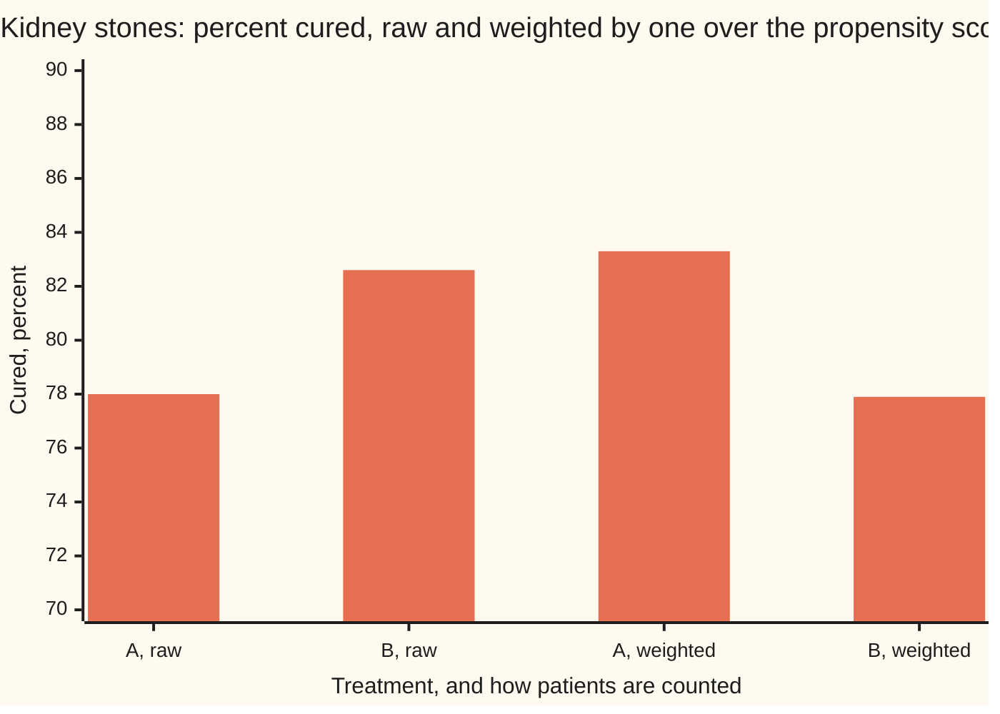
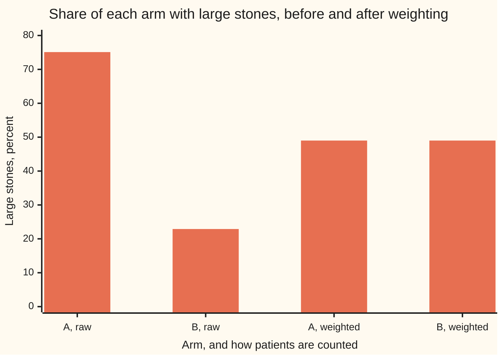

# Propensity scores: comparing like with like when treatment was not randomised

[Syllabus](../../../SYLLABUS.md) → [Probability and statistics](../README.md) → [Survival, Design and Causality](../README.md#s13) → Propensity scores

---

## General Overview

A 1986 hospital study followed 700 patients with kidney stones. Each had one of two operations. Treatment A, open surgery, cured 273 of 350 patients: 78.0 percent. Treatment B, keyhole surgery through a small cut in the back, cured 289 of 350: 82.6 percent. B looks better by 4.57 points.

No coin decided who got which operation. Doctors chose, and they gave A mostly to patients with large stones, which are harder to cure: 263 of A's 350 patients had large stones, against 80 of B's. Inside each size, A did better. For small stones it cured 0.9310 against 0.8667; for large stones 0.7300 against 0.6875. [Causal graphs](08-causal-graphs-and-back-door-adjustment.md) settles this by averaging each treatment's cure rates over the whole hospital's mix of stone sizes. That gives A 83.3 percent and B 77.9 percent.

This card reaches the same answer from the other side: the chance each patient had of getting A. Of the 357 patients with small stones, 87 got A, a chance of 87/357 = 0.2437. Of the 343 with large stones, 263 got A, a chance of 0.7668. That chance is the patient's **propensity score**. Small-stone patients rarely got A: about one in four did. So each small-stone A patient is counted as 1/0.2437 = 4.1034 patients: themself, plus about three similar patients who got B. Count every A patient this way and the A group has the hospital's stone-size mix. Its weighted cure rate is 83.3 percent, the back-door answer.

**The propensity score is a patient's chance of getting the treatment, given what was measured about them; weighting each treated patient by one over that chance, or matching patients whose chances are equal, rebuilds the comparison a coin toss would have given, but only for the confounders that were measured.**

**What kind of fact this is:** a theorem, proved on this card in Why it works. Reading its answer as the effect of the treatment rests on an assumption, that no unmeasured variable drove both the choice and the cure, which the data cannot check.

### The picture: the raw comparison and the weighted one



Read the bars in pairs. Raw, B leads, 82.6 against 78.0. Weighted, A leads, 83.3 against 77.9. The weights changed nobody's outcome. They changed only how many patients each record speaks for.

---

## The formula

Notation first, in words. Number the patients $`i = 1`$ to $`n`$, here $`n = 700`$. $`T_i`$ is 1 if patient $`i`$ got A and 0 if B. $`X_i`$ is what was measured before the choice: here stone size, small or large. [Causal graphs](08-causal-graphs-and-back-door-adjustment.md) called stone size $`Z`$; propensity-score work writes the measurements $`X`$. $`Y_i`$ is 1 if the patient was cured and 0 if not.

Each patient also carries two **potential outcomes**, as on [Randomised experiments](04-randomised-experiments-and-ab-tests.md): $`Y_i(A)`$, cured or not had they got A, and $`Y_i(B)`$ for B. That card writes them $`y_i(A)`$ and $`y_i(B)`$; the capital letter here marks them as chance quantities, as in the proofs below. Only one is ever seen. The target is $`\mu_A`$, the share of all 700 who would be cured if every one got A, and likewise $`\mu_B`$. Their difference $`\tau = \mu_A - \mu_B`$ is the **average treatment effect**, the ATE.

The propensity score is the chance of A given the measurements:

```math
e(x) = P(T = 1 \mid X = x)
```

The **inverse-probability-weighted** (IPW) estimates count each A patient $`1/e`$ times and each B patient $`1/(1-e)`$ times:

```math
\hat\mu_A = \frac{1}{n}\sum_{i=1}^{n} \frac{T_i\,Y_i}{e(X_i)}, \qquad \hat\mu_B = \frac{1}{n}\sum_{i=1}^{n} \frac{(1-T_i)\,Y_i}{1-e(X_i)}, \qquad \hat\tau = \hat\mu_A - \hat\mu_B
```

**Read it aloud:** add up the cured A patients, each counted once for every patient they stand in for, and divide by everyone; do the same for B; subtract.

A common variant divides each sum by its own total weight instead of by $`n`$. On the kidney table the weights in each arm add to exactly 700, so the two versions agree; the code uses the variant, which is steadier when weights are large.

The theorem behind it reads as follows. Its first half, that the score can stand in for all of $`X`$, is Rosenbaum and Rubin's (1983); the weighting identity in its second half is set out in *What If*, chapter 12.

```math
\big(Y(A),\,Y(B)\big) \perp T \mid X \;\text{ and }\; 0 < e(X) < 1 \;\Longrightarrow\; \big(Y(A),\,Y(B)\big) \perp T \mid e(X) \;\text{ and }\; E\Big[\frac{T\,Y}{e(X)}\Big] = E\big[Y(A)\big]
```

**Read it aloud:** if, among patients with the same measurements, the choice of treatment was unrelated to how they would have fared, and every patient could have got either treatment, then the same holds among patients with the same score, and the weighted average of the cured A patients is the cure rate everyone would have had on A.

| Symbol | Plain meaning | In our example | Push it up and the answer… |
| --- | --- | --- | --- |
| $`n`$, $`i`$ | number of patients; one patient's number | 700 | standard errors shrink |
| $`T_i`$ | treatment received: 1 for A, 0 for B | 350 of each | — |
| $`X_i`$, $`x`$ | measurement taken before the choice; a particular value | stone size, small or large; diameter in mm in the simulation | — |
| $`Y_i`$, $`Y_i(A)`$, $`Y_i(B)`$ | cured or not; cured or not had the patient got A, or B | 273 cured on A, 289 on B | — |
| $`e(x)`$ | propensity score: chance of A given $`x`$ | 0.2437 small, 0.7668 large | nearer 0 or 1, weights grow |
| $`1/e`$, $`1/(1-e)`$ | weight of an A patient, of a B patient | 4.1034 and 1.3042; 1.3222 and 4.2875 | larger weights, noisier answer |
| $`\mu_A`$, $`\mu_B`$, $`\hat\mu_A`$, $`\hat\mu_B`$ | cure rate if everyone got A, or B; their estimates | 0.8325 and 0.7789 | — |
| $`\tau`$, $`\hat\tau`$ | average treatment effect, A minus B; its estimate | +5.37 points (standard error, SE, 3.47) | — |
| $`\perp`$, $`\mid`$, $`P`$, $`E`$ | "unrelated to" (independent of); "given"; chance; average | — | — |
| $`n_x`$, $`n_{A,x}`$, $`r_{A,x}`$ | in the proof: patients with stone size $`x`$; those who got A; A's cure rate among them | 357, 87 and 0.9310 for small stones | — |
| $`b_0`$, $`b_1`$ | logistic regression's intercept and slope for the score | −1.1325 and 2.3226 | — |
| ATT, ESS | average effect among those who got A; effective sample size, the number of equally weighted patients carrying the same information | +4.80 points; 256.2 of A's 350 | — |

### When it holds

- **Every common cause is measured.** If doctors also gave A to fitter patients, and fitness helps cure, part of the 5.37 points is fitness. Weighting balances only what is in $`X`$, and nothing in the table can reveal a variable that is missing from it. This is the assumption the whole method rests on.
- **Overlap: every patient could have got either treatment.** The score must stay away from 0 and 1. In the simulation below, a steep choice rule gives one patient a weight of 1,501.8, A's 10,009 patients count as only 119 equally weighted ones, and the standard error grows from 0.82 to 3.90 points. A score of exactly 0 or 1 leaves nobody to stand in, and the weight is infinite.
- **The score is right.** With stone size in two classes, counting gives the score exactly. With a measurement on a scale it has to be fitted, and a wrong shape leaves the arms unbalanced. Check the balance after weighting, as Step 5 does for stone diameter; on the two-cell table of Step 3 it holds automatically.
- **$`X`$ is measured before the treatment.** A variable the treatment changes, such as days in hospital afterwards, carries part of the effect. Weighting on it removes part of what is being measured.
- **One patient's treatment does not change another's outcome.** This is the no-interference condition of [Randomised experiments](04-randomised-experiments-and-ab-tests.md), unchanged.

---

## Why it works

### Step 0: each treated patient stands in for the untreated patients like them

A coin toss gives every patient the same chance of A, so each arm is a fair sample of everyone. Without a coin, each kind of patient had their own chance. A kind that rarely got A is thin in the A arm. The fix is to count each A patient of that kind more often, by exactly as much as that kind was under-sampled. A chance of one in four means a count of four. Then the A arm, weighted, looks like the whole hospital. The same reasoning applies to B with the chance $`1 - e`$.

### Step 1: on a table, the weights rebuild every row exactly

Among the $`n_x`$ patients with stone size $`x`$, $`n_{A,x}`$ got A, so the counted score is $`e(x) = n_{A,x}/n_x`$. Every A patient of size $`x`$ gets weight $`1/e(x) = n_x/n_{A,x}`$. The $`n_{A,x}`$ of them together weigh

```math
n_{A,x} \times \frac{n_x}{n_{A,x}} = n_x .
```

The 87 small-stone A patients weigh 87 × 4.1034 = 357.0, all the small-stone patients. The 263 large-stone A patients weigh 263 × 1.3042 = 343.0. Their cured members weigh $`n_x\,r_{A,x}`$, where $`r_{A,x}`$ is A's cure rate among size $`x`$. Divide by $`n`$:

```math
\hat\mu_A = \frac{1}{n}\sum_{x} n_x\, r_{A,x} = \sum_x \frac{n_x}{n}\, r_{A,x}
```

That is the back-door formula of [Causal graphs](08-causal-graphs-and-back-door-adjustment.md): each size's cure rate, averaged with the hospital's mix of sizes, 0.5100 small and 0.4900 large. On the kidney table, weighting and adjustment are one sum written two ways.

### Step 2: the general proof, for any measurement

Step 1 needed a table with every cell filled. The general version needs one assumption and one rule. The assumption, **no unmeasured confounding**, says that once $`X`$ is known, $`T`$ carries no information about $`Y(A)`$. The rule is the tower property of averages: an average can be taken in two stages, first within each value of $`X`$, then over $`X`$.

Inside one value of $`X`$, $`T Y = T\,Y(A)`$, because the outcome seen on A is the A outcome. The average of $`T\,Y(A)`$ splits into $`e(X)`$ times the average of $`Y(A)`$, by the assumption. Dividing by $`e(X)`$ cancels it, which needs $`e(X) > 0`$. What is left is the average of $`Y(A)`$ within that value of $`X`$, and averaging over $`X`$ gives $`E[Y(A)]`$. The fold writes it out.

<details>
<summary>Detailed proof: the weighted average equals the cure rate under A</summary>

Write $`E[\,\cdot \mid X]`$ for the average among patients with a given value of $`X`$.

$`\displaystyle E\Big[\frac{T\,Y}{e(X)}\Big] = E\Big[\frac{E[\,T\,Y(A) \mid X\,]}{e(X)}\Big] = E\Big[\frac{E[T \mid X]\;E[\,Y(A) \mid X\,]}{e(X)}\Big] = E\big[\,E[\,Y(A) \mid X\,]\,\big] = E[Y(A)].`$

The first equality is the tower property, with $`T\,Y = T\,Y(A)`$. The second is no unmeasured confounding: given $`X`$, $`T`$ and $`Y(A)`$ are independent, so the average of their product is the product of averages. The third uses $`E[T \mid X] = e(X)`$, the definition of the score, and needs $`e(X) > 0`$. The last is the tower property again. For B, replace $`T`$ by $`1 - T`$ and $`e`$ by $`1 - e`$, which needs $`e(X) < 1`$.

The estimate $`\hat\mu_A`$ is the sample version of the left-hand side, so by the law of large numbers it settles on $`E[Y(A)]`$ as $`n`$ grows.

</details>

### Step 3: one number balances every measurement

The theorem's first claim is that the score alone is enough. Among patients with the same score, say 0.2437, the chance of A is 0.2437 whatever their measurements are, because the score is that chance. So within a score, treatment is unrelated to $`X`$: both arms have the same mix of measurements. This is the **balancing property**. The same argument with $`Y(A)`$ added shows that no unmeasured confounding given $`X`$ carries over to the score:

```math
P\big(T=1 \mid Y(A),\, e(X)\big) = E\big[\,P\big(T=1 \mid Y(A),\, X\big) \;\big|\; Y(A),\, e(X)\,\big] = E\big[\,e(X) \;\big|\; Y(A),\, e(X)\,\big] = e(X)
```

The first equality is the tower property: knowing $`X`$ fixes $`e(X)`$, so an average taken within $`X`$ and then within the score is an average within the score. The second is no unmeasured confounding: given $`X`$, the chance of A is $`e(X)`$ whatever $`Y(A)`$ is. The third holds because $`e(X)`$ is already given. So among patients with the same score, the chance of A does not depend on $`Y(A)`$: treatment is unrelated to the potential outcome. The same steps work for $`Y(B)`$, and for the pair.

Why it matters: $`X`$ is often twenty measurements, not one. Splitting patients into cells that agree on all twenty leaves most cells empty. Splitting on one number, the score, does not.

The checks test balance directly. Raw, 75.1 percent of A's patients had large stones, against 22.9 percent of B's. Weighted, both arms have 49.0 percent, the hospital's own share.



Before weighting, the arms differ sharply in the very variable that drives cure. After, they do not differ at all.

### Step 4: weighting is importance sampling

[Importance sampling](../11-Simulation/06-importance-sampling.md) averages draws from one law, the proposal, and corrects each draw by a weight: its chance under the law that was wanted, divided by its chance under the proposal. Here the wanted world is "every patient gets A", in which a patient with size $`x`$ gets A with chance 1. The real hospital is the proposal, giving A with chance $`e(x)`$. The weight is $`1/e(x)`$.

The two cards share their warnings. Importance sampling needs the proposal to give a positive chance wherever the wanted law does: that is overlap. Its error grows with the average squared weight: that is why extreme weights make a noisy answer. The effective sample size measures the cost. A's 350 weighted patients carry as much information as 256.2 equally weighted ones, and B's as much as 252.2.

### Step 5: estimating the score

The score is rarely handed over. It is fitted, usually by [Logistic regression](../09-Regression/05-logistic-regression.md): treatment, 1 or 0, regressed on the measurements. On the kidney table, with $`x = 1`$ for a large stone, the fit gives $`b_0 = -1.1325`$ and $`b_1 = 2.3226`$. Through the logistic curve these return 0.2437 and 0.7668, the counted shares to the last digit, because two numbers fit two cells exactly.

A diameter in millimetres has no cells to count. The checks build a hospital of 20,000 patients with diameters spread evenly from 2 to 20 mm. Larger stones are more often given A and are harder to cure, and A truly helps, by a known amount. Two choice rules are tried: a mild one and a steep one, where nearly every patient above 15 mm gets A.

| Choice rule | True effect | Raw gap | IPW (SE) | Matching | Largest weight | Effective size, A and B |
| --- | ---: | ---: | ---: | ---: | ---: | ---: |
| mild, fitted slope 0.2460 | +11.18 | −9.88 | +11.81 (0.82) | +11.80 | 10.3 | 6,549 and 6,510 |
| steep, fitted slope 0.9088 | +11.21 | −22.22 | +6.34 (3.90) | +16.23 | 1,501.8 | 119 and 330 |

All figures are percentage points except the slopes, weights and sizes. The largest weight is the one a patient actually carries: one over the chance of the treatment they got. Under the mild rule both methods land within one SE of the truth, while the raw gap points the wrong way. Under the steep rule both still fall within four SEs, but the SE is nearly five times larger, and the two methods now sit far apart, on opposite sides of the truth.

The steep rule leaves few patients who got the less likely treatment for their stone size, and those few carry huge weights. One small-stone patient who got A weighs 1,501.8, 8.0 percent of A's total weight. A's 10,009 patients count as only 119 equally weighted ones, and B's 9,991 as 330. Balance slips too. Raw, A's mean stone diameter is 13.68 mm against B's 8.24 under the mild rule, and 15.30 against 6.73 under the steep one. Weighting brings the mild pair to 10.94 and 10.98 mm, but the steep pair only to 11.45 and 10.30. That is what poor overlap looks like in practice.

### Step 6: matching instead of weighting

**Matching** fills in each patient's missing outcome from a patient in the other arm with the nearest score, then averages the differences. By Step 3, patients with equal scores have the same mix of measurements, so the pair is a fair comparison. On the kidney table the score takes two values, so each patient is matched to the average of the other arm at the same score. The result is +5.37 points, the IPW answer again.

Matching only the A patients answers a different question: how much A helped the patients who actually got it. That is the **average treatment effect on the treated**, ATT. It comes out at +4.80 points, smaller than the ATE because A's patients were mostly large-stone patients, where A's edge is smaller. The same number comes from weighting each B patient by the odds $`e/(1-e)`$, which reshapes the B arm to look like the A arm.

Estimators that combine a score model with a model of the outcome, and stay right if either one is right, are called **doubly robust**. They are the next step in practice; this card does not build them.

---

## Worked numbers, by hand

The kidney table, overlap checked first.

| Step | Arithmetic | Value |
| --- | --- | --- |
| score, small stones | 87/357 | 0.2437 |
| score, large stones | 263/343 | 0.7668 |
| overlap check | both between 0 and 1; largest weight 1/(1 − 0.7668) | 4.2875 |
| A weights, small and large | 1/0.2437 and 1/0.7668 | 4.1034 and 1.3042 |
| A weights add to | 87 × 4.1034 + 263 × 1.3042 = 357.0 + 343.0 | 700.0 |
| weighted A cures | 81 × 4.1034 + 192 × 1.3042 = 332.4 + 250.4 | 582.8 |
| $`\hat\mu_A`$ | 582.8/700 | 0.8325 |
| B weights, small and large | 1/(1 − 0.2437) and 1/(1 − 0.7668) | 1.3222 and 4.2875 |
| weighted B cures | 234 × 1.3222 + 55 × 4.2875 = 309.4 + 235.8 | 545.2 |
| $`\hat\mu_B`$ | 545.2/700 | 0.7789 |
| **ATE** | 0.8325 − 0.7789, before rounding | **+5.37 points (SE 3.47)** |

Had every patient got A, about 83 in 100 would have been cured; had every one got B, about 78. A is ahead by about 5 points, but the standard error of 3.47 means the data alone leave room for a much smaller edge. That standard error is the spread of each patient's weighted term, $`T(Y - \hat\mu_A)/e - (1-T)(Y - \hat\mu_B)/(1-e)`$, divided by $`\sqrt{n}`$, and it takes the score as known. Counting the score as fitted, which on this table is the same as working size by size as the back-door formula does, gives 3.36. So 3.47 slightly overstates the error.

### What breaks if you drop a piece

| Mistake | Comes out at | What went wrong |
| --- | --- | --- |
| Compare the raw cure rates | −4.57 points, against +5.37 | B's patients mostly had small stones, which are easier to cure |
| Weight by $`e`$ instead of $`1/e`$ | −10.25 points | Counts the over-sampled patients up, so the confounding gets worse |
| Use $`1/e`$ for B patients too | B "cure rate" 1.4742 | B patients were chosen with chance $`1 - e`$, so their weight is $`1/(1-e)`$ |
| Skip the overlap check, steep simulation | +6.34 points (SE 3.90), against +11.21 | A few huge weights: one patient weighs 1,501.8 and A's 10,009 patients count as 119, so the SE is nearly five times the mild rule's 0.82 |

The code prints all four.

---

## Code, from first principles, and it actually runs

Nothing imported knows the answer: the logistic fit is Newton's method written out, matching is a sorted search, and random numbers come from SplitMix64, a small generator written out in both languages with seed 20261123. The checks take four roads to the kidney answer. The score is counted and also fitted. The ATE is computed by weighting all 700 patient records, by the back-door formula, and by matching on the score, and the ATT by matching and by odds weights. Balance after weighting is tested. Then the simulated hospital tests weighting and matching against a known true effect, shows the raw gap is biased, and prints for each arm the largest weight a patient carries, the effective size and the mean diameter before and after weighting.

### Python

```python
# Propensity scores and weighting -- the check behind the card.  Standard library only.
# Kidney stones (Charig et al. 1986): treatment A = open surgery, B = keyhole surgery.
from math import exp, log, sqrt
from bisect import bisect_left

def logistic(z): return 1.0 / (1.0 + exp(-z))

def fit(xs, ts):  # logistic regression of treatment on one covariate, Newton's method
    b0 = b1 = 0.0
    for _ in range(40):
        g0 = g1 = h00 = h01 = h11 = 0.0
        for x, t in zip(xs, ts):
            p = logistic(b0 + b1 * x); w = p * (1 - p)
            g0 += t - p; g1 += (t - p) * x; h00 += w; h01 += w * x; h11 += w * x * x
        det = h00 * h11 - h01 * h01
        b0 += (h11 * g0 - h01 * g1) / det; b1 += (h00 * g1 - h01 * g0) / det
    return b0, b1

def ipw(es, ts, ys):  # weighted means of Y(A), Y(B), each over its own weights; ATE and its SE
    n = len(ts)
    mA = sum(t * y / e for e, t, y in zip(es, ts, ys)) / sum(t / e for e, t in zip(es, ts))
    mB = sum((1 - t) * y / (1 - e) for e, t, y in zip(es, ts, ys)) / sum((1 - t) / (1 - e) for e, t in zip(es, ts))
    terms = [t * (y - mA) / e - (1 - t) * (y - mB) / (1 - e) for e, t, y in zip(es, ts, ys)]
    se = sqrt(sum(v * v for v in terms) / (n - 1) / n)
    return mA, mB, mA - mB, se

def match(es, ts, ys):  # fill each patient's missing outcome from the other arm at the nearest score
    pool = {0: {}, 1: {}}  # arm -> score -> [cured, patients]; tied scores are averaged
    for e, t, y in zip(es, ts, ys):
        c = pool[t].setdefault(e, [0, 0]); c[0] += y; c[1] += 1
    keys = {a: sorted(pool[a]) for a in (0, 1)}
    total = 0.0
    for e, t, y in zip(es, ts, ys):
        k = keys[1 - t]; j = bisect_left(k, e)
        if j == len(k) or (j > 0 and e - k[j - 1] <= k[j] - e): j -= 1
        c = pool[1 - t][k[j]]; other = c[0] / c[1]
        total += (y - other) if t == 1 else (other - y)
    return total / len(ts)

# ---- the table: (stone large?, got A?, patients, cured) ----
TABLE = [(0, 1, 87, 81), (1, 1, 263, 192), (0, 0, 270, 234), (1, 0, 80, 55)]
xs, ts, ys = [], [], []
for large, a, n, c in TABLE:
    for i in range(n): xs.append(large); ts.append(a); ys.append(1 if i < c else 0)
N, cnt = len(ts), {(l, a): (n, c) for l, a, n, c in TABLE}
nA = sum(ts); naive_A = sum(t * y for t, y in zip(ts, ys)) / nA
naive_B = sum((1 - t) * y for t, y in zip(ts, ys)) / (N - nA)
print(f"patients {N}; naive cure rate A {naive_A:.4f}, B {naive_B:.4f}, gap {100*(naive_A-naive_B):+.2f} points")
for l, name in ((0, "small"), (1, "large")):
    (na, ca), (nb, cb) = cnt[(l, 1)], cnt[(l, 0)]
    print(f"{name}: A {ca}/{na} = {ca/na:.4f}, B {cb}/{nb} = {cb/nb:.4f}, e = {na}/{na+nb} = {na/(na+nb):.4f}, "
          f"weights 1/e = {(na+nb)/na:.4f}, 1/(1-e) = {(na+nb)/nb:.4f}")
e_count = {l: cnt[(l, 1)][0] / (cnt[(l, 1)][0] + cnt[(l, 0)][0]) for l in (0, 1)}
b0, b1 = fit(xs, ts)
e_fit = {l: logistic(b0 + b1 * l) for l in (0, 1)}
print(f"logistic fit: b0 {b0:.4f}, b1 {b1:.4f}; e(small) {e_fit[0]:.4f}, e(large) {e_fit[1]:.4f}")
es = [e_fit[x] for x in xs]
mA, mB, ate, se = ipw(es, ts, ys)
print(f"1 IPW over {N} records: A {mA:.4f}, B {mB:.4f}, ATE {100*ate:+.2f} points (SE {100*se:.2f})")
for a, arm, f in ((1, "A", lambda e: 1 / e), (0, "B", lambda e: 1 / (1 - e))):
    parts = [(cnt[(l, a)][1], f(e_fit[l]), cnt[(l, a)][0]) for l in (0, 1)]
    print(f"  {arm}: cured " + " + ".join(f"{c} x {w:.4f} = {c*w:.1f}" for c, w, _ in parts)
          + f" -> {sum(c*w for c, w, _ in parts):.1f} / {N}; weights " + " + ".join(f"{n} x {w:.4f} = {n*w:.1f}" for _, w, n in parts))
share = {l: sum(cnt[(l, a)][0] for a in (0, 1)) / N for l in (0, 1)}
rate = {(l, a): cnt[(l, a)][1] / cnt[(l, a)][0] for l in (0, 1) for a in (0, 1)}  # cure rate by size and arm
bdA, bdB = (sum(share[l] * rate[l, a] for l in (0, 1)) for a in (1, 0))
se_bd = sqrt(sum(share[l] * ((rate[l, 1] - rate[l, 0] - bdA + bdB) ** 2 + rate[l, 1] * (1 - rate[l, 1]) / e_fit[l]
                 + rate[l, 0] * (1 - rate[l, 0]) / (1 - e_fit[l])) for l in (0, 1)) / N)  # size by size: score counted as fitted
print(f"2 back-door: A {bdA:.4f}, B {bdB:.4f}, ATE {100*(bdA-bdB):+.2f} points (SE {100*se_bd:.2f}, size by size); "
      f"size shares {share[0]:.4f}, {share[1]:.4f}")
m = match(es, ts, ys)
print(f"3 matching on the score, every patient: ATE {100*m:+.2f} points")
attm = sum(t * (y - (cnt[(x, 0)][1] / cnt[(x, 0)][0])) for x, t, y in zip(xs, ts, ys)) / nA
wB = [(1 - t) * e / (1 - e) for e, t in zip(es, ts)]
att_w = naive_A - sum(w * y for w, y in zip(wB, ys)) / sum(wB)
print(f"ATT (A patients only): matching {100*attm:+.2f} points, odds weights e/(1-e) {100*att_w:+.2f} points")
wsumA = sum(t / e for e, t in zip(es, ts)); wsumB = sum((1 - t) / (1 - e) for e, t in zip(es, ts))
bal = [sum(t * x for x, t in zip(xs, ts)) / nA, sum((1 - t) * x for x, t in zip(xs, ts)) / (N - nA),
       sum(t * x / e for x, e, t in zip(xs, es, ts)) / wsumA, sum((1 - t) * x / (1 - e) for x, e, t in zip(xs, es, ts)) / wsumB]
print(f"weights add to: A {wsumA:.1f}, B {wsumB:.1f}")
print("bars, cure percent, raw A, raw B, weighted A, weighted B: " + ", ".join(f"{100*v:.1f}" for v in (naive_A, naive_B, mA, mB)))
print("large-stone share, raw A, raw B, weighted A, weighted B: " + ", ".join(f"{100*v:.1f}" for v in bal))
essA = wsumA ** 2 / sum((t / e) ** 2 for e, t in zip(es, ts))
essB = wsumB ** 2 / sum(((1 - t) / (1 - e)) ** 2 for e, t in zip(es, ts))
print(f"overlap: e from {min(es):.4f} to {max(es):.4f}; largest weight {max(t / e + (1 - t) / (1 - e) for e, t in zip(es, ts)):.4f}; "
      f"effective sizes A {essA:.1f} of {nA}, B {essB:.1f} of {N-nA}")
# ---- what breaks ----
eA = sum(t * e * y for e, t, y in zip(es, ts, ys)) / sum(t * e for e, t in zip(es, ts))
eB = sum((1 - t) * (1 - e) * y for e, t, y in zip(es, ts, ys)) / sum((1 - t) * (1 - e) for e, t in zip(es, ts))
oneB = sum((1 - t) * y / e for e, t, y in zip(es, ts, ys)) / N
print(f"wrong: weight by e, not 1/e: A {eA:.4f}, B {eB:.4f}, gap {100*(eA-eB):+.2f} points")
print(f"wrong: 1/e for B patients too: B 'cure rate' {oneB:.4f}")

# ---- simulation: stone diameter in mm, a covariate with no strata ----
state = 20261123
def rand():
    global state
    state = (state + 0x9E3779B97F4A7C15) & 0xFFFFFFFFFFFFFFFF
    z = state
    z = ((z ^ (z >> 30)) * 0xBF58476D1CE4E5B9) & 0xFFFFFFFFFFFFFFFF
    z = ((z ^ (z >> 27)) * 0x94D049BB133111EB) & 0xFFFFFFFFFFFFFFFF
    return ((z ^ (z >> 31)) >> 11) / 9007199254740992.0

NS = 20000
print(f"simulation: SplitMix64 seed 20261123, {NS} patients, diameter 2-20 mm")
res = {}
for label, slope in (("mild", 0.25), ("steep", 0.9)):
    d, t, y, truth = [], [], [], 0.0
    for _ in range(NS):
        x = 2.0 + 18.0 * rand()
        pA, pB = logistic(3.2 - 0.2 * x), logistic(2.6 - 0.2 * x)
        a = 1 if rand() < logistic(slope * (x - 11.0)) else 0
        u = rand()
        d.append(x); t.append(a); y.append(1 if u < (pA if a else pB) else 0); truth += pA - pB
    truth /= NS
    c0, c1 = fit(d, t); es = [logistic(c0 + c1 * x) for x in d]
    _, _, sate, sse = ipw(es, t, y)
    sm, na = match(es, t, y), sum(t)
    nv = sum(a * v for a, v in zip(t, y)) / na - sum((1 - a) * v for a, v in zip(t, y)) / (NS - na)
    print(f"  {label}: fitted slope {c1:.4f} (true {slope}); truth {100*truth:+.2f}; naive {100*nv:+.2f}; "
          f"IPW {100*sate:+.2f} (SE {100*sse:.2f}); matching {100*sm:+.2f}")
    w = [a / e + (1 - a) / (1 - e) for e, a in zip(es, t)]          # the weight each patient carries
    for g in (1, 0):                                                 # each arm: weights, effective size, balance
        r = [(v, x) for v, x, a in zip(w, d, t) if a == g]; tw, top = sum(v for v, _ in r), max(r)[0]
        print(f"    arm {'BA'[g]}: largest weight {top:.1f} ({100*top/tw:.1f}% of the arm's weight); "
              f"effective size {tw*tw / sum(v*v for v, _ in r):.0f} of {len(r)}; mean diameter "
              f"{sum(x for _, x in r)/len(r):.2f} mm raw, {sum(v*x for v, x in r)/tw:.2f} weighted")
    res[label] = (truth, nv, sate, sse, sm, c1, slope)

assert all(abs(e_fit[l] - e_count[l]) < 1e-9 for l in (0, 1)), "logistic fit must reproduce the counted shares"
assert abs(mA - bdA) < 1e-12 and abs(mB - bdB) < 1e-12, "IPW over records must equal the back-door formula"
assert abs(m - (bdA - bdB)) < 1e-12, "matching on the score must equal the back-door ATE"
assert abs(attm - att_w) < 1e-12, "ATT by matching must equal ATT by odds weights"
assert abs(bal[2] - share[1]) < 1e-12 and abs(bal[3] - share[1]) < 1e-12, "weighting must balance stone size"
assert naive_A < naive_B and bdA > bdB, "Simpson reversal: B looks better raw, A is better adjusted"
for truth, nv, sate, sse, sm, c1, slope in res.values():
    assert abs(sate - truth) < 4 * sse and abs(sm - truth) < 4 * sse, "IPW and matching within 4 SE of truth"
    assert abs(nv - truth) > 4 * sse, "the naive gap must be visibly biased"
assert res["steep"][3] > res["mild"][3], "poorer overlap must widen the standard error"
print("ALL CHECKS PASS")
```

**Ran 2026-11-23 on macOS, Python 3.14.10, standard library only. All checks passed. Output, pasted from the run:**

```
patients 700; naive cure rate A 0.7800, B 0.8257, gap -4.57 points
small: A 81/87 = 0.9310, B 234/270 = 0.8667, e = 87/357 = 0.2437, weights 1/e = 4.1034, 1/(1-e) = 1.3222
large: A 192/263 = 0.7300, B 55/80 = 0.6875, e = 263/343 = 0.7668, weights 1/e = 1.3042, 1/(1-e) = 4.2875
logistic fit: b0 -1.1325, b1 2.3226; e(small) 0.2437, e(large) 0.7668
1 IPW over 700 records: A 0.8325, B 0.7789, ATE +5.37 points (SE 3.47)
  A: cured 81 x 4.1034 = 332.4 + 192 x 1.3042 = 250.4 -> 582.8 / 700; weights 87 x 4.1034 = 357.0 + 263 x 1.3042 = 343.0
  B: cured 234 x 1.3222 = 309.4 + 55 x 4.2875 = 235.8 -> 545.2 / 700; weights 270 x 1.3222 = 357.0 + 80 x 4.2875 = 343.0
2 back-door: A 0.8325, B 0.7789, ATE +5.37 points (SE 3.36, size by size); size shares 0.5100, 0.4900
3 matching on the score, every patient: ATE +5.37 points
ATT (A patients only): matching +4.80 points, odds weights e/(1-e) +4.80 points
weights add to: A 700.0, B 700.0
bars, cure percent, raw A, raw B, weighted A, weighted B: 78.0, 82.6, 83.3, 77.9
large-stone share, raw A, raw B, weighted A, weighted B: 75.1, 22.9, 49.0, 49.0
overlap: e from 0.2437 to 0.7668; largest weight 4.2875; effective sizes A 256.2 of 350, B 252.2 of 350
wrong: weight by e, not 1/e: A 0.7492, B 0.8517, gap -10.25 points
wrong: 1/e for B patients too: B 'cure rate' 1.4742
simulation: SplitMix64 seed 20261123, 20000 patients, diameter 2-20 mm
  mild: fitted slope 0.2460 (true 0.25); truth +11.18; naive -9.88; IPW +11.81 (SE 0.82); matching +11.80
    arm A: largest weight 10.0 (0.1% of the arm's weight); effective size 6549 of 10013; mean diameter 13.68 mm raw, 10.94 weighted
    arm B: largest weight 10.3 (0.1% of the arm's weight); effective size 6510 of 9987; mean diameter 8.24 mm raw, 10.98 weighted
  steep: fitted slope 0.9088 (true 0.9); truth +11.21; naive -22.22; IPW +6.34 (SE 3.90); matching +16.23
    arm A: largest weight 1501.8 (8.0% of the arm's weight); effective size 119 of 10009; mean diameter 15.30 mm raw, 11.45 weighted
    arm B: largest weight 458.0 (2.5% of the arm's weight); effective size 330 of 9991; mean diameter 6.73 mm raw, 10.30 weighted
ALL CHECKS PASS
```

### Rust

The same checks, with the same labels. Python's `sum` adds floats more carefully than a plain loop, but the printed digits agree.

```rust
// Propensity scores and weighting -- the same check as propensity_scores_and_weighting_check.py.
// Standard library only, no crates.  Kidney stones: A = open surgery, B = keyhole surgery.
use std::collections::BTreeMap;

fn logistic(z: f64) -> f64 { 1.0 / (1.0 + (-z).exp()) }

fn fit(xs: &[f64], ts: &[f64]) -> (f64, f64) { // logistic regression, Newton's method
    let (mut b0, mut b1) = (0.0f64, 0.0f64);
    for _ in 0..40 {
        let (mut g0, mut g1, mut h00, mut h01, mut h11) = (0.0, 0.0, 0.0, 0.0, 0.0);
        for (&x, &t) in xs.iter().zip(ts) {
            let p = logistic(b0 + b1 * x); let w = p * (1.0 - p);
            g0 += t - p; g1 += (t - p) * x; h00 += w; h01 += w * x; h11 += w * x * x;
        }
        let det = h00 * h11 - h01 * h01;
        b0 += (h11 * g0 - h01 * g1) / det; b1 += (h00 * g1 - h01 * g0) / det;
    }
    (b0, b1)
}

fn sum<I: Iterator<Item = f64>>(it: I) -> f64 { it.fold(0.0, |a, b| a + b) }

fn ipw(es: &[f64], ts: &[f64], ys: &[f64]) -> (f64, f64, f64, f64) {
    let n = ts.len() as f64;
    let z = || es.iter().zip(ts).zip(ys).map(|((&e, &t), &y)| (e, t, y));
    let ma = sum(z().map(|(e, t, y)| t * y / e)) / sum(z().map(|(e, t, _)| t / e));
    let mb = sum(z().map(|(e, t, y)| (1.0 - t) * y / (1.0 - e))) / sum(z().map(|(e, t, _)| (1.0 - t) / (1.0 - e)));
    let ss = sum(z().map(|(e, t, y)| { let v = t * (y - ma) / e - (1.0 - t) * (y - mb) / (1.0 - e); v * v }));
    (ma, mb, ma - mb, (ss / (n - 1.0) / n).sqrt())
}

fn matching(es: &[f64], ts: &[f64], ys: &[f64]) -> f64 { // nearest score in the other arm, ties averaged
    let mut pool: [BTreeMap<u64, (f64, f64)>; 2] = [BTreeMap::new(), BTreeMap::new()];
    for i in 0..ts.len() {
        let c = pool[ts[i] as usize].entry(es[i].to_bits()).or_insert((0.0, 0.0));
        c.0 += ys[i]; c.1 += 1.0;
    }
    let keys: Vec<Vec<f64>> = (0..2).map(|a| pool[a].keys().map(|&k| f64::from_bits(k)).collect()).collect();
    let mut total = 0.0;
    for i in 0..ts.len() {
        let (e, t, y) = (es[i], ts[i] as usize, ys[i]);
        let k = &keys[1 - t];
        let mut j = k.partition_point(|&v| v < e);
        if j == k.len() || (j > 0 && e - k[j - 1] <= k[j] - e) { j -= 1; }
        let c = pool[1 - t][&k[j].to_bits()]; let other = c.0 / c.1;
        total += if t == 1 { y - other } else { other - y };
    }
    total / ts.len() as f64
}

struct Rng(u64);
impl Rng {
    fn next(&mut self) -> f64 {
        self.0 = self.0.wrapping_add(0x9E3779B97F4A7C15);
        let mut z = self.0;
        z = (z ^ (z >> 30)).wrapping_mul(0xBF58476D1CE4E5B9);
        z = (z ^ (z >> 27)).wrapping_mul(0x94D049BB133111EB);
        ((z ^ (z >> 31)) >> 11) as f64 / 9007199254740992.0
    }
}

fn main() {
    // (stone large?, got A?, patients, cured)
    let table = [(0usize, 1usize, 87usize, 81usize), (1, 1, 263, 192), (0, 0, 270, 234), (1, 0, 80, 55)];
    let (mut xs, mut ts, mut ys) = (vec![], vec![], vec![]);
    let mut cnt = [[(0.0f64, 0.0f64); 2]; 2]; // cnt[large][a] = (patients, cured)
    for &(l, a, n, c) in &table {
        for i in 0..n { xs.push(l as f64); ts.push(a as f64); ys.push(if i < c { 1.0 } else { 0.0 }); }
        cnt[l][a] = (n as f64, c as f64);
    }
    let nn = ts.len() as f64;
    let na = sum(ts.iter().cloned());
    let naive_a = sum(ts.iter().zip(&ys).map(|(t, y)| t * y)) / na;
    let naive_b = sum(ts.iter().zip(&ys).map(|(t, y)| (1.0 - t) * y)) / (nn - na);
    println!("patients {}; naive cure rate A {:.4}, B {:.4}, gap {:+.2} points", nn, naive_a, naive_b, 100.0 * (naive_a - naive_b));
    for (l, name) in [(0usize, "small"), (1, "large")] {
        let ((n1, c1), (n0, c0)) = (cnt[l][1], cnt[l][0]);
        println!("{}: A {}/{} = {:.4}, B {}/{} = {:.4}, e = {}/{} = {:.4}, weights 1/e = {:.4}, 1/(1-e) = {:.4}",
            name, c1, n1, c1 / n1, c0, n0, c0 / n0, n1, n1 + n0, n1 / (n1 + n0), (n1 + n0) / n1, (n1 + n0) / n0);
    }
    let e_count: Vec<f64> = (0..2).map(|l| cnt[l][1].0 / (cnt[l][1].0 + cnt[l][0].0)).collect();
    let (b0, b1) = fit(&xs, &ts);
    let e_fit: Vec<f64> = (0..2).map(|l| logistic(b0 + b1 * l as f64)).collect();
    println!("logistic fit: b0 {:.4}, b1 {:.4}; e(small) {:.4}, e(large) {:.4}", b0, b1, e_fit[0], e_fit[1]);
    let es: Vec<f64> = xs.iter().map(|&x| e_fit[x as usize]).collect();
    let (ma, mb, ate, se) = ipw(&es, &ts, &ys);
    println!("1 IPW over {} records: A {:.4}, B {:.4}, ATE {:+.2} points (SE {:.2})", nn, ma, mb, 100.0 * ate, 100.0 * se);
    for (a, arm) in [(1usize, "A"), (0, "B")] {
        let f = |e: f64| if a == 1 { 1.0 / e } else { 1.0 / (1.0 - e) };
        let parts: Vec<(f64, f64, f64)> = (0..2).map(|l| (cnt[l][a].1, f(e_fit[l]), cnt[l][a].0)).collect();
        let cured: Vec<String> = parts.iter().map(|&(c, w, _)| format!("{} x {:.4} = {:.1}", c, w, c * w)).collect();
        let wts: Vec<String> = parts.iter().map(|&(_, w, n)| format!("{} x {:.4} = {:.1}", n, w, n * w)).collect();
        println!("  {}: cured {} -> {:.1} / {}; weights {}", arm, cured.join(" + "), sum(parts.iter().map(|&(c, w, _)| c * w)), nn, wts.join(" + "));
    }
    let share: Vec<f64> = (0..2).map(|l| (cnt[l][0].0 + cnt[l][1].0) / nn).collect();
    let rate = |l: usize, a: usize| cnt[l][a].1 / cnt[l][a].0; // cure rate by size and arm
    let (bd_a, bd_b) = (sum((0..2).map(|l| share[l] * rate(l, 1))), sum((0..2).map(|l| share[l] * rate(l, 0))));
    let se_bd = (sum((0..2).map(|l| share[l] * ((rate(l, 1) - rate(l, 0) - bd_a + bd_b).powi(2) + rate(l, 1) * (1.0 - rate(l, 1)) / e_fit[l]
        + rate(l, 0) * (1.0 - rate(l, 0)) / (1.0 - e_fit[l])))) / nn).sqrt(); // size by size: score counted as fitted
    println!("2 back-door: A {:.4}, B {:.4}, ATE {:+.2} points (SE {:.2}, size by size); size shares {:.4}, {:.4}", bd_a, bd_b, 100.0 * (bd_a - bd_b), 100.0 * se_bd, share[0], share[1]);
    let m = matching(&es, &ts, &ys);
    println!("3 matching on the score, every patient: ATE {:+.2} points", 100.0 * m);
    let r = |i: usize| (xs[i] as usize, ts[i], ys[i], es[i]);
    let n = ts.len();
    let attm = sum((0..n).map(|i| { let (x, t, y, _) = r(i); t * (y - cnt[x][0].1 / cnt[x][0].0) })) / na;
    let wb: Vec<f64> = (0..n).map(|i| { let (_, t, _, e) = r(i); (1.0 - t) * e / (1.0 - e) }).collect();
    let att_w = naive_a - sum((0..n).map(|i| wb[i] * ys[i])) / sum(wb.iter().cloned());
    println!("ATT (A patients only): matching {:+.2} points, odds weights e/(1-e) {:+.2} points", 100.0 * attm, 100.0 * att_w);
    let wsum_a = sum((0..n).map(|i| ts[i] / es[i]));
    let wsum_b = sum((0..n).map(|i| (1.0 - ts[i]) / (1.0 - es[i])));
    let bal = [sum((0..n).map(|i| ts[i] * xs[i])) / na, sum((0..n).map(|i| (1.0 - ts[i]) * xs[i])) / (nn - na),
        sum((0..n).map(|i| ts[i] * xs[i] / es[i])) / wsum_a, sum((0..n).map(|i| (1.0 - ts[i]) * xs[i] / (1.0 - es[i]))) / wsum_b];
    println!("weights add to: A {:.1}, B {:.1}", wsum_a, wsum_b);
    println!("bars, cure percent, raw A, raw B, weighted A, weighted B: {}", [naive_a, naive_b, ma, mb].iter().map(|v| format!("{:.1}", 100.0 * v)).collect::<Vec<_>>().join(", "));
    println!("large-stone share, raw A, raw B, weighted A, weighted B: {}", bal.iter().map(|v| format!("{:.1}", 100.0 * v)).collect::<Vec<_>>().join(", "));
    let ess_a = wsum_a * wsum_a / sum((0..n).map(|i| (ts[i] / es[i]).powi(2)));
    let ess_b = wsum_b * wsum_b / sum((0..n).map(|i| ((1.0 - ts[i]) / (1.0 - es[i])).powi(2)));
    let maxw = |es: &[f64], ts: &[f64]| es.iter().zip(ts).map(|(&e, &t)| t / e + (1.0 - t) / (1.0 - e)).fold(0.0, f64::max);
    println!("overlap: e from {:.4} to {:.4}; largest weight {:.4}; effective sizes A {:.1} of {}, B {:.1} of {}",
        es.iter().cloned().fold(1.0, f64::min), es.iter().cloned().fold(0.0, f64::max), maxw(&es, &ts), ess_a, na, ess_b, nn - na);
    let e_a = sum((0..n).map(|i| ts[i] * es[i] * ys[i])) / sum((0..n).map(|i| ts[i] * es[i]));
    let e_b = sum((0..n).map(|i| (1.0 - ts[i]) * (1.0 - es[i]) * ys[i])) / sum((0..n).map(|i| (1.0 - ts[i]) * (1.0 - es[i])));
    let one_b = sum((0..n).map(|i| (1.0 - ts[i]) * ys[i] / es[i])) / nn;
    println!("wrong: weight by e, not 1/e: A {:.4}, B {:.4}, gap {:+.2} points", e_a, e_b, 100.0 * (e_a - e_b));
    println!("wrong: 1/e for B patients too: B 'cure rate' {:.4}", one_b);

    // simulation: stone diameter in mm, a covariate with no strata
    let mut rng = Rng(20261123);
    let ns = 20000usize;
    println!("simulation: SplitMix64 seed 20261123, {} patients, diameter 2-20 mm", ns);
    let mut res = vec![];
    for (label, slope) in [("mild", 0.25f64), ("steep", 0.9)] {
        let (mut d, mut t, mut y, mut truth) = (vec![], vec![], vec![], 0.0);
        for _ in 0..ns {
            let x = 2.0 + 18.0 * rng.next();
            let (pa, pb) = (logistic(3.2 - 0.2 * x), logistic(2.6 - 0.2 * x));
            let a = if rng.next() < logistic(slope * (x - 11.0)) { 1.0 } else { 0.0 };
            let u = rng.next();
            d.push(x); t.push(a); y.push(if u < (if a == 1.0 { pa } else { pb }) { 1.0 } else { 0.0 }); truth += pa - pb;
        }
        truth /= ns as f64;
        let (_c0, c1) = fit(&d, &t);
        let es: Vec<f64> = d.iter().map(|&x| logistic(_c0 + c1 * x)).collect();
        let (_, _, sate, sse) = ipw(&es, &t, &y);
        let (sm, na) = (matching(&es, &t, &y), sum(t.iter().cloned()));
        let nv = sum(t.iter().zip(&y).map(|(a, v)| a * v)) / na - sum(t.iter().zip(&y).map(|(a, v)| (1.0 - a) * v)) / (ns as f64 - na);
        println!("  {}: fitted slope {:.4} (true {}); truth {:+.2}; naive {:+.2}; IPW {:+.2} (SE {:.2}); matching {:+.2}",
            label, c1, slope, 100.0 * truth, 100.0 * nv, 100.0 * sate, 100.0 * sse, 100.0 * sm);
        for g in [1.0, 0.0] { // each arm: the weight each patient carries, effective size, balance
            let r: Vec<(f64, f64)> = (0..ns).filter(|&i| t[i] == g).map(|i| (g / es[i] + (1.0 - g) / (1.0 - es[i]), d[i])).collect();
            let (tw, top, nr) = (sum(r.iter().map(|p| p.0)), r.iter().map(|p| p.0).fold(0.0, f64::max), r.len() as f64);
            println!("    arm {}: largest weight {:.1} ({:.1}% of the arm's weight); effective size {:.0} of {}; mean diameter {:.2} mm raw, {:.2} weighted", if g == 1.0 { "A" } else { "B" },
                top, 100.0 * top / tw, tw * tw / sum(r.iter().map(|p| p.0 * p.0)), nr, sum(r.iter().map(|p| p.1)) / nr, sum(r.iter().map(|p| p.0 * p.1)) / tw);
        }
        res.push((truth, nv, sate, sse, sm));
    }

    assert!((0..2).all(|l| (e_fit[l] - e_count[l]).abs() < 1e-9), "logistic fit must reproduce the counted shares");
    assert!((ma - bd_a).abs() < 1e-12 && (mb - bd_b).abs() < 1e-12, "IPW over records must equal the back-door formula");
    assert!((m - (bd_a - bd_b)).abs() < 1e-12, "matching on the score must equal the back-door ATE");
    assert!((attm - att_w).abs() < 1e-12, "ATT by matching must equal ATT by odds weights");
    assert!((bal[2] - share[1]).abs() < 1e-12 && (bal[3] - share[1]).abs() < 1e-12, "weighting must balance stone size");
    assert!(naive_a < naive_b && bd_a > bd_b, "Simpson reversal: B looks better raw, A is better adjusted");
    for &(truth, nv, sate, sse, sm) in &res {
        assert!((sate - truth).abs() < 4.0 * sse && (sm - truth).abs() < 4.0 * sse, "IPW and matching within 4 SE of truth");
        assert!((nv - truth).abs() > 4.0 * sse, "the naive gap must be visibly biased");
    }
    assert!(res[1].3 > res[0].3, "poorer overlap must widen the standard error");
    println!("ALL CHECKS PASS");
}
```

**Ran 2026-11-23 on macOS, rustc 1.98.1, no crates. All checks passed. Output, pasted from the run:**

```
patients 700; naive cure rate A 0.7800, B 0.8257, gap -4.57 points
small: A 81/87 = 0.9310, B 234/270 = 0.8667, e = 87/357 = 0.2437, weights 1/e = 4.1034, 1/(1-e) = 1.3222
large: A 192/263 = 0.7300, B 55/80 = 0.6875, e = 263/343 = 0.7668, weights 1/e = 1.3042, 1/(1-e) = 4.2875
logistic fit: b0 -1.1325, b1 2.3226; e(small) 0.2437, e(large) 0.7668
1 IPW over 700 records: A 0.8325, B 0.7789, ATE +5.37 points (SE 3.47)
  A: cured 81 x 4.1034 = 332.4 + 192 x 1.3042 = 250.4 -> 582.8 / 700; weights 87 x 4.1034 = 357.0 + 263 x 1.3042 = 343.0
  B: cured 234 x 1.3222 = 309.4 + 55 x 4.2875 = 235.8 -> 545.2 / 700; weights 270 x 1.3222 = 357.0 + 80 x 4.2875 = 343.0
2 back-door: A 0.8325, B 0.7789, ATE +5.37 points (SE 3.36, size by size); size shares 0.5100, 0.4900
3 matching on the score, every patient: ATE +5.37 points
ATT (A patients only): matching +4.80 points, odds weights e/(1-e) +4.80 points
weights add to: A 700.0, B 700.0
bars, cure percent, raw A, raw B, weighted A, weighted B: 78.0, 82.6, 83.3, 77.9
large-stone share, raw A, raw B, weighted A, weighted B: 75.1, 22.9, 49.0, 49.0
overlap: e from 0.2437 to 0.7668; largest weight 4.2875; effective sizes A 256.2 of 350, B 252.2 of 350
wrong: weight by e, not 1/e: A 0.7492, B 0.8517, gap -10.25 points
wrong: 1/e for B patients too: B 'cure rate' 1.4742
simulation: SplitMix64 seed 20261123, 20000 patients, diameter 2-20 mm
  mild: fitted slope 0.2460 (true 0.25); truth +11.18; naive -9.88; IPW +11.81 (SE 0.82); matching +11.80
    arm A: largest weight 10.0 (0.1% of the arm's weight); effective size 6549 of 10013; mean diameter 13.68 mm raw, 10.94 weighted
    arm B: largest weight 10.3 (0.1% of the arm's weight); effective size 6510 of 9987; mean diameter 8.24 mm raw, 10.98 weighted
  steep: fitted slope 0.9088 (true 0.9); truth +11.21; naive -22.22; IPW +6.34 (SE 3.90); matching +16.23
    arm A: largest weight 1501.8 (8.0% of the arm's weight); effective size 119 of 10009; mean diameter 15.30 mm raw, 11.45 weighted
    arm B: largest weight 458.0 (2.5% of the arm's weight); effective size 330 of 9991; mean diameter 6.73 mm raw, 10.30 weighted
ALL CHECKS PASS
```

The two outputs match line for line.

### Lean

Lean proves Steps 1 to 3 for patients of finitely many kinds, and checks the kidney numbers as exact fractions.

- Take any table with every cell filled. Then each arm's weights, $`1/e`$ and $`1/(1-e)`$, rebuild every row, so each arm weighs $`n`$.
- Take the same table. Then the weighted A cures, divided by $`n`$, equal the back-door formula. The same holds for B.
- Suppose no unmeasured confounding given $`X`$, and every score strictly between 0 and 1. Then $`E[T\,Y/e(X)] = E[Y(A)]`$, and the B version gives $`E[Y(B)]`$.
- Suppose no unmeasured confounding given $`X`$. Then, among patients with the same score, treatment is unrelated to $`X`$ and to the potential outcomes.
- On the kidney table, each arm's weights add to 700. The weighted cure rates equal the back-door formula: 0.8325 for A and 0.7789 for B.
- The ATE is +5.37 points, while the raw gap is −4.57 points.
- Weighted, both arms have the hospital's large-stone share, 0.49.

The logistic fit, the standard errors, matching, the ATT and the diameter simulation are left to the Python and Rust checks.

```lean
-- Propensity scores: if, given the measurements, treatment is unrelated to the potential outcomes and every score lies strictly between 0 and 1, then weighting each patient by one over the chance of the treatment they got recovers the average outcome under each treatment, the score balances the measurements and keeps that unrelatedness, and on a table of strata the weighting equals the back-door formula, with the kidney-stone numbers checked exactly.
import Mathlib.Algebra.BigOperators.Field
import Mathlib.Algebra.Order.BigOperators.Group.Finset
import Mathlib.Data.Real.Basic
import Mathlib.Tactic.NormNum
import Mathlib.Tactic.FieldSimp
import Mathlib.Tactic.Ring
import Mathlib.Tactic.Linarith

open Finset
open scoped Classical

noncomputable section


variable {Ω ι : Type*} [Fintype Ω]

/-- The chance of an event `A` on a finite space where outcome `ω` has chance `P ω`. -/
def prob (P : Ω → ℝ) (A : Ω → Prop) : ℝ :=
  ∑ ω ∈ univ.filter A, P ω

/-- The propensity score `e(x) = P(T = 1 | X = x)`: the chance of treatment A
among the patients whose measurement is `x`. -/
def score (P : Ω → ℝ) (X : Ω → ι) (T : Ω → Bool) (x : ι) : ℝ :=
  prob P (fun ω => X ω = x ∧ T ω = true) / prob P (fun ω => X ω = x)

/-- A chance written as a sum over every outcome. -/
lemma prob_eq_sum_ite (P : Ω → ℝ) (A : Ω → Prop) :
    prob P A = ∑ ω, if A ω then P ω else 0 := by
  unfold prob; rw [Finset.sum_filter]

lemma prob_congr (P : Ω → ℝ) {A B : Ω → Prop} (h : ∀ ω, A ω ↔ B ω) :
    prob P A = prob P B := by
  have : A = B := funext fun ω => propext (h ω)
  rw [this]

lemma prob_nonneg (P : Ω → ℝ) (hP : ∀ ω, 0 ≤ P ω) (A : Ω → Prop) : 0 ≤ prob P A := by
  unfold prob; exact Finset.sum_nonneg (fun ω _ => hP ω)

lemma prob_of_not (P : Ω → ℝ) {A : Ω → Prop} (h : ∀ ω, ¬ A ω) : prob P A = 0 := by
  rw [prob_eq_sum_ite]; simp [h]

/-- Inside a stratum of chance zero, every event has chance zero. -/
lemma prob_zero_of_imp (P : Ω → ℝ) (hP : ∀ ω, 0 ≤ P ω) (X : Ω → ι) (x : ι)
    (h0 : prob P (fun ω => X ω = x) = 0) (A : Ω → Prop) (hA : ∀ ω, A ω → X ω = x) :
    prob P A = 0 := by
  unfold prob at h0 ⊢
  have hz := (Finset.sum_eq_zero_iff_of_nonneg (fun i _ => hP i)).1 h0
  apply Finset.sum_eq_zero
  intro ω hω
  exact hz ω (by simpa using hA ω (by simpa using hω))

/-- Splitting a chance over the outcomes of a map. -/
lemma sum_fiber (P : Ω → ℝ) (Q : Ω → Prop) [DecidablePred Q] {β : Type*} [DecidableEq β] (g : Ω → β) (φ : β → ℝ) :
    ∑ ω, (if Q ω then P ω else 0) * φ (g ω) =
      ∑ y ∈ univ.image g, prob P (fun ω => Q ω ∧ g ω = y) * φ y := by
  rw [← Finset.sum_fiberwise_of_maps_to (g := g) (t := univ.image g)
    (fun ω _ => Finset.mem_image_of_mem g (Finset.mem_univ ω))]
  apply Finset.sum_congr rfl
  intro y _
  rw [prob_eq_sum_ite, Finset.sum_mul, Finset.sum_filter]
  apply Finset.sum_congr rfl
  intro ω _
  by_cases hg : g ω = y <;> by_cases hq : Q ω <;> simp [hg, hq]

/-- Inside a stratum, the chance of each treatment is the score, or one minus it. -/
lemma prob_X_T (P : Ω → ℝ) (hP : ∀ ω, 0 ≤ P ω) (X : Ω → ι) (T : Ω → Bool) (x : ι) (t : Bool) :
    prob P (fun ω => X ω = x ∧ T ω = t) =
      (if t then score P X T x else 1 - score P X T x) * prob P (fun ω => X ω = x) := by
  by_cases h0 : prob P (fun ω => X ω = x) = 0
  · rw [h0, mul_zero]; exact prob_zero_of_imp P hP X x h0 _ (fun ω h => h.1)
  · have split : prob P (fun ω => X ω = x) =
        prob P (fun ω => X ω = x ∧ T ω = true) + prob P (fun ω => X ω = x ∧ T ω = false) := by
      simp only [prob_eq_sum_ite]
      rw [← Finset.sum_add_distrib]
      apply Finset.sum_congr rfl
      intro ω _
      cases hT : T ω <;> by_cases hx : X ω = x <;> simp [hx]
    cases t
    · simp only [Bool.false_eq_true, ↓reduceIte, score]
      rw [sub_mul, div_mul_cancel₀ _ h0, one_mul]
      linarith
    · simp only [↓reduceIte, score]
      rw [div_mul_cancel₀ _ h0]

/-- No unmeasured confounding, stratum by stratum: the joint chance is the treatment chance times
the outcome chance. -/
lemma prob_cond (P : Ω → ℝ) (hP : ∀ ω, 0 ≤ P ω) (X : Ω → ι) (T : Ω → Bool) (YA YB : Ω → ℝ)
    (hcond : ∀ (x : ι) (t : Bool) (a b : ℝ),
      prob P (fun ω => X ω = x ∧ T ω = t ∧ YA ω = a ∧ YB ω = b) * prob P (fun ω => X ω = x) =
        prob P (fun ω => X ω = x ∧ T ω = t) * prob P (fun ω => X ω = x ∧ YA ω = a ∧ YB ω = b))
    (x : ι) (t : Bool) (a b : ℝ) :
    prob P (fun ω => X ω = x ∧ T ω = t ∧ YA ω = a ∧ YB ω = b) =
      (if t then score P X T x else 1 - score P X T x) *
        prob P (fun ω => X ω = x ∧ YA ω = a ∧ YB ω = b) := by
  by_cases h0 : prob P (fun ω => X ω = x) = 0
  · rw [prob_zero_of_imp P hP X x h0 _ (fun ω h => h.1),
      prob_zero_of_imp P hP X x h0 (fun ω => X ω = x ∧ YA ω = a ∧ YB ω = b) (fun ω h => h.1),
      mul_zero]
  · have h := hcond x t a b
    rw [prob_X_T P hP X T x t] at h
    apply mul_right_cancel₀ h0
    rw [h]; ring

/-- Adding strata: if each stratum's chances keep the ratio `k`, so do the totals. -/
lemma prob_ratio_of_strata (P : Ω → ℝ) (X : Ω → ι) (R R' : Ω → Prop) (k : ℝ)
    (h : ∀ x, prob P (fun ω => R ω ∧ X ω = x) = k * prob P (fun ω => R' ω ∧ X ω = x)) :
    prob P R = k * prob P R' := by
  have e1 : prob P R = ∑ ω, (if R ω then P ω else 0) * (fun _ : ι => (1 : ℝ)) (X ω) := by
    rw [prob_eq_sum_ite]; simp
  have e2 : prob P R' = ∑ ω, (if R' ω then P ω else 0) * (fun _ : ι => (1 : ℝ)) (X ω) := by
    rw [prob_eq_sum_ite]; simp
  rw [e1, e2, sum_fiber P R X (fun _ : ι => (1 : ℝ)), sum_fiber P R' X (fun _ : ι => (1 : ℝ)),
    Finset.mul_sum]
  apply Finset.sum_congr rfl
  intro x _
  rw [h x]; ring

/-- Among patients with score `s`, the chance of each treatment is `s`, or one minus it, times the
chance of `R`, whenever that holds stratum by stratum. -/
lemma prob_score_level (P : Ω → ℝ) (X : Ω → ι) (T : Ω → Bool) (s k : ℝ) (A B : Ω → Prop)
    (hstrat : ∀ x, score P X T x = s →
      prob P (fun ω => A ω ∧ X ω = x) = k * prob P (fun ω => B ω ∧ X ω = x)) :
    prob P (fun ω => score P X T (X ω) = s ∧ A ω) =
      k * prob P (fun ω => score P X T (X ω) = s ∧ B ω) := by
  apply prob_ratio_of_strata P X
  intro x
  by_cases hs : score P X T x = s
  · have h1 : prob P (fun ω => (score P X T (X ω) = s ∧ A ω) ∧ X ω = x) =
        prob P (fun ω => A ω ∧ X ω = x) := by
      apply prob_congr; intro ω
      constructor
      · rintro ⟨⟨_, h⟩, hx⟩; exact ⟨h, hx⟩
      · rintro ⟨h, hx⟩; exact ⟨⟨by rw [hx, hs], h⟩, hx⟩
    have h2 : prob P (fun ω => (score P X T (X ω) = s ∧ B ω) ∧ X ω = x) =
        prob P (fun ω => B ω ∧ X ω = x) := by
      apply prob_congr; intro ω
      constructor
      · rintro ⟨⟨_, h⟩, hx⟩; exact ⟨h, hx⟩
      · rintro ⟨h, hx⟩; exact ⟨⟨by rw [hx, hs], h⟩, hx⟩
    rw [h1, h2]; exact hstrat x hs
  · rw [prob_of_not P (A := fun ω => (score P X T (X ω) = s ∧ A ω) ∧ X ω = x)
        (fun ω h => hs (by rw [← h.2]; exact h.1.1)),
      prob_of_not P (A := fun ω => (score P X T (X ω) = s ∧ B ω) ∧ X ω = x)
        (fun ω h => hs (by rw [← h.2]; exact h.1.1)), mul_zero]


/-- The card's theorem, weighting half. Patients `ω` form a finite probability space with
chances `P ω`. `X` is the measurement, `T` the treatment (`true` for A), `YA` and `YB` the
potential outcomes, and the outcome seen is `YA` on A and `YB` on B. Suppose no unmeasured
confounding, `(Y(A), Y(B)) ⊥ T | X`, and overlap, `0 < e(X) < 1`. Then the average of
`T Y / e(X)` is the average outcome had everyone got A, `E[Y(A)]`, and the average of
`(1 - T) Y / (1 - e(X))` is `E[Y(B)]`. -/
theorem ipw_recovers_average_outcome_under_each_treatment
    (P : Ω → ℝ) (hP : ∀ ω, 0 ≤ P ω) (hP1 : ∑ ω, P ω = 1)
    (X : Ω → ι) (T : Ω → Bool) (YA YB : Ω → ℝ)
    (hcond : ∀ (x : ι) (t : Bool) (a b : ℝ),
      prob P (fun ω => X ω = x ∧ T ω = t ∧ YA ω = a ∧ YB ω = b) * prob P (fun ω => X ω = x) =
        prob P (fun ω => X ω = x ∧ T ω = t) * prob P (fun ω => X ω = x ∧ YA ω = a ∧ YB ω = b))
    (hoverlap : ∀ x : ι, 0 < prob P (fun ω => X ω = x) →
      0 < score P X T x ∧ score P X T x < 1) :
    ∑ ω, P ω * ((if T ω then 1 else 0) * (if T ω then YA ω else YB ω) / score P X T (X ω)) =
        ∑ ω, P ω * YA ω ∧
    ∑ ω, P ω * ((if T ω then 0 else 1) * (if T ω then YA ω else YB ω) /
        (1 - score P X T (X ω))) =
      ∑ ω, P ω * YB ω := by
  have key : ∀ (t : Bool) (x : ι) (a b v : ℝ),
      prob P (fun ω => X ω = x ∧ T ω = t ∧ YA ω = a ∧ YB ω = b) *
          (v / (if t then score P X T x else 1 - score P X T x)) =
        prob P (fun ω => X ω = x ∧ YA ω = a ∧ YB ω = b) * v := by
    intro t x a b v
    rw [prob_cond P hP X T YA YB hcond x t a b]
    by_cases h0 : prob P (fun ω => X ω = x) = 0
    · rw [prob_zero_of_imp P hP X x h0 (fun ω => X ω = x ∧ YA ω = a ∧ YB ω = b) (fun ω h => h.1)]
      ring
    · have hpos : 0 < prob P (fun ω => X ω = x) :=
        lt_of_le_of_ne (prob_nonneg P hP _) (Ne.symm h0)
      obtain ⟨h1, h2⟩ := hoverlap x hpos
      have hc : (if t then score P X T x else 1 - score P X T x) ≠ 0 := by
        cases t
        · simp only [Bool.false_eq_true, ↓reduceIte]; exact (sub_pos.2 h2).ne'
        · simp only [↓reduceIte]; exact h1.ne'
      field_simp
  set g : Ω → ι × ℝ × ℝ := fun ω => (X ω, YA ω, YB ω) with hg
  have hR : ∀ φ : ι × ℝ × ℝ → ℝ, ∑ ω, P ω * φ (g ω) =
      ∑ y ∈ univ.image g, prob P (fun ω => X ω = y.1 ∧ YA ω = y.2.1 ∧ YB ω = y.2.2) * φ y := by
    intro φ
    rw [show (∑ ω, P ω * φ (g ω)) = ∑ ω, (if True then P ω else 0) * φ (g ω) by simp,
      sum_fiber]
    apply Finset.sum_congr rfl
    intro y _
    congr 1
    apply prob_congr
    intro ω
    obtain ⟨x, a, b⟩ := y
    simp only [hg, Prod.mk.injEq, true_and]
  have hL : ∀ (t : Bool) (φ : ι × ℝ × ℝ → ℝ), ∑ ω, (if T ω = t then P ω else 0) * φ (g ω) =
      ∑ y ∈ univ.image g,
        prob P (fun ω => X ω = y.1 ∧ T ω = t ∧ YA ω = y.2.1 ∧ YB ω = y.2.2) * φ y := by
    intro t φ
    rw [sum_fiber]
    apply Finset.sum_congr rfl
    intro y _
    congr 1
    apply prob_congr
    intro ω
    obtain ⟨x, a, b⟩ := y
    simp only [hg, Prod.mk.injEq]
    tauto
  constructor
  · have e1 : ∑ ω, P ω * ((if T ω then 1 else 0) * (if T ω then YA ω else YB ω) /
          score P X T (X ω)) =
        ∑ ω, (if T ω = true then P ω else 0) *
          (fun y : ι × ℝ × ℝ => y.2.1 / (if true then score P X T y.1 else 1 - score P X T y.1))
            (g ω) := by
      apply Finset.sum_congr rfl
      intro ω _
      cases hT : T ω <;> simp [hg]
    have e2 : ∑ ω, P ω * YA ω = ∑ ω, P ω * (fun y : ι × ℝ × ℝ => y.2.1) (g ω) := by
      simp [hg]
    rw [e1, e2]
    beta_reduce
    rw [hL true (fun y : ι × ℝ × ℝ =>
        y.2.1 / (if true then score P X T y.1 else 1 - score P X T y.1)),
      hR (fun y : ι × ℝ × ℝ => y.2.1)]
    apply Finset.sum_congr rfl
    intro y _
    exact key true y.1 y.2.1 y.2.2 y.2.1
  · have e1 : ∑ ω, P ω * ((if T ω then 0 else 1) * (if T ω then YA ω else YB ω) /
          (1 - score P X T (X ω))) =
        ∑ ω, (if T ω = false then P ω else 0) *
          (fun y : ι × ℝ × ℝ => y.2.2 / (if false then score P X T y.1 else 1 - score P X T y.1))
            (g ω) := by
      apply Finset.sum_congr rfl
      intro ω _
      cases hT : T ω <;> simp [hg]
    have e2 : ∑ ω, P ω * YB ω = ∑ ω, P ω * (fun y : ι × ℝ × ℝ => y.2.2) (g ω) := by
      simp [hg]
    rw [e1, e2]
    beta_reduce
    rw [hL false (fun y : ι × ℝ × ℝ =>
        y.2.2 / (if false then score P X T y.1 else 1 - score P X T y.1)),
      hR (fun y : ι × ℝ × ℝ => y.2.2)]
    apply Finset.sum_congr rfl
    intro y _
    exact key false y.1 y.2.1 y.2.2 y.2.2

/-- The card's theorem, score half (Rosenbaum and Rubin). With no unmeasured confounding given
`X`, the single number `e(X)` is enough. Balancing: among patients with the same score, the
treatment is unrelated to the measurement. Carry-over: among patients with the same score, the
treatment is unrelated to the potential outcomes, `(Y(A), Y(B)) ⊥ T | e(X)`. -/
theorem score_balances_and_keeps_no_confounding
    (P : Ω → ℝ) (hP : ∀ ω, 0 ≤ P ω) (hP1 : ∑ ω, P ω = 1)
    (X : Ω → ι) (T : Ω → Bool) (YA YB : Ω → ℝ)
    (hcond : ∀ (x : ι) (t : Bool) (a b : ℝ),
      prob P (fun ω => X ω = x ∧ T ω = t ∧ YA ω = a ∧ YB ω = b) * prob P (fun ω => X ω = x) =
        prob P (fun ω => X ω = x ∧ T ω = t) * prob P (fun ω => X ω = x ∧ YA ω = a ∧ YB ω = b)) :
    (∀ (s : ℝ) (t : Bool) (x : ι),
      prob P (fun ω => score P X T (X ω) = s ∧ T ω = t ∧ X ω = x) *
          prob P (fun ω => score P X T (X ω) = s) =
        prob P (fun ω => score P X T (X ω) = s ∧ T ω = t) *
          prob P (fun ω => score P X T (X ω) = s ∧ X ω = x)) ∧
    (∀ (s : ℝ) (t : Bool) (a b : ℝ),
      prob P (fun ω => score P X T (X ω) = s ∧ T ω = t ∧ YA ω = a ∧ YB ω = b) *
          prob P (fun ω => score P X T (X ω) = s) =
        prob P (fun ω => score P X T (X ω) = s ∧ T ω = t) *
          prob P (fun ω => score P X T (X ω) = s ∧ YA ω = a ∧ YB ω = b)) := by
  have hlevel : ∀ (s : ℝ) (t : Bool), prob P (fun ω => score P X T (X ω) = s ∧ T ω = t) =
      (if t then s else 1 - s) * prob P (fun ω => score P X T (X ω) = s) := by
    intro s t
    have h := prob_score_level P X T s (if t then s else 1 - s) (fun ω => T ω = t)
      (fun _ => True) (by
        intro x hs
        rw [prob_congr P (B := fun ω => X ω = x ∧ T ω = t) (fun ω => and_comm),
          prob_X_T P hP X T x t, hs]
        congr 1
        apply prob_congr
        intro ω
        simp)
    rw [h]
    congr 1
    apply prob_congr
    intro ω
    simp
  refine ⟨?_, ?_⟩
  · intro s t x
    by_cases hs : score P X T x = s
    · have h1 : prob P (fun ω => score P X T (X ω) = s ∧ T ω = t ∧ X ω = x) =
          prob P (fun ω => X ω = x ∧ T ω = t) := by
        apply prob_congr
        intro ω
        constructor
        · rintro ⟨_, ht, hx⟩; exact ⟨hx, ht⟩
        · rintro ⟨hx, ht⟩; exact ⟨by rw [hx, hs], ht, hx⟩
      have h2 : prob P (fun ω => score P X T (X ω) = s ∧ X ω = x) =
          prob P (fun ω => X ω = x) := by
        apply prob_congr
        intro ω
        constructor
        · rintro ⟨_, hx⟩; exact hx
        · rintro hx; exact ⟨by rw [hx, hs], hx⟩
      rw [h1, h2, hlevel, prob_X_T P hP X T x t, hs]
      ring
    · rw [prob_of_not P (A := fun ω => score P X T (X ω) = s ∧ T ω = t ∧ X ω = x)
          (fun ω h => hs (by rw [← h.2.2]; exact h.1)),
        prob_of_not P (A := fun ω => score P X T (X ω) = s ∧ X ω = x)
          (fun ω h => hs (by rw [← h.2]; exact h.1))]
      ring
  · intro s t a b
    have h := prob_score_level P X T s (if t then s else 1 - s)
      (fun ω => T ω = t ∧ YA ω = a ∧ YB ω = b) (fun ω => YA ω = a ∧ YB ω = b) (by
        intro x hs
        rw [prob_congr P (B := fun ω => X ω = x ∧ T ω = t ∧ YA ω = a ∧ YB ω = b)
            (fun ω => by tauto),
          prob_cond P hP X T YA YB hcond x t a b, hs]
        congr 1
        apply prob_congr
        intro ω
        tauto)
    rw [h, hlevel]
    ring

/-- Step 1, on a table. In each stratum `x`, `nA x` patients got A and `nB x` got B, every cell
filled, and `cA x`, `cB x` of them were cured; `N` is everyone and the counted score is
`e x = nA x / (nA x + nB x)`. Each arm's weights, `1 / e` and `1 / (1 - e)`, add to `N`, and the
weighted cure rates equal the back-door sums: each stratum's cure rate averaged with the
stratum's share of everyone. -/
theorem ipw_equals_backdoor_on_strata {κ : Type*} (S : Finset κ) (nA nB cA cB : κ → ℕ)
    (hA : ∀ x ∈ S, 0 < nA x) (hB : ∀ x ∈ S, 0 < nB x) :
    let N : ℝ := ∑ x ∈ S, ((nA x : ℝ) + nB x)
    let e : κ → ℝ := fun x => (nA x : ℝ) / ((nA x : ℝ) + nB x)
    ∑ x ∈ S, (nA x : ℝ) * (1 / e x) = N ∧
    ∑ x ∈ S, (nB x : ℝ) * (1 / (1 - e x)) = N ∧
    (1 / N) * ∑ x ∈ S, (cA x : ℝ) * (1 / e x) =
      ∑ x ∈ S, (((nA x : ℝ) + nB x) / N) * ((cA x : ℝ) / nA x) ∧
    (1 / N) * ∑ x ∈ S, (cB x : ℝ) * (1 / (1 - e x)) =
      ∑ x ∈ S, (((nA x : ℝ) + nB x) / N) * ((cB x : ℝ) / nB x) := by
  intro N e
  have hApos : ∀ x ∈ S, (0 : ℝ) < nA x := fun x hx => Nat.cast_pos.2 (hA x hx)
  have hBpos : ∀ x ∈ S, (0 : ℝ) < nB x := fun x hx => Nat.cast_pos.2 (hB x hx)
  have hsum : ∀ x ∈ S, (0 : ℝ) < (nA x : ℝ) + nB x := fun x hx =>
    add_pos (hApos x hx) (hBpos x hx)
  have h1e : ∀ x ∈ S, 1 / e x = ((nA x : ℝ) + nB x) / nA x := fun x _ => by
    simp only [e, one_div_div]
  have h1me : ∀ x ∈ S, 1 / (1 - e x) = ((nA x : ℝ) + nB x) / nB x := fun x hx => by
    have hs := (hsum x hx).ne'
    have h : 1 - e x = (nB x : ℝ) / ((nA x : ℝ) + nB x) := by
      simp only [e]; field_simp; ring
    rw [h, one_div_div]
  refine ⟨?_, ?_, ?_, ?_⟩
  · apply Finset.sum_congr rfl
    intro x hx
    rw [h1e x hx]
    have := (hApos x hx).ne'
    field_simp
  · apply Finset.sum_congr rfl
    intro x hx
    rw [h1me x hx]
    have := (hBpos x hx).ne'
    field_simp
  · rw [Finset.mul_sum]
    apply Finset.sum_congr rfl
    intro x hx
    rw [h1e x hx]
    ring
  · rw [Finset.mul_sum]
    apply Finset.sum_congr rfl
    intro x hx
    rw [h1me x hx]
    ring


end

/-! ### The kidney-stone numbers, as exact fractions
Small stones: A cured 81 of 87, B 234 of 270, 357 in all. Large stones: A cured 192 of 263,
B 55 of 80, 343 in all. 700 patients. -/

-- A's weights rebuild 357 and 343, B's too, so each arm weighs 700.
example :
    (87 : ℚ) * (1 / (87 / 357)) = 357 ∧ (263 : ℚ) * (1 / (263 / 343)) = 343 ∧
    (270 : ℚ) * (1 / (1 - 87 / 357)) = 357 ∧ (80 : ℚ) * (1 / (1 - 263 / 343)) = 343 ∧
    (357 : ℚ) + 343 = 700 := by
  norm_num

-- The weighted cure rates equal the back-door sums: A 634983/762700 (0.8325), B 6231/8000 (0.7789).
example :
    (1 / 700 : ℚ) * (81 * (1 / (87 / 357)) + 192 * (1 / (263 / 343))) =
      357 / 700 * (81 / 87) + 343 / 700 * (192 / 263) ∧
    (357 / 700 * (81 / 87) + 343 / 700 * (192 / 263) : ℚ) = 634983 / 762700 ∧
    (1 / 700 : ℚ) * (234 * (1 / (1 - 87 / 357)) + 55 * (1 / (1 - 263 / 343))) =
      357 / 700 * (234 / 270) + 343 / 700 * (55 / 80) ∧
    (357 / 700 * (234 / 270) + 343 / 700 * (55 / 80) : ℚ) = 6231 / 8000 := by
  norm_num

-- The ATE is 3274803/61016000 (+5.37 points); the raw gap is 273/350 - 289/350 = -8/175 (-4.57 points).
example :
    (634983 / 762700 : ℚ) - 6231 / 8000 = 3274803 / 61016000 ∧
    (273 : ℚ) / 350 - 289 / 350 = -8 / 175 := by
  norm_num

-- Weighted, both arms have the hospital's large-stone share, 343/700 = 49/100.
example :
    (263 : ℚ) * (1 / (263 / 343)) / 700 = 49 / 100 ∧
    (80 : ℚ) * (1 / (1 - 263 / 343)) / 700 = 49 / 100 := by
  norm_num

#print axioms prob_eq_sum_ite
#print axioms prob_congr
#print axioms prob_nonneg
#print axioms prob_of_not
#print axioms prob_zero_of_imp
#print axioms sum_fiber
#print axioms prob_X_T
#print axioms prob_cond
#print axioms prob_ratio_of_strata
#print axioms prob_score_level
#print axioms ipw_recovers_average_outcome_under_each_treatment
#print axioms score_balances_and_keeps_no_confounding
#print axioms ipw_equals_backdoor_on_strata
```

**Checked 2026-11-23 on macOS, Lean 4.36.0-rc2, Mathlib v4.36.0-rc2. Every proof is complete and uses only Lean's standard axioms. Output, pasted from the run:**

```
'prob_eq_sum_ite' depends on axioms: [propext, Classical.choice, Quot.sound]
'prob_congr' depends on axioms: [propext, Classical.choice, Quot.sound]
'prob_nonneg' depends on axioms: [propext, Classical.choice, Quot.sound]
'prob_of_not' depends on axioms: [propext, Classical.choice, Quot.sound]
'prob_zero_of_imp' depends on axioms: [propext, Classical.choice, Quot.sound]
'sum_fiber' depends on axioms: [propext, Classical.choice, Quot.sound]
'prob_X_T' depends on axioms: [propext, Classical.choice, Quot.sound]
'prob_cond' depends on axioms: [propext, Classical.choice, Quot.sound]
'prob_ratio_of_strata' depends on axioms: [propext, Classical.choice, Quot.sound]
'prob_score_level' depends on axioms: [propext, Classical.choice, Quot.sound]
'ipw_recovers_average_outcome_under_each_treatment' depends on axioms: [propext, Classical.choice, Quot.sound]
'score_balances_and_keeps_no_confounding' depends on axioms: [propext, Classical.choice, Quot.sound]
'ipw_equals_backdoor_on_strata' depends on axioms: [propext, Classical.choice, Quot.sound]
```

> [!TIP]
> **Try changing**
> Guess first, then run it. The asserts are pinned to this setup, so some changes stop the program.
> - **Break overlap.** Change the steep slope `0.9` to `2.0`. Guess what IPW does. The largest weight reaches 2,631.5, a B patient carrying 16.4 percent of B's weight, B's 9,940 patients count as only 36, IPW reports −15.06 points against a truth of +11.21, and the assert stops the run.
> - **Make the treatments equal.** Change `logistic(2.6 - 0.2 * x)` to `logistic(3.2 - 0.2 * x)`. The truth becomes +0.00. Under the mild rule the raw gap still reports −19.70 points, while IPW gives +0.27 and matching +0.66: confounding alone makes a large gap.
> - **Toss a coin.** Set the mild slope `0.25` to `0.0`, so choice ignores stone size. The raw gap becomes +12.36 against a truth of +11.18, and the assert that the raw gap is biased stops the run. Randomisation does the weighting's job for free.
> - **Starve the B arm.** Give B only 8 large-stone patients, 6 cured: replace `(1, 0, 80, 55)` with `(1, 0, 8, 6)`. The large-stone score rises to 0.9705, a B weight of 33.8750, and B's effective sample size falls to 40.9 of 278. The SE more than doubles, to 7.09 points.

---

## The usual mistake

> [!warning]
> **Treating weighting as a cure for all confounding.** Weighting balances the measured variables and nothing else. If doctors also judged fitness and wrote nothing down, the weighted 5.37 points still contains it, and no check on the table can tell. A propensity-score study is only as good as the argument that every common cause was measured. When that argument fails, the answer has to come from a different design: a coin toss, or the methods on the next card.
>
> - **Weighting by the score instead of one over it.** The gap becomes −10.25 points, worse than the raw −4.57.
> - **Forgetting that B patients need $`1/(1-e)`$.** B's "cure rate" comes out at 1.4742, more than everyone.
> - **Ignoring extreme weights.** In the steep simulation one patient weighs 1,501.8, A's 10,009 patients count as only 119, and IPW reports +6.34 against a truth of +11.21, with an SE of 3.90 instead of 0.82. Look at the largest weights and the effective sample size before trusting the answer.

---

## Where you meet it in real life

- **Drug safety from health records.** Regulators compare patients who were prescribed a drug with those who were not. Doctors prescribe by age, illness and history, so studies weight or match on a fitted propensity score built from dozens of such records.
- **Website changes without an A/B test.** When users choose to switch on a new feature, the choosers differ from the rest. Weighting by each user's fitted chance of opting in is the fallback when a lottery, as on [Randomised experiments](04-randomised-experiments-and-ab-tests.md), was not run.
- **Clinical trials with dropouts.** Patients who leave a trial early are often sicker. Weighting each patient who stayed by one over their fitted chance of staying is the same trick with "stayed" in place of "treated". It corrects the bias that [Kaplan-Meier](02-kaplan-meier.md) shows when dropout is linked to the outcome, provided the reasons for leaving were recorded.
- **Surveys.** A household sampled with a small chance stands in for many households that were not sampled: its weight is one over its chance of selection. This weighting by one over the chance of selection predates propensity scores and is the same arithmetic.
- **Job-training evaluations.** Economists compare people who joined a programme with people who did not, matching on earnings history and schooling, and test the method against programmes where a lottery gave the right answer.

> **Say it back**
> When doctors, not a coin, choose the treatment, the arms differ in ways that also affect the outcome. The propensity score is each patient's chance of the treatment, given what was measured. Counting each treated patient one over that chance times, and each untreated one over one minus it, gives both arms the whole group's mix: for the kidney stones, A 83.3 percent and B 77.9 percent, the same as the back-door formula. Matching patients with equal scores gives the same answer, because equal scores mean equal mixes. It works only if every common cause was measured and every patient could have got either treatment; extreme weights are the warning sign.

---

## What this builds on

- [Causal graphs](08-causal-graphs-and-back-door-adjustment.md): which variables to adjust for, and the back-door formula that weighting reproduces.
- [Logistic regression](../09-Regression/05-logistic-regression.md): the model used to fit the score from the measurements.
- [Importance sampling](../11-Simulation/06-importance-sampling.md): reweighting draws from one law into averages under another, the arithmetic behind the weights.
- [Randomised experiments](04-randomised-experiments-and-ab-tests.md): potential outcomes, the average treatment effect, and the coin toss that weighting imitates.

## Where this goes next

- [Instrumental variables and difference-in-differences](10-instrumental-variables-and-difference-in-differences.md): two designs that estimate an effect even when a confounder was not measured, by using a variable that moves the treatment only, or a before-and-after comparison.

Left open: what can still be learned when the variable that drove both choice and outcome was never recorded?

---

## Sources

Verified 2026-11-23: every link below resolves to the publisher's page, except the What If link, which is the authors' own page for their book.

- Rosenbaum, Paul R., and Donald B. Rubin. "The Central Role of the Propensity Score in Observational Studies for Causal Effects." *Biometrika* 70, no. 1 (1983): 41–55. [doi:10.1093/biomet/70.1.41](https://doi.org/10.1093/biomet/70.1.41). The definition of the score, the balancing property, and the result proved in Step 3: no unmeasured confounding given the measurements carries over to the score.
- Charig, C. R., D. R. Webb, S. R. Payne and J. E. Wickham. "Comparison of Treatment of Renal Calculi by Open Surgery, Percutaneous Nephrolithotomy, and Extracorporeal Shockwave Lithotripsy." *BMJ* 292, no. 6524 (1986): 879–882. [doi:10.1136/bmj.292.6524.879](https://doi.org/10.1136/bmj.292.6524.879). The kidney-stone counts used on this card.
- Austin, Peter C. "An Introduction to Propensity Score Methods for Reducing the Effects of Confounding in Observational Studies." *Multivariate Behavioral Research* 46, no. 3 (2011): 399–424. [doi:10.1080/00273171.2011.568786](https://doi.org/10.1080/00273171.2011.568786). Weighting, matching, balance checks and the ATE against the ATT, in practice.
- Hernán, Miguel A., and James M. Robins. *Causal Inference: What If*. Chapman & Hall/CRC, 2020. [Authors' book page, with free full text](https://miguelhernan.org/whatifbook). Chapters 12 to 15: inverse-probability weighting and the identity proved in Step 2, standardisation, propensity scores and positivity.
- Imbens, Guido W., and Donald B. Rubin. *Causal Inference for Statistics, Social, and Biomedical Sciences*. Cambridge University Press, 2015. [Publisher page](https://www.cambridge.org/core/books/causal-inference-for-statistics-social-and-biomedical-sciences/71126BE90C58F1A431FE9B2DD07938AB). The potential-outcomes framework, overlap and matching estimators.
