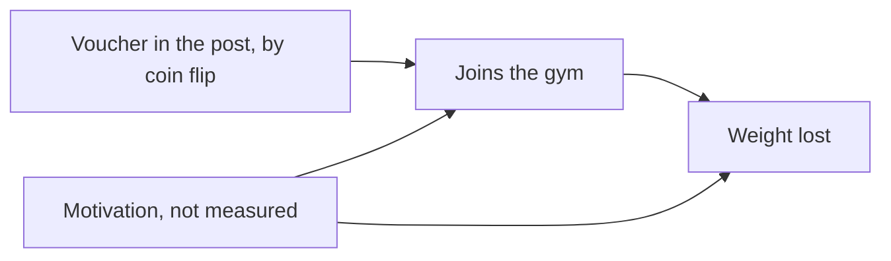
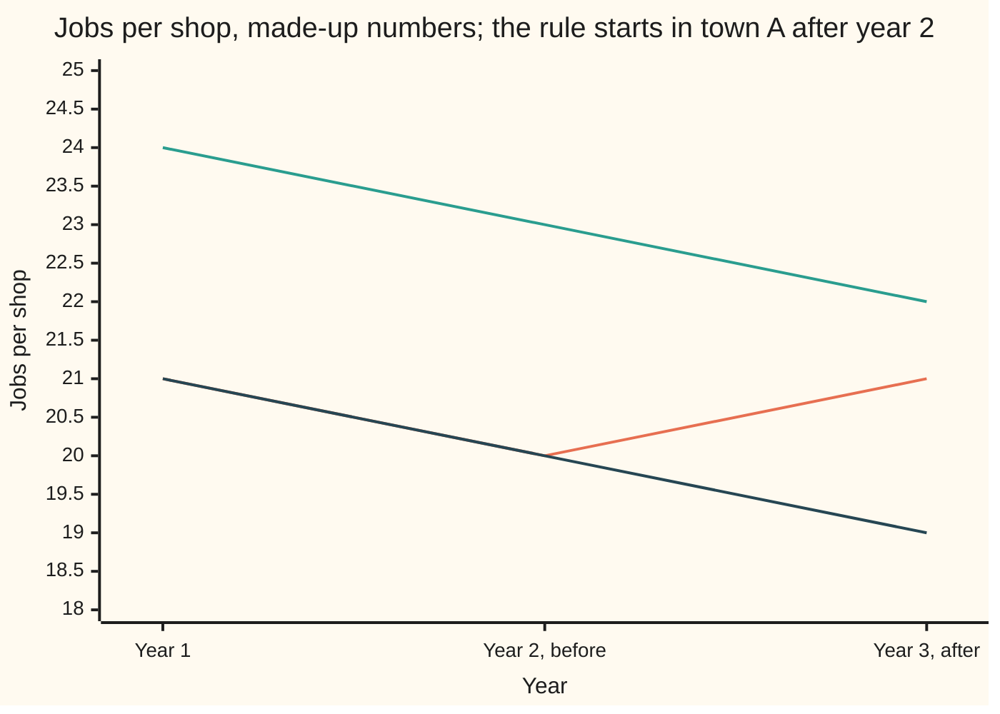

# Instrumental variables and difference-in-differences: causal effects when a confounder is unmeasured

[Syllabus](../../../SYLLABUS.md) → [Probability and statistics](../README.md) → [Survival, Design and Causality](../README.md#s13) → Instrumental variables and difference-in-differences

---

## General Overview

Does joining a gym make people lose weight? Comparing members with non-members gives a misleading answer. People who join are often the motivated ones, and motivated people lose weight anyway. Motivation is a **confounder**: a third variable linked both to joining and to weight lost. No one has measured it, so it cannot be held fixed.

A city health office tries something else. It flips a coin for each resident and mails a free gym voucher to the winners. Six months later, sign-up is 20% among people with no voucher and 50% among people with one. Average weight loss is 1.0 kg without a voucher and 1.9 kg with one. The numbers on this card are made up, chosen to work by hand.

The voucher moved sign-up by 0.30 (30 people in 100) and weight loss by 0.9 kg. The coin flip cannot be linked to motivation. If the voucher changes weight only by getting people to join, the 0.9 kg came entirely from those extra 30 sign-ups in every 100. Each extra sign-up is worth 0.9 / 0.3 = **3.0 kg**. A plain members-against-non-members comparison says 3.59 kg, because it mixes the gym with motivation.

The voucher is an **instrument**: a push on the treatment that is as good as random and reaches the outcome only through the treatment. The ratio of its two effects is the **Wald ratio**. A second idea on this card, **difference-in-differences**, uses a comparison group's change over time in place of a coin flip.

**When an unmeasured confounder blocks a direct comparison, an instrument that moves the treatment at random, and touches the outcome only through it, gives the treatment's effect as a ratio: the instrument's effect on the outcome divided by its effect on the treatment; when no instrument exists, a comparison group's change over time can stand in for the change the treated group would have had, if both groups would have moved in parallel.**

**What kind of fact this is:** two theorems about averages, proved on this card in Why it works. Each rests on conditions (exclusion, no defiers, parallel trends) that are assumptions about the world. The data can test parts of them, never all.

### The picture: the arrows the instrument needs



The voucher reaches weight lost only through joining. Nothing points from motivation into the voucher, because a coin decided it. The drawing uses the conventions of [Causal graphs](08-causal-graphs-and-back-door-adjustment.md). There, a confounder is handled by holding it fixed; here that is impossible, because motivation was never recorded.

---

## The formula

Notation first, in words. The letters are the ones instrumental-variable work uses, not those of [Causal graphs](08-causal-graphs-and-back-door-adjustment.md), where $`Z`$ was stone size and $`T`$ the treatment.

- $`Z`$ is the instrument: 1 if a person was mailed a voucher, 0 if not.
- $`D`$ is the treatment: 1 if the person joined the gym, 0 if not.
- $`Y`$ is the outcome: kilograms lost in six months.
- $`E[Y \mid Z=1]`$ is the average of $`Y`$ among people with $`Z = 1`$. $`\mathrm{Cov}`$ is a covariance: the average product of two variables' distances from their own means.

The **Wald ratio**:

```math
\beta_{\mathrm{IV}} = \frac{E[Y \mid Z=1] - E[Y \mid Z=0]}{E[D \mid Z=1] - E[D \mid Z=0]} = \frac{\mathrm{Cov}(Z, Y)}{\mathrm{Cov}(Z, D)}
```

**Read it aloud:** the treatment's effect is how much the instrument moved the outcome, divided by how much it moved the treatment.

**Two-stage least squares** (2SLS) is the same idea written as two regressions, which can also carry measured covariates (extra recorded variables, such as starting weight $`W`$):

```math
\text{Stage 1: } D = \pi_0 + \pi_1 Z + \gamma_1 W + \text{error} \ \Rightarrow\ \hat D, \qquad \text{Stage 2: } Y = \alpha + \beta\, \hat D + \gamma_2 W + \text{error}
```

**Read it aloud:** first predict sign-up from the voucher and starting weight, then regress weight lost on that prediction and starting weight; the slope on the prediction is the effect. Without a covariate, drop the $`\gamma`$ terms.

**Difference-in-differences** (DiD), for town A, which got a new rule, and town B, which did not:

```math
\delta = \big(\bar y_{A,\mathrm{after}} - \bar y_{A,\mathrm{before}}\big) - \big(\bar y_{B,\mathrm{after}} - \bar y_{B,\mathrm{before}}\big)
```

**Read it aloud:** the treated town's change, minus the untreated town's change over the same years.

| Symbol | Plain meaning | In our example | Push it up and the answer… |
| --- | --- | --- | --- |
| $`Z`$, $`p`$ | instrument: voucher mailed (1) or not (0); $`p`$ is the share with $`Z = 1`$ | coin flip, $`p`$ = 0.5 | — |
| $`D`$ | treatment: joined the gym (1) or not (0) | sign-up 0.20 without, 0.50 with voucher | — |
| $`Y`$ | outcome: kg lost in six months | 1.00 without, 1.90 with voucher | — |
| $`U`$ | the unmeasured confounder | motivation | the plain comparison drifts further from the truth |
| $`E[\cdot \mid \cdot]`$, $`\mathrm{Cov}`$, $`V`$ | average within a group; covariance; $`V`$ stands for either $`Y`$ or $`D`$ in the proof | $`E[Y \mid Z=1]`$ = 1.90 | — |
| $`\beta_{\mathrm{IV}}`$, $`\beta`$ | effect of joining, in kg per sign-up | 3.00 | — |
| $`\hat D`$, $`\pi_0`$, $`\pi_1`$ | stage-1 predicted sign-up; its intercept and voucher slope | $`\pi_1`$ about 0.30 | a bigger $`\pi_1`$ gives a steadier estimate |
| $`\alpha`$, $`\varepsilon`$ | intercept; error, everything else that moves $`Y`$ | $`\varepsilon`$ includes motivation | — |
| $`W`$, $`\gamma_1`$, $`\gamma_2`$ | a measured covariate; its coefficients in stages 1 and 2 | starting weight | adding it shrinks the error bar: SE 0.2089 to 0.1627 |
| $`F`$ | first-stage F statistic: $`\pi_1`$'s estimate divided by its standard error, squared | 447.9 in the sample | above 10 counts as a strong instrument |
| $`\bar y_{g,t}`$, $`\bar y_{A,\mathrm{after}}(0)`$ | mean jobs per shop in town $`g`$ in period $`t`$; town A's after-mean had there been no rule | town A: 20.0 before, 21.0 after; 19.0 without the rule | — |
| $`\delta`$ | difference-in-differences: the rule's effect | +2.0 jobs per shop | — |

### When it holds

- **Relevance: the instrument moves the treatment.** If the voucher changed sign-up by zero, the ratio divides by zero. If it changes sign-up only a little, the ratio is wildly unstable: with a 3-point lift, 90% of simulated studies land anywhere from −5.43 to 8.51 kg.
- **Exclusion: the instrument touches the outcome only through the treatment.** If the voucher letter also carried diet tips worth 0.15 kg, the ratio reads (0.9 + 0.15) / 0.3 = 3.50 kg, not 3.00. No test on these data can detect this.
- **Independence: the instrument is as good as random.** The coin flip makes this true by design. If vouchers went to people who asked for them, the motivated would get more, and the confounder returns.
- **No defiers.** Nobody joins *because* they did not get a voucher. With different effects for different people, this is what makes the ratio equal the compliers' effect (Step 2).
- **Parallel trends, for DiD.** Without the rule, town A would have changed by the same amount as town B. If A would have stayed flat instead, the true effect is +1.0 jobs per shop, and DiD still reports +2.0.

---

## Why it works

### Step 0: let a coin flip push the treatment

Motivation and gym membership are tangled, and nothing in the data can untangle them directly. A coin flip is tangled with nothing. If the coin moves sign-up, and sign-up is the only road from the coin to weight, then every kilogram the coin moves travelled along that road. Measure both movements and divide.

### Step 1: in a straight-line model, the ratio is the effect

Write weight lost as $`Y = \alpha + \beta D + \varepsilon`$. Here $`\beta`$ is the effect of joining, and the error $`\varepsilon`$ holds everything else, motivation included. Least squares of $`Y`$ on $`D`$ fails because $`D`$ and $`\varepsilon`$ are correlated: the motivated join, and the motivated lose weight.

Take the covariance of both sides with $`Z`$. Covariance splits over sums, and a constant has none:

```math
\mathrm{Cov}(Z, Y) = \beta\, \mathrm{Cov}(Z, D) + \mathrm{Cov}(Z, \varepsilon)
```

Independence and exclusion together say $`\mathrm{Cov}(Z, \varepsilon) = 0`$: the coin is unrelated to everything else that moves weight. Relevance says $`\mathrm{Cov}(Z, D) \ne 0`$. Divide, and $`\beta = \mathrm{Cov}(Z, Y) / \mathrm{Cov}(Z, D)`$.

For a 0-or-1 instrument, each covariance is a difference of two group averages times the same factor, so the covariance ratio is the Wald ratio. On the 4,000-person sample in the checks, both give 2.7876 kg.

<details>
<summary>Detailed proof: with a 0-or-1 instrument, the covariance ratio equals the Wald ratio</summary>

Let $`p`$ be the share of people with $`Z = 1`$. For any variable $`V`$, the covariance with $`Z`$ is $`E[ZV] - E[Z]\,E[V]`$.

Here $`E[Z] = p`$ and $`E[ZV] = p\,E[V \mid Z=1]`$. The overall mean is $`E[V] = p\,E[V \mid Z=1] + (1-p)\,E[V \mid Z=0]`$. Substituting:

$`\displaystyle \mathrm{Cov}(Z, V) = p\,E[V \mid Z=1] - p^2\,E[V \mid Z=1] - p(1-p)\,E[V \mid Z=0] = p(1-p)\,\big(E[V \mid Z=1] - E[V \mid Z=0]\big).`$

Apply this with $`V = Y`$ and with $`V = D`$. The factor $`p(1-p)`$ appears in both and cancels in the ratio. The same algebra holds for sample averages, which is why the checks find the two equal to nine decimal places.

</details>

### Step 2: when effects differ, the ratio is the compliers' effect

The straight-line model assumes one effect for everyone. Real people differ. Sort them by what they would do with and without a voucher:

| Type | Without voucher | With voucher | Share | kg lost without the gym → with it |
| --- | --- | --- | --- | --- |
| **Always-takers** | join | join | 0.20 | 1.0 → 4.0 |
| **Compliers** | stay home | join | 0.30 | 0.5 → 3.5 |
| **Never-takers** | stay home | stay home | 0.50 | 0.1 → 1.1 |
| **Defiers** | join | stay home | assumed 0 | — |

The coin gives each arm the same mix of types. Always-takers and never-takers do the same thing in both arms, and the voucher does nothing else to them, so their weight loss is the same in both arms. The whole gap between arms comes from compliers:

- Sign-up gap = share of compliers = 0.30.
- Weight gap = share of compliers × compliers' effect = 0.30 × 3.0 = 0.9 kg.

The ratio is 0.9 / 0.3 = 3.0: the **local average treatment effect** (LATE), the average effect among compliers. Here it is local in a specific sense. The average effect over everyone is 2.00 kg, because never-takers would gain only 1.0 kg from a gym they would hardly use. The Wald ratio cannot see them. Defiers would enter the sign-up gap with a minus sign and spoil the cancellation, which is why the no-defiers condition is needed.

The checks rebuild both averages from this table: 1.00 kg in the no-voucher arm, 1.90 kg in the voucher arm. Members against non-members, mixing both arms, gives 3.7857 − 0.1923 = 3.59 kg. The plain comparison is too high, because members include every motivated always-taker.

### Step 3: two-stage least squares, and its error bars

Stage 1 regresses $`D`$ on $`Z`$ and keeps the prediction $`\hat D`$: the part of sign-up the coin explains. That part is free of motivation. Stage 2 regresses $`Y`$ on $`\hat D`$. With one 0-or-1 instrument and nothing else, stage 1 predicts the two arms' sign-up rates, stage 2 joins two points, and its slope is exactly the Wald ratio. The checks solve both stages by the normal equations of [Multiple regression](../09-Regression/03-multiple-regression-and-gauss-markov.md) and get 2.7876 kg, equal to the Wald ratio.

2SLS earns its keep when there is more to add. Put starting weight $`W`$ into both stages. Heavier people lose more, so $`W`$ soaks up part of the error. The estimate moves to 2.8436 kg and its standard error (the typical size of chance error) drops from 0.2089 to 0.1627.

The error bar needs care. The residuals, the misses used to estimate the error spread, must be $`Y - \hat\alpha - \hat\beta D`$ with the *real* $`D`$. Running stage 2 as an ordinary regression uses $`\hat D`$ instead, and its printed standard error is wrong: 0.2678 instead of 0.2089. Otherwise the standard-error formula is the one in [Regression error bars](../09-Regression/02-regression-inference.md).

### Step 4: a weak instrument divides by almost nothing

The Wald ratio has a sample average in its denominator. When the voucher barely moves sign-up, that denominator is small and noisy, and the ratio jumps around. The checks run 150 studies of 2,000 people in two worlds:

| Voucher lifts sign-up by | Median of 150 estimates | Middle 90% of estimates | Studies with $`F`$ over 10 |
| --- | --- | --- | --- |
| 30 points | 2.98 kg | 2.59 to 3.41 kg | 150 of 150 |
| 3 points | 2.77 kg | −5.43 to 8.51 kg | 11 of 150 |

The first-stage $`F`$ statistic is the warning light. A common rule of thumb calls an instrument weak when $`F`$ is below 10. In the 4,000-person sample of Step 3, $`F`$ is 447.9.

A weak instrument also magnifies any failure of exclusion. A direct effect of 0.15 kg adds 0.15 / 0.30 = 0.50 kg of bias at a 30-point lift. At a 3-point lift it adds 0.15 / 0.03 = 5.00 kg.

### Step 5: difference-in-differences lets a second group stand in for the coin

Sometimes nothing random moves the treatment. A new rule starts in one place and not another. Here, town A brings in a rule (say, a higher minimum wage) after year 2; town B does not. Jobs per shop in town A go from 20.0 to 21.0; in town B, from 23.0 to 22.0.

Two plain comparisons fail. Before-and-after in town A alone says +1.0, but jobs were falling everywhere. After-only, town A against town B, says −1.0, but town A always had fewer jobs per shop.

DiD subtracts both problems away. Anything fixed about a town, such as its size or its kind of shops, cancels in that town's own change. Anything that hit both towns at once, such as a slow year, cancels when the two changes are subtracted. Under **parallel trends**, town A would have followed town B's −1.0 without the rule:

- Town A without the rule: 20.0 + (−1.0) = 19.0.
- Effect: 21.0 − 19.0 = +2.0 jobs per shop.

The same argument in symbols. Write $`\bar y_{A,\mathrm{after}}(0)`$ for town A's after-mean had there been no rule. Adding and subtracting it splits the DiD in two:

```math
\delta = \big(\bar y_{A,\mathrm{after}} - \bar y_{A,\mathrm{after}}(0)\big) + \Big[\big(\bar y_{A,\mathrm{after}}(0) - \bar y_{A,\mathrm{before}}\big) - \big(\bar y_{B,\mathrm{after}} - \bar y_{B,\mathrm{before}}\big)\Big]
```

The first bracket is the rule's effect on town A. The second is town A's change without the rule minus town B's change, and parallel trends says it is 0. So under parallel trends, $`\delta`$ is the rule's effect on the town that got it.

### The picture: town A against the path it would have taken



Orange: town A. Green: town B. Dark blue: town A without the rule, following town B's slope after year 2. The gap between orange and dark blue in year 3 is the effect, +2.0.

Year 1 is a check on the assumption. Between years 1 and 2, before any rule, both towns fell by 1.0. That is a **placebo** difference-in-differences: the same calculation where the effect must be zero. Here it is +0.0. Parallel trends before the rule do not prove parallel trends after it, but a non-zero placebo is a clear warning.

The same estimate comes out of one regression on shop-level data: jobs on a constant, a town-A indicator (1 for a town-A shop, 0 otherwise), an after indicator (1 in year 3), and their product. The product's coefficient is $`\delta`$. The checks simulate 60 shops a town, each with its own level and yearly noise, and get +2.1322 three ways: from four means, from the regression, and from the mean of each shop's own change. The standard error is 0.2728, and the placebo is −0.2848 (SE 0.2560), within chance of zero.

---

## Worked numbers, by hand

| Step | Arithmetic | Value |
| --- | --- | --- |
| voucher's effect on sign-up | 0.50 − 0.20 | 0.30 |
| voucher's effect on weight lost | 1.90 − 1.00 | 0.90 kg |
| **Wald ratio** | 0.90 / 0.30 | **3.00 kg per sign-up** |
| check from the type table | compliers' share 0.30 × effect 3.0, over 0.30 | 3.00 kg |
| town A's change | 21.0 − 20.0 | +1.0 |
| town B's change | 22.0 − 23.0 | −1.0 |
| **difference-in-differences** | +1.0 − (−1.0) | **+2.0 jobs per shop** |
| placebo, years 1 to 2 | (20.0 − 21.0) − (23.0 − 24.0) | +0.0 |

Joining the gym takes off about 3 kg for the people the voucher persuaded, and the rule added about 2 jobs per shop in town A, if the towns would otherwise have moved together.

### What breaks if you drop a piece

| Mistake | Comes out at | What went wrong |
| --- | --- | --- |
| Members against non-members | 3.59 kg, against 3.00 | Members include the motivated, who lose weight anyway |
| Voucher's effect on weight read as the gym's | 0.90 kg, against 3.00 | Only 30 in 100 people were moved to join; divide by 0.30 |
| Voucher letter also worth 0.15 kg on its own | 3.50 kg, against 3.00 | Exclusion fails; the direct effect is credited to the gym |
| Before-and-after in town A only | +1.0 jobs, against +2.0 | Ignores the fall that hit both towns |
| Town A against town B after the rule only | −1.0 jobs, against +2.0 | Ignores that town A always had fewer jobs per shop |

The code prints all five.

---

## Code, from first principles, and it actually runs

The checks take five roads. The Wald ratio from four averages is compared with the compliers' effect read off the type table. On a seeded sample of 4,000 people, the Wald ratio, the covariance ratio and two-stage least squares (both stages solved by the normal equations) must agree to nine decimals, and must land within four standard errors of 3.0. A repeated-sampling run shows a weak instrument spreading out. For DiD, the hand calculation is compared with a regression on the four means, and on 60 simulated shops a town the four-means, regression and per-shop-change estimates must agree, with the estimate near 2.0 and the placebo near 0. Random numbers come from SplitMix64, a small generator written out in both languages with seed 20261123, so both print the same digits.

### Python

```python
# Instrumental variables and difference-in-differences -- the check behind the card.
# Standard library only.  Every number is made up for hand work.  Roads: Wald ratio
# against the compliers' own effect, two-stage least squares and the covariance ratio;
# DiD from four means against a regression with an interaction and per-shop changes.
from math import sqrt

def solve(a, b):                                 # Gaussian elimination, partial pivoting
    n, m = len(b), [row[:] + [b[i]] for i, row in enumerate(a)]
    for c in range(n):
        p = max(range(c, n), key=lambda r: abs(m[r][c])); m[c], m[p] = m[p], m[c]
        for r in range(n):
            if r != c:
                m[r] = [x - m[r][c] / m[c][c] * y for x, y in zip(m[r], m[c])]
    return [m[i][n] / m[i][i] for i in range(n)]

def gram(X):                                     # X^T X
    return [[sum(r[i] * r[j] for r in X) for j in range(len(X[0]))] for i in range(len(X[0]))]

def ols(X, y):                                   # least squares by the normal equations
    return solve(gram(X), [sum(r[i] * v for r, v in zip(X, y)) for i in range(len(X[0]))])

def se(X, resid, j):                             # s * sqrt of entry j of (X^T X)^-1
    e = [0.0] * len(X[0]); e[j] = 1.0
    return sqrt(sum(r * r for r in resid) / (len(X) - len(X[0])) * solve(gram(X), e)[j])

M64, state = (1 << 64) - 1, 20261123              # SplitMix64, seed stated
def uniform():
    global state
    state = (state + 0x9E3779B97F4A7C15) & M64
    z = ((state ^ (state >> 30)) * 0xBF58476D1CE4E5B9) & M64
    z = ((z ^ (z >> 27)) * 0x94D049BB133111EB) & M64
    return ((z ^ (z >> 31)) >> 11) / 9007199254740992.0
def bell():                                      # mean 0, spread 1: four uniforms summed
    return (uniform() + uniform() + uniform() + uniform() - 2.0) * sqrt(3.0)

# ---- the gym voucher, exact: type -> (share, kg lost without the gym, gym's effect in kg)
TYPES = {"always": (0.20, 1.0, 3.0), "complier": (0.30, 0.5, 3.0), "never": (0.50, 0.1, 1.0)}
joins = lambda t, z: t == "always" or (t == "complier" and z == 1)
def arm(z, letter=0.0):                          # sign-up share and mean kg lost in one arm
    d = sum(s for t, (s, _, _) in TYPES.items() if joins(t, z))
    y = sum(s * (y0 + (eff if joins(t, z) else 0.0)) for t, (s, y0, eff) in TYPES.items())
    return d, y + letter * z
print("types: share, kg lost without -> with the gym: " + "; ".join(f"{t} {s:.2f}, {a:.1f} -> {a + e:.1f}"
                                                                   for t, (s, a, e) in TYPES.items()))
(d0, y0), (d1, y1) = arm(0), arm(1)
wald = (y1 - y0) / (d1 - d0)
late, ate = TYPES["complier"][2], sum(s * eff for s, _, eff in TYPES.values())  # off the table
print(f"no voucher: sign-up {d0:.2f}, mean loss {y0:.2f} kg; voucher: sign-up {d1:.2f}, mean loss {y1:.2f} kg")
print(f"Wald = {y1 - y0:.2f} / {d1 - d0:.2f} = {wald:.2f} kg per sign-up; compliers' own effect {late:.2f}; "
      f"average effect over everyone {ate:.2f}")
assert abs(wald - late) < 1e-12                  # the Wald ratio is the compliers' effect
assert abs(ate - late) > 0.5                     # which here is not the average effect over everyone
mem = [(0.5 * s, y0_ + eff) for t, (s, y0_, eff) in TYPES.items() for z in (0, 1) if joins(t, z)]
non = [(0.5 * s, y0_) for t, (s, y0_, eff) in TYPES.items() for z in (0, 1) if not joins(t, z)]
mean = lambda g: sum(w * v for w, v in g) / sum(w for w, _ in g)
(_, yl0), (_, yl1) = arm(0, 0.15), arm(1, 0.15)
print(f"members {mean(mem):.4f} kg, non-members {mean(non):.4f} kg; what breaks: voucher effect read as the gym's "
      f"{y1 - y0:.2f}; naive gap {mean(mem) - mean(non):.2f}; letter itself worth 0.15 kg -> Wald {(yl1 - yl0) / (d1 - d0):.2f} "
      f"(bias 0.15 / {d1 - d0:.2f} = {0.15 / (d1 - d0):.2f}; with a 3-point lift 0.15 / 0.03 = {0.15 / 0.03:.2f})")

# ---- a seeded sample of 4,000 people, with starting weight W as a measured covariate
rows = []
for _ in range(4000):
    u, z = uniform(), 1 if uniform() < 0.5 else 0
    t = "always" if u < 0.2 else ("complier" if u < 0.5 else "never")
    w = 90.0 + 12.0 * bell()
    d = 1 if joins(t, z) else 0
    rows.append((z, d, w, TYPES[t][1] + TYPES[t][2] * d + 0.1 * (w - 90.0) + 1.5 * bell()))
(Z, D, _, Y), n = (list(c) for c in zip(*rows)), len(rows)
avg = lambda v, zz: sum(a for a, b in zip(v, Z) if b == zz) / Z.count(zz)
s_wald = (avg(Y, 1) - avg(Y, 0)) / (avg(D, 1) - avg(D, 0))
mz, md, my = sum(Z) / n, sum(D) / n, sum(Y) / n
cov_ratio = sum((a - mz) * (c - my) for a, c in zip(Z, Y)) / sum((a - mz) * (b - md) for a, b in zip(Z, D))
print(f"sample n={n}: sign-up {avg(D, 0):.4f} -> {avg(D, 1):.4f}, loss {avg(Y, 0):.4f} -> {avg(Y, 1):.4f} kg")
for label, extra in (("no covariate", lambda r: []), ("with W", lambda r: [r[2] - 90.0])):
    X1 = [[1.0, float(r[0])] + extra(r) for r in rows]
    g1 = ols(X1, D)
    fit = [sum(a * b for a, b in zip(x, g1)) for x in X1]
    f_stat = (g1[1] / se(X1, [d - f for d, f in zip(D, fit)], 1)) ** 2
    X2 = [[1.0, f] + extra(r) for f, r in zip(fit, rows)]
    b = ols(X2, Y)
    right = [y - b[0] - b[1] * d - sum(a * c for a, c in zip(extra(r), b[2:])) for y, d, r in zip(Y, D, rows)]
    wrong = [y - sum(a * c for a, c in zip(x, b)) for y, x in zip(Y, X2)]
    print(f"2SLS {label}: {b[1]:.4f} kg (SE {se(X2, right, 1):.4f}; second-stage SE taken as is "
          f"{se(X2, wrong, 1):.4f}); first-stage F {f_stat:.1f}")
    assert abs(b[1] - 3.0) < 4 * se(X2, right, 1)
    if label == "no covariate":
        assert abs(b[1] - s_wald) < 1e-9 and abs(cov_ratio - s_wald) < 1e-9
        print(f"  Wald from the four sample means {s_wald:.4f}; covariance ratio {cov_ratio:.4f}")
print(f"least squares of loss on sign-up, sample: {ols([[1.0, float(d)] for d in D], Y)[1]:.4f} kg")

# ---- weak instrument: 150 samples of 2,000, voucher lifting sign-up by 30 points or by 3
def wald_once(c_share):
    s = [[0, 0.0, 0.0], [0, 0.0, 0.0]]              # per arm: count, sign-ups, kg lost
    for _ in range(2000):
        u, z = uniform(), 1 if uniform() < 0.5 else 0
        t = "always" if u < 0.2 else ("complier" if u < 0.2 + c_share else "never")
        d = 1 if joins(t, z) else 0
        s[z][0] += 1; s[z][1] += d; s[z][2] += TYPES[t][1] + TYPES[t][2] * d + 1.5 * bell()
    p0, p1 = s[0][1] / s[0][0], s[1][1] / s[1][0]
    f = (p1 - p0) ** 2 / (p0 * (1 - p0) / s[0][0] + p1 * (1 - p1) / s[1][0])
    return (s[1][2] / s[1][0] - s[0][2] / s[0][0]) / (p1 - p0), f
spread = {}
for label, c_share in (("strong, 30 points", 0.30), ("weak, 3 points", 0.03)):
    runs = [wald_once(c_share) for _ in range(150)]
    est = sorted(r[0] for r in runs)
    q = lambda p: est[int(p * 149 + 0.5)]
    spread[label] = q(0.95) - q(0.05)
    print(f"{label}: median {q(0.5):.2f}, middle 90% {q(0.05):.2f} to {q(0.95):.2f} kg; "
          f"samples with F over 10: {sum(1 for r in runs if r[1] > 10)} of 150")
assert spread["weak, 3 points"] > 5 * spread["strong, 30 points"]

# ---- difference-in-differences: jobs per shop, town A gets the rule after year 2
A, B = [21.0, 20.0, 21.0], [24.0, 23.0, 22.0]    # years 1, 2, 3
did, counterfactual = (A[2] - A[1]) - (B[2] - B[1]), A[1] + (B[2] - B[1])
print(f"by hand: A {A[1]:.1f} -> {A[2]:.1f}, B {B[1]:.1f} -> {B[2]:.1f}; DiD {did:+.1f}; "
      f"A without the rule {counterfactual:.1f}, effect {A[2] - counterfactual:+.1f}; "
      f"placebo years 1-2 {(A[1] - A[0]) - (B[1] - B[0]):+.1f}")
assert abs(did - ols([[1.0, tr, af, tr * af] for tr in (1.0, 0.0) for af in (0.0, 1.0)], [A[1], A[2], B[1], B[2]])[3]) < 1e-9
print(f"what breaks: before-after in A only {A[2] - A[1]:+.1f}; after-only gap {A[2] - B[2]:+.1f}; "
      f"if A would have stayed flat, true effect {A[2] - A[1]:+.1f} but DiD still says {did:+.1f}")
print(f"chart, town A: {', '.join(f'{v:.1f}' for v in A)}; town B: {', '.join(f'{v:.1f}' for v in B)}; "
      f"town A without the rule: {A[0]:.1f}, {A[1]:.1f}, {counterfactual:.1f}")
shops = []                                       # (treated, jobs in years 1, 2, 3)
for town, mu in ((1, A), (0, B)):                # each shop: its own level, then yearly noise
    shops += [(town, (lambda lv: [m + lv + bell() for m in mu])(3.0 * bell())) for _ in range(60)]
cell = lambda tr, yr: sum(s[1][yr] for s in shops if s[0] == tr) / 60
four = (cell(1, 2) - cell(1, 1)) - (cell(0, 2) - cell(0, 1))
X = [[1.0, float(tr), float(yr == 2), float(tr and yr == 2)] for tr, _ in shops for yr in (1, 2)]
reg = ols(X, [v[yr] for _, v in shops for yr in (1, 2)])[3]
ch, pl = ({tr: [v[b] - v[a] for t, v in shops if t == tr] for tr in (0, 1)} for a, b in ((1, 2), (0, 1)))
def gap(c):                                      # difference in mean changes, and its SE
    m = {k: sum(v) / 60 for k, v in c.items()}
    return m[1] - m[0], sqrt(sum(sum((x - m[k]) ** 2 for x in c[k]) / 59 / 60 for k in (0, 1)))
(est, s_e), (plc, s_p) = gap(ch), gap(pl)
print(f"sample, 60 shops a town: four means {four:+.4f}; regression interaction {reg:+.4f}; "
      f"per-shop changes {est:+.4f} (SE {s_e:.4f}); placebo {plc:+.4f} (SE {s_p:.4f})")
assert abs(four - reg) < 1e-9 and abs(four - est) < 1e-9
assert abs(est - 2.0) < 4 * s_e and abs(plc) < 4 * s_p
print("ALL CHECKS PASS")
```

**Ran 2026-11-23 on macOS, Python 3.14.10, standard library only. All checks passed. Output, pasted from the run:**

```
types: share, kg lost without -> with the gym: always 0.20, 1.0 -> 4.0; complier 0.30, 0.5 -> 3.5; never 0.50, 0.1 -> 1.1
no voucher: sign-up 0.20, mean loss 1.00 kg; voucher: sign-up 0.50, mean loss 1.90 kg
Wald = 0.90 / 0.30 = 3.00 kg per sign-up; compliers' own effect 3.00; average effect over everyone 2.00
members 3.7857 kg, non-members 0.1923 kg; what breaks: voucher effect read as the gym's 0.90; naive gap 3.59; letter itself worth 0.15 kg -> Wald 3.50 (bias 0.15 / 0.30 = 0.50; with a 3-point lift 0.15 / 0.03 = 5.00)
sample n=4000: sign-up 0.1992 -> 0.5022, loss 0.9883 -> 1.8331 kg
2SLS no covariate: 2.7876 kg (SE 0.2089; second-stage SE taken as is 0.2678); first-stage F 447.9
  Wald from the four sample means 2.7876; covariance ratio 2.7876
2SLS with W: 2.8436 kg (SE 0.1627; second-stage SE taken as is 0.2344); first-stage F 447.7
least squares of loss on sign-up, sample: 3.5632 kg
strong, 30 points: median 2.98, middle 90% 2.59 to 3.41 kg; samples with F over 10: 150 of 150
weak, 3 points: median 2.77, middle 90% -5.43 to 8.51 kg; samples with F over 10: 11 of 150
by hand: A 20.0 -> 21.0, B 23.0 -> 22.0; DiD +2.0; A without the rule 19.0, effect +2.0; placebo years 1-2 +0.0
what breaks: before-after in A only +1.0; after-only gap -1.0; if A would have stayed flat, true effect +1.0 but DiD still says +2.0
chart, town A: 21.0, 20.0, 21.0; town B: 24.0, 23.0, 22.0; town A without the rule: 21.0, 20.0, 19.0
sample, 60 shops a town: four means +2.1322; regression interaction +2.1322; per-shop changes +2.1322 (SE 0.2728); placebo -0.2848 (SE 0.2560)
ALL CHECKS PASS
```

### Rust

Same numbers, same labels, built with `rustc --edition 2021 -O`.

```rust
// Instrumental variables and difference-in-differences -- the same check as the
// Python, in Rust.  No crates.  Every number is made up for hand work.  Roads: Wald
// ratio against the compliers' own effect, two-stage least squares and the covariance
// ratio; DiD from four means against a regression with an interaction and per-shop changes.

fn solve(a: &[Vec<f64>], b: &[f64]) -> Vec<f64> { // Gaussian elimination, partial pivoting
    let n = b.len();
    let mut m: Vec<Vec<f64>> = a.iter().enumerate().map(|(i, r)| { let mut r = r.clone(); r.push(b[i]); r }).collect();
    for c in 0..n {
        let p = (c..n).fold(c, |best, r| if m[r][c].abs() > m[best][c].abs() { r } else { best });
        m.swap(c, p);
        let pivot = m[c].clone();
        for r in (0..n).filter(|&r| r != c) {
            let row: Vec<f64> = m[r].iter().zip(&pivot).map(|(x, y)| x - m[r][c] / pivot[c] * y).collect();
            m[r] = row;
        }
    }
    (0..n).map(|i| m[i][n] / m[i][i]).collect()
}

fn gram(x: &[Vec<f64>]) -> Vec<Vec<f64>> { // X^T X
    (0..x[0].len()).map(|i| (0..x[0].len()).map(|j| x.iter().map(|r| r[i] * r[j]).sum()).collect()).collect()
}

fn ols(x: &[Vec<f64>], y: &[f64]) -> Vec<f64> { // least squares by the normal equations
    let xty: Vec<f64> = (0..x[0].len()).map(|i| x.iter().zip(y).map(|(r, v)| r[i] * v).sum()).collect();
    solve(&gram(x), &xty)
}

fn se(x: &[Vec<f64>], resid: &[f64], j: usize) -> f64 { // s * sqrt of entry j of (X^T X)^-1
    let e: Vec<f64> = (0..x[0].len()).map(|i| if i == j { 1.0 } else { 0.0 }).collect();
    let ss: f64 = resid.iter().map(|r| r * r).sum();
    (ss / (x.len() - x[0].len()) as f64 * solve(&gram(x), &e)[j]).sqrt()
}

struct Rng(u64); // SplitMix64, seed stated; bell(): mean 0, spread 1, four uniforms summed
impl Rng {
    fn uniform(&mut self) -> f64 {
        self.0 = self.0.wrapping_add(0x9E3779B97F4A7C15);
        let mut z = (self.0 ^ (self.0 >> 30)).wrapping_mul(0xBF58476D1CE4E5B9);
        z = (z ^ (z >> 27)).wrapping_mul(0x94D049BB133111EB);
        ((z ^ (z >> 31)) >> 11) as f64 / 9007199254740992.0
    }
    fn bell(&mut self) -> f64 { (self.uniform() + self.uniform() + self.uniform() + self.uniform() - 2.0) * 3.0f64.sqrt() }
}

// the gym voucher, exact: type -> (share, kg lost without the gym, gym's effect in kg)
const TYPES: [(f64, f64, f64); 3] = [(0.20, 1.0, 3.0), (0.30, 0.5, 3.0), (0.50, 0.1, 1.0)]; // always, complier, never
fn joins(t: usize, z: usize) -> bool { t == 0 || (t == 1 && z == 1) }
fn arm(z: usize, letter: f64) -> (f64, f64) { // sign-up share and mean kg lost in one arm
    let d: f64 = (0..3).filter(|&t| joins(t, z)).map(|t| TYPES[t].0).sum();
    let y: f64 = (0..3).map(|t| TYPES[t].0 * (TYPES[t].1 + if joins(t, z) { TYPES[t].2 } else { 0.0 })).sum();
    (d, y + letter * z as f64)
}
fn draw(rng: &mut Rng, c_share: f64) -> (usize, usize) { // a person's type, then the voucher coin
    let u = rng.uniform();
    (if u < 0.2 { 0 } else if u < 0.2 + c_share { 1 } else { 2 }, if rng.uniform() < 0.5 { 1 } else { 0 })
}

fn wald_once(rng: &mut Rng, c_share: f64) -> (f64, f64) {
    let mut s = [[0.0f64; 3]; 2]; // per arm: count, sign-ups, kg lost
    for _ in 0..2000 {
        let (t, z) = draw(rng, c_share);
        let d = if joins(t, z) { 1.0 } else { 0.0 };
        s[z][0] += 1.0; s[z][1] += d; s[z][2] += TYPES[t].1 + TYPES[t].2 * d + 1.5 * rng.bell();
    }
    let (p0, p1) = (s[0][1] / s[0][0], s[1][1] / s[1][0]);
    let f = (p1 - p0).powi(2) / (p0 * (1.0 - p0) / s[0][0] + p1 * (1.0 - p1) / s[1][0]);
    ((s[1][2] / s[1][0] - s[0][2] / s[0][0]) / (p1 - p0), f)
}

fn gap(c: &[Vec<f64>; 2]) -> (f64, f64) { // difference in mean changes, and its SE
    let m: Vec<f64> = c.iter().map(|v| v.iter().sum::<f64>() / 60.0).collect();
    let v: f64 = (0..2).map(|k| c[k].iter().map(|x| (x - m[k]).powi(2)).sum::<f64>() / 59.0 / 60.0).sum();
    (m[1] - m[0], v.sqrt())
}

fn main() {
    let mut rng = Rng(20261123);
    let names = ["always", "complier", "never"];
    println!("types: share, kg lost without -> with the gym: {}", (0..3).map(|t| format!("{} {:.2}, {:.1} -> {:.1}", names[t], TYPES[t].0, TYPES[t].1, TYPES[t].1 + TYPES[t].2)).collect::<Vec<_>>().join("; "));
    let ((d0, y0), (d1, y1)) = (arm(0, 0.0), arm(1, 0.0));
    let (late, ate) = (TYPES[1].2, TYPES.iter().map(|t| t.0 * t.2).sum::<f64>()); // off the table
    println!("no voucher: sign-up {:.2}, mean loss {:.2} kg; voucher: sign-up {:.2}, mean loss {:.2} kg", d0, y0, d1, y1);
    let wald = (y1 - y0) / (d1 - d0);
    println!("Wald = {:.2} / {:.2} = {:.2} kg per sign-up; compliers' own effect {:.2}; average effect over everyone {:.2}", y1 - y0, d1 - d0, wald, late, ate);
    assert!((wald - late).abs() < 1e-12); // the Wald ratio is the compliers' effect
    assert!((ate - late).abs() > 0.5); // which here is not the average effect over everyone
    let (mut mem, mut non) = (Vec::new(), Vec::new());
    for t in 0..3 { for z in 0..2 {
        if joins(t, z) { mem.push((0.5 * TYPES[t].0, TYPES[t].1 + TYPES[t].2)) } else { non.push((0.5 * TYPES[t].0, TYPES[t].1)) }
    } }
    let mean = |g: &[(f64, f64)]| g.iter().map(|(w, v)| w * v).sum::<f64>() / g.iter().map(|(w, _)| w).sum::<f64>();
    let ((_, yl0), (_, yl1)) = (arm(0, 0.15), arm(1, 0.15));
    println!("members {:.4} kg, non-members {:.4} kg; what breaks: voucher effect read as the gym's {:.2}; naive gap {:.2}; letter itself worth 0.15 kg -> Wald {:.2} (bias 0.15 / {:.2} = {:.2}; with a 3-point lift 0.15 / 0.03 = {:.2})",
             mean(&mem), mean(&non), y1 - y0, mean(&mem) - mean(&non), (yl1 - yl0) / (d1 - d0), d1 - d0, 0.15 / (d1 - d0), 0.15 / 0.03);

    // a seeded sample of 4,000 people, with starting weight W as a measured covariate
    let mut rows: Vec<(f64, f64, f64, f64)> = Vec::new();
    for _ in 0..4000 {
        let (t, z) = draw(&mut rng, 0.30);
        let w = 90.0 + 12.0 * rng.bell();
        let d = if joins(t, z) { 1.0 } else { 0.0 };
        rows.push((z as f64, d, w, TYPES[t].1 + TYPES[t].2 * d + 0.1 * (w - 90.0) + 1.5 * rng.bell()));
    }
    let n = rows.len() as f64;
    let (zc, dc, yc): (Vec<f64>, Vec<f64>, Vec<f64>) = (rows.iter().map(|r| r.0).collect(), rows.iter().map(|r| r.1).collect(), rows.iter().map(|r| r.3).collect());
    let avg = |v: &[f64], zz: f64| v.iter().zip(&zc).filter(|(_, b)| **b == zz).map(|(a, _)| a).sum::<f64>() / zc.iter().filter(|b| **b == zz).count() as f64;
    let s_wald = (avg(&yc, 1.0) - avg(&yc, 0.0)) / (avg(&dc, 1.0) - avg(&dc, 0.0));
    let (mz, md, my) = (zc.iter().sum::<f64>() / n, dc.iter().sum::<f64>() / n, yc.iter().sum::<f64>() / n);
    let cov_ratio = zc.iter().zip(&yc).map(|(a, c)| (a - mz) * (c - my)).sum::<f64>() / zc.iter().zip(&dc).map(|(a, b)| (a - mz) * (b - md)).sum::<f64>();
    println!("sample n={}: sign-up {:.4} -> {:.4}, loss {:.4} -> {:.4} kg", n, avg(&dc, 0.0), avg(&dc, 1.0), avg(&yc, 0.0), avg(&yc, 1.0));
    for (label, with_w) in [("no covariate", false), ("with W", true)] {
        let extra = |r: &(f64, f64, f64, f64)| if with_w { vec![r.2 - 90.0] } else { vec![] };
        let x1: Vec<Vec<f64>> = rows.iter().map(|r| { let mut v = vec![1.0, r.0]; v.extend(extra(r)); v }).collect();
        let g1 = ols(&x1, &dc);
        let fit: Vec<f64> = x1.iter().map(|x| x.iter().zip(&g1).map(|(a, b)| a * b).sum()).collect();
        let f_stat = (g1[1] / se(&x1, &dc.iter().zip(&fit).map(|(d, f)| d - f).collect::<Vec<f64>>(), 1)).powi(2);
        let x2: Vec<Vec<f64>> = fit.iter().zip(&rows).map(|(f, r)| { let mut v = vec![1.0, *f]; v.extend(extra(r)); v }).collect();
        let b = ols(&x2, &yc);
        let right: Vec<f64> = rows.iter().map(|r| r.3 - b[0] - b[1] * r.1 - extra(r).iter().zip(&b[2..]).map(|(a, c)| a * c).sum::<f64>()).collect();
        let wrong: Vec<f64> = yc.iter().zip(&x2).map(|(y, x)| y - x.iter().zip(&b).map(|(a, c)| a * c).sum::<f64>()).collect();
        println!("2SLS {}: {:.4} kg (SE {:.4}; second-stage SE taken as is {:.4}); first-stage F {:.1}", label, b[1], se(&x2, &right, 1), se(&x2, &wrong, 1), f_stat);
        assert!((b[1] - 3.0).abs() < 4.0 * se(&x2, &right, 1));
        if !with_w {
            assert!((b[1] - s_wald).abs() < 1e-9 && (cov_ratio - s_wald).abs() < 1e-9);
            println!("  Wald from the four sample means {:.4}; covariance ratio {:.4}", s_wald, cov_ratio);
        }
    }
    println!("least squares of loss on sign-up, sample: {:.4} kg", ols(&dc.iter().map(|d| vec![1.0, *d]).collect::<Vec<_>>(), &yc)[1]);

    // weak instrument: 150 samples of 2,000, voucher lifting sign-up by 30 points or by 3
    let mut spread = [0.0; 2];
    for (i, (label, c_share)) in [("strong, 30 points", 0.30), ("weak, 3 points", 0.03)].iter().enumerate() {
        let runs: Vec<(f64, f64)> = (0..150).map(|_| wald_once(&mut rng, *c_share)).collect();
        let mut est: Vec<f64> = runs.iter().map(|r| r.0).collect();
        est.sort_by(|a, b| a.partial_cmp(b).unwrap());
        let q = |p: f64| est[(p * 149.0 + 0.5) as usize];
        spread[i] = q(0.95) - q(0.05);
        println!("{}: median {:.2}, middle 90% {:.2} to {:.2} kg; samples with F over 10: {} of 150", label, q(0.5), q(0.05), q(0.95), runs.iter().filter(|r| r.1 > 10.0).count());
    }
    assert!(spread[1] > 5.0 * spread[0]);

    // difference-in-differences: jobs per shop, town A gets the rule after year 2
    let (a, bt) = ([21.0f64, 20.0, 21.0], [24.0f64, 23.0, 22.0]); // years 1, 2, 3
    let (did, counterfactual) = ((a[2] - a[1]) - (bt[2] - bt[1]), a[1] + (bt[2] - bt[1]));
    println!("by hand: A {:.1} -> {:.1}, B {:.1} -> {:.1}; DiD {:+.1}; A without the rule {:.1}, effect {:+.1}; placebo years 1-2 {:+.1}", a[1], a[2], bt[1], bt[2], did, counterfactual, a[2] - counterfactual, (a[1] - a[0]) - (bt[1] - bt[0]));
    assert!((did - ols(&[vec![1.0, 1.0, 0.0, 0.0], vec![1.0, 1.0, 1.0, 1.0], vec![1.0, 0.0, 0.0, 0.0], vec![1.0, 0.0, 1.0, 0.0]], &[a[1], a[2], bt[1], bt[2]])[3]).abs() < 1e-9);
    println!("what breaks: before-after in A only {:+.1}; after-only gap {:+.1}; if A would have stayed flat, true effect {:+.1} but DiD still says {:+.1}", a[2] - a[1], a[2] - bt[2], a[2] - a[1], did);
    let j = |v: &[f64; 3]| v.iter().map(|x| format!("{:.1}", x)).collect::<Vec<_>>().join(", ");
    println!("chart, town A: {}; town B: {}; town A without the rule: {:.1}, {:.1}, {:.1}", j(&a), j(&bt), a[0], a[1], counterfactual);
    let mut shops: Vec<(usize, Vec<f64>)> = Vec::new(); // (treated, jobs in years 1, 2, 3)
    for (town, mu) in [(1, a), (0, bt)] { // each shop: its own level, then yearly noise
        for _ in 0..60 { let lv = 3.0 * rng.bell(); shops.push((town, mu.iter().map(|m| m + lv + rng.bell()).collect())) }
    }
    let cell = |tr: usize, yr: usize| shops.iter().filter(|s| s.0 == tr).map(|s| s.1[yr]).sum::<f64>() / 60.0;
    let four = (cell(1, 2) - cell(1, 1)) - (cell(0, 2) - cell(0, 1));
    let (mut x, mut y): (Vec<Vec<f64>>, Vec<f64>) = (Vec::new(), Vec::new());
    for (tr, v) in &shops { for yr in [1, 2] {
        let (t, p) = (*tr as f64, if yr == 2 { 1.0 } else { 0.0 });
        x.push(vec![1.0, t, p, t * p]); y.push(v[yr]);
    } }
    let reg = ols(&x, &y)[3];
    let changes = |s0: usize, s1: usize| [0, 1].map(|tr| shops.iter().filter(|s| s.0 == tr).map(|s| s.1[s1] - s.1[s0]).collect::<Vec<f64>>());
    let ((est, s_e), (plc, s_p)) = (gap(&changes(1, 2)), gap(&changes(0, 1)));
    println!("sample, 60 shops a town: four means {:+.4}; regression interaction {:+.4}; per-shop changes {:+.4} (SE {:.4}); placebo {:+.4} (SE {:.4})", four, reg, est, s_e, plc, s_p);
    assert!((four - reg).abs() < 1e-9 && (four - est).abs() < 1e-9);
    assert!((est - 2.0).abs() < 4.0 * s_e && plc.abs() < 4.0 * s_p);
    println!("ALL CHECKS PASS");
}
```

**Ran 2026-11-23 on macOS, rustc 1.98.1, no crates. All checks passed. Output, pasted from the run:**

```
types: share, kg lost without -> with the gym: always 0.20, 1.0 -> 4.0; complier 0.30, 0.5 -> 3.5; never 0.50, 0.1 -> 1.1
no voucher: sign-up 0.20, mean loss 1.00 kg; voucher: sign-up 0.50, mean loss 1.90 kg
Wald = 0.90 / 0.30 = 3.00 kg per sign-up; compliers' own effect 3.00; average effect over everyone 2.00
members 3.7857 kg, non-members 0.1923 kg; what breaks: voucher effect read as the gym's 0.90; naive gap 3.59; letter itself worth 0.15 kg -> Wald 3.50 (bias 0.15 / 0.30 = 0.50; with a 3-point lift 0.15 / 0.03 = 5.00)
sample n=4000: sign-up 0.1992 -> 0.5022, loss 0.9883 -> 1.8331 kg
2SLS no covariate: 2.7876 kg (SE 0.2089; second-stage SE taken as is 0.2678); first-stage F 447.9
  Wald from the four sample means 2.7876; covariance ratio 2.7876
2SLS with W: 2.8436 kg (SE 0.1627; second-stage SE taken as is 0.2344); first-stage F 447.7
least squares of loss on sign-up, sample: 3.5632 kg
strong, 30 points: median 2.98, middle 90% 2.59 to 3.41 kg; samples with F over 10: 150 of 150
weak, 3 points: median 2.77, middle 90% -5.43 to 8.51 kg; samples with F over 10: 11 of 150
by hand: A 20.0 -> 21.0, B 23.0 -> 22.0; DiD +2.0; A without the rule 19.0, effect +2.0; placebo years 1-2 +0.0
what breaks: before-after in A only +1.0; after-only gap -1.0; if A would have stayed flat, true effect +1.0 but DiD still says +2.0
chart, town A: 21.0, 20.0, 21.0; town B: 24.0, 23.0, 22.0; town A without the rule: 21.0, 20.0, 19.0
sample, 60 shops a town: four means +2.1322; regression interaction +2.1322; per-shop changes +2.1322 (SE 0.2728); placebo -0.2848 (SE 0.2560)
ALL CHECKS PASS
```

The two outputs match line for line.

### Lean

Lean proves the algebra of Steps 1, 2 and 5 for any finite group of people, and checks the card's made-up numbers exactly.

- Take a 0-or-1 instrument $`Z`$, with $`p`$ the share with $`Z = 1`$. Then $`\mathrm{Cov}(Z, V)`$ is $`p(1-p)`$ times the gap between the two group means of $`V`$.
- Suppose $`Y = \alpha + \beta D + \varepsilon`$, with $`\mathrm{Cov}(Z, \varepsilon) = 0`$ and $`\mathrm{Cov}(Z, D) \ne 0`$. Then the covariance ratio and the Wald ratio both equal $`\beta`$.
- Suppose there are no defiers and the sign-up gap is not zero. Then the weight gap over the sign-up gap is the compliers' average effect, however much each person's own effect differs.
- Suppose town A without the rule would have changed as town B did. Then $`\delta`$ is the rule's effect on town A.
- From the type table, the arms sign up 0.20 and 0.50 and lose 1.00 and 1.90 kg.
- The Wald ratio is 3.00 kg, while the average effect over everyone is 2.00 kg.
- Members lose 53/14 kg, about 3.7857, and non-members 5/26 kg, about 0.1923.
- A 0.15 kg letter makes the ratio 3.50, a bias of 0.50 at a 30-point lift and 5.00 at a 3-point lift.
- For the towns, the DiD is +2.0, town A without the rule is 19.0, and the placebo is 0. Before-and-after says +1.0, and after-only says −1.0.

Two-stage least squares, the standard errors, the first-stage $`F`$ and all simulated samples are left to the Python and Rust checks.

```lean
-- Instrumental variables and difference-in-differences: with a 0-or-1 instrument that moves the treatment and is unrelated to the error, the Wald ratio equals the covariance ratio and both equal the effect; with no defiers the Wald ratio is the compliers' average effect; and under parallel trends the difference-in-differences is the rule's effect on the treated town.
import Mathlib.Algebra.BigOperators.Field
import Mathlib.Data.Real.Basic
import Mathlib.Tactic.NormNum
import Mathlib.Tactic.Ring
import Mathlib.Tactic.Linarith
import Mathlib.Tactic.FieldSimp
import Mathlib.Tactic.Positivity

open Finset

/-- The mean of `v` over the people in `s`: the total divided by the head count. -/
noncomputable def mean {ι : Type*} (s : Finset ι) (v : ι → ℝ) : ℝ :=
  (∑ i ∈ s, v i) / s.card

/-- The covariance of `z` and `v` over `s`: the average product of their distances from
their own means. -/
noncomputable def cov {ι : Type*} (s : Finset ι) (z v : ι → ℝ) : ℝ :=
  (∑ i ∈ s, (z i - mean s z) * (v i - mean s v)) / s.card


/-- Covariance written with plain sums. -/
theorem cov_eq_sums {ι : Type*} (s : Finset ι) (z v : ι → ℝ) :
    cov s z v = ((∑ i ∈ s, z i * v i) - (∑ i ∈ s, z i) * (∑ i ∈ s, v i) / s.card) / s.card := by
  unfold cov mean
  rcases Nat.eq_zero_or_pos s.card with h | h
  · simp [h]
  · have hn : (s.card : ℝ) ≠ 0 := by positivity
    have e : ∀ i ∈ s, (z i - (∑ j ∈ s, z j) / s.card) * (v i - (∑ j ∈ s, v j) / s.card)
        = z i * v i - ((∑ j ∈ s, z j) / s.card) * v i - ((∑ j ∈ s, v j) / s.card) * z i
          + ((∑ j ∈ s, z j) / s.card) * ((∑ j ∈ s, v j) / s.card) := by
      intro i _; ring
    rw [Finset.sum_congr rfl e]
    simp only [Finset.sum_add_distrib, Finset.sum_sub_distrib, ← Finset.mul_sum,
      Finset.sum_const, nsmul_eq_mul]
    field_simp
    ring

/-- With a 0-or-1 instrument, the covariance is the group-mean gap times `n₁ n₀ / n²`. -/
theorem cov_binary {ι : Type*} (s : Finset ι) (z v : ι → ℝ)
    (hz : ∀ i ∈ s, z i = 0 ∨ z i = 1) :
    cov s z v = ((s.filter (fun i => z i = 1)).card * (s.filter (fun i => z i = 0)).card
        / (s.card : ℝ) ^ 2) *
      (mean (s.filter (fun i => z i = 1)) v - mean (s.filter (fun i => z i = 0)) v) := by
  classical
  have h1 : ∑ i ∈ s, z i * v i = ∑ i ∈ s.filter (fun i => z i = 1), v i := by
    rw [Finset.sum_filter]
    refine Finset.sum_congr rfl (fun i hi => ?_)
    rcases hz i hi with h | h <;> simp [h]
  have h2 : ∑ i ∈ s, z i = ((s.filter (fun i => z i = 1)).card : ℝ) := by
    rw [Finset.card_filter, Nat.cast_sum]
    refine Finset.sum_congr rfl (fun i hi => ?_)
    rcases hz i hi with h | h <;> simp [h]
  have hf : s.filter (fun i => ¬ z i = 1) = s.filter (fun i => z i = 0) := by
    refine Finset.filter_congr (fun i hi => ?_)
    rcases hz i hi with h | h <;> simp [h]
  have h3 : ∑ i ∈ s, v i = ∑ i ∈ s.filter (fun i => z i = 1), v i
      + ∑ i ∈ s.filter (fun i => z i = 0), v i := by
    rw [← hf, Finset.sum_filter_add_sum_filter_not]
  have h4 : (s.card : ℝ) = (s.filter (fun i => z i = 1)).card
      + (s.filter (fun i => z i = 0)).card := by
    rw [← hf]; exact_mod_cast (Finset.card_filter_add_card_filter_not (fun i => z i = 1)).symm
  rw [cov_eq_sums, h1, h2, h3, h4]
  unfold mean
  set n1 := (s.filter (fun i => z i = 1)).card with hn1
  set n0 := (s.filter (fun i => z i = 0)).card with hn0
  set S1 := ∑ i ∈ s.filter (fun i => z i = 1), v i
  set S0 := ∑ i ∈ s.filter (fun i => z i = 0), v i
  rcases Nat.eq_zero_or_pos n1 with a | a
  · have : S1 = 0 := by
      simp only [S1]; rw [Finset.card_eq_zero.mp a]; simp
    rw [this, a]; simp
  rcases Nat.eq_zero_or_pos n0 with b | b
  · have : S0 = 0 := by
      simp only [S0]; rw [Finset.card_eq_zero.mp b]; simp
    rw [this, b]
    have : (n1 : ℝ) ≠ 0 := by positivity
    field_simp
    ring
  have : (n1 : ℝ) ≠ 0 := by positivity
  have : (n0 : ℝ) ≠ 0 := by positivity
  have : (n1 : ℝ) + n0 ≠ 0 := by positivity
  field_simp
  ring

/-- The instrument gives the effect as a ratio. People `i` in `s`; `z i` is the instrument
(1 if mailed a voucher, 0 if not), `d i` the treatment, and the outcome follows the
straight-line model `y = α + β d + ε`. Independence and exclusion say the instrument has zero
covariance with the error `ε`; relevance says it has non-zero covariance with the treatment.
Then the covariance ratio `Cov(Z, Y) / Cov(Z, D)` is the effect `β`, and so is the Wald ratio:
the gap in mean outcome between the `Z = 1` and `Z = 0` groups divided by their gap in mean
treatment. -/
theorem wald_ratio_eq_effect {ι : Type*} (s : Finset ι) (z d ε y : ι → ℝ) (α β : ℝ)
    (hz : ∀ i ∈ s, z i = 0 ∨ z i = 1)
    (hy : ∀ i ∈ s, y i = α + β * d i + ε i)
    (hexcl : cov s z ε = 0)
    (hrel : cov s z d ≠ 0) :
    cov s z y / cov s z d = β ∧
      (mean (s.filter (fun i => z i = 1)) y - mean (s.filter (fun i => z i = 0)) y) /
          (mean (s.filter (fun i => z i = 1)) d - mean (s.filter (fun i => z i = 0)) d) = β := by
  have hlin : cov s z y = β * cov s z d + cov s z ε := by
    have e1 : ∑ i ∈ s, z i * y i = α * ∑ i ∈ s, z i + β * ∑ i ∈ s, z i * d i
        + ∑ i ∈ s, z i * ε i := by
      rw [Finset.mul_sum, Finset.mul_sum, ← Finset.sum_add_distrib, ← Finset.sum_add_distrib]
      exact Finset.sum_congr rfl (fun i hi => by rw [hy i hi]; ring)
    have e2 : ∑ i ∈ s, y i = α * s.card + β * ∑ i ∈ s, d i + ∑ i ∈ s, ε i := by
      rw [Finset.mul_sum, show α * (s.card : ℝ) = ∑ _i ∈ s, α by simp [mul_comm],
        ← Finset.sum_add_distrib, ← Finset.sum_add_distrib]
      exact Finset.sum_congr rfl (fun i hi => by rw [hy i hi])
    rw [cov_eq_sums, cov_eq_sums, cov_eq_sums, e1, e2]
    rcases Nat.eq_zero_or_pos s.card with h | h
    · simp [h]
    · have : (s.card : ℝ) ≠ 0 := by positivity
      field_simp
      ring
  have hyd : cov s z y = β * cov s z d := by rw [hlin, hexcl, add_zero]
  refine ⟨by rw [hyd]; field_simp, ?_⟩
  have cy := cov_binary s z y hz
  have cd := cov_binary s z d hz
  set c := ((s.filter (fun i => z i = 1)).card * (s.filter (fun i => z i = 0)).card
        / (s.card : ℝ) ^ 2)
  have hc : c ≠ 0 := by
    intro h; apply hrel; rw [cd, h, zero_mul]
  have hdd : mean (s.filter (fun i => z i = 1)) d - mean (s.filter (fun i => z i = 0)) d ≠ 0 := by
    intro h; apply hrel; rw [cd, h, mul_zero]
  rw [div_eq_iff hdd]
  apply mul_left_cancel₀ hc
  rw [← cy, hyd, cd]; ring

/-- When effects differ, the Wald ratio is the compliers' effect. Person `i` would join
(`true`) or not with no voucher, `d0 i`, and with one, `d1 i`; they would lose `y0 i` without
the gym and `y1 i` with it, so the voucher reaches weight only through joining (exclusion).
The coin gives each arm the same people, so each arm's averages are the averages over everyone
of what they would do under that arm (independence). With no defiers (nobody joins only
without a voucher) and a non-zero sign-up gap (relevance), the weight gap divided by the
sign-up gap is the average effect `y1 - y0` among compliers, those who join only with a
voucher. -/
theorem wald_ratio_eq_compliers_effect {ι : Type*} (s : Finset ι) (d0 d1 : ι → Bool)
    (y0 y1 : ι → ℝ)
    (hnodef : ∀ i ∈ s, d0 i = true → d1 i = true)
    (hrel : mean s (fun i => if d1 i then 1 else 0) - mean s (fun i => if d0 i then 1 else 0) ≠ 0) :
    (mean s (fun i => if d1 i then y1 i else y0 i) - mean s (fun i => if d0 i then y1 i else y0 i)) /
        (mean s (fun i => if d1 i then 1 else 0) - mean s (fun i => if d0 i then 1 else 0)) =
      mean (s.filter (fun i => d0 i = false ∧ d1 i = true)) (fun i => y1 i - y0 i) := by
  classical
  set C := s.filter (fun i => d0 i = false ∧ d1 i = true)
  have hnum : mean s (fun i => if d1 i then y1 i else y0 i)
      - mean s (fun i => if d0 i then y1 i else y0 i) = (∑ i ∈ C, (y1 i - y0 i)) / s.card := by
    unfold mean
    rw [← sub_div, ← Finset.sum_sub_distrib, Finset.sum_filter]
    congr 1
    refine Finset.sum_congr rfl (fun i hi => ?_)
    have := hnodef i hi
    cases h0 : d0 i <;> cases h1 : d1 i <;> simp_all
  have hden : mean s (fun i => if d1 i then (1 : ℝ) else 0)
      - mean s (fun i => if d0 i then (1 : ℝ) else 0) = (C.card : ℝ) / s.card := by
    unfold mean
    rw [← sub_div, ← Finset.sum_sub_distrib, Finset.card_filter, Nat.cast_sum]
    congr 1
    refine Finset.sum_congr rfl (fun i hi => ?_)
    have := hnodef i hi
    cases h0 : d0 i <;> cases h1 : d1 i <;> simp_all
  rw [hden] at hrel
  rw [hnum, hden]
  have hn : (s.card : ℝ) ≠ 0 := by
    intro h; apply hrel; rw [h, div_zero]
  rw [div_div_div_cancel_right₀ hn]
  rfl

/-- Difference-in-differences under parallel trends. Town A's mean goes from `aBefore` to
`aAfter` with the rule, town B's from `bBefore` to `bAfter` without it, and `aAfter0` is town
A's after-mean had there been no rule. If town A would have changed as town B did, the
difference-in-differences is the rule's effect on town A, `aAfter - aAfter0`. -/
theorem did_eq_effect_under_parallel_trends (aBefore aAfter bBefore bAfter aAfter0 : ℝ)
    (hpar : aAfter0 - aBefore = bAfter - bBefore) :
    (aAfter - aBefore) - (bAfter - bBefore) = aAfter - aAfter0 := by
  linarith

/-! ### The card's made-up numbers, exactly
Shares are in percent and kilograms in tenths, so every number is whole: always-takers 20%,
losing 10 tenths without the gym and 40 with it; compliers 30%, 5 and 35; never-takers 50%,
1 and 11. Jobs per shop in town A are 21, 20, 21; in town B 24, 23, 22. -/

-- Sign-up 20% and 50%; mean loss 1000 and 1900 (percent times tenths, that is 1.00 and
-- 1.90 kg); Wald ratio 900 / 30 = 30 tenths = 3.0 kg; average effect over everyone 2.0 kg.
example :
    (20 : ℚ) * 40 + 30 * 5 + 50 * 1 = 1000 ∧
    (20 : ℚ) * 40 + 30 * 35 + 50 * 1 = 1900 ∧
    ((1900 : ℚ) - 1000) / (50 - 20) = 30 ∧
    ((20 : ℚ) * 30 + 30 * 30 + 50 * 10) / 100 = 20 := by
  norm_num

-- Members lose 265/7 tenths (3.7857 kg), non-members 25/13 tenths (0.1923 kg).
example :
    ((10 : ℚ) * 40 + 10 * 40 + 15 * 35) / (10 + 10 + 15) = 265 / 7 ∧
    ((15 : ℚ) * 5 + 25 * 1 + 25 * 1) / (15 + 25 + 25) = 25 / 13 := by
  norm_num

-- A letter worth 15 hundredths of a kg breaks exclusion: (90 + 15) / 30 = 7/2 kg, a bias of
-- 1/2 kg at a 30-point lift and 5 kg at a 3-point lift.
example : ((90 : ℚ) + 15) / 30 = 7 / 2 ∧ (15 : ℚ) / 30 = 1 / 2 ∧ (15 : ℚ) / 3 = 5 := by
  norm_num

-- Jobs per shop: DiD +2, town A without the rule 19, placebo 0, before-and-after +1,
-- after-only -1.
example :
    ((21 : ℤ) - 20) - (22 - 23) = 2 ∧ (20 : ℤ) + (22 - 23) = 19 ∧
    ((20 : ℤ) - 21) - (23 - 24) = 0 ∧ (21 : ℤ) - 20 = 1 ∧ (21 : ℤ) - 22 = -1 := by
  decide

#print axioms cov_eq_sums
#print axioms cov_binary
#print axioms wald_ratio_eq_effect
#print axioms wald_ratio_eq_compliers_effect
#print axioms did_eq_effect_under_parallel_trends
```

**Checked 2026-11-23 on macOS, Lean 4.36.0-rc2, Mathlib v4.36.0-rc2. Every proof is complete and uses only Lean's standard axioms. Output, pasted from the run:**

```
'cov_eq_sums' depends on axioms: [propext, Classical.choice, Quot.sound]
'cov_binary' depends on axioms: [propext, Classical.choice, Quot.sound]
'wald_ratio_eq_effect' depends on axioms: [propext, Classical.choice, Quot.sound]
'wald_ratio_eq_compliers_effect' depends on axioms: [propext, Classical.choice, Quot.sound]
'did_eq_effect_under_parallel_trends' depends on axioms: [propext, Classical.choice, Quot.sound]
```

> [!TIP]
> **Try changing**
> Guess first, then run it. Some asserts are pinned to the card's numbers, so some changes stop the program.
> - **Make the voucher less persuasive.** In `TYPES`, set compliers to `0.10` and never-takers to `0.70`. Guess the Wald ratio. It stays 3.00: the sign-up gap shrinks to 0.10 and the weight gap to 0.30. The average effect over everyone falls to 1.60, and a 0.15 kg letter effect would now bias the ratio by 1.50.
> - **Make the gym work equally for everyone.** Set the never-takers' effect to `3.0`. The Wald ratio does not move, the average effect over everyone becomes 3.00, and the assert that the two differ stops the run.
> - **Strengthen the weak instrument.** Change `0.03` to `0.10` in the weak-instrument loop. Guess the middle 90%. It narrows to 1.43 to 3.93 kg, with 145 of 150 studies above $`F`$ = 10, and the assert that the weak world is five times wider stops the run.
> - **Give town A a different trend before the rule.** Set `A` to `[22.0, 20.0, 21.0]`. The hand DiD is still +2.0, but the placebo becomes −1.0, and the simulated placebo, −1.2848 with SE 0.2560, fails its assert. The pre-trend check catches it.

---

## The usual mistake

> [!warning]
> **Trusting an instrument because it is random.** A coin flip guarantees independence from motivation. It says nothing about exclusion. If the voucher letter itself changed behaviour, by carrying diet tips or by reminding people they were being watched, the ratio credits that to the gym: 3.50 kg instead of 3.00 for a 0.15 kg direct effect. Exclusion is argued from how the study was run, not tested from its numbers.
>
> - **Reading the ratio as everyone's effect.** It is the compliers' effect, 3.00 kg. The average over everyone here is 2.00 kg.
> - **Ignoring a weak first stage.** With a 3-point lift, estimates range from −5.43 to 8.51 kg across studies. Report the first-stage $`F`$.
> - **Running stage 2 by hand and keeping its error bar.** It uses the predicted sign-up in the residuals and prints 0.2678 instead of 0.2089.
> - **Skipping the pre-trend check in DiD.** Two towns already drifting apart before the rule make any DiD number a mix of the rule and the drift.

---

## Where you meet it in real life

- **Clinical trials where patients do not take what they were assigned.** Patients are randomised to a drug, but some never take it and some in the control arm get it elsewhere. The random assignment is an instrument. Its effect on the outcome is the intention-to-treat effect. Divided by its effect on who took the drug, it gives the effect among compliers.
- **Website A/B tests with an opt-in feature.** A site cannot force visitors to use a new tool, but it can show a random half an invitation. The invitation is an instrument for using the tool, and the Wald ratio measures the tool's effect on those the invitation persuaded.
- **Minimum-wage studies.** In April 1992 New Jersey raised its minimum wage, while nearby Pennsylvania did not. A difference-in-differences study surveyed fast-food restaurants in both states before and after. Relative to Pennsylvania, employment in New Jersey rose rather than fell.
- **Genes as instruments.** Genetic variants are fixed at conception, at random with respect to later lifestyle. Variants that raise cholesterol serve as instruments for cholesterol's effect on heart disease, a method called Mendelian randomisation.
- **Policy roll-outs.** A law, a tax or a school programme that starts in some regions first is studied by comparing their change with the change in regions that started later.

> **Say it back**
> When a confounder is not measured, comparing treated with untreated people mixes the treatment with the confounder. An instrument moves the treatment at random and reaches the outcome only through it, so its effect on the outcome divided by its effect on the treatment is the treatment's effect: 0.9 / 0.3 = 3.0 kg per gym sign-up. That ratio is the effect among compliers, the people the instrument moved, and it is unstable when the instrument is weak. Two-stage least squares gives the same answer and can add covariates. With no instrument, difference-in-differences subtracts an untreated group's change from the treated group's change, here +1.0 − (−1.0) = +2.0 jobs per shop, which is the effect if the two groups would have moved in parallel.

---

## What this builds on

- [Causal graphs](08-causal-graphs-and-back-door-adjustment.md): the arrows of the picture, and back-door adjustment, which holds a measured confounder fixed. This card covers the case where that confounder was never measured.
- [Multiple regression](../09-Regression/03-multiple-regression-and-gauss-markov.md): the normal equations that solve both stages of two-stage least squares and the DiD regression.
- [Regression error bars](../09-Regression/02-regression-inference.md): the standard error of a fitted coefficient, which two-stage least squares must compute from the real treatment.

Earlier cards on this shelf set the scene. [Randomised experiments](04-randomised-experiments-and-ab-tests.md) is the case where the coin decides the treatment itself; here it decides only an invitation. [Confounding](07-confounding-and-simpsons-paradox.md) shows how a third variable distorts a comparison. [Propensity scores](09-propensity-scores-and-weighting.md) removes confounders that were measured.

## Where this goes next

This card closes the shelf on causality. The tools here, a random push on the treatment and a comparison group's path over time, are where applied work on cause and effect starts.

The question it leaves open: when only some people can be moved by an instrument, what can be learned about the effect on everyone else?

---

## Sources

Verified 2026-11-23: every link below resolves to the publisher's page.

- Angrist, Joshua D., Guido W. Imbens and Donald B. Rubin. "Identification of Causal Effects Using Instrumental Variables." *Journal of the American Statistical Association* 91, no. 434 (1996): 444–455. [doi:10.1080/01621459.1996.10476902](https://doi.org/10.1080/01621459.1996.10476902). Always-takers, never-takers, compliers and defiers, and the proof that the Wald ratio is the compliers' average effect.
- Angrist, Joshua D., and Jörn-Steffen Pischke. *Mostly Harmless Econometrics: An Empiricist's Companion*. Princeton University Press, 2009. [doi:10.1515/9781400829828](https://doi.org/10.1515/9781400829828). Chapters 4 and 5: the Wald ratio, two-stage least squares and its standard errors, and difference-in-differences as a regression.
- Staiger, Douglas, and James H. Stock. "Instrumental Variables Regression with Weak Instruments." *Econometrica* 65, no. 3 (1997): 557–586. [doi:10.2307/2171753](https://doi.org/10.2307/2171753). Why a weak first stage makes the estimate unreliable, and the first-stage F statistic as the check.
- Card, David, and Alan B. Krueger. "Minimum Wages and Employment: A Case Study of the Fast Food Industry in New Jersey and Pennsylvania." NBER Working Paper 4509, 1993. [doi:10.3386/w4509](https://doi.org/10.3386/w4509). The New Jersey minimum-wage comparison, the best-known difference-in-differences study.
