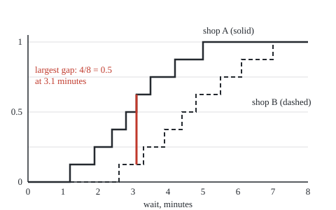

# The empirical CDF: the data's own staircase, and the Kolmogorov-Smirnov test

[Syllabus](../../../SYLLABUS.md) → [Probability and statistics](../README.md) → [Nonparametric Inference](../README.md#s15) → The empirical CDF

---

## General Overview

Two coffee shops on one street each time 8 customers, from order to cup in hand:

- **Shop A:** 1.2, 1.9, 2.4, 2.8, 3.1, 3.5, 4.2, 5.0 minutes.
- **Shop B:** 2.6, 3.3, 3.9, 4.4, 4.8, 5.5, 6.1, 7.0 minutes.

Shop A looks faster. Is it, or is that the luck of which 16 customers turned up? Waits are skewed: most are short, a few run long. A test built on the bell curve does not fit them well, and 8 waits cannot show what shape the true law (the pattern of chances behind the waits) has.

So use the data's own law. For any time x, count the share of a shop's customers served within x minutes. Plot that share against x and it climbs in steps of 1/8, one step at each wait. This staircase is the **empirical CDF** (cumulative distribution function): the data's own estimate of the chance that a wait is at most x.

Put the two staircases on one chart and look for the widest vertical gap. At 3.1 minutes, 5 of A's 8 customers have their coffee and 1 of B's has. The gap is 5/8 − 1/8 = **4/8 = 0.5**. That largest gap is the **Kolmogorov-Smirnov statistic**, KS for short.

Is 0.5 a lot? Shuffle the 16 waits between the two shops in every one of the 12,870 possible ways. In 3,638 of them the gap is 0.5 or more: a p-value (the chance of a gap this large if the shops are the same) of **0.2827**. The KS test cannot settle it at 8 customers a shop: it watches for every kind of difference at once, so it is slow to notice a plain shift. A test aimed at a shift, on [Rank tests](02-rank-tests-wilcoxon-and-mann-whitney.md), finds evidence at the 5% level in the same waits. One staircase on its own is only pinned to within **±0.480** of the truth, with 95% confidence.

**The empirical CDF gives each data point a step of 1/n; it closes in on the true CDF at every value at once as n grows, and the largest vertical gap between two staircases, or between a staircase and a model, has a null law (its chance pattern when there is no real difference) that does not depend on the data's shape, so it makes a test.**

**What kind of fact this is:** the empirical CDF is a definition. That it closes in on the truth everywhere at once is a theorem (Glivenko-Cantelli), proved on this card in Why it works from the strong law of large numbers. The ±0.480 band comes from a theorem stated here without proof (the Dvoretzky-Kiefer-Wolfowitz inequality) and checked exactly at n = 8 by the code.

### The picture: two staircases and their widest gap

<p align="center"></p>

Solid: shop A. Dashed: shop B. Each staircase rises by 1/8 at each wait and reaches 1 at the slowest one. The red bar at 3.1 minutes runs from B's 0.125 up to A's 0.625. The same gap of 0.5 also appears at 3.5 and at 4.2 minutes.

---

## The formula

Notation first, in words. As on [Densities](../04-Continuous%20Distributions/01-densities-and-cdfs.md), $`F(x)`$ is the true CDF: the chance that one wait $`X`$ is at most $`x`$. The waits in a sample are $`X_1, \dots, X_n`$. The **indicator** $`\mathbf{1}\{X_i \le x\}`$ is 1 when wait $`i`$ is at most $`x`$ and 0 when it is not.

The empirical CDF counts the waits at or below $`x`$ and divides by $`n`$:

```math
F_n(x) = \frac{1}{n}\sum_{i=1}^{n} \mathbf{1}\{X_i \le x\}
```

**Read it aloud:** the share of the sample at or below $`x`$.

The KS statistic is the largest gap. Against a model CDF $`F`$, and between two samples of sizes $`n`$ and $`m`$ with staircases $`F_n`$ and $`G_m`$:

```math
D_n = \sup_x \lvert F_n(x) - F(x) \rvert, \qquad D_{n,m} = \sup_x \lvert F_n(x) - G_m(x) \rvert
```

**Read it aloud:** run along every value of $`x`$ and keep the largest vertical distance between the two curves. Here $`\sup`$ (supremum) means the largest value, or the limit the values climb towards if none is reached.

The band. With probability at least $`1 - \alpha`$, the true $`F`$ lies within $`\varepsilon`$ of the staircase at every $`x`$ at once, where

```math
P\left(\sup_x \lvert F_n(x) - F(x)\rvert > \varepsilon\right) \le 2e^{-2n\varepsilon^2}, \qquad \varepsilon = \sqrt{\frac{\ln(2/\alpha)}{2n}}
```

**Read it aloud:** the chance that the staircase strays more than $`\varepsilon`$ anywhere is at most two times $`e`$ to the minus $`2n\varepsilon^2`$; set that equal to $`\alpha`$ and solve for the band's half-width.

For one shop, $`n = 8`$ and $`\alpha = 0.05`$: $`\varepsilon = \sqrt{\ln 40/16} = 0.480`$.

| Symbol | Plain meaning | In our example | Push it up and the answer… |
| --- | --- | --- | --- |
| $`X_i`$ | the $`i`$-th wait in a sample | shop A's first wait, 1.2 min | moves one step of the staircase |
| $`n`$, $`m`$ | sample sizes | 8 and 8 | steps get finer, band and null gaps shrink like $`1/\sqrt{n}`$ |
| $`x`$ | a point on the time axis | 3.1 min | the staircase climbs towards 1 |
| $`\mathbf{1}\{\cdot\}`$ | indicator: 1 if true, 0 if false | $`\mathbf{1}\{1.2 \le 3.1\} = 1`$ | — |
| $`F_n`$, $`G_m`$ | empirical CDFs, the staircases; $`F_n(x-)`$ is the share strictly below $`x`$ | A at 3.1: 0.625; B: 0.125 | — |
| $`x_{(i)}`$ | the $`i`$-th smallest wait | $`x_{(2)} = 1.9`$ min for shop A | — |
| $`F`$ | true or model CDF | exponential, mean 3 min: $`1 - e^{-x/3}`$ | — |
| $`D_n`$, $`D_{n,m}`$ | KS gaps: staircase to model, and staircase to staircase | 0.3442; 0.5 | p-value falls |
| $`\alpha`$ | allowed chance that the band misses | 0.05 | band narrows |
| $`\varepsilon`$ | half-width of the confidence band | 0.480 | — |
| $`\lambda`$ | gap scaled by sample size, $`\sqrt{nm/(n+m)}\,D_{n,m}`$ | 1.000 | p-value falls |
| $`Q(\lambda)`$ | Kolmogorov's large-sample p-value; $`k`$ counts its terms | 0.2700 | — |

### When it holds

- **Each sample is independent draws from one law.** If the 8 waits came from one rush-hour queue, each customer waits behind the last, and the band and p-values are too optimistic.
- **The true CDF is continuous, so ties have chance zero.** Waits rounded to whole minutes tie often; the null law below then overstates the p-value, and the test rejects less often than it claims.
- **The model is fixed before looking at the data.** Fit the model's mean from the same 8 waits and the usual table gives p = 0.2417 where the honest p-value is 0.0702.
- **The two shops' samples are independent of each other.** Pair each A customer with a B customer (same time of day) and a paired test fits better.
- **Small samples use the exact null law.** Kolmogorov's large-sample formula is an approximation; at 8 a shop it gives p = 0.2995 in the one-sample test, where the exact value is 0.2377.

---

## Why it works

### Step 0: one point is a coin, every point is a staircase

Fix one time, say $`x = 3.1`$ minutes. Each customer either has coffee by then or does not: a coin that lands "yes" with chance $`F(3.1)`$. The staircase's height there is the share of "yes" coins. That is an average, and the law of large numbers says averages settle on their mean.

The hard part is "at every $`x`$ at once". There are infinitely many points, and settling at each one separately does not stop the worst point from staying bad. The rescue is that both curves only climb. A climbing curve is pinned everywhere once it is pinned at a few well-chosen points.

### Step 1: at one point, the staircase is a binomial average

At a fixed $`x`$, the count $`nF_n(x)`$ is the number of "yes" coins out of $`n`$: a binomial count with chance $`F(x)`$. So $`F_n(x)`$ has mean $`F(x)`$ and variance $`F(x)(1 - F(x))/n`$. It is unbiased (right on average), and its typical error is at most $`1/(2\sqrt{n})`$.

The strong law of large numbers ([Law of large numbers](../06-Limit%20Theorems%20in%20Practice/01-law-of-large-numbers.md) states it; [The strong law of large numbers](../../10-Measure%20and%20integration/10-The%20Limit%20Theorems%2C%20Proved/04-strong-law-of-large-numbers.md) proves it) adds more. With probability 1, along an endless run of customers, $`F_n(x)`$ ends up within any tolerance of $`F(x)`$ and stays there. The same holds for the share strictly below $`x`$, written $`F_n(x-)`$, which tends to $`F(x-)`$, the chance of a wait strictly below $`x`$.

### Step 2: Glivenko-Cantelli, from a finite grid

Choose a tolerance $`\varepsilon`$. Cut the time axis at $`r`$ points so that the true $`F`$ climbs by at most $`\varepsilon`$ between neighbouring cuts; the points where $`F`$ crosses $`1/r, 2/r, \dots`$ do it when $`r \ge 1/\varepsilon`$. Between two cuts, both curves only climb, so the gap at any $`x`$ is squeezed by the gaps at the two cuts, plus at most $`\varepsilon`$.

The grid is finite. By Step 1, with probability 1 the gaps at all its cuts shrink to zero together. So the largest gap anywhere ends up below $`\varepsilon`$. That holds for $`\varepsilon = 1, 1/2, 1/3, \dots`$, all with probability 1, so:

```math
\sup_x \lvert F_n(x) - F(x) \rvert \to 0 \quad \text{with probability 1}
```

This is the **Glivenko-Cantelli theorem**. [Bootstrap](../07-Sampling%20and%20Estimation/08-bootstrap.md) relies on it and states it without proof; this is the proof.

<details>
<summary>The squeeze, written out</summary>

Let $`t_0 = -\infty`$, $`t_r = +\infty`$, and for $`0 < j < r`$ let $`t_j`$ be the smallest $`x`$ with $`F(x) \ge j/r`$. Then $`F(t_j-) - F(t_{j-1}) \le 1/r \le \varepsilon`$.

Take $`x`$ with $`t_{j-1} \le x < t_j`$. Both $`F_n`$ and $`F`$ climb, so

$`\displaystyle F_n(x) - F(x) \le F_n(t_j-) - F(t_{j-1}) \le F_n(t_j-) - F(t_j-) + \varepsilon,`$

$`\displaystyle F_n(x) - F(x) \ge F_n(t_{j-1}) - F(t_j-) \ge F_n(t_{j-1}) - F(t_{j-1}) - \varepsilon.`$

So the largest gap over all $`x`$ is at most $`M_n + \varepsilon`$, where $`M_n`$ is the largest of the $`2r`$ gaps $`\lvert F_n(t_j) - F(t_j)\rvert`$ and $`\lvert F_n(t_j-) - F(t_j-)\rvert`$. Each of those is an average of indicators, so the strong law sends it to 0 with probability 1. Finitely many events of probability 1 happen together with probability 1, so $`M_n \to 0`$ and the largest gap ends up at most $`\varepsilon`$.

Countably many choices $`\varepsilon = 1, 1/2, 1/3, \dots`$ again leave an event of probability 1. On it, the largest gap tends to 0.

</details>

One seeded run from the exponential model shows it. The largest gap shrinks as the sample grows, roughly like $`1/\sqrt{n}`$, and in each run sits below the 95% band's half-width:

```
n =     8   gap 0.2299  ███████████████████████   half-width 0.4802
n =    80   gap 0.0977  ██████████                half-width 0.1518
n =   800   gap 0.0200  ██                        half-width 0.0480
n = 8,000   gap 0.0054  █                         half-width 0.0152
```

### Step 3: the null law does not depend on the shape

Glivenko-Cantelli says the gap goes to zero. A test needs more: the law of the gap at a given $`n`$ when the model is true. The surprise is that this law is the same for every continuous $`F`$.

The reason is a change of scale. If $`X`$ has continuous CDF $`F`$, then $`U = F(X)`$ is uniform on 0 to 1 ([Inverse transform](../11-Simulation/02-inverse-transform-sampling.md) runs this backwards to make samples). Stretching the time axis by $`F`$ turns the model into the straight line $`u`$ and the staircase into the staircase of $`n`$ uniforms. Vertical gaps do not change under a stretch of the horizontal axis. So $`D_n`$ has the same law as the KS gap of $`n`$ uniforms, whatever $`F`$ is.

That is why one table serves every model. The code computes the law exactly with the matrix method of Marsaglia, Tsang and Wang, and checks it by simulating exponential waits directly: the exact p-value 0.2377 against 0.2384 from 100,000 simulated samples.

### Step 4: the largest gap sits at a step

Between two waits the staircase is flat and the model climbs, so the gap is largest at an end of a flat stretch. At the $`i`$-th smallest wait $`x_{(i)}`$, check just after the step, $`i/n - F(x_{(i)})`$, and just before it, $`F(x_{(i)}) - (i-1)/n`$. The largest of these $`2n`$ numbers is $`D_n`$.

For shop A against the exponential model with mean 3 minutes, the largest is just before the step at 1.9 minutes. The model says $`1 - e^{-1.9/3} = 0.4692`$ of waits should be done by then; the staircase is still at 1/8. The gap is 0.3442. The code confirms it by scanning a grid of 10,000 points 0.001 minutes apart.

### Step 5: the band (Dvoretzky-Kiefer-Wolfowitz)

Dvoretzky, Kiefer and Wolfowitz proved in 1956 that $`P(D_n > \varepsilon) \le C e^{-2n\varepsilon^2}`$ for some constant $`C`$. Massart showed in 1990 that $`C = 2`$ works for every $`n`$, and that no smaller constant does. The proof is long and is not given here.

Read the inequality backwards and it is a band. Draw $`F_n(x) \pm \varepsilon`$, cut off below 0 and above 1. With chance at least $`1 - \alpha`$, the whole true CDF lies inside, at every $`x`$ at once. This is stronger than a confidence interval at one point.

At $`n = 8`$ the band is safe. The exact chance that $`D_8 \ge 0.4802`$ is 0.0323, below the promised 0.05; the simulation gives 0.0321. The exact 5% line is 0.4543, so the DKW band is a little wider than it needs to be. Its value is that it needs no table and holds at every $`n`$.

### Step 6: two samples, and the shuffle

If both shops draw waits from one law, the labels "A" and "B" carry no information. Every split of the 16 waits into two groups of 8 is equally likely, exactly as in [Permutation tests](../13-Survival%2C%20Design%20and%20Causality/06-permutation-tests.md). The two-sample p-value is the share of the $`\binom{16}{8} = 12{,}870`$ splits whose gap is at least 0.5.

A second road counts the same splits without listing them. Walk through the 16 waits from smallest to largest, stepping up for an A and right for a B. The gap at any moment is the distance from the diagonal divided by 8. A path keeps its gap below 4/8 when it never strays 4 or more from the diagonal. Counting such paths step by step gives 9,232, and $`12{,}870 - 9{,}232 = 3{,}638`$, matching the full list.

For large samples, Kolmogorov found the limit law. The scaled gap $`\lambda = \sqrt{nm/(n+m)}\,D_{n,m}`$ has

```math
P(\text{scaled gap} > \lambda) \to Q(\lambda) = 2\sum_{k=1}^{\infty} (-1)^{k-1} e^{-2k^2\lambda^2}
```

**Read it aloud:** the large-sample p-value is an alternating sum of fast-shrinking exponentials in the scaled gap.

The same $`Q`$ serves the one-sample test with $`\lambda = \sqrt{n}\,D_n`$. Here $`\lambda = \sqrt{64/16} \times 0.5 = 1.000`$ and $`Q(1) = 0.2700`$, near the exact 0.2827. The limit is the law of the largest distance from zero of a Brownian bridge, a random path pinned to 0 at both ends; the stochastic-processes wing builds it.

---

## Worked numbers, by hand

The two-sample test, then the one-sample test and the band for shop A.

| Step | Arithmetic | Value |
| --- | --- | --- |
| A's staircase at 3.1 min | 5 waits of 8 at or below 3.1 | 0.625 |
| B's staircase at 3.1 min | 1 wait of 8 (2.6) | 0.125 |
| two-sample gap $`D_{8,8}`$ | 0.625 − 0.125 (also at 3.5 and 4.2) | 0.500 |
| exact p-value | 3,638 of 12,870 splits | 0.2827 |
| large-sample p-value | $`\lambda = \sqrt{64/16} \times 0.5 = 1.000`$, $`Q(1)`$ | 0.2700 |
| model at 1.9 min | $`1 - e^{-1.9/3}`$ | 0.4692 |
| one-sample gap $`D_8`$ | 0.4692 − 1/8, just before the step | 0.3442 |
| exact one-sample p-value | matrix method, $`n = 8`$ | 0.2377 |
| **DKW 95% half-width** | $`\sqrt{\ln 40 / 16}`$ | **0.480** |

The shops differ by half the customers at 3.1 minutes, yet with 8 customers each a gap that large turns up in 3,638 of the 12,870 shuffles. The exponential model with mean 3 minutes also survives. Neither result says the shops are the same, or that the model is right: 8 customers leave a band 0.48 wide on each side.

The band for shop A, from each wait up to the next ($`F_8 \pm 0.4802`$, cut to 0 and 1):

| From (min) | 1.2 | 1.9 | 2.4 | 2.8 | 3.1 | 3.5 | 4.2 | 5.0 |
| --- | --- | --- | --- | --- | --- | --- | --- | --- |
| Staircase | 0.125 | 0.250 | 0.375 | 0.500 | 0.625 | 0.750 | 0.875 | 1.000 |
| Lower edge | 0.000 | 0.000 | 0.000 | 0.020 | 0.145 | 0.270 | 0.395 | 0.520 |
| Upper edge | 0.605 | 0.730 | 0.855 | 0.980 | 1.000 | 1.000 | 1.000 | 1.000 |

### What breaks if you drop a piece

| Mistake | Comes out at | What went wrong |
| --- | --- | --- |
| Check only just after each step | $`D_8 = 0.1889`$ (right: 0.3442) | The largest gap at 1.9 min is just before the step, where the staircase is still at 1/8 |
| Two-sample scale $`\sqrt{8}`$ instead of $`\sqrt{8 \cdot 8/16} = 2`$ | p = 0.0366 (right: 0.2827) | Two noisy staircases, not one, so the effective size is $`nm/(n+m) = 4`$; the wrong scale reports a difference that is not there |
| Kolmogorov's limit for the one-sample test at $`n = 8`$ | p = 0.2995 (right: 0.2377) | The limit is for large $`n`$; at 8 it overstates the p-value |
| Fit the model's mean from the data (3.0125), then use the table | p = 0.2417 (honest: 0.0702) | The fitted model is pulled towards the data, so gaps are smaller than the table expects |
| $`\ln(1/\alpha)`$ instead of $`\ln(2/\alpha)`$ in the band | half-width 0.4327 (right: 0.4802) | The 2 covers misses above and below; drop it and the band is too narrow for 95% |

---

## Code, from first principles, and it actually runs

The code builds both staircases, finds each gap two ways (at the steps, and by a merge walk or a fine grid), and gets each p-value by two independent roads. Two-sample: all 12,870 splits listed, against a lattice-path count that lists none. One-sample: the exact matrix method, against 100,000 simulated samples of exponential waits from a seeded generator (SplitMix64, written out in both languages so their streams match). Kolmogorov's limit $`Q`$ is summed by the series above and by a second series for the same limit, and the two must agree. The honest p-value for a fitted mean must come out well below the table's. It then checks the DKW band against the exact law, runs the growing-sample demonstration and prints every "what breaks" and "try changing" number.

### Python

```python
# Empirical CDF and Kolmogorov-Smirnov -- the check behind the card.
# Standard library only.  Every number on the card is printed here.  The KS
# null laws are built from scratch: all 12,870 splits, a lattice-path count,
# the Marsaglia-Tsang-Wang matrix and a seeded simulation (SplitMix64).
import math
from itertools import combinations

A = [1.2, 1.9, 2.4, 2.8, 3.1, 3.5, 4.2, 5.0]   # shop A waits, minutes
B = [2.6, 3.3, 3.9, 4.4, 4.8, 5.5, 6.1, 7.0]   # shop B waits, minutes
MEAN = 3.0                                      # the model: exponential, mean 3 min

def ecdf(xs, t):              # share of the sample at or below t
    return sum(1 for x in xs if x <= t) / len(xs)

def model(t, mean=MEAN):      # exponential CDF
    return 1.0 - math.exp(-t / mean) if t > 0 else 0.0

def d_one(xs, cdf):           # sup |F_n - F|: check both sides of every step
    xs, n = sorted(xs), len(xs)
    return max(max((i + 1) / n - cdf(x), cdf(x) - i / n) for i, x in enumerate(xs))

def d_two(xs, ys):            # sup |F_A - F_B|, read at every data point
    return max(abs(ecdf(xs, t) - ecdf(ys, t)) for t in xs + ys)

def kolmogorov_q(lam):        # Kolmogorov's limit: P(sup |bridge| > lam)
    return 2 * sum((-1) ** (k - 1) * math.exp(-2 * k * k * lam * lam) for k in range(1, 101))
def kolmogorov_theta(lam):    # the same limit by its second series (Jacobi's theta identity)
    return 1 - math.sqrt(2 * math.pi) / lam * sum(math.exp(-(2 * k - 1) ** 2 * math.pi ** 2 / (8 * lam * lam)) for k in range(1, 101))

def mtw_below(n, d):          # exact P(D_n < d), Marsaglia-Tsang-Wang matrix
    k = int(n * d) + 1; m = 2 * k - 1; h = k - n * d
    H = [[1.0 if i - j + 1 >= 0 else 0.0 for j in range(m)] for i in range(m)]
    for i in range(m):
        H[i][0] -= h ** (i + 1); H[m - 1][i] -= h ** (m - i)
    H[m - 1][0] += (2 * h - 1) ** m if 2 * h - 1 > 0 else 0.0
    for i in range(m):
        for j in range(m):
            if i - j + 1 > 0: H[i][j] /= math.factorial(i - j + 1)
    P = [[float(i == j) for j in range(m)] for i in range(m)]
    for _ in range(n):
        P = [[sum(P[i][t] * H[t][j] for t in range(m)) for j in range(m)] for i in range(m)]
    return P[k - 1][k - 1] * math.factorial(n) / n ** n

def dkw(n, alpha):            # DKW half-width: 2 exp(-2 n eps^2) = alpha
    return math.sqrt(math.log(2 / alpha) / (2 * n))

state = 20261123              # SplitMix64, written out so Rust matches
def unif():
    global state
    state = (state + 0x9E3779B97F4A7C15) & 0xFFFFFFFFFFFFFFFF
    z = state
    z = ((z ^ (z >> 30)) * 0xBF58476D1CE4E5B9) & 0xFFFFFFFFFFFFFFFF
    z = ((z ^ (z >> 27)) * 0x94D049BB133111EB) & 0xFFFFFFFFFFFFFFFF
    return ((z ^ (z >> 31)) >> 11) / 2.0 ** 53

def draw(n):                  # inverse transform: exponential waits, mean 3
    return [-MEAN * math.log(1.0 - unif()) for _ in range(n)]

print("staircases at each pooled wait (counts out of 8):")
for t in sorted(A + B):
    print(f"  {t:.1f} min   A {round(8 * ecdf(A, t))}   B {round(8 * ecdf(B, t))}   gap {abs(ecdf(A, t) - ecdf(B, t)):.3f}")

# ---- two-sample test: shop A against shop B ----
D2 = d_two(A, B)
walk, i, j = 0.0, 0, 0                              # road 2 for D: merge walk
for t in sorted(A + B):
    while i < 8 and A[i] <= t: i += 1
    while j < 8 and B[j] <= t: j += 1
    walk = max(walk, abs(i - j) / 8)
pool = A + B
hits = sum(1 for c in combinations(range(16), 8)    # road 1: all 12,870 splits
           if d_two([pool[k] for k in c], [pool[k] for k in range(16) if k not in c]) >= D2 - 1e-12)
paths = [[0] * 9 for _ in range(9)]                 # road 2: lattice paths with |i-j| < 4
for a in range(9):
    for b in range(9):
        if abs(a - b) * 1.0 / 8 >= D2 - 1e-12: continue
        paths[a][b] = 1 if a == b == 0 else (paths[a - 1][b] if a else 0) + (paths[a][b - 1] if b else 0)
lam2 = math.sqrt(8 * 8 / 16) * D2
print(f"two-sample D = {D2:.3f} ({round(8 * D2)}/8), at 3.1 min: A {ecdf(A, 3.1):.3f}, B {ecdf(B, 3.1):.3f}")
print(f"exact p: {hits} of 12870 splits = {hits / 12870:.4f}; lattice paths inside: {paths[8][8]}")
print(f"Kolmogorov limit: lambda = {lam2:.3f}, p = {kolmogorov_q(lam2):.4f}")

# ---- one-sample test: shop A against an exponential model, mean 3 min ----
D1 = d_one(A, model)
grid = max(abs(ecdf(A, t / 1000) - model(t / 1000)) for t in range(1, 10001))
grid = max(grid, max(abs(ecdf(A, x - 1e-9) - model(x)) for x in A))
print(f"model at 1.9 min: {model(1.9):.4f}; staircase just below 1.9: {ecdf(A, 1.8):.3f}")
print(f"one-sample D = {D1:.4f}; by a 0.001-min grid: {grid:.4f}")
p1 = 1 - mtw_below(8, D1)
R, sim1, simdkw, simest = 100000, 0, 0, 0
Dest = d_one(A, lambda t: model(t, sum(A) / 8))
for _ in range(R):
    xs = draw(8)
    d = d_one(xs, model)
    sim1 += d >= D1; simdkw += d >= dkw(8, 0.05)
    simest += d_one(xs, lambda t: model(t, sum(xs) / 8)) >= Dest
print(f"exact p = {p1:.4f}; simulated ({R} samples of 8) p = {sim1 / R:.4f}")

# ---- the DKW band, and the exact 5% line it stands in for ----
eps, lo, hi = dkw(8, 0.05), 0.2, 0.8
for _ in range(60): mid = (lo + hi) / 2; lo, hi = (mid, hi) if 1 - mtw_below(8, mid) > 0.05 else (lo, mid)
miss = 1 - mtw_below(8, eps)
print(f"DKW half-width, n 8, 95%: sqrt(ln 40/16) = {eps:.4f}; Massart bound 2exp(-2n eps^2) = {2 * math.exp(-16 * eps * eps):.4f}")
print(f"chance D_8 >= {eps:.4f}: exact {miss:.4f}, simulated {simdkw / R:.4f}; exact 5% line {hi:.4f}")
print("band for shop A at each wait (lower, upper):")
print("  " + "  ".join(f"{x}:{max(0, (i + 1) / 8 - eps):.3f}-{min(1, (i + 1) / 8 + eps):.3f}" for i, x in enumerate(A[:4])))
print("  " + "  ".join(f"{x}:{max(0, (i + 5) / 8 - eps):.3f}-{min(1, (i + 5) / 8 + eps):.3f}" for i, x in enumerate(A[4:])))

# ---- Glivenko-Cantelli: one seeded run from the model, n growing ----
for n in (8, 80, 800, 8000):
    print(f"GC n {n:5d}: sup|F_n - F| = {d_one(draw(n), model):.4f}   DKW 95% half-width {dkw(n, 0.05):.4f}")

# ---- what breaks ----
right_only = max((i + 1) / 8 - model(x) for i, x in enumerate(A))
print(f"break: right side of steps only, D = {right_only:.4f} (right {D1:.4f})")
print(f"break: two-sample scale sqrt(8) not sqrt(4): p = {kolmogorov_q(math.sqrt(8) * D2):.4f} (exact {hits / 12870:.4f})")
print(f"break: limit law for n 8 one-sample: p = {kolmogorov_q(math.sqrt(8) * D1):.4f} (exact {p1:.4f})")
print(f"break: mean fitted from data ({sum(A) / 8:.4f}): D = {Dest:.4f}, table p = {1 - mtw_below(8, Dest):.4f}, honest p = {simest / R:.4f}")
print(f"break: ln(1/alpha) for ln(2/alpha): half-width {math.sqrt(math.log(20) / 16):.4f} (right {eps:.4f})")

# ---- try changing ----
print(f"try: n 32, DKW 95% half-width {dkw(32, 0.05):.4f}; n 8 at 90%: {dkw(8, 0.10):.4f}")
print(f"try: shop B 1 min faster, D = {d_two(A, [b - 1.0 for b in B]):.3f}")
D1b = d_one(A, lambda t: model(t, 2.0))
print(f"try: model mean 2 min, D = {D1b:.4f}, exact p = {1 - mtw_below(8, D1b):.4f}")

# ---- figure: x 40 + 50 px per minute, y 260 - 200 px per unit ----
print(f"figure, gap line x {40 + 50 * 3.1:.0f}, from y {260 - 200 * ecdf(B, 3.1):.0f} to {260 - 200 * ecdf(A, 3.1):.0f}")

assert abs(D2 - 0.5) < 1e-12 and abs(walk - D2) < 1e-12          # D by two roads
assert hits == 12870 - paths[8][8]                                # p by enumeration = by paths
assert abs(D1 - grid) < 1e-6                                      # D at the steps = D on a fine grid
assert abs(sim1 / R - p1) < 0.006                                 # exact null law = simulation
assert abs(eps - 0.4802) < 1e-4 and miss <= 0.05                  # DKW is safe at n = 8
assert abs(simdkw / R - miss) < 0.004
assert hi < eps                                                   # DKW band is wider than exact
assert abs(1 - mtw_below(1, 0.7) - 0.6) < 1e-12                   # n = 1: P(D_1 >= d) = 2(1 - d)
assert all(abs(kolmogorov_q(l) - kolmogorov_theta(l)) < 1e-12 for l in (lam2, math.sqrt(8) * D2, math.sqrt(8) * D1))  # Q by two series
assert simest / R < (1 - mtw_below(8, Dest)) / 2                  # fitting the mean shrinks the null gaps
print("ALL CHECKS PASS")
```

**Ran 2026-11-23 on macOS, Python 3.14.10, standard library only. All checks passed. Output, pasted from the run:**

```
staircases at each pooled wait (counts out of 8):
  1.2 min   A 1   B 0   gap 0.125
  1.9 min   A 2   B 0   gap 0.250
  2.4 min   A 3   B 0   gap 0.375
  2.6 min   A 3   B 1   gap 0.250
  2.8 min   A 4   B 1   gap 0.375
  3.1 min   A 5   B 1   gap 0.500
  3.3 min   A 5   B 2   gap 0.375
  3.5 min   A 6   B 2   gap 0.500
  3.9 min   A 6   B 3   gap 0.375
  4.2 min   A 7   B 3   gap 0.500
  4.4 min   A 7   B 4   gap 0.375
  4.8 min   A 7   B 5   gap 0.250
  5.0 min   A 8   B 5   gap 0.375
  5.5 min   A 8   B 6   gap 0.250
  6.1 min   A 8   B 7   gap 0.125
  7.0 min   A 8   B 8   gap 0.000
two-sample D = 0.500 (4/8), at 3.1 min: A 0.625, B 0.125
exact p: 3638 of 12870 splits = 0.2827; lattice paths inside: 9232
Kolmogorov limit: lambda = 1.000, p = 0.2700
model at 1.9 min: 0.4692; staircase just below 1.9: 0.125
one-sample D = 0.3442; by a 0.001-min grid: 0.3442
exact p = 0.2377; simulated (100000 samples of 8) p = 0.2384
DKW half-width, n 8, 95%: sqrt(ln 40/16) = 0.4802; Massart bound 2exp(-2n eps^2) = 0.0500
chance D_8 >= 0.4802: exact 0.0323, simulated 0.0321; exact 5% line 0.4543
band for shop A at each wait (lower, upper):
  1.2:0.000-0.605  1.9:0.000-0.730  2.4:0.000-0.855  2.8:0.020-0.980
  3.1:0.145-1.000  3.5:0.270-1.000  4.2:0.395-1.000  5.0:0.520-1.000
GC n     8: sup|F_n - F| = 0.2299   DKW 95% half-width 0.4802
GC n    80: sup|F_n - F| = 0.0977   DKW 95% half-width 0.1518
GC n   800: sup|F_n - F| = 0.0200   DKW 95% half-width 0.0480
GC n  8000: sup|F_n - F| = 0.0054   DKW 95% half-width 0.0152
break: right side of steps only, D = 0.1889 (right 0.3442)
break: two-sample scale sqrt(8) not sqrt(4): p = 0.0366 (exact 0.2827)
break: limit law for n 8 one-sample: p = 0.2995 (exact 0.2377)
break: mean fitted from data (3.0125): D = 0.3428, table p = 0.2417, honest p = 0.0702
break: ln(1/alpha) for ln(2/alpha): half-width 0.4327 (right 0.4802)
try: n 32, DKW 95% half-width 0.2401; n 8 at 90%: 0.4327
try: shop B 1 min faster, D = 0.250
try: model mean 2 min, D = 0.4883, exact p = 0.0280
figure, gap line x 195, from y 235 to 135
ALL CHECKS PASS
```

### Rust

```rust
// Empirical CDF and Kolmogorov-Smirnov -- the same check as the Python, in Rust.
// Standard library only, no crates.  Same roads, same SplitMix64 stream.
use std::f64::consts::PI;
const A: [f64; 8] = [1.2, 1.9, 2.4, 2.8, 3.1, 3.5, 4.2, 5.0]; // shop A waits, minutes
const B: [f64; 8] = [2.6, 3.3, 3.9, 4.4, 4.8, 5.5, 6.1, 7.0]; // shop B waits, minutes
const MEAN: f64 = 3.0; // the model: exponential, mean 3 min

fn ecdf(xs: &[f64], t: f64) -> f64 { xs.iter().filter(|&&x| x <= t).count() as f64 / xs.len() as f64 }
fn model(t: f64, mean: f64) -> f64 { if t > 0.0 { 1.0 - (-t / mean).exp() } else { 0.0 } }

// sup |F_n - F|: check both sides of every step
fn d_one(xs: &[f64], cdf: &dyn Fn(f64) -> f64) -> f64 {
    let mut s = xs.to_vec(); s.sort_by(|a, b| a.partial_cmp(b).unwrap());
    let (n, mut d) = (s.len() as f64, f64::MIN);
    for (i, &x) in s.iter().enumerate() {
        d = d.max(((i + 1) as f64 / n - cdf(x)).max(cdf(x) - i as f64 / n));
    }
    d
}
// sup |F_A - F_B|, read at every data point
fn d_two(xs: &[f64], ys: &[f64]) -> f64 {
    xs.iter().chain(ys.iter()).map(|&t| (ecdf(xs, t) - ecdf(ys, t)).abs()).fold(f64::MIN, f64::max)
}
// Kolmogorov's limit: P(sup |bridge| > lam)
fn kolmogorov_q(lam: f64) -> f64 {
    let mut s = 0.0;
    for k in 1..101 { s += (if k % 2 == 1 { 1.0 } else { -1.0 }) * (-2.0 * (k * k) as f64 * lam * lam).exp(); }
    2.0 * s
}
// the same limit by its second series (Jacobi's theta identity)
fn kolmogorov_theta(lam: f64) -> f64 { 1.0 - (2.0 * PI).sqrt() / lam * (1..101).map(|k| (-((2 * k - 1) as f64).powi(2) * PI * PI / (8.0 * lam * lam)).exp()).sum::<f64>() }
fn fact(n: usize) -> f64 { (1..=n).fold(1.0, |a, k| a * k as f64) }
// exact P(D_n < d), Marsaglia-Tsang-Wang matrix
fn mtw_below(n: usize, d: f64) -> f64 {
    let k = (n as f64 * d) as usize + 1;
    let (m, h) = (2 * k - 1, k as f64 - n as f64 * d);
    let mut hm = vec![vec![0.0; m]; m];
    for i in 0..m { for j in 0..m { if i + 1 >= j { hm[i][j] = 1.0; } } }
    for i in 0..m {
        hm[i][0] -= h.powf((i + 1) as f64);
        hm[m - 1][i] -= h.powf((m - i) as f64);
    }
    hm[m - 1][0] += if 2.0 * h - 1.0 > 0.0 { (2.0 * h - 1.0).powf(m as f64) } else { 0.0 };
    for i in 0..m { for j in 0..m { if i + 1 > j { hm[i][j] /= fact(i + 1 - j); } } }
    let mut p: Vec<Vec<f64>> = (0..m).map(|i| (0..m).map(|j| if i == j { 1.0 } else { 0.0 }).collect()).collect();
    for _ in 0..n {
        p = (0..m).map(|i| (0..m).map(|j| { let mut s = 0.0; for t in 0..m { s += p[i][t] * hm[t][j]; } s }).collect()).collect();
    }
    p[k - 1][k - 1] * fact(n) / (n as f64).powf(n as f64)
}
// DKW half-width: 2 exp(-2 n eps^2) = alpha
fn dkw(n: usize, alpha: f64) -> f64 { ((2.0 / alpha).ln() / (2.0 * n as f64)).sqrt() }

struct Rng(u64); // SplitMix64, written out so Python matches
impl Rng {
    fn unif(&mut self) -> f64 {
        self.0 = self.0.wrapping_add(0x9E3779B97F4A7C15);
        let mut z = self.0;
        z = (z ^ (z >> 30)).wrapping_mul(0xBF58476D1CE4E5B9);
        z = (z ^ (z >> 27)).wrapping_mul(0x94D049BB133111EB);
        ((z ^ (z >> 31)) >> 11) as f64 / 2f64.powi(53)
    }
    // inverse transform: exponential waits, mean 3
    fn draw(&mut self, n: usize) -> Vec<f64> { (0..n).map(|_| -MEAN * (1.0 - self.unif()).ln()).collect() }
}

fn main() {
    let ex = |t: f64| model(t, MEAN);
    let mut rng = Rng(20261123);
    let mut pooled: Vec<f64> = A.iter().chain(B.iter()).cloned().collect();
    pooled.sort_by(|a, b| a.partial_cmp(b).unwrap());
    println!("staircases at each pooled wait (counts out of 8):");
    for &t in &pooled {
        println!("  {:.1} min   A {}   B {}   gap {:.3}", t, (8.0 * ecdf(&A, t)).round(), (8.0 * ecdf(&B, t)).round(), (ecdf(&A, t) - ecdf(&B, t)).abs());
    }

    // ---- two-sample test: shop A against shop B ----
    let d2 = d_two(&A, &B);
    let (mut walk, mut i, mut j) = (0.0f64, 0, 0); // road 2 for D: merge walk
    for &t in &pooled {
        while i < 8 && A[i] <= t { i += 1; }
        while j < 8 && B[j] <= t { j += 1; }
        walk = walk.max((i as f64 - j as f64).abs() / 8.0);
    }
    let pool: Vec<f64> = A.iter().chain(B.iter()).cloned().collect();
    let mut hits = 0; // road 1: all 12,870 splits
    for mask in 0u32..(1 << 16) {
        if mask.count_ones() != 8 { continue; }
        let xs: Vec<f64> = (0..16).filter(|k| mask >> k & 1 == 1).map(|k| pool[k]).collect();
        let ys: Vec<f64> = (0..16).filter(|k| mask >> k & 1 == 0).map(|k| pool[k]).collect();
        if d_two(&xs, &ys) >= d2 - 1e-12 { hits += 1; }
    }
    let mut paths = [[0u64; 9]; 9]; // road 2: lattice paths with |i-j| < 4
    for a in 0..9 {
        for b in 0..9 {
            if (a as f64 - b as f64).abs() / 8.0 >= d2 - 1e-12 { continue; }
            paths[a][b] = if a == 0 && b == 0 { 1 } else { (if a > 0 { paths[a - 1][b] } else { 0 }) + (if b > 0 { paths[a][b - 1] } else { 0 }) };
        }
    }
    let lam2 = (8.0f64 * 8.0 / 16.0).sqrt() * d2;
    println!("two-sample D = {:.3} ({}/8), at 3.1 min: A {:.3}, B {:.3}", d2, (8.0 * d2).round(), ecdf(&A, 3.1), ecdf(&B, 3.1));
    println!("exact p: {} of 12870 splits = {:.4}; lattice paths inside: {}", hits, hits as f64 / 12870.0, paths[8][8]);
    println!("Kolmogorov limit: lambda = {:.3}, p = {:.4}", lam2, kolmogorov_q(lam2));

    // ---- one-sample test: shop A against an exponential model, mean 3 min ----
    let d1 = d_one(&A, &ex);
    let mut grid = (1..10001).map(|t| { let t = t as f64 / 1000.0; (ecdf(&A, t) - ex(t)).abs() }).fold(f64::MIN, f64::max);
    grid = grid.max(A.iter().map(|&x| (ecdf(&A, x - 1e-9) - ex(x)).abs()).fold(f64::MIN, f64::max));
    println!("model at 1.9 min: {:.4}; staircase just below 1.9: {:.3}", ex(1.9), ecdf(&A, 1.8));
    println!("one-sample D = {:.4}; by a 0.001-min grid: {:.4}", d1, grid);
    let p1 = 1.0 - mtw_below(8, d1);
    let (r, mut sim1, mut simdkw, mut simest) = (100000, 0, 0, 0);
    let mean_a: f64 = A.iter().sum::<f64>() / 8.0;
    let dest = d_one(&A, &|t| model(t, mean_a));
    for _ in 0..r {
        let xs = rng.draw(8);
        let d = d_one(&xs, &ex);
        if d >= d1 { sim1 += 1; }
        if d >= dkw(8, 0.05) { simdkw += 1; }
        let mx: f64 = xs.iter().sum::<f64>() / 8.0;
        if d_one(&xs, &|t| model(t, mx)) >= dest { simest += 1; }
    }
    println!("exact p = {:.4}; simulated ({} samples of 8) p = {:.4}", p1, r, sim1 as f64 / r as f64);

    // ---- the DKW band, and the exact 5% line it stands in for ----
    let (eps, mut lo, mut hi) = (dkw(8, 0.05), 0.2f64, 0.8f64);
    for _ in 0..60 { let mid = (lo + hi) / 2.0; if 1.0 - mtw_below(8, mid) > 0.05 { lo = mid; } else { hi = mid; } }
    let miss = 1.0 - mtw_below(8, eps);
    println!("DKW half-width, n 8, 95%: sqrt(ln 40/16) = {:.4}; Massart bound 2exp(-2n eps^2) = {:.4}", eps, 2.0 * (-16.0 * eps * eps).exp());
    println!("chance D_8 >= {:.4}: exact {:.4}, simulated {:.4}; exact 5% line {:.4}", eps, miss, simdkw as f64 / r as f64, hi);
    println!("band for shop A at each wait (lower, upper):");
    for half in 0..2 {
        let cells: Vec<String> = (0..4).map(|q| { let i = 4 * half + q; format!("{:.1}:{:.3}-{:.3}", A[i], ((i + 1) as f64 / 8.0 - eps).max(0.0), ((i + 1) as f64 / 8.0 + eps).min(1.0)) }).collect();
        println!("  {}", cells.join("  "));
    }

    // ---- Glivenko-Cantelli: one seeded run from the model, n growing ----
    for n in [8usize, 80, 800, 8000] {
        println!("GC n {:5}: sup|F_n - F| = {:.4}   DKW 95% half-width {:.4}", n, d_one(&rng.draw(n), &ex), dkw(n, 0.05));
    }

    // ---- what breaks ----
    let right_only = A.iter().enumerate().map(|(i, &x)| (i + 1) as f64 / 8.0 - ex(x)).fold(f64::MIN, f64::max);
    println!("break: right side of steps only, D = {:.4} (right {:.4})", right_only, d1);
    println!("break: two-sample scale sqrt(8) not sqrt(4): p = {:.4} (exact {:.4})", kolmogorov_q(8f64.sqrt() * d2), hits as f64 / 12870.0);
    println!("break: limit law for n 8 one-sample: p = {:.4} (exact {:.4})", kolmogorov_q(8f64.sqrt() * d1), p1);
    println!("break: mean fitted from data ({:.4}): D = {:.4}, table p = {:.4}, honest p = {:.4}", mean_a, dest, 1.0 - mtw_below(8, dest), simest as f64 / r as f64);
    println!("break: ln(1/alpha) for ln(2/alpha): half-width {:.4} (right {:.4})", (20f64.ln() / 16.0).sqrt(), eps);

    // ---- try changing ----
    println!("try: n 32, DKW 95% half-width {:.4}; n 8 at 90%: {:.4}", dkw(32, 0.05), dkw(8, 0.10));
    println!("try: shop B 1 min faster, D = {:.3}", d_two(&A, &B.iter().map(|b| b - 1.0).collect::<Vec<f64>>()));
    let d1b = d_one(&A, &|t| model(t, 2.0));
    println!("try: model mean 2 min, D = {:.4}, exact p = {:.4}", d1b, 1.0 - mtw_below(8, d1b));

    // ---- figure: x 40 + 50 px per minute, y 260 - 200 px per unit ----
    println!("figure, gap line x {:.0}, from y {:.0} to {:.0}", 40.0 + 50.0 * 3.1, 260.0 - 200.0 * ecdf(&B, 3.1), 260.0 - 200.0 * ecdf(&A, 3.1));

    assert!((d2 - 0.5).abs() < 1e-12 && (walk - d2).abs() < 1e-12); // D by two roads
    assert!(hits == 12870 - paths[8][8]); // p by enumeration = by paths
    assert!((d1 - grid).abs() < 1e-6); // D at the steps = D on a fine grid
    assert!((sim1 as f64 / r as f64 - p1).abs() < 0.006); // exact null law = simulation
    assert!((eps - 0.4802).abs() < 1e-4 && miss <= 0.05); // DKW is safe at n = 8
    assert!((simdkw as f64 / r as f64 - miss).abs() < 0.004);
    assert!(hi < eps); // DKW band is wider than exact
    assert!((1.0 - mtw_below(1, 0.7) - 0.6).abs() < 1e-12); // n = 1: P(D_1 >= d) = 2(1 - d)
    assert!([lam2, 8f64.sqrt() * d2, 8f64.sqrt() * d1].iter().all(|&l| (kolmogorov_q(l) - kolmogorov_theta(l)).abs() < 1e-12)); // Q by two series
    assert!((simest as f64 / r as f64) < (1.0 - mtw_below(8, dest)) / 2.0); // fitting the mean shrinks the null gaps
    println!("ALL CHECKS PASS");
}
```

**Ran 2026-11-23 on macOS, rustc 1.98.1, no crates. All checks passed. Output, pasted from the run:**

```
staircases at each pooled wait (counts out of 8):
  1.2 min   A 1   B 0   gap 0.125
  1.9 min   A 2   B 0   gap 0.250
  2.4 min   A 3   B 0   gap 0.375
  2.6 min   A 3   B 1   gap 0.250
  2.8 min   A 4   B 1   gap 0.375
  3.1 min   A 5   B 1   gap 0.500
  3.3 min   A 5   B 2   gap 0.375
  3.5 min   A 6   B 2   gap 0.500
  3.9 min   A 6   B 3   gap 0.375
  4.2 min   A 7   B 3   gap 0.500
  4.4 min   A 7   B 4   gap 0.375
  4.8 min   A 7   B 5   gap 0.250
  5.0 min   A 8   B 5   gap 0.375
  5.5 min   A 8   B 6   gap 0.250
  6.1 min   A 8   B 7   gap 0.125
  7.0 min   A 8   B 8   gap 0.000
two-sample D = 0.500 (4/8), at 3.1 min: A 0.625, B 0.125
exact p: 3638 of 12870 splits = 0.2827; lattice paths inside: 9232
Kolmogorov limit: lambda = 1.000, p = 0.2700
model at 1.9 min: 0.4692; staircase just below 1.9: 0.125
one-sample D = 0.3442; by a 0.001-min grid: 0.3442
exact p = 0.2377; simulated (100000 samples of 8) p = 0.2384
DKW half-width, n 8, 95%: sqrt(ln 40/16) = 0.4802; Massart bound 2exp(-2n eps^2) = 0.0500
chance D_8 >= 0.4802: exact 0.0323, simulated 0.0321; exact 5% line 0.4543
band for shop A at each wait (lower, upper):
  1.2:0.000-0.605  1.9:0.000-0.730  2.4:0.000-0.855  2.8:0.020-0.980
  3.1:0.145-1.000  3.5:0.270-1.000  4.2:0.395-1.000  5.0:0.520-1.000
GC n     8: sup|F_n - F| = 0.2299   DKW 95% half-width 0.4802
GC n    80: sup|F_n - F| = 0.0977   DKW 95% half-width 0.1518
GC n   800: sup|F_n - F| = 0.0200   DKW 95% half-width 0.0480
GC n  8000: sup|F_n - F| = 0.0054   DKW 95% half-width 0.0152
break: right side of steps only, D = 0.1889 (right 0.3442)
break: two-sample scale sqrt(8) not sqrt(4): p = 0.0366 (exact 0.2827)
break: limit law for n 8 one-sample: p = 0.2995 (exact 0.2377)
break: mean fitted from data (3.0125): D = 0.3428, table p = 0.2417, honest p = 0.0702
break: ln(1/alpha) for ln(2/alpha): half-width 0.4327 (right 0.4802)
try: n 32, DKW 95% half-width 0.2401; n 8 at 90%: 0.4327
try: shop B 1 min faster, D = 0.250
try: model mean 2 min, D = 0.4883, exact p = 0.0280
figure, gap line x 195, from y 235 to 135
ALL CHECKS PASS
```

### Lean

Lean proves Glivenko-Cantelli, the staircase's mean and variance, and the shape-free null law for every $`n`$, and the coffee-shop numbers exactly.

- Take independent draws from one law with CDF $`F`$. Then, with probability 1, $`\sup_x \lvert F_n(x) - F(x) \rvert \to 0`$ as $`n`$ grows.
- Take such draws, any point $`x`$ and any $`n \ge 1`$. Then $`F_n(x)`$ has mean $`F(x)`$ and variance $`F(x)(1 - F(x))/n`$.
- Take such draws with $`F`$ continuous, and separately independent draws uniform on 0 to 1. Then for every $`n`$, $`D_n`$ has the same law as the uniforms' KS gap.
- At 3.1 minutes, 5 of shop A's 8 customers and 1 of B's have coffee: a gap of $`5/8 - 1/8 = 1/2`$.
- At every one of the 16 pooled waits the count gap is at most 4, and it reaches 4 at 3.5 and 4.2 minutes.
- There are $`\binom{16}{8} = 12{,}870`$ splits. Counting step by step, 9,232 lattice paths never stray 4 or more from the diagonal, leaving 3,638.
- Kolmogorov's scale is $`nm/(n+m) = 64/16 = 2^2`$, so $`\lambda = 2 \times 0.5 = 1`$.
- Take $`n = 8`$ and $`\varepsilon^2 = \ln 40/16`$. Then the Massart bound $`2e^{-2n\varepsilon^2}`$ is exactly 0.05.

The DKW inequality, Kolmogorov's limit law, the decimals, the test against the exponential model and the simulations are left to the Python and Rust checks.

```lean
-- The empirical CDF: for independent draws from one law the staircase F_n closes in on the true CDF at every point at once with probability 1 (Glivenko-Cantelli), at each point it is a binomial average with mean F(x) and variance F(x)(1 - F(x))/n, and for a continuous CDF the law of the Kolmogorov-Smirnov gap is the same as for uniform draws.
import Mathlib.Probability.CDF
import Mathlib.Probability.IdentDistrib
import Mathlib.Probability.Independence.Basic
import Mathlib.Probability.Moments.Variance
import Mathlib.Probability.StrongLaw
import Mathlib.Analysis.SpecialFunctions.Log.Basic
import Mathlib.Data.Nat.Choose.Basic
import Mathlib.Tactic.NormNum

open MeasureTheory ProbabilityTheory Filter Topology

/-- The empirical CDF (the staircase) of the first `n` draws `X 0 ω, …, X (n-1) ω` at the point
`x`: the share of those draws at or below `x`, `F_n(x) = (1/n) Σ 1{X_i ≤ x}`. -/
noncomputable def empiricalCDF {Ω : Type*} (X : ℕ → Ω → ℝ) (n : ℕ) (ω : Ω) (x : ℝ) : ℝ :=
  (1 / (n : ℝ)) * ∑ i ∈ Finset.range n, (Set.Iic x).indicator (fun _ => (1 : ℝ)) (X i ω)

lemma ecdf_indicator_measurable (x : ℝ) :
    Measurable ((Set.Iic x).indicator (fun _ : ℝ => (1 : ℝ))) :=
  measurable_const.indicator measurableSet_Iic

#print axioms ecdf_indicator_measurable

lemma ecdf_integral_indicator {Ω : Type*} [MeasurableSpace Ω] {P : Measure Ω}
    [IsProbabilityMeasure P] (Y : Ω → ℝ) (hY : AEMeasurable Y P) (x : ℝ) :
    ∫ ω, (Set.Iic x).indicator (fun _ => (1 : ℝ)) (Y ω) ∂P = cdf (P.map Y) x := by
  rw [← integral_map hY (ecdf_indicator_measurable x).aestronglyMeasurable]
  rw [cdf_eq_real]
  exact integral_indicator_one measurableSet_Iic

#print axioms ecdf_integral_indicator

lemma ecdf_memLp {Ω : Type*} [MeasurableSpace Ω] {P : Measure Ω}
    [IsProbabilityMeasure P] (Y : Ω → ℝ) (hY : AEMeasurable Y P) (x : ℝ) :
    MemLp (fun ω => (Set.Iic x).indicator (fun _ => (1 : ℝ)) (Y ω)) 2 P := by
  refine MemLp.of_bound ((ecdf_indicator_measurable x).comp_aemeasurable hY).aestronglyMeasurable
    1 (Eventually.of_forall fun ω => ?_)
  by_cases h : Y ω ∈ Set.Iic x <;> simp [Set.indicator, h]

#print axioms ecdf_memLp

/-- Left limit of the cdf is the mass of the open half-line. -/
lemma ecdf_measureReal_Iio (μ : Measure ℝ) [IsProbabilityMeasure μ] (y : ℝ) :
    μ.real (Set.Iio y) = Function.leftLim (cdf μ) y := by
  have h := StieltjesFunction.measure_Iio (cdf μ) (tendsto_cdf_atBot μ) y
  rw [measure_cdf, sub_zero] at h
  rw [measureReal_def, h, ENNReal.toReal_ofReal]
  exact le_trans (cdf_nonneg μ (y - 1))
    (Monotone.le_leftLim (monotone_cdf μ) (show y - 1 < y by linarith))

#print axioms ecdf_measureReal_Iio

/-- A finite grid adapted to the law: every point is bracketed within `ε`. -/
lemma ecdf_grid (μ : Measure ℝ) [IsProbabilityMeasure μ] {ε : ℝ} (hε : 0 < ε) :
    ∃ T : Finset ℝ, ∀ x : ℝ,
      (cdf μ x ≤ ε ∨ ∃ s ∈ T, s ≤ x ∧ cdf μ x - cdf μ s ≤ ε) ∧
      (1 - cdf μ x ≤ ε ∨ ∃ t ∈ T, x < t ∧ μ.real (Set.Iio t) - cdf μ x ≤ ε) := by
  classical
  set F := cdf μ with hF
  have hFL : ∀ x t, x < t → F x ≤ μ.real (Set.Iio t) := fun x t h => by
    rw [hF, cdf_eq_real]; exact measureReal_mono (Set.Iic_subset_Iio.2 h)
  have hLF : ∀ t, μ.real (Set.Iio t) ≤ F t := fun t => by
    rw [hF, cdf_eq_real]; exact measureReal_mono Set.Iio_subset_Iic_self
  have hmono : Monotone F := monotone_cdf μ
  have hleft : ∀ y, ∃ s, s < y ∧ μ.real (Set.Iio y) - F s ≤ ε := by
    intro y
    have ht := Monotone.tendsto_leftLim hmono y
    rw [← ecdf_measureReal_Iio] at ht
    have hev : ∀ᶠ s in 𝓝[<] y, μ.real (Set.Iio y) - ε < F s :=
      ht.eventually (lt_mem_nhds (by linarith))
    obtain ⟨s, hs1, hs2⟩ := (hev.and self_mem_nhdsWithin).exists
    exact ⟨s, hs2, by linarith⟩
  have hright : ∀ y, ∃ t, y < t ∧ F t - F y ≤ ε := by
    intro y
    have ht : Tendsto F (𝓝[>] y) (𝓝 (F y)) :=
      ((cdf μ).right_continuous y).mono Set.Ioi_subset_Ici_self
    have hev : ∀ᶠ t in 𝓝[>] y, F t < F y + ε := ht.eventually (gt_mem_nhds (by linarith))
    obtain ⟨t, ht1, ht2⟩ := (hev.and self_mem_nhdsWithin).exists
    exact ⟨t, ht2, by linarith⟩
  obtain ⟨a, ha⟩ : ∃ a, F a ≤ ε :=
    ((tendsto_cdf_atBot μ).eventually (gt_mem_nhds hε)).exists.imp fun _ h => h.le
  obtain ⟨b, hb⟩ : ∃ b, 1 - F b ≤ ε := by
    obtain ⟨b, hb⟩ := ((tendsto_cdf_atTop μ).eventually
      (lt_mem_nhds (show 1 - ε < 1 by linarith))).exists
    exact ⟨b, by linarith⟩
  choose sL hsL hsL' using hleft
  choose tR htR htR' using hright
  obtain ⟨I, -, hI⟩ := (isCompact_Icc (a := a) (b := b)).elim_nhds_subcover
    (fun y => Set.Ioo (sL y) (tR y)) (fun y _ => Ioo_mem_nhds (hsL y) (htR y))
  refine ⟨{a, b} ∪ I ∪ I.image sL ∪ I.image tR, fun x => ?_⟩
  have hF0 : 0 ≤ F x := cdf_nonneg μ x
  rcases lt_or_ge x a with hxa | hxa
  · refine ⟨Or.inl (le_trans (hmono hxa.le) ha), Or.inr ⟨a, by simp, hxa, ?_⟩⟩
    linarith [hLF a]
  rcases le_or_gt x b with hxb | hxb
  · have hx : x ∈ ⋃ y ∈ I, Set.Ioo (sL y) (tR y) := hI ⟨hxa, hxb⟩
    simp only [Set.mem_iUnion, Set.mem_Ioo] at hx
    obtain ⟨y, hyI, hsx, hxt⟩ := hx
    rcases lt_or_ge x y with hxy | hxy
    · refine ⟨Or.inr ⟨sL y, Finset.mem_union_left _ (Finset.mem_union_right _ (Finset.mem_image_of_mem sL hyI)), hsx.le, ?_⟩, Or.inr ⟨y, Finset.mem_union_left _ (Finset.mem_union_left _ (Finset.mem_union_right _ hyI)), hxy, ?_⟩⟩
      · linarith [hFL x y hxy, hsL' y]
      · linarith [hmono hsx.le, hsL' y]
    · refine ⟨Or.inr ⟨y, Finset.mem_union_left _ (Finset.mem_union_left _ (Finset.mem_union_right _ hyI)), hxy, ?_⟩, Or.inr ⟨tR y, Finset.mem_union_right _ (Finset.mem_image_of_mem tR hyI), hxt, ?_⟩⟩
      · linarith [hmono hxt.le, htR' y]
      · linarith [hLF (tR y), hmono hxy, htR' y]
  · refine ⟨Or.inr ⟨b, by simp, hxb.le, ?_⟩, Or.inl ?_⟩
    · linarith [cdf_le_one μ x]
    · linarith [hmono hxb.le]

#print axioms ecdf_grid

/-- The strong law for the share of draws landing in a fixed measurable set. -/
lemma ecdf_slln_set {Ω : Type*} [MeasurableSpace Ω] {P : Measure Ω}
    [IsProbabilityMeasure P] (X : ℕ → Ω → ℝ)
    (hind : iIndepFun X P)
    (hident : ∀ i, IdentDistrib (X i) (X 0) P P) {S : Set ℝ} (hS : MeasurableSet S) :
    ∀ᵐ ω ∂P, Tendsto (fun n : ℕ => (1 / (n : ℝ)) *
      ∑ i ∈ Finset.range n, S.indicator (fun _ => (1 : ℝ)) (X i ω)) atTop
      (𝓝 ((P.map (X 0)).real S)) := by
  set g := S.indicator (fun _ : ℝ => (1 : ℝ)) with hg
  have hgm : Measurable g := measurable_const.indicator hS
  have hX0 : AEMeasurable (X 0) P := (hident 0).aemeasurable_fst
  have hint : Integrable (fun ω => g (X 0 ω)) P := by
    refine Integrable.of_bound (hgm.comp_aemeasurable hX0).aestronglyMeasurable 1
      (Eventually.of_forall fun ω => ?_)
    by_cases h : X 0 ω ∈ S <;> simp [hg, h]
  have hval : ∫ ω, g (X 0 ω) ∂P = (P.map (X 0)).real S := by
    rw [← integral_map hX0 hgm.aestronglyMeasurable]
    exact integral_indicator_one hS
  have h := strong_law_ae_real (fun i ω => g (X i ω)) hint
    (fun i j hij => (hind.comp (fun _ => g) (fun _ => hgm)).indepFun hij)
    (fun i => (hident i).comp hgm)
  filter_upwards [h] with ω hω
  rw [← hval]
  refine hω.congr fun n => ?_
  rw [div_eq_inv_mul, one_div]

#print axioms ecdf_slln_set

/-- The sandwich: control at the grid points gives control everywhere. -/
lemma ecdf_sandwich (F L Fn Ln : ℝ → ℝ) (T : Finset ℝ) {ε δ : ℝ}
    (hmono : Monotone Fn) (hFnL : ∀ x t, x < t → Fn x ≤ Ln t)
    (hFn0 : ∀ x, 0 ≤ Fn x) (hFn1 : ∀ x, Fn x ≤ 1)
    (hT : ∀ x : ℝ, (F x ≤ ε ∨ ∃ s ∈ T, s ≤ x ∧ F x - F s ≤ ε) ∧
      (1 - F x ≤ ε ∨ ∃ t ∈ T, x < t ∧ L t - F x ≤ ε))
    (hS : ∀ s ∈ T, |Fn s - F s| ≤ δ) (hL : ∀ t ∈ T, |Ln t - L t| ≤ δ) (hδ : 0 ≤ δ) (x : ℝ) :
    |Fn x - F x| ≤ ε + δ := by
  rw [abs_le]
  obtain ⟨h1, h2⟩ := hT x
  constructor
  · rcases h1 with h1 | ⟨s, hs, hsx, h1⟩
    · linarith [hFn0 x]
    · have := (abs_le.1 (hS s hs)).1
      linarith [hmono hsx]
  · rcases h2 with h2 | ⟨t, ht, hxt, h2⟩
    · linarith [hFn1 x]
    · have := (abs_le.1 (hL t ht)).2
      linarith [hFnL x t hxt]

#print axioms ecdf_sandwich

lemma ecdf_indicator_le_one (S : Set ℝ) (y : ℝ) :
    S.indicator (fun _ => (1 : ℝ)) y ≤ 1 := by
  by_cases h : y ∈ S <;> simp [Set.indicator, h]

#print axioms ecdf_indicator_le_one

lemma ecdf_avg_nonneg (n : ℕ) (f : ℕ → ℝ) (hf : ∀ i, 0 ≤ f i) :
    0 ≤ (1 / (n : ℝ)) * ∑ i ∈ Finset.range n, f i :=
  mul_nonneg (by positivity) (Finset.sum_nonneg fun i _ => hf i)

#print axioms ecdf_avg_nonneg

lemma ecdf_avg_le_one (n : ℕ) (f : ℕ → ℝ) (hf : ∀ i, f i ≤ 1) :
    (1 / (n : ℝ)) * ∑ i ∈ Finset.range n, f i ≤ 1 := by
  rcases Nat.eq_zero_or_pos n with rfl | hn
  · simp
  have hnr : (0 : ℝ) < n := by exact_mod_cast hn
  have : ∑ i ∈ Finset.range n, f i ≤ n := by
    calc ∑ i ∈ Finset.range n, f i ≤ ∑ _i ∈ Finset.range n, (1 : ℝ) :=
          Finset.sum_le_sum fun i _ => hf i
      _ = n := by simp
  rw [one_div, inv_mul_le_iff₀ hnr]
  linarith

#print axioms ecdf_avg_le_one

lemma ecdf_avg_mono (n : ℕ) (f g : ℕ → ℝ) (hfg : ∀ i, f i ≤ g i) :
    (1 / (n : ℝ)) * ∑ i ∈ Finset.range n, f i ≤ (1 / (n : ℝ)) * ∑ i ∈ Finset.range n, g i :=
  mul_le_mul_of_nonneg_left (Finset.sum_le_sum fun i _ => hfg i) (by positivity)

#print axioms ecdf_avg_mono

/-- The staircase is never below 0. -/
lemma ecdf_nonneg {Ω : Type*} (W : ℕ → Ω → ℝ) (n : ℕ) (ω : Ω) (u : ℝ) :
    0 ≤ empiricalCDF W n ω u :=
  ecdf_avg_nonneg n _ fun _ => Set.indicator_nonneg (fun _ _ => zero_le_one) _

#print axioms ecdf_nonneg

/-- The staircase is never above 1. -/
lemma ecdf_le_one {Ω : Type*} (W : ℕ → Ω → ℝ) (n : ℕ) (ω : Ω) (u : ℝ) :
    empiricalCDF W n ω u ≤ 1 :=
  ecdf_avg_le_one n _ fun _ => ecdf_indicator_le_one _ _

#print axioms ecdf_le_one

/-- A gap between the staircase and a function with values in `[0, 1]` is at most 1. -/
lemma ecdf_gap_bdd {Ω : Type*} (W : ℕ → Ω → ℝ) (n : ℕ) (ω : Ω) (c : ℝ → ℝ)
    (hc0 : ∀ u, 0 ≤ c u) (hc1 : ∀ u, c u ≤ 1) :
    BddAbove (Set.range fun u => |empiricalCDF W n ω u - c u|) := by
  refine ⟨1, ?_⟩
  rintro _ ⟨u, rfl⟩
  rw [abs_le]
  constructor <;> linarith [hc0 u, hc1 u, ecdf_nonneg W n ω u, ecdf_le_one W n ω u]

#print axioms ecdf_gap_bdd

/-- The cdf of the uniform law on `[0, 1]` clamps to `[0, 1]`. -/
lemma ecdf_cdf_uniform (ν : Measure ℝ) [IsProbabilityMeasure ν]
    (h : ν = volume.restrict (Set.Icc (0 : ℝ) 1)) (u : ℝ) :
    cdf ν u = max 0 (min u 1) := by
  rw [cdf_eq_real, measureReal_def, h, Measure.restrict_apply measurableSet_Iic]
  rcases lt_or_ge u 0 with hu | hu
  · have : Set.Iic u ∩ Set.Icc (0 : ℝ) 1 = ∅ := by
      ext y
      simp only [Set.mem_inter_iff, Set.mem_Iic, Set.mem_Icc, Set.mem_empty_iff_false, iff_false]
      rintro ⟨h1, h2, _⟩
      linarith
    rw [this, measure_empty, ENNReal.toReal_zero, min_eq_left (by linarith), max_eq_left hu.le]
  rcases le_or_gt u 1 with hu1 | hu1
  · have : Set.Iic u ∩ Set.Icc (0 : ℝ) 1 = Set.Icc 0 u := by
      ext y
      simp only [Set.mem_inter_iff, Set.mem_Iic, Set.mem_Icc]
      constructor
      · rintro ⟨h1, h2, _⟩; exact ⟨h2, h1⟩
      · rintro ⟨h1, h2⟩; exact ⟨h2, h1, by linarith⟩
    rw [this, Real.volume_Icc, ENNReal.toReal_ofReal (by linarith), min_eq_left hu1,
      max_eq_right hu]
    ring
  · have : Set.Iic u ∩ Set.Icc (0 : ℝ) 1 = Set.Icc 0 1 := by
      ext y
      simp only [Set.mem_inter_iff, Set.mem_Iic, Set.mem_Icc]
      constructor
      · rintro ⟨_, h2⟩; exact h2
      · rintro ⟨h1, h2⟩; exact ⟨by linarith, h1, h2⟩
    rw [this, Real.volume_Icc, ENNReal.toReal_ofReal (by norm_num), min_eq_right hu1.le]
    norm_num

#print axioms ecdf_cdf_uniform

/-- For a continuous cdf `F`, the chance that `F(X) ≤ a` is `a` clamped to `[0, 1]`. -/
lemma ecdf_measure_cdf_le (μ : Measure ℝ) [IsProbabilityMeasure μ]
    (hcont : Continuous (cdf μ)) (a : ℝ) :
    μ ((cdf μ) ⁻¹' Set.Iic a) = ENNReal.ofReal (max 0 (min a 1)) := by
  rcases lt_or_ge a 0 with ha | ha
  · have : (cdf μ) ⁻¹' Set.Iic a = ∅ := by
      ext x
      simp only [Set.mem_preimage, Set.mem_Iic, Set.mem_empty_iff_false, iff_false, not_le]
      linarith [cdf_nonneg μ x]
    rw [this, measure_empty, min_eq_left (by linarith), max_eq_left ha.le, ENNReal.ofReal_zero]
  rcases le_or_gt 1 a with ha1 | ha1
  · have : (cdf μ) ⁻¹' Set.Iic a = Set.univ := by
      ext x
      simp only [Set.mem_preimage, Set.mem_Iic, Set.mem_univ, iff_true]
      linarith [cdf_le_one μ x]
    rw [this, measure_univ, min_eq_right ha1, max_eq_right zero_le_one, ENNReal.ofReal_one]
  rw [min_eq_left ha1.le, max_eq_right ha]
  rcases ((cdf μ) ⁻¹' Set.Iic a).eq_empty_or_nonempty with hAe | hAne
  · have hle : a ≤ 0 := by
      by_contra hpos
      push Not at hpos
      obtain ⟨x, hx⟩ := ((tendsto_cdf_atBot μ).eventually (gt_mem_nhds hpos)).exists
      have hxA : x ∈ (cdf μ) ⁻¹' Set.Iic a := hx.le
      rw [hAe] at hxA
      exact hxA
    rw [hAe, measure_empty, ENNReal.ofReal_of_nonpos hle]
  · obtain ⟨b, hb⟩ := eventually_atTop.1 ((tendsto_cdf_atTop μ).eventually (lt_mem_nhds ha1))
    have hbdd : BddAbove ((cdf μ) ⁻¹' Set.Iic a) := by
      refine ⟨b, fun x hx => ?_⟩
      by_contra hxb
      push Not at hxb
      have h1 := hb x hxb.le
      have h2 : cdf μ x ≤ a := hx
      linarith
    have hclosed : IsClosed ((cdf μ) ⁻¹' Set.Iic a) := isClosed_Iic.preimage hcont
    have hcA := hclosed.csSup_mem hAne hbdd
    set c := sSup ((cdf μ) ⁻¹' Set.Iic a) with hc
    have hAeq : (cdf μ) ⁻¹' Set.Iic a = Set.Iic c := by
      ext x
      constructor
      · exact fun hx => le_csSup hbdd hx
      · intro hx
        exact (monotone_cdf μ hx).trans hcA
    have hgt : ∀ y, c < y → a < cdf μ y := by
      intro y hy
      by_contra h
      push Not at h
      exact absurd (le_csSup hbdd (show y ∈ (cdf μ) ⁻¹' Set.Iic a from h)) (not_le.2 hy)
    have hFc : cdf μ c = a := le_antisymm hcA
      (ge_of_tendsto ((hcont.tendsto c).mono_left nhdsWithin_le_nhds)
        (eventually_nhdsWithin_of_forall (s := Set.Ioi c) fun y hy => (hgt y hy).le))
    rw [hAeq, ← ofReal_cdf μ c, hFc]

#print axioms ecdf_measure_cdf_le

/-- **Probability integral transform**: for a continuous cdf, `F(X)` is uniform on `[0, 1]`. -/
lemma ecdf_map_cdf_uniform (μ : Measure ℝ) [IsProbabilityMeasure μ]
    (hcont : Continuous (cdf μ)) (ν : Measure ℝ) [IsProbabilityMeasure ν]
    (hν : ν = volume.restrict (Set.Icc (0 : ℝ) 1)) :
    μ.map (cdf μ) = ν := by
  refine Measure.ext_of_Iic _ _ fun a => ?_
  rw [Measure.map_apply hcont.measurable measurableSet_Iic, ecdf_measure_cdf_le μ hcont a,
    ← ofReal_cdf ν a, ecdf_cdf_uniform ν hν a]

#print axioms ecdf_map_cdf_uniform

/-- The staircase is constant just to the right of any point. -/
lemma ecdf_eventually_right {Ω : Type*} (W : ℕ → Ω → ℝ) (n : ℕ) (ω : Ω) (u : ℝ) :
    ∀ᶠ q in 𝓝[>] u, empiricalCDF W n ω q = empiricalCDF W n ω u := by
  have h : ∀ i ∈ Finset.range n, ∀ᶠ q in 𝓝[>] u,
      (Set.Iic q).indicator (fun _ => (1 : ℝ)) (W i ω) =
        (Set.Iic u).indicator (fun _ => (1 : ℝ)) (W i ω) := by
    intro i _
    rcases le_or_gt (W i ω) u with h | h
    · filter_upwards [self_mem_nhdsWithin] with q hq
      rw [Set.indicator_of_mem (show W i ω ∈ Set.Iic q from h.trans (le_of_lt hq)),
        Set.indicator_of_mem (show W i ω ∈ Set.Iic u from h)]
    · filter_upwards [Ioo_mem_nhdsGT h] with q hq
      rw [Set.indicator_of_notMem (show W i ω ∉ Set.Iic q from not_le.2 hq.2),
        Set.indicator_of_notMem (show W i ω ∉ Set.Iic u from not_le.2 h)]
  filter_upwards [(eventually_all_finset _).2 h] with q hq
  unfold empiricalCDF
  rw [Finset.sum_congr rfl hq]

#print axioms ecdf_eventually_right

/-- The gap between the staircase and a cdf is right-continuous. -/
lemma ecdf_tendsto_right {Ω : Type*} (W : ℕ → Ω → ℝ) (n : ℕ) (ω : Ω) (c : StieltjesFunction ℝ)
    (u : ℝ) :
    Tendsto (fun q => |empiricalCDF W n ω q - c q|) (𝓝[>] u)
      (𝓝 (|empiricalCDF W n ω u - c u|)) := by
  have h1 : Tendsto (fun q => empiricalCDF W n ω q) (𝓝[>] u) (𝓝 (empiricalCDF W n ω u)) :=
    tendsto_const_nhds.congr' ((ecdf_eventually_right W n ω u).mono fun q hq => hq.symm)
  have h2 : Tendsto (fun q => c q) (𝓝[>] u) (𝓝 (c u)) :=
    (c.right_continuous u).mono Set.Ioi_subset_Ici_self
  exact (h1.sub h2).abs

#print axioms ecdf_tendsto_right

/-- A bounded right-continuous function has the same supremum over the rationals. -/
lemma ecdf_iSup_rat (φ : ℝ → ℝ) (hbdd : BddAbove (Set.range φ))
    (hr : ∀ u, Tendsto φ (𝓝[>] u) (𝓝 (φ u))) :
    ⨆ u, φ u = ⨆ q : ℚ, φ q := by
  have hbddq : BddAbove (Set.range fun q : ℚ => φ q) := by
    obtain ⟨M, hM⟩ := hbdd
    exact ⟨M, by rintro _ ⟨q, rfl⟩; exact hM ⟨q, rfl⟩⟩
  apply le_antisymm
  · refine ciSup_le fun u => ?_
    by_contra hlt
    push Not at hlt
    have hev : ∀ᶠ q in 𝓝[>] u, (⨆ q : ℚ, φ q) < φ q := (hr u).eventually (lt_mem_nhds hlt)
    obtain ⟨u', hu', hsub⟩ := mem_nhdsGT_iff_exists_Ioo_subset.1 hev
    obtain ⟨q, hq1, hq2⟩ := exists_rat_btwn (show u < u' from hu')
    have hq : (⨆ q : ℚ, φ q) < φ q := hsub ⟨hq1, hq2⟩
    exact absurd (le_ciSup hbddq q) (not_le.2 hq)
  · exact ciSup_le fun q => le_ciSup hbdd (q : ℝ)

#print axioms ecdf_iSup_rat

/-- Reading `n` coordinates as a sample gives the same staircase. -/
lemma ecdf_pad_eq {Ω : Type*} (W : ℕ → Ω → ℝ) (n : ℕ) (ω : Ω) (u : ℝ) :
    empiricalCDF (fun i (v : Fin n → ℝ) => if h : i < n then v ⟨i, h⟩ else 0) n
      (fun j : Fin n => W j ω) u = empiricalCDF W n ω u := by
  unfold empiricalCDF
  congr 1
  refine Finset.sum_congr rfl fun i hi => ?_
  simp only [Finset.mem_range.1 hi, ↓reduceDIte]

#print axioms ecdf_pad_eq

/-- The KS gap is a measurable function of the sample. -/
lemma ecdf_ks_measurable (n : ℕ) (C : StieltjesFunction ℝ) (hC0 : ∀ u, 0 ≤ C u)
    (hC1 : ∀ u, C u ≤ 1) :
    Measurable (fun v : Fin n → ℝ => ⨆ u : ℝ,
      |empiricalCDF (fun i (v : Fin n → ℝ) => if h : i < n then v ⟨i, h⟩ else 0) n v u - C u|) := by
  have hE : ∀ i, Measurable (fun v : Fin n → ℝ => if h : i < n then v ⟨i, h⟩ else 0) := by
    intro i
    by_cases h : i < n
    · simp only [h, ↓reduceDIte]
      exact measurable_pi_apply _
    · simp only [h, ↓reduceDIte]
      exact measurable_const
  have hq : ∀ u : ℝ, Measurable (fun v : Fin n → ℝ =>
      empiricalCDF (fun i (v : Fin n → ℝ) => if h : i < n then v ⟨i, h⟩ else 0) n v u) := by
    intro u
    unfold empiricalCDF
    exact (Finset.measurable_sum _ fun i _ =>
      (measurable_const.indicator measurableSet_Iic).comp (hE i)).const_mul _
  have heq : (fun v : Fin n → ℝ => ⨆ u : ℝ,
      |empiricalCDF (fun i (v : Fin n → ℝ) => if h : i < n then v ⟨i, h⟩ else 0) n v u - C u|) =
      fun v => ⨆ q : ℚ,
      |empiricalCDF (fun i (v : Fin n → ℝ) => if h : i < n then v ⟨i, h⟩ else 0) n v q - C q| :=
    funext fun v => ecdf_iSup_rat _ (ecdf_gap_bdd _ n v C hC0 hC1)
      (fun u => ecdf_tendsto_right _ n v C u)
  rw [heq]
  exact Measurable.iSup fun q => continuous_abs.measurable.comp ((hq q).sub_const _)

#print axioms ecdf_ks_measurable

/-- **The Glivenko-Cantelli theorem.** Let `X 0, X 1, X 2, …` be independent draws, all with the
same law, and let `F` be the CDF of that law (`F x` is the chance that one draw is at most `x`).
Then with probability 1 the largest vertical gap between the staircase and the true CDF,
`sup_x |F_n(x) - F(x)|`, tends to 0 as the sample size `n` grows. -/
theorem glivenko_cantelli {Ω : Type*} [MeasurableSpace Ω] {P : Measure Ω}
    [IsProbabilityMeasure P] (X : ℕ → Ω → ℝ)
    (hind : iIndepFun X P)
    (hident : ∀ i, IdentDistrib (X i) (X 0) P P) :
    ∀ᵐ ω ∂P, Tendsto
      (fun n : ℕ => ⨆ x : ℝ, |empiricalCDF X n ω x - cdf (P.map (X 0)) x|) atTop (𝓝 0) := by
  set μ := P.map (X 0) with hμ
  have hpos : ∀ k : ℕ, (0 : ℝ) < 1 / ((k : ℝ) + 1) := fun k => by positivity
  choose T hT using fun k : ℕ => ecdf_grid μ (hpos k)
  have hae : ∀ᵐ ω ∂P, ∀ k, ∀ t ∈ T k,
      Tendsto (fun n : ℕ => empiricalCDF X n ω t) atTop (𝓝 (cdf μ t)) ∧
      Tendsto (fun n : ℕ => (1 / (n : ℝ)) *
        ∑ i ∈ Finset.range n, (Set.Iio t).indicator (fun _ => (1 : ℝ)) (X i ω)) atTop
        (𝓝 (μ.real (Set.Iio t))) := by
    rw [ae_all_iff]
    intro k
    rw [eventually_all_finset]
    intro t _
    have h1 := ecdf_slln_set X hind hident (measurableSet_Iic (a := t))
    have h2 := ecdf_slln_set X hind hident (measurableSet_Iio (a := t))
    filter_upwards [h1, h2] with ω hω1 hω2
    refine ⟨?_, hω2⟩
    rw [cdf_eq_real]
    exact hω1
  filter_upwards [hae] with ω hω
  set D := fun n : ℕ => ⨆ x : ℝ, |empiricalCDF X n ω x - cdf μ x| with hD
  have hD0 : ∀ n, 0 ≤ D n := fun n => Real.iSup_nonneg fun x => abs_nonneg _
  have hsmall : ∀ ε > 0, ∀ᶠ n in atTop, D n ≤ ε := by
    intro ε hε
    obtain ⟨k, hk⟩ := exists_nat_one_div_lt (half_pos hε)
    have hev : ∀ᶠ n in atTop, ∀ t ∈ T k,
        |empiricalCDF X n ω t - cdf μ t| ≤ ε / 2 ∧
        |(1 / (n : ℝ)) * ∑ i ∈ Finset.range n, (Set.Iio t).indicator (fun _ => (1 : ℝ)) (X i ω)
          - μ.real (Set.Iio t)| ≤ ε / 2 := by
      rw [eventually_all_finset]
      intro t ht
      obtain ⟨h1, h2⟩ := hω k t ht
      have e1 := Metric.tendsto_nhds.1 h1 (ε / 2) (half_pos hε)
      have e2 := Metric.tendsto_nhds.1 h2 (ε / 2) (half_pos hε)
      filter_upwards [e1, e2] with n hn1 hn2
      rw [Real.dist_eq] at hn1 hn2
      exact ⟨hn1.le, hn2.le⟩
    filter_upwards [hev] with n hn
    have key : ∀ x, |empiricalCDF X n ω x - cdf μ x| ≤ 1 / ((k : ℝ) + 1) + ε / 2 := by
      refine ecdf_sandwich (cdf μ) (fun t => μ.real (Set.Iio t)) (fun x => empiricalCDF X n ω x)
        (fun t => (1 / (n : ℝ)) *
          ∑ i ∈ Finset.range n, (Set.Iio t).indicator (fun _ => (1 : ℝ)) (X i ω)) (T k)
        ?_ ?_ ?_ ?_ (hT k) (fun s hs => (hn s hs).1) (fun t ht => (hn t ht).2)
        (half_pos hε).le
      · intro x y hxy
        exact ecdf_avg_mono n _ _ fun i =>
          Set.indicator_le_indicator_of_subset (Set.Iic_subset_Iic.2 hxy) (fun _ => zero_le_one) _
      · intro x t hxt
        exact ecdf_avg_mono n _ _ fun i =>
          Set.indicator_le_indicator_of_subset (Set.Iic_subset_Iio.2 hxt) (fun _ => zero_le_one) _
      · intro x
        exact ecdf_avg_nonneg n _ fun i => Set.indicator_nonneg (fun _ _ => zero_le_one) _
      · intro x
        exact ecdf_avg_le_one n _ fun i => ecdf_indicator_le_one _ _
    refine ciSup_le fun x => (key x).trans ?_
    linarith
  refine tendsto_order.2 ⟨fun a ha => Eventually.of_forall fun n => lt_of_lt_of_le ha (hD0 n),
    fun a ha => (hsmall (a / 2) (half_pos ha)).mono fun n hn => lt_of_le_of_lt hn (half_lt_self ha)⟩

/-- **At one point the staircase is a binomial average.** Let `X 0, X 1, …` be independent draws,
all with the same law with CDF `F`, and fix a point `x` and a sample size `n ≥ 1`. Then the
staircase's height `F_n(x)` is right on average, `E[F_n(x)] = F(x)`, and its variance is
`F(x)(1 - F(x))/n`. -/
theorem empirical_cdf_mean_and_variance {Ω : Type*} [MeasurableSpace Ω] {P : Measure Ω}
    [IsProbabilityMeasure P] (X : ℕ → Ω → ℝ)
    (hind : iIndepFun X P)
    (hident : ∀ i, IdentDistrib (X i) (X 0) P P) (x : ℝ) {n : ℕ} (hn : 1 ≤ n) :
    ∫ ω, empiricalCDF X n ω x ∂P = cdf (P.map (X 0)) x ∧
      variance (fun ω => empiricalCDF X n ω x) P =
        cdf (P.map (X 0)) x * (1 - cdf (P.map (X 0)) x) / n := by
  set g := (Set.Iic x).indicator (fun _ : ℝ => (1 : ℝ)) with hg
  have hgm : Measurable g := ecdf_indicator_measurable x
  have hXm : ∀ i, AEMeasurable (X i) P := fun i => (hident i).aemeasurable_fst
  have hint : ∀ i, ∫ ω, g (X i ω) ∂P = cdf (P.map (X 0)) x := by
    intro i
    rw [ecdf_integral_indicator _ (hXm i), (hident i).map_eq]
  have hnpos : (0 : ℝ) < n := by exact_mod_cast hn
  have hmem : ∀ i, MemLp (fun ω => g (X i ω)) 2 P := fun i => ecdf_memLp _ (hXm i) x
  set p := cdf (P.map (X 0)) x with hp
  constructor
  · unfold empiricalCDF
    rw [integral_const_mul, integral_finsetSum _ (fun i _ => (hmem i).integrable one_le_two)]
    simp only [hint, Finset.sum_const, Finset.card_range, nsmul_eq_mul]
    field_simp
  · unfold empiricalCDF
    rw [variance_const_mul]
    have hsum : (fun ω => ∑ i ∈ Finset.range n, g (X i ω))
        = ∑ i ∈ Finset.range n, (fun ω => g (X i ω)) := by
      ext ω; simp
    rw [hsum, IndepFun.variance_sum (fun i _ => hmem i)]
    · have hv : ∀ i, variance (fun ω => g (X i ω)) P = p * (1 - p) := by
        intro i
        rw [variance_eq_sub (hmem i)]
        have hsq : ((fun ω => g (X i ω)) ^ 2) = fun ω => g (X i ω) := by
          ext ω
          rw [Pi.pow_apply]
          rcases em (X i ω ∈ Set.Iic x) with h | h
          · rw [hg, Set.indicator_of_mem h]; norm_num
          · rw [hg, Set.indicator_of_notMem h]; norm_num
        rw [hsq, hint i]
        ring
      simp only [hv, Finset.sum_const, Finset.card_range, nsmul_eq_mul]
      field_simp
    · intro i _ j _ hij
      exact (hind.comp (fun _ => g) (fun _ => hgm)).indepFun hij

/-- **The null law of the KS gap does not depend on the shape.** Let `X 0, X 1, …` be independent
draws, all with one law whose CDF `F` is continuous, and let `U 0, U 1, …` be independent draws,
all uniform on `[0, 1]` (on any probability space). Then for every sample size `n`, the
one-sample KS gap `D_n = sup_x |F_n(x) - F(x)|` of the `X`s has exactly the same law as the KS gap
of the uniforms against the uniform CDF. So one table serves every continuous model. -/
theorem ks_null_law_distribution_free {Ω Ω' : Type*} [MeasurableSpace Ω] [MeasurableSpace Ω']
    {P : Measure Ω} [IsProbabilityMeasure P] {P' : Measure Ω'} [IsProbabilityMeasure P']
    (X : ℕ → Ω → ℝ) (hind : iIndepFun X P)
    (hident : ∀ i, IdentDistrib (X i) (X 0) P P)
    (hcont : Continuous (cdf (P.map (X 0))))
    (U : ℕ → Ω' → ℝ) (hindU : iIndepFun U P')
    (hidentU : ∀ i, IdentDistrib (U i) (U 0) P' P')
    (hunif : P'.map (U 0) = volume.restrict (Set.Icc (0 : ℝ) 1)) (n : ℕ) :
    P.map (fun ω => ⨆ x : ℝ, |empiricalCDF X n ω x - cdf (P.map (X 0)) x|) =
      P'.map (fun ω => ⨆ u : ℝ, |empiricalCDF U n ω u - cdf (P'.map (U 0)) u|) := by
  set μ := P.map (X 0) with hμ
  set F := cdf μ with hF
  set C := cdf (P'.map (U 0)) with hC
  have hCval : ∀ u, C u = max 0 (min u 1) := ecdf_cdf_uniform _ hunif
  have hCF : ∀ x, C (F x) = F x := fun x => by
    rw [hCval, min_eq_left (cdf_le_one μ x), max_eq_right (cdf_nonneg μ x)]
  have hXm : ∀ i, AEMeasurable (X i) P := fun i => (hident i).aemeasurable_fst
  have hUm : ∀ i, AEMeasurable (U i) P' := fun i => (hidentU i).aemeasurable_fst
  have hFm : Measurable F := hcont.measurable
  -- each `F(X i)` is uniform
  have hlaw : ∀ i, P.map (fun ω => F (X i ω)) = P'.map (U 0) := by
    intro i
    rw [show (fun ω => F (X i ω)) = F ∘ X i from rfl,
      ← AEMeasurable.map_map_of_aemeasurable hFm.aemeasurable (hXm i), (hident i).map_eq]
    exact ecdf_map_cdf_uniform μ hcont _ hunif
  -- the joint laws of the first `n` coordinates agree
  have hVm : AEMeasurable (fun ω (j : Fin n) => F (X j ω)) P :=
    AEMeasurable.of_eval fun j => hFm.comp_aemeasurable (hXm j)
  have hWm : AEMeasurable (fun ω (j : Fin n) => U j ω) P' :=
    AEMeasurable.of_eval fun j => hUm j
  have hindV : iIndepFun (fun (j : Fin n) ω => F (X j ω)) P :=
    (hind.comp (fun _ => F) (fun _ => hFm)).precomp Fin.val_injective
  have hindW : iIndepFun (fun (j : Fin n) ω => U j ω) P' := hindU.precomp Fin.val_injective
  have hlawV : P.map (fun ω (j : Fin n) => F (X j ω)) =
      Measure.pi (fun _ : Fin n => P'.map (U 0)) := by
    rw [(iIndepFun_iff_map_fun_eq_pi_map (f := fun (j : Fin n) ω => F (X j ω))
      (fun j => hFm.comp_aemeasurable (hXm j))).1 hindV]
    congr 1
    funext j
    exact hlaw j
  have hlawW : P'.map (fun ω (j : Fin n) => U j ω) =
      Measure.pi (fun _ : Fin n => P'.map (U 0)) := by
    rw [(iIndepFun_iff_map_fun_eq_pi_map (f := fun (j : Fin n) ω => U j ω)
      (fun j => hUm j)).1 hindW]
    congr 1
    funext j
    exact (hidentU j).map_eq
  -- the gap as a function of the sample
  have hHm := ecdf_ks_measurable n C (cdf_nonneg _) (cdf_le_one _)
  set H := (fun v : Fin n → ℝ => ⨆ u : ℝ,
      |empiricalCDF (fun i (v : Fin n → ℝ) => if h : i < n then v ⟨i, h⟩ else 0) n v u - C u|)
    with hH
  have hDU : (fun ω => ⨆ u : ℝ, |empiricalCDF U n ω u - C u|) =
      H ∘ (fun ω (j : Fin n) => U j ω) := by
    funext ω
    simp only [Function.comp, hH, ecdf_pad_eq U n ω]
  -- almost surely no draw lands on a flat stretch of `F`
  have hgood : ∀ᵐ ω ∂P, ∀ i, ∀ q : ℚ, F (X i ω) ≠ F q := by
    rw [ae_all_iff]
    intro i
    rw [ae_all_iff]
    intro q
    have h0 : P ((fun ω => F (X i ω)) ⁻¹' {F q}) = 0 := by
      rw [← Measure.map_apply_of_aemeasurable
        (show AEMeasurable (fun ω => F (X i ω)) P from hFm.comp_aemeasurable (hXm i))
        (measurableSet_singleton _), hlaw i, hunif,
        Measure.restrict_apply (measurableSet_singleton _)]
      exact measure_mono_null Set.inter_subset_left (Real.volume_singleton)
    rw [ae_iff]
    exact measure_mono_null (fun ω hω => by simpa using hω) h0
  have hae : (fun ω => ⨆ x : ℝ, |empiricalCDF X n ω x - F x|) =ᵐ[P]
      H ∘ (fun ω (j : Fin n) => F (X j ω)) := by
    filter_upwards [hgood] with ω hω
    simp only [Function.comp, hH, ecdf_pad_eq (fun i ω => F (X i ω)) n ω]
    have hK : ∀ x, empiricalCDF X n ω x = empiricalCDF (fun i ω => F (X i ω)) n ω (F x) := by
      intro x
      unfold empiricalCDF
      congr 1
      refine Finset.sum_congr rfl fun i _ => ?_
      have hiff : X i ω ≤ x ↔ F (X i ω) ≤ F x := by
        constructor
        · exact fun h => monotone_cdf μ h
        · intro h
          by_contra hlt
          push Not at hlt
          obtain ⟨q, hq1, hq2⟩ := exists_rat_btwn hlt
          have e1 : F x ≤ F q := monotone_cdf μ hq1.le
          have e2 : F q ≤ F (X i ω) := monotone_cdf μ hq2.le
          exact hω i q (le_antisymm (h.trans e1) e2)
      by_cases h : X i ω ≤ x
      · rw [Set.indicator_of_mem (show X i ω ∈ Set.Iic x from h),
          Set.indicator_of_mem (show F (X i ω) ∈ Set.Iic (F x) from hiff.1 h)]
      · rw [Set.indicator_of_notMem (show X i ω ∉ Set.Iic x from h),
          Set.indicator_of_notMem (show F (X i ω) ∉ Set.Iic (F x) from fun h' => h (hiff.2 h'))]
    have hbddD := ecdf_gap_bdd X n ω F (cdf_nonneg μ) (cdf_le_one μ)
    have hbddG := ecdf_gap_bdd (fun i ω => F (X i ω)) n ω C (cdf_nonneg _) (cdf_le_one _)
    have hD0 : 0 ≤ ⨆ x : ℝ, |empiricalCDF X n ω x - F x| :=
      Real.iSup_nonneg fun _ => abs_nonneg _
    have hDge : ∀ x, |empiricalCDF X n ω x - F x| ≤ ⨆ x : ℝ, |empiricalCDF X n ω x - F x| :=
      fun x => le_ciSup hbddD x
    apply le_antisymm
    · refine ciSup_le fun x => ?_
      have h1 := le_ciSup hbddG (F x)
      rw [hCF x] at h1
      rw [hK x]
      exact h1
    · refine ciSup_le fun u => ?_
      rcases lt_or_ge u 0 with hu | hu
      · have hG : empiricalCDF (fun i ω => F (X i ω)) n ω u = 0 := by
          unfold empiricalCDF
          rw [Finset.sum_eq_zero fun i _ => Set.indicator_of_notMem
            (show F (X i ω) ∉ Set.Iic u from not_le.2 (lt_of_lt_of_le hu (cdf_nonneg μ _))) _,
            mul_zero]
        rw [hG, hCval, min_eq_left (by linarith), max_eq_left hu.le, sub_zero, abs_zero]
        exact hD0
      rcases le_or_gt 1 u with hu1 | hu1
      · rcases Nat.eq_zero_or_pos n with hn | hn
        · have hG : empiricalCDF (fun i ω => F (X i ω)) n ω u = 0 := by
            simp [empiricalCDF, hn]
          rw [hG, hCval, min_eq_right hu1, max_eq_right zero_le_one]
          rw [zero_sub, abs_neg, abs_one]
          refine le_of_tendsto (tendsto_cdf_atTop μ) (Eventually.of_forall fun x => ?_)
          have h1 := hDge x
          have e : empiricalCDF X n ω x = 0 := by simp [empiricalCDF, hn]
          rwa [e, zero_sub, abs_neg, abs_of_nonneg (cdf_nonneg μ x)] at h1
        · have hG : empiricalCDF (fun i ω => F (X i ω)) n ω u = 1 := by
            unfold empiricalCDF
            rw [Finset.sum_congr rfl fun i _ => Set.indicator_of_mem
              (show F (X i ω) ∈ Set.Iic u from (cdf_le_one μ _).trans hu1) _]
            have hnr : (n : ℝ) ≠ 0 := by exact_mod_cast hn.ne'
            simp only [Finset.sum_const, Finset.card_range, nsmul_eq_mul, mul_one]
            field_simp
          rw [hG, hCval, min_eq_right hu1, max_eq_right zero_le_one, sub_self, abs_zero]
          exact hD0
      · refine le_of_tendsto (ecdf_tendsto_right (fun i ω => F (X i ω)) n ω C u) ?_
        filter_upwards [Ioo_mem_nhdsGT hu1] with q hq
        have hq0 : (0 : ℝ) < q := lt_of_le_of_lt hu hq.1
        obtain ⟨x, hx⟩ := mem_range_of_exists_le_of_exists_ge hcont
          (((tendsto_cdf_atBot μ).eventually (gt_mem_nhds hq0)).exists.imp fun _ h => h.le)
          (((tendsto_cdf_atTop μ).eventually (lt_mem_nhds hq.2)).exists.imp fun _ h => h.le)
        rw [← hx, ← hK x, hCF x]
        exact hDge x
  rw [Measure.map_congr hae, ← AEMeasurable.map_map_of_aemeasurable hHm.aemeasurable hVm, hlawV,
    hDU, ← AEMeasurable.map_map_of_aemeasurable hHm.aemeasurable hWm, hlawW]

-- The coffee shops, waits in tenths of a minute: A 1.2, …, 5.0 min and B 2.6, …, 7.0 min.
-- By 3.1 min, 5 of A's 8 customers and 1 of B's 8 have coffee: gap 5/8 - 1/8 = 4/8 = 1/2.
example : ([12, 19, 24, 28, 31, 35, 42, 50].filter (fun t : ℕ => t ≤ 31)).length = 5 := by decide
example : ([26, 33, 39, 44, 48, 55, 61, 70].filter (fun t : ℕ => t ≤ 31)).length = 1 := by decide
example : (5 / 8 - 1 / 8 : ℚ) = 1 / 2 := by norm_num
-- Read at every one of the 16 pooled waits, the largest count gap is 4 (of 8), and no gap is larger.
example : ∀ t ∈ [12, 19, 24, 28, 31, 35, 42, 50, 26, 33, 39, 44, 48, 55, 61, 70],
    Int.natAbs (([12, 19, 24, 28, 31, 35, 42, 50].filter (fun s : ℕ => s ≤ t)).length -
      ([26, 33, 39, 44, 48, 55, 61, 70].filter (fun s : ℕ => s ≤ t)).length : ℤ) ≤ 4 := by
  decide
example : Int.natAbs (([12, 19, 24, 28, 31, 35, 42, 50].filter (fun s : ℕ => s ≤ 35)).length -
      ([26, 33, 39, 44, 48, 55, 61, 70].filter (fun s : ℕ => s ≤ 35)).length : ℤ) = 4 ∧
    Int.natAbs (([12, 19, 24, 28, 31, 35, 42, 50].filter (fun s : ℕ => s ≤ 42)).length -
      ([26, 33, 39, 44, 48, 55, 61, 70].filter (fun s : ℕ => s ≤ 42)).length : ℤ) = 4 := by
  decide
-- All splits of the 16 waits into two groups of 8, and the lattice-path count: paths of 8 up and
-- 8 right steps that never stray 4 or more from the diagonal number 9,232, so 3,638 splits
-- have a gap of at least 4/8.
example : Nat.choose 16 8 = 12870 := by decide

/-- One row of the lattice-path count. Entry `i` of row `j` counts the paths of up and right
unit steps from `(0, 0)` to `(i, j)` that keep every point within distance 3 of the diagonal
(`|i - j| ≤ 3`), that is, whose gap never reaches 4/8; it adds the entry below and the entry to
the left. -/
def ksStep (j : ℕ) (prev : List ℕ) : List ℕ :=
  (List.range 9).foldl
    (fun acc i => acc ++ [if i ≤ j + 3 ∧ j ≤ i + 3 then prev.getD i 0 + acc.getLastD 0 else 0]) []

/-- Rows `0, 1, …, j` of the lattice-path count, built one on top of the other. -/
def ksRows : ℕ → List ℕ
  | 0 => ksStep 0 [1]
  | j + 1 => ksStep (j + 1) (ksRows j)

example : (ksRows 8).getD 8 0 = 9232 := by decide
example : Nat.choose 16 8 - 9232 = 3638 := by decide
-- Kolmogorov's scale for two samples of 8: nm/(n+m) = 64/16 = 4 = 2², so λ = 2 · 1/2 = 1.
example : ((8 * 8 : ℚ) / (8 + 8) = 2 ^ 2) ∧ (2 * (1 / 2) : ℚ) = 1 := by norm_num
-- The DKW band at n = 8, α = 5%: ε² = ln 40 / 16 makes the Massart bound 2e^(-2nε²) exactly 1/20.
example : 2 * Real.exp (-(2 * 8 * (Real.log 40 / 16))) = 1 / 20 := by
  rw [show 2 * 8 * (Real.log 40 / 16) = Real.log 40 by ring, Real.exp_neg,
    Real.exp_log (by norm_num)]
  norm_num

#print axioms glivenko_cantelli
#print axioms empirical_cdf_mean_and_variance
#print axioms ks_null_law_distribution_free
```

**Checked 2026-11-23 on macOS, Lean 4.36.0-rc2, Mathlib v4.36.0-rc2. Every proof is complete and uses only Lean's standard axioms. Output, pasted from the run:**

```
'ecdf_indicator_measurable' depends on axioms: [propext, Classical.choice, Quot.sound]
'ecdf_integral_indicator' depends on axioms: [propext, Classical.choice, Quot.sound]
'ecdf_memLp' depends on axioms: [propext, Classical.choice, Quot.sound]
'ecdf_measureReal_Iio' depends on axioms: [propext, Classical.choice, Quot.sound]
'ecdf_grid' depends on axioms: [propext, Classical.choice, Quot.sound]
'ecdf_slln_set' depends on axioms: [propext, Classical.choice, Quot.sound]
'ecdf_sandwich' depends on axioms: [propext, Classical.choice, Quot.sound]
'ecdf_indicator_le_one' depends on axioms: [propext, Classical.choice, Quot.sound]
'ecdf_avg_nonneg' depends on axioms: [propext, Classical.choice, Quot.sound]
'ecdf_avg_le_one' depends on axioms: [propext, Classical.choice, Quot.sound]
'ecdf_avg_mono' depends on axioms: [propext, Classical.choice, Quot.sound]
'ecdf_nonneg' depends on axioms: [propext, Classical.choice, Quot.sound]
'ecdf_le_one' depends on axioms: [propext, Classical.choice, Quot.sound]
'ecdf_gap_bdd' depends on axioms: [propext, Classical.choice, Quot.sound]
'ecdf_cdf_uniform' depends on axioms: [propext, Classical.choice, Quot.sound]
'ecdf_measure_cdf_le' depends on axioms: [propext, Classical.choice, Quot.sound]
'ecdf_map_cdf_uniform' depends on axioms: [propext, Classical.choice, Quot.sound]
'ecdf_eventually_right' depends on axioms: [propext, Classical.choice, Quot.sound]
'ecdf_tendsto_right' depends on axioms: [propext, Classical.choice, Quot.sound]
'ecdf_iSup_rat' depends on axioms: [propext, Classical.choice, Quot.sound]
'ecdf_pad_eq' depends on axioms: [propext, Classical.choice, Quot.sound]
'ecdf_ks_measurable' depends on axioms: [propext, Classical.choice, Quot.sound]
'glivenko_cantelli' depends on axioms: [propext, Classical.choice, Quot.sound]
'empirical_cdf_mean_and_variance' depends on axioms: [propext, Classical.choice, Quot.sound]
'ks_null_law_distribution_free' depends on axioms: [propext, Classical.choice, Quot.sound]
```

> [!TIP]
> **Try changing**
> - Guess first: how many customers does shop A need to halve the band? Set `dkw(32, 0.05)`. The half-width falls from 0.4802 to **0.2401**: four times the data for half the width.
> - Guess first: does a 90% band at $`n = 8`$ get much narrower? Set `dkw(8, 0.10)`. It is **0.4327**, only a little narrower than 0.4802.
> - Guess first: what if shop B speeds up by a minute? Subtract 1.0 from every wait in `B`. The gap falls from 0.5 to **0.250**.
> - Guess first: is shop A consistent with an exponential model of mean 2 minutes? Set the model mean to 2. The gap rises to **0.4883** and the exact p-value falls to **0.0280**: rejected at 5%.

---

## The usual mistake

> [!warning]
> **Reading a large p-value as proof that two laws are the same.** A p-value of 0.2827 says a gap of 0.5 is common when the shops are the same. It does not say they are the same. With 8 customers each staircase is only pinned to within 0.48, so a real difference can hide. Failing to find a difference does not show there is none.
>
> Four smaller traps:
> - **Fitting the model from the same data.** Estimating the mean (3.0125 min) and then using the KS table gives p = 0.2417. The honest p-value, from simulating the whole fit-then-test procedure, is 0.0702.
> - **Using the large-sample formula on small samples.** For shop A against the model it gives p = 0.2995; the exact value is 0.2377.
> - **Scaling the two-sample gap by the wrong size.** Use $`\sqrt{nm/(n+m)}`$, which is 2 here. Using $`\sqrt{8}`$ gives p = 0.0366 and a false "significant".
> - **Checking only one side of each step.** The gap just after each step gives 0.1889 for shop A; the true largest gap, just before the step at 1.9 min, is 0.3442.

---

## Where you meet it in real life

- **Software releases.** Teams compare page-load or response times before and after a change. The times are skewed, so the two-sample KS test, or a picture of the two staircases, is a common first check.
- **Machine-learning monitoring.** A model trained on last year's data is fed this month's inputs. A two-sample KS gap between the two staircases of a feature flags drift (a change in the input's law).
- **Testing random number generators.** A generator's outputs should be uniform. Test suites run one-sample KS tests on millions of outputs against the straight line.
- **Insurance and reliability.** Before pricing with a fitted claim-size or failure-time model, analysts draw the empirical CDF against the model and check the gap, remembering the fitted-parameter trap.
- **The bootstrap.** Resampling draws from the empirical CDF. Glivenko-Cantelli is why that stand-in improves as the sample grows.

> **Say it back**
> The empirical CDF is a staircase that rises by 1/n at each data point; at each x it is the share of the sample at or below x. At one point it is a binomial average, and because both curves only climb, the strong law at a finite grid of points pins it to the true CDF everywhere at once: that is Glivenko-Cantelli. The DKW inequality turns this into a band of half-width the square root of ln(2/α)/(2n), 0.480 for 8 customers. The KS statistic is the largest vertical gap, and its null law is the same for every continuous model, so it can be computed exactly or by shuffling. For the two coffee shops the gap is 0.5 with p = 0.2827: no evidence of a difference from the KS test, which watches for every kind of difference; a rank test, aimed at a shift, finds some.

---

## What this builds on

- [Densities](../04-Continuous%20Distributions/01-densities-and-cdfs.md): the CDF itself, the curve the staircase estimates.
- [Law of large numbers](../06-Limit%20Theorems%20in%20Practice/01-law-of-large-numbers.md): averages settle on their mean; the strong law it states drives the Glivenko-Cantelli proof.
- [Bootstrap](../07-Sampling%20and%20Estimation/08-bootstrap.md): resampling from the data's own law, which this card shows is a sound stand-in for the truth.
- [Permutation tests](../13-Survival%2C%20Design%20and%20Causality/06-permutation-tests.md): shuffling labels to get an exact null law; the two-sample KS test is one with the largest gap as its statistic.

## Where this goes next

- [Rank tests](02-rank-tests-wilcoxon-and-mann-whitney.md): the same two shops compared through the ranks of their waits, a test that is more sensitive to a shift in the middle.
- [Kernel density estimation](03-kernel-density-estimation.md): the staircase has no slope to read; smoothing it gives an estimate of the density.
- [Smoothing a scatter](04-kernel-regression-and-smoothing-splines.md): the same smoothing idea applied to a curve through scattered points.
- [Brownian bridge](../../11-Stochastic%20processes%20and%20calculus/05-Brownian%20Motion/05-brownian-bridge.md): the random path whose largest distance from zero gives Kolmogorov's limit law.

The KS gap watches for every kind of difference at once, so it is slow to notice a plain shift; which statistic catches a shift best is the question the rank tests take up.

---

## Sources

Verified 2026-11-23: every link below resolves to the publisher's page.

- Dvoretzky, A., J. Kiefer, and J. Wolfowitz. "Asymptotic Minimax Character of the Sample Distribution Function and of the Classical Multinomial Estimator." *Annals of Mathematical Statistics* 27(3), 1956, 642–669. [doi:10.1214/aoms/1177728174](https://doi.org/10.1214/aoms/1177728174). The band inequality, with an unspecified constant.
- Massart, P. "The Tight Constant in the Dvoretzky-Kiefer-Wolfowitz Inequality." *Annals of Probability* 18(3), 1990, 1269–1283. [doi:10.1214/aop/1176990746](https://doi.org/10.1214/aop/1176990746). The constant 2 used on this card, and proof that it cannot be smaller.
- Marsaglia, George, Wai Wan Tsang, and Jingbo Wang. "Evaluating Kolmogorov's Distribution." *Journal of Statistical Software* 8(18), 2003. [doi:10.18637/jss.v008.i18](https://doi.org/10.18637/jss.v008.i18). The exact matrix method the code uses for the one-sample null law.
- Wasserman, Larry. *All of Statistics*. Springer, 2004. [doi:10.1007/978-0-387-21736-9](https://doi.org/10.1007/978-0-387-21736-9). The empirical CDF, Glivenko-Cantelli and the DKW band, at this card's level.
- van der Vaart, A. W. *Asymptotic Statistics*. Cambridge University Press, 1998. [doi:10.1017/CBO9780511802256](https://doi.org/10.1017/CBO9780511802256). The grid proof of Glivenko-Cantelli and the KS tests with their limit law.
