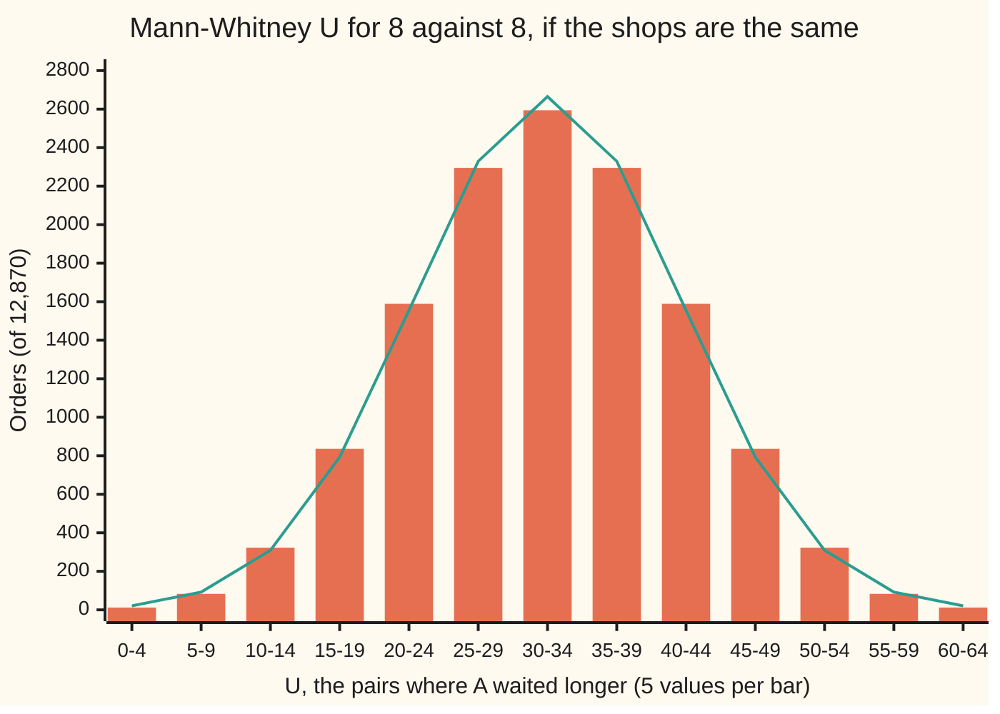

# Rank tests: Wilcoxon and Mann-Whitney, comparing groups by order alone

[Syllabus](../../../SYLLABUS.md) → [Probability and statistics](../README.md) → [Nonparametric Inference](../README.md#s15) → Rank tests

---

## General Overview

Two coffee shops on one street. A stopwatch times 8 customers at each, from order to cup in hand.

- **Shop A:** 1.2, 1.9, 2.4, 2.8, 3.1, 3.5, 4.2, 5.0 minutes.
- **Shop B:** 2.6, 3.3, 3.9, 4.4, 4.8, 5.5, 6.1, 7.0 minutes.

Is A really faster, or did it just get a lucky afternoon? Line all 16 waits up from shortest to longest and write only the shop's letter under each. Shop A holds places 1, 2, 3, 5, 6, 8, 10 and 13. The minutes are gone. Only the order is left.

If the two shops were the same, A's 8 customers would be 8 places picked at random from 16. There are 12,870 ways to pick them, all equally likely. Only 244 of them crowd A as far toward the front as this, and another 244 crowd it as far toward the back. So the chance of an order this lopsided, if the shops were the same, is 2 × 244 / 12,870 = 0.0379.

That is a **rank test**: replace each number by its rank (its place in the sorted list), and ask how unusual the ranks are. Comparing two separate groups this way is the **Mann-Whitney test**, also called the Wilcoxon rank-sum test. Comparing before and after on the same people is the **Wilcoxon signed-rank test**, met in Step 5.

The Kolmogorov-Smirnov test on [The empirical CDF](01-empirical-cdf-and-kolmogorov-smirnov.md), which compares the two shops' staircases, found no clear difference in these same 16 waits. It watches for every kind of difference at once. A rank test is aimed at a shift, so it is sharper at spotting one.

Why throw the minutes away? Because one wild value cannot drag a rank far. Type A's last wait as 50.0 instead of 5.0 and the p-value of Welch's t-test (the t-test that allows the two shops different spreads) jumps from 0.0260 to 0.5284. The rank test's moves from 0.0379 to 0.0830.

**Replace every value by its place in the combined order; if the groups do not differ, every arrangement of places is equally likely, so the p-value is a count of arrangements, exact for any shape of data; on bell-shaped data the rank test keeps 3/π, about 95.5%, of the t-test's efficiency.**

**What kind of fact this is:** a method. Its exact p-value rests on a theorem, proved on [Permutation tests](../13-Survival%2C%20Design%20and%20Causality/06-permutation-tests.md): a rank test is a permutation test run on ranks. The 3/π efficiency is a large-sample theorem, derived in outline in Why it works.

### The picture: U under all 12,870 equally likely orders



Bars: the exact count of orders whose U falls in each band of 5 values. Line: a bell curve with the same centre (32) and spread (standard deviation, 9.52), read over the same bands. The observed U = 12 sits in the third bar. The bell fits the middle well and is too fat in the two outermost bars on each side, which is why small samples use the exact count.

---

## The formula

Notation first, in words. Shop A has $`n`$ customers and shop B has $`m`$, as on [The empirical CDF](01-empirical-cdf-and-kolmogorov-smirnov.md); together $`N = n + m`$. Pool all $`N`$ waits and rank them 1 to $`N`$. $`R_A`$ is the sum of shop A's ranks. The Mann-Whitney statistic is

```math
U = R_A - \frac{n(n+1)}{2}, \qquad \mu_U = \frac{nm}{2}, \qquad \sigma_U^2 = \frac{nm(N+1)}{12}
```

**Read it aloud:** U is A's rank sum minus the smallest sum A could possibly have; if the shops are the same, it averages half of all the A-against-B pairs, with the stated spread.

U has a plain meaning. It is the number of pairs, one A customer and one B customer, in which the A customer waited longer. Here $`U = 48 - 36 = 12`$ of the 64 pairs.

**The exact p-value** counts equally likely rank sets, both tails:

```math
p = \frac{2 \times (\text{rank sets with } U \le 12)}{\binom{16}{8}} = \frac{2 \times 244}{12{,}870} = 0.0379
```

**The bell shortcut** for larger groups, with the half-step continuity correction from [Normal approximation](../06-Limit%20Theorems%20in%20Practice/03-normal-approximation-to-binomial.md):

```math
z = \frac{U + \tfrac12 - \mu_U}{\sigma_U}, \qquad p \approx 2\,\Phi(-|z|)
```

This is for U below its centre, as here. Above the centre, subtract the half instead: the half-step always moves U toward $`\mu_U`$.

**The signed-rank statistic** for pairs. Rank the sizes of the before-minus-after differences $`d_i`$, ignoring sign, then add the ranks of the positive ones:

```math
W^+ = \sum_{d_i > 0} \mathrm{rank}\,|d_i|, \qquad \mu_W = \frac{n(n+1)}{4}, \qquad \sigma_W^2 = \frac{n(n+1)(2n+1)}{24} - \sum_j \frac{t_j^3 - t_j}{48}
```

**The efficiency against the t-test**, for data whose shape (density) is $`f`$ with spread $`\sigma`$:

```math
e = 12\,\sigma^2 \left(\int f(x)^2\,dx\right)^2 = \frac{3}{\pi} \approx 0.955 \text{ for normal data}
```

**Read it aloud:** the rank test's efficiency is 12 times the squared spread times the squared area under $`f^2`$; for normal data the rank test needs about 104.7 customers to match the t-test's 100.

| Symbol | Plain meaning | In our example | Push it up and the answer… |
| --- | --- | --- | --- |
| $`n`$, $`m`$ | customers timed at shop A and shop B (for pairs: the number of pairs, $`n`$) | 8 and 8 | more orders, finer p-values |
| $`N`$, $`\binom{N}{n}`$ | all customers; the number of ways to pick A's ranks | 16; 12,870 | the smallest possible p-value shrinks |
| $`R_A`$ | the sum of shop A's ranks in the pooled list | 48 | U rises with it |
| $`U`$ | pairs where the A customer waited longer; ties count one half | 12 of 64 | moves toward "A is slower" |
| $`\mu_U`$, $`\sigma_U`$ | U's centre and spread if the shops are the same | 32 and 9.52 | — |
| $`z`$ | U's distance from its centre, in spreads | −2.10 plain, −2.048 with the half-step | further from 0, smaller p |
| $`p`$, $`\Phi`$ | the p-value; the standard bell's area left of a point | 0.0379 exact, 0.0406 from the bell | — |
| $`d_i`$ | pair $`i`$'s wait before minus after, in minutes | −0.3, 0.8, … , 1.9 | bigger drops, bigger $`W^+`$ |
| $`W^+`$, $`W^-`$, $`\mu_W`$, $`\sigma_W^2`$ | rank sums of the positive and of the negative differences; $`W^+`$'s centre and variance if nothing changed | 35 and 1; 18 and 50.875 | $`W^+`$ up: stronger evidence of a drop |
| $`t_j`$ | the size of tie group $`j`$: values that share one rank | one group of 2 | shrinks $`\sigma_W`$ a little |
| $`f`$, $`\sigma`$, $`\delta`$ | the data's shape and spread; a small shift between the groups | normal, 1 spread; δ = 1 in the simulation | heavier tails raise $`e`$ |
| $`e`$ | efficiency: the ratio of sample sizes the t-test and the rank test need for equal power | 0.955 (normal), 1.500 (Laplace) | above 1, the rank test wins |

### When it holds

- **Independent customers, and labels that could have been swapped.** The count of equally likely orders needs every customer to be interchangeable if the shops are the same. A queue where one slow order delays the next three breaks this, and the p-value comes out too small.
- **The null is "same distribution", not "same median".** If B's waits are just more spread out around the same middle, U still averages 32 or close to it, but it swings more widely than the table allows, so the test fires more often than 5% of the time. The test answers "does one shop tend to give longer waits?"
- **Ties get midranks.** Tied values share the average of their places, such as 3.5 and 3.5 for places 3 and 4. The exact count then runs over those midranks. In the bell shortcut, each tie group $`j`$ trims the signed-rank variance by $`(t_j^3 - t_j)/48`$ and U's variance by $`nm(t_j^3 - t_j)/(12N(N-1))`$.
- **Pairs need the signed-rank test.** Before-and-after waits on the same 8 regulars are tied together. Ranked as two separate groups, the p-value rises from 0.0156 to 0.1116.
- **The bell shortcut needs about 8 or more per group.** Here it gives 0.0406 against the exact 0.0379. Below that, count.

---

## Why it works

### Step 0: if the groups do not differ, the ranks are a shuffle of 1 to N

Suppose the two shops have the same distribution of waits. Then the 16 customers are interchangeable, and which 8 wear the label "A" is a random draw, as on [Permutation tests](../13-Survival%2C%20Design%20and%20Causality/06-permutation-tests.md).

That card shuffles the raw values. Here the values are first replaced by their ranks, and the ranks of 16 untied values are always 1 to 16, whatever the minutes were. So the null distribution (the law of U if the shops are the same) is the same table for every data set of 8 against 8. In 1945 that meant one printed table served everybody. Today it means the count can be done once, exactly, with no assumption about the shape of the waits.

### Step 1: the rank sum minus a constant counts the pairs

Take A's fourth-fastest customer, who waited 2.8 minutes. Their rank is 5. Below them in the pooled list sit A's three faster customers and one B customer (2.6). So rank 5 minus their place 4 within A counts the B customers who waited less: 1.

The same holds for every A customer: rank minus place within A counts the B customers below. Add over A's 8 customers. The ranks add to $`R_A = 48`$. The places add to $`1 + 2 + \dots + 8 = 36`$. The difference, 12, is the number of A-against-B pairs where A waited longer.

So $`U / nm`$ estimates the chance that a random A customer waits longer than a random B customer: 12 of 64 = 0.1875. If the shops are the same, that chance is one half.

### Step 2: count the equally likely rank sets

There are $`\binom{16}{8} = 12{,}870`$ ways to choose A's 8 ranks. Listing them all and recording each U takes a computer a moment. A second road never lists them.

Build the count one rank at a time. The number of ways to pick $`j`$ ranks from the first $`k`$ with a given sum equals the ways that skip rank $`k`$ plus the ways that use it. Both roads in the code give 244 rank sets with $`U \le 12`$. The table is symmetric about 32, so 244 more have $`U \ge 52`$, and the two-sided p-value is $`2 \times 244 / 12{,}870 = 0.0379`$.

### Step 3: the centre and spread, without listing anything

Swapping the labels A and B turns U into $`64 - U`$, so the centre is 32. The spread follows from drawing ranks without putting them back.

<details>
<summary>Detailed proof: the variance of U is nm(N+1)/12</summary>

A's rank sum is 8 draws, without putting back, from the ranks 1 to 16. One draw has variance

$`\displaystyle \mathrm{Var}(\text{one rank}) = \frac{N^2 - 1}{12} = \frac{255}{12}.`$

Two different draws are slightly negatively related. All 16 draws together always add to 136, a fixed total with variance zero. Writing that variance out as 16 variances plus 16 × 15 covariances, each covariance must equal

$`\displaystyle \mathrm{Cov} = -\frac{N^2 - 1}{12\,(N - 1)} = -\frac{N+1}{12}.`$

So the sum of $`n`$ draws has variance

$`\displaystyle \mathrm{Var}(R_A) = n\,\frac{N^2-1}{12} - n(n-1)\,\frac{N+1}{12} = \frac{n(N+1)(N-n)}{12} = \frac{nm(N+1)}{12}.`$

U differs from $`R_A`$ by the constant 36, so it has the same variance: $`8 \times 8 \times 17 / 12 = 90.667`$. The code also computes the mean and variance straight from all 12,870 rank sets and gets 32 and 90.667.

</details>

### Step 4: the bell shortcut, with the half-step

U is a sum of many small, nearly independent pieces, so for larger groups its law is close to a bell with centre 32 and spread $`\sqrt{90.667} = 9.52`$. U takes whole-number values, so the cut moves half a step toward the centre, as on [Normal approximation](../06-Limit%20Theorems%20in%20Practice/03-normal-approximation-to-binomial.md).

- With the half-step: $`z = (12.5 - 32)/9.52 = -2.048`$, p = 0.0406.
- Without it: $`z = -2.10`$, p = 0.0357, now below the exact 0.0379.

The bell's tails are too fat here (the chart), so the half-step version errs on the safe side.

### Step 5: pairs, signs and the signed-rank test

Shop B adds a second barista. The same 8 regulars are timed again. Before: B's eight waits above. After: 2.9, 2.5, 3.4, 3.2, 4.0, 3.9, 3.8, 5.1 minutes.

| Regular | 1 | 2 | 3 | 4 | 5 | 6 | 7 | 8 |
| --- | --- | --- | --- | --- | --- | --- | --- | --- |
| drop $`d_i`$, before − after | −0.3 | 0.8 | 0.5 | 1.2 | 0.8 | 1.6 | 2.3 | 1.9 |
| rank of the size $`\lvert d_i \rvert`$ | 1 | 3.5 | 2 | 5 | 3.5 | 6 | 8 | 7 |

Two drops tie at 0.8, so they share places 3 and 4 as 3.5 each. Only regular 1 got slower. So $`W^- = 1`$ and $`W^+ = 35`$; together they make $`1 + 2 + \dots + 8 = 36`$.

If the barista changed nothing, each difference is as likely to be positive as negative. That is the null here, and it needs the differences to be symmetric about zero. Each of the $`2^8 = 256`$ sign patterns is then equally likely.

- Patterns with $`W^- \le 1`$: all positive, or only rank 1 negative. That is 2.
- Two-sided exact p-value: $`2 \times 2 / 256 = 0.0156`$.
- Centre $`8 \times 9 / 4 = 18`$. Variance $`8 \times 9 \times 17 / 24 = 51`$ without ties, $`51 - (2^3 - 2)/48 = 50.875`$ with the tie.
- Bell: $`z = (35 - 0.5 - 18)/\sqrt{50.875} = 2.313`$, p = 0.0207.

Each rank is either counted or not, with chance one half, so it adds its square divided by 4 to the variance. Midranks shrink the sum of squares: $`3.5^2 + 3.5^2 = 24.5`$ against $`3^2 + 4^2 = 25`$. That is where the tie correction comes from.

The paired t-test on the same drops gives t = 3.742 and p = 0.0072. It uses the sizes as well as the ranks, and with no outlier that pays.

### Step 6: what ranking costs, and what it buys

Throwing the minutes away loses information. How much? The standard yardstick is **Pitman efficiency** (the ratio of sample sizes two tests need for the same power against a small shift, in large samples). Power is the chance of detecting a real difference.

The idea in words. A test detects a shift $`\delta`$ when its statistic moves by more than its own noise. So what matters is (how fast the statistic's average moves with the shift)², divided by its variance.

- **Gap in means:** moves 1 for 1 with the shift; variance $`2\sigma^2/n`$.
- **Share of pairs won, U / n²:** moves at rate $`\int f^2`$ per unit of shift; variance about $`1/(6n)`$.

The ratio of the two is $`e = 12\sigma^2(\int f^2)^2`$.

<details>
<summary>Detailed derivation: why the share of pairs moves at the rate ∫f²</summary>

Shift every B wait up by $`\delta`$. The chance that a B customer waits longer than an A customer is the chance that the difference of two independent draws from $`f`$ is below $`\delta`$. The density of that difference at zero is

$`\displaystyle \int f(x)\,f(x)\,dx,`$

so the chance rises from one half at rate $`\int f^2`$. The variance of U over $`n^2`$ when both groups have $`n`$ is

$`\displaystyle \frac{n^2(2n+1)}{12\,n^4} \approx \frac{1}{6n}.`$

Power depends on the ratio (rate)² / variance. For the rank test this is $`6n(\int f^2)^2`$. For the gap in means it is $`n / (2\sigma^2)`$. The sample sizes needed for equal power are in the inverse ratio, so

$`\displaystyle e = \frac{6n\,(\int f^2)^2}{n/(2\sigma^2)} = 12\,\sigma^2\left(\int f^2\right)^2.`$

For the normal shape, $`\int f^2 = 1/(2\sigma\sqrt{\pi})`$, which gives $`12\sigma^2/(4\pi\sigma^2) = 3/\pi`$.

</details>

The code integrates $`f^2`$ numerically for four shapes:

```
normal    ███████████████████              0.955
uniform   ████████████████████             1.000
logistic  ██████████████████████           1.097
Laplace   ██████████████████████████████   1.500
```

The Laplace shape is a sharp peak with heavy tails (an exponential fall on each side). Hodges and Lehmann proved that for a shift between two shapes alike, $`e`$ is never below 108/125 = 0.864, and for heavy enough tails it has no ceiling.

Small samples tell the same story. The code simulates 20,000 pairs of shops, 8 customers each, B slower by one spread, and runs both tests at the 5% level. The t-test uses its cut-off 2.1448 for 14 degrees of freedom; the rank test rejects when U ≤ 13 or U ≥ 51, an exact level of 0.0499.

| Shape of the waits | t-test detects | Rank test detects |
| --- | --- | --- |
| normal | 0.470 | 0.445 |
| Laplace | 0.509 | 0.547 |

On bell-shaped data the rank test gives up a little. On heavy-tailed data it wins. The t-test's exact power on normal data, from the noncentral t law (the law of the t ratio when the shift is real), is 0.461; the simulated 0.470 is close to it.

---

## Worked numbers, by hand

| Step | Arithmetic | Value |
| --- | --- | --- |
| pool and sort the 16 waits | A sits at places 1, 2, 3, 5, 6, 8, 10, 13 | ranks |
| A's rank sum | 1 + 2 + 3 + 5 + 6 + 8 + 10 + 13 | 48 |
| B's rank sum | 136 − 48 | 88 |
| U | 48 − (1 + 2 + … + 8) = 48 − 36 | 12 |
| same, by pairs | 2.8 beats 1; 3.1 beats 1; 3.5 beats 2; 4.2 beats 3; 5.0 beats 5 | 12 of 64 |
| null centre | 8 × 8 ÷ 2 | 32 |
| null variance | 8 × 8 × 17 ÷ 12 | 90.667 |
| null spread | √90.667 | 9.52 |
| z, with the half-step | (12 + 0.5 − 32) ÷ 9.52 | −2.048 |
| bell p, two-sided | 2 × Φ(−2.048) | 0.0406 |
| exact count | rank sets with U ≤ 12, of 12,870 | 244 |
| **exact p, two-sided** | 2 × 244 ÷ 12,870 | **0.0379** |

If the shops gave the same waits, an order this lopsided would turn up in 3.79% of afternoons. That is evidence that A tends to be faster, not the chance that the shops are the same.

### What breaks if you drop a piece

| Mistake | Comes out at | What went wrong |
| --- | --- | --- |
| Use the rank sum 48 as U | z = +1.68 | Forgot to subtract 36, the smallest possible sum; the sign even flips |
| Rank the barista's before and after as two separate groups | p = 0.1116 | The pairing is thrown away; regulars differ more than the barista's effect |
| Report one tail as the answer | p = 0.0190 | Picked the direction after seeing which way the data went |
| Bell without the half-step | p = 0.0357 | Smaller than the exact 0.0379: the cut sits half a step too far out |

The code prints all four.

---

## Code, from first principles, and it actually runs

The script ranks the waits, then counts the null law of U two independent ways: building the count one rank at a time, and listing all 12,870 rank sets. Two more roads check the formulas. U is recomputed by counting pairs. The centre and variance of U and W are recomputed from the full lists. The efficiency 3/π comes from a Simpson integral of $`f^2`$, and a simulation of 20,000 pairs of shops, for each of two shapes, checks it at small sizes. The t-test's simulated power is checked against its exact value from the noncentral t law, and a second pass with no shift shows both tests firing about 5% of the time. The normal and t tail areas are Simpson integrals too, and the random numbers come from a hand-written generator, so Python and Rust print the same digits.

### Python

```python
# Rank tests -- the check behind the card.  Standard library only.  Two coffee
# shops, 8 waits each; a before/after pair; the 3/pi efficiency against the t-test.
# Normal and t tail areas are Simpson integrals written out; the random numbers
# come from a hand-written generator, so the Rust check repeats them exactly.
import math
from itertools import combinations
A = [1.2, 1.9, 2.4, 2.8, 3.1, 3.5, 4.2, 5.0]
B = [2.6, 3.3, 3.9, 4.4, 4.8, 5.5, 6.1, 7.0]
m = n = 8; N = m + n
def simpson(f, a, b, k=2000):
    h = (b - a) / k
    return h / 3 * sum((1 if i in (0, k) else 4 if i % 2 else 2) * f(a + i * h) for i in range(k + 1))
def norm_tail(z):                             # area beyond |z| under the standard bell
    return 0.5 - simpson(lambda x: math.exp(-x * x / 2) / math.sqrt(2 * math.pi), 0, abs(z))
def norm_cdf(z): return 1 - norm_tail(z) if z > 0 else norm_tail(z)
def t_tail(t, df):                            # area beyond |t|, with t = sqrt(df) tan(theta)
    g = lambda th: math.cos(th) ** (df - 1)
    return simpson(g, math.atan(abs(t) / math.sqrt(df)), math.pi / 2) / (2 * simpson(g, 0, math.pi / 2))
def midranks(xs):                             # ranks 1..len; tied values share the average rank
    order = sorted(xs); return [order.index(x) + 1 + (order.count(x) - 1) / 2 for x in xs]
def mean_var(xs):
    mu = sum(xs) / len(xs); return mu, sum((x - mu) ** 2 for x in xs) / (len(xs) - 1)
def welch(x, y):
    (mx, vx), (my, vy) = mean_var(x), mean_var(y); se2 = vx / len(x) + vy / len(y)
    df = se2 ** 2 / ((vx / len(x)) ** 2 / (len(x) - 1) + (vy / len(y)) ** 2 / (len(y) - 1))
    return (mx - my) / math.sqrt(se2), df
def U_pairs(x, y): return sum((a > b) + 0.5 * (a == b) for a in x for b in y)
def exact_p(x, y):                            # road 2: list all C(16,8) splits of the pooled ranks
    r = midranks(x + y); obs = abs(sum(r[:m]) - 36 - 32); hit = 0
    for c in combinations(range(N), m): hit += abs(sum(r[i] for i in c) - 36 - 32) >= obs - 1e-9
    return hit / math.comb(N, m)
def show(label, v): print(f"{label:<50}{v}")
r = midranks(A + B); RA = sum(r[:m]); UA = RA - m * (m + 1) / 2
show("shop A ranks among all 16", " ".join(f"{x:g}" for x in r[:m]))
show("rank sums A, B; all 16", f"{RA:g}, {sum(r[m:]):g}; {sum(r):g}")
show("U = rank sum - 36; pairs where A waited longer", f"{UA:g}; {U_pairs(A, B):g} of {m * n} = {UA / (m * n):.4f}")
mu, sd = m * n / 2, math.sqrt(m * n * (N + 1) / 12)
show("null mean, variance, spread of U", f"{mu:g}, {sd * sd:.3f}, {sd:.2f}")
z, zc = (UA - mu) / sd, (UA + 0.5 - mu) / sd
show("z plain, z with half-step", f"{z:.2f}, {zc:.3f}")
show("mistake: rank sum 48 used as U, z", f"{(RA - mu) / sd:+.2f}")
show("bell p two-sided: plain, half-step", f"{2 * norm_tail(z):.4f}, {2 * norm_tail(zc):.4f}")
ways = [[0] * (N * (N + 1) // 2 + 1) for _ in range(m + 1)]; ways[0][0] = 1
for k in range(1, N + 1):                     # road 1: count rank sets by size and sum
    for j in range(min(k, m), 0, -1):
        for s in range(len(ways[0]) - 1, k - 1, -1): ways[j][s] += ways[j - 1][s - k]
cU = [ways[m][u + 36] for u in range(m * n + 1)]   # rank sum = U + 36
total, low = sum(cU), sum(cU[:int(UA) + 1])
show("rank sets in all; with U <= 12", f"{total}; {low}")
p_exact = 2 * low / total
show("exact p one-sided, two-sided", f"{low / total:.4f}, {p_exact:.4f}")
show("two-sided p by listing every split", f"{exact_p(A, B):.4f}")
emu = sum(u * c for u, c in enumerate(cU)) / total
evar = sum((u - emu) ** 2 * c for u, c in enumerate(cU)) / total
show("mean and variance of U over all sets", f"{emu:g}, {evar:.3f}")
tw, dfw = welch(A, B)
show("Welch t, df, p on the raw minutes", f"{tw:.3f}, {dfw:.2f}, {2 * t_tail(tw, dfw):.4f}")
bins = [sum(cU[5 * i:5 * i + 5]) for i in range(13)]
bell = [round(total * (norm_cdf((5 * i + 4.5 - mu) / sd) - norm_cdf((5 * i - 0.5 - mu) / sd))) for i in range(13)]
print("chart, U in 0-4 ... 60-64, exact:", bins); print("chart, same bins, bell:", bell)
crit = max(u for u in range(33) if 2 * sum(cU[:u + 1]) / total <= 0.05)
show("5% cut-off: reject when U <=, exact level", f"{crit}, {2 * sum(cU[:crit + 1]) / total:.4f}")
A2 = A[:-1] + [50.0]; t2, df2 = welch(A2, B)
show("A's 5.0 typed as 50.0: U, exact p, Welch p", f"{U_pairs(A2, B):g}, {exact_p(A2, B):.4f}, {2 * t_tail(t2, df2):.4f}")
after = [2.9, 2.5, 3.4, 3.2, 4.0, 3.9, 3.8, 5.1]   # shop B's 8 regulars, after a second barista
d = [round(b - a, 2) for b, a in zip(B, after)]
rd = midranks([abs(x) for x in d])
Wp, Wm = sum(q for q, x in zip(rd, d) if x > 0), sum(q for q, x in zip(rd, d) if x < 0)
show("paired drops, before - after", " ".join(f"{x:g}" for x in d))
show("ranks of the sizes (ties share 3.5)", " ".join(f"{x:g}" for x in rd))
show("W+ and W-", f"{Wp:g}, {Wm:g}")
pats = [sum(q for i, q in enumerate(rd) if mask >> i & 1) for mask in range(256)]   # every sign flip
k = sum(1 for w in pats if w <= Wm)
show("sign patterns in all; with W- <= 1", f"{len(pats)}; {k}")
show("exact signed-rank p two-sided", f"{2 * k / 256:.4f}")
wmu, wv = 8 * 9 / 4, 8 * 9 * 17 / 24; wvt = wv - (2 ** 3 - 2) / 48
evw = sum((w - wmu) ** 2 for w in pats) / 256
show("W null mean, variance, tie-corrected", f"{wmu:g}, {wv:g}, {wvt:.3f}")
zw = (Wp - 0.5 - wmu) / math.sqrt(wvt)
show("signed-rank z with half-step, bell p", f"{zw:.3f}, {2 * norm_tail(zw):.4f}")
md, vd = mean_var(d); tp = md / math.sqrt(vd / 8)
show("paired t, p (7 df)", f"{tp:.3f}, {2 * t_tail(tp, 7):.4f}")
show("pairing ignored: U after vs before, exact p", f"{U_pairs(after, B):g}, {exact_p(after, B):.4f}")
shapes = {"normal": (lambda x: math.exp(-x * x / 2) / math.sqrt(2 * math.pi), 1.0, 12),
          "logistic": (lambda x: math.exp(-x) / (1 + math.exp(-x)) ** 2, math.pi ** 2 / 3, 40),
          "Laplace": (lambda x: 0.5 * math.exp(-abs(x)), 2.0, 40), "uniform": (lambda x: 1.0, 1 / 12, 0.5)}
are = {nm: 12 * var * simpson(lambda x: f(x) ** 2, -L, L) ** 2 for nm, (f, var, L) in shapes.items()}
print("efficiency of rank test vs t:", ", ".join(f"{nm} {v:.3f}" for nm, v in are.items()))
show("3/pi; rank-test sample matching t-test's 100", f"{3 / math.pi:.4f}; {100 / are['normal']:.1f}")
tcut = 2.0
for i in range(60):                           # bisect the t cut-off with 2.5% beyond, 14 df
    tcut += 2.0 ** -(i + 1) * (1 if t_tail(tcut, 14) > 0.025 else -1)
show("lowest efficiency over all shapes, 108/125", f"{108 / 125:.3f}")
show("t cut-off, 14 df", f"{tcut:.4f}")
chi14 = lambda v: v ** 6 * math.exp(-v / 2) / (2 ** 7 * math.factorial(6))   # chi-square density, 14 df
nc = 1 / math.sqrt(2 / 8)                     # a shift of one spread over its standard error
exact_pow = simpson(lambda v: chi14(v) * (norm_cdf(nc - tcut * math.sqrt(v / 14)) + norm_cdf(-nc - tcut * math.sqrt(v / 14))), 0, 100)
show("t-test power at 1 spread, exact (noncentral t)", f"{exact_pow:.3f}")
def unif():                                   # 64-bit linear congruential generator
    global s; s = (s * 6364136223846793005 + 1442695040888963407) % 2 ** 64
    return ((s >> 11) + 1) / 2 ** 53
def draw(kind):
    if kind == "normal": return math.sqrt(-2 * math.log(unif())) * math.cos(2 * math.pi * unif())
    return math.log(unif() / unif()) / math.sqrt(2)   # Laplace with spread 1
for shift in (1.0, 0.0):
    s = 20261123                              # each pass reruns the same random stream
    for kind in ("normal", "Laplace"):
        hits_t = hits_u = 0
        for _ in range(20000):                # 8 waits per shop, B slower by the shift, in spreads
            x = [draw(kind) for _ in range(8)]; y = [draw(kind) + shift for _ in range(8)]
            t = (sum(y) - sum(x)) / 8 / math.sqrt((mean_var(x)[1] + mean_var(y)[1]) / 8)
            u = U_pairs(x, y); hits_t += abs(t) > tcut; hits_u += u <= crit or u >= m * n - crit
        if (shift, kind) == (1.0, "normal"): power_t = hits_t / 20000
        show(f"power at {shift:g} spread, {kind}: t-test, rank test", f"{hits_t / 20000:.3f}, {hits_u / 20000:.3f}")
B70 = B[:-1] + [70.0]; t3, df3 = welch(A, B70)
show("try: B's 7.0 typed as 70.0: U, exact p, Welch p", f"{U_pairs(A, B70):g}, {exact_p(A, B70):.4f}, {2 * t_tail(t3, df3):.4f}")
d3 = [round(b - a, 2) for b, a in zip(B, [2.3] + after[1:])]; r3 = midranks([abs(x) for x in d3])
w3 = sum(q for q, x in zip(r3, d3) if x < 0); k3 = sum(1 for mk in range(256) if sum(q for i, q in enumerate(r3) if mk >> i & 1) <= w3)
show("try: first after-wait 2.3: W-, patterns, p", f"{w3:g}, {k3}, {2 * k3 / 256:.4f}")
assert cU[::-1] == cU and total == math.comb(16, 8) and U_pairs(A, B) == UA   # symmetry; pairs = ranks
assert abs(exact_p(A, B) - p_exact) < 1e-12   # DP count against the full list of splits
assert abs(emu - mu) < 1e-9 and abs(evar - sd * sd) < 1e-9   # null mean and variance by formula
assert k == 2 and abs(sum(pats) / 256 - wmu) < 1e-9 and abs(evw - wvt) < 1e-9
assert abs(are["normal"] - 3 / math.pi) < 1e-6 and abs(are["Laplace"] - 1.5) < 1e-6
assert abs(2 * norm_tail(zc) - p_exact) < 0.01 and abs(tcut - 2.144787) < 1e-5
assert abs(power_t - exact_pow) < 0.02        # simulated t-test power against the noncentral t law
print("ALL CHECKS PASS")
```

**Ran 2026-11-23 on macOS, Python 3.14.10, standard library only. All checks passed. Output, pasted from the run:**

```
shop A ranks among all 16                         1 2 3 5 6 8 10 13
rank sums A, B; all 16                            48, 88; 136
U = rank sum - 36; pairs where A waited longer    12; 12 of 64 = 0.1875
null mean, variance, spread of U                  32, 90.667, 9.52
z plain, z with half-step                         -2.10, -2.048
mistake: rank sum 48 used as U, z                 +1.68
bell p two-sided: plain, half-step                0.0357, 0.0406
rank sets in all; with U <= 12                    12870; 244
exact p one-sided, two-sided                      0.0190, 0.0379
two-sided p by listing every split                0.0379
mean and variance of U over all sets              32, 90.667
Welch t, df, p on the raw minutes                 -2.498, 13.59, 0.0260
chart, U in 0-4 ... 60-64, exact: [12, 83, 323, 836, 1589, 2295, 2594, 2295, 1589, 836, 323, 83, 12]
chart, same bins, bell: [21, 92, 309, 793, 1555, 2329, 2665, 2329, 1555, 793, 309, 92, 21]
5% cut-off: reject when U <=, exact level         13, 0.0499
A's 5.0 typed as 50.0: U, exact p, Welch p        15, 0.0830, 0.5284
paired drops, before - after                      -0.3 0.8 0.5 1.2 0.8 1.6 2.3 1.9
ranks of the sizes (ties share 3.5)               1 3.5 2 5 3.5 6 8 7
W+ and W-                                         35, 1
sign patterns in all; with W- <= 1                256; 2
exact signed-rank p two-sided                     0.0156
W null mean, variance, tie-corrected              18, 51, 50.875
signed-rank z with half-step, bell p              2.313, 0.0207
paired t, p (7 df)                                3.742, 0.0072
pairing ignored: U after vs before, exact p       16.5, 0.1116
efficiency of rank test vs t: normal 0.955, logistic 1.097, Laplace 1.500, uniform 1.000
3/pi; rank-test sample matching t-test's 100      0.9549; 104.7
lowest efficiency over all shapes, 108/125        0.864
t cut-off, 14 df                                  2.1448
t-test power at 1 spread, exact (noncentral t)    0.461
power at 1 spread, normal: t-test, rank test      0.470, 0.445
power at 1 spread, Laplace: t-test, rank test     0.509, 0.547
power at 0 spread, normal: t-test, rank test      0.047, 0.047
power at 0 spread, Laplace: t-test, rank test     0.044, 0.050
try: B's 7.0 typed as 70.0: U, exact p, Welch p   12, 0.0379, 0.2829
try: first after-wait 2.3: W-, patterns, p        0, 1, 0.0078
ALL CHECKS PASS
```

### Rust

Same numbers, same labels, built with `rustc --edition 2021 -O`.

```rust
// Rank tests -- the same check as the Python, in Rust.  No crates.  Two coffee
// shops, 8 waits each; a before/after pair; the 3/pi efficiency against the t-test.
// Normal and t tail areas are Simpson integrals written out; the random numbers
// come from a hand-written generator, so both checks draw the same numbers.
use std::f64::consts::PI;
const M: usize = 8;
const N: usize = 16;
fn simpson(f: &dyn Fn(f64) -> f64, a: f64, b: f64) -> f64 {
    let (k, mut s) = (2000, 0.0);
    let h = (b - a) / k as f64;
    for i in 0..=k { s += (if i == 0 || i == k { 1.0 } else if i % 2 == 1 { 4.0 } else { 2.0 }) * f(a + i as f64 * h); }
    h / 3.0 * s
}
fn norm_tail(z: f64) -> f64 { 0.5 - simpson(&|x: f64| (-x * x / 2.0).exp() / (2.0 * PI).sqrt(), 0.0, z.abs()) }
fn norm_cdf(z: f64) -> f64 { if z > 0.0 { 1.0 - norm_tail(z) } else { norm_tail(z) } }
fn t_tail(t: f64, df: f64) -> f64 {
    let g = |th: f64| th.cos().powf(df - 1.0);
    simpson(&g, (t.abs() / df.sqrt()).atan(), PI / 2.0) / (2.0 * simpson(&g, 0.0, PI / 2.0))
}
fn midranks(xs: &[f64]) -> Vec<f64> {          // ranks 1..len; tied values share the average rank
    let below = |x: f64, eq: bool| xs.iter().filter(|&&y| y < x || (eq && y == x)).count() as f64;
    xs.iter().map(|&x| (below(x, false) + 1.0 + below(x, true)) / 2.0).collect()
}
fn mean_var(xs: &[f64]) -> (f64, f64) {
    let mu = xs.iter().sum::<f64>() / xs.len() as f64;
    (mu, xs.iter().map(|x| (x - mu).powi(2)).sum::<f64>() / (xs.len() as f64 - 1.0))
}
fn welch(x: &[f64], y: &[f64]) -> (f64, f64) {
    let ((mx, vx), (my, vy)) = (mean_var(x), mean_var(y));
    let (nx, ny) = (x.len() as f64, y.len() as f64);
    let se2 = vx / nx + vy / ny;
    let df = se2.powi(2) / ((vx / nx).powi(2) / (nx - 1.0) + (vy / ny).powi(2) / (ny - 1.0));
    ((mx - my) / se2.sqrt(), df)
}
fn u_pairs(x: &[f64], y: &[f64]) -> f64 {
    x.iter().map(|a| y.iter().map(|b| if a > b { 1.0 } else if a == b { 0.5 } else { 0.0 }).sum::<f64>()).sum()
}
fn exact_p(x: &[f64], y: &[f64]) -> f64 {     // road 2: list all C(16,8) splits of the pooled ranks
    let r = midranks(&[x, y].concat());
    let dev = |mask: u32| ((0..N).filter(|i| mask >> i & 1 == 1).map(|i| r[i]).sum::<f64>() - 36.0 - 32.0).abs();
    let splits: Vec<u32> = (0u32..1 << N).filter(|mk| mk.count_ones() as usize == M).collect();
    splits.iter().filter(|&&mk| dev(mk) >= dev(0xFF) - 1e-9).count() as f64 / splits.len() as f64   // 0xFF: A's 8 places
}
fn show(label: &str, v: String) { println!("{:<50}{}", label, v); }
fn join(xs: &[f64]) -> String { xs.iter().map(|x| format!("{}", x)).collect::<Vec<_>>().join(" ") }
fn main() {
    let a = [1.2, 1.9, 2.4, 2.8, 3.1, 3.5, 4.2, 5.0];
    let b = [2.6, 3.3, 3.9, 4.4, 4.8, 5.5, 6.1, 7.0];
    let r = midranks(&[&a[..], &b[..]].concat());
    let ra: f64 = r[..M].iter().sum();
    let ua = ra - (M * (M + 1) / 2) as f64;
    show("shop A ranks among all 16", join(&r[..M]));
    show("rank sums A, B; all 16", format!("{}, {}; {}", ra, r[M..].iter().sum::<f64>(), r.iter().sum::<f64>()));
    show("U = rank sum - 36; pairs where A waited longer", format!("{}; {} of {} = {:.4}", ua, u_pairs(&a, &b), M * M, ua / (M * M) as f64));
    let (mu, sd) = ((M * M) as f64 / 2.0, ((M * M * (N + 1)) as f64 / 12.0).sqrt());
    show("null mean, variance, spread of U", format!("{}, {:.3}, {:.2}", mu, sd * sd, sd));
    let (z, zc) = ((ua - mu) / sd, (ua + 0.5 - mu) / sd);
    show("z plain, z with half-step", format!("{:.2}, {:.3}", z, zc));
    show("mistake: rank sum 48 used as U, z", format!("{:+.2}", (ra - mu) / sd));
    show("bell p two-sided: plain, half-step", format!("{:.4}, {:.4}", 2.0 * norm_tail(z), 2.0 * norm_tail(zc)));
    let smax = N * (N + 1) / 2;
    let mut ways = vec![vec![0u64; smax + 1]; M + 1];
    ways[0][0] = 1;
    for k in 1..=N {                           // road 1: count rank sets by size and sum
        for j in (1..=k.min(M)).rev() { for s in (k..=smax).rev() { ways[j][s] += ways[j - 1][s - k]; } }
    }
    let cu: Vec<u64> = (0..=M * M).map(|u| ways[M][u + 36]).collect();   // rank sum = U + 36
    let total: u64 = cu.iter().sum();
    let low: u64 = cu[..=ua as usize].iter().sum();
    show("rank sets in all; with U <= 12", format!("{}; {}", total, low));
    let p_exact = 2.0 * low as f64 / total as f64;
    show("exact p one-sided, two-sided", format!("{:.4}, {:.4}", low as f64 / total as f64, p_exact));
    show("two-sided p by listing every split", format!("{:.4}", exact_p(&a, &b)));
    let emu = cu.iter().enumerate().map(|(u, &c)| u as f64 * c as f64).sum::<f64>() / total as f64;
    let evar = cu.iter().enumerate().map(|(u, &c)| (u as f64 - emu).powi(2) * c as f64).sum::<f64>() / total as f64;
    show("mean and variance of U over all sets", format!("{}, {:.3}", emu, evar));
    let (tw, dfw) = welch(&a, &b);
    show("Welch t, df, p on the raw minutes", format!("{:.3}, {:.2}, {:.4}", tw, dfw, 2.0 * t_tail(tw, dfw)));
    let bins: Vec<String> = (0..13).map(|i| cu[5 * i..5 * i + 5].iter().sum::<u64>().to_string()).collect();
    let bell: Vec<String> = (0..13).map(|i| {
        let (lo, hi) = ((5 * i) as f64 - 0.5, (5 * i) as f64 + 4.5);
        format!("{}", (total as f64 * (norm_cdf((hi - mu) / sd) - norm_cdf((lo - mu) / sd))).round())
    }).collect();
    println!("chart, U in 0-4 ... 60-64, exact: [{}]", bins.join(", "));
    println!("chart, same bins, bell: [{}]", bell.join(", "));
    let lvl = |u: usize| 2.0 * cu[..=u].iter().sum::<u64>() as f64 / total as f64;
    let crit = (0..33).filter(|&u| lvl(u) <= 0.05).max().unwrap();
    show("5% cut-off: reject when U <=, exact level", format!("{}, {:.4}", crit, lvl(crit)));
    let mut a2 = a; a2[7] = 50.0;
    let (t2, df2) = welch(&a2, &b);
    show("A's 5.0 typed as 50.0: U, exact p, Welch p", format!("{}, {:.4}, {:.4}", u_pairs(&a2, &b), exact_p(&a2, &b), 2.0 * t_tail(t2, df2)));
    let after = [2.9, 2.5, 3.4, 3.2, 4.0, 3.9, 3.8, 5.1];   // shop B's 8 regulars, after a second barista
    let d: Vec<f64> = (0..8).map(|i| ((b[i] - after[i]) * 100.0).round() / 100.0).collect();
    let rd = midranks(&d.iter().map(|x| x.abs()).collect::<Vec<_>>());
    let wp: f64 = (0..8).filter(|&i| d[i] > 0.0).map(|i| rd[i]).sum();
    let wm: f64 = (0..8).filter(|&i| d[i] < 0.0).map(|i| rd[i]).sum();
    show("paired drops, before - after", join(&d));
    show("ranks of the sizes (ties share 3.5)", join(&rd));
    show("W+ and W-", format!("{}, {}", wp, wm));
    let pats: Vec<f64> = (0..256u32).map(|mk| (0..8).filter(|i| mk >> i & 1 == 1).map(|i| rd[i]).sum()).collect();
    let k = pats.iter().filter(|&&w| w <= wm).count();
    show("sign patterns in all; with W- <= 1", format!("{}; {}", pats.len(), k));
    show("exact signed-rank p two-sided", format!("{:.4}", 2.0 * k as f64 / 256.0));
    let (wmu, wv): (f64, f64) = (8.0 * 9.0 / 4.0, 8.0 * 9.0 * 17.0 / 24.0);
    let wvt = wv - (8.0 - 2.0) / 48.0;
    let evw = pats.iter().map(|w| (w - wmu).powi(2)).sum::<f64>() / 256.0;
    show("W null mean, variance, tie-corrected", format!("{}, {}, {:.3}", wmu, wv, wvt));
    let zw = (wp - 0.5 - wmu) / wvt.sqrt();
    show("signed-rank z with half-step, bell p", format!("{:.3}, {:.4}", zw, 2.0 * norm_tail(zw)));
    let (md, vd) = mean_var(&d);
    let tp = md / (vd / 8.0).sqrt();
    show("paired t, p (7 df)", format!("{:.3}, {:.4}", tp, 2.0 * t_tail(tp, 7.0)));
    show("pairing ignored: U after vs before, exact p", format!("{}, {:.4}", u_pairs(&after, &b), exact_p(&after, &b)));
    let shapes: Vec<(&str, Box<dyn Fn(f64) -> f64>, f64, f64)> = vec![
        ("normal", Box::new(|x: f64| (-x * x / 2.0).exp() / (2.0 * PI).sqrt()), 1.0, 12.0),
        ("logistic", Box::new(|x: f64| (-x).exp() / (1.0 + (-x).exp()).powi(2)), PI * PI / 3.0, 40.0),
        ("Laplace", Box::new(|x: f64| 0.5 * (-x.abs()).exp()), 2.0, 40.0),
        ("uniform", Box::new(|_x: f64| 1.0), 1.0 / 12.0, 0.5)];
    let are: Vec<f64> = shapes.iter().map(|(_, f, var, l)| 12.0 * var * simpson(&|x: f64| f(x).powi(2), -l, *l).powi(2)).collect();
    let parts: Vec<String> = shapes.iter().zip(&are).map(|(s, v)| format!("{} {:.3}", s.0, v)).collect();
    println!("efficiency of rank test vs t: {}", parts.join(", "));
    show("3/pi; rank-test sample matching t-test's 100", format!("{:.4}; {:.1}", 3.0 / PI, 100.0 / are[0]));
    let mut tcut = 2.0;
    for i in 0..60 { tcut += 2f64.powi(-(i + 1)) * if t_tail(tcut, 14.0) > 0.025 { 1.0 } else { -1.0 }; }   // bisect the t cut-off, 14 df
    show("lowest efficiency over all shapes, 108/125", format!("{:.3}", 108.0 / 125.0));
    show("t cut-off, 14 df", format!("{:.4}", tcut));
    let chi14 = |v: f64| v.powi(6) * (-v / 2.0).exp() / (128.0 * 720.0);   // chi-square density, 14 df
    let nc = 1.0 / (2.0f64 / 8.0).sqrt();     // a shift of one spread over its standard error
    let exact_pow = simpson(&|v: f64| chi14(v) * (norm_cdf(nc - tcut * (v / 14.0).sqrt()) + norm_cdf(-nc - tcut * (v / 14.0).sqrt())), 0.0, 100.0);
    show("t-test power at 1 spread, exact (noncentral t)", format!("{:.3}", exact_pow));
    let mut power_t = 0.0;
    for shift in [1.0, 0.0] {
        let mut s: u64 = 20261123;             // each pass reruns the same random stream
        let mut unif = || {                    // 64-bit linear congruential generator
            s = s.wrapping_mul(6364136223846793005).wrapping_add(1442695040888963407);
            ((s >> 11) + 1) as f64 / 2f64.powi(53)
        };
        for kind in ["normal", "Laplace"] {
            let (mut hits_t, mut hits_u) = (0, 0);
            let mut draw = || if kind == "normal" { let u1 = unif(); (-2.0 * u1.ln()).sqrt() * (2.0 * PI * unif()).cos() }
                              else { let u1 = unif(); (u1 / unif()).ln() / 2f64.sqrt() };
            for _ in 0..20000 {                // 8 waits per shop, B slower by the shift, in spreads
                let x: Vec<f64> = (0..8).map(|_| draw()).collect();
                let y: Vec<f64> = (0..8).map(|_| draw() + shift).collect();
                let t = (y.iter().sum::<f64>() - x.iter().sum::<f64>()) / 8.0 / ((mean_var(&x).1 + mean_var(&y).1) / 8.0).sqrt();
                let u = u_pairs(&x, &y);
                if t.abs() > tcut { hits_t += 1; }
                if u <= crit as f64 || u >= (M * M - crit) as f64 { hits_u += 1; }
            }
            if shift == 1.0 && kind == "normal" { power_t = hits_t as f64 / 20000.0; }
            show(&format!("power at {} spread, {}: t-test, rank test", shift, kind), format!("{:.3}, {:.3}", hits_t as f64 / 20000.0, hits_u as f64 / 20000.0));
        }
    }
    let mut b70 = b; b70[7] = 70.0;
    let (t3, df3) = welch(&a, &b70);
    show("try: B's 7.0 typed as 70.0: U, exact p, Welch p", format!("{}, {:.4}, {:.4}", u_pairs(&a, &b70), exact_p(&a, &b70), 2.0 * t_tail(t3, df3)));
    let d3: Vec<f64> = (0..8).map(|i| ((b[i] - if i == 0 { 2.3 } else { after[i] }) * 100.0).round() / 100.0).collect();
    let r3 = midranks(&d3.iter().map(|x| x.abs()).collect::<Vec<_>>());
    let w3 = (0..8).filter(|&i| d3[i] < 0.0).fold(0.0, |t, i| t + r3[i]);   // fold from +0.0: an empty sum prints 0
    let k3 = (0..256u32).filter(|&mk| (0..8).filter(|i| mk >> i & 1 == 1).map(|i| r3[i]).sum::<f64>() <= w3).count();
    show("try: first after-wait 2.3: W-, patterns, p", format!("{}, {}, {:.4}", w3, k3, 2.0 * k3 as f64 / 256.0));
    assert!(cu.iter().rev().eq(cu.iter()) && total == (1..=8u64).fold(1u64, |c, i| c * (8 + i) / i) && u_pairs(&a, &b) == ua);   // symmetry; pairs = ranks
    assert!((exact_p(&a, &b) - p_exact).abs() < 1e-12);   // DP count against the full list of splits
    assert!((emu - mu).abs() < 1e-9 && (evar - sd * sd).abs() < 1e-9);   // null mean and variance
    assert!(k == 2 && (pats.iter().sum::<f64>() / 256.0 - wmu).abs() < 1e-9 && (evw - wvt).abs() < 1e-9);
    assert!((are[0] - 3.0 / PI).abs() < 1e-6 && (are[2] - 1.5).abs() < 1e-6);
    assert!((2.0 * norm_tail(zc) - p_exact).abs() < 0.01 && (tcut - 2.144787).abs() < 1e-5);
    assert!((power_t - exact_pow).abs() < 0.02);   // simulated t-test power against the noncentral t law
    println!("ALL CHECKS PASS");
}
```

**Ran 2026-11-23 on macOS, rustc 1.98.1, no crates. All checks passed. Output, pasted from the run:**

```
shop A ranks among all 16                         1 2 3 5 6 8 10 13
rank sums A, B; all 16                            48, 88; 136
U = rank sum - 36; pairs where A waited longer    12; 12 of 64 = 0.1875
null mean, variance, spread of U                  32, 90.667, 9.52
z plain, z with half-step                         -2.10, -2.048
mistake: rank sum 48 used as U, z                 +1.68
bell p two-sided: plain, half-step                0.0357, 0.0406
rank sets in all; with U <= 12                    12870; 244
exact p one-sided, two-sided                      0.0190, 0.0379
two-sided p by listing every split                0.0379
mean and variance of U over all sets              32, 90.667
Welch t, df, p on the raw minutes                 -2.498, 13.59, 0.0260
chart, U in 0-4 ... 60-64, exact: [12, 83, 323, 836, 1589, 2295, 2594, 2295, 1589, 836, 323, 83, 12]
chart, same bins, bell: [21, 92, 309, 793, 1555, 2329, 2665, 2329, 1555, 793, 309, 92, 21]
5% cut-off: reject when U <=, exact level         13, 0.0499
A's 5.0 typed as 50.0: U, exact p, Welch p        15, 0.0830, 0.5284
paired drops, before - after                      -0.3 0.8 0.5 1.2 0.8 1.6 2.3 1.9
ranks of the sizes (ties share 3.5)               1 3.5 2 5 3.5 6 8 7
W+ and W-                                         35, 1
sign patterns in all; with W- <= 1                256; 2
exact signed-rank p two-sided                     0.0156
W null mean, variance, tie-corrected              18, 51, 50.875
signed-rank z with half-step, bell p              2.313, 0.0207
paired t, p (7 df)                                3.742, 0.0072
pairing ignored: U after vs before, exact p       16.5, 0.1116
efficiency of rank test vs t: normal 0.955, logistic 1.097, Laplace 1.500, uniform 1.000
3/pi; rank-test sample matching t-test's 100      0.9549; 104.7
lowest efficiency over all shapes, 108/125        0.864
t cut-off, 14 df                                  2.1448
t-test power at 1 spread, exact (noncentral t)    0.461
power at 1 spread, normal: t-test, rank test      0.470, 0.445
power at 1 spread, Laplace: t-test, rank test     0.509, 0.547
power at 0 spread, normal: t-test, rank test      0.047, 0.047
power at 0 spread, Laplace: t-test, rank test     0.044, 0.050
try: B's 7.0 typed as 70.0: U, exact p, Welch p   12, 0.0379, 0.2829
try: first after-wait 2.3: W-, patterns, p        0, 1, 0.0078
ALL CHECKS PASS
```

The two outputs match line for line.

### Lean

Lean proves the pair count and U's null centre and spread for every $`n`$ and $`m`$, and the efficiency $`3/\pi`$ for normal data.

- Take any $`n`$ and $`m`$ waits, with tied values given midranks. Then U counts the pairs where the A customer waited longer, with ties counting one half.
- Take the $`\binom{N}{n}`$ equally likely rank sets, with no ties. Then over them U averages $`nm/2`$ and has variance $`nm(N+1)/12`$.
- Take normal data with any centre and any spread $`\sigma > 0`$. Then $`12\,\sigma^2 (\int f^2)^2 = 3/\pi`$ exactly.
- The hand arithmetic holds exactly: rank sums 48 and 88, U = 12 of 64 pairs, centre 32 and variance 272/3.
- Also exact: 244 of the 12,870 rank sets have U ≤ 12, 244 more have U ≥ 52, and p = 2 × 244 / 12,870.
- The signed-rank numbers hold too: 2 of 256 sign patterns, centre 18, variance 51 or 50.875 with the tie, and p = 1/64.

The decimals, the bell shortcut, the t-test, the other shapes' efficiencies and the simulations are left to the Python and Rust checks.

```lean
-- Rank tests: with midranks, Mann-Whitney U = R_A − n(n+1)/2 counts the A-against-B pairs where A is larger (ties one half), over all equally likely rank sets U has centre nm/2 and variance nm(N+1)/12, and for normal data the efficiency 12σ²(∫f²)² equals 3/π.
import Mathlib.Data.Finset.Powerset
import Mathlib.Data.Fintype.Sum
import Mathlib.Data.Fintype.Prod
import Mathlib.Algebra.BigOperators.Fin
import Mathlib.Probability.Distributions.Gaussian.Real
import Mathlib.Tactic.NormNum
import Mathlib.Tactic.FinCases

open Finset MeasureTheory ProbabilityTheory Real

/-- The midrank of value `k` in a pooled list `z`: the number of values strictly below it,
plus the average of the places shared by the values tied with it (itself included).
With no ties this is the ordinary rank 1, 2, …, N; two values tied for places 3 and 4
both get 3.5. -/
noncomputable def midrank {ι : Type*} [Fintype ι] (z : ι → ℝ) (k : ι) : ℝ :=
  (#{l | z l < z k} : ℝ) + ((#{l | z l = z k} : ℝ) + 1) / 2

lemma half_pairs_within (n : ℕ) (x : Fin n → ℝ) :
    (∑ i, ∑ j, ((if x j < x i then (1:ℝ) else 0) + (1/2) * (if x j = x i then (1:ℝ) else 0)))
      = (n : ℝ) * n / 2 := by
  set f : Fin n → Fin n → ℝ := fun i j =>
    (if x j < x i then (1:ℝ) else 0) + (1/2) * (if x j = x i then (1:ℝ) else 0) with hf
  have hpair : ∀ i j, f i j + f j i = 1 := by
    intro i j
    simp only [hf]
    rcases lt_trichotomy (x i) (x j) with h | h | h
    · simp [h, h.ne, h.ne', not_lt.mpr h.le]
    · simp [h]; norm_num
    · simp [h, h.ne, h.ne', not_lt.mpr h.le]
  have hs : (∑ i, ∑ j, f i j) = ∑ i, ∑ j, f j i := Finset.sum_comm
  have h2 : (∑ i, ∑ j, f i j) + (∑ i, ∑ j, f j i) = (n : ℝ) * n := by
    rw [← Finset.sum_add_distrib]
    simp_rw [← Finset.sum_add_distrib, hpair]
    simp
  show (∑ i, ∑ j, f i j) = _
  linarith
#print axioms half_pairs_within

lemma card_filter_sum_type {α β : Type*} [Fintype α] [Fintype β] (p : α ⊕ β → Prop)
    [DecidablePred p] :
    (#{l | p l} : ℝ) = (#{a | p (Sum.inl a)} : ℝ) + (#{b | p (Sum.inr b)} : ℝ) := by
  simp only [natCast_card_filter, Fintype.sum_sum_type]

#print axioms card_filter_sum_type

/-- The rank sum minus a constant counts the pairs (the formula, and Step 1). Shop A has
`n` values `x` and shop B has `m` values `y`; pool all of them and give each its midrank.
Then U = R_A − n(n+1)/2, A's rank sum minus the smallest sum A could have, equals the
number of A-against-B pairs in which the A value is larger, with each tied pair counting
one half. -/
theorem rank_sum_minus_constant_counts_pairs (n m : ℕ) (x : Fin n → ℝ) (y : Fin m → ℝ) :
    (∑ i, midrank (Sum.elim x y) (Sum.inl i)) - (n : ℝ) * (n + 1) / 2 =
      (#{p : Fin n × Fin m | y p.2 < x p.1} : ℝ) +
        (1 / 2) * (#{p : Fin n × Fin m | y p.2 = x p.1} : ℝ) := by
  have hw := half_pairs_within n x
  have hi : ∀ i : Fin n, midrank (Sum.elim x y) (Sum.inl i) =
      ((#{j | x j < x i} : ℝ) + (#{k | y k < x i} : ℝ)) +
        (((#{j | x j = x i} : ℝ) + (#{k | y k = x i} : ℝ)) + 1) / 2 := by
    intro i
    unfold midrank
    rw [card_filter_sum_type, card_filter_sum_type]
    rfl
  simp_rw [hi]
  simp only [natCast_card_filter, Fintype.sum_prod_type]
  simp only [add_div, Finset.sum_add_distrib, ← Finset.sum_div, ← Finset.mul_sum, Finset.sum_const,
    Finset.card_univ, Fintype.card_fin, nsmul_eq_mul] at hw ⊢
  linear_combination hw

lemma powersetCard_range_split (n m : ℕ) (f : Finset ℕ → ℝ) :
    ∑ S ∈ (range (n + 1 + (m + 1))).powersetCard (n + 1), f S =
      ∑ S ∈ (range (n + 1 + m)).powersetCard (n + 1), f S +
        ∑ S ∈ (range (n + (m + 1))).powersetCard n, f (insert (n + m + 1) S) := by
  have e1 : n + 1 + (m + 1) = (n + m + 1) + 1 := by omega
  have e2 : n + 1 + m = n + m + 1 := by omega
  have e3 : n + (m + 1) = n + m + 1 := by omega
  rw [e1, e2, e3, range_add_one, powersetCard_succ_insert notMem_range_self]
  rw [sum_union, sum_image]
  · intro A hA B hB hAB
    simp only [mem_coe, mem_powersetCard] at hA hB
    have hA' : n + m + 1 ∉ A := fun h => notMem_range_self (hA.1 h)
    have hB' : n + m + 1 ∉ B := fun h => notMem_range_self (hB.1 h)
    rw [← erase_insert hA', ← erase_insert hB']
    exact congrArg (fun s => Finset.erase s (n + m + 1)) hAB
  · rw [disjoint_left]
    intro S hS hS'
    rw [mem_powersetCard] at hS
    obtain ⟨A, -, rfl⟩ := mem_image.mp hS'
    exact notMem_range_self (hS.1 (mem_insert_self _ _))
#print axioms powersetCard_range_split

lemma sum_range_add_one_real (k : ℕ) :
    ∑ i ∈ range k, ((i : ℝ) + 1) = (k : ℝ) * (k + 1) / 2 := by
  induction k with
  | zero => simp
  | succ k ih => rw [sum_range_succ, ih]; push_cast; ring
#print axioms sum_range_add_one_real

lemma rank_sum_moments (n m : ℕ) :
    (∑ S ∈ (range (n + m)).powersetCard n, ∑ i ∈ S, ((i : ℝ) + 1)) =
        ((n + m).choose n : ℝ) * ((n : ℝ) * (n + m + 1) / 2) ∧
      (∑ S ∈ (range (n + m)).powersetCard n, (∑ i ∈ S, ((i : ℝ) + 1)) ^ 2) =
        ((n + m).choose n : ℝ) *
          ((n : ℝ) * m * (n + m + 1) / 12 + ((n : ℝ) * (n + m + 1) / 2) ^ 2) := by
  induction n generalizing m with
  | zero => simp
  | succ n ihn =>
    induction m with
    | zero =>
      have h : (range (n + 1 + 0)).powersetCard (n + 1) = {range (n + 1)} := by
        have := powersetCard_self (range (n + 1))
        rwa [card_range] at this
      rw [h, sum_singleton, sum_singleton, sum_range_add_one_real]
      simp
    | succ m ihm =>
      obtain ⟨a1, a2⟩ := ihm
      obtain ⟨b1, b2⟩ := ihn (m + 1)
      have hins : ∀ S ∈ (range (n + (m + 1))).powersetCard n,
          ∑ i ∈ insert (n + m + 1) S, ((i : ℝ) + 1) =
            ∑ i ∈ S, ((i : ℝ) + 1) + ((n : ℝ) + m + 2) := by
        intro S hS
        rw [mem_powersetCard] at hS
        have : n + m + 1 ∉ S := fun h => by
          have := mem_range.mp (hS.1 h)
          omega
        rw [sum_insert this]
        push_cast
        ring
      have hcard : ((range (n + (m + 1))).powersetCard n).card = (n + (m + 1)).choose n := by
        rw [card_powersetCard, card_range]
      have pascal : (n + 1 + (m + 1)).choose (n + 1) =
          (n + (m + 1)).choose n + (n + 1 + m).choose (n + 1) := by
        have e1 : n + 1 + (m + 1) = (n + m + 1) + 1 := by omega
        have e2 : n + 1 + m = n + m + 1 := by omega
        have e3 : n + (m + 1) = n + m + 1 := by omega
        rw [e1, e2, e3, Nat.choose_succ_succ]
      have ratio : (n + 1 + m).choose (n + 1) * (n + 1) = (n + (m + 1)).choose n * (m + 1) := by
        have e2 : n + 1 + m = n + m + 1 := by omega
        have e3 : n + (m + 1) = n + m + 1 := by omega
        rw [e2, e3, Nat.choose_succ_right_eq]
        congr 1
        omega
      have ratioR : ((n + 1 + m).choose (n + 1) : ℝ) =
          ((n + (m + 1)).choose n : ℝ) * (m + 1) / (n + 1) := by
        rw [eq_div_iff (by positivity)]
        exact_mod_cast ratio
      constructor
      · rw [powersetCard_range_split, sum_congr rfl hins, sum_add_distrib, sum_const, hcard,
          nsmul_eq_mul, a1, b1, pascal]
        push_cast
        rw [ratioR]
        field_simp
        ring
      · have hins2 : ∀ S ∈ (range (n + (m + 1))).powersetCard n,
            (∑ i ∈ insert (n + m + 1) S, ((i : ℝ) + 1)) ^ 2 =
              (∑ i ∈ S, ((i : ℝ) + 1)) ^ 2 + (2 * ((n : ℝ) + m + 2)) * ∑ i ∈ S, ((i : ℝ) + 1)
                + ((n : ℝ) + m + 2) ^ 2 := by
          intro S hS
          rw [hins S hS]
          ring
        rw [powersetCard_range_split, sum_congr rfl hins2, sum_add_distrib, sum_add_distrib,
          ← mul_sum, sum_const, hcard, nsmul_eq_mul, a2, b1, b2, pascal]
        push_cast
        rw [ratioR]
        field_simp
        ring

#print axioms rank_sum_moments

/-- The centre and spread of U, without listing anything (Step 3). If the groups do not
differ, A's ranks are one of the C(N, n) equally likely sets of `n` places among the ranks
1 to N = n + m. Taken over all those rank sets, U = R_A − n(n+1)/2 averages nm/2 and has
variance nm(N + 1)/12: the sum of U over the sets is C(N, n) · nm/2, and the sum of its
squared distance from nm/2 is C(N, n) · nm(N + 1)/12. -/
theorem mann_whitney_null_mean_and_variance (n m : ℕ) :
    let U : Finset ℕ → ℝ := fun S => (∑ i ∈ S, ((i : ℝ) + 1)) - (n : ℝ) * (n + 1) / 2
    (∑ S ∈ (range (n + m)).powersetCard n, U S) =
        ((n + m).choose n : ℝ) * ((n : ℝ) * m / 2) ∧
      (∑ S ∈ (range (n + m)).powersetCard n, (U S - (n : ℝ) * m / 2) ^ 2) =
        ((n + m).choose n : ℝ) * ((n : ℝ) * m * ((n : ℝ) + m + 1) / 12) := by
  intro U
  obtain ⟨h1, h2⟩ := rank_sum_moments n m
  have hcard : ((range (n + m)).powersetCard n).card = (n + m).choose n := by
    rw [card_powersetCard, card_range]
  have hU : ∀ S, (U S - (n : ℝ) * m / 2) ^ 2 =
      (∑ i ∈ S, ((i : ℝ) + 1)) ^ 2 - 2 * ((n : ℝ) * (n + m + 1) / 2) * (∑ i ∈ S, ((i : ℝ) + 1))
        + ((n : ℝ) * (n + m + 1) / 2) ^ 2 := by
    intro S
    simp only [U]
    ring
  constructor
  · simp only [U]
    rw [sum_sub_distrib, sum_const, hcard, nsmul_eq_mul, h1]
    ring
  · simp_rw [hU]
    rw [sum_add_distrib, sum_sub_distrib, ← mul_sum, sum_const, hcard, nsmul_eq_mul, h1, h2]
    ring

/-- The efficiency against the t-test on bell-shaped data (Step 6). For the normal shape
f with centre μ and variance σ² > 0, the efficiency e = 12σ²(∫ f(x)² dx)² is exactly 3/π,
about 0.955. -/
theorem normal_efficiency_three_over_pi (μ : ℝ) (v : NNReal) (hv : v ≠ 0) :
    12 * (v : ℝ) * (∫ x, gaussianPDFReal μ v x ^ 2) ^ 2 = 3 / π := by
  have hv' : (0:ℝ) < v := NNReal.coe_pos.mpr (pos_iff_ne_zero.mpr hv)
  have hsq : ∀ x, gaussianPDFReal μ v x ^ 2 =
      (2 * π * v)⁻¹ * rexp (-(1 / (v:ℝ)) * (x - μ) ^ 2) := by
    intro x
    rw [gaussianPDFReal, mul_pow, inv_pow, sq_sqrt (by positivity), ← Real.exp_nat_mul]
    congr 2
    field_simp
    ring
  simp_rw [hsq]
  rw [integral_const_mul,
    integral_sub_right_eq_self (μ := volume) (fun a ↦ rexp (-(1 / (v:ℝ)) * a ^ 2)) μ,
    integral_gaussian]
  rw [mul_pow, inv_pow, sq_sqrt (by positivity)]
  field_simp
  ring

/-! The card's worked numbers. Ranks are whole numbers; in the signed-rank example each
midrank is doubled (3.5 becomes 7) so every number is a whole number. -/

-- Shop A's ranks 1, 2, 3, 5, 6, 8, 10, 13 add to 48; all 16 add to 136, so B's add to 88;
-- U = 48 − (1 + 2 + … + 8) = 48 − 36 = 12.
example : ∑ i ∈ ({1, 2, 3, 5, 6, 8, 10, 13} : Finset ℕ), i = 48 ∧
    ∑ i ∈ range 16, (i + 1) = 136 ∧ 136 - 48 = 88 ∧
    ∑ i ∈ range 8, (i + 1) = 36 ∧ 48 - 36 = 12 := by decide

-- Same U by pairs: of the 64 A-against-B pairs of ranks, A's rank is larger in 12.
example : (({1, 2, 3, 5, 6, 8, 10, 13} : Finset ℕ) ×ˢ
    ((Icc 1 16) \ {1, 2, 3, 5, 6, 8, 10, 13})).card = 64 ∧
    ((({1, 2, 3, 5, 6, 8, 10, 13} : Finset ℕ) ×ˢ
      ((Icc 1 16) \ {1, 2, 3, 5, 6, 8, 10, 13})).filter (fun p => p.2 < p.1)).card = 12 := by
  decide

-- C(16, 8) = 12,870 equally likely rank sets; U's centre 8 · 8 / 2 = 32 and variance
-- 8 · 8 · 17 / 12 = 272/3 (90.667).
example : Nat.choose 16 8 = 12870 ∧ (8 * 8 / 2 : ℚ) = 32 ∧ (8 * 8 * 17 / 12 : ℚ) = 272 / 3 := by
  refine ⟨by decide, by norm_num, by norm_num⟩

-- The exact count: 244 of the 12,870 rank sets have rank sum at most 48, that is U ≤ 12,
-- and the sets are symmetric about 32, so 244 more have U ≥ 52.
example : (((range 16).powersetCard 8).filter (fun S => ∑ i ∈ S, (i + 1) ≤ 48)).card = 244 ∧
    (((range 16).powersetCard 8).filter (fun S => 88 ≤ ∑ i ∈ S, (i + 1))).card = 244 := by
  decide +kernel

-- Two-sided exact p-value 2 × 244 / 12,870 = 488/12,870.
example : (2 * 244 / 12870 : ℚ) = 244 / 6435 := by norm_num

-- Signed-rank test: doubled midranks of the drops' sizes are 2, 7, 4, 10, 7, 12, 16, 14.
-- Regular 1 got slower: W⁻ = 1 (doubled, 2) and W⁺ = 35 (doubled, 70). Of the 2⁸ = 256
-- sign patterns, exactly 2 have W⁻ ≤ 1.
example : let r : Fin 8 → ℕ := ![2, 7, 4, 10, 7, 12, 16, 14]
    r 0 = 2 ∧ ∑ i ∈ ({1, 2, 3, 4, 5, 6, 7} : Finset (Fin 8)), r i = 70 ∧
      (univ : Finset (Finset (Fin 8))).card = 256 ∧
      ((univ : Finset (Finset (Fin 8))).filter (fun T => ∑ i ∈ T, r i ≤ 2)).card = 2 := by
  decide +kernel

-- Signed-rank centre 8 · 9 / 4 = 18, variance 8 · 9 · 17 / 24 = 51, and 51 − (2³ − 2)/48
-- = 50.875 with the tie; exact p-value 2 × 2 / 256 = 1/64.
example : (8 * 9 / 4 : ℚ) = 18 ∧ (8 * 9 * 17 / 24 : ℚ) = 51 ∧
    (51 - (2 ^ 3 - 2) / 48 : ℚ) = 407 / 8 ∧ (2 * 2 / 256 : ℚ) = 1 / 64 := by norm_num

#print axioms rank_sum_minus_constant_counts_pairs
#print axioms mann_whitney_null_mean_and_variance
#print axioms normal_efficiency_three_over_pi
```

**Checked 2026-11-23 on macOS, Lean 4.36.0-rc2, Mathlib v4.36.0-rc2. Every proof is complete and uses only Lean's standard axioms. Output, pasted from the run:**

```
'half_pairs_within' depends on axioms: [propext, Classical.choice, Quot.sound]
'card_filter_sum_type' depends on axioms: [propext, Classical.choice, Quot.sound]
'powersetCard_range_split' depends on axioms: [propext, Classical.choice, Quot.sound]
'sum_range_add_one_real' depends on axioms: [propext, Classical.choice, Quot.sound]
'rank_sum_moments' depends on axioms: [propext, Classical.choice, Quot.sound]
'rank_sum_minus_constant_counts_pairs' depends on axioms: [propext, Classical.choice, Quot.sound]
'mann_whitney_null_mean_and_variance' depends on axioms: [propext, Classical.choice, Quot.sound]
'normal_efficiency_three_over_pi' depends on axioms: [propext, Classical.choice, Quot.sound]
```

> [!TIP]
> **Try changing**
> Guess first, then run it. An assert is a line that stops the program if a number comes out wrong.
> - **Make B's slowest wait 70.0 instead of 7.0.** Guess first: what happens to each p-value? The ranks do not change, so U stays 12 and the exact p stays 0.0379. Welch's t-test p rises from 0.0260 to 0.2829. Every assert still passes.
> - **Remove the shift.** The simulation's second pass sets the shift to 0. Guess first: how often should each test fire? Both should fire about 5% of the time. Normal: 0.047 and 0.047. Laplace: 0.044 and 0.050.
> - **Make regular 1 faster too.** Change the first "after" wait from 2.9 to 2.3. Guess first: what is the new exact p? $`W^-`$ becomes 0, only 1 sign pattern is that extreme, and p = 0.0078. The assert pinned to 2 patterns stops the program.

---

## The usual mistake

> [!warning]
> **Reading a significant Mann-Whitney test as "the medians differ".** The test asks whether a customer from one shop tends to wait longer than a customer from the other: whether the share of pairs won, 0.1875 here, is far from one half. Two shops with the same median but different shapes can give a significant U. Only when the two shapes are alike, one shifted from the other, does U speak about the medians.
>
> - **Forgetting to subtract.** The rank sum 48 is not U. Used as U it gives z = +1.68, pointing the wrong way.
> - **Ignoring the pairs.** Before-and-after on the same regulars, ranked as two groups, gives p = 0.1116 instead of 0.0156.
> - **Trusting the t-test because the data "look fine".** One mistyped 50.0 sends Welch's t-test p to 0.5284; the rank test's goes to 0.0830.
> - **Mixing up which U.** Software often reports the smaller of U and 64 − U. Here that is 12 either way, but the direction must come from the data.

---

## Where you meet it in real life

- **Clinical trials with scores.** Pain is rated 0 to 10, and the gap from 3 to 4 need not equal the gap from 8 to 9. Ranks use only the order, which is all such a scale really carries.
- **Website and app speed.** Page-load and response times have long right tails. A few very slow requests can swamp a t-test; a rank test compares typical requests.
- **Environmental testing.** Many readings come back "below the detection limit". Those are ties at the bottom of the list, which midranks handle directly.
- **Before-and-after studies.** A diet, a training plan or a new machine measured on the same people or units uses the signed-rank test.

> **Say it back**
> A rank test throws away the values and keeps only their order in the combined list. If the groups do not differ, every arrangement of the ranks is equally likely, so the p-value is an exact count: 2 × 244 of 12,870 for the coffee shops, 0.0379. U counts the pairs where one group beat the other, and its centre and spread give a bell shortcut for larger samples. For pairs, the signed-rank test flips signs instead of labels. On bell-shaped data it needs about 104.7 customers where the t-test needs 100, and on heavy-tailed data it often wins.

---

## What this builds on

- [Permutation tests](../13-Survival%2C%20Design%20and%20Causality/06-permutation-tests.md): the shuffle logic and its exactness guarantee; a rank test is that test run on ranks.
- [t-tests](../08-Confidence%20Intervals%20and%20Tests/05-t-tests-and-comparing-means.md): the two-sample and paired tests this card is measured against.
- [Normal approximation](../06-Limit%20Theorems%20in%20Practice/03-normal-approximation-to-binomial.md): the bell shortcut and the half-step correction for a whole-number count.
- [The empirical CDF](01-empirical-cdf-and-kolmogorov-smirnov.md): the data's own step-function CDF; a value's rank is N times the pooled empirical CDF at that value.

---

## Where this goes next

- [Kernel density estimation](03-kernel-density-estimation.md): estimates the shape $`f`$ itself, the shape that sets this card's efficiency.
- [Smoothing a scatter](04-kernel-regression-and-smoothing-splines.md): drops the bell-curve assumption for a whole curve instead of a single comparison.

The question this card leaves open: a rank test says whether one group tends to be larger, so how large is the difference, with an interval around it?

---

## Sources

Verified 2026-11-23: every link below resolves to the publisher's page.

- Wilcoxon, Frank. "Individual Comparisons by Ranking Methods." *Biometrics Bulletin* 1, no. 6 (1945): 80–83. [doi:10.2307/3001968](https://doi.org/10.2307/3001968). The original rank-sum and signed-rank tests, with small exact tables.
- Mann, H. B., and D. R. Whitney. "On a Test of Whether One of Two Random Variables Is Stochastically Larger than the Other." *Annals of Mathematical Statistics* 18, no. 1 (1947): 50–60. [doi:10.1214/aoms/1177730491](https://doi.org/10.1214/aoms/1177730491). U as a count of pairs, its recursion, mean, variance and normal limit.
- Hodges, J. L., and E. L. Lehmann. "The Efficiency of Some Nonparametric Competitors of the t-Test." *Annals of Mathematical Statistics* 27, no. 2 (1956): 324–335. [doi:10.1214/aoms/1177728261](https://doi.org/10.1214/aoms/1177728261). The efficiency 3/π for normal data and the floor of 0.864.
- Hollander, Myles, Douglas A. Wolfe, and Eric Chicken. *Nonparametric Statistical Methods*, 3rd ed. Wiley, 2014. [Publisher page](https://www.wiley.com/en-us/Nonparametric+Statistical+Methods%2C+3rd+Edition-p-9780470387375). Chapters 3 and 4: the signed-rank and rank-sum tests, ties and large-sample forms.
