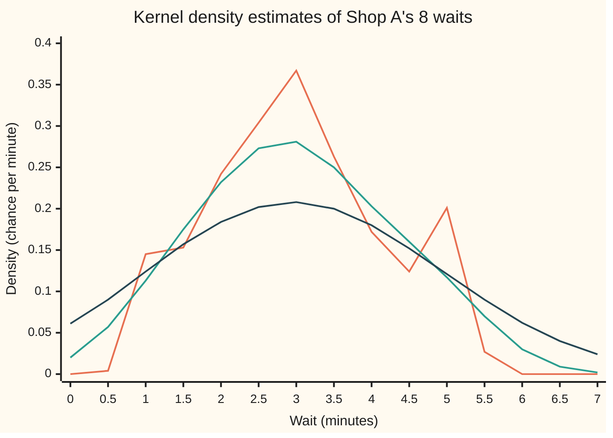

# Kernel density estimation: a smooth histogram, and the bandwidth that balances bias and noise

[Syllabus](../../../SYLLABUS.md) → [Probability and statistics](../README.md) → [Nonparametric Inference](../README.md#s15) → Kernel density estimation

---

## General Overview

A coffee shop, Shop A, times eight customers from order to cup: 1.2, 1.9, 2.4, 2.8, 3.1, 3.5, 4.2 and 5.0 minutes. The owner wants the shape of the waits, not just their average. Where do waits pile up? Is there a second cluster of slow orders? How likely is a wait near 3 minutes?

A histogram is the first answer: cut the time axis into bins and count. But the picture depends on where the bins start. With one-minute bins from 1.0, the counts are 2, 2, 2, 1, 1: flat, then a drop. Start the same bins at 0.5 and the counts are 1, 2, 2, 2, 1: a neat hump. Same eight waits, two shapes.

A **kernel density estimate** removes the bin edges. Put a small bell curve, of total area one eighth, on top of each wait. Add the eight bells. The sum is a smooth curve of total area 1, highest where waits are crowded. Its height at 3 minutes is **0.281 per minute**.

One number controls the result: the width of each bell, called the **bandwidth** and written $`h`$. Too narrow and every customer gets a spike. Too wide and the shape is smeared flat. Silverman's rule sets it from the data's spread: here $`h = 0.7289`$ minutes.

**A kernel density estimate replaces each data point by a small bump of area $`1/n`$ and adds the bumps; its bias grows like $`h^2`$ and its noise like $`1/(nh)`$, so the bandwidth $`h`$ is chosen to balance the two.**

**What kind of fact this is:** a method. Its bias and variance formulas are theorems, derived on this card in Why it works from Taylor's theorem. Silverman's rule is a rule of thumb built on a bell-shaped assumption, not a law.

### The picture: one set of waits, three bandwidths



First line (orange): $`h = 0.25`$ minutes. It is jagged and grows a false second hump at 5.0 minutes, made by one slow customer. Second line (teal): Silverman's $`h = 0.73`$, one smooth hump that peaks near 3 minutes. Third line (dark): $`h = 1.50`$, flatter, with its tails pushed out past 0 and 7 minutes.

The two histograms from the opening, as bars (one block per customer):

```
bins from 1.0     bins from 0.5
1.0-2.0  ██  2    0.5-1.5  █   1
2.0-3.0  ██  2    1.5-2.5  ██  2
3.0-4.0  ██  2    2.5-3.5  ██  2
4.0-5.0  █   1    3.5-4.5  ██  2
5.0-6.0  █   1    4.5-5.5  █   1
```

---

## The formula

Notation first. As on [Densities](../04-Continuous%20Distributions/01-densities-and-cdfs.md), $`f`$ is a density: chance per unit, so area under it is chance. Here $`f`$ is the true density of waits, which nobody knows. A hat marks an estimate. The data are $`x_1, \dots, x_n`$; here $`n = 8`$.

A **kernel** $`K`$ is the bump: any density symmetric about 0. This card uses the standard bell $`\varphi(u) = e^{-u^2/2}/\sqrt{2\pi}`$ from [Normal](../04-Continuous%20Distributions/04-normal-distribution.md). The estimate at a point $`x`$ is

```math
\hat f_h(x) = \frac{1}{n h} \sum_{i=1}^{n} K\!\left(\frac{x - x_i}{h}\right)
```

**Read it aloud:** at the point $`x`$, measure each data point's distance from $`x`$ in bandwidths, read the kernel's height there, add the heights, and divide by $`n`$ times $`h`$.

Why divide by $`h`$? Stretching a bump $`h`$ times wider would multiply its area by $`h`$. Dividing by $`h`$ puts the area back to 1, and dividing by $`n`$ shares it out: area $`1/n`$ per point.

The histogram is the same idea with a box instead of a bell: the height on a bin is the count in the bin divided by $`n`$ times the bin width.

For a point $`x`$ where $`f`$ is smooth, with $`n`$ large and $`h`$ small, the estimate's bias and variance are approximately

```math
\mathrm{bias}\,\hat f_h(x) \approx \frac{h^2}{2}\,\sigma_K^2\, f''(x), \qquad \mathrm{Var}\,\hat f_h(x) \approx \frac{f(x)\,R(K)}{n h}
```

**Read it aloud:** the lean grows with the square of the bandwidth and with the curve's bend at $`x`$; the scatter shrinks as the number of points within one bandwidth, about $`nh`$, grows.

Here $`\sigma_K^2 = \int u^2 K(u)\,du`$ is the kernel's own variance (1 for the bell) and $`R(K) = \int K(u)^2\,du`$ is its total squared height ($`1/(2\sqrt\pi) = 0.2821`$ for the bell). Balancing the two errors over the whole axis gives the **optimal-rate bandwidth**, and for a bell-shaped truth, the normal-reference value:

```math
h^* = \left(\frac{R(K)}{\sigma_K^4\, R(f'')\, n}\right)^{1/5}, \qquad h_{\mathrm{normal}} = 1.06\,\sigma\, n^{-1/5}
```

**Read it aloud:** the best bandwidth shrinks like the fifth root of the sample size; for bell-shaped data it is 1.06 spreads times $`n`$ to the minus one fifth.

**Silverman's rule** hedges that formula against data that are not bell-shaped:

```math
h = 0.9 \times \min\!\left(s,\ \frac{\mathrm{IQR}}{1.34}\right) \times n^{-1/5}
```

**Read it aloud:** take the smaller of two spread measures, the standard deviation and the quartile range scaled to match it, then multiply by 0.9 and by $`n`$ to the minus one fifth.

**Cross-validation** chooses $`h`$ from the data alone, by minimising

```math
\mathrm{CV}(h) = \int \hat f_h(x)^2\,dx \;-\; \frac{2}{n}\sum_{i=1}^{n} \hat f_{h,-i}(x_i)
```

**Read it aloud:** the area under the squared estimate, minus twice the average height that each point receives from a curve built without it.

| Symbol | Plain meaning | In our example | Push it up and the answer… |
| --- | --- | --- | --- |
| $`x`$, $`y`$; $`X`$; $`x_i`$, $`i`$ | points on the wait axis; a random wait; customer $`i`$'s wait | $`x`$ = 3 min; 1.2 to 5.0 min | — |
| $`n`$ | number of data points | 8 | $`h`$ shrinks like $`n^{-1/5}`$ |
| $`h`$ | bandwidth: the width of each bump, in minutes | 0.7289 (Silverman) | smoother curve: less noise, more bias |
| $`K`$, $`K_h`$, $`\varphi`$, $`\Phi`$; $`u`$, $`z`$ | the kernel and its copy stretched to width $`h`$; here the standard bell, its height and its area to the left; a distance measured in bandwidths | bell heights 0.0092 to 0.3952 in the worked table | — |
| $`f`$ | the true density of waits, unknown | 0.3250 at 3 min, if waits were bell-shaped | — |
| $`\hat f_h`$, $`\hat f_{h,-i}`$, $`\hat F_h`$ | the kernel estimate; the same built without point $`i`$; the estimate's CDF | $`\hat f_h(3) = 0.2809`$ per min | — |
| $`s`$; $`Q_1`$, $`Q_3`$, IQR | standard deviation (divisor $`n-1`$); lower and upper quartiles; their gap | 1.2276; 2.15, 3.85, 1.70 min | $`h`$ grows |
| $`f''`$ | the curve's bend: its second derivative | −0.2156 at 3 min (bell model) | larger bias |
| $`\sigma_K^2`$, $`R(K)`$ | kernel's variance; kernel's total squared height | 1; 0.2821 | — |
| $`R(f'')`$, $`\sigma`$ | total squared bend of the true curve, $`\int f''(x)^2 dx`$; its spread if bell-shaped | depends on unknown $`f`$ | best $`h`$ shrinks |
| MISE, $`h^*`$ | mean integrated squared error, the MSE added up over all $`x`$; the $`h`$ that minimises its leading terms | for a bell, $`h^* = (4/3)^{1/5}\, s\, n^{-1/5} = 0.8579`$ | — |
| $`\mathrm{CV}(h)`$ | cross-validation score: lower is better | −0.1820 at its best, $`h = 1.43`$ | — |

### When it holds

- **The waits are independent draws from one smooth density.** If the barista slows down through a rush, the eight waits are not one law, and the curve averages two different shops.
- **The bias formula needs $`f`$ to bend smoothly.** Near a sharp edge, such as a wait that can never be below some minimum, the Taylor step fails and the bias no longer shrinks like $`h^2`$.
- **A bell kernel spills over boundaries.** Waits cannot be negative, yet 0.0069 of the estimate's area sits below 0 minutes. Near a hard edge, reflect the data or use a kernel that stays on one side.
- **The bandwidth rules assume one hump.** Silverman's rule and $`h_{\mathrm{normal}}`$ use a bell as reference. For data with two clusters they oversmooth and can merge the clusters into one.
- **Eight points is very few.** The formulas describe how errors scale. At $`n = 8`$ the variance formula overstates the exact variance about threefold (table in Step 3).

---

## Why it works

### Step 0: a density is a local count, and smoothing trades detail for stability

A density at $`x`$ is the chance of landing near $`x`$, per unit of width. The natural estimate is to count the points near $`x`$ and divide by $`n`$ times the width of "near". That is a histogram bin centred on $`x`$.

A kernel softens "near": points close to $`x`$ count fully, points further away count less, by the kernel's height. The bandwidth $`h`$ is the width of "near". A wide window holds many points, so the count is stable, but it mixes in points where the density is different. A narrow window is faithful to $`x`$ but holds few points, so the count jumps around. That tension is the whole card.

### Step 1: the estimate is a true density, and it is the data's law smoothed

Each term $`K((x - x_i)/h)/h`$ is a bell centred on $`x_i`$ with spread $`h`$, area 1. The average of eight densities is a density: never negative, total area 1. The code confirms the area: 1.000000.

There is a second view. The data's own law puts a lump of chance $`1/n`$ on each point; its running total is the staircase of [The empirical CDF](01-empirical-cdf-and-kolmogorov-smirnov.md). Add an independent bell of spread $`h`$ to a draw from it. By [Adding continuous variables](../05-Transformations%20and%20Joint%20Laws/04-sums-and-convolution.md), the density of the sum is the convolution, and convolving a lump at $`x_i`$ with a bell gives that bell shifted to $`x_i`$. So:

```math
\hat f_h = (\text{empirical law of the data}) * (\text{kernel of width } h)
```

The kernel estimate is the data's jagged staircase CDF, smoothed by a bell. Its own CDF is $`\hat F_h(x) = \frac1n \sum_i \Phi((x - x_i)/h)`$, where $`\Phi`$ is the standard bell's area to the left, and $`\hat f_h`$ is its slope. Road 2 in the code uses exactly this.

### Step 2: the bias is order $`h^2`$

Average the estimate over all the samples the shop could have drawn. Each term has the same average, so

```math
E\,\hat f_h(x) = \int \frac1h K\!\left(\frac{x - y}{h}\right) f(y)\,dy = \int K(u)\, f(x - hu)\,du
```

The second form substitutes $`u = (x - y)/h`$. In words: the estimate's average is the true curve, blurred by the kernel. Blurring is the bias.

Now expand $`f(x - hu)`$ by Taylor's theorem: $`f(x) - hu\,f'(x) + \tfrac12 h^2u^2 f''(x) + \dots`$. Integrate each term against $`K`$:

- $`\int K = 1`$ gives back $`f(x)`$.
- $`\int u K = 0`$ because the kernel is symmetric. The slope term cancels: the slope adds as much on one side of $`x`$ as it takes away on the other.
- $`\int u^2 K = \sigma_K^2`$ leaves the bend term, $`\tfrac12 h^2 \sigma_K^2 f''(x)`$.

So the bias is about $`\tfrac12 h^2 \sigma_K^2 f''(x)`$. At a peak, $`f''`$ is negative and the estimate sits too low: blurring flattens peaks and fills valleys.

### Step 3: the variance is order $`1/(nh)`$

The estimate is an average of $`n`$ independent copies of $`K_h(x - X) = K((x - X)/h)/h`$. By [Bias and variance](../07-Sampling%20and%20Estimation/06-bias-variance-and-mean-squared-error.md), averaging $`n`$ independent copies divides the variance by $`n`$:

```math
\mathrm{Var}\,\hat f_h(x) = \frac1n\Big(E\big[K_h(x - X)^2\big] - \big(E\,\hat f_h(x)\big)^2\Big), \qquad E\big[K_h(x-X)^2\big] = \frac1h\int K(u)^2 f(x - hu)\,du \approx \frac{f(x)\,R(K)}{h}
```

The first term dominates when $`h`$ is small, which gives $`f(x)R(K)/(nh)`$. In words: about $`nh\,f(x)`$ points fall within one bandwidth of $`x`$, and a count of that many points has relative noise near one over its square root.

**Checking both with a bell-shaped truth.** Suppose the waits really were bell-shaped, with Shop A's mean 3.0125 and spread 1.2276. Then everything is exact: the true bell blurred by a bell of spread $`h`$ is a bell of spread $`\sqrt{s^2 + h^2}`$ (convolution again). Here $`f(3) = 0.3250`$ and $`f''(3) = -0.2156`$. At 3 minutes:

| $`h`$ | Bias, exact | $`h^2 f''/2`$ | Variance, exact | $`f R(K)/(nh)`$ | MSE, exact |
| --- | --- | --- | --- | --- | --- |
| 0.25 | −0.00654 | −0.00674 | 0.03269 | 0.04584 | 0.03274 |
| 0.50 | −0.02400 | −0.02695 | 0.01070 | 0.02292 | 0.01128 |
| 0.7289 | −0.04554 | −0.05728 | 0.00474 | 0.01572 | **0.00681** |
| 1.00 | −0.07301 | −0.10781 | 0.00199 | 0.01146 | 0.00732 |
| 1.50 | −0.11915 | −0.24257 | 0.00049 | 0.00764 | 0.01468 |

Bias grows and variance falls as $`h`$ grows; their sum, the MSE, is smallest of the five rows at Silverman's $`h`$. The bias formula is close for small $`h`$. The variance formula drops the $`(E\hat f)^2`$ term and treats $`f`$ as flat across the window; both fail when $`h`$ is as wide as it must be at $`n = 8`$. It captures the trend, not the size.

A simulation of 20,000 samples of 8 bell-shaped waits confirms the exact row at $`h = 0.7289`$: average estimate 0.27881 against 0.27942 exact, variance 0.00478 against 0.00474.

### Step 4: balance the two and get the $`n^{-1/5}`$ rate

Add squared bias and variance at each $`x`$ and integrate over all $`x`$. The leading terms are

```math
\mathrm{MISE}(h) \approx \frac{h^4}{4}\,\sigma_K^4\, R(f'') + \frac{R(K)}{n h}
```

The first term rises like $`h^4`$ and the second falls like $`1/h`$. Set the slope to zero: $`h^3 \sigma_K^4 R(f'') = R(K)/(n h^2)`$, so $`h^5 = R(K)/(\sigma_K^4 R(f'') n)`$. That is $`h^*`$ above.

Put $`h^*`$ back in and both terms shrink like $`n^{-4/5}`$. A parametric fit, where the shape is known up to a few numbers, has error falling like $`n^{-1}`$. Not knowing the shape costs a slower rate.

<details>
<summary>From the general formula to 1.06 σ n^(-1/5)</summary>

For a bell kernel, $`\sigma_K = 1`$ and $`R(K) = 1/(2\sqrt\pi)`$. For a bell-shaped truth of spread $`\sigma`$, the total squared bend works out to

$`\displaystyle R(f'') = \int f''(x)^2\,dx = \frac{3}{8\sqrt\pi\,\sigma^5}.`$

Substitute:

$`\displaystyle h^5 = \frac{1}{2\sqrt\pi}\cdot\frac{8\sqrt\pi\,\sigma^5}{3n} = \frac{4\sigma^5}{3n}, \qquad h = \left(\tfrac43\right)^{1/5}\sigma\, n^{-1/5} = 1.0592\,\sigma\,n^{-1/5}.`$

Rounded, that is the 1.06 of the normal-reference rule.

</details>

### Step 5: Silverman's rule, a hedged plug-in

The formula for $`h^*`$ needs $`R(f'')`$, which depends on the unknown $`f`$. The normal-reference rule pretends $`f`$ is a bell and plugs in $`s`$ for $`\sigma`$. Silverman made two changes:

- **Use the smaller of two spreads.** One very slow wait inflates $`s`$ but barely moves the quartiles. Dividing the IQR by 1.34 rescales it to match $`s`$ for a bell, whose IQR is 1.3490 spreads. The smaller of the two resists outliers.
- **Shrink 1.06 to 0.9.** Skewed or two-humped data have more bend than a bell, so their best $`h`$ is smaller. A slightly narrow bandwidth costs little; a too-wide one can hide a second cluster.

For Shop A, the bell-model numbers show the hedge's price: the MISE-best bandwidth, computed exactly at $`n = 8`$, is 0.984; the large-sample formula, $`(4/3)^{1/5}\, s\, n^{-1/5}`$ before rounding to 1.06, gives 0.8579; Silverman gives 0.7289.

### Step 6: cross-validation estimates the error without knowing $`f`$

Expand the integrated squared error: $`\int(\hat f - f)^2 = \int \hat f^2 - 2\int \hat f f + \int f^2`$. The last term does not depend on $`h`$, so drop it. The middle term is the estimate's average height at a fresh draw from $`f`$. A data point is a draw from $`f`$, but not a fresh one if it helped build the curve. Leave it out, as on [Overfitting](../09-Regression/08-cross-validation-and-overfitting.md): $`\hat f_{h,-i}(x_i)`$ is a fair stand-in. Averaging over $`i`$ gives $`\mathrm{CV}(h)`$.

For the bell kernel, $`\int \hat f^2`$ has a closed form: two bells of spread $`h`$, multiplied and integrated, give a bell of spread $`\sqrt2\,h`$ at their distance. The code checks this against a brute-force integral.

For Shop A, CV is lowest at $`h = 1.43`$. Its curve is very flat between 1.2 and 1.7, so with eight points the choice is loose. Cross-validation is unbiased for the error but noisy, and it shines with hundreds of points.

---

## Worked numbers, by hand

Shop A, read at 3 minutes. First Silverman's bandwidth, then the eight bells.

| Step | Arithmetic | Value |
| --- | --- | --- |
| mean | add the eight waits, divide by 8 | 3.0125 |
| standard deviation $`s`$ | squared gaps from the mean, summed, divided by 7, square root | 1.2276 |
| quartiles | median of 1.2, 1.9, 2.4, 2.8; median of 3.1, 3.5, 4.2, 5.0 | 2.15 and 3.85 |
| IQR / 1.34 | $`1.70 / 1.34`$ | 1.2687 |
| smaller spread | $`\min(1.2276, 1.2687)`$ | 1.2276 |
| $`8^{-1/5}`$ | fifth root of 8, inverted | 0.6598 |
| bandwidth $`h`$ | $`0.9 \times 1.2276 \times 0.6598`$ | 0.7289 |
| wait 1.2 | $`z = (3 - 1.2)/0.7289 = 2.4694`$, $`\varphi(z)`$ | 0.0189 |
| wait 1.9 | $`z = 1.5091`$ | 0.1278 |
| wait 2.4 | $`z = 0.8231`$ | 0.2843 |
| wait 2.8 | $`z = 0.2744`$ | 0.3842 |
| wait 3.1 | $`z = -0.1372`$ | 0.3952 |
| wait 3.5 | $`z = -0.6860`$ | 0.3153 |
| wait 4.2 | $`z = -1.6463`$ | 0.1029 |
| wait 5.0 | $`z = -2.7438`$ | 0.0092 |
| sum of heights | add the eight | 1.6378 |
| divide by $`nh`$ | $`1.6378 / (8 \times 0.7289) = 1.6378 / 5.8313`$ | **0.2809 per minute** |

The estimated density of waits at 3 minutes is 0.281 per minute: waits land near 3 minutes at that rate per minute of width. For comparison, both histograms give 0.250 there, and the bell-shaped model gives 0.3250.

The four waits from 2.4 to 3.5 supply most of the sum. The waits at 1.2 and 5.0, more than two bandwidths away, add only 0.0189 and 0.0092. That is "near" in action.

### What breaks if you drop a piece

| Mistake | Comes out at | What went wrong |
| --- | --- | --- |
| Forget to divide by $`h`$ | $`\hat f(3) = 0.2047`$ | Each bump has area $`h`$, not 1; total area 0.7289 |
| Not stating the quartile rule: R's default interpolates (IQR 1.40) | $`h = 0.6204`$, $`\hat f(3) = 0.2948`$ | Not wrong in itself, but a second, common rule flips which spread is smaller and gives another $`h`$; state the rule used |
| $`n^{-1/2}`$ instead of $`n^{-1/5}`$ | $`h = 0.3906`$, $`\hat f(3) = 0.3346`$ | The parametric rate; the curve turns spiky |
| $`s`$ with divisor $`n`$ | $`h = 0.6818`$, $`\hat f(3) = 0.2866`$ | Small here, but not Silverman's rule |
| CV without leaving each point out | picks $`h = 0.10`$, the smallest allowed | Each point predicts itself; a spike on every point scores best |

---

## Code, from first principles, and it actually runs

The code builds Silverman's bandwidth and the estimate at 3 minutes from the raw waits. Nothing imported knows about densities. It reaches each key number by two independent roads:

- $`\hat f(3)`$ as an average of bells, and as the slope of the smoothed CDF.
- The area under the estimate, by Simpson's rule, against 1.
- Bias and variance from exact bell formulas, against a 20,000-sample simulation with a hand-written random number generator, and against the $`h^2`$ Taylor term.
- The CV score, with $`\int \hat f^2`$ by the bell identity and by brute-force integration.

### Python

```python
# Kernel density estimation -- the check behind the card.  Standard library only.
# Shop A's 8 waits, a bell-shaped kernel, Silverman's bandwidth, bias and variance, cross-validation.
from math import sqrt, exp, pi, log, cos, floor
A = [1.2, 1.9, 2.4, 2.8, 3.1, 3.5, 4.2, 5.0]
B = [2.6, 3.3, 3.9, 4.4, 4.8, 5.5, 6.1, 7.0]

def phi(z): return exp(-0.5 * z * z) / sqrt(2 * pi)            # standard bell height
def Phi(z): return 0.5 + simpson(phi, 0, z)                    # standard bell area to the left, by Simpson slices
def npdf(x, sd): return phi(x / sd) / sd                       # bell of spread sd, centred at 0
def kde(x, data, h): return sum(phi((x - xi) / h) for xi in data) / (len(data) * h)
def mean(d): return sum(d) / len(d)
def sd(d, div): m = mean(d); return sqrt(sum((v - m) ** 2 for v in d) / div)
def hinges(d):                                                 # quartiles = medians of the two halves
    d = sorted(d); k = len(d) // 2
    med = lambda v: (v[(len(v) - 1) // 2] + v[len(v) // 2]) / 2
    return med(d[:k]), med(d[len(d) - k:])
def silverman(d, spread_iqr=None):
    q1, q3 = hinges(d); iqr = q3 - q1 if spread_iqr is None else spread_iqr
    return 0.9 * min(sd(d, len(d) - 1), iqr / 1.34) * len(d) ** -0.2
def simpson(f, a, b, m=4000):
    w = (b - a) / m
    return (f(a) + f(b) + sum((4 if i % 2 else 2) * f(a + i * w) for i in range(1, m))) * w / 3
def cv_closed(d, h, leave_out=True):                           # integral of fhat^2 by the bell identity
    n = len(d)
    i2 = sum(npdf(a - b, sqrt(2) * h) for a in d for b in d) / n ** 2
    if leave_out:
        fit = sum(sum(npdf(a - b, h) for j, b in enumerate(d) if j != i) / (n - 1) for i, a in enumerate(d))
    else:
        fit = sum(kde(a, d, h) for a in d)                      # each point helps predict itself
    return i2 - 2 * fit / n
def cv_simpson(d, h):                                          # same score, integral done by brute force
    i2 = simpson(lambda x: kde(x, d, h) ** 2, -10, 16, 2000)
    return i2 - 2 * sum(kde(a, d[:i] + d[i + 1:], h) for i, a in enumerate(d)) / len(d)

n, x0 = len(A), 3.0
m, s = mean(A), sd(A, n - 1)
q1, q3 = hinges(A)
h = silverman(A)
print(f"mean {m:.4f}  s {s:.4f}  Q1 {q1:.2f}  Q3 {q3:.2f}  IQR {q3 - q1:.2f}  IQR/1.34 {(q3 - q1) / 1.34:.4f}")
print(f"min(s, IQR/1.34) {min(s, (q3 - q1) / 1.34):.4f}  8^(-1/5) {n ** -0.2:.4f}  h = 0.9 x {min(s, (q3 - q1) / 1.34):.4f} x {n ** -0.2:.4f} = {h:.4f}")
lo, hi = 0.0, 2.0
for _ in range(60): mid = (lo + hi) / 2; lo, hi = (mid, hi) if Phi(mid) < 0.75 else (lo, mid)
print(f"standard bell: IQR {2 * lo:.4f}  R(K) = 1/(2 sqrt(pi)) {1 / (2 * sqrt(pi)):.4f}  (4/3)^(1/5) {(4 / 3) ** 0.2:.4f}")
print("wait   z = (3 - wait)/h   bell height phi(z)")
for xi in A:
    print(f"{xi:4.1f}   {(x0 - xi) / h:+8.4f}            {phi((x0 - xi) / h):.4f}")
tot = sum(phi((x0 - xi) / h) for xi in A)
f1 = kde(x0, A, h)
d = 1e-4
f2 = (sum(Phi((x0 + d - xi) / h) - Phi((x0 - d - xi) / h) for xi in A) / n) / (2 * d)
area = simpson(lambda x: kde(x, A, h), -10, 16)
below0 = sum(Phi(-xi / h) for xi in A) / n
print(f"sum of heights {tot:.4f}   divide by n h = {n * h:.4f}")
print(f"road 1  average of 8 bells   fhat(3) = {f1:.6f}")
print(f"road 2  slope of smooth CDF  fhat(3) = {f2:.6f}")
print(f"area under fhat {area:.6f}   area below 0 minutes {below0:.4f}")
for a0 in (1.0, 0.5):
    cnt = [sum(1 for v in A if a0 + k <= v < a0 + k + 1) for k in range(6)]
    print(f"histogram, bins of 1 min from {a0}: counts {cnt}   density at 3 = {cnt[floor(x0 - a0)] / n:.3f}")
xs = [0.5 * k for k in range(15)]
print("chart x      " + " ".join(f"{x:5.1f}" for x in xs))
for hh in (0.25, h, 1.5):
    print(f"chart h={hh:.2f} " + " ".join(f"{kde(x, A, hh):5.3f}" for x in xs))

# ---- bias and variance at 3 minutes, if the waits were truly bell-shaped (centre m, spread s) ----
u = x0 - m
f_true, f2nd = npdf(u, s), npdf(u, s) * (u * u / s ** 4 - 1 / s ** 2)
def exact(hh):
    ef = npdf(u, sqrt(s * s + hh * hh))                         # E fhat = true bell convolved with kernel
    ek2 = npdf(u, sqrt(s * s + hh * hh / 2)) / (2 * sqrt(pi) * hh)
    return ef - f_true, (ek2 - ef * ef) / n
print(f"true f(3) {f_true:.4f}   f''(3) {f2nd:.4f}")
print("h      bias exact  h^2 f''/2   var exact  f/(2 sqrt(pi) n h)  MSE")
for hh in (0.25, 0.5, h, 1.0, 1.5):
    b, v = exact(hh)
    print(f"{hh:.4f} {b:+.5f}   {hh * hh * f2nd / 2:+.5f}    {v:.5f}    {f_true / (2 * sqrt(pi) * n * hh):.5f}          {b * b + v:.5f}")
state = 20261123
def unif():
    global state
    state ^= (state << 13) & 0xFFFFFFFFFFFFFFFF; state ^= state >> 7; state ^= (state << 17) & 0xFFFFFFFFFFFFFFFF
    return ((state >> 11) + 0.5) / 2.0 ** 53
reps, acc, acc2 = 20000, 0.0, 0.0
for _ in range(reps):
    smp = [m + s * sqrt(-2 * log(unif())) * cos(2 * pi * unif()) for _ in range(n)]
    v = kde(x0, smp, h); acc += v; acc2 += v * v
sim_mean = acc / reps; sim_var = acc2 / reps - sim_mean ** 2
b_ex, v_ex = exact(h)
print(f"simulation, {reps} samples of 8: mean fhat(3) {sim_mean:.5f} (exact {f_true + b_ex:.5f})  var {sim_var:.5f} (exact {v_ex:.5f})")
h_amise = (4 / 3) ** 0.2 * s * n ** -0.2
def mise(hh):
    t = sqrt(s * s + hh * hh)
    return (1 / hh - 1 / t) / (2 * sqrt(pi) * n) + 1 / (2 * sqrt(pi) * t) - 2 * npdf(0, sqrt(t * t + s * s)) + 1 / (2 * sqrt(pi) * s)
grid = [k / 1000 for k in range(100, 3001)]
h_mise = min(grid, key=mise)
print(f"optimal-rate h = (4/3)^(1/5) s n^(-1/5) = {h_amise:.4f}   exact MISE minimum at h = {h_mise:.3f}")

# ---- cross-validation ----
cgrid = [k / 100 for k in range(10, 301)]
h_cv = min(cgrid, key=lambda hh: cv_closed(A, hh))
print(f"CV score at h: 0.30 {cv_closed(A, 0.3):+.4f}  0.73 {cv_closed(A, h):+.4f}  1.43 {cv_closed(A, 1.43):+.4f}  2.00 {cv_closed(A, 2.0):+.4f}")
print(f"CV picks h = {h_cv:.2f}   brute-force integral at 1.43: {cv_simpson(A, 1.43):+.4f}   fhat(3) there {kde(x0, A, h_cv):.4f}")
h_nlo = min(cgrid, key=lambda hh: cv_closed(A, hh, False))
print(f"wrong: CV without leaving out picks h = {h_nlo:.2f} (the smallest allowed)")

# ---- what breaks ----
q1i, q3i = A[1] + 0.75 * (A[2] - A[1]), A[5] + 0.25 * (A[6] - A[5])   # interpolated quartiles, R's default
h_i, h_r, h_p = silverman(A, q3i - q1i), 0.9 * s * n ** -0.5, 0.9 * sd(A, n) * n ** -0.2
print(f"wrong: forget 1/h            fhat(3) = {tot / n:.4f}")
print(f"other rule: interpolated IQR {q3i - q1i:.2f}  h = {h_i:.4f}  fhat(3) = {kde(x0, A, h_i):.4f}")
print(f"wrong: n^(-1/2)              h = {h_r:.4f}  fhat(3) = {kde(x0, A, h_r):.4f}")
print(f"wrong: s divided by n        h = {h_p:.4f}  fhat(3) = {kde(x0, A, h_p):.4f}")
hb, A9 = silverman(B), A + [12.0]
print(f"try: shop B h = {hb:.4f}  fhatB(3) = {kde(x0, B, hb):.4f}  fhatB(5) = {kde(5.0, B, hb):.4f}")
print(f"try: add a 12-min wait  s = {sd(A9, 8):.4f}  IQR/1.34 = {(hinges(A9)[1] - hinges(A9)[0]) / 1.34:.4f}  h = {silverman(A9):.4f}")
print(f"try: 80 waits, same spread  h = {0.9 * s * 80 ** -0.2:.4f}  MISE shrinks by 10^(-4/5) = {10 ** -0.8:.4f}")

assert abs(h - 0.9 * 1.2275847 * 2 ** -0.6) < 1e-6, "Silverman's h by hand"
assert abs(f1 - f2) < 1e-6, "average of bells = slope of smoothed CDF"
assert abs(area - 1) < 1e-9, "a kernel estimate is a density"
assert abs(sim_mean - (f_true + b_ex)) < 4 * sqrt(sim_var / reps), "simulated mean vs exact E fhat"
assert abs(sim_var - v_ex) / v_ex < 0.05, "simulated variance vs exact"
assert abs(exact(0.05)[0] / (0.05 ** 2 * f2nd / 2) - 1) < 0.01, "bias is h^2 f''/2 for small h"
assert abs(cv_closed(A, 1.43) - cv_simpson(A, 1.43)) < 1e-8, "CV integral: identity vs brute force"
assert h_nlo == 0.10, "without leaving out, CV runs to the smallest h"
assert abs(2 * lo - 1.349) < 1e-3, "IQR of the standard bell"
print("ALL CHECKS PASS")
```

**Ran 2026-11-23 on macOS, Python 3.14.10, standard library only. All checks passed. Output, pasted from the run:**

```
mean 3.0125  s 1.2276  Q1 2.15  Q3 3.85  IQR 1.70  IQR/1.34 1.2687
min(s, IQR/1.34) 1.2276  8^(-1/5) 0.6598  h = 0.9 x 1.2276 x 0.6598 = 0.7289
standard bell: IQR 1.3490  R(K) = 1/(2 sqrt(pi)) 0.2821  (4/3)^(1/5) 1.0592
wait   z = (3 - wait)/h   bell height phi(z)
 1.2    +2.4694            0.0189
 1.9    +1.5091            0.1278
 2.4    +0.8231            0.2843
 2.8    +0.2744            0.3842
 3.1    -0.1372            0.3952
 3.5    -0.6860            0.3153
 4.2    -1.6463            0.1029
 5.0    -2.7438            0.0092
sum of heights 1.6378   divide by n h = 5.8313
road 1  average of 8 bells   fhat(3) = 0.280869
road 2  slope of smooth CDF  fhat(3) = 0.280869
area under fhat 1.000000   area below 0 minutes 0.0069
histogram, bins of 1 min from 1.0: counts [2, 2, 2, 1, 1, 0]   density at 3 = 0.250
histogram, bins of 1 min from 0.5: counts [1, 2, 2, 2, 1, 0]   density at 3 = 0.250
chart x        0.0   0.5   1.0   1.5   2.0   2.5   3.0   3.5   4.0   4.5   5.0   5.5   6.0   6.5   7.0
chart h=0.25 0.000 0.004 0.145 0.153 0.242 0.304 0.367 0.263 0.172 0.124 0.201 0.027 0.000 0.000 0.000
chart h=0.73 0.020 0.057 0.113 0.175 0.232 0.273 0.281 0.250 0.203 0.160 0.117 0.070 0.030 0.009 0.002
chart h=1.50 0.061 0.090 0.124 0.157 0.184 0.202 0.208 0.200 0.180 0.152 0.121 0.090 0.062 0.040 0.024
true f(3) 0.3250   f''(3) -0.2156
h      bias exact  h^2 f''/2   var exact  f/(2 sqrt(pi) n h)  MSE
0.2500 -0.00654   -0.00674    0.03269    0.04584          0.03274
0.5000 -0.02400   -0.02695    0.01070    0.02292          0.01128
0.7289 -0.04554   -0.05728    0.00474    0.01572          0.00681
1.0000 -0.07301   -0.10781    0.00199    0.01146          0.00732
1.5000 -0.11915   -0.24257    0.00049    0.00764          0.01468
simulation, 20000 samples of 8: mean fhat(3) 0.27881 (exact 0.27942)  var 0.00478 (exact 0.00474)
optimal-rate h = (4/3)^(1/5) s n^(-1/5) = 0.8579   exact MISE minimum at h = 0.984
CV score at h: 0.30 +0.0459  0.73 -0.1388  1.43 -0.1820  2.00 -0.1720
CV picks h = 1.43   brute-force integral at 1.43: -0.1820   fhat(3) there 0.2134
wrong: CV without leaving out picks h = 0.10 (the smallest allowed)
wrong: forget 1/h            fhat(3) = 0.2047
other rule: interpolated IQR 1.40  h = 0.6204  fhat(3) = 0.2948
wrong: n^(-1/2)              h = 0.3906  fhat(3) = 0.3346
wrong: s divided by n        h = 0.6818  fhat(3) = 0.2866
try: shop B h = 0.8692  fhatB(3) = 0.1626  fhatB(5) = 0.2150
try: add a 12-min wait  s = 3.2084  IQR/1.34 = 1.8284  h = 1.0604
try: 80 waits, same spread  h = 0.4599  MISE shrinks by 10^(-4/5) = 0.1585
ALL CHECKS PASS
```

### Rust

Same checks, same inputs. As in the Python, the bell area $`\Phi`$ is built by Simpson slices.

```rust
// Kernel density estimation -- the same check as kernel_density_estimation_check.py, in Rust.
// Standard library only, no crates.  As in the Python, the bell area Phi is built by Simpson slices.
use std::f64::consts::PI;
const A: [f64; 8] = [1.2, 1.9, 2.4, 2.8, 3.1, 3.5, 4.2, 5.0];
const B: [f64; 8] = [2.6, 3.3, 3.9, 4.4, 4.8, 5.5, 6.1, 7.0];

fn phi(z: f64) -> f64 { (-0.5 * z * z).exp() / (2.0 * PI).sqrt() }
fn simpson<F: Fn(f64) -> f64>(f: F, a: f64, b: f64, m: usize) -> f64 {
    let w = (b - a) / m as f64;
    let mut inner = 0.0;
    for i in 1..m { inner += if i % 2 == 1 { 4.0 } else { 2.0 } * f(a + i as f64 * w); }
    (f(a) + f(b) + inner) * w / 3.0
}
fn big_phi(z: f64) -> f64 { 0.5 + simpson(phi, 0.0, z, 4000) }      // area to the left of z
fn npdf(x: f64, sd: f64) -> f64 { phi(x / sd) / sd }
fn kde(x: f64, d: &[f64], h: f64) -> f64 { d.iter().map(|xi| phi((x - xi) / h)).sum::<f64>() / (d.len() as f64 * h) }
fn mean(d: &[f64]) -> f64 { d.iter().sum::<f64>() / d.len() as f64 }
fn sd(d: &[f64], div: f64) -> f64 { let m = mean(d); (d.iter().map(|v| (v - m) * (v - m)).sum::<f64>() / div).sqrt() }
fn hinges(d: &[f64]) -> (f64, f64) {
    let mut v = d.to_vec(); v.sort_by(|a, b| a.partial_cmp(b).unwrap());
    let k = v.len() / 2;
    let med = |w: &[f64]| (w[(w.len() - 1) / 2] + w[w.len() / 2]) / 2.0;
    (med(&v[..k]), med(&v[v.len() - k..]))
}
fn silverman(d: &[f64], iqr_in: Option<f64>) -> f64 {
    let (q1, q3) = hinges(d);
    let iqr = iqr_in.unwrap_or(q3 - q1);
    0.9 * sd(d, d.len() as f64 - 1.0).min(iqr / 1.34) * (d.len() as f64).powf(-0.2)
}
fn without(d: &[f64], i: usize) -> Vec<f64> { d.iter().enumerate().filter(|(j, _)| *j != i).map(|(_, v)| *v).collect() }
fn cv_closed(d: &[f64], h: f64, leave_out: bool) -> f64 {
    let n = d.len() as f64;
    let mut i2 = 0.0;
    for a in d { for b in d { i2 += npdf(a - b, 2f64.sqrt() * h); } }
    i2 /= n * n;
    let mut fit = 0.0;
    for (i, a) in d.iter().enumerate() {
        if leave_out {
            let mut t = 0.0;
            for (j, b) in d.iter().enumerate() { if j != i { t += npdf(a - b, h); } }
            fit += t / (n - 1.0);
        } else { fit += kde(*a, d, h); }
    }
    i2 - 2.0 * fit / n
}
fn cv_simpson(d: &[f64], h: f64) -> f64 {
    let i2 = simpson(|x| kde(x, d, h).powi(2), -10.0, 16.0, 2000);
    let mut fit = 0.0;
    for (i, a) in d.iter().enumerate() { fit += kde(*a, &without(d, i), h); }
    i2 - 2.0 * fit / d.len() as f64
}

fn main() {
    let (n, x0) = (A.len() as f64, 3.0_f64);
    let (m, s) = (mean(&A), sd(&A, n - 1.0));
    let (q1, q3) = hinges(&A);
    let h = silverman(&A, None);
    let mn = s.min((q3 - q1) / 1.34);
    println!("mean {:.4}  s {:.4}  Q1 {:.2}  Q3 {:.2}  IQR {:.2}  IQR/1.34 {:.4}", m, s, q1, q3, q3 - q1, (q3 - q1) / 1.34);
    println!("min(s, IQR/1.34) {:.4}  8^(-1/5) {:.4}  h = 0.9 x {:.4} x {:.4} = {:.4}", mn, n.powf(-0.2), mn, n.powf(-0.2), h);
    let (mut lo, mut hi) = (0.0_f64, 2.0_f64);
    for _ in 0..60 { let mid = (lo + hi) / 2.0; if big_phi(mid) < 0.75 { lo = mid } else { hi = mid } }
    println!("standard bell: IQR {:.4}  R(K) = 1/(2 sqrt(pi)) {:.4}  (4/3)^(1/5) {:.4}", 2.0 * lo, 1.0 / (2.0 * PI.sqrt()), (4.0_f64 / 3.0).powf(0.2));
    println!("wait   z = (3 - wait)/h   bell height phi(z)");
    for xi in A { println!("{:4.1}   {:+8.4}            {:.4}", xi, (x0 - xi) / h, phi((x0 - xi) / h)); }
    let tot: f64 = A.iter().map(|xi| phi((x0 - xi) / h)).sum();
    let f1 = kde(x0, &A, h);
    let dd = 1e-4;
    let f2 = (A.iter().map(|xi| big_phi((x0 + dd - xi) / h) - big_phi((x0 - dd - xi) / h)).sum::<f64>() / n) / (2.0 * dd);
    let area = simpson(|x| kde(x, &A, h), -10.0, 16.0, 4000);
    let below0 = A.iter().map(|xi| big_phi(-xi / h)).sum::<f64>() / n;
    println!("sum of heights {:.4}   divide by n h = {:.4}", tot, n * h);
    println!("road 1  average of 8 bells   fhat(3) = {:.6}", f1);
    println!("road 2  slope of smooth CDF  fhat(3) = {:.6}", f2);
    println!("area under fhat {:.6}   area below 0 minutes {:.4}", area, below0);
    for a0 in [1.0_f64, 0.5] {
        let cnt: Vec<usize> = (0..6).map(|k| A.iter().filter(|&&v| a0 + k as f64 <= v && v < a0 + k as f64 + 1.0).count()).collect();
        println!("histogram, bins of 1 min from {:.1}: counts {:?}   density at 3 = {:.3}", a0, cnt, cnt[(x0 - a0).floor() as usize] as f64 / n);
    }
    let xs: Vec<f64> = (0..15).map(|k| 0.5 * k as f64).collect();
    println!("chart x      {}", xs.iter().map(|x| format!("{:5.1}", x)).collect::<Vec<_>>().join(" "));
    for hh in [0.25, h, 1.5] {
        println!("chart h={:.2} {}", hh, xs.iter().map(|x| format!("{:5.3}", kde(*x, &A, hh))).collect::<Vec<_>>().join(" "));
    }

    // ---- bias and variance at 3 minutes, if the waits were truly bell-shaped (centre m, spread s) ----
    let u = x0 - m;
    let f_true = npdf(u, s);
    let f2nd = npdf(u, s) * (u * u / s.powi(4) - 1.0 / (s * s));
    let exact = |hh: f64| -> (f64, f64) {
        let ef = npdf(u, (s * s + hh * hh).sqrt());
        let ek2 = npdf(u, (s * s + hh * hh / 2.0).sqrt()) / (2.0 * PI.sqrt() * hh);
        (ef - f_true, (ek2 - ef * ef) / n)
    };
    println!("true f(3) {:.4}   f''(3) {:.4}", f_true, f2nd);
    println!("h      bias exact  h^2 f''/2   var exact  f/(2 sqrt(pi) n h)  MSE");
    for hh in [0.25, 0.5, h, 1.0, 1.5] {
        let (b, v) = exact(hh);
        println!("{:.4} {:+.5}   {:+.5}    {:.5}    {:.5}          {:.5}", hh, b, hh * hh * f2nd / 2.0, v, f_true / (2.0 * PI.sqrt() * n * hh), b * b + v);
    }
    let mut state: u64 = 20261123;
    let mut unif = || { state ^= state << 13; state ^= state >> 7; state ^= state << 17; ((state >> 11) as f64 + 0.5) / 2f64.powi(53) };
    let (reps, mut acc, mut acc2) = (20000, 0.0_f64, 0.0_f64);
    for _ in 0..reps {
        let smp: Vec<f64> = (0..8).map(|_| { let a = unif(); let b = unif(); m + s * (-2.0 * a.ln()).sqrt() * (2.0 * PI * b).cos() }).collect();
        let v = kde(x0, &smp, h); acc += v; acc2 += v * v;
    }
    let sim_mean = acc / reps as f64;
    let sim_var = acc2 / reps as f64 - sim_mean * sim_mean;
    let (b_ex, v_ex) = exact(h);
    println!("simulation, {} samples of 8: mean fhat(3) {:.5} (exact {:.5})  var {:.5} (exact {:.5})", reps, sim_mean, f_true + b_ex, sim_var, v_ex);
    let h_amise = (4.0_f64 / 3.0).powf(0.2) * s * n.powf(-0.2);
    let mise = |hh: f64| { let t = (s * s + hh * hh).sqrt();
        (1.0 / hh - 1.0 / t) / (2.0 * PI.sqrt() * n) + 1.0 / (2.0 * PI.sqrt() * t) - 2.0 * npdf(0.0, (t * t + s * s).sqrt()) + 1.0 / (2.0 * PI.sqrt() * s) };
    let mut h_mise = 0.1;
    for k in 100..=3000 { let hh = k as f64 / 1000.0; if mise(hh) < mise(h_mise) { h_mise = hh; } }
    println!("optimal-rate h = (4/3)^(1/5) s n^(-1/5) = {:.4}   exact MISE minimum at h = {:.3}", h_amise, h_mise);

    // ---- cross-validation ----
    let argmin = |lo_out: bool| { let mut best = 0.10;
        for k in 10..=300 { let hh = k as f64 / 100.0; if cv_closed(&A, hh, lo_out) < cv_closed(&A, best, lo_out) { best = hh; } } best };
    let h_cv = argmin(true);
    println!("CV score at h: 0.30 {:+.4}  0.73 {:+.4}  1.43 {:+.4}  2.00 {:+.4}", cv_closed(&A, 0.3, true), cv_closed(&A, h, true), cv_closed(&A, 1.43, true), cv_closed(&A, 2.0, true));
    println!("CV picks h = {:.2}   brute-force integral at 1.43: {:+.4}   fhat(3) there {:.4}", h_cv, cv_simpson(&A, 1.43), kde(x0, &A, h_cv));
    let h_nlo = argmin(false);
    println!("wrong: CV without leaving out picks h = {:.2} (the smallest allowed)", h_nlo);

    // ---- what breaks ----
    let (q1i, q3i) = (A[1] + 0.75 * (A[2] - A[1]), A[5] + 0.25 * (A[6] - A[5]));   // interpolated quartiles, R's default
    let (h_i, h_r, h_p) = (silverman(&A, Some(q3i - q1i)), 0.9 * s * n.powf(-0.5), 0.9 * sd(&A, n) * n.powf(-0.2));
    println!("wrong: forget 1/h            fhat(3) = {:.4}", tot / n);
    println!("other rule: interpolated IQR {:.2}  h = {:.4}  fhat(3) = {:.4}", q3i - q1i, h_i, kde(x0, &A, h_i));
    println!("wrong: n^(-1/2)              h = {:.4}  fhat(3) = {:.4}", h_r, kde(x0, &A, h_r));
    println!("wrong: s divided by n        h = {:.4}  fhat(3) = {:.4}", h_p, kde(x0, &A, h_p));
    let hb = silverman(&B, None);
    let mut a9 = A.to_vec(); a9.push(12.0);
    let (r1, r3) = hinges(&a9);
    println!("try: shop B h = {:.4}  fhatB(3) = {:.4}  fhatB(5) = {:.4}", hb, kde(x0, &B, hb), kde(5.0, &B, hb));
    println!("try: add a 12-min wait  s = {:.4}  IQR/1.34 = {:.4}  h = {:.4}", sd(&a9, 8.0), (r3 - r1) / 1.34, silverman(&a9, None));
    println!("try: 80 waits, same spread  h = {:.4}  MISE shrinks by 10^(-4/5) = {:.4}", 0.9 * s * 80f64.powf(-0.2), 10f64.powf(-0.8));

    assert!((h - 0.9 * 1.2275847 * 2f64.powf(-0.6)).abs() < 1e-6, "Silverman's h by hand");
    assert!((f1 - f2).abs() < 1e-6, "average of bells = slope of smoothed CDF");
    assert!((area - 1.0).abs() < 1e-9, "a kernel estimate is a density");
    assert!((sim_mean - (f_true + b_ex)).abs() < 4.0 * (sim_var / reps as f64).sqrt(), "simulated mean vs exact E fhat");
    assert!((sim_var - v_ex).abs() / v_ex < 0.05, "simulated variance vs exact");
    let (b05, _) = exact(0.05);
    assert!((b05 / (0.05 * 0.05 * f2nd / 2.0) - 1.0).abs() < 0.01, "bias is h^2 f''/2 for small h");
    assert!((cv_closed(&A, 1.43, true) - cv_simpson(&A, 1.43)).abs() < 1e-8, "CV integral: identity vs brute force");
    assert!(h_nlo == 0.10, "without leaving out, CV runs to the smallest h");
    assert!((2.0 * lo - 1.349).abs() < 1e-3, "IQR of the standard bell");
    println!("ALL CHECKS PASS");
}
```

**Ran 2026-11-23 on macOS, rustc 1.98.1, no crates. All checks passed. Output, pasted from the run:**

```
mean 3.0125  s 1.2276  Q1 2.15  Q3 3.85  IQR 1.70  IQR/1.34 1.2687
min(s, IQR/1.34) 1.2276  8^(-1/5) 0.6598  h = 0.9 x 1.2276 x 0.6598 = 0.7289
standard bell: IQR 1.3490  R(K) = 1/(2 sqrt(pi)) 0.2821  (4/3)^(1/5) 1.0592
wait   z = (3 - wait)/h   bell height phi(z)
 1.2    +2.4694            0.0189
 1.9    +1.5091            0.1278
 2.4    +0.8231            0.2843
 2.8    +0.2744            0.3842
 3.1    -0.1372            0.3952
 3.5    -0.6860            0.3153
 4.2    -1.6463            0.1029
 5.0    -2.7438            0.0092
sum of heights 1.6378   divide by n h = 5.8313
road 1  average of 8 bells   fhat(3) = 0.280869
road 2  slope of smooth CDF  fhat(3) = 0.280869
area under fhat 1.000000   area below 0 minutes 0.0069
histogram, bins of 1 min from 1.0: counts [2, 2, 2, 1, 1, 0]   density at 3 = 0.250
histogram, bins of 1 min from 0.5: counts [1, 2, 2, 2, 1, 0]   density at 3 = 0.250
chart x        0.0   0.5   1.0   1.5   2.0   2.5   3.0   3.5   4.0   4.5   5.0   5.5   6.0   6.5   7.0
chart h=0.25 0.000 0.004 0.145 0.153 0.242 0.304 0.367 0.263 0.172 0.124 0.201 0.027 0.000 0.000 0.000
chart h=0.73 0.020 0.057 0.113 0.175 0.232 0.273 0.281 0.250 0.203 0.160 0.117 0.070 0.030 0.009 0.002
chart h=1.50 0.061 0.090 0.124 0.157 0.184 0.202 0.208 0.200 0.180 0.152 0.121 0.090 0.062 0.040 0.024
true f(3) 0.3250   f''(3) -0.2156
h      bias exact  h^2 f''/2   var exact  f/(2 sqrt(pi) n h)  MSE
0.2500 -0.00654   -0.00674    0.03269    0.04584          0.03274
0.5000 -0.02400   -0.02695    0.01070    0.02292          0.01128
0.7289 -0.04554   -0.05728    0.00474    0.01572          0.00681
1.0000 -0.07301   -0.10781    0.00199    0.01146          0.00732
1.5000 -0.11915   -0.24257    0.00049    0.00764          0.01468
simulation, 20000 samples of 8: mean fhat(3) 0.27881 (exact 0.27942)  var 0.00478 (exact 0.00474)
optimal-rate h = (4/3)^(1/5) s n^(-1/5) = 0.8579   exact MISE minimum at h = 0.984
CV score at h: 0.30 +0.0459  0.73 -0.1388  1.43 -0.1820  2.00 -0.1720
CV picks h = 1.43   brute-force integral at 1.43: -0.1820   fhat(3) there 0.2134
wrong: CV without leaving out picks h = 0.10 (the smallest allowed)
wrong: forget 1/h            fhat(3) = 0.2047
other rule: interpolated IQR 1.40  h = 0.6204  fhat(3) = 0.2948
wrong: n^(-1/2)              h = 0.3906  fhat(3) = 0.3346
wrong: s divided by n        h = 0.6818  fhat(3) = 0.2866
try: shop B h = 0.8692  fhatB(3) = 0.1626  fhatB(5) = 0.2150
try: add a 12-min wait  s = 3.2084  IQR/1.34 = 1.8284  h = 1.0604
try: 80 waits, same spread  h = 0.4599  MISE shrinks by 10^(-4/5) = 0.1585
ALL CHECKS PASS
```

The two outputs are identical, line for line.

### Lean

Lean proves three steps of Why it works for every kernel, bandwidth and sample size, and checks the histogram and spread arithmetic.

- Suppose $`K`$ is a density, $`h > 0`$ and $`n \ge 1`$. Then $`\hat f_h`$ is never negative, has a finite area, and that area is exactly 1.
- Take any kernel $`K`$, any curve $`f`$ and $`h > 0`$. Then the two integrals for $`E\,\hat f_h(x)`$ in Step 2 are equal.
- Take $`\sigma_K^2`$, $`R(K)`$ and $`R(f'')`$ above 0, and $`n \ge 1`$. Then $`h^*`$ is above 0, and no $`h > 0`$ gives the Step 4 MISE terms a smaller sum.
- The worked arithmetic: both histograms' counts, the mean 3.0125, and the IQR under both quartile rules, 1.70 and 1.40.

The bias and variance formulas, Silverman's bandwidth, the bell heights, cross-validation and the simulation are left to the Python and Rust checks.

```lean
-- Kernel density estimation: a kernel estimate built from any density kernel is itself a density, its average is the true density blurred by the kernel, and the bandwidth (R(K) / (σ_K⁴ R(f'') n))^(1/5) minimises the leading error h⁴ σ_K⁴ R(f'')/4 + R(K)/(n h).
import Mathlib.MeasureTheory.Measure.Haar.NormedSpace
import Mathlib.MeasureTheory.Measure.Lebesgue.Basic
import Mathlib.MeasureTheory.Integral.Bochner.Basic
import Mathlib.Analysis.SpecialFunctions.Pow.Real
import Mathlib.MeasureTheory.Group.Integral

open MeasureTheory

/-- A kernel density estimate is a true density. If the kernel `K` is a density (never negative,
integrable, total area 1), then for any `n ≥ 1` data points `x₁, …, xₙ` and any bandwidth `h > 0`,
the estimate `f̂_h(t) = (1/(n h)) ∑ᵢ K((t - xᵢ)/h)` is never negative, is integrable, and has
total area 1: each data point contributes a bump of area `1/n`. -/
theorem kde_is_density {n : ℕ} (hn : 0 < n) (x : Fin n → ℝ) {h : ℝ} (hh : 0 < h)
    (K : ℝ → ℝ) (hK0 : ∀ u, 0 ≤ K u) (hKint : Integrable K) (hK1 : ∫ u, K u = 1) :
    (∀ t, 0 ≤ (1 / (n * h)) * ∑ i, K ((t - x i) / h)) ∧
      Integrable (fun t => (1 / (n * h)) * ∑ i, K ((t - x i) / h)) ∧
      ∫ t, (1 / (n * h)) * ∑ i, K ((t - x i) / h) = 1 := by
  have hn' : (0:ℝ) < n := by exact_mod_cast hn
  have hbump : ∀ i, Integrable (fun t => K ((t - x i) / h)) :=
    fun i => (hKint.comp_div hh.ne').comp_sub_right (x i)
  have hbumpint : ∀ i, ∫ t, K ((t - x i) / h) = h := by
    intro i
    rw [integral_sub_right_eq_self (fun t => K (t / h)) (x i), Measure.integral_comp_div, hK1,
      abs_of_pos hh]
    simp
  refine ⟨fun t => ?_, ?_, ?_⟩
  · exact mul_nonneg (by positivity) (Finset.sum_nonneg fun i _ => hK0 _)
  · exact (integrable_finsetSum _ fun i _ => hbump i).const_mul _
  · rw [integral_const_mul, integral_finsetSum _ fun i _ => hbump i]
    simp only [hbumpint, Finset.sum_const, Finset.card_univ, Fintype.card_fin, nsmul_eq_mul]
    field_simp

/-- The estimate's average is the true density blurred by the kernel. One bump
`K_h(x - y) = K((x - y)/h)/h` averaged against a density `f` equals `∫ K(u) f(x - h u) du`
(substitute `u = (x - y)/h`); this is `E f̂_h(x)`, the starting point of the `h²` bias expansion. -/
theorem kde_mean_eq_kernel_blur (K f : ℝ → ℝ) {h : ℝ} (hh : 0 < h) (x : ℝ) :
    ∫ y, (1 / h) * K ((x - y) / h) * f y = ∫ u, K u * f (x - h * u) := by
  set φ : ℝ → ℝ := fun u => K u * f (x - h * u) with hφ
  have key : ∀ y, (1 / h) * K ((x - y) / h) * f y = (1 / h) * φ ((y - x) / (-h)) := by
    intro y
    simp only [hφ]
    have : x - h * ((y - x) / (-h)) = y := by field_simp; ring
    have h2 : (y - x) / (-h) = (x - y) / h := by rw [div_neg, ← neg_div, neg_sub]
    rw [this, h2]; ring
  simp_rw [key]
  rw [integral_const_mul, integral_sub_right_eq_self (fun z => φ (z / (-h))) x,
    Measure.integral_comp_div, abs_neg, abs_of_pos hh, smul_eq_mul, hφ]
  field_simp

/-- Balancing bias and noise. With `σ_K²` the kernel's variance, `R(K)` its total squared height,
`R(f'')` the total squared bend of the true density and `n` points, the leading error
`MISE(h) ≈ h⁴ σ_K⁴ R(f'')/4 + R(K)/(n h)` is smallest over all bandwidths `h > 0` at
`h* = (R(K) / (σ_K⁴ R(f'') n))^(1/5)`. -/
theorem amise_minimized_at_optimal_bandwidth (σK2 RK Rf2 : ℝ) {n : ℕ} (hn : 0 < n)
    (hσ : 0 < σK2) (hRK : 0 < RK) (hRf : 0 < Rf2) :
    0 < (RK / (σK2 ^ 2 * Rf2 * n)) ^ (1 / 5 : ℝ) ∧
      ∀ h : ℝ, 0 < h →
        ((RK / (σK2 ^ 2 * Rf2 * n)) ^ (1 / 5 : ℝ)) ^ 4 / 4 * σK2 ^ 2 * Rf2
            + RK / (n * (RK / (σK2 ^ 2 * Rf2 * n)) ^ (1 / 5 : ℝ))
          ≤ h ^ 4 / 4 * σK2 ^ 2 * Rf2 + RK / (n * h) := by
  have hn' : (0:ℝ) < n := by exact_mod_cast hn
  set B := RK / (σK2 ^ 2 * Rf2 * n) with hB
  have hBpos : 0 < B := by positivity
  set c := B ^ (1 / 5 : ℝ) with hc
  have hcpos : 0 < c := Real.rpow_pos_of_pos hBpos _
  refine ⟨hcpos, fun h hh => ?_⟩
  have hc5 : c ^ 5 = B := by
    rw [hc, show (1 / 5 : ℝ) = ((5 : ℕ) : ℝ)⁻¹ by norm_num]
    exact Real.rpow_inv_natCast_pow hBpos.le (by norm_num)
  have hRK : RK = c ^ 5 * (σK2 ^ 2 * Rf2 * n) := by
    rw [hc5, hB]; field_simp
  set a := σK2 ^ 2 * Rf2 with ha
  have hapos : 0 < a := by positivity
  rw [hRK]
  have e1 : c ^ 5 * (a * n) / (n * c) = c ^ 4 * a := by field_simp
  have e2 : c ^ 5 * (a * n) / (n * h) = c ^ 5 * a / h := by field_simp
  rw [e1, e2]
  have hpoly : 0 ≤ h ^ 5 - 5 * c ^ 4 * h + 4 * c ^ 5 := by
    have : h ^ 5 - 5 * c ^ 4 * h + 4 * c ^ 5
        = (h - c) ^ 2 * (h ^ 3 + 2 * c * h ^ 2 + 3 * c ^ 2 * h + 4 * c ^ 3) := by ring
    rw [this]; positivity
  have : h ^ 4 / 4 * a + c ^ 5 * a / h - (c ^ 4 / 4 * a + c ^ 4 * a)
      = a / (4 * h) * (h ^ 5 - 5 * c ^ 4 * h + 4 * c ^ 5) := by field_simp; ring
  have : 0 ≤ a / (4 * h) * (h ^ 5 - 5 * c ^ 4 * h + 4 * c ^ 5) := by positivity
  linarith

-- Shop A's waits in tenths of a minute: 1.2, 1.9, 2.4, 2.8, 3.1, 3.5, 4.2, 5.0.
-- One-minute bins starting at 1.0 minutes give counts 2, 2, 2, 1, 1, 0.
example : (List.range 6).map (fun k => (([12, 19, 24, 28, 31, 35, 42, 50] : List ℕ).filter
    (fun v => 10 + 10 * k ≤ v ∧ v < 20 + 10 * k)).length) = [2, 2, 2, 1, 1, 0] := by decide
-- The same bins started at 0.5 minutes give counts 1, 2, 2, 2, 1, 0.
example : (List.range 6).map (fun k => (([12, 19, 24, 28, 31, 35, 42, 50] : List ℕ).filter
    (fun v => 5 + 10 * k ≤ v ∧ v < 15 + 10 * k)).length) = [1, 2, 2, 2, 1, 0] := by decide
-- Mean wait 24.1 / 8 = 3.0125 minutes.
example : ((12 + 19 + 24 + 28 + 31 + 35 + 42 + 50 : ℚ) / 10) / 8 = 241 / 80 := by norm_num
-- Quartiles by medians of the halves: (1.9 + 2.4)/2 = 2.15 and (3.5 + 4.2)/2 = 3.85, IQR 1.70.
example : ((35 + 42) / 2 - (19 + 24) / 2 : ℚ) / 10 = 17 / 10 := by norm_num
-- Interpolated quartiles (R's default): 1.9 + 0.75 × 0.5 and 3.5 + 0.25 × 0.7, IQR 1.40.
example : ((35 + (42 - 35) / 4) - (19 + 3 * (24 - 19) / 4) : ℚ) / 10 = 7 / 5 := by norm_num

#print axioms kde_is_density
#print axioms kde_mean_eq_kernel_blur
#print axioms amise_minimized_at_optimal_bandwidth
```

**Checked 2026-11-23 on macOS, Lean 4.36.0-rc2, Mathlib v4.36.0-rc2. Every proof is complete and uses only Lean's standard axioms. Output, pasted from the run:**

```
'kde_is_density' depends on axioms: [propext, Classical.choice, Quot.sound]
'kde_mean_eq_kernel_blur' depends on axioms: [propext, Classical.choice, Quot.sound]
'amise_minimized_at_optimal_bandwidth' depends on axioms: [propext, Classical.choice, Quot.sound]
```

> [!TIP]
> **Try changing**
> - Guess first: is Shop B's density at 3 minutes higher or lower than Shop A's? Swap in Shop B's waits (2.6 to 7.0). Its $`h`$ is 0.8692, and $`\hat f_B(3) = 0.1626`$ against $`\hat f_B(5) = 0.2150`$: Shop B's waits pile up later.
> - Guess first: one 12-minute wait joins Shop A. Does $`h`$ explode? $`s`$ jumps to 3.2084, but IQR/1.34 is only 1.8284, so the rule uses it: $`h = 1.0604`$. The min is the outlier guard.
> - Guess first: with 80 waits of the same spread, how much narrower is $`h`$? It falls to 0.4599, and the best MISE shrinks by $`10^{-4/5} = 0.1585`$, not by 10.
> - Guess first: what does $`h = 0.25`$ show at 4.5 and 5.0 minutes? A dip to 0.124, then a peak of 0.201: a "second cluster" made by one customer.

---

## The usual mistake

> [!warning]
> **Reading every bump as real.** The bumps of a kernel estimate are partly the data and partly the bandwidth. At $`h = 0.25`$, Shop A shows a second peak of 0.201 at 5.0 minutes, made by one customer. A narrow bandwidth turns noise into structure; a wide one hides real clusters. Report the bandwidth and how it was chosen, and check that a feature survives a range of reasonable $`h`$.
>
> Smaller traps:
> - **Forgetting the $`1/h`$.** The estimate at 3 minutes comes out at 0.2047 and the total area at 0.7289, not 1.
> - **Not stating the quartile rule.** Interpolated quartiles, the default in R, give IQR 1.40, not 1.70, and Silverman's $`h`$ drops to 0.6204. Both rules are in use; say which one was used.
> - **Cross-validating without leaving out.** The score keeps improving as $`h`$ shrinks, down to 0.10, the edge of the search.
> - **Ignoring the boundary.** A bell kernel puts 0.0069 of the estimate below 0 minutes, where no wait can be.

---

## Where you meet it in real life

- **Violin plots and density plots.** Statistical software draws a smooth curve over a histogram with a kernel estimate and, by default, Silverman's rule or a close relative.
- **Crime and traffic heat maps.** Each incident gets a two-dimensional bump on a city map; the bumps add up to a hot-spot surface.
- **Animal home ranges.** Ecologists turn radio-collar fixes into a kernel density and report the smallest area holding 95 percent of it as an animal's range.
- **Risk models.** A trading desk smooths historical returns with a kernel estimate to read off tail chances without assuming a bell.
- **Particle physics.** Signal and background shapes are estimated from simulated events by kernel smoothing before a fit.

> **Say it back**
> A kernel density estimate puts a small bump of area $`1/n`$ on every data point and adds them, giving a smooth curve with no bin edges. It equals the data's own law blurred by the kernel. Blurring makes it lean, by about $`h^2 f''/2`$; few points per window make it noisy, by about $`f R(K)/(nh)`$. The best bandwidth balances the two and shrinks like $`n^{-1/5}`$; Silverman's rule and cross-validation are two ways to pick it. For Shop A, $`h = 0.7289`$ and the density at 3 minutes is 0.281 per minute.

---

## What this builds on

- [Densities](../04-Continuous%20Distributions/01-densities-and-cdfs.md): a density is chance per unit width, and area is chance. The estimate is one.
- [Adding continuous variables](../05-Transformations%20and%20Joint%20Laws/04-sums-and-convolution.md): convolution, which turns the data's lumps into smooth bells, and bell plus bell gives a wider bell.
- [Bias and variance](../07-Sampling%20and%20Estimation/06-bias-variance-and-mean-squared-error.md): MSE equals variance plus squared bias, the split the bandwidth balances.
- [Normal](../04-Continuous%20Distributions/04-normal-distribution.md): the bell used as kernel, and as the reference shape behind 1.06 and 1.34.
- [Overfitting](../09-Regression/08-cross-validation-and-overfitting.md): leave-one-out scoring, reused here to choose $`h`$.
- [The empirical CDF](01-empirical-cdf-and-kolmogorov-smirnov.md): the data's own staircase law, which the kernel estimate smooths.

## Where this goes next

- [Smoothing a scatter](04-kernel-regression-and-smoothing-splines.md): the same bumps, used to average $`y`$ values near each $`x`$, with the same bias–variance choice of bandwidth.

The question this card leaves open: when the data have several dimensions, the number of points within one bandwidth collapses, so how much data does a smooth estimate then need?

---

## Sources

Verified 2026-11-23: every link below resolves to the publisher's page.

- Rosenblatt, Murray. "Remarks on Some Nonparametric Estimates of a Density Function." *Annals of Mathematical Statistics* 27, no. 3 (1956): 832–837. [doi:10.1214/aoms/1177728190](https://doi.org/10.1214/aoms/1177728190). The first kernel estimate, with its bias and variance.
- Parzen, Emanuel. "On Estimation of a Probability Density Function and Mode." *Annals of Mathematical Statistics* 33, no. 3 (1962): 1065–1076. [doi:10.1214/aoms/1177704472](https://doi.org/10.1214/aoms/1177704472). General kernels and the large-sample theory.
- Bowman, Adrian W. "An Alternative Method of Cross-Validation for the Smoothing of Density Estimates." *Biometrika* 71, no. 2 (1984): 353–360. [doi:10.1093/biomet/71.2.353](https://doi.org/10.1093/biomet/71.2.353). The least-squares cross-validation score of Step 6.
- Silverman, B. W. *Density Estimation for Statistics and Data Analysis*. Chapman & Hall, 1986; reissued by Routledge. [doi:10.1201/9781315140919](https://doi.org/10.1201/9781315140919). Chapters 2 and 3: histograms, kernels, and the 0.9 min(s, IQR/1.34) rule.
- Wasserman, Larry. *All of Nonparametric Statistics*. Springer, 2006. [doi:10.1007/0-387-30623-4](https://doi.org/10.1007/0-387-30623-4). Chapter 6: the bias and variance derivation, the $`n^{-4/5}`$ rate and cross-validation.
