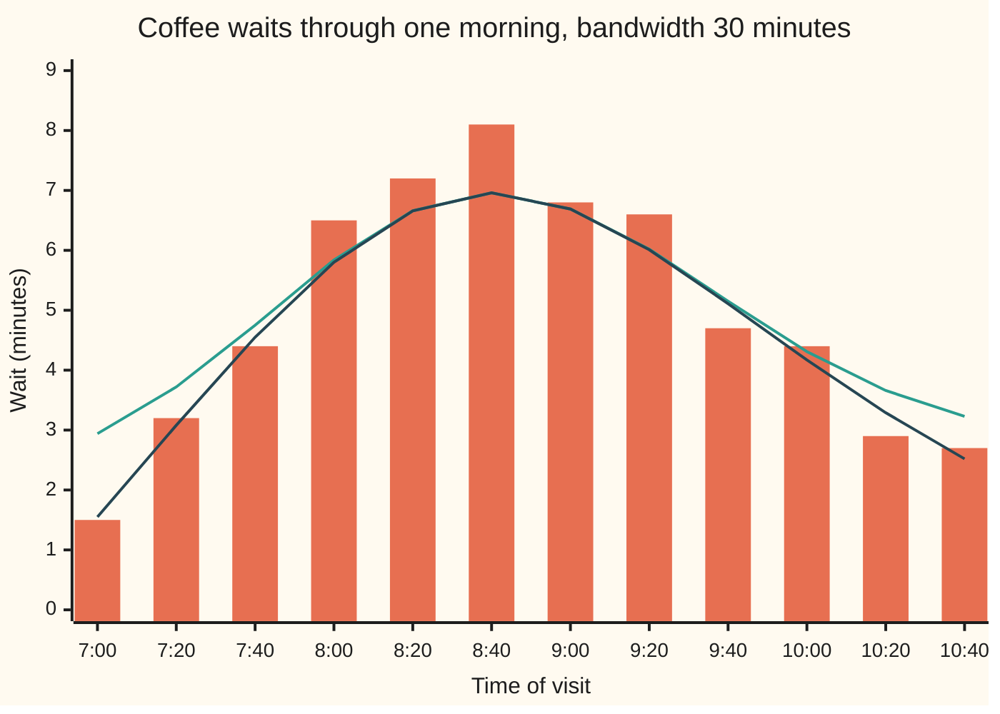
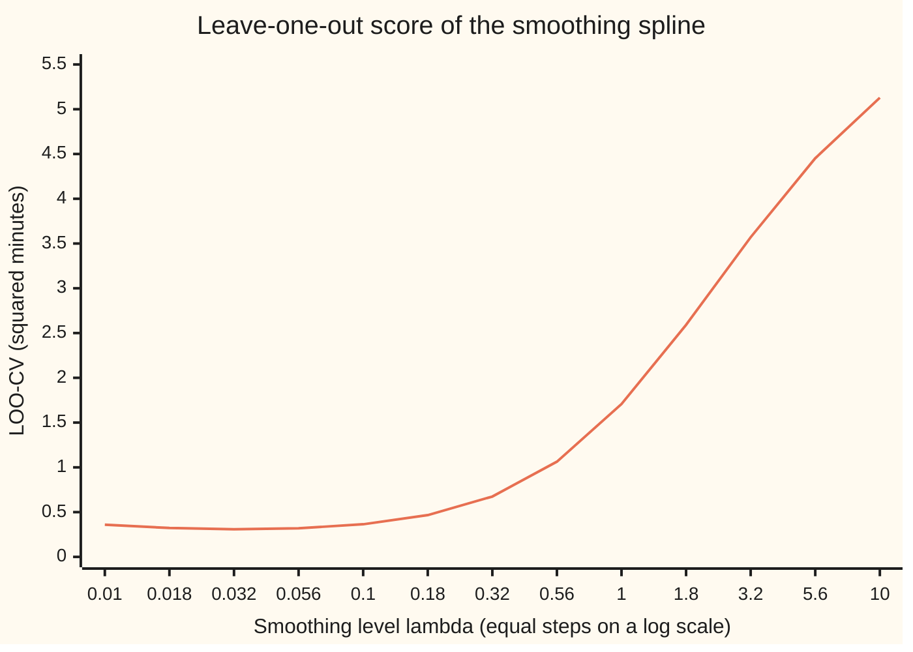

# Smoothing a scatter: kernel regression and smoothing splines

[Syllabus](../../../SYLLABUS.md) → [Probability and statistics](../README.md) → [Nonparametric Inference](../README.md#s15) → Smoothing a scatter

---

## General Overview

A café owner times how long one customer waits for a coffee, every 20 minutes from 7:00 to 10:40 one morning. Twelve visits give twelve waits, in minutes: 1.5, 3.2, 4.4, 6.5, 7.2, 8.1, 6.8, 6.6, 4.7, 4.4, 2.9 and 2.7.

The owner wants the typical wait at each time of the morning, to decide when a second barista should start. The waits rise into a commuter rush and fall away, but no straight line or textbook curve fits that shape, and each single wait is noisy. So the curve is fitted straight from the points, with no formula assumed for its shape.

The simplest way: to estimate the wait at 9:00, average the waits near 9:00, giving close visits more weight than far ones. With bell-shaped weights that fade over about 30 minutes, the estimate at 9:00 is **6.69 minutes**. That weighted local average is **kernel regression**.

It has one known fault. At 7:00 there are no earlier visits, so every neighbour lies later in the morning, when waits were longer. The plain average at 7:00 comes out at 2.94 minutes, though the wait was 1.5. Fitting a short weighted straight line instead of a flat average, a **local-linear fit**, gives 1.55 and removes the pull.

A second family of methods asks for the whole curve at once. A **smoothing spline** is the curve that best balances two costs: missing the data points, and bending. One number, the smoothing level, sets the price of bending. Cross-validation picks that number by asking how well the curve predicts each wait it was not shown.

**A smoother estimates the typical value at each point from the data nearby, either as a weighted local average or line, or as the curve that best trades closeness to the data against bending, and the amount of smoothing is chosen by how well the curve predicts points held out of the fit.**

**What kind of fact this is:** a method. Inside it sit three theorems, proved on this card in Why it works: a local-linear fit has no edge bias from the curve's slope; the best curve in the smoothing-spline problem is a natural cubic spline; and its leave-one-out errors come from one fit.

### The picture: twelve waits and two local smoothers



Orange bars: the twelve waits. Green line: the plain weighted average (Nadaraya–Watson). Dark line: the local-linear fit. From 8:20 to 9:20 the two lines are within 0.01 minutes of each other. At both ends the green line is pulled toward the middle of the morning: up at 7:00 (2.94 against 1.55), and up again at 10:40 (3.23 against 2.52).

---

## The formula

Notation first. Visit $`i`$ happens at time $`x_i`$, in hours after 7:00, and its wait is $`y_i`$ minutes, for $`i = 1, \dots, n`$; here $`n = 12`$ and $`x_i = (i-1)/3`$. The time where the curve is wanted is $`x_0`$. A hat marks an estimate, as on [Least squares](../09-Regression/01-least-squares-regression.md).

Each visit gets a weight from a **kernel**, a bell-shaped weight function, as on [Kernel density estimation](03-kernel-density-estimation.md). The **bandwidth** $`h`$ is the distance over which the weight fades; here $`h = 0.5`$ hours, 30 minutes:

```math
w_i(x_0) = K\!\left(\frac{x_i - x_0}{h}\right), \qquad K(u) = e^{-u^2/2}
```

This $`K`$ is the normal bell without its constant $`1/\sqrt{2\pi}\,`$: the constant cancels in every ratio below, so it is dropped.

The **Nadaraya–Watson estimate** is the weighted average of the waits:

```math
\hat m_{\mathrm{NW}}(x_0) = \frac{\sum_{i=1}^{n} w_i(x_0)\, y_i}{\sum_{i=1}^{n} w_i(x_0)}
```

**Read it aloud:** the estimate at time $`x_0`$ is the average of all the waits, each weighted by how close its visit is to $`x_0`$.

The **local-linear estimate** fits a straight line with the same weights and reads the line at $`x_0`$:

```math
\hat m_{\mathrm{LL}}(x_0) = \hat a, \qquad (\hat a, \hat b) = \mathrm{argmin}_{a,\,b} \sum_{i=1}^{n} w_i(x_0)\,\big(y_i - a - b\,(x_i - x_0)\big)^2
```

Here $`\mathrm{argmin}`$ means the values that make the sum smallest.

**Read it aloud:** among all lines, take the one with the smallest weighted sum of squared misses, and report its height at $`x_0`$.

The **cubic smoothing spline** is the curve $`g`$ that minimises a sum of squared misses plus a price on bending:

```math
\hat g = \mathrm{argmin}_{g} \; \sum_{i=1}^{n} \big(y_i - g(x_i)\big)^2 + \lambda \int \big(g''(x)\big)^2\, dx
```

**Read it aloud:** choose the curve that misses the waits by little, but pay $`\lambda`$ for every unit of squared bending, added up along the whole morning.

Here $`g''(x)`$ is the second derivative, the curve's bending at $`x`$. The **smoothing level** $`\lambda`$ (lambda) sets the price, as the penalty weight did for coefficients on [Regularisation](../09-Regression/06-ridge-and-lasso.md).

The fitted values are a fixed matrix times the data, $`\hat g = S y`$, where $`S`$ is the **smoother matrix**. Its diagonal entry $`S_{ii}`$ is how strongly wait $`i`$ pulls its own fitted value. The smoothing level is chosen to make the **leave-one-out score** smallest:

```math
\mathrm{CV}(\lambda) = \frac{1}{n} \sum_{i=1}^{n} \left(\frac{y_i - \hat g(x_i)}{1 - S_{ii}}\right)^2
```

**Read it aloud:** each wait's miss, enlarged to what it would be had the curve been fitted without that wait, then squared and averaged.

| Symbol | Plain meaning | In our example | Push it up and the answer… |
| --- | --- | --- | --- |
| $`x_i`$, $`y_i`$, $`n`$ | time of visit $`i`$ in hours after 7:00, its wait in minutes, the number of visits | 9:00 is $`x_7 = 2`$, wait 6.8; $`n = 12`$ | — |
| $`x_0`$ | the time where the curve is estimated | 9:00 and 7:00 | — |
| $`K`$, $`u`$ | the bell weight function, and its input: distance in bandwidths | $`K(0) = 1`$, $`K(2/3) = 0.8007`$ | — |
| $`h`$ | the bandwidth: how far the weights reach | 0.5 hours | NW flattens to the mean wait, 4.92; local-linear to the least-squares line |
| $`w_i(x_0)`$ | visit $`i`$'s weight for the estimate at $`x_0`$ | 0.8007 for 8:40 when $`x_0`$ is 9:00 | — |
| $`m`$, $`m'`$, $`\hat m_{\mathrm{NW}}`$ | the true typical-wait curve, its slope, and the Nadaraya–Watson estimate: a weighted average | 6.69 at 9:00, 2.94 at 7:00 | — |
| $`\hat a`$, $`\hat b`$, $`\hat m_{\mathrm{LL}}`$ | the weighted line's height and slope at $`x_0`$; the local-linear estimate $`\hat a`$ | 1.55 at 7:00 | — |
| $`\ell_i(x_0)`$ | the local-linear fit's effective weight on wait $`i`$ | 0.7861 on 7:00, −0.0569 on 8:00 | — |
| $`g`$, $`g''`$, $`\hat g`$ | a candidate curve, its bending, the fitted spline | $`\hat g`$ = 7.13 at 9:00 | — |
| $`\lambda`$ | the smoothing level: the price of bending | 0.0316 by cross-validation | the spline stiffens toward the least-squares line, df 2.00 |
| $`\Omega`$, $`S`$, $`S_{ii}`$, $`\mathrm{df}`$ | the bending matrix, the smoother matrix $`(I + \lambda\Omega)^{-1}`$, its diagonal, and $`\mathrm{df} = \sum_i S_{ii}`$, the effective number of parameters | df = 5.30 | df falls toward 2.00 |
| $`\mathrm{CV}(\lambda)`$ | the leave-one-out score, in squared minutes | 0.3089 at the chosen $`\lambda`$ | — |

### When it holds

- **The true curve is smooth on the scale of the bandwidth.** A sudden jump, such as a coach party arriving at 9:15, is smeared over about an hour either side.
- **The points are dense enough near $`x_0`$.** With $`h`$ of 30 minutes and visits 20 minutes apart, several visits share the weight. With one visit an hour the estimate is mostly one noisy wait.
- **Edges need a local line, not a flat average.** At the first and last visits all neighbours lie on one side. A flat average is then pulled toward the middle: 2.94 at 7:00 here, against 1.5 seen.
- **The smoothing level is chosen on held-out points.** Chosen by the error on the fitted points, $`\lambda`$ goes to zero, the curve passes through every wait, and the error is 0.0000.
- **The visits are independent.** If waits drift together, as on a day when the machine runs slowly, leave-one-out keeps a near-copy of each held-out wait in the fit and picks too little smoothing.

---

## Why it works

### Step 0: near one time, the curve is almost a constant, or almost a line

Over a short stretch of morning the typical wait barely changes. So the waits near 9:00 are all noisy readings of nearly the same number. Averaging them cancels much of the noise and changes the signal little. The bandwidth sets the trade: a wider window averages more noise away, and blurs more of the curve's real shape.

### Step 1: the Nadaraya–Watson estimate is a weighted mean

Divide each weight by their total. The new weights are positive and add up to 1, so the estimate is a weighted mean of the waits and always lies between the smallest and the largest wait used.

It is also a ratio of two kernel sums. The bottom sum, divided by $`nh`$ and a constant, is the kernel density estimate of the visit times ([Kernel density estimation](03-kernel-density-estimation.md)). The top sum is the same estimate with each point carrying its wait. So the estimate is "wait-weighted density over density", a plug-in for the average wait given the time.

### Step 2: why the plain average is biased at an edge

Write the typical wait as a curve $`m(x)`$, and expand it near $`x_0`$: $`m(x_i) \approx m(x_0) + m'(x_0)(x_i - x_0)`$. Here $`m'`$ is the slope. Averaging with the weights gives

```math
E\big[\hat m_{\mathrm{NW}}(x_0)\big] \approx m(x_0) + m'(x_0)\, \frac{\sum_i w_i(x_0)\,(x_i - x_0)}{\sum_i w_i(x_0)}
```

The fraction is the weighted average distance from $`x_0`$ to the visits. At 9:00 the visits sit evenly on both sides, the distances cancel, and the slope term vanishes. At 7:00 every visit lies later. The weighted average distance is 18.19 minutes, so the estimate reads the curve as it was about 18 minutes later.

Test it on a wait that rises exactly 5 minutes per hour, $`1.5 + 5x`$. The true value at 7:00 is 1.5. The plain average gives 3.0159: 1.5 plus 5 × 18.19 / 60. At 9:00 it gives 11.4991, almost the true 11.5. At 10:40 it gives 18.3174, against a true 19.8333. Both ends are pulled toward the middle.

### Step 3: a local line removes the slope term everywhere

The local-linear estimate is also a weighted sum of the waits, $`\hat m_{\mathrm{LL}}(x_0) = \sum_i \ell_i(x_0)\, y_i`$. Solving the two-unknown least-squares problem gives the weights in closed form; the fold shows it. Their key property is that they reproduce any straight line exactly:

```math
\sum_i \ell_i(x_0) = 1, \qquad \sum_i \ell_i(x_0)\,(x_i - x_0) = 0
```

The second sum is the weighted distance from Step 2, now forced to zero. So the slope term drops out at every $`x_0`$, including the edges. On the rising line the local-linear estimate at 7:00 is exactly 1.5000.

The price is that some weights go negative. At 7:00 the first five are 0.7861, 0.3073, −0.0076, −0.0569 and −0.0235. The fit leans on 7:00 and 7:20, and uses the later visits only to measure the slope, then subtracts it.

<details>
<summary>Detailed derivation: the local-linear weights</summary>

Write $`d_i = x_i - x_0`$ and $`w_i = w_i(x_0)`$, and define three weight sums: $`W_0 = \sum_i w_i`$, $`W_1 = \sum_i w_i d_i`$, $`W_2 = \sum_i w_i d_i^2`$.

Set the derivatives of $`\sum_i w_i (y_i - a - b d_i)^2`$ with respect to $`a`$ and $`b`$ to zero. That gives two equations: $`W_0 a + W_1 b = \sum_i w_i y_i`$ and $`W_1 a + W_2 b = \sum_i w_i d_i y_i`$.

Solve for $`a`$ by Cramer's rule:

$`\displaystyle \hat a = \sum_i \frac{w_i\,(W_2 - d_i W_1)}{W_0 W_2 - W_1^2}\; y_i, \qquad \ell_i(x_0) = \frac{w_i\,(W_2 - d_i W_1)}{W_0 W_2 - W_1^2}`$

Then $`\sum_i \ell_i = (W_0 W_2 - W_1^2)/(W_0 W_2 - W_1^2) = 1`$, and $`\sum_i \ell_i d_i = (W_1 W_2 - W_2 W_1)/(W_0 W_2 - W_1^2) = 0`$. If $`W_1 = 0`$, as at the middle of evenly spread visits, $`\ell_i = w_i / W_0`$ and the local line equals the plain average.

</details>

### Step 4: the smoothing spline is a natural cubic spline

The spline problem searches over every smooth curve, an infinite set. One theorem makes it a finite problem: **the best curve is a natural cubic spline with a knot at each visit time.** A natural cubic spline is a chain of cubic pieces joined smoothly at the knots (the joining points), straight beyond the end knots ([Cubic splines](../../16-Numerical%20analysis/04-Interpolation%20and%20Approximation/05-splines.md) builds them).

The reason: the misses depend only on the curve's 12 values at the visits. Among all smooth curves through those 12 values, the natural cubic spline bends least. The fold proves it.

So the unknowns are just the 12 fitted values, collected as a vector $`g`$. The bending of the spline through them is a quadratic form (a sum of products of pairs of fitted values), $`\int (g'')^2 = g^\top \Omega g`$, for a fixed 12 × 12 **bending matrix** $`\Omega`$ (omega) built from the spacing of the visits. Here $`g^\top`$ is $`g`$ laid flat as a row, and $`I`$ is the identity matrix. The problem becomes

```math
\min_{g}\; (y - g)^\top (y - g) + \lambda\, g^\top \Omega g \quad\Longrightarrow\quad \hat g = (I + \lambda \Omega)^{-1}\, y
```

This is ridge regression with $`\Omega`$ in place of the identity ([Regularisation](../09-Regression/06-ridge-and-lasso.md)). The smoother matrix is $`S = (I + \lambda \Omega)^{-1}`$.

<details>
<summary>Detailed proof: the natural cubic spline bends least, and its bending is a quadratic form</summary>

**Least bending.** Let $`s`$ be the natural cubic spline through the values $`z_1, \dots, z_n`$ at the knots $`x_1 < \dots < x_n`$. Let $`f`$ be any other curve with two continuous derivatives through the same values, and $`v = f - s`$, so $`v(x_i) = 0`$ at every knot.

Integrate by parts over $`[x_1, x_n]`$:

$`\displaystyle \int s''\, v'' \, dx = \big[s''\, v'\big]_{x_1}^{x_n} - \int s'''\, v' \, dx`$

The bracket is zero because a natural spline has $`s'' = 0`$ at both end knots. On each piece $`s'''`$ is a constant $`c_i`$, so the last integral is $`\sum_i c_i \big(v(x_{i+1}) - v(x_i)\big) = 0`$. Hence

$`\displaystyle \int (f'')^2 = \int (s'')^2 + 2\int s'' v'' + \int (v'')^2 = \int (s'')^2 + \int (v'')^2 \ge \int (s'')^2`$

with equality only when $`v'' = 0`$, which with $`v = 0`$ at the knots forces $`v = 0`$. Beyond the end knots the natural spline is straight and adds no bending. So any curve can be swapped for the natural spline through its own values: same misses, no more bending.

**Bending as a quadratic form.** Let $`\delta_j = x_{j+1} - x_j`$ be the gaps between knots. Let $`\gamma`$ hold the spline's second derivatives at the $`n - 2`$ interior knots. Matching slopes at each interior knot gives $`Q^\top g = R \gamma`$. Here $`Q`$ is $`n \times (n-2)`$ with column $`j`$ holding $`1/\delta_j`$, $`-1/\delta_j - 1/\delta_{j+1}`$, $`1/\delta_{j+1}`$ in rows $`j`$ to $`j+2`$, and $`R`$ is tridiagonal with $`(\delta_j + \delta_{j+1})/3`$ on the diagonal and $`\delta_{j+1}/6`$ beside it.

The second derivative is straight on each piece, so integrating its square gives $`\int (g'')^2 = \gamma^\top R \gamma = g^\top Q R^{-1} Q^\top g`$. So $`\Omega = Q R^{-1} Q^\top`$.

**Reinsch's equations.** Setting the gradient to zero gives $`(I + \lambda \Omega)\hat g = y`$. With $`\Omega\hat g = Q\gamma`$, this is $`\hat g = y - \lambda Q \gamma`$, where $`(R + \lambda Q^\top Q)\gamma = Q^\top y`$. That system is banded, so it solves in time proportional to $`n`$. The checks use it.

</details>

### Step 5: choose the smoothing level by leaving one out

Small $`\lambda`$ makes bending cheap: the curve chases every wait, noise included. Large $`\lambda`$ forbids bending: the curve becomes the least-squares line. As on [Overfitting](../09-Regression/08-cross-validation-and-overfitting.md), the error on the fitted waits cannot choose between them, because it always prefers less smoothing. A held-out wait can.

Leave-one-out needs no refits. Fit without wait $`i`$, and put that curve's own prediction in place of $`y_i`$. The curve then also solves the full 12-point problem: its miss at $`x_i`$ is zero, and it already does best on the other 11. Because the fit is $`Sy`$, this gives $`y_i - \hat g^{(-i)}(x_i) = (y_i - \hat g(x_i))/(1 - S_{ii})`$. Here $`\hat g^{(-i)}`$ is the curve fitted without wait $`i`$.

<details>
<summary>Detailed proof: the leave-one-out shortcut for a smoothing spline</summary>

Let $`p = \hat g^{(-i)}(x_i)`$, and let $`y^*`$ be the data with $`y_i`$ replaced by $`p`$. For any curve $`f`$, the 12-point objective on $`y^*`$ is at least the 11-point objective without $`i`$, which $`\hat g^{(-i)}`$ minimises. And $`\hat g^{(-i)}`$ scores the same on both, since its miss at $`x_i`$ is zero. So $`\hat g^{(-i)}`$ is the 12-point fit to $`y^*`$, and by linearity

$`\displaystyle p = \sum_j S_{ij}\, y^*_j = \hat g(x_i) - S_{ii}\, y_i + S_{ii}\, p`$

Rearranging, $`y_i - p = (y_i - \hat g(x_i))/(1 - S_{ii})`$.

</details>

The checks search 21 values of $`\lambda`$, from 0.0001 to 10 in quarter-decade steps (each step multiplies by $`10^{1/4}`$, about 1.78). The score is lowest at $`\lambda = 0.0316`$.



The orange line is the leave-one-out score. It bottoms out at $`\lambda = 0.0316`$, at 0.3089 squared minutes, and climbs steeply as the spline stiffens toward a straight line.

At that level the **effective degrees of freedom**, $`\mathrm{df} = \sum_i S_{ii}`$, is 5.30. The spline is about as flexible as a fit with five or six free parameters. At $`\lambda`$ = 1,000,000 the spline is a straight line and df = 2.00. At $`\lambda`$ = 0.000001 it passes through every wait and df = 12.00.

---

## Worked numbers, by hand

The Nadaraya–Watson estimate at 9:00, bandwidth 30 minutes. The weight for a visit $`d`$ minutes away is $`e^{-(d/30)^2/2}`$.

| Step | Arithmetic | Value |
| --- | --- | --- |
| weight at 0 minutes (9:00) | $`e^{0}`$ | 1.0000 |
| weight at 20 minutes (8:40, 9:20) | $`e^{-(2/3)^2/2}`$ | 0.8007 each |
| weight at 40 minutes (8:20, 9:40) | $`e^{-(4/3)^2/2}`$ | 0.4111 each |
| weight at 60 minutes (8:00, 10:00) | $`e^{-2}`$ | 0.1353 each |
| weights farther out | 80, 100 and 120 minutes | 0.0286, 0.0039, 0.0003 |
| sum of weights | all 12 added | 3.7596 |
| weights × waits | 6.8000 + 6.4860 + 5.2849 + 2.9600 + 1.9322 + 0.8797 + 0.5955 + smaller terms | 25.1701 |
| estimate at 9:00 | 25.1701 / 3.7596 | **6.69 minutes** |
| the same at 7:00 | 6.9903 / 2.3800 | 2.94 minutes |
| local-linear at 7:00 | weighted line read at 7:00 | **1.55 minutes** |
| spline at 9:00, $`\lambda = 0.0316`$ | Reinsch's equations | 7.13 minutes |
| the spline's two costs | squared misses 1.1851 + $`\lambda`$ × bending 1.3803 | 2.5653 |

The typical wait at 9:00 is about 6.7 minutes by the local average, and 7.1 by the spline, which bends a little more sharply into the rush. At 7:00 the plain average says 2.94, nearly double the wait seen; the local line says 1.55.

### What breaks if you drop a piece

| Mistake | Comes out at | What went wrong |
| --- | --- | --- |
| Using the plain weighted average at 7:00 | 2.94 minutes, against 1.5 seen | every neighbour is later, when waits were longer |
| Choosing $`\lambda`$ by the error on the fitted waits | $`\lambda`$ = 0.000001: error 0.0000, but LOO-CV 1.1577 against 0.3089 | the curve threads every wait and copies the noise |
| Making bending far too expensive | $`\lambda`$ = 1,000,000: 4.91 at 9:00, the least-squares line; LOO-CV 6.2885 | no bending is allowed, so the rush disappears |
| Bandwidth 30 entered as hours, not minutes | 4.92 at 7:00, the mean of all 12 waits, 4.9167 | every weight is about 1, so nothing is local |

---

## Code, from first principles, and it actually runs

The scripts compute every number on the card from the twelve waits. They take independent roads to each key result.

- **The local average:** the Nadaraya–Watson estimates at 9:00 and 7:00 are recomputed with weights built by the worked table's rule, $`e^{-(d/30)^2/2}`$ for a visit $`d`$ minutes away, counted in 20-minute steps rather than read off the hours axis. The two agree to $`10^{-12}`$.
- **Edge bias:** the local-linear weights are checked to add to 1 and to cancel the weighted distance, and both smoothers are run on an exact straight line, where the true answer is known.
- **The spline:** Reinsch's equations, against a separate fit on a grid of one-minute steps that prices bending by second differences. Second differences are the change in the change between grid neighbours, divided by the step squared. The two agree to 0.0001 minutes. A third check nudges each fitted value up and down by 0.01 and confirms the cost rises every time.
- **Leave-one-out:** twelve real refits for each $`\lambda`$, each read off the natural spline through the refitted values, against the one-fit shortcut. They agree to $`10^{-9}`$ at all 21 values.
- **The stiff limit:** the spline at $`\lambda = 1{,}000{,}000`$ against the least-squares line from its own formula.

### Python

```python
# Kernel regression and smoothing splines -- the check behind the card; only math is imported.
# Twelve coffee waits, one every 20 minutes from 7:00 to 10:40.  Time x is in hours after 7:00.
# Nadaraya-Watson and local-linear fits with bell weights, bandwidth 30 minutes; a cubic
# smoothing spline by Reinsch's equations, checked against a fine-grid penalised fit; and the
# smoothing level chosen by leave-one-out cross-validation, by refitting and by the hat shortcut.
import math

X = [i / 3 for i in range(12)]
Y = [1.5, 3.2, 4.4, 6.5, 7.2, 8.1, 6.8, 6.6, 4.7, 4.4, 2.9, 2.7]
H = 0.5
clock = lambda x: f"{7 + int(round(x * 60)) // 60}:{int(round(x * 60)) % 60:02d}"

def bell(x0, xs, h): return [math.exp(-((x - x0) / h) ** 2 / 2) for x in xs]

def nw(x0, xs, ys, h):
    w = bell(x0, xs, h)
    return sum(a * b for a, b in zip(w, ys)) / sum(w)

def loclin(x0, xs, ys, h):                  # weighted least-squares line, read at x0
    w = bell(x0, xs, h)
    s0, s1, s2 = sum(w), sum(a * (x - x0) for a, x in zip(w, xs)), sum(a * (x - x0) ** 2 for a, x in zip(w, xs))
    l = [a * (s2 - (x - x0) * s1) / (s0 * s2 - s1 * s1) for a, x in zip(w, xs)]
    return sum(a * b for a, b in zip(l, ys)), l

def solve(A, b):                            # Gaussian elimination with partial pivoting
    n = len(b); M = [row[:] + [v] for row, v in zip(A, b)]
    for c in range(n):
        p = max(range(c, n), key=lambda r: abs(M[r][c])); M[c], M[p] = M[p], M[c]
        for r in range(c + 1, n):
            f = M[r][c] / M[c][c]
            if f: M[r] = [a - f * d for a, d in zip(M[r], M[c])]
    z = [0.0] * n
    for r in range(n - 1, -1, -1):
        z[r] = (M[r][n] - sum(M[r][k] * z[k] for k in range(r + 1, n))) / M[r][r]
    return z

def spline(xs, ys, lam):                    # Reinsch: (R + lam Q'Q) gamma = Q'y, g = y - lam Q gamma
    n, h = len(xs), [xs[i + 1] - xs[i] for i in range(len(xs) - 1)]
    Q = [[0.0] * (n - 2) for _ in range(n)]
    R = [[0.0] * (n - 2) for _ in range(n - 2)]
    for j in range(n - 2):
        Q[j][j], Q[j + 1][j], Q[j + 2][j] = 1 / h[j], -1 / h[j] - 1 / h[j + 1], 1 / h[j + 1]
        R[j][j] = (h[j] + h[j + 1]) / 3
        if j < n - 3: R[j][j + 1] = R[j + 1][j] = h[j + 1] / 6
    A = [[R[a][b] + lam * sum(Q[i][a] * Q[i][b] for i in range(n)) for b in range(n - 2)] for a in range(n - 2)]
    gam = solve(A, [sum(Q[i][a] * ys[i] for i in range(n)) for a in range(n - 2)])
    g = [ys[i] - lam * sum(Q[i][a] * gam[a] for a in range(n - 2)) for i in range(n)]
    pen = sum(gam[a] * R[a][b] * gam[b] for a in range(n - 2) for b in range(n - 2))
    return g, pen

def grid_fit(lam, per=20):                  # road 2: values on a 1-minute grid, second differences
    m, d = 11 * per + 1, 1 / (3 * per)
    A = [[0.0] * m for _ in range(m)]; b = [0.0] * m
    for i, y in enumerate(Y): A[i * per][i * per] += 1; b[i * per] += y
    for k in range(1, m - 1):
        c = {k - 1: 1.0, k: -2.0, k + 1: 1.0}
        for p, u in c.items():
            for q, v in c.items(): A[p][q] += lam * u * v / d ** 3
    g = solve(A, b)
    return [g[i * per] for i in range(12)]

def loo(lam):                               # leave-one-out: real refits, and the hat shortcut
    g, _ = spline(X, Y, lam)
    refit = shortcut = 0.0
    for i in range(12):
        gi, _ = spline(X[:i] + X[i + 1:], Y[:i] + Y[i + 1:], lam)
        refit += (Y[i] - spline_at(X[:i] + X[i + 1:], gi, X[i])) ** 2
        sii = spline(X, [1.0 if j == i else 0.0 for j in range(12)], lam)[0][i]
        shortcut += ((Y[i] - g[i]) / (1 - sii)) ** 2
    return refit / 12, shortcut / 12

def spline_at(xs, g, x0):                   # natural cubic spline through (xs, g), evaluated at x0
    n, h = len(xs), [xs[i + 1] - xs[i] for i in range(len(xs) - 1)]
    A = [[0.0] * n for _ in range(n)]; b = [0.0] * n
    A[0][0] = A[n - 1][n - 1] = 1.0
    for i in range(1, n - 1):
        A[i][i - 1], A[i][i], A[i][i + 1] = h[i - 1] / 6, (h[i - 1] + h[i]) / 3, h[i] / 6
        b[i] = (g[i + 1] - g[i]) / h[i] - (g[i] - g[i - 1]) / h[i - 1]
    s = solve(A, b)
    if x0 < xs[0]: return g[0] + ((g[1] - g[0]) / h[0] - h[0] * s[1] / 6) * (x0 - xs[0])  # straight past the ends
    if x0 > xs[-1]: return g[-1] + ((g[-1] - g[-2]) / h[-1] + h[-1] * s[-2] / 6) * (x0 - xs[-1])
    i = max(j for j in range(n - 1) if xs[j] <= x0)
    a, t = xs[i + 1] - x0, x0 - xs[i]
    return (s[i] * a ** 3 + s[i + 1] * t ** 3) / (6 * h[i]) + (g[i] / h[i] - s[i] * h[i] / 6) * a + (g[i + 1] / h[i] - s[i + 1] * h[i] / 6) * t

print("waits, time  " + " ".join(f"{clock(x):>5}" for x in X))
print("waits, min   " + " ".join(f"{y:5.1f}" for y in Y))
w9 = bell(2.0, X, H)
print("9:00 weights " + " ".join(f"{w:.4f}" for w in w9))
print("9:00 w*wait  " + " ".join(f"{w * y:.4f}" for w, y in zip(w9, Y)))
nw9 = nw(2.0, X, Y, H)
print(f"9:00 NW: sum(w*wait) {sum(w * y for w, y in zip(w9, Y)):.4f} / sum(w) {sum(w9):.4f} = {nw9:.4f}")
nw7, (ll7, l7) = nw(0.0, X, Y, H), loclin(0.0, X, Y, H)
w7 = bell(0.0, X, H)
print(f"7:00 NW: sum(w*wait) {sum(w * y for w, y in zip(w7, Y)):.4f} / sum(w) {sum(w7):.4f} = {nw7:.4f}")
hand = lambda c: [math.exp(-2 * (i - c) ** 2 / 9) for i in range(12)]   # by hand: visits 20|i - c| min away weigh e^(-2(i-c)^2/9)
assert all(abs(sum(a * y for a, y in zip(hand(c), Y)) / sum(hand(c)) - v) < 1e-12 for c, v in ((6, nw9), (0, nw7))), "NW from hand-built weights"
print(f"7:00 weighted mean time of its weights {sum(a * x for a, x in zip(w7, X)) / sum(w7) * 60:.2f} min; local-linear {ll7:.4f}; observed {Y[0]}")
print("7:00 local-linear weights " + " ".join(f"{v:.4f}" for v in l7[:5]))
line = [1.5 + 5.0 * x for x in X]            # a wait rising 5 minutes per hour
print(f"on a straight line 1.5 + 5x: NW at 7:00 {nw(0.0, X, line, H):.4f}, local-linear {loclin(0.0, X, line, H)[0]:.4f}, "
      f"NW at 9:00 {nw(2.0, X, line, H):.4f}, NW at 10:40 {nw(X[-1], X, line, H):.4f} (true {line[-1]:.4f})")
assert abs(sum(l7) - 1) < 1e-12 and abs(sum(v * x for v, x in zip(l7, X))) < 1e-12, "local-linear weights reproduce lines"
assert abs(loclin(0.0, X, line, H)[0] - 1.5) < 1e-12, "local-linear has no edge bias on a line"
assert nw(0.0, X, line, H) > 1.5 + 0.5, "the plain average is pulled inward at the edge"

LAMS = [10 ** (k / 4) for k in range(-16, 5)]
cv = [(lam,) + loo(lam) for lam in LAMS]
for lam, a, b in cv:
    assert abs(a - b) < 1e-9, "the hat shortcut equals real refits"
best = min(cv, key=lambda r: r[1])
print("lambda  " + " ".join(f"{lam:7.4f}" for lam, _, _ in cv[8:]))
print("LOO-CV  " + " ".join(f"{a:7.4f}" for _, a, _ in cv[8:]))
lam = best[0]
g, pen = spline(X, Y, lam)
gg = grid_fit(lam)
dfof = lambda l: sum(spline(X, [1.0 if j == i else 0.0 for j in range(12)], l)[0][i] for i in range(12)); df = dfof(lam)
rss = sum((y - v) ** 2 for y, v in zip(Y, g))
print(f"chosen lambda {lam:.4f}: LOO-CV refits {best[1]:.4f}, hat shortcut {best[2]:.4f}; effective df {df:.2f}")
print("spline fit, Reinsch  " + " ".join(f"{v:.2f}" for v in g))
print("spline fit, grid     " + " ".join(f"{v:.2f}" for v in gg))
print(f"max gap Reinsch vs grid {max(abs(a - b) for a, b in zip(g, gg)):.4f}; RSS {rss:.4f} + lambda x penalty {lam * pen:.4f} = {rss + lam * pen:.4f}")
assert max(abs(a - b) for a, b in zip(g, gg)) < 2e-3, "two roads to the spline agree"
obj = lambda v: sum((y - u) ** 2 for y, u in zip(Y, v)) + lam * spline(X, v, 0.0)[1]
for i in range(12):                         # road 3: nudging any fitted value raises the objective
    for e in (0.01, -0.01):
        assert obj([u + (e if j == i else 0) for j, u in enumerate(g)]) > obj(g), "Reinsch fit is the minimiser"
nw_all = [nw(x, X, Y, H) for x in X]; ll_all = [loclin(x, X, Y, H)[0] for x in X]
print("chart, NW           " + " ".join(f"{v:.2f}" for v in nw_all))
print("chart, local-linear " + " ".join(f"{v:.2f}" for v in ll_all))
g0, _ = spline(X, Y, 1e-6); ginf, _ = spline(X, Y, 1e6)
mx, my = sum(X) / 12, sum(Y) / 12
b1 = sum((x - mx) * (y - my) for x, y in zip(X, Y)) / sum((x - mx) ** 2 for x in X)
assert abs(ginf[6] - (my + b1 * (X[6] - mx))) < 1e-3, "a huge lambda leaves the least-squares line"
print(f"lambda 0.000001: RSS {sum((y - v) ** 2 for y, v in zip(Y, g0)):.4f}, LOO-CV {loo(1e-6)[0]:.4f}, df {dfof(1e-6):.2f}")
print(f"lambda 1000000: 9:00 value {ginf[6]:.4f}, least-squares line at 9:00 {my + b1 * (X[6] - mx):.4f}, LOO-CV {loo(1e6)[0]:.4f}, df {dfof(1e6):.2f}")
print(f"bandwidth 30 read as hours: NW at 7:00 {nw(0.0, X, Y, 30.0):.4f}, mean of all waits {sum(Y) / 12:.4f}")
print("ALL CHECKS PASS")
```

**Ran 2026-11-23 on macOS, Python 3.14.10, standard library only. All checks passed. Output, pasted from the run:**

```
waits, time   7:00  7:20  7:40  8:00  8:20  8:40  9:00  9:20  9:40 10:00 10:20 10:40
waits, min     1.5   3.2   4.4   6.5   7.2   8.1   6.8   6.6   4.7   4.4   2.9   2.7
9:00 weights 0.0003 0.0039 0.0286 0.1353 0.4111 0.8007 1.0000 0.8007 0.4111 0.1353 0.0286 0.0039
9:00 w*wait  0.0005 0.0124 0.1257 0.8797 2.9600 6.4860 6.8000 5.2849 1.9322 0.5955 0.0828 0.0104
9:00 NW: sum(w*wait) 25.1701 / sum(w) 3.7596 = 6.6949
7:00 NW: sum(w*wait) 6.9903 / sum(w) 2.3800 = 2.9371
7:00 weighted mean time of its weights 18.19 min; local-linear 1.5473; observed 1.5
7:00 local-linear weights 0.7861 0.3073 -0.0076 -0.0569 -0.0235
on a straight line 1.5 + 5x: NW at 7:00 3.0159, local-linear 1.5000, NW at 9:00 11.4991, NW at 10:40 18.3174 (true 19.8333)
lambda   0.0100  0.0178  0.0316  0.0562  0.1000  0.1778  0.3162  0.5623  1.0000  1.7783  3.1623  5.6234 10.0000
LOO-CV   0.3592  0.3228  0.3089  0.3195  0.3643  0.4667  0.6742  1.0633  1.7075  2.5920  3.5702  4.4525  5.1281
chosen lambda 0.0316: LOO-CV refits 0.3089, hat shortcut 0.3089; effective df 5.30
spline fit, Reinsch  1.54 3.18 4.77 6.24 7.23 7.55 7.13 6.27 5.18 4.16 3.25 2.50
spline fit, grid     1.54 3.18 4.77 6.24 7.23 7.55 7.13 6.27 5.18 4.16 3.25 2.50
max gap Reinsch vs grid 0.0001; RSS 1.1851 + lambda x penalty 1.3803 = 2.5653
chart, NW           2.94 3.72 4.75 5.84 6.66 6.96 6.69 6.02 5.15 4.31 3.66 3.23
chart, local-linear 1.55 3.08 4.55 5.80 6.66 6.96 6.69 6.01 5.11 4.17 3.29 2.52
lambda 0.000001: RSS 0.0000, LOO-CV 1.1577, df 12.00
lambda 1000000: 9:00 value 4.9139, least-squares line at 9:00 4.9139, LOO-CV 6.2885, df 2.00
bandwidth 30 read as hours: NW at 7:00 4.9179, mean of all waits 4.9167
ALL CHECKS PASS
```

### Rust

Same numbers, same labels, built with `rustc --edition 2021 -O`.

```rust
// Kernel regression and smoothing splines -- the same check as the Python, in Rust, std only.
// Twelve coffee waits, one every 20 minutes from 7:00 to 10:40.  Time x is in hours after 7:00.
// Nadaraya-Watson and local-linear fits with bell weights, bandwidth 30 minutes; a cubic
// smoothing spline by Reinsch's equations, checked against a fine-grid penalised fit; and the
// smoothing level chosen by leave-one-out cross-validation, by refitting and by the hat shortcut.

const Y: [f64; 12] = [1.5, 3.2, 4.4, 6.5, 7.2, 8.1, 6.8, 6.6, 4.7, 4.4, 2.9, 2.7];
const H: f64 = 0.5;

fn xs() -> Vec<f64> { (0..12).map(|i| i as f64 / 3.0).collect() }
fn clock(x: f64) -> String { let m = (x * 60.0).round() as i64; format!("{}:{:02}", 7 + m / 60, m % 60) }
fn bell(x0: f64, xs: &[f64], h: f64) -> Vec<f64> { xs.iter().map(|x| (-((x - x0) / h).powi(2) / 2.0).exp()).collect() }
fn dot(a: &[f64], b: &[f64]) -> f64 { a.iter().zip(b).map(|(p, q)| p * q).sum() }
fn join(v: &[f64], d: usize) -> String { v.iter().map(|x| format!("{:.*}", d, x)).collect::<Vec<_>>().join(" ") }

fn nw(x0: f64, xs: &[f64], ys: &[f64], h: f64) -> f64 {
    let w = bell(x0, xs, h);
    dot(&w, ys) / w.iter().sum::<f64>()
}

fn loclin(x0: f64, xs: &[f64], ys: &[f64], h: f64) -> (f64, Vec<f64>) { // weighted least-squares line, read at x0
    let w = bell(x0, xs, h);
    let s0: f64 = w.iter().sum();
    let s1: f64 = w.iter().zip(xs).map(|(a, x)| a * (x - x0)).sum();
    let s2: f64 = w.iter().zip(xs).map(|(a, x)| a * (x - x0).powi(2)).sum();
    let l: Vec<f64> = w.iter().zip(xs).map(|(a, x)| a * (s2 - (x - x0) * s1) / (s0 * s2 - s1 * s1)).collect();
    (dot(&l, ys), l)
}

fn solve(a: &[Vec<f64>], b: &[f64]) -> Vec<f64> { // Gaussian elimination with partial pivoting
    let n = b.len();
    let mut m: Vec<Vec<f64>> = a.iter().zip(b).map(|(r, v)| { let mut r = r.clone(); r.push(*v); r }).collect();
    for c in 0..n {
        let p = (c..n).max_by(|&i, &j| m[i][c].abs().partial_cmp(&m[j][c].abs()).unwrap()).unwrap();
        m.swap(c, p);
        for r in c + 1..n {
            let f = m[r][c] / m[c][c];
            if f != 0.0 { for k in c..=n { let d = m[c][k]; m[r][k] -= f * d; } }
        }
    }
    let mut z = vec![0.0; n];
    for r in (0..n).rev() {
        let s: f64 = (r + 1..n).map(|k| m[r][k] * z[k]).sum();
        z[r] = (m[r][n] - s) / m[r][r];
    }
    z
}

fn spline(xs: &[f64], ys: &[f64], lam: f64) -> (Vec<f64>, f64) { // Reinsch: (R + lam Q'Q) gamma = Q'y, g = y - lam Q gamma
    let n = xs.len();
    let h: Vec<f64> = (0..n - 1).map(|i| xs[i + 1] - xs[i]).collect();
    let mut q = vec![vec![0.0; n - 2]; n];
    let mut r = vec![vec![0.0; n - 2]; n - 2];
    for j in 0..n - 2 {
        q[j][j] = 1.0 / h[j]; q[j + 1][j] = -1.0 / h[j] - 1.0 / h[j + 1]; q[j + 2][j] = 1.0 / h[j + 1];
        r[j][j] = (h[j] + h[j + 1]) / 3.0;
        if j < n - 3 { r[j][j + 1] = h[j + 1] / 6.0; r[j + 1][j] = h[j + 1] / 6.0; }
    }
    let a: Vec<Vec<f64>> = (0..n - 2).map(|p| (0..n - 2).map(|s| r[p][s] + lam * (0..n).map(|i| q[i][p] * q[i][s]).sum::<f64>()).collect()).collect();
    let rhs: Vec<f64> = (0..n - 2).map(|p| (0..n).map(|i| q[i][p] * ys[i]).sum()).collect();
    let gam = solve(&a, &rhs);
    let g: Vec<f64> = (0..n).map(|i| ys[i] - lam * dot(&q[i], &gam)).collect();
    let pen: f64 = (0..n - 2).map(|p| (0..n - 2).map(|s| gam[p] * r[p][s] * gam[s]).sum::<f64>()).sum();
    (g, pen)
}

fn grid_fit(lam: f64, per: usize) -> Vec<f64> { // road 2: values on a 1-minute grid, second differences
    let (m, d) = (11 * per + 1, 1.0 / (3.0 * per as f64));
    let mut a = vec![vec![0.0; m]; m];
    let mut b = vec![0.0; m];
    for i in 0..12 { a[i * per][i * per] += 1.0; b[i * per] += Y[i]; }
    for k in 1..m - 1 {
        let c = [(k - 1, 1.0), (k, -2.0), (k + 1, 1.0)];
        for &(p, u) in &c { for &(s, v) in &c { a[p][s] += lam * u * v / d.powi(3); } }
    }
    let g = solve(&a, &b);
    (0..12).map(|i| g[i * per]).collect()
}

fn unit(i: usize) -> Vec<f64> { (0..12).map(|j| if j == i { 1.0 } else { 0.0 }).collect() }
fn drop(v: &[f64], i: usize) -> Vec<f64> { v.iter().enumerate().filter(|&(j, _)| j != i).map(|(_, x)| *x).collect() }

fn spline_at(xs: &[f64], g: &[f64], x0: f64) -> f64 { // natural cubic spline through (xs, g), evaluated at x0
    let n = xs.len();
    let h: Vec<f64> = (0..n - 1).map(|i| xs[i + 1] - xs[i]).collect();
    let mut a = vec![vec![0.0; n]; n];
    let mut b = vec![0.0; n];
    a[0][0] = 1.0; a[n - 1][n - 1] = 1.0;
    for i in 1..n - 1 {
        a[i][i - 1] = h[i - 1] / 6.0; a[i][i] = (h[i - 1] + h[i]) / 3.0; a[i][i + 1] = h[i] / 6.0;
        b[i] = (g[i + 1] - g[i]) / h[i] - (g[i] - g[i - 1]) / h[i - 1];
    }
    let s = solve(&a, &b);
    if x0 < xs[0] { return g[0] + ((g[1] - g[0]) / h[0] - h[0] * s[1] / 6.0) * (x0 - xs[0]); } // straight past the ends
    if x0 > xs[n - 1] { return g[n - 1] + ((g[n - 1] - g[n - 2]) / h[n - 2] + h[n - 2] * s[n - 2] / 6.0) * (x0 - xs[n - 1]); }
    let i = (0..n - 1).filter(|&j| xs[j] <= x0).max().unwrap();
    let (a, t) = (xs[i + 1] - x0, x0 - xs[i]);
    (s[i] * a.powi(3) + s[i + 1] * t.powi(3)) / (6.0 * h[i]) + (g[i] / h[i] - s[i] * h[i] / 6.0) * a + (g[i + 1] / h[i] - s[i + 1] * h[i] / 6.0) * t
}

fn loo(x: &[f64], lam: f64) -> (f64, f64) { // leave-one-out: real refits, and the hat shortcut
    let (g, _) = spline(x, &Y, lam);
    let (mut refit, mut shortcut) = (0.0, 0.0);
    for i in 0..12 {
        let (xi, yi) = (drop(x, i), drop(&Y, i));
        let (gi, _) = spline(&xi, &yi, lam);
        refit += (Y[i] - spline_at(&xi, &gi, x[i])).powi(2);
        let sii = spline(x, &unit(i), lam).0[i];
        shortcut += ((Y[i] - g[i]) / (1.0 - sii)).powi(2);
    }
    (refit / 12.0, shortcut / 12.0)
}

fn main() {
    let (x, y) = (xs(), Y.to_vec());
    println!("waits, time  {}", x.iter().map(|v| format!("{:>5}", clock(*v))).collect::<Vec<_>>().join(" "));
    println!("waits, min   {}", y.iter().map(|v| format!("{:5.1}", v)).collect::<Vec<_>>().join(" "));
    let w9 = bell(2.0, &x, H);
    println!("9:00 weights {}", join(&w9, 4));
    println!("9:00 w*wait  {}", join(&w9.iter().zip(&y).map(|(a, b)| a * b).collect::<Vec<_>>(), 4));
    println!("9:00 NW: sum(w*wait) {:.4} / sum(w) {:.4} = {:.4}", dot(&w9, &y), w9.iter().sum::<f64>(), nw(2.0, &x, &y, H));
    let (nw7, (ll7, l7)) = (nw(0.0, &x, &y, H), loclin(0.0, &x, &y, H));
    let w7 = bell(0.0, &x, H);
    println!("7:00 NW: sum(w*wait) {:.4} / sum(w) {:.4} = {:.4}", dot(&w7, &y), w7.iter().sum::<f64>(), nw7);
    let hand = |c: f64| -> Vec<f64> { (0..12).map(|i| (-2.0 * (i as f64 - c).powi(2) / 9.0).exp()).collect() }; // by hand: visits 20|i - c| min away weigh e^(-2(i-c)^2/9)
    assert!([(6.0, nw(2.0, &x, &y, H)), (0.0, nw7)].iter().all(|&(c, v)| (dot(&hand(c), &y) / hand(c).iter().sum::<f64>() - v).abs() < 1e-12), "NW from hand-built weights");
    println!("7:00 weighted mean time of its weights {:.2} min; local-linear {:.4}; observed {}", dot(&w7, &x) / w7.iter().sum::<f64>() * 60.0, ll7, Y[0]);
    println!("7:00 local-linear weights {}", join(&l7[..5], 4));
    let line: Vec<f64> = x.iter().map(|v| 1.5 + 5.0 * v).collect(); // a wait rising 5 minutes per hour
    println!("on a straight line 1.5 + 5x: NW at 7:00 {:.4}, local-linear {:.4}, NW at 9:00 {:.4}, NW at 10:40 {:.4} (true {:.4})",
        nw(0.0, &x, &line, H), loclin(0.0, &x, &line, H).0, nw(2.0, &x, &line, H), nw(x[11], &x, &line, H), line[11]);
    assert!((l7.iter().sum::<f64>() - 1.0).abs() < 1e-12 && dot(&l7, &x).abs() < 1e-12, "local-linear weights reproduce lines");
    assert!((loclin(0.0, &x, &line, H).0 - 1.5).abs() < 1e-12, "local-linear has no edge bias on a line");
    assert!(nw(0.0, &x, &line, H) > 1.5 + 0.5, "the plain average is pulled inward at the edge");

    let cv: Vec<(f64, f64, f64)> = (-16..5).map(|k| { let lam = 10f64.powf(k as f64 / 4.0); let (a, b) = loo(&x, lam); (lam, a, b) }).collect();
    for &(_, a, b) in &cv { assert!((a - b).abs() < 1e-9, "the hat shortcut equals real refits"); }
    let best = *cv.iter().min_by(|p, q| p.1.partial_cmp(&q.1).unwrap()).unwrap();
    println!("lambda  {}", cv[8..].iter().map(|r| format!("{:7.4}", r.0)).collect::<Vec<_>>().join(" "));
    println!("LOO-CV  {}", cv[8..].iter().map(|r| format!("{:7.4}", r.1)).collect::<Vec<_>>().join(" "));
    let lam = best.0;
    let (g, pen) = spline(&x, &y, lam);
    let gg = grid_fit(lam, 20);
    let dfof = |l: f64| -> f64 { (0..12).map(|i| spline(&x, &unit(i), l).0[i]).sum() }; let df = dfof(lam);
    let sse = |v: &[f64]| -> f64 { y.iter().zip(v).map(|(a, b)| (a - b).powi(2)).sum() };
    let rss = sse(&g);
    println!("chosen lambda {:.4}: LOO-CV refits {:.4}, hat shortcut {:.4}; effective df {:.2}", lam, best.1, best.2, df);
    println!("spline fit, Reinsch  {}", join(&g, 2));
    println!("spline fit, grid     {}", join(&gg, 2));
    let gap = g.iter().zip(&gg).map(|(a, b)| (a - b).abs()).fold(0.0, f64::max);
    println!("max gap Reinsch vs grid {:.4}; RSS {:.4} + lambda x penalty {:.4} = {:.4}", gap, rss, lam * pen, rss + lam * pen);
    assert!(gap < 2e-3, "two roads to the spline agree");
    let obj = |v: &[f64]| sse(v) + lam * spline(&x, v, 0.0).1;
    for i in 0..12 { // road 3: nudging any fitted value raises the objective
        for e in [0.01, -0.01] {
            let v: Vec<f64> = g.iter().enumerate().map(|(j, u)| if j == i { u + e } else { *u }).collect();
            assert!(obj(&v) > obj(&g), "Reinsch fit is the minimiser");
        }
    }
    println!("chart, NW           {}", join(&x.iter().map(|v| nw(*v, &x, &y, H)).collect::<Vec<_>>(), 2));
    println!("chart, local-linear {}", join(&x.iter().map(|v| loclin(*v, &x, &y, H).0).collect::<Vec<_>>(), 2));
    let (g0, ginf) = (spline(&x, &y, 1e-6).0, spline(&x, &y, 1e6).0);
    let (mx, my) = (x.iter().sum::<f64>() / 12.0, y.iter().sum::<f64>() / 12.0);
    let b1 = x.iter().zip(&y).map(|(a, b)| (a - mx) * (b - my)).sum::<f64>() / x.iter().map(|a| (a - mx).powi(2)).sum::<f64>();
    assert!((ginf[6] - (my + b1 * (x[6] - mx))).abs() < 1e-3, "a huge lambda leaves the least-squares line");
    println!("lambda 0.000001: RSS {:.4}, LOO-CV {:.4}, df {:.2}", sse(&g0), loo(&x, 1e-6).0, dfof(1e-6));
    println!("lambda 1000000: 9:00 value {:.4}, least-squares line at 9:00 {:.4}, LOO-CV {:.4}, df {:.2}", ginf[6], my + b1 * (x[6] - mx), loo(&x, 1e6).0, dfof(1e6));
    println!("bandwidth 30 read as hours: NW at 7:00 {:.4}, mean of all waits {:.4}", nw(0.0, &x, &y, 30.0), my);
    println!("ALL CHECKS PASS");
}
```

**Ran 2026-11-23 on macOS, rustc 1.98.1, no crates. All checks passed. Output, pasted from the run:**

```
waits, time   7:00  7:20  7:40  8:00  8:20  8:40  9:00  9:20  9:40 10:00 10:20 10:40
waits, min     1.5   3.2   4.4   6.5   7.2   8.1   6.8   6.6   4.7   4.4   2.9   2.7
9:00 weights 0.0003 0.0039 0.0286 0.1353 0.4111 0.8007 1.0000 0.8007 0.4111 0.1353 0.0286 0.0039
9:00 w*wait  0.0005 0.0124 0.1257 0.8797 2.9600 6.4860 6.8000 5.2849 1.9322 0.5955 0.0828 0.0104
9:00 NW: sum(w*wait) 25.1701 / sum(w) 3.7596 = 6.6949
7:00 NW: sum(w*wait) 6.9903 / sum(w) 2.3800 = 2.9371
7:00 weighted mean time of its weights 18.19 min; local-linear 1.5473; observed 1.5
7:00 local-linear weights 0.7861 0.3073 -0.0076 -0.0569 -0.0235
on a straight line 1.5 + 5x: NW at 7:00 3.0159, local-linear 1.5000, NW at 9:00 11.4991, NW at 10:40 18.3174 (true 19.8333)
lambda   0.0100  0.0178  0.0316  0.0562  0.1000  0.1778  0.3162  0.5623  1.0000  1.7783  3.1623  5.6234 10.0000
LOO-CV   0.3592  0.3228  0.3089  0.3195  0.3643  0.4667  0.6742  1.0633  1.7075  2.5920  3.5702  4.4525  5.1281
chosen lambda 0.0316: LOO-CV refits 0.3089, hat shortcut 0.3089; effective df 5.30
spline fit, Reinsch  1.54 3.18 4.77 6.24 7.23 7.55 7.13 6.27 5.18 4.16 3.25 2.50
spline fit, grid     1.54 3.18 4.77 6.24 7.23 7.55 7.13 6.27 5.18 4.16 3.25 2.50
max gap Reinsch vs grid 0.0001; RSS 1.1851 + lambda x penalty 1.3803 = 2.5653
chart, NW           2.94 3.72 4.75 5.84 6.66 6.96 6.69 6.02 5.15 4.31 3.66 3.23
chart, local-linear 1.55 3.08 4.55 5.80 6.66 6.96 6.69 6.01 5.11 4.17 3.29 2.52
lambda 0.000001: RSS 0.0000, LOO-CV 1.1577, df 12.00
lambda 1000000: 9:00 value 4.9139, least-squares line at 9:00 4.9139, LOO-CV 6.2885, df 2.00
bandwidth 30 read as hours: NW at 7:00 4.9179, mean of all waits 4.9167
ALL CHECKS PASS
```

### Lean

Lean proves the facts behind Steps 1, 2 and 3, for any visit times, any waits and any bandwidth.

- With at least one visit, the Nadaraya–Watson estimate always lies between the smallest and the largest wait used.
- Take waits lying exactly on a straight line. Then the Nadaraya–Watson estimate at $`x_0`$ is the line's value at $`x_0`$, plus the slope times the weighted average distance.
- Take waits lying exactly on a straight line, and at least two different visit times. Then the local-linear estimate, with the weights $`\ell_i`$ from the fold, equals the line's value at every $`x_0`$, edges included.

Lean's library has no smoothing splines, so Steps 4 and 5 and every worked number are left to the Python and Rust checks.

```lean
-- Smoothing a scatter: with bell weights, the local-linear fit reproduces any straight line exactly, the Nadaraya-Watson estimate is a weighted mean of the waits, and on a straight line its error is the slope times the weighted average distance.
import Mathlib.Analysis.SpecialFunctions.Exp
import Mathlib.Algebra.Order.BigOperators.Group.Finset
import Mathlib.Algebra.BigOperators.Field

open Finset

/-- No edge bias from the slope: weight each visit `i` at time `x i` by the bell
`w i = exp (-((x i - x₀) / h) ^ 2 / 2)`, form the sums `W₀ = ∑ w i`, `W₁ = ∑ w i (x i - x₀)`,
`W₂ = ∑ w i (x i - x₀) ^ 2`, and the local-linear weights
`ℓ i = w i (W₂ - (x i - x₀) W₁) / (W₀ W₂ - W₁ ^ 2)`.
If at least two visit times differ, then on waits lying on any straight line `α + β x`
the local-linear estimate `∑ ℓ i y i` at `x₀` equals the line's true value `α + β x₀`,
at every `x₀`, edges included. -/
theorem local_linear_reproduces_lines {ι : Type*} (s : Finset ι) (x : ι → ℝ) (x₀ h α β : ℝ)
    (hx : ∃ i ∈ s, ∃ j ∈ s, x i ≠ x j) :
    let w : ι → ℝ := fun i => Real.exp (-((x i - x₀) / h) ^ 2 / 2)
    let W₀ := ∑ i ∈ s, w i
    let W₁ := ∑ i ∈ s, w i * (x i - x₀)
    let W₂ := ∑ i ∈ s, w i * (x i - x₀) ^ 2
    let ℓ : ι → ℝ := fun i => w i * (W₂ - (x i - x₀) * W₁) / (W₀ * W₂ - W₁ ^ 2)
    ∑ i ∈ s, ℓ i * (α + β * x i) = α + β * x₀ := by
  intro w W₀ W₁ W₂ ℓ
  have hw : ∀ i, 0 < w i := fun i => Real.exp_pos _
  have h2D : 2 * (W₀ * W₂ - W₁ ^ 2) =
      ∑ i ∈ s, ∑ j ∈ s, w i * w j * ((x i - x₀) - (x j - x₀)) ^ 2 := by
    have e : ∀ i j, w i * w j * ((x i - x₀) - (x j - x₀)) ^ 2 =
        w i * (w j * (x j - x₀) ^ 2) - 2 * (w i * (x i - x₀)) * (w j * (x j - x₀))
          + w i * (x i - x₀) ^ 2 * w j := fun i j => by ring
    simp_rw [e, sum_add_distrib, sum_sub_distrib, ← mul_sum, ← sum_mul, ← mul_sum]
    simp only [W₀, W₁, W₂]
    ring
  have hD : W₀ * W₂ - W₁ ^ 2 ≠ 0 := by
    obtain ⟨i, hi, j, hj, hij⟩ := hx
    have hpos : 0 < ∑ i ∈ s, ∑ j ∈ s, w i * w j * ((x i - x₀) - (x j - x₀)) ^ 2 := by
      have hnn : ∀ a b, 0 ≤ w a * w b * ((x a - x₀) - (x b - x₀)) ^ 2 := fun a b =>
        mul_nonneg (mul_nonneg (hw a).le (hw b).le) (sq_nonneg _)
      have hterm : 0 < w i * w j * ((x i - x₀) - (x j - x₀)) ^ 2 := by
        apply mul_pos (mul_pos (hw i) (hw j))
        have : (x i - x₀) - (x j - x₀) ≠ 0 := by
          intro h0; apply hij; linarith
        positivity
      calc (0:ℝ) < w i * w j * ((x i - x₀) - (x j - x₀)) ^ 2 := hterm
        _ ≤ ∑ j ∈ s, w i * w j * ((x i - x₀) - (x j - x₀)) ^ 2 :=
          single_le_sum (f := fun b => w i * w b * ((x i - x₀) - (x b - x₀)) ^ 2)
            (fun b _ => hnn i b) hj
        _ ≤ _ := single_le_sum (f := fun a => ∑ j ∈ s, w a * w j * ((x a - x₀) - (x j - x₀)) ^ 2)
            (fun a _ => sum_nonneg (fun b _ => hnn a b)) hi
    intro h0
    rw [h0, mul_zero] at h2D
    linarith
  have e : ∀ i, ℓ i * (α + β * x i) =
      ((α + β * x₀) * W₂ * w i + (β * W₂ - (α + β * x₀) * W₁) * (w i * (x i - x₀))
        - β * W₁ * (w i * (x i - x₀) ^ 2)) / (W₀ * W₂ - W₁ ^ 2) := fun i => by
    simp only [ℓ]
    rw [div_mul_eq_mul_div]
    congr 1
    ring
  rw [sum_congr rfl (fun i _ => e i), ← sum_div, div_eq_iff hD, sum_sub_distrib,
    sum_add_distrib, ← mul_sum, ← mul_sum, ← mul_sum]
  simp only [W₀, W₁, W₂]
  ring

/-- The Nadaraya-Watson estimate is a weighted mean: with bell weights
`w i = exp (-((x i - x₀) / h) ^ 2 / 2)` and at least one visit, the estimate
`(∑ w i y i) / (∑ w i)` lies between the smallest and the largest wait used. -/
theorem nadaraya_watson_between_min_and_max {ι : Type*} (s : Finset ι) (hs : s.Nonempty)
    (x y : ι → ℝ) (x₀ h m M : ℝ) (hy : ∀ i ∈ s, m ≤ y i ∧ y i ≤ M) :
    let w : ι → ℝ := fun i => Real.exp (-((x i - x₀) / h) ^ 2 / 2)
    m ≤ (∑ i ∈ s, w i * y i) / (∑ i ∈ s, w i) ∧
      (∑ i ∈ s, w i * y i) / (∑ i ∈ s, w i) ≤ M := by
  intro w
  have hw : ∀ i, 0 < w i := fun i => Real.exp_pos _
  have hW : 0 < ∑ i ∈ s, w i := sum_pos (fun i _ => hw i) hs
  constructor
  · rw [le_div_iff₀ hW, mul_sum]
    apply sum_le_sum
    intro i hi
    rw [mul_comm]
    exact mul_le_mul_of_nonneg_left (hy i hi).1 (hw i).le
  · rw [div_le_iff₀ hW, mul_sum]
    apply sum_le_sum
    intro i hi
    rw [mul_comm M]
    exact mul_le_mul_of_nonneg_left (hy i hi).2 (hw i).le

/-- Edge bias of the plain average: on waits lying on a straight line `α + β x`, the
Nadaraya-Watson estimate at `x₀` equals the true value `α + β x₀` plus the slope `β` times the
weighted average distance `(∑ w i (x i - x₀)) / (∑ w i)` from `x₀` to the visits. -/
theorem nadaraya_watson_on_a_line {ι : Type*} (s : Finset ι) (hs : s.Nonempty)
    (x : ι → ℝ) (x₀ h α β : ℝ) :
    let w : ι → ℝ := fun i => Real.exp (-((x i - x₀) / h) ^ 2 / 2)
    (∑ i ∈ s, w i * (α + β * x i)) / (∑ i ∈ s, w i) =
      α + β * x₀ + β * ((∑ i ∈ s, w i * (x i - x₀)) / (∑ i ∈ s, w i)) := by
  intro w
  have hW : 0 < ∑ i ∈ s, w i := sum_pos (fun i _ => Real.exp_pos _) hs
  have e : ∀ i, w i * (α + β * x i) = (α + β * x₀) * w i + β * (w i * (x i - x₀)) :=
    fun i => by ring
  rw [sum_congr rfl (fun i _ => e i), sum_add_distrib, ← mul_sum, ← mul_sum]
  field_simp

#print axioms local_linear_reproduces_lines
#print axioms nadaraya_watson_between_min_and_max
#print axioms nadaraya_watson_on_a_line
```

**Checked 2026-11-23 on macOS, Lean 4.36.0-rc2, Mathlib v4.36.0-rc2. Every proof is complete and uses only Lean's standard axioms. Output, pasted from the run:**

```
'local_linear_reproduces_lines' depends on axioms: [propext, Classical.choice, Quot.sound]
'nadaraya_watson_between_min_and_max' depends on axioms: [propext, Classical.choice, Quot.sound]
'nadaraya_watson_on_a_line' depends on axioms: [propext, Classical.choice, Quot.sound]
```

> [!TIP]
> **Try changing**
> - Guess first: halve the bandwidth to 15 minutes. Does the 9:00 estimate move toward the 6.8 seen there? Set `H = 0.25`. It overshoots to 7.01: the 8:40 wait of 8.1 still counts strongly, and the falling waits after 9:20 hardly count at all.
> - Guess first: make the first wait 4.0 instead of 1.5. Which 7:00 estimate moves more? Change `Y[0]`. The local-linear one: it puts weight 0.7861 on that wait, the plain average only 1 / 2.3800 of it.
> - Guess first: double the bandwidth to 60 minutes. Does the local line still fix 7:00? Set `H = 1.0`. Only partly: the plain average rises to 4.35 and the local line to 2.23. A line cancels the slope, not the bend, and a wide window sees the whole rush.
> - Guess first: how much worse is ten times the chosen smoothing level? No change needed: the table shows $`\lambda`$ = 0.3162 scoring 0.6742, more than double 0.3089.

---

## The usual mistake

> [!warning]
> **Trusting a smoother at the edges of the data.** A flat local average at the first or last point can only look inward, so it reports the curve as it is somewhere inside. Here the plain average says 2.94 minutes at 7:00, where the wait was 1.5; on an exact rising line it gives 3.0159 where the truth is 1.5. Use a local-linear fit, which cancels the slope, and still treat the ends as the least certain part of any smooth curve.
>
> - **Choosing the smoothing by eye or by fit to the data.** The fitted-point error always prefers less smoothing: at $`\lambda`$ = 0.000001 it is 0.0000, while the leave-one-out score is 1.1577.
> - **Bandwidth in the wrong units.** Time measured in hours with a bandwidth of 30 gives one flat average, 4.92 everywhere.
> - **Reading beyond the data.** A natural spline continues as a straight line past 10:40. That line is a guess, not an estimate.
> - **Forgetting that the smoothed curve is an average.** The curve at 9:00, 6.69 minutes, is the typical wait, not a promise to any one customer; single waits there ranged from 6.6 to 8.1.

---

## Where you meet it in real life

- **Scatter-plot trend lines.** The smooth line many plotting tools draw through a scatter is a local regression fit, a cousin of the local-linear fit here.
- **Growth charts.** Children's height and weight percentile curves are smoothed from survey data with penalised splines, so they follow the data without wiggling.
- **Yield curves.** Central banks smooth bond yields across maturities with smoothing splines whose bending price varies with maturity.
- **Energy demand.** Electricity load against temperature is fitted with splines or kernel smoothers, because demand rises at both cold and hot ends and no simple formula fits.

> **Say it back**
> A smoother estimates a curve straight from the data, with no formula assumed for its shape. Kernel regression averages nearby points with bell weights; on twelve coffee waits it gives 6.69 minutes at 9:00. At an edge every neighbour lies on one side, so the plain average is pulled inward, 2.94 at 7:00 against 1.5 seen; fitting a weighted line instead cancels the slope and gives 1.55. A smoothing spline is the curve that best trades squared misses against a price on bending, and the best curve is always a natural cubic spline. The price is chosen by leave-one-out cross-validation, here 0.0316, which needs only one fit.

---

## What this builds on

- [Kernel density estimation](03-kernel-density-estimation.md): bell-shaped kernels and the bandwidth, used here to weight neighbours instead of to pile up density.
- [Least squares](../09-Regression/01-least-squares-regression.md): the sum of squared misses, minimised here with weights and inside every local window.
- [Regularisation](../09-Regression/06-ridge-and-lasso.md): a fit plus a price, with one number setting the price; the smoothing spline is ridge with a bending penalty.
- [Overfitting](../09-Regression/08-cross-validation-and-overfitting.md): why fitted-point error cannot choose flexibility, and the leave-one-out shortcut for least squares that Step 5 extends.

The other cards on this shelf, [The empirical CDF](01-empirical-cdf-and-kolmogorov-smirnov.md) and [Rank tests](02-rank-tests-wilcoxon-and-mann-whitney.md), share its aim: inference without assuming a bell curve.

## Where this goes next

- [Cubic splines](../../16-Numerical%20analysis/04-Interpolation%20and%20Approximation/05-splines.md): the spline through every point, the $`\lambda \to 0`$ end of this card, built and solved as a numerical method.
- [Reproducing kernels](../../18-Functional%20analysis/02-Hilbert%20Spaces/08-reproducing-kernel-hilbert-spaces.md): the space of curves in which the smoothing spline is a projection, and why penalised fits over infinite sets of curves reduce to finite ones.

This card smooths one input at a time; with several inputs, such as time of day and weather together, the points thin out fast, and how to keep a smoother useful as the inputs multiply is the question it leaves open.

---

## Sources

Verified 2026-11-23: every link below resolves to the publisher's page.

- Nadaraya, E. A. "On Estimating Regression." *Theory of Probability and Its Applications* 9 (1964): 141–142. [DOI 10.1137/1109020](https://doi.org/10.1137/1109020). The kernel-weighted average of Step 1.
- Fan, Jianqing. "Local Linear Regression Smoothers and Their Minimax Efficiencies." *The Annals of Statistics* 21 (1993): 196–216. [DOI 10.1214/aos/1176349022](https://doi.org/10.1214/aos/1176349022). Why a weighted local line does better than a weighted local average.
- Reinsch, Christian H. "Smoothing by Spline Functions." *Numerische Mathematik* 10 (1967): 177–183. [DOI 10.1007/BF02162161](https://doi.org/10.1007/BF02162161). The banded equations the checks solve.
- Green, P. J., and B. W. Silverman. *Nonparametric Regression and Generalized Linear Models: A Roughness Penalty Approach*. Chapman and Hall/CRC, 1994. [DOI 10.1201/b15710](https://doi.org/10.1201/b15710). Chapters 2 and 3: the natural-spline theorem, the matrices $`Q`$ and $`R`$, and the leave-one-out shortcut.
- Wasserman, Larry. *All of Nonparametric Statistics*. Springer, 2006. [DOI 10.1007/0-387-30623-4](https://doi.org/10.1007/0-387-30623-4). Chapter 5: kernel, local-linear and spline smoothers side by side, and their edge bias.
