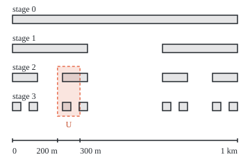
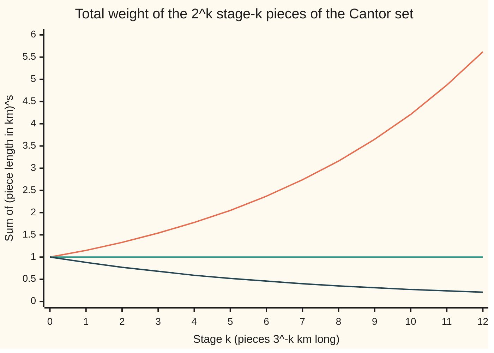

# Hausdorff measure and dimension: cover with pieces of any shape, weigh each by its size to the power s, and a fractal gets a size in its own dimension

[Syllabus](../../../SYLLABUS.md) → [Measure and integration](../README.md) → [Length Done Properly](../README.md#s02) → Hausdorff measure and dimension

---

## General Overview

Go back to the 1 km road of [The Cantor set](07-the-cantor-set.md). Each night a crew resurfaces the open middle third of every stretch still waiting. The points never resurfaced form the Cantor set $`C`$. Stage $`k`$ leaves $`2^k`$ stretches, called pieces here, each $`3^{-k}`$ km long: 32 pieces of 4.12 m at stage 5, 1024 pieces at stage 10.

Two rulers fail on $`C`$. Length says 0, since the pieces' total length, $`(2/3)^k`$ km, shrinks to nothing. Counting says infinity, since $`C`$ has as many points as the road. Length cannot tell $`C`$ from a single point; counting cannot tell it from the whole road.

The fix is a ruler between the two. Weigh each piece by its length raised to a power $`s`$. With $`s = 1`$ the weights are lengths; with $`s = 0`$ every piece weighs 1, so the total counts pieces. For $`C`$ one power sits exactly between too much and too little: $`s = 0.6309`$. At that power each stage-$`k`$ piece weighs $`1/2^k`$, so every stage weighs 1 in total.

Covers may use pieces of any shape, and the pieces must get small. The cheapest total in the limit is the **Hausdorff measure** $`\mathcal H^s`$. The power where it drops from infinity to 0 is the **Hausdorff dimension**. For the Cantor set that power is $`\log 2/\log 3 = 0.6309`$, and the size there is between 0.5 and 1.

**Cover a set with small pieces of any shape, weigh each piece by its diameter to the power s, and take the cheapest total as the pieces shrink: this is a measure on the Borel sets that scales by r to the s, equals length when s = 1 on the line, and is infinite below one power and zero above it, the set's dimension; for the Cantor set that power is log 2/log 3 = 0.6309.**

**What kind of fact this is:** $`\mathcal H^s`$ and the dimension are definitions. That $`\mathcal H^s`$ is a Borel measure, scales by $`r^s`$, equals length for $`s = 1`$ on the line, jumps at one power, and gives the Cantor set a size between 1/2 and 1 at dimension 0.6309 are theorems, proved on this card in Why it works. The exact value $`\mathcal H^{0.6309}(C) = 1`$, the area constant $`4/\pi`$ and the Koch curve's lower bound are cited.

### The picture: the road at stages 0 to 3, and one covering set

<p align="center"></p>

Drawn to scale, 324 units to the kilometre. Shaded bars are the pieces at each stage: 1 piece of 1000 m, 2 of 333.33 m, 4 of 111.11 m, 8 of 37.04 m. The dashed set $`U`$, from 200 m to 300 m, is used in Step 6.

---

## The formula

Notation first, in words. $`\mathbb R^n`$ is space with $`n`$ coordinates: the line for $`n = 1`$, the plane for $`n = 2`$. The **diameter** $`\mathrm{diam}\, U`$ of a set $`U`$ is the greatest distance between two of its points, or the least number at or above all such distances. A **$`\delta`$-cover** of a set $`A`$ is a list of sets $`U_1, U_2, \ldots`$, of any shape, whose union contains $`A`$ and whose diameters are all at most $`\delta`$ (delta, the size cap). The symbol $`\inf`$ is the greatest number at or below every total ([Outer measure](01-lebesgue-outer-measure.md)).

```math
\mathcal H^s_\delta(A) = \inf\Big\{ \sum_{i=1}^{\infty} (\mathrm{diam}\, U_i)^s \;:\; A \subseteq \bigcup_{i=1}^{\infty} U_i,\ \mathrm{diam}\, U_i \le \delta \Big\} \qquad \mathcal H^s(A) = \lim_{\delta \to 0} \mathcal H^s_\delta(A)
```

**Read it aloud:** cover the set with pieces no wider than delta, add up each piece's diameter to the power s, take the cheapest total, and let delta shrink to 0.

A smaller cap allows fewer covers, so the cheapest total never falls as $`\delta`$ shrinks. The limit exists, and it may be infinite. For $`s = 0`$ read $`(\mathrm{diam}\, U)^0`$ as 1 for every non-empty piece, so $`\mathcal H^0`$ counts points.

```math
\dim_H A = \inf\{ s \ge 0 : \mathcal H^s(A) = 0 \} = \sup\{ s \ge 0 : \mathcal H^s(A) = \infty \}
```

**Read it aloud:** the Hausdorff dimension is the power where the size drops from infinity to zero; $`\sup`$ is the least number at or above every member.

For the Cantor set $`C`$:

```math
\tfrac12 \le \mathcal H^{s_0}(C) \le 1, \qquad s_0 = \frac{\log 2}{\log 3} = 0.6309, \qquad \dim_H C = s_0
```

**Read it aloud:** at the power log 2 over log 3 the Cantor set's size is between one half and one, so its dimension is 0.6309.

Two rules do the rest of the work, for every set $`A`$ and every scale factor $`r > 0`$:

```math
\mathcal H^s(rA) = r^s\, \mathcal H^s(A) \qquad\qquad \mathcal H^1(A) = \lambda^*(A) \ \text{ for } A \subseteq \mathbb R
```

**Read it aloud:** magnify a set r times and its s-dimensional size grows r to the s times; on the line, the 1-dimensional size is the outer measure, length.

| Symbol | Plain meaning | In our example | Push it up and the answer… |
| --- | --- | --- | --- |
| $`s`$, $`t`$, $`s_0`$ | powers each piece's diameter is raised to; $`s_0`$ the Cantor set's dimension | 0.5, 0.6309, 0.75 | a fixed cover's total falls (pieces under 1 km) |
| $`U`$, $`U_i`$, $`\mathrm{diam}\, U`$ | a covering set; the $`i`$-th in a list; its diameter | $`U`$ = [200 m, 300 m], diameter 100 m | its weight rises |
| $`\delta`$, $`\delta_0`$ | the size cap on the pieces of a cover; $`\delta_0`$ the cap in the mass test | 1000 m down to 0.15 m; $`\delta_0`$ = 1 km | more covers allowed: the cheapest total falls or stays |
| $`\mathcal H^s_\delta`$, $`\mathcal H^s`$ | cheapest total under the cap; its limit, the $`s`$-dimensional Hausdorff measure | 1.0000: cheapest run cover of the stage-10 pieces at $`s_0`$, every cap | — |
| $`\dim_H`$ | Hausdorff dimension: where $`\mathcal H^s`$ drops from infinity to 0 | 0.6309 for $`C`$, 1.2619 for the Koch curve | — |
| $`A`$, $`B`$, $`G`$, $`\mathrm{dist}(A, B)`$, $`E_j`$, $`B_j`$ | sets in $`\mathbb R^n`$, $`G`$ a closed one; the least distance between a point of $`A`$ and a point of $`B`$; the fold's layers of $`A`$ outside $`G`$ | the two halves of $`C`$, 333.33 m apart | — |
| $`C`$, $`C_k`$ | the Cantor set; its stage $`k`$, $`2^k`$ pieces of $`3^{-k}`$ km | stage 10: 1024 pieces | more pieces, each shorter |
| $`\mu`$, $`F`$ | the Cantor measure, giving each stage-$`k`$ piece mass $`1/2^k`$; $`F`$ its staircase | $`\mu(U)`$ = 0.4 − 0.25 = 0.15 | — |
| $`c`$ | a ceiling in the mass test: $`\mu(U) \le c\,(\mathrm{diam}\, U)^s`$ | 2 proved; 1.0000 on a grid | the lower bound $`\mu(C)/c`$ falls |
| $`r`$ | a scale factor | 1/3 for a half of $`C`$; 1000 for km to m | the size grows as $`r^s`$ |
| $`\lambda`$, $`\lambda^*`$, $`\mathbb R^n`$, $`\mathbb R`$ | Lebesgue measure and outer measure; space with $`n`$ coordinates; the line | $`\lambda(C_{10})`$ = 0.0173 km | — |
| $`\varepsilon`$; $`i`$, $`j`$, $`k`$, $`m`$, $`n`$ | any positive allowance, as small as wished; whole numbers counting places in a list, stages or coordinates | 0.01; stage $`k`$ = 10 | — |

### When it holds

- **The cap shrinks to 0.** With the cap fixed, one big piece can win: at $`s = 0.5`$ the single piece [0, 1 km] costs 1, though $`\mathcal H^{0.5}(C)`$ is infinite. A fixed cap gives only an outer measure, which need not add up over separate sets: with no cap at $`s = 0.5`$, each half of the stage-10 pieces costs 0.5774, the whole 1.0000, not 1.1547.
- **Borel sets, or sets passing Carathéodory's test.** Sizes add up over separate pieces only there. On every set, $`\mathcal H^s`$ is still monotone and subadditive (Step 1).
- **The right power.** At any power other than the dimension the answer is 0 or infinity. Measured at $`s = 1`$, $`C`$ has size 0; at $`s = 0`$, infinity.
- **A spread-out mass for the lower bound.** The mass test needs $`\mu(U) \le c\,(\mathrm{diam}\, U)^s`$ for every small $`U`$. A mass sitting on one point fails it: the point has diameter 0 and positive mass.
- **Constants at whole-number powers.** In the plane, $`\mathcal H^2`$ is $`4/\pi`$ = 1.2732 times area, not area. Some books divide by that constant from the start.

---

## Why it works

### Step 0: copies force the power

$`C`$ is two copies of itself, each shrunk to a third. Suppose its size at power $`s`$ is a number strictly between 0 and infinity. Each copy then has size $`3^{-s}`$ times it, by the scaling rule, and the two copies add up to the whole. So $`2 \times 3^{-s} = 1`$, which gives $`3^s = 2`$ and $`s = \log 2/\log 3 = 0.6309`$.

The steps below earn what this used: sizes add (Steps 1 and 2), they scale by $`r^s`$ (Step 3), and at 0.6309 the size is neither 0 nor infinity (Steps 5 and 6).

### Step 1: each capped total is an outer measure, and so is the limit

$`\mathcal H^s_\delta`$ is built like [Outer measure](01-lebesgue-outer-measure.md), with any sets in place of intervals and $`(\mathrm{diam}\, U)^s`$ in place of length. The same three arguments work.

- The empty set costs 0.
- A cover of a bigger set covers a smaller one, so a bigger set never costs less.
- For a list of sets $`A_1, A_2, \ldots`$, cover $`A_i`$ within $`\varepsilon/2^i`$ of its cheapest total. Together these cover the union, so the union costs at most the sum of the sizes plus $`\varepsilon`$.

As $`\delta`$ shrinks, each $`\mathcal H^s_\delta(A)`$ rises toward $`\mathcal H^s(A)`$. So $`\mathcal H^s_\delta(\bigcup A_i) \le \sum \mathcal H^s_\delta(A_i) \le \sum \mathcal H^s(A_i)`$, and letting $`\delta \to 0`$ gives the same inequality for $`\mathcal H^s`$.

### Step 2: separated sets add, so Borel sets pass the test

Take two sets $`A`$ and $`B`$ at a positive distance $`\mathrm{dist}(A, B)`$. Choose the cap below that distance. Then no covering piece meets both sets. The pieces split into a cover of $`A`$ and a cover of $`B`$, so $`\mathcal H^s_\delta(A \cup B) \ge \mathcal H^s_\delta(A) + \mathcal H^s_\delta(B)`$. Step 1 gives the reverse, and the limit gives

```math
\mathrm{dist}(A, B) > 0 \;\Rightarrow\; \mathcal H^s(A \cup B) = \mathcal H^s(A) + \mathcal H^s(B).
```

An outer measure with this property is called a **metric outer measure**. Every closed set passes [Caratheodory's criterion](02-caratheodory-measurable-sets.md) for it. The passing sets form a sigma-algebra (a collection closed under complements and countable unions) holding the closed sets, so they hold every Borel set (every set built from open sets by complements and countable unions). On them $`\mathcal H^s`$ adds up over any list of separate sets: it is a **Borel measure**.

The halves $`C \cap [0, 1/3]`$ and $`C \cap [2/3, 1]`$ are 333.33 m apart, so their sizes add, as Step 0 needed.

<details>
<summary>Detailed proof: a closed set passes Carathéodory's test for a metric outer measure</summary>

Let $`G`$ be closed and $`A`$ any test set with $`\mathcal H^s(A)`$ finite (if it is infinite there is nothing to prove). The test asks $`\mathcal H^s(A) \ge \mathcal H^s(A \cap G) + \mathcal H^s(A \setminus G)`$.

For each whole number $`j`$, let $`E_j`$ be the points of $`A \setminus G`$ at distance at least $`1/j`$ from $`G`$. Then $`A \cap G`$ and $`E_j`$ are at least $`1/j`$ apart, so

$`\displaystyle \mathcal H^s(A \cap G) + \mathcal H^s(E_j) = \mathcal H^s\big((A \cap G) \cup E_j\big) \le \mathcal H^s(A).`$

It remains to show $`\mathcal H^s(E_j) \to \mathcal H^s(A \setminus G)`$. Since $`G`$ is closed, every point outside it is at a positive distance from it, so $`A \setminus G`$ is the union of the $`E_j`$. Let $`B_j`$ be the points of $`A \setminus G`$ with distance from $`G`$ in $`[1/(j+1), 1/j)`$. Then $`A \setminus G = E_j \cup B_j \cup B_{j+1} \cup \cdots`$.

Bands two or more apart are at a positive distance, so the even bands add: $`\mathcal H^s(B_2) + \mathcal H^s(B_4) + \cdots + \mathcal H^s(B_{2m}) \le \mathcal H^s(A)`$ for every $`m`$, and the odd bands likewise. So $`\sum_j \mathcal H^s(B_j)`$ is finite, and its tail from $`j`$ on shrinks to 0. Subadditivity gives

$`\displaystyle \mathcal H^s(E_j) \le \mathcal H^s(A \setminus G) \le \mathcal H^s(E_j) + \sum_{i \ge j} \mathcal H^s(B_i),`$

so $`\mathcal H^s(E_j) \to \mathcal H^s(A \setminus G)`$, and the test holds.

</details>

### Step 3: scaling, length on the line, and area in the plane

**Scaling.** Magnify every piece of a $`\delta`$-cover of $`A`$ by $`r`$. The result is an $`r\delta`$-cover of $`rA`$, and each weight $`(\mathrm{diam}\, U)^s`$ becomes $`r^s (\mathrm{diam}\, U)^s`$. The step back by $`1/r`$ works the same way, so $`\mathcal H^s_{r\delta}(rA) = r^s\, \mathcal H^s_\delta(A)`$; let $`\delta \to 0`$. Moving or turning a set changes no diameter, so $`\mathcal H^s`$ ignores both.

The left third of $`C`$ is $`C`$ shrunk by $`r = 1/3`$, and the code finds its cheapest cover costs 0.5000, which is $`3^{-0.6309}`$. Units scale too: in metres, $`r = 1000`$, every weight grows by $`1000^{0.6309}`$, and the cheapest cover costs 78.12. The size of $`C`$ carries the unit km to the power 0.6309.

**Length.** On the line any set $`U`$ fits in a closed interval of length $`\mathrm{diam}\, U`$, so every cover's total is at least $`\lambda^*(A)`$. In the other direction, take a cover by open intervals within $`\varepsilon`$ of $`\lambda^*(A)`$ and chop each into pieces no longer than $`\delta`$. Chopping keeps the total. So $`\mathcal H^1_\delta(A) = \lambda^*(A)`$ for every cap, and $`\mathcal H^1 = \lambda^*`$ ([Lebesgue measure](03-lebesgue-measure.md) on the Borel sets). On the stage-10 pieces the code's cheapest cover at $`s = 1`$ is 0.0173, their length $`(2/3)^{10}`$.

**Area and volume.** In $`\mathbb R^n`$, $`\mathcal H^n`$ is a fixed multiple of $`n`$-dimensional Lebesgue measure. The multiple comes from the isodiametric inequality, cited not proved: among sets of a given diameter, the ball has the most volume. So discs are the cheapest pieces, and in the plane $`\mathcal H^2 = (4/\pi)`$ × area, with $`4/\pi`$ = 1.2732.

### Step 4: the size jumps once, from infinity to zero

Suppose $`\mathcal H^s(A)`$ is finite and $`t > s`$. A piece of diameter at most $`\delta`$ has $`(\mathrm{diam}\, U)^t \le \delta^{t-s} (\mathrm{diam}\, U)^s`$. So

```math
\mathcal H^t_\delta(A) \le \delta^{\,t-s}\, \mathcal H^s_\delta(A) \le \delta^{\,t-s}\, \mathcal H^s(A) \longrightarrow 0 .
```

A finite size at power $`s`$ forces size 0 at every higher power. Read backwards, a positive size at $`t`$ forces infinity at every lower power. So there is one switching power, the Hausdorff dimension. At the switch itself the size can be 0, infinite, or anything between.

### The picture: stage covers at three powers



Orange, $`s = 0.5`$: the total grows by 1.1547 a stage, without limit. Green, $`s = 0.6309`$: flat at 1. Dark, $`s = 0.75`$: it shrinks by 0.8774 a stage, toward 0.

### Step 5: the upper bound, from the stage covers

The $`2^k`$ pieces of stage $`k`$, which make up $`C_k`$, cover $`C`$, each with diameter $`3^{-k}`$. Their total weight is

```math
2^k \times \big(3^{-k}\big)^{s} = \big(2 \times 3^{-s}\big)^k .
```

At $`s_0`$, $`3^{s_0} = 2`$, so the total is exactly 1 at every stage. Any cap $`\delta`$ is beaten by $`3^{-k}`$ for large $`k`$, so $`\mathcal H^{s_0}_\delta(C) \le 1`$ for every cap, and $`\mathcal H^{s_0}(C) \le 1`$.

For $`s > s_0`$ the factor $`2 \times 3^{-s}`$ is below 1 and the totals fall to 0: $`\mathcal H^s(C) = 0`$, so $`\dim_H C \le 0.6309`$. For $`s < s_0`$ the totals grow, but a growing total of one family of covers proves nothing: a cheaper cover might exist. Infinity below $`s_0`$ needs the lower bound.

The code searches all covers of the stage-10 pieces whose sets each span a run of whole pieces, under caps from 1000 m down to 0.15 m. At $`s_0`$ the cheapest is 1.0000 under every cap: no regrouping beats the stage covers. At $`s = 0.5`$ the cheapest is 1.0000 with no real cap, from one piece [0, 1 km], and climbs to 3.1605 under the 0.15 m cap. That climb is why the definition lets the cap shrink.

### Step 6: the lower bound, from a spread-out mass

A lower bound must beat every cover at once. Spread a mass $`\mu`$ over $`C`$ and show that no small piece holds much of it.

**Mass distribution principle.** Let $`\mu`$ be a measure with $`\mu(C) > 0`$, and suppose $`\mu(U) \le c\,(\mathrm{diam}\, U)^s`$ for every set $`U`$ of diameter at most some $`\delta_0`$. Then $`\mathcal H^s(C) \ge \mu(C)/c`$.

Any cover with cap below $`\delta_0`$ has $`\mu(C) \le \sum \mu(U_i) \le c \sum (\mathrm{diam}\, U_i)^s`$, so every cover's total is at least $`\mu(C)/c`$.

For $`C`$, use the **Cantor measure**: each stage-$`k`$ piece gets mass $`1/2^k`$, split equally between its two children. It is the law of the coin-flip point on [The Cantor set](07-the-cantor-set.md), with distribution function the staircase $`F`$ ([Distribution functions and Lebesgue-Stieltjes measures](06-lebesgue-stieltjes-measures.md)), and $`\mu(C) = 1`$.

Now take any set $`U`$ with $`3^{-(k+1)} \le \mathrm{diam}\, U < 3^{-k}`$. Stage-$`k`$ pieces are at least $`3^{-k}`$ apart, so $`U`$ meets at most one of them, and

```math
\mu(U) \le 2^{-k} = \big(3^{-k}\big)^{s_0} = 3^{s_0} \big(3^{-(k+1)}\big)^{s_0} \le 2\,(\mathrm{diam}\, U)^{s_0} .
```

That covers $`0 < \mathrm{diam}\, U < 1`$ km; wider sets hold mass at most 1, and single points mass 0 ([The Cantor set](07-the-cantor-set.md)). So $`c = 2`$ works with $`\delta_0`$ = 1 km, and $`\mathcal H^{s_0}(C) \ge 1/2`$. Positive size at $`s_0`$ means infinite size below it (Step 4). With Step 5, $`\dim_H C = 0.6309`$ exactly.

The picture's $`U`$, from 200 m to 300 m, has diameter 100 m, between 37.04 m and 111.11 m, so $`k = 2`$. It meets only one stage-2 piece, from 222.22 m to 333.33 m. Its mass is $`F(300\text{ m}) - F(200\text{ m}) = 0.4 - 0.25 = 0.15`$, below $`2 \times 0.1^{0.6309}`$ = 0.4678.

The code tests all 266085 intervals with ends on multiples of 1/729 km. The largest ratio $`\mu(U)/(\mathrm{diam}\, U)^{0.6309}`$ is 1.0000, and none is above 1. The grid suggests the true ceiling is 1, inside the proof's 2, matching the cited exact value $`\mathcal H^{0.6309}(C) = 1`$.

### Step 7: the Koch curve, and box counting

The Koch curve from [Fractals](../../05-Geometry%20and%20trig/07-Points%2C%20Convexity%20and%20Fractals/05-self-similarity-and-fractal-dimension.md) is four copies of itself at a third of the size. Stage $`k`$ has $`4^k`$ pieces of diameter $`3^{-k}`$, total weight $`(4 \times 3^{-s})^k`$. That is 1 at every stage when $`3^s = 4`$, so $`s = \log 4/\log 3`$ = 1.2619 and $`\mathcal H^{1.2619} \le 1`$. The matching lower bound, cited, holds under Hutchinson's open set condition (roughly: copies overlap only at edges or points, as the Koch curve's do). With it, the curve's length is infinite ($`\mathcal H^1 = \infty`$) and its area 0 ($`\mathcal H^2 = 0`$).

The Fractals card measures dimension by **box counting**: count grid squares the set touches as the grid shrinks. For self-similar sets like these the two dimensions agree, 0.6309 and 1.2619. They part on scattered sets. The fractions in [0, 1) touch all 3, 9, 27 and 81 boxes at widths 1/3, 1/9, 1/27, 1/81, so box counting says 1. Hausdorff measure lets the pieces have different sizes: give the $`n`$-th fraction a piece of width $`(0.01/2^n)^{1/s}`$, and the total weight is 0.0100 at any power $`s > 0`$. Shrink 0.01 toward 0: $`\mathcal H^s = 0`$ for every $`s > 0`$. The fractions have dimension 0, as any countable set does.

The code checks finite stages, grids and covers; only the proofs reach the infinite set.

---

## Worked numbers, by hand

| Step | Arithmetic | Value |
| --- | --- | --- |
| the power | $`3^{s} = 2`$, so $`s = \log 2/\log 3`$ | $`s_0`$ = 0.6309 |
| one stage-5 piece | 4.12 m long; $`(3^{-5})^{s_0} = 2^{-5}`$ | weight 0.03125 each, 32 pieces |
| a stage's total at $`s_0`$ | $`2^k \times 2^{-k}`$ | 1 at every stage, so $`\mathcal H^{s_0}(C) \le 1`$ |
| the same at $`s = 0.75`$, stage 10 | $`(2 \times 3^{-0.75})^{10}`$ = $`0.8774^{10}`$ | 0.2703, falling to 0 |
| mass on a stage-$`k`$ piece | halve at each stage | $`2^{-k}`$ |
| ceiling for $`3^{-(k+1)} \le \mathrm{diam}\, U < 3^{-k}`$ | $`2^{-k} = 3^{s_0} \times (3^{-(k+1)})^{s_0}`$ | $`\le 2\,(\mathrm{diam}\, U)^{s_0}`$ |
| lower bound | $`\mu(C)/c = 1/2`$ | $`\mathcal H^{s_0}(C) \ge 0.5`$ |
| the picture's $`U`$ | $`0.4 - 0.25`$ against $`2 \times 0.1^{0.6309}`$ | 0.15 ≤ 0.4678 |
| one half of $`C`$ | $`3^{-0.6309}`$ × size of $`C`$ | half the size of $`C`$ |
| the Koch curve | $`3^{s} = 4`$ | 1.2619 |
| the answer | $`0.5 \le \mathcal H^{s_0}(C) \le 1`$ | **$`\dim_H C`$ = 0.6309** |

The road's never-resurfaced points are too thin for length and too thick for counting; at the power 0.6309 they have a finite, positive size.

### What breaks if you drop a piece

| Mistake | Comes out at | What went wrong |
| --- | --- | --- |
| Keeping the cap fixed at 1 km | cheapest cover at $`s = 0.5`$ is 1.0000, against 3.1605 under a 0.15 m cap and infinity in the limit | One large piece hides the fine structure; the cap must shrink |
| Weighing pieces by length ($`s = 1`$) | stage sums 0.0173 at stage 10, 0.000301 at stage 20, then 0 | Above the dimension every size is 0 |
| Weighing pieces by count ($`s = 0`$) | 1024 at stage 10, 1048576 at stage 20, then infinity | Below the dimension every size is infinite |
| Scaling a size by $`r`$, not $`r^s`$ | a third of $`C`$ predicted 0.3333 of the size; the truth is 0.5000 | Only $`r^{s}`$ lets two thirds-size copies add up to the whole |
| Box counting on a scattered set | dimension 1: all 81 boxes of width 1/81 touched by the fractions | Equal-size boxes cannot shrink around single points; Hausdorff pieces can, and give 0 |

---

## Code, from first principles, and it actually runs

The code reaches the card's answers by four independent roads. The dimension comes from logarithms and from bisection on $`2 \times 3^{-s} = 1`$. The stage total comes from the closed form $`(2 \times 3^{-s})^k`$ and from the built list of 1024 pieces. The cheapest cover comes from an exhaustive search over runs of pieces, set against the stage covers, and the search also checks scaling and length. The lower bound's ceiling is tested on 266085 grid intervals, with the Cantor measure read from base-3 digits.

### Python

```python
# Hausdorff measure and dimension -- the check behind the card.  Standard library
# only.  The Cantor set C on the road [0, 1] km.  Stage k keeps 2^k pieces of
# length 3^-k; their ends are whole numbers over D = 3^10, so they are exact.
import math

K = 10
D = 3 ** K
S0 = math.log(2) / math.log(3)

def stage(k):                                   # road one: cut the middle third of every piece, k times
    pieces = [(0, D)]
    for _ in range(k):
        pieces = [p for lo, hi in pieces for p in ((lo, lo + (hi - lo) // 3), (hi - (hi - lo) // 3, hi))]
    return pieces

def solve_dim(copies, ratio):                   # road two: bisection for copies * ratio^s = 1
    lo, hi = 0.0, 10.0
    for _ in range(200):
        mid = (lo + hi) / 2
        lo, hi = (mid, hi) if copies * ratio ** mid > 1 else (lo, mid)
    return lo

def cheapest(pieces, s, cap, scale=1.0):        # cheapest cover: each set spans a run of whole pieces,
    best = [0.0] + [math.inf] * len(pieces)     # no wider than cap (in units of 1/D)
    for j in range(1, len(pieces) + 1):
        for i in range(j, 0, -1):
            span = pieces[j - 1][1] - pieces[i - 1][0]
            if span > cap:
                break
            best[j] = min(best[j], best[i - 1] + (span / D * scale) ** s)
    return best[-1]

def F(p, q, digits=50):                         # Cantor function at p/q: base-3 digits read in base 2
    if p >= q:
        return 1.0
    total, half = 0.0, 0.5
    for _ in range(digits):
        d, p = divmod(3 * p, q)
        if d == 1:                              # inside a removed gap: flat from here
            return total + half
        total, half = total + half * (d // 2), half / 2
    return total

kd = math.log(4) / math.log(3)
print(f"Cantor: log 2 / log 3 = {S0:.6f}; bisection of 2 x (1/3)^s = 1 gives {solve_dim(2, 1 / 3):.6f}; 3^s = {3 ** S0:.6f}")
print(f"Koch: log 4 / log 3 = {kd:.6f}; bisection of 4 x (1/3)^s = 1 gives {solve_dim(4, 1 / 3):.6f}")
print("stage k         pieces  sum s=0.5  sum s=0.6309  sum s=0.75")
for k in (0, 1, 2, 5, 10, 20, 40):
    sums = [2 ** k * 3.0 ** (-k * s) for s in (0.5, S0, 0.75)]
    print(f"{k:>7}  {2 ** k:>13}  {sums[0]:>9.4f}  {sums[1]:>12.4f}  {sums[2]:>10.4f}")
p10 = stage(K)
built = sum(((hi - lo) / D) ** S0 for lo, hi in p10)
print(f"stage 10 built by cutting: {len(p10)} pieces; sum of (length)^0.6309 over the list = {built:.6f}")
for s, name in ((0.5, "0.5"), (S0, "0.6309"), (0.75, "0.75")):
    print(f"chart s={name}: " + ", ".join(f"{2 ** k * 3.0 ** (-k * s):.2f}" for k in range(13)))
print("cheapest cover of the stage-10 pieces, sets no wider than 3^-j km")
print("    j  width (m)  s=0.5   s=0.6309  s=0.75")
dp = {}
for j in range(9):
    dp[j] = [cheapest(p10, s, 3 ** (K - j)) for s in (0.5, S0, 0.75)]
    print(f"{j:>5}  {1000 / 3 ** j:>9.2f}  {dp[j][0]:.4f}  {dp[j][1]:.4f}    {dp[j][2]:.4f}")
h1 = cheapest(p10, 1.0, D)
print(f"s=1, any width: cheapest cover {h1:.4f}; length of stage 10 = (2/3)^10 = {(2 / 3) ** 10:.4f}")
lp, rp = [p for p in p10 if p[1] <= D // 3], [p for p in p10 if p[0] >= 2 * D // 3]
left, hl, hr = cheapest(lp, S0, D), cheapest(lp, 0.5, D), cheapest(rp, 0.5, D)
print(f"left third of C (scale r = 1/3): cheapest {left:.4f}; r^s = {3 ** -S0:.4f}; r alone would say {1 / 3:.4f}")
print(f"s=0.5, no cap: whole {dp[0][0]:.4f}; halves {hl:.4f} + {hr:.4f} = {hl + hr:.4f}, more than the whole")
metres = cheapest(p10, S0, D, 1000.0)
print(f"same set measured in metres: cheapest {metres:.2f}; 1000^0.6309 = {1000 ** S0:.2f}")
m = 6
q = 3 ** m
vals = [F(i, q) for i in range(q + 1)]
ratios = [(vals[b] - vals[a]) / ((b - a) / q) ** S0 for a in range(q) for b in range(a + 1, q + 1)]
top = max(ratios)
beat = sum(r > 1 + 1e-9 for r in ratios)
print(f"mass test: {len(ratios)} intervals with ends on multiples of 1/729; largest mu(U)/|U|^0.6309 = {top:.4f}; "
      f"above 1: {beat}")
print(f"proved bound mu(U) <= 2 |U|^0.6309 gives H^0.6309(C) >= 1/2 = {1 / 2:.4f}; stage covers give <= {built:.4f}")
fa, fb = F(1, 5), F(3, 10)
w = 0.1 ** S0
print(f"U = [200 m, 300 m]: F = {fa:.4f} and {fb:.4f}, mu(U) = {fb - fa:.4f}; |U|^0.6309 = {w:.4f}; 2|U|^0.6309 = {2 * w:.4f}")
hit = [(lo, hi) for lo, hi in stage(2) if lo < 0.3 * D and hi > 0.2 * D]
print(f"U meets {len(hit)} stage-2 piece: {1000 * hit[0][0] / D:.2f} to {1000 * hit[0][1] / D:.2f} m")
print(f"stage-5 piece: length {1000 / 3 ** 5:.2f} m, weight (length in km)^0.6309 = {(1 / 3 ** 5) ** S0:.5f}")
print(f"mistake, weigh by length (s=1): stage 10 sum {(2 / 3) ** 10:.4f}, stage 20 sum {(2 / 3) ** 20:.6f}")
print(f"mistake, weigh by count (s=0): stage 10 sum {2 ** 10}, stage 20 sum {2 ** 20}")
boxes = [len({math.floor(N * a / b) for b in range(1, N + 1) for a in range(b)}) for N in (3, 9, 27, 81)]
print(f"mistake, box counting on the fractions in [0, 1): boxes touched at widths 1/3, 1/9, 1/27, 1/81: "
      f"{', '.join(map(str, boxes))}; slope {math.log(boxes[-1] / boxes[0]) / math.log(27):.4f}")
eps = 0.01
weight = sum((eps / 2 ** n) for n in range(1, 61))
print(f"fractions listed, n-th given width (0.01/2^n)^(1/s): total weight at any s > 0 is {weight:.4f}")
print(f"constant in H^2 = c x area on the plane (cited): 4/pi = {4 / math.pi:.4f}")
print("figure, x = 18 + 324 t for t in km; stage k drawn at y = 22 + 42 k, bars 12 high")
for k in range(4):
    print(f"figure, stage {k}: width {324 / 3 ** k:.2f} at x " + ", ".join(f"{18 + 324 * lo / D:.2f}" for lo, hi in stage(k)))
print(f"figure, U from x = {18 + 324 * 0.2:.2f} to {18 + 324 * 0.3:.2f}")
assert abs(solve_dim(2, 1 / 3) - S0) < 1e-9 and abs(solve_dim(4, 1 / 3) - kd) < 1e-9   # bisection vs logs
assert abs(built - 1) < 1e-9 and len(p10) == 2 ** K                                   # built list vs 2^k 3^-ks
for j in range(9):                                                                     # search vs stage-j covers
    assert abs(dp[j][1] - 1) < 1e-9 and abs(dp[j][0] - (2 / math.sqrt(3)) ** j) < 1e-9
    assert abs(dp[j][2] - (2 * 3 ** -0.75) ** K) < 1e-9
assert abs(h1 - (2 / 3) ** 10) < 1e-12 and abs(left - 0.5) < 1e-9 and abs(metres - 1000 ** S0) < 1e-6
assert abs(hl - 3 ** -0.5) < 1e-9 and abs(hr - hl) < 1e-9 and hl + hr > dp[0][0] + 0.1   # halves need not add
assert 1 - 1e-12 < top <= 2 and beat == 0                                              # mass test
assert abs(fa - 0.25) < 1e-12 and abs(fb - 0.4) < 1e-12 and boxes == [3, 9, 27, 81] and len(hit) == 1
print("ALL CHECKS PASS")
```

**Ran 2026-11-23 on macOS, Python 3.14.10, standard library only. All checks passed. Output, pasted from the run:**

```
Cantor: log 2 / log 3 = 0.630930; bisection of 2 x (1/3)^s = 1 gives 0.630930; 3^s = 2.000000
Koch: log 4 / log 3 = 1.261860; bisection of 4 x (1/3)^s = 1 gives 1.261860
stage k         pieces  sum s=0.5  sum s=0.6309  sum s=0.75
      0              1     1.0000        1.0000      1.0000
      1              2     1.1547        1.0000      0.8774
      2              4     1.3333        1.0000      0.7698
      5             32     2.0528        1.0000      0.5199
     10           1024     4.2140        1.0000      0.2703
     20        1048576    17.7577        1.0000      0.0731
     40  1099511627776   315.3369        1.0000      0.0053
stage 10 built by cutting: 1024 pieces; sum of (length)^0.6309 over the list = 1.000000
chart s=0.5: 1.00, 1.15, 1.33, 1.54, 1.78, 2.05, 2.37, 2.74, 3.16, 3.65, 4.21, 4.87, 5.62
chart s=0.6309: 1.00, 1.00, 1.00, 1.00, 1.00, 1.00, 1.00, 1.00, 1.00, 1.00, 1.00, 1.00, 1.00
chart s=0.75: 1.00, 0.88, 0.77, 0.68, 0.59, 0.52, 0.46, 0.40, 0.35, 0.31, 0.27, 0.24, 0.21
cheapest cover of the stage-10 pieces, sets no wider than 3^-j km
    j  width (m)  s=0.5   s=0.6309  s=0.75
    0    1000.00  1.0000  1.0000    0.2703
    1     333.33  1.1547  1.0000    0.2703
    2     111.11  1.3333  1.0000    0.2703
    3      37.04  1.5396  1.0000    0.2703
    4      12.35  1.7778  1.0000    0.2703
    5       4.12  2.0528  1.0000    0.2703
    6       1.37  2.3704  1.0000    0.2703
    7       0.46  2.7371  1.0000    0.2703
    8       0.15  3.1605  1.0000    0.2703
s=1, any width: cheapest cover 0.0173; length of stage 10 = (2/3)^10 = 0.0173
left third of C (scale r = 1/3): cheapest 0.5000; r^s = 0.5000; r alone would say 0.3333
s=0.5, no cap: whole 1.0000; halves 0.5774 + 0.5774 = 1.1547, more than the whole
same set measured in metres: cheapest 78.12; 1000^0.6309 = 78.12
mass test: 266085 intervals with ends on multiples of 1/729; largest mu(U)/|U|^0.6309 = 1.0000; above 1: 0
proved bound mu(U) <= 2 |U|^0.6309 gives H^0.6309(C) >= 1/2 = 0.5000; stage covers give <= 1.0000
U = [200 m, 300 m]: F = 0.2500 and 0.4000, mu(U) = 0.1500; |U|^0.6309 = 0.2339; 2|U|^0.6309 = 0.4678
U meets 1 stage-2 piece: 222.22 to 333.33 m
stage-5 piece: length 4.12 m, weight (length in km)^0.6309 = 0.03125
mistake, weigh by length (s=1): stage 10 sum 0.0173, stage 20 sum 0.000301
mistake, weigh by count (s=0): stage 10 sum 1024, stage 20 sum 1048576
mistake, box counting on the fractions in [0, 1): boxes touched at widths 1/3, 1/9, 1/27, 1/81: 3, 9, 27, 81; slope 1.0000
fractions listed, n-th given width (0.01/2^n)^(1/s): total weight at any s > 0 is 0.0100
constant in H^2 = c x area on the plane (cited): 4/pi = 1.2732
figure, x = 18 + 324 t for t in km; stage k drawn at y = 22 + 42 k, bars 12 high
figure, stage 0: width 324.00 at x 18.00
figure, stage 1: width 108.00 at x 18.00, 234.00
figure, stage 2: width 36.00 at x 18.00, 90.00, 234.00, 306.00
figure, stage 3: width 12.00 at x 18.00, 42.00, 90.00, 114.00, 234.00, 258.00, 306.00, 330.00
figure, U from x = 82.80 to 115.20
ALL CHECKS PASS
```

### Rust

```rust
// Hausdorff measure and dimension -- the check behind the card.  std only.  The
// Cantor set C on the road [0, 1] km.  Stage k keeps 2^k pieces of length 3^-k;
// their ends are whole numbers over D = 3^10, so they are exact.
use std::collections::HashSet;

const K: u32 = 10;
const D: i64 = 59049; // 3^10

fn stage(k: u32) -> Vec<(i64, i64)> { // road one: cut the middle third of every piece, k times
    let mut pieces = vec![(0i64, D)];
    for _ in 0..k {
        let mut next = Vec::new();
        for &(lo, hi) in &pieces {
            let w = (hi - lo) / 3;
            next.push((lo, lo + w));
            next.push((hi - w, hi));
        }
        pieces = next;
    }
    pieces
}

fn solve_dim(copies: f64, ratio: f64) -> f64 { // road two: bisection for copies * ratio^s = 1
    let (mut lo, mut hi) = (0.0f64, 10.0f64);
    for _ in 0..200 {
        let mid = (lo + hi) / 2.0;
        if copies * ratio.powf(mid) > 1.0 { lo = mid } else { hi = mid }
    }
    lo
}

// cheapest cover: each set spans a run of whole pieces, no wider than cap (in units of 1/D)
fn cheapest(pieces: &[(i64, i64)], s: f64, cap: i64, scale: f64) -> f64 {
    let mut best = vec![f64::INFINITY; pieces.len() + 1];
    best[0] = 0.0;
    for j in 1..=pieces.len() {
        for i in (1..=j).rev() {
            let span = pieces[j - 1].1 - pieces[i - 1].0;
            if span > cap { break; }
            let c = best[i - 1] + (span as f64 / D as f64 * scale).powf(s);
            if c < best[j] { best[j] = c; }
        }
    }
    best[pieces.len()]
}

fn cantor_f(mut p: i64, q: i64) -> f64 { // Cantor function at p/q: base-3 digits read in base 2
    if p >= q { return 1.0; }
    let (mut total, mut half) = (0.0f64, 0.5f64);
    for _ in 0..50 {
        let d = 3 * p / q;
        p = 3 * p - d * q;
        if d == 1 { return total + half; } // inside a removed gap: flat from here
        total += half * (d / 2) as f64;
        half /= 2.0;
    }
    total
}

fn main() {
    let s0 = 2f64.ln() / 3f64.ln();
    let kd = 4f64.ln() / 3f64.ln();
    println!("Cantor: log 2 / log 3 = {:.6}; bisection of 2 x (1/3)^s = 1 gives {:.6}; 3^s = {:.6}",
             s0, solve_dim(2.0, 1.0 / 3.0), 3f64.powf(s0));
    println!("Koch: log 4 / log 3 = {:.6}; bisection of 4 x (1/3)^s = 1 gives {:.6}", kd, solve_dim(4.0, 1.0 / 3.0));
    let sum = |k: i32, s: f64| 2f64.powi(k) * 3f64.powf(-(k as f64) * s);
    println!("stage k         pieces  sum s=0.5  sum s=0.6309  sum s=0.75");
    for k in [0, 1, 2, 5, 10, 20, 40] {
        println!("{:>7}  {:>13}  {:>9.4}  {:>12.4}  {:>10.4}", k, 1u64 << k, sum(k, 0.5), sum(k, s0), sum(k, 0.75));
    }
    let p10 = stage(K);
    let built: f64 = p10.iter().map(|&(lo, hi)| ((hi - lo) as f64 / D as f64).powf(s0)).sum();
    println!("stage 10 built by cutting: {} pieces; sum of (length)^0.6309 over the list = {:.6}", p10.len(), built);
    for (s, name) in [(0.5, "0.5"), (s0, "0.6309"), (0.75, "0.75")] {
        let row: Vec<String> = (0..13).map(|k| format!("{:.2}", sum(k, s))).collect();
        println!("chart s={}: {}", name, row.join(", "));
    }
    println!("cheapest cover of the stage-10 pieces, sets no wider than 3^-j km");
    println!("    j  width (m)  s=0.5   s=0.6309  s=0.75");
    let mut dp = Vec::new();
    for j in 0..9u32 {
        let cap = 3i64.pow(K - j);
        let row = [cheapest(&p10, 0.5, cap, 1.0), cheapest(&p10, s0, cap, 1.0), cheapest(&p10, 0.75, cap, 1.0)];
        println!("{:>5}  {:>9.2}  {:.4}  {:.4}    {:.4}", j, 1000.0 / 3f64.powi(j as i32), row[0], row[1], row[2]);
        dp.push(row);
    }
    let h1 = cheapest(&p10, 1.0, D, 1.0);
    println!("s=1, any width: cheapest cover {:.4}; length of stage 10 = (2/3)^10 = {:.4}", h1, (2.0f64 / 3.0).powi(10));
    let lefts: Vec<(i64, i64)> = p10.iter().cloned().filter(|p| p.1 <= D / 3).collect();
    let rights: Vec<(i64, i64)> = p10.iter().cloned().filter(|p| p.0 >= 2 * D / 3).collect();
    let (left, hl, hr) = (cheapest(&lefts, s0, D, 1.0), cheapest(&lefts, 0.5, D, 1.0), cheapest(&rights, 0.5, D, 1.0));
    println!("left third of C (scale r = 1/3): cheapest {:.4}; r^s = {:.4}; r alone would say {:.4}",
             left, 3f64.powf(-s0), 1.0 / 3.0);
    println!("s=0.5, no cap: whole {:.4}; halves {:.4} + {:.4} = {:.4}, more than the whole", dp[0][0], hl, hr, hl + hr);
    let metres = cheapest(&p10, s0, D, 1000.0);
    println!("same set measured in metres: cheapest {:.2}; 1000^0.6309 = {:.2}", metres, 1000f64.powf(s0));
    let q: i64 = 729;
    let vals: Vec<f64> = (0..=q).map(|i| cantor_f(i, q)).collect();
    let (mut top, mut beat, mut count) = (0.0f64, 0, 0);
    for a in 0..q {
        for b in a + 1..=q {
            let r = (vals[b as usize] - vals[a as usize]) / ((b - a) as f64 / q as f64).powf(s0);
            if r > top { top = r; }
            if r > 1.0 + 1e-9 { beat += 1; }
            count += 1;
        }
    }
    println!("mass test: {} intervals with ends on multiples of 1/729; largest mu(U)/|U|^0.6309 = {:.4}; above 1: {}",
             count, top, beat);
    println!("proved bound mu(U) <= 2 |U|^0.6309 gives H^0.6309(C) >= 1/2 = {:.4}; stage covers give <= {:.4}", 0.5, built);
    let (fa, fb) = (cantor_f(1, 5), cantor_f(3, 10));
    let w = 0.1f64.powf(s0);
    println!("U = [200 m, 300 m]: F = {:.4} and {:.4}, mu(U) = {:.4}; |U|^0.6309 = {:.4}; 2|U|^0.6309 = {:.4}",
             fa, fb, fb - fa, w, 2.0 * w);
    let hit: Vec<(i64, i64)> = stage(2).into_iter().filter(|&(lo, hi)| (lo as f64) < 0.3 * D as f64 && hi as f64 > 0.2 * D as f64).collect();
    println!("U meets {} stage-2 piece: {:.2} to {:.2} m", hit.len(), 1000.0 * hit[0].0 as f64 / D as f64, 1000.0 * hit[0].1 as f64 / D as f64);
    println!("stage-5 piece: length {:.2} m, weight (length in km)^0.6309 = {:.5}", 1000.0 / 243.0, (1.0f64 / 243.0).powf(s0));
    println!("mistake, weigh by length (s=1): stage 10 sum {:.4}, stage 20 sum {:.6}",
             (2.0f64 / 3.0).powi(10), (2.0f64 / 3.0).powi(20));
    println!("mistake, weigh by count (s=0): stage 10 sum {}, stage 20 sum {}", 1 << 10, 1 << 20);
    let mut boxes = Vec::new();
    for n in [3i64, 9, 27, 81] {
        let mut hit = HashSet::new();
        for b in 1..=n { for a in 0..b { hit.insert(n * a / b); } }
        boxes.push(hit.len());
    }
    let bs: Vec<String> = boxes.iter().map(|b| b.to_string()).collect();
    println!("mistake, box counting on the fractions in [0, 1): boxes touched at widths 1/3, 1/9, 1/27, 1/81: {}; slope {:.4}",
             bs.join(", "), (boxes[3] as f64 / boxes[0] as f64).ln() / 27f64.ln());
    let weight: f64 = (1..61).map(|n| 0.01 / 2f64.powi(n)).sum();
    println!("fractions listed, n-th given width (0.01/2^n)^(1/s): total weight at any s > 0 is {:.4}", weight);
    println!("constant in H^2 = c x area on the plane (cited): 4/pi = {:.4}", 4.0 / std::f64::consts::PI);
    println!("figure, x = 18 + 324 t for t in km; stage k drawn at y = 22 + 42 k, bars 12 high");
    for k in 0..4u32 {
        let xs: Vec<String> = stage(k).iter().map(|&(lo, _)| format!("{:.2}", 18.0 + 324.0 * lo as f64 / D as f64)).collect();
        println!("figure, stage {}: width {:.2} at x {}", k, 324.0 / 3f64.powi(k as i32), xs.join(", "));
    }
    println!("figure, U from x = {:.2} to {:.2}", 18.0 + 324.0 * 0.2, 18.0 + 324.0 * 0.3);
    assert!((solve_dim(2.0, 1.0 / 3.0) - s0).abs() < 1e-9 && (solve_dim(4.0, 1.0 / 3.0) - kd).abs() < 1e-9);
    assert!((built - 1.0).abs() < 1e-9 && p10.len() == 1 << K); // built list vs 2^k 3^-ks
    for j in 0..9usize { // search vs stage-j covers
        assert!((dp[j][1] - 1.0).abs() < 1e-9 && (dp[j][0] - (2.0 / 3f64.sqrt()).powi(j as i32)).abs() < 1e-9);
        assert!((dp[j][2] - (2.0 * 3f64.powf(-0.75)).powi(K as i32)).abs() < 1e-9);
    }
    assert!((h1 - (2.0f64 / 3.0).powi(10)).abs() < 1e-12 && (left - 0.5).abs() < 1e-9);
    assert!((metres - 1000f64.powf(s0)).abs() < 1e-6);
    assert!((hl - 3f64.powf(-0.5)).abs() < 1e-9 && (hr - hl).abs() < 1e-9 && hl + hr > dp[0][0] + 0.1); // halves need not add
    assert!(1.0 - 1e-12 < top && top <= 2.0 && beat == 0); // mass test
    assert!((fa - 0.25).abs() < 1e-12 && (fb - 0.4).abs() < 1e-12 && boxes == vec![3, 9, 27, 81] && hit.len() == 1);
    println!("ALL CHECKS PASS");
}
```

**Ran 2026-11-23 on macOS, rustc 1.98.1, no crates. All checks passed. Output, pasted from the run:**

```
Cantor: log 2 / log 3 = 0.630930; bisection of 2 x (1/3)^s = 1 gives 0.630930; 3^s = 2.000000
Koch: log 4 / log 3 = 1.261860; bisection of 4 x (1/3)^s = 1 gives 1.261860
stage k         pieces  sum s=0.5  sum s=0.6309  sum s=0.75
      0              1     1.0000        1.0000      1.0000
      1              2     1.1547        1.0000      0.8774
      2              4     1.3333        1.0000      0.7698
      5             32     2.0528        1.0000      0.5199
     10           1024     4.2140        1.0000      0.2703
     20        1048576    17.7577        1.0000      0.0731
     40  1099511627776   315.3369        1.0000      0.0053
stage 10 built by cutting: 1024 pieces; sum of (length)^0.6309 over the list = 1.000000
chart s=0.5: 1.00, 1.15, 1.33, 1.54, 1.78, 2.05, 2.37, 2.74, 3.16, 3.65, 4.21, 4.87, 5.62
chart s=0.6309: 1.00, 1.00, 1.00, 1.00, 1.00, 1.00, 1.00, 1.00, 1.00, 1.00, 1.00, 1.00, 1.00
chart s=0.75: 1.00, 0.88, 0.77, 0.68, 0.59, 0.52, 0.46, 0.40, 0.35, 0.31, 0.27, 0.24, 0.21
cheapest cover of the stage-10 pieces, sets no wider than 3^-j km
    j  width (m)  s=0.5   s=0.6309  s=0.75
    0    1000.00  1.0000  1.0000    0.2703
    1     333.33  1.1547  1.0000    0.2703
    2     111.11  1.3333  1.0000    0.2703
    3      37.04  1.5396  1.0000    0.2703
    4      12.35  1.7778  1.0000    0.2703
    5       4.12  2.0528  1.0000    0.2703
    6       1.37  2.3704  1.0000    0.2703
    7       0.46  2.7371  1.0000    0.2703
    8       0.15  3.1605  1.0000    0.2703
s=1, any width: cheapest cover 0.0173; length of stage 10 = (2/3)^10 = 0.0173
left third of C (scale r = 1/3): cheapest 0.5000; r^s = 0.5000; r alone would say 0.3333
s=0.5, no cap: whole 1.0000; halves 0.5774 + 0.5774 = 1.1547, more than the whole
same set measured in metres: cheapest 78.12; 1000^0.6309 = 78.12
mass test: 266085 intervals with ends on multiples of 1/729; largest mu(U)/|U|^0.6309 = 1.0000; above 1: 0
proved bound mu(U) <= 2 |U|^0.6309 gives H^0.6309(C) >= 1/2 = 0.5000; stage covers give <= 1.0000
U = [200 m, 300 m]: F = 0.2500 and 0.4000, mu(U) = 0.1500; |U|^0.6309 = 0.2339; 2|U|^0.6309 = 0.4678
U meets 1 stage-2 piece: 222.22 to 333.33 m
stage-5 piece: length 4.12 m, weight (length in km)^0.6309 = 0.03125
mistake, weigh by length (s=1): stage 10 sum 0.0173, stage 20 sum 0.000301
mistake, weigh by count (s=0): stage 10 sum 1024, stage 20 sum 1048576
mistake, box counting on the fractions in [0, 1): boxes touched at widths 1/3, 1/9, 1/27, 1/81: 3, 9, 27, 81; slope 1.0000
fractions listed, n-th given width (0.01/2^n)^(1/s): total weight at any s > 0 is 0.0100
constant in H^2 = c x area on the plane (cited): 4/pi = 1.2732
figure, x = 18 + 324 t for t in km; stage k drawn at y = 22 + 42 k, bars 12 high
figure, stage 0: width 324.00 at x 18.00
figure, stage 1: width 108.00 at x 18.00, 234.00
figure, stage 2: width 36.00 at x 18.00, 90.00, 234.00, 306.00
figure, stage 3: width 12.00 at x 18.00, 42.00, 90.00, 114.00, 234.00, 258.00, 306.00, 330.00
figure, U from x = 82.80 to 115.20
ALL CHECKS PASS
```

### Lean

Lean proves the Cantor set's bounds and dimension, and the scaling, length and jump rules for every set in $`\mathbb R^n`$.

- Take $`s_0 = \log 2/\log 3`$. Then $`\tfrac12 \le \mathcal H^{s_0}(C) \le 1`$ and $`\dim_H C = s_0`$.
- The bounds follow Steps 5 and 6: the stage covers above, the Cantor measure with $`c = 2`$ below.
- Take $`s \ge 0`$ and $`r > 0`$. Then $`\mathcal H^s(rA) = r^s\, \mathcal H^s(A)`$ for every set $`A`$ in $`\mathbb R^n`$.
- On the line, $`\mathcal H^1(A) = \lambda^*(A)`$ for every set $`A`$.
- Suppose $`\mathcal H^s(A)`$ is finite and $`t > s`$. Then $`\mathcal H^t(A) = 0`$.
- It also checks the card's whole-number sums, such as 32 pieces at stage 5 and 266085 grid intervals.

The stage sums, the cheapest covers, the mass-test grid and the Koch curve are left to the Python and Rust checks.

```lean
-- Hausdorff measure and dimension: the Cantor set has Hausdorff dimension log 2 / log 3 with size between 1/2 and 1 there, Hausdorff measure scales by r^s and equals length on the line, and it jumps from infinity to 0 at one power.
import Mathlib.Topology.MetricSpace.HausdorffDimension
import Mathlib.Topology.Instances.CantorSet
import Mathlib.Analysis.InnerProductSpace.PiL2
import Mathlib.Analysis.Normed.Lp.MeasurableSpace
import Mathlib.Probability.ProductMeasure

open MeasureTheory Measure Set
open scoped ENNReal Pointwise

lemma cantorAux_ofDigits_three (a : ℕ → Fin 3) :
    Real.ofDigits a = ((a 0 : ℕ) : ℝ) / 3 + 3⁻¹ * Real.ofDigits (fun i => a (i + 1)) := by
  rw [Real.ofDigits_eq_sum_add_ofDigits a 1]
  simp [Real.ofDigitsTerm]
  ring

lemma cantorAux_sep (f g : ℕ → Bool) (m : ℕ) (h : ∀ i < m, f i = g i) (hm : f m ≠ g m) :
    (3⁻¹ : ℝ) ^ (m + 1) ≤ |Real.ofDigits (fun i => cond (f i) (2 : Fin 3) 0) -
      Real.ofDigits (fun i => cond (g i) (2 : Fin 3) 0)| := by
  rw [Real.ofDigits_eq_sum_add_ofDigits _ m, Real.ofDigits_eq_sum_add_ofDigits (fun i => cond (g i) (2 : Fin 3) 0) m]
  have hsum : ∑ i ∈ Finset.range m, Real.ofDigitsTerm (fun i => cond (f i) (2 : Fin 3) 0) i =
      ∑ i ∈ Finset.range m, Real.ofDigitsTerm (fun i => cond (g i) (2 : Fin 3) 0) i :=
    Finset.sum_congr rfl fun i hi ↦ by simp [Real.ofDigitsTerm, h i (Finset.mem_range.mp hi)]
  rw [hsum, add_sub_add_left_eq_sub, ← mul_sub, abs_mul, abs_of_nonneg (by positivity),
    cantorAux_ofDigits_three (fun i => cond (f (i + m)) (2 : Fin 3) 0),
    cantorAux_ofDigits_three (fun i => cond (g (i + m)) (2 : Fin 3) 0)]
  have a1 := Real.ofDigits_nonneg (fun i => cond (f (i + 1 + m)) (2 : Fin 3) 0)
  have a2 := Real.ofDigits_le_one (fun i => cond (f (i + 1 + m)) (2 : Fin 3) 0)
  have b1 := Real.ofDigits_nonneg (fun i => cond (g (i + 1 + m)) (2 : Fin 3) 0)
  have b2 := Real.ofDigits_le_one (fun i => cond (g (i + 1 + m)) (2 : Fin 3) 0)
  simp only [zero_add]
  generalize Real.ofDigits (fun i => cond (f (i + 1 + m)) (2 : Fin 3) 0) = X at *
  generalize Real.ofDigits (fun i => cond (g (i + 1 + m)) (2 : Fin 3) 0) = Y at *
  have key : (3⁻¹ : ℝ) ≤ |(((cond (f m) (2 : Fin 3) 0 : Fin 3) : ℕ) : ℝ) / 3 + 3⁻¹ * X -
      ((((cond (g m) (2 : Fin 3) 0 : Fin 3) : ℕ) : ℝ) / 3 + 3⁻¹ * Y)| := by
    cases hf : f m <;> cases hg : g m <;> rw [hf, hg] at hm
    · exact absurd rfl hm
    · norm_num; rw [abs_of_neg (by linarith)]; linarith
    · norm_num; rw [abs_of_pos (by linarith)]; linarith
    · exact absurd rfl hm
  rw [pow_succ, inv_pow]
  calc ((3:ℝ) ^ m)⁻¹ * 3⁻¹ ≤ ((3:ℝ) ^ m)⁻¹ * _ := by gcongr
    _ = _ := rfl

lemma cantorAux_s0_pos : 0 < Real.log 2 / Real.log 3 :=
  div_pos (Real.log_pos (by norm_num)) (Real.log_pos (by norm_num))

lemma cantorAux_rpow (k : ℕ) :
    ((3⁻¹ : ℝ) ^ k) ^ (Real.log 2 / Real.log 3) = (2⁻¹ : ℝ) ^ k := by
  have h3 : (3 : ℝ) ^ (Real.log 2 / Real.log 3) = 2 := by
    rw [Real.rpow_def_of_pos (by norm_num),
      mul_div_cancel₀ _ (Real.log_pos (by norm_num : (1:ℝ) < 3)).ne', Real.exp_log (by norm_num)]
  rw [← Real.rpow_natCast, ← Real.rpow_mul (by norm_num), mul_comm, Real.rpow_mul (by norm_num),
    Real.inv_rpow (by norm_num), h3, Real.rpow_natCast]

lemma cantorAux_ennreal (k : ℕ) :
    ENNReal.ofReal ((3⁻¹ : ℝ) ^ k) ^ (Real.log 2 / Real.log 3) = (2⁻¹ : ℝ≥0∞) ^ k := by
  rw [ENNReal.ofReal_rpow_of_nonneg (by positivity) cantorAux_s0_pos.le, cantorAux_rpow,
    ENNReal.ofReal_pow (by norm_num), ENNReal.ofReal_inv_of_pos (by norm_num)]
  simp

lemma cantorAux_upper : μH[Real.log 2 / Real.log 3] cantorSet ≤ 1 := by
  set φ : (ℕ → Bool) → ℝ := fun f => Real.ofDigits (fun i => cond (f i) (2 : Fin 3) 0) with hφ
  have hcov : ∀ n : ℕ, cantorSet ⊆ ⋃ b : Fin n → Bool, φ '' {f | ∀ i : Fin n, f i = b i} := by
    intro n x hx
    obtain ⟨y, rfl⟩ : ∃ y, φ y = x := ⟨cantorSetEquivNatToBool ⟨x, hx⟩,
      congrArg Subtype.val (cantorSetEquivNatToBool.symm_apply_apply ⟨x, hx⟩)⟩
    exact mem_iUnion.2 ⟨fun i => y i, y, fun i => rfl, rfl⟩
  have hdiam : ∀ n (b : Fin n → Bool), Metric.ediam (φ '' {f | ∀ i : Fin n, f i = b i}) ≤
      ENNReal.ofReal ((3⁻¹ : ℝ) ^ n) := by
    intro n b
    apply Metric.ediam_le
    rintro _ ⟨f, hf, rfl⟩ _ ⟨g, hg, rfl⟩
    rw [edist_dist, Real.dist_eq]
    apply ENNReal.ofReal_le_ofReal
    have := Real.abs_ofDigits_sub_ofDigits_le (b := 3) (n := n)
      (x := fun i => cond (f i) (2 : Fin 3) 0) (y := fun i => cond (g i) (2 : Fin 3) 0)
      (fun i hi => by simp only [hf ⟨i, hi⟩, hg ⟨i, hi⟩])
    refine this.trans_eq ?_
    push_cast
    rw [inv_pow]
  have hr : Filter.Tendsto (fun n : ℕ => ENNReal.ofReal ((3⁻¹ : ℝ) ^ n)) Filter.atTop (nhds 0) := by
    rw [← ENNReal.ofReal_zero]
    exact ENNReal.tendsto_ofReal
      (tendsto_pow_atTop_nhds_zero_of_lt_one (by norm_num) (by norm_num))
  refine (hausdorffMeasure_le_liminf_sum (ι := fun n => Fin n → Bool) (l := Filter.atTop) _ cantorSet _ hr
    (fun n b => φ '' {f | ∀ i : Fin n, f i = b i}) (Filter.Eventually.of_forall hdiam)
    (Filter.Eventually.of_forall hcov)).trans ?_
  have hsum : ∀ n : ℕ, ∑ b : Fin n → Bool, Metric.ediam (φ '' {f | ∀ i : Fin n, f i = b i}) ^
      (Real.log 2 / Real.log 3) ≤ 1 := by
    intro n
    calc ∑ b : Fin n → Bool, Metric.ediam (φ '' {f | ∀ i : Fin n, f i = b i}) ^ (Real.log 2 / Real.log 3)
        ≤ ∑ _b : Fin n → Bool, (2⁻¹ : ℝ≥0∞) ^ n := Finset.sum_le_sum fun b _ =>
          (ENNReal.rpow_le_rpow (hdiam n b) cantorAux_s0_pos.le).trans_eq (cantorAux_ennreal n)
      _ = 1 := by
        rw [Finset.sum_const, Finset.card_univ, nsmul_eq_mul]
        simp only [Fintype.card_fun, Fintype.card_bool, Fintype.card_fin, Nat.cast_pow,
          Nat.cast_ofNat]
        rw [← mul_pow, ENNReal.mul_inv_cancel two_ne_zero ENNReal.ofNat_ne_top, one_pow]
  exact (Filter.liminf_le_liminf (Filter.Eventually.of_forall hsum)).trans
    (le_of_eq (Filter.liminf_const (f := (Filter.atTop : Filter ℕ)) (1 : ℝ≥0∞)))

lemma cantorAux_bool_prob :
    IsProbabilityMeasure ((2⁻¹ : ℝ≥0∞) • (Measure.dirac true + Measure.dirac false)) := by
  constructor
  simp only [Measure.smul_apply, Measure.add_apply, measure_univ, smul_eq_mul]
  rw [one_add_one_eq_two, ENNReal.inv_mul_cancel two_ne_zero ENNReal.ofNat_ne_top]

lemma cantorAux_bool_singleton (b : Bool) :
    ((2⁻¹ : ℝ≥0∞) • (Measure.dirac true + Measure.dirac false)) {b} = 2⁻¹ := by
  cases b <;> simp

lemma cantorAux_lower : (1 / 2 : ℝ≥0∞) ≤ μH[Real.log 2 / Real.log 3] cantorSet := by
  set φ : (ℕ → Bool) → ℝ := fun f => Real.ofDigits (fun i => cond (f i) (2 : Fin 3) 0) with hφ
  have hφm : Measurable φ := (Real.continuous_ofDigits.comp (by fun_prop)).measurable
  have := cantorAux_bool_prob
  set μ : Measure ℝ := (Measure.infinitePi
    (fun _ : ℕ => (2⁻¹ : ℝ≥0∞) • (Measure.dirac true + Measure.dirac false))).map φ with hμ
  have hC : μ cantorSet = 1 := by
    rw [hμ, Measure.map_apply hφm isClosed_cantorSet.measurableSet]
    have : φ ⁻¹' cantorSet = univ :=
      eq_univ_of_forall fun f => ofDigits_bool_to_fin_three_mem_cantorSet f
    rw [this, measure_univ]
  have hcyl : ∀ (k : ℕ) (s : Set ℝ), Metric.ediam s < ENNReal.ofReal ((3⁻¹ : ℝ) ^ k) →
      μ s ≤ (2⁻¹ : ℝ≥0∞) ^ k := by
    intro k s hs
    refine (measure_mono subset_closure).trans ?_
    rw [hμ, Measure.map_apply hφm isClosed_closure.measurableSet]
    rcases (φ ⁻¹' closure s).eq_empty_or_nonempty with h | ⟨f₀, hf₀⟩
    · simp [h]
    have hsub : φ ⁻¹' closure s ⊆ Set.pi (↑(Finset.range k)) (fun i => {f₀ i}) := by
      intro g hg
      simp only [Set.mem_pi, Finset.coe_range, mem_Iio, mem_singleton_iff]
      by_contra hne
      push Not at hne
      have hex : ∃ i, g i ≠ f₀ i := let ⟨i, _, hi⟩ := hne; ⟨i, hi⟩
      classical
      have hm : g (Nat.find hex) ≠ f₀ (Nat.find hex) := Nat.find_spec hex
      have hlt : ∀ i < Nat.find hex, g i = f₀ i := fun i hi => of_not_not (Nat.find_min hex hi)
      have hmk : Nat.find hex < k := by
        obtain ⟨i, hik, hi⟩ := hne
        exact lt_of_le_of_lt (Nat.find_min' hex hi) hik
      have hsep := cantorAux_sep g f₀ (Nat.find hex) hlt hm
      have hd : edist (φ g) (φ f₀) < ENNReal.ofReal ((3⁻¹ : ℝ) ^ k) :=
        (Metric.edist_le_ediam_of_mem (show φ g ∈ closure s from hg) (show φ f₀ ∈ closure s from hf₀)).trans_lt (by rwa [Metric.ediam_closure])
      rw [edist_dist, Real.dist_eq, ENNReal.ofReal_lt_ofReal_iff (by positivity)] at hd
      have : (3⁻¹ : ℝ) ^ k ≤ (3⁻¹ : ℝ) ^ (Nat.find hex + 1) :=
        pow_le_pow_of_le_one (by norm_num) (by norm_num) hmk
      simp only [hφ] at hd
      linarith
    refine (measure_mono hsub).trans_eq ?_
    rw [Measure.infinitePi_pi _ (fun i _ => measurableSet_singleton _)]
    simp only [cantorAux_bool_singleton, Finset.prod_const, Finset.card_range]
  have hle : (2⁻¹ : ℝ≥0∞) • μ ≤ μH[Real.log 2 / Real.log 3] := by
    refine le_mkMetric _ _ (ENNReal.ofReal (1 / 2)) (by simp) fun s hs => ?_
    rw [Measure.smul_apply, smul_eq_mul]
    rcases eq_or_ne (Metric.ediam s) 0 with h0 | h0
    · have : μ s = 0 := by
        refine le_antisymm (ge_of_tendsto' (ENNReal.tendsto_pow_atTop_nhds_zero_of_lt_one
          (by norm_num : (2⁻¹ : ℝ≥0∞) < 1)) fun k => hcyl k s ?_) (by positivity)
        rw [h0]
        exact ENNReal.ofReal_pos.2 (by positivity)
      simp [this]
    · have htop : Metric.ediam s ≠ ∞ := ne_top_of_le_ne_top ENNReal.ofReal_ne_top hs
      have hdpos : 0 < (Metric.ediam s).toReal := ENNReal.toReal_pos h0 htop
      have hD : Metric.ediam s = ENNReal.ofReal (Metric.ediam s).toReal :=
        (ENNReal.ofReal_toReal htop).symm
      generalize (Metric.ediam s).toReal = d at hdpos hD
      have hd2 : d ≤ 1 / 2 := by
        rw [hD] at hs
        exact (ENNReal.ofReal_le_ofReal_iff (by norm_num)).1 hs
      have hex : ∃ k : ℕ, (3⁻¹ : ℝ) ^ (k + 1) ≤ d := by
        obtain ⟨n, hn⟩ := exists_pow_lt_of_lt_one hdpos (by norm_num : (3⁻¹ : ℝ) < 1)
        exact ⟨n, (pow_le_pow_of_le_one (by norm_num) (by norm_num) n.le_succ).trans hn.le⟩
      classical
      have hk1 : (3⁻¹ : ℝ) ^ (Nat.find hex + 1) ≤ d := Nat.find_spec hex
      have hk2 : d < (3⁻¹ : ℝ) ^ Nat.find hex := by
        rcases Nat.eq_zero_or_pos (Nat.find hex) with hk | hk
        · rw [hk]; norm_num; linarith
        · have := Nat.find_min hex (show Nat.find hex - 1 < Nat.find hex by omega)
          rw [Nat.sub_add_cancel hk] at this
          exact lt_of_not_ge this
      have hμs := hcyl (Nat.find hex) s
        (by rw [hD, ENNReal.ofReal_lt_ofReal_iff (by positivity)]; exact hk2)
      calc 2⁻¹ * μ s ≤ 2⁻¹ * 2⁻¹ ^ Nat.find hex := by gcongr
        _ = 2⁻¹ ^ (Nat.find hex + 1) := by rw [pow_succ, mul_comm]
        _ = ENNReal.ofReal ((3⁻¹ : ℝ) ^ (Nat.find hex + 1)) ^ (Real.log 2 / Real.log 3) :=
          (cantorAux_ennreal _).symm
        _ ≤ ENNReal.ofReal d ^ (Real.log 2 / Real.log 3) :=
          ENNReal.rpow_le_rpow (ENNReal.ofReal_le_ofReal hk1) cantorAux_s0_pos.le
        _ = _ := by rw [← hD]
  calc (1 / 2 : ℝ≥0∞) = ((2⁻¹ : ℝ≥0∞) • μ) cantorSet := by
        rw [Measure.smul_apply, hC, smul_eq_mul, mul_one, one_div]
    _ ≤ _ := hle _

#print axioms cantorAux_ofDigits_three
#print axioms cantorAux_sep
#print axioms cantorAux_s0_pos
#print axioms cantorAux_rpow
#print axioms cantorAux_ennreal
#print axioms cantorAux_upper
#print axioms cantorAux_bool_prob
#print axioms cantorAux_bool_singleton
#print axioms cantorAux_lower

/-- The Cantor set at the power `s₀ = log 2 / log 3`: its `s₀`-dimensional Hausdorff
measure is at least 1/2 and at most 1, so its Hausdorff dimension is exactly
`log 2 / log 3` (about 0.6309). -/
theorem cantorSet_hausdorff_bounds_and_dimH :
    (1 / 2 : ℝ≥0∞) ≤ μH[Real.log 2 / Real.log 3] cantorSet ∧
      μH[Real.log 2 / Real.log 3] cantorSet ≤ 1 ∧
      dimH cantorSet = ENNReal.ofReal (Real.log 2 / Real.log 3) := by
  have hl := cantorAux_lower
  have hu := cantorAux_upper
  refine ⟨hl, hu, ?_⟩
  have hs0 := cantorAux_s0_pos
  have := dimH_of_hausdorffMeasure_ne_zero_ne_top
    (d := (Real.log 2 / Real.log 3).toNNReal) (s := cantorSet) ?_ ?_
  · rw [this]; rfl
  · rw [Real.coe_toNNReal _ hs0.le]; exact (lt_of_lt_of_le (by norm_num) hl).ne'
  · rw [Real.coe_toNNReal _ hs0.le]; exact ne_top_of_le_ne_top ENNReal.one_ne_top hu

/-- The two rules: in `ℝⁿ`, magnifying a set by `r > 0` multiplies its `s`-dimensional
Hausdorff measure by `r ^ s`; and on the line the 1-dimensional Hausdorff measure of every
set equals its Lebesgue outer measure (its length). -/
theorem hausdorffMeasure_scaling_and_length (n : ℕ) {s r : ℝ} (hs : 0 ≤ s) (hr : 0 < r)
    (A : Set (EuclideanSpace ℝ (Fin n))) :
    μH[s] (r • A) = ENNReal.ofReal r ^ s * μH[s] A ∧
      ∀ B : Set ℝ, μH[1] B = volume B := by
  refine ⟨?_, fun B => by rw [hausdorffMeasure_real]⟩
  rw [hausdorffMeasure_smul₀ hs hr.ne', ENNReal.smul_def, smul_eq_mul,
    ENNReal.coe_rpow_of_nonneg _ hs]
  congr 2
  rw [← enorm_eq_nnnorm, Real.enorm_eq_ofReal hr.le]

/-- The size jumps once: in `ℝⁿ`, if a set has finite `s`-dimensional Hausdorff measure,
then its `t`-dimensional Hausdorff measure is 0 for every higher power `t > s`. -/
theorem hausdorffMeasure_eq_zero_of_lt_of_ne_top (n : ℕ) {s t : ℝ} (hst : s < t)
    (A : Set (EuclideanSpace ℝ (Fin n))) (hA : μH[s] A ≠ ∞) :
    μH[t] A = 0 := by
  exact (hausdorffMeasure_zero_or_top hst A).resolve_right hA

-- Stage 5 of the Cantor set: 32 pieces, each 1/243 km long (4.12 m).
example : 2 ^ 5 = 32 ∧ 3 ^ 5 = 243 := by decide
-- Stage 10 has 1024 pieces; stage 20 has 1048576.
example : 2 ^ 10 = 1024 ∧ 2 ^ 20 = 1048576 := by decide
-- At s₀ each stage-k piece weighs 1/2^k, so 2^k pieces weigh 1 in total (stage 10).
example : (2 : ℚ) ^ 10 * (1 / 2 ^ 10) = 1 := by norm_num
-- Length of stage 10: (2/3)^10 km.
example : ((2 : ℚ) / 3) ^ 10 = 1024 / 59049 := by norm_num
-- The picture's U from 200 m to 300 m: Cantor mass F(3/10) - F(1/5) = 2/5 - 1/4 = 3/20.
example : (2 : ℚ) / 5 - 1 / 4 = 3 / 20 := by norm_num
-- U has width 1/10 km, between the stage-3 and stage-2 piece lengths 1/27 and 1/9 km.
example : (1 : ℚ) / 27 ≤ 1 / 10 ∧ (1 : ℚ) / 10 < 1 / 9 := by norm_num
-- The mass test: intervals with ends on multiples of 1/729 number 729 · 730 / 2 = 266085.
example : 729 * 730 / 2 = 266085 := by decide
-- Box counting on the fractions: 3, 9, 27, 81 boxes at widths 1/3, 1/9, 1/27, 1/81.
example : (3 ^ 1, 3 ^ 2, 3 ^ 3, 3 ^ 4) = (3, 9, 27, 81) := by decide
-- The Koch curve: stage k has 4^k pieces (stage 2: 16 pieces of length 1/9).
example : 4 ^ 2 = 16 := by decide

#print axioms cantorSet_hausdorff_bounds_and_dimH
#print axioms hausdorffMeasure_scaling_and_length
#print axioms hausdorffMeasure_eq_zero_of_lt_of_ne_top
```

**Checked 2026-11-23 on macOS, Lean 4.36.0-rc2, Mathlib v4.36.0-rc2. Every proof is complete and uses only Lean's standard axioms. Output, pasted from the run:**

```
'cantorAux_ofDigits_three' depends on axioms: [propext, Classical.choice, Quot.sound]
'cantorAux_sep' depends on axioms: [propext, Classical.choice, Quot.sound]
'cantorAux_s0_pos' depends on axioms: [propext, Classical.choice, Quot.sound]
'cantorAux_rpow' depends on axioms: [propext, Classical.choice, Quot.sound]
'cantorAux_ennreal' depends on axioms: [propext, Classical.choice, Quot.sound]
'cantorAux_upper' depends on axioms: [propext, Classical.choice, Quot.sound]
'cantorAux_bool_prob' depends on axioms: [propext, Classical.choice, Quot.sound]
'cantorAux_bool_singleton' depends on axioms: [propext, Classical.choice, Quot.sound]
'cantorAux_lower' depends on axioms: [propext, Classical.choice, Quot.sound]
'cantorSet_hausdorff_bounds_and_dimH' depends on axioms: [propext, Classical.choice, Quot.sound]
'hausdorffMeasure_scaling_and_length' depends on axioms: [propext, Classical.choice, Quot.sound]
'hausdorffMeasure_eq_zero_of_lt_of_ne_top' depends on axioms: [propext, Classical.choice, Quot.sound]
```

> [!TIP]
> **Try changing**
> Guess first, then run the Python.
> - **Fewer stages.** Set `K = 8`. Guess: the middle column stays at 1.0000, and the last column rises to 0.3512, the stage-8 total $`0.8774^8`$. An assert pinned to stage 10 then stops the run.
> - **The wrong power in the mass test.** In the line building `ratios`, replace `S0` with `0.7`. Guess: tiny intervals now hold too much mass for their weight; the largest ratio is 1.5766, 2574 intervals are above 1, and the mass assert stops the run. A finer grid makes the ratio grow without limit.
> - **A thinner Cantor set.** Cut the middle half instead of the middle third: change `solve_dim(2, 1 / 3)` in the first print to `solve_dim(2, 1 / 4)`. Guess: 0.500000. The asserts recompute the middle-third value, so the run still passes.
> - **The Sierpinski triangle.** Change `solve_dim(4, 1 / 3)` in the Koch line to `solve_dim(3, 1 / 2)`: three copies at half size. Guess: 1.584963, the Sierpinski dimension on the Fractals card; the run still passes.

---

## The usual mistake

> [!warning]
> **Reading the dimension off one family of covers.** The stage covers at $`s = 0.5`$ grow without limit, which looks like $`\mathcal H^{0.5}(C) = \infty`$. But growing totals for some covers prove nothing: $`\mathcal H^s`$ is the cheapest cover, and only an upper bound comes from exhibiting covers. The lower half of the dimension needs an argument that beats every cover at once, here the mass distribution principle.
>
> - **Dropping the shrinking cap.** With pieces up to 1 km allowed, the cheapest cover at $`s = 0.5`$ is the whole road at 1.0000, not infinity.
> - **Taking the dimension to be where the size is 1.** For $`C`$ it happens to be 1. Measured in metres the same set has size 78.12 at the same power 0.6309; the plane's unit square has $`\mathcal H^2`$ = 1.2732.
> - **Scaling by $`r`$.** A third of $`C`$ has half its size, 0.5000, not a third, 0.3333.
> - **Treating box counting as the same number.** The fractions in [0, 1) have box dimension 1 and Hausdorff dimension 0.

---

## Where you meet it in real life

- **Fractals in data.** Coastlines and river networks get fractional dimensions. Box counting estimates them; for self-similar shapes it agrees with Hausdorff dimension.
- **Random paths.** The path of Brownian motion (the random walk of a particle in a fluid, in the limit of tiny steps) has Hausdorff dimension 2 in the plane, and the graph of one coordinate against time has dimension 1.5.
- **Chaotic systems.** Strange attractors, the sets where a chaotic system's long-run paths settle, are measured by their dimension.
- **Geometric measure theory.** Surfaces of soap films and the sets where a function is not smooth are measured by $`\mathcal H^s`$ for whole-number $`s`$: $`\mathcal H^1`$ is the length of a curve in the plane, and $`\mathcal H^2`$ divided by $`4/\pi`$ the area of a surface in space.

> **Say it back**
> Hausdorff measure covers a set with small pieces of any shape, weighs each by its diameter to a power s, and takes the cheapest total as the pieces shrink. Separated sets add, so it is a measure on the Borel sets; it scales by r to the s and equals length when s is 1 on the line. A finite size at one power forces zero at every higher power, so the size jumps from infinity to zero at one power, the dimension. The Cantor set's stage covers weigh 1 at log 2/log 3 = 0.6309, and the Cantor measure shows no cover weighs less than 1/2. So the Cantor set has dimension 0.6309 and a size between 1/2 and 1 there.

---

## What this builds on

- [The Cantor set](07-the-cantor-set.md): the set, its stages, the staircase $`F`$, and the coin-flip law that becomes the Cantor measure.
- [Caratheodory's criterion](02-caratheodory-measurable-sets.md): the test that turns an outer measure into a measure; here closed sets pass it because separated sets add.
- [Outer measure](01-lebesgue-outer-measure.md): the cheapest-cover construction, with intervals and length, that Hausdorff measure generalises.
- [Lebesgue measure](03-lebesgue-measure.md): length on the Borel sets, which $`\mathcal H^1`$ equals on the line.
- [Fractals](../../05-Geometry%20and%20trig/07-Points%2C%20Convexity%20and%20Fractals/05-self-similarity-and-fractal-dimension.md): similarity dimension and box counting, which this card makes exact and compares.

## Where this goes next

- [The area and coarea formulas](../11-Derivatives%20Meet%20the%20Lebesgue%20Integral/08-area-and-coarea-formulas.md): the Hausdorff measure of images and level sets, turned into ordinary integrals by Jacobians, with the normalisation that removes the $`4/\pi`$.

This is the last card on the shelf. The same construction works in any space with a distance, not only $`\mathbb R^n`$; the topology wing takes it there.

The Cantor set's size at its dimension lies between 1/2 and 1, and the grid points to 1; proving the exact value needs a sharper mass test, one that shows no set holds more Cantor measure than its diameter to the power 0.6309.

---

## Sources

Verified 2026-11-23: every link below resolves to the publisher's page.

- Hausdorff, Felix. "Dimension und äußeres Maß." *Mathematische Annalen* 79 (1918), 157–179. [DOI](https://doi.org/10.1007/BF01457179). The paper that defines the measure and fractional dimension, with the Cantor set as an example.
- Falconer, Kenneth. *Fractal Geometry: Mathematical Foundations and Applications*, 3rd ed. Wiley, 2014. [Publisher page](https://www.wiley.com/en-us/Fractal+Geometry%3A+Mathematical+Foundations+and+Applications%2C+3rd+Edition-p-9781119942399). Chapter 2: box counting; chapter 3: the definition, the jump, and the Cantor bounds, exact value stated; chapter 4: the mass distribution principle.
- Evans, Lawrence C., and Ronald F. Gariepy. *Measure Theory and Fine Properties of Functions*, revised ed. CRC Press, 2015. [DOI](https://doi.org/10.1201/b18333). Chapter 2: Hausdorff measure as a Borel measure, the isodiametric inequality, and Hausdorff measure against Lebesgue measure.
- Hutchinson, John E. "Fractals and Self-Similarity." *Indiana University Mathematics Journal* 30 (1981), 713–747. [DOI](https://doi.org/10.1512/iumj.1981.30.30055). Under the open set condition, met by the Koch curve, a self-similar set's Hausdorff dimension equals its similarity dimension.
