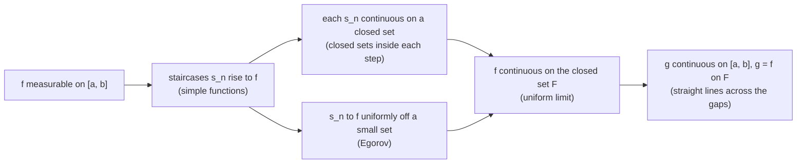

# Lusin's theorem: every measurable function is continuous once you delete a set as small as you like

[Syllabus](../../../SYLLABUS.md) → [Measure and integration](../README.md) → [Swapping Limits and Integrals](../README.md#s05) → Lusin's theorem

---

## General Overview

An electricity tariff charges 10 cents per kWh overnight, 30 cents from 8:00 and 20 cents from 16:00. Measure the day as the interval [0, 1], so the price jumps at 1/3 and at 2/3. A jump is a break in the graph: the price is not continuous there.

Cut out 0.0005 of a day around each jump. That is 0.001 of the day in all. On what is left the price is constant on each piece, so it is continuous. Join the pieces across the two gaps by straight lines and the result is a continuous price curve. It equals the tariff everywhere except in the 0.001 of the day that was cut out.

The worst function of all behaves the same way. The **Dirichlet function** is 1 at every rational number and 0 at every other number. Every interval contains both kinds of number, so it jumps everywhere. List the rationals of [0, 1] as 0, 1, 1/2, 1/3, 2/3, 1/4 and so on. Cut out an interval of length 0.01 × 2^(−n) around the n-th one. The lengths 0.005, 0.0025, 0.00125, … add up to at most 0.01. No rational survives, so on the closed set left the function is the constant 0.

**Lusin's theorem: a measurable function on an interval agrees with a continuous function everywhere except on an open set as small as wished, because the function is nearly a finite-step function, each step is nearly a closed set, and straight lines fill the gaps.**

**What kind of fact this is:** a theorem, proved on this card in Why it works, with one consequence proved there too: continuous functions that vanish outside a bounded interval come within any tolerance of every integrable function. The card also states Littlewood's three principles, which sum up the wing; it proves the second, and links the cards that prove the other two.

### The picture: the chain of the proof



Each box is one step of Why it works. The two middle boxes each throw away a small set; the closed set F is what survives both.

---

## The formula

Notation first, in words. $`\lambda`$ is Lebesgue measure: the length of a set ([Lebesgue measure](../02-Length%20Done%20Properly/03-lebesgue-measure.md)). A function $`f`$ is **measurable** when every set $`\{x : f(x) < c\}`$ has a length ([Measurable functions](../03-Measurable%20Functions/01-measurable-functions.md)). A set is **closed** when it contains every point that its own points close in on. $`f|_F`$ is $`f`$ looked at only on the set $`F`$, the **restriction** of $`f`$ to $`F`$.

**Lusin's theorem.** Let $`f`$ be measurable on $`[a, b]`$ and finite almost everywhere (everywhere outside a set of length 0), and let $`\varepsilon > 0`$. Then:

```math
\text{there is a closed } F \subseteq [a, b] \text{ with } \lambda([a, b] \setminus F) < \varepsilon \text{ and } f|_F \text{ continuous}
```

```math
\text{and a continuous } g : [a, b] \to \mathbb{R} \text{ with } g = f \text{ on } F \text{ and } \sup_{[a,b]} |g| \le \sup_F |f|
```

**Read it aloud:** delete less than epsilon of length and the function, seen only on what is left, is continuous; and some continuous function on the whole interval agrees with it on what is left, and is never larger in size.

The deleted part $`[a, b] \setminus F`$ sits inside an open set $`U`$ (one that contains a small interval around each of its points) with $`\lambda(U) < \varepsilon`$, so the theorem is often said as "f equals a continuous function off an open set of size less than epsilon".

**The density corollary.** An **integrable** function is one with $`\int |f|\, d\lambda`$ finite ([Integrable functions](../04-The%20Lebesgue%20Integral/04-integrable-functions-and-l1.md)); they form the space $`L^1`$. A function has **compact support** when it is zero outside some bounded interval.

```math
f \in L^1(\mathbb{R}),\ \varepsilon > 0 \;\Longrightarrow\; \int |f - h|\, d\lambda < \varepsilon \text{ for some continuous } h \text{ with compact support}
```

**Read it aloud:** every integrable function on the line has a continuous function, zero far out, whose total distance from it is as small as wished. "Dense" names exactly this: the continuous functions with compact support come within any tolerance of every member of $`L^1`$.

**Littlewood's three principles.** They sum up Lebesgue's theory in three sentences, each now a theorem:

1. Every measurable set of finite length is nearly a finite union of intervals: an open set around it is a list of intervals, and the first few hold all but a sliver ([Lebesgue measure](../02-Length%20Done%20Properly/03-lebesgue-measure.md)).
2. Every measurable function is nearly continuous (this card).
3. Every sequence of measurable functions that converges is nearly uniformly convergent: Egorov's theorem ([Modes of convergence](04-modes-of-convergence.md)).

"Nearly" means each time: except on a set as small as wished.

| Symbol | Plain meaning | In our example | Push it up and the answer… |
| --- | --- | --- | --- |
| $`[a, b]`$ | the interval the function lives on | [0, 1], one day | a longer interval, same theorem |
| $`f`$, $`f\vert_F`$ | the measurable function; the same function seen only on $`F`$ | the tariff; the Dirichlet function | — |
| $`\lambda`$ | Lebesgue measure, length | the deleted part of the day | — |
| $`\varepsilon`$ | the size allowed for the deleted set | any size above 0.001 for the tariff; 0.01 for Dirichlet | more may be deleted, so it is easier |
| $`F`$, $`U`$, $`\alpha`$, $`\beta`$ | the closed set kept; an open set holding what is deleted; the two ends of one gap | the day minus two gaps; the day minus the intervals round the rationals | — |
| $`g`$ | the continuous function that equals $`f`$ on $`F`$ | the price joined by straight lines | — |
| $`q_n`$, $`n`$ | the n-th rational in the list; its place in the list | $`q_3 = 1/2`$ | later rationals get shorter intervals |
| $`w`$ | the width of each gap cut out at a jump | 0.0005 of a day | the area between s and g grows in step with it |
| $`J`$ | the size of a jump, in cents per kWh | +20 at 1/3, −10 at 2/3 | a bigger area between s and g, and a bigger worst gap J/2 |
| $`s`$, $`s_n`$, $`c_i`$, $`A_i`$, $`F_i`$, $`k`$, $`K_n`$ | a simple function (finitely many values), and the n-th in a list of them; its i-th value; the piece where it takes that value; a closed set inside that piece; the number of pieces; the closed set on which $`s_n`$ is continuous | the tariff's three prices on three thirds of the day | — |
| $`\delta`$, $`\eta`$, $`N`$; $`x`$, $`y`$, $`t`$, $`p`$, $`c`$, $`m`$ | small sizes used inside the proofs; a cap on the height and reach of $`f`$; points of the line, a level and a whole number, used in the definitions and proofs | $`\delta`$ = 0.002, the gaps' total on the line; N = 30 cents | — |
| $`L^1`$, $`h`$ | the integrable functions; a continuous function with compact support close to $`f`$ | the tariff on the line, zero outside the day; h joined by lines at 0, 1/3, 2/3, 1 | — |

### When it holds

- **The function is measurable.** Without it the sets $`A_i`$ in Step 1 have no length and no closed set can be fitted inside them. Lusin's conclusion in fact forces measurability: a function continuous on closed sets that cover all but a null set is measurable.
- **The function is finite almost everywhere.** A function equal to $`+\infty`$ on a set of positive length matches no real-valued continuous function there.
- **The space has finite size for the proof.** Egorov's theorem needs it. On the whole line apply the theorem on each $`[m, m+1]`$, for every whole number $`m`$, with tolerance $`\varepsilon \cdot 2^{-|m|-2}`$ and add up.
- **Closed, not just "large".** Deleting only the two jump points of the tariff leaves a set of full length on which the price is continuous. But that set is not closed, the price comes in at 10 and leaves at 30 at 1/3, and no continuous function on [0, 1] agrees with it there.
- **The line, or $`\mathbb{R}^n`$ with a different last step.** Steps 1 to 3 work in $`\mathbb{R}^n`$ word for word. Filling the gaps by straight lines does not; there the Tietze extension theorem builds $`g`$ ([Urysohn and Tietze](../../17-Topology/02-Topological%20Spaces/10-urysohn-tietze-and-metrisation.md)).

---

## Why it works

### Step 0: three small losses, one closed set

A measurable function is a limit of simple functions, which take finitely many values on measurable pieces. A simple function is nearly continuous, because each piece contains a closed set of nearly the same length. Egorov's theorem makes the limit uniform off a small set, and a uniform limit of continuous functions is continuous. Each step loses a small set. Arrange the losses to add up to less than $`\varepsilon`$, keep the closed set that survives them all, and fill its gaps with straight lines.

### Step 1: a simple function is continuous on a closed set

Let $`s`$ take the values $`c_1, \dots, c_k`$ on the pieces $`A_1, \dots, A_k`$, which do not overlap and fill $`[a, b]`$ ([Simple functions](../03-Measurable%20Functions/03-simple-functions-and-approximation.md)). Lebesgue measure squeezes every measurable set from inside by closed sets. So each $`A_i`$ holds a closed $`F_i`$ with $`\lambda(A_i \setminus F_i) < \varepsilon / k`$.

Let $`F = F_1 \cup \dots \cup F_k`$. It is closed, and it misses less than $`\varepsilon`$ of $`[a, b]`$. The closed sets of the other pieces join into one closed set that misses $`F_i`$. A closed set holds every point its own points close in on, so each point of $`F_i`$ has a small interval around it that misses them. That interval meets $`F`$ only in $`F_i`$, where $`s`$ is the constant $`c_i`$. That is continuity of $`s|_F`$.

Both examples are this step.

- **The tariff.** It is a simple function, so from here on it is written $`s`$. The pieces are the three thirds of the day. The closed sets are $`[0, 1/3 - w/2]`$, $`[1/3 + w/2, 2/3 - w/2]`$ and $`[2/3 + w/2, 1]`$, with $`w = 0.0005`$. Together they keep 0.999 of the day.
- **The Dirichlet function.** The pieces are the rationals and the irrationals. The rationals have length 0, so their closed set can be empty. The irrationals hold the closed set $`F = [0, 1] \setminus U`$, where $`U`$ is the union of the open intervals of length $`0.01 \cdot 2^{-n}`$ around each $`q_n`$.

The deleted length inside [0, 1] is at most $`0.01 \cdot (1/4 + 1/8 + 1/4) = 0.00625`$. The intervals around 0 and 1 stick out of [0, 1] by half, $`0.0025`$ and $`0.00125`$; the others add up to at most $`0.0025`$. So $`F`$ keeps at least 0.99375 of [0, 1].

### Step 2: a measurable function is a uniform limit of simple ones off a small set

The staircases of [Simple functions](../03-Measurable%20Functions/03-simple-functions-and-approximation.md) are simple functions $`s_n`$ with $`s_n(x) \to f(x)`$ at every point where $`f`$ is finite. For signed $`f`$, take the staircase of the part above zero minus that of the part below.

Pointwise convergence on a set of finite length is uniform off a small set. That is **Egorov's theorem**, proved on [Modes of convergence](04-modes-of-convergence.md). It gives a measurable set $`A`$ with $`\lambda(A) < \varepsilon/4`$ and $`s_n \to f`$ uniformly off $`A`$. Squeeze $`[a, b] \setminus A`$ from inside: a closed $`K_0`$ inside it misses less than $`\varepsilon / 2`$ of $`[a, b]`$ in all.

By Step 1, each $`s_n`$ is continuous on a closed $`K_n`$ that misses less than $`\varepsilon \cdot 2^{-n-1}`$. Let $`F = K_0 \cap K_1 \cap K_2 \cap \dots`$. It is closed, as every intersection of closed sets is. It misses less than $`\varepsilon/2 + \varepsilon/4 + \varepsilon/8 + \dots = \varepsilon`$.

### Step 3: the uniform limit keeps continuity

On $`F`$ every $`s_n`$ is continuous and $`s_n \to f`$ uniformly. A uniform limit of continuous functions is continuous ([Uniform convergence](../../06-Calculus%20and%20analysis/06-Series/07-uniform-convergence.md)). The reason in one line: to move $`f`$ by little, move first to $`s_n`$ (uniformly close), then along $`s_n`$ (continuous), then back. So $`f|_F`$ is continuous.

### Step 4: fill the gaps by straight lines

What $`F`$ leaves out of $`[a, b]`$ is a union of gaps: at most countably many open intervals that do not overlap, each with both ends in $`F`$ (or at an end of $`[a, b]`$). Define $`g = f`$ on $`F`$. On each gap, let $`g`$ run in a straight line from its value at the left end to its value at the right end. Before the first point of $`F`$ and after the last, let $`g`$ be constant. These points exist because $`F`$ is closed and bounded ([Compactness of [a, b]](../../06-Calculus%20and%20analysis/01-Limits%20and%20Continuity/09-compactness-of-closed-intervals.md)): points of $`F`$ close in on its lowest and its highest bound, and a closed set keeps such limits.

A straight line never goes beyond its two ends, so $`\sup |g| \le \sup_F |f|`$. The fold proves that $`g`$ is continuous. For the tariff this is the whole construction: the lines run from 10 to 30 across $`[1/3 - w/2, 1/3 + w/2]`$ and from 30 to 20 across the second gap.

<details>
<summary>Detailed proof: the joined-up function g is continuous</summary>

Inside a gap, $`g`$ is a straight line, so it is continuous there. Take $`x`$ in $`F`$ and look to the right of it; the left is the same.

If $`x`$ is the left end of a gap, then just to the right $`g`$ is the line that starts at $`g(x) = f(x)`$, or the constant $`f(x)`$ when $`x`$ is the last point of $`F`$, so $`g(y) \to f(x)`$ as $`y`$ comes down to $`x`$.

Otherwise every interval $`(x, x + \eta)`$ contains a point $`p`$ of $`F`$. Take $`y`$ in $`(x, p)`$. If $`y`$ is in $`F`$, then $`g(y) = f(y)`$. If $`y`$ is in a gap, that gap lies inside $`(x, p)`$, since its ends cannot pass the points $`x`$ and $`p`$ of $`F`$. Its ends $`\alpha`$, $`\beta`$ are in $`F`$ and within $`\eta`$ of $`x`$, and $`g(y)`$ lies between $`f(\alpha)`$ and $`f(\beta)`$. In both cases

$`\displaystyle |g(y) - f(x)| \le \sup \{ |f(t) - f(x)| : t \in F,\ x \le t \le x + \eta \}`$

and the right side tends to 0 as $`\eta \to 0`$, because $`f|_F`$ is continuous at $`x`$.

For the open set: Step 2 with $`\varepsilon/2`$ gives $`\lambda([a, b] \setminus F) < \varepsilon/2`$. Then $`U = (a - \varepsilon/8,\ b + \varepsilon/8) \setminus F`$ is open, since $`F`$ is closed, holds every point where $`g`$ may differ from $`f`$, and $`\lambda(U) < \varepsilon/2 + \varepsilon/4 < \varepsilon`$.

</details>

### Step 5: continuous functions with compact support are dense in L¹

Take $`f`$ in $`L^1(\mathbb{R})`$ and $`\varepsilon > 0`$. Three moves.

1. **Cap it.** Let $`f_N`$ equal $`f`$ where $`|x| \le N`$ and $`|f| \le N`$, and 0 elsewhere. Then $`|f - f_N| \le |f|`$ and $`f_N \to f`$ at every point where $`f`$ is finite. Dominated convergence gives $`\int |f - f_N| \to 0`$ ([Dominated convergence](02-dominated-convergence-theorem.md)), so fix $`N`$ with $`\int |f - f_N| < \varepsilon/2`$.
2. **Apply Lusin.** On $`[-N-1, N+1]`$, Lusin's theorem with $`\delta = \varepsilon/(4N)`$ gives a continuous $`g`$ with $`|g| \le N`$, equal to $`f_N`$ except on a set of size below $`\delta`$.
3. **Fade it to zero.** Multiply $`g`$ by the trapezoid that is 1 on $`[-N, N]`$, 0 outside $`[-N-1, N+1]`$ and straight between. Call the product $`h`$. Outside $`[-N, N]`$ the function $`f_N`$ is 0, and so is $`g`$ except on the small set. So $`h = f_N`$ except on that set.

Where they differ, $`|f_N - h| \le 2N`$. So $`\int |f_N - h| \le 2N\delta = \varepsilon/2`$, and $`\int |f - h| < \varepsilon`$.

The tariff on the line, zero outside the day, has four jumps: +10 at 0, +20 at 1/3, −10 at 2/3, −20 at 1. Joining across each by a line of width 0.0005 gives $`h`$, zero outside $`[-0.00025, 1.00025]`$. The proof's bound $`2N\delta`$, with height cap $`N = 30`$ and deleted size $`\delta = 0.002`$, is $`60 \times 0.002 = 0.12`$. The true distance is 0.0075, far smaller, because a line across a jump misses the step only by thin triangles.

### Step 6: why the triangles give J w / 4

Across a gap of width $`w`$ at a jump of size $`J`$, the line crosses the step at the jump point, halfway up. The gap between step and line is two triangles, each $`w/2`$ wide and $`|J|/2`$ tall. Their area is $`2 \times \tfrac12 \times \tfrac{w}{2} \times \tfrac{|J|}{2} = |J|\, w / 4`$. The tallest point of the gap is $`|J|/2`$, right at the jump, however small $`w`$ is.

---

## Worked numbers, by hand

| Step | Arithmetic | Value |
| --- | --- | --- |
| Dirichlet: first five rationals | 0, 1, 1/2, 1/3, 2/3 | widths 0.005, 0.0025, 0.00125, 0.000625, 0.0003125 |
| Dirichlet: all widths | 0.01 × (1/2 + 1/4 + 1/8 + …) | at most 0.01 |
| Dirichlet: inside [0, 1] | 0.01 − 0.0025 (half at 0) − 0.00125 (half at 1) | at most 0.00625 |
| Dirichlet: the 23 rationals with denominator up to 8 | 0.01 × (1 − 2^(−23)) − 0.00375 | 0.0062499988 |
| Dirichlet: closed set left | 1 − 0.00625 | **at least 0.99375, where the function is 0** |
| Tariff: kept | 1 − 2 × 0.0005 | 0.999 of the day |
| Tariff: area between s and g | (20 + 10) × 0.0005 / 4 | **0.00375** |
| Tariff: worst gap | 20 / 2 | 10 cents per kWh |
| Line: area between s and h | (10 + 20 + 10 + 20) × 0.0005 / 4 | 0.0075, against the proof's bound 0.12 |

The Dirichlet function, nowhere continuous, becomes the constant 0 on a closed set of at least 0.99375 of [0, 1]. The tariff becomes continuous after losing 0.001 of the day, and the joined-up price differs from it by an area of 0.00375 (cents per kWh) × days.

### What breaks if you drop a piece

| Mistake | Comes out at | What went wrong |
| --- | --- | --- |
| Width 0.01 around every rational, not shrinking | the rationals with denominator up to 100 already delete length 1: no length is left | neighbouring fractions with denominator up to 100 are at most 0.01 apart, so the intervals touch; the widths must add up to something small |
| Delete around the first 23 rationals only | 3022 rationals with denominator up to 100 are still in the set left, each a point where the function is 1 | finitely many intervals cannot catch a dense set; the list must go on forever |
| Read Lusin as "g is uniformly close to f" | the worst gap stays 10 cents at gap width 0.0005 and at 0.00005 | Lusin makes the bad set small, not the gap on it |

---

## Code, from first principles, and it actually runs

The code checks both examples with exact fractions; the theorem itself rests on the proof. It takes two independent roads to every number. The deleted length around the rationals is found by sorting and merging the intervals, and by the geometric sum minus the parts outside [0, 1]. The area between the tariff and its joined-up version is found by the triangle formula and by a midpoint sum on a grid that every corner of the gap lines up with, so the sum is exact. The breaks use the Farey sequence (all fractions with denominator up to 100, in order) and the totient count of those fractions (for each denominator, how many numerators from 1 up to it share no factor with it) as cross-checks on the list of rationals.

### Python

```python
# Lusin's theorem -- the check behind the card.  Standard library only.
# Exact fractions throughout.  Every number is reached by two roads:
# Dirichlet: the length deleted around the rationals, by sorting and merging
#   the intervals, against the geometric sum minus the parts outside [0, 1].
# Tariff: the gap between the step s and its joined-up version g, by the
#   triangle formula |J| w / 4 per jump, against a midpoint sum on a grid
#   that every corner of |s - g| lines up with (so the sum is exact).
from fractions import Fraction as F
from math import gcd

def dec(x, digits=10):                       # exact decimal, rounded half up
    sign, x = ("-" if x < 0 else ""), abs(x)
    n = (x.numerator * 10**digits * 2 + x.denominator) // (2 * x.denominator)
    s = f"{n // 10**digits}.{n % 10**digits:0{digits}d}".rstrip("0").rstrip(".")
    return sign + s

def rationals(qmax):                         # 0, 1, then p/q by denominator
    out = [F(0), F(1)]
    for q in range(2, qmax + 1):
        out += [F(p, q) for p in range(1, q) if gcd(p, q) == 1]
    return out

def merged_length(centres, width):           # length of the union inside [0, 1]
    iv = sorted((max(F(0), c - width(n) / 2), min(F(1), c + width(n) / 2))
                for n, c in enumerate(centres, 1))
    total, (lo, hi) = F(0), iv[0]
    for a, b in iv[1:]:
        if a > hi:
            total, lo, hi = total + hi - lo, a, b
        else:
            hi = max(hi, b)
    return total + hi - lo

def totient(n):                              # n times (1 - 1/p) over primes p
    r, m, p = n, n, 2
    while p * p <= m:
        if m % p == 0:
            r -= r // p
            while m % p == 0:
                m //= p
        p += 1
    return r - r // m if m > 1 else r

def farey(n):                                # count and smallest b*d of neighbours
    a, b, c, d, count, small = 0, 1, 1, n, 2, n
    while (c, d) != (1, 1):
        k = (n + b) // d
        a, b, c, d = c, d, k * c - a, k * d - b
        count, small = count + 1, min(small, b * d)
    return count, small

def s_at(x, base, jumps):                    # the step: base, plus J from c on
    return base + sum(J for c, J in jumps if x >= c)

def g_at(x, base, jumps, w):                 # straight line across each gap
    return base + sum(J * min(F(1), max(F(0), (x - c + w / 2) / w)) for c, J in jumps)

def gap_by_grid(base, jumps, w, lo, hi, h):  # integral and largest |s - g|
    n = int((hi - lo) / h)
    area = sum(abs(s_at(lo + (k + F(1, 2)) * h, base, jumps)
                   - g_at(lo + (k + F(1, 2)) * h, base, jumps, w)) for k in range(n)) * h
    top = max(abs(s_at(lo + k * h, base, jumps) - g_at(lo + k * h, base, jumps, w)) for k in range(n + 1))
    return area, top, n

def gap_by_formula(jumps, w):
    return sum(abs(J) for c, J in jumps) * w / 4, max(abs(J) for c, J in jumps) / 2

# ---- Dirichlet: delete width eps * 2^-n around the n-th rational ----
eps = F(1, 100)
width = lambda n: eps / 2**n
q8 = rationals(8)
first = ", ".join(str(x) for x in q8[:5])
d_merge = merged_length(q8, width)
outside = width(1) / 2 + width(2) / 2        # half of the intervals at 0 and at 1
d_sum = eps * (1 - F(1, 2**len(q8))) - outside
bound = lambda e: e - e / 4 - e / 8          # all rationals: the same overhangs
assert d_merge == d_sum and bound(eps) - d_merge == eps / 2**len(q8)
print("Dirichlet on [0, 1]: delete width 0.01 * 2^-n around the n-th rational")
print(f"denominator up to 8: {len(q8)} rationals; first five {first}")
print("widths of the first five: " + ", ".join(dec(width(n)) for n in range(1, 6)))
print(f"deleted, first 23, by merging: {dec(d_merge)}; by the sum: {dec(d_sum)}")
print(f"deleted, every rational, at most {dec(bound(eps))}; closed set left at least {dec(1 - bound(eps))}")

# ---- the tariff: 10, then 30 from 1/3, then 20 from 2/3 cents per kWh ----
w = F(1, 2000)
tariff = [(F(1, 3), F(20)), (F(2, 3), F(-10))]
area, top, n = gap_by_grid(F(10), tariff, w, F(0), F(1), F(1, 12000))
f_area, f_top = gap_by_formula(tariff, w)
assert area == f_area and top == f_top
print(f"tariff: gaps {dec(w)} at 1/3 and 2/3, kept length {dec(1 - 2 * w)}")
print(f"integral |s - g|: triangles {dec(f_area)}; grid of {n} cells {dec(area)}")
print(f"largest |s - g|: J/2 gives {dec(f_top)}; grid gives {dec(top)}")

# ---- continuous with compact support, close in L1: the tariff on the line ----
line = [(F(0), F(10))] + tariff + [(F(1), F(-20))]
l_area, l_top, n = gap_by_grid(F(0), line, w, F(-1, 1000), F(1001, 1000), F(1, 12000))
assert l_area == gap_by_formula(line, w)[0] and l_area < 60 * 4 * w
print(f"line: h is 0 outside [{dec(-w / 2)}, {dec(1 + w / 2)}]; integral |s - h| "
      f"{dec(gap_by_formula(line, w)[0])}; grid {dec(l_area)}; proof's bound 60 x {dec(4 * w)} = {dec(60 * 4 * w)}")

# ---- what breaks ----
q100 = rationals(100)
f_count, small = farey(100)
tot = 1 + sum(totient(q) for q in range(1, 101))
fixed = merged_length(q100, lambda n: eps)
assert f_count == tot == len(q100) and small >= 100 and fixed == 1
print(f"break, width 0.01 for all: {tot} rationals with denominator up to 100, widest neighbour gap {dec(F(1, small))}, deleted {dec(fixed)}")
cut = [(c - width(k) / 2, c + width(k) / 2) for k, c in enumerate(q8, 1)]
left = sum(1 for x in q100 if not any(a < x < b for a, b in cut))
assert left == tot - len(q8)
print(f"break, first 23 only: rationals up to denominator 100 left {left} = {tot} - 23")
fine = gap_by_grid(F(10), tariff, w / 10, F(0), F(1), F(1, 120000))
assert fine[:2] == gap_by_formula(tariff, w / 10)
print(f"break, sup reading: largest |s - g| {dec(top)} at gap 0.0005, {dec(fine[1])} at gap 0.00005")

# ---- try changing ----
print(f"try, eps 0.001: deleted at most {dec(bound(F(1, 1000)))}, left at least {dec(1 - bound(F(1, 1000)))}")
print(f"try, gap 0.00005: integral |s - g| {dec(fine[0])}")
w3 = F(1, 1000) / 15
a3 = gap_by_grid(F(0), line, w3, F(-1, 1000), F(1001, 1000), F(1, 30000))[0]
assert a3 == F(1, 1000)
print(f"try, target 0.001 on the line: gap 1/15000 = {dec(w3)}, integral |s - h| {dec(a3)}")
peak = [(F(1, 3), F(40)), (F(2, 3), F(-30))]
a4, t4, _ = gap_by_grid(F(10), peak, w, F(0), F(1), F(1, 12000))
assert (a4, t4) == gap_by_formula(peak, w)
print(f"try, peak 50: integral |s - g| {dec(a4)}, largest gap {dec(t4)}")
print("ALL CHECKS PASS")
```

**Ran 2026-11-23 on macOS, Python 3.14.10, standard library only. All checks passed. Output, pasted from the run:**

```
Dirichlet on [0, 1]: delete width 0.01 * 2^-n around the n-th rational
denominator up to 8: 23 rationals; first five 0, 1, 1/2, 1/3, 2/3
widths of the first five: 0.005, 0.0025, 0.00125, 0.000625, 0.0003125
deleted, first 23, by merging: 0.0062499988; by the sum: 0.0062499988
deleted, every rational, at most 0.00625; closed set left at least 0.99375
tariff: gaps 0.0005 at 1/3 and 2/3, kept length 0.999
integral |s - g|: triangles 0.00375; grid of 12000 cells 0.00375
largest |s - g|: J/2 gives 10; grid gives 10
line: h is 0 outside [-0.00025, 1.00025]; integral |s - h| 0.0075; grid 0.0075; proof's bound 60 x 0.002 = 0.12
break, width 0.01 for all: 3045 rationals with denominator up to 100, widest neighbour gap 0.01, deleted 1
break, first 23 only: rationals up to denominator 100 left 3022 = 3045 - 23
break, sup reading: largest |s - g| 10 at gap 0.0005, 10 at gap 0.00005
try, eps 0.001: deleted at most 0.000625, left at least 0.999375
try, gap 0.00005: integral |s - g| 0.000375
try, target 0.001 on the line: gap 1/15000 = 0.0000666667, integral |s - h| 0.001
try, peak 50: integral |s - g| 0.00875, largest gap 20
ALL CHECKS PASS
```

### Rust

```rust
// Lusin's theorem -- the check behind the card.  std only.
// Exact fractions (i128) throughout; the same two roads as the Python:
// Dirichlet: merge the deleted intervals, against the geometric sum minus
//   the parts outside [0, 1].
// Tariff: the triangle formula |J| w / 4 per jump, against a midpoint sum on
//   a grid that every corner of |s - g| lines up with.
use std::cmp::Ordering;
use std::ops::{Add, Div, Mul, Sub};

fn gcd(a: i128, b: i128) -> i128 { if b == 0 { a.abs() } else { gcd(b, a % b) } }
#[derive(Clone, Copy, Debug, PartialEq, Eq)]
struct Q { n: i128, d: i128 }
fn q(n: i128, d: i128) -> Q { let g = gcd(n, d) * d.signum(); Q { n: n / g, d: d / g } }
fn z(n: i128) -> Q { q(n, 1) }
impl Add for Q { type Output = Q; fn add(self, o: Q) -> Q { q(self.n * o.d + o.n * self.d, self.d * o.d) } }
impl Sub for Q { type Output = Q; fn sub(self, o: Q) -> Q { q(self.n * o.d - o.n * self.d, self.d * o.d) } }
impl Mul for Q { type Output = Q; fn mul(self, o: Q) -> Q { q(self.n * o.n, self.d * o.d) } }
impl Div for Q { type Output = Q; fn div(self, o: Q) -> Q { q(self.n * o.d, self.d * o.n) } }
impl PartialOrd for Q { fn partial_cmp(&self, o: &Q) -> Option<Ordering> { Some(self.cmp(o)) } }
impl Ord for Q { fn cmp(&self, o: &Q) -> Ordering { (self.n * o.d).cmp(&(o.n * self.d)) } }
fn abs(x: Q) -> Q { q(x.n.abs(), x.d) }
fn mx(a: Q, b: Q) -> Q { if a > b { a } else { b } }
fn mn(a: Q, b: Q) -> Q { if a < b { a } else { b } }

fn dec(x: Q) -> String {                     // exact decimal, rounded half up
    let sign = if x.n < 0 { "-" } else { "" };
    let p = 10i128.pow(10);
    let m = (x.n.abs() * p * 2 + x.d) / (2 * x.d);
    let s = format!("{}.{:010}", m / p, m % p);
    format!("{}{}", sign, s.trim_end_matches('0').trim_end_matches('.'))
}
fn qstr(x: Q) -> String { if x.d == 1 { format!("{}", x.n) } else { format!("{}/{}", x.n, x.d) } }

fn rationals(qmax: i128) -> Vec<Q> {         // 0, 1, then p/q by denominator
    let mut out = vec![z(0), z(1)];
    for b in 2..=qmax { for a in 1..b { if gcd(a, b) == 1 { out.push(q(a, b)); } } }
    out
}
fn merged_length(c: &[Q], width: &dyn Fn(usize) -> Q) -> Q {
    let half = z(2);
    let mut iv: Vec<(Q, Q)> = c.iter().enumerate()
        .map(|(k, &x)| (mx(z(0), x - width(k + 1) / half), mn(z(1), x + width(k + 1) / half))).collect();
    iv.sort();
    let (mut total, mut lo, mut hi) = (z(0), iv[0].0, iv[0].1);
    for &(a, b) in &iv[1..] {
        if a > hi { total = total + hi - lo; lo = a; hi = b; } else { hi = mx(hi, b); }
    }
    total + hi - lo
}
fn totient(n: i128) -> i128 {
    let (mut r, mut m, mut p) = (n, n, 2);
    while p * p <= m {
        if m % p == 0 { r -= r / p; while m % p == 0 { m /= p; } }
        p += 1;
    }
    if m > 1 { r - r / m } else { r }
}
fn farey(n: i128) -> (i128, i128) {
    let (mut a, mut b, mut c, mut d, mut count, mut small) = (0, 1, 1, n, 2, n);
    while (c, d) != (1, 1) {
        let k = (n + b) / d;
        let (na, nb, nc, nd) = (c, d, k * c - a, k * d - b);
        a = na; b = nb; c = nc; d = nd;
        count += 1; small = small.min(b * d);
    }
    (count, small)
}
fn s_at(x: Q, base: Q, j: &[(Q, Q)]) -> Q { j.iter().fold(base, |t, &(c, jj)| if x >= c { t + jj } else { t }) }
fn g_at(x: Q, base: Q, j: &[(Q, Q)], w: Q) -> Q {
    j.iter().fold(base, |t, &(c, jj)| t + jj * mn(z(1), mx(z(0), (x - c + w / z(2)) / w)))
}
fn gap_by_grid(base: Q, j: &[(Q, Q)], w: Q, lo: Q, hi: Q, h: Q) -> (Q, Q, i128) {
    let r = (hi - lo) / h;
    let n = r.n / r.d;
    let (mut area, mut top) = (z(0), z(0));
    for k in 0..n {
        let x = lo + (z(k) + q(1, 2)) * h;
        area = area + abs(s_at(x, base, j) - g_at(x, base, j, w));
    }
    for k in 0..=n {
        let x = lo + z(k) * h;
        top = mx(top, abs(s_at(x, base, j) - g_at(x, base, j, w)));
    }
    (area * h, top, n)
}
fn gap_by_formula(j: &[(Q, Q)], w: Q) -> (Q, Q) {
    let sum = j.iter().fold(z(0), |t, &(_, jj)| t + abs(jj));
    let top = j.iter().fold(z(0), |t, &(_, jj)| mx(t, abs(jj)));
    (sum * w / z(4), top / z(2))
}

fn main() {
    // ---- Dirichlet: delete width eps * 2^-n around the n-th rational ----
    let eps = q(1, 100);
    let width = move |k: usize| eps / z(1i128 << k);
    let q8 = rationals(8);
    let first: Vec<String> = q8[..5].iter().map(|&x| qstr(x)).collect();
    let d_merge = merged_length(&q8, &width);
    let outside = width(1) / z(2) + width(2) / z(2);
    let d_sum = eps * (z(1) - q(1, 1i128 << q8.len())) - outside;
    let bound = |e: Q| e - e / z(4) - e / z(8);
    assert!(d_merge == d_sum && bound(eps) - d_merge == eps / z(1i128 << q8.len()));
    println!("Dirichlet on [0, 1]: delete width 0.01 * 2^-n around the n-th rational");
    println!("denominator up to 8: {} rationals; first five {}", q8.len(), first.join(", "));
    let ws: Vec<String> = (1..6).map(|k| dec(width(k))).collect();
    println!("widths of the first five: {}", ws.join(", "));
    println!("deleted, first 23, by merging: {}; by the sum: {}", dec(d_merge), dec(d_sum));
    println!("deleted, every rational, at most {}; closed set left at least {}", dec(bound(eps)), dec(z(1) - bound(eps)));

    // ---- the tariff: 10, then 30 from 1/3, then 20 from 2/3 cents per kWh ----
    let w = q(1, 2000);
    let tariff = [(q(1, 3), z(20)), (q(2, 3), z(-10))];
    let (area, top, n) = gap_by_grid(z(10), &tariff, w, z(0), z(1), q(1, 12000));
    let (f_area, f_top) = gap_by_formula(&tariff, w);
    assert!(area == f_area && top == f_top);
    println!("tariff: gaps {} at 1/3 and 2/3, kept length {}", dec(w), dec(z(1) - z(2) * w));
    println!("integral |s - g|: triangles {}; grid of {} cells {}", dec(f_area), n, dec(area));
    println!("largest |s - g|: J/2 gives {}; grid gives {}", dec(f_top), dec(top));

    // ---- continuous with compact support, close in L1: the tariff on the line ----
    let line = [(z(0), z(10)), tariff[0], tariff[1], (z(1), z(-20))];
    let (l_area, _, _) = gap_by_grid(z(0), &line, w, q(-1, 1000), q(1001, 1000), q(1, 12000));
    assert!(l_area == gap_by_formula(&line, w).0 && l_area < z(60) * z(4) * w);
    println!("line: h is 0 outside [{}, {}]; integral |s - h| {}; grid {}; proof's bound 60 x {} = {}",
        dec(z(0) - w / z(2)), dec(z(1) + w / z(2)), dec(gap_by_formula(&line, w).0), dec(l_area),
        dec(z(4) * w), dec(z(60) * z(4) * w));

    // ---- what breaks ----
    let q100 = rationals(100);
    let (f_count, small) = farey(100);
    let tot = 1 + (1..=100).map(totient).sum::<i128>();
    let fixed = merged_length(&q100, &move |_| eps);
    assert!(f_count == tot && tot == q100.len() as i128 && small >= 100 && fixed == z(1));
    println!("break, width 0.01 for all: {} rationals with denominator up to 100, widest neighbour gap {}, deleted {}",
        tot, dec(q(1, small)), dec(fixed));
    let cut: Vec<(Q, Q)> = q8.iter().enumerate()
        .map(|(k, &c)| (c - width(k + 1) / z(2), c + width(k + 1) / z(2))).collect();
    let left = q100.iter().filter(|&&x| !cut.iter().any(|&(a, b)| a < x && x < b)).count() as i128;
    assert!(left == tot - q8.len() as i128);
    println!("break, first 23 only: rationals up to denominator 100 left {} = {} - 23", left, tot);
    let fine = gap_by_grid(z(10), &tariff, w / z(10), z(0), z(1), q(1, 120000));
    assert!((fine.0, fine.1) == gap_by_formula(&tariff, w / z(10)));
    println!("break, sup reading: largest |s - g| {} at gap 0.0005, {} at gap 0.00005", dec(top), dec(fine.1));

    // ---- try changing ----
    let e2 = q(1, 1000);
    println!("try, eps 0.001: deleted at most {}, left at least {}", dec(bound(e2)), dec(z(1) - bound(e2)));
    println!("try, gap 0.00005: integral |s - g| {}", dec(fine.0));
    let w3 = q(1, 1000) / z(15);
    let a3 = gap_by_grid(z(0), &line, w3, q(-1, 1000), q(1001, 1000), q(1, 30000)).0;
    assert!(a3 == q(1, 1000));
    println!("try, target 0.001 on the line: gap 1/15000 = {}, integral |s - h| {}", dec(w3), dec(a3));
    let peak = [(q(1, 3), z(40)), (q(2, 3), z(-30))];
    let (a4, t4, _) = gap_by_grid(z(10), &peak, w, z(0), z(1), q(1, 12000));
    assert!((a4, t4) == gap_by_formula(&peak, w));
    println!("try, peak 50: integral |s - g| {}, largest gap {}", dec(a4), dec(t4));
    println!("ALL CHECKS PASS");
}
```

**Ran 2026-11-23 on macOS, rustc 1.98.1, no crates. All checks passed. Output, pasted from the run:**

```
Dirichlet on [0, 1]: delete width 0.01 * 2^-n around the n-th rational
denominator up to 8: 23 rationals; first five 0, 1, 1/2, 1/3, 2/3
widths of the first five: 0.005, 0.0025, 0.00125, 0.000625, 0.0003125
deleted, first 23, by merging: 0.0062499988; by the sum: 0.0062499988
deleted, every rational, at most 0.00625; closed set left at least 0.99375
tariff: gaps 0.0005 at 1/3 and 2/3, kept length 0.999
integral |s - g|: triangles 0.00375; grid of 12000 cells 0.00375
largest |s - g|: J/2 gives 10; grid gives 10
line: h is 0 outside [-0.00025, 1.00025]; integral |s - h| 0.0075; grid 0.0075; proof's bound 60 x 0.002 = 0.12
break, width 0.01 for all: 3045 rationals with denominator up to 100, widest neighbour gap 0.01, deleted 1
break, first 23 only: rationals up to denominator 100 left 3022 = 3045 - 23
break, sup reading: largest |s - g| 10 at gap 0.0005, 10 at gap 0.00005
try, eps 0.001: deleted at most 0.000625, left at least 0.999375
try, gap 0.00005: integral |s - g| 0.000375
try, target 0.001 on the line: gap 1/15000 = 0.0000666667, integral |s - h| 0.001
try, peak 50: integral |s - g| 0.00875, largest gap 20
ALL CHECKS PASS
```

### Lean

Lean proves Lusin's theorem and its open-set form on every interval $`[a, b]`$, and the density corollary on the whole line.

- Suppose $`f`$ is measurable on $`[a, b]`$ and finite almost everywhere, and $`\varepsilon > 0`$. Then some closed $`F \subseteq [a, b]`$ has $`\lambda([a, b] \setminus F) < \varepsilon`$ and $`f|_F`$ continuous.
- Take the same $`f`$, $`F`$ and $`\varepsilon`$. Then a continuous $`g`$ on $`[a, b]`$ equals $`f`$ on $`F`$, with $`\sup_{[a,b]} |g| \le \sup_F |f|`$.
- Take the same $`f`$ and $`\varepsilon`$. Then some open $`U`$ has $`\lambda(U) < \varepsilon`$, and a continuous $`g`$ on $`[a, b]`$ equals $`f`$ outside $`U`$.
- Suppose $`f`$ is in $`L^1(\mathbb{R})`$ and $`\varepsilon > 0`$. Then some continuous $`h`$ with compact support has $`\int |f - h|\, d\lambda < \varepsilon`$.
- The hand numbers hold exactly. They cover the Dirichlet widths and deleted length, the counts 23 and 3045, and the tariff and line areas.

Merging the deleted intervals, the grid sums and the Try changing values are left to the Python and Rust checks.

```lean
-- Lusin's theorem: a measurable function on [a, b] that is finite almost everywhere is continuous on a closed set missing less than ε of the interval and agrees there with a continuous function no larger in size, and so continuous functions with compact support are dense in L¹.
import Mathlib.MeasureTheory.Measure.Lebesgue.Basic
import Mathlib.MeasureTheory.Integral.Bochner.Basic
import Mathlib.Topology.Algebra.Support
import Mathlib.Data.Nat.Totient
import Mathlib.MeasureTheory.Measure.Regular
import Mathlib.MeasureTheory.Function.ContinuousMapDense
import Mathlib.Topology.TietzeExtension
import Mathlib.Analysis.SpecificLimits.Basic

open MeasureTheory Set

theorem lusin_aux_closed_pair (ν : Measure ℝ) [IsFiniteMeasure ν] {S : Set ℝ}
    (hS : MeasurableSet S) {δ : ENNReal} (hδ : δ ≠ 0) :
    ∃ K K' : Set ℝ, IsClosed K ∧ IsClosed K' ∧ K ⊆ S ∧ K' ⊆ Sᶜ ∧ ν (K ∪ K')ᶜ < δ := by
  have hδ2 : δ / 2 ≠ 0 := by simp [hδ]
  obtain ⟨K, hKS, hKc, hK⟩ := hS.exists_isClosed_sdiff_lt (measure_ne_top ν S) hδ2
  obtain ⟨K', hKS', hKc', hK'⟩ := hS.compl.exists_isClosed_sdiff_lt (measure_ne_top ν _) hδ2
  refine ⟨K, K', hKc, hKc', hKS, hKS', ?_⟩
  have hsub : (K ∪ K')ᶜ ⊆ (S \ K) ∪ (Sᶜ \ K') := by
    intro x hx
    simp only [mem_compl_iff, mem_union, not_or] at hx
    by_cases h : x ∈ S
    · exact Or.inl ⟨h, hx.1⟩
    · exact Or.inr ⟨h, hx.2⟩
  calc ν (K ∪ K')ᶜ ≤ ν ((S \ K) ∪ (Sᶜ \ K')) := measure_mono hsub
    _ ≤ ν (S \ K) + ν (Sᶜ \ K') := measure_union_le _ _
    _ < δ / 2 + δ / 2 := ENNReal.add_lt_add hK hK'
    _ = δ := ENNReal.add_halves δ
#print axioms lusin_aux_closed_pair

theorem lusin_aux_countable {ι : Type*} [Countable ι] (ν : Measure ℝ) [IsFiniteMeasure ν]
    (S : ι → Set ℝ) (hS : ∀ i, MeasurableSet (S i)) {δ : ENNReal} (hδ : δ ≠ 0) :
    ∃ F : Set ℝ, IsClosed F ∧ ν Fᶜ < δ ∧ ∀ i, ∃ O : Set ℝ, IsOpen O ∧ S i ∩ F = O ∩ F := by
  obtain ⟨δ', hδ'pos, hδ'sum⟩ := ENNReal.exists_pos_sum_of_countable' hδ ι
  choose K K' hK hK' hKS hKS' hKν using
    fun i => lusin_aux_closed_pair ν (hS i) (hδ'pos i).ne'
  refine ⟨⋂ i, (K i ∪ K' i), isClosed_iInter fun i => (hK i).union (hK' i), ?_, ?_⟩
  · rw [compl_iInter]
    calc ν (⋃ i, (K i ∪ K' i)ᶜ) ≤ ∑' i, ν (K i ∪ K' i)ᶜ := measure_iUnion_le _
      _ ≤ ∑' i, δ' i := tsum_le_tsum fun i => (hKν i).le
      _ < δ := hδ'sum
  · intro i
    refine ⟨(K' i)ᶜ, (hK' i).isOpen_compl, ?_⟩
    ext x
    simp only [mem_inter_iff, mem_compl_iff, mem_iInter, mem_union]
    constructor
    · rintro ⟨hx, hF⟩
      exact ⟨fun h => hKS' i h hx, hF⟩
    · rintro ⟨hx, hF⟩
      refine ⟨?_, hF⟩
      rcases hF i with h | h
      · exact hKS i h
      · exact absurd h hx
#print axioms lusin_aux_countable

theorem lusin_aux_real (ν : Measure ℝ) [IsFiniteMeasure ν] {h : ℝ → ℝ} (hh : Measurable h)
    {δ : ENNReal} (hδ : δ ≠ 0) :
    ∃ F : Set ℝ, IsClosed F ∧ ν Fᶜ < δ ∧ ContinuousOn h F := by
  let S : ℚ ⊕ ℚ → Set ℝ := fun i => match i with
    | Sum.inl q => h ⁻¹' Iio (q : ℝ)
    | Sum.inr q => h ⁻¹' Ioi (q : ℝ)
  have hS : ∀ i, MeasurableSet (S i) := by
    rintro (q | q)
    · exact hh measurableSet_Iio
    · exact hh measurableSet_Ioi
  obtain ⟨F, hFc, hFν, hO⟩ := lusin_aux_countable ν S hS hδ
  refine ⟨F, hFc, hFν, ?_⟩
  intro x hx
  rw [ContinuousWithinAt, tendsto_order]
  constructor
  · intro c hc
    obtain ⟨q, hcq, hqx⟩ := exists_rat_btwn hc
    obtain ⟨O, hOo, hOeq⟩ := hO (Sum.inr q)
    have hxO : x ∈ O ∩ F := hOeq ▸ ⟨(show q < h x from hqx), hx⟩
    filter_upwards [inter_mem_nhdsWithin F (hOo.mem_nhds hxO.1), self_mem_nhdsWithin] with y hy hyF
    have : y ∈ S (Sum.inr q) ∩ F := hOeq ▸ ⟨hy.2, hyF⟩
    exact lt_trans hcq this.1
  · intro c hc
    obtain ⟨q, hxq, hqc⟩ := exists_rat_btwn hc
    obtain ⟨O, hOo, hOeq⟩ := hO (Sum.inl q)
    have hxO : x ∈ O ∩ F := hOeq ▸ ⟨(show h x < q from hxq), hx⟩
    filter_upwards [inter_mem_nhdsWithin F (hOo.mem_nhds hxO.1), self_mem_nhdsWithin] with y hy hyF
    have : y ∈ S (Sum.inl q) ∩ F := hOeq ▸ ⟨hy.2, hyF⟩
    exact lt_trans this.1 hqc
#print axioms lusin_aux_real

/-- Lusin's theorem. Let `f` be a (Lebesgue) measurable function on `[a, b]` with values in the
extended reals, finite almost everywhere, and let `ε > 0`. Then there is a closed set
`F ⊆ [a, b]` with `λ([a, b] \ F) < ε` on which `f` is continuous, and a function `g` continuous on
`[a, b]` that equals `f` on `F` and is never larger in size than `f` is on `F`
(every bound `M ≥ 0` for `|f|` on `F` also bounds `|g|` on all of `[a, b]`, i.e.
`sup_[a,b] |g| ≤ sup_F |f|`). -/
theorem lusin_measurable_continuous_off_small_set (a b : ℝ) (f : ℝ → EReal)
    (hf : AEMeasurable f (volume.restrict (Icc a b)))
    (hfin : ∀ᵐ x ∂(volume.restrict (Icc a b)), f x ≠ ⊤ ∧ f x ≠ ⊥)
    (ε : ℝ) (hε : 0 < ε) :
    ∃ F : Set ℝ, IsClosed F ∧ F ⊆ Icc a b ∧
      volume (Icc a b \ F) < ENNReal.ofReal ε ∧ ContinuousOn f F ∧
      ∃ g : ℝ → ℝ, ContinuousOn g (Icc a b) ∧ (∀ x ∈ F, (g x : EReal) = f x) ∧
        ∀ M : ℝ, 0 ≤ M → (∀ y ∈ F, |g y| ≤ M) → ∀ x ∈ Icc a b, |g x| ≤ M := by
  set ν := volume.restrict (Icc a b) with hν
  have hεpos : ENNReal.ofReal ε ≠ 0 := by simpa using hε
  have hδ : ENNReal.ofReal ε / 2 ≠ 0 := by simp [hεpos]
  obtain ⟨f', hf'm, hff'⟩ := hf
  have hgood : ∀ᵐ x ∂ν, f x = f' x ∧ f x ≠ ⊤ ∧ f x ≠ ⊥ := by
    filter_upwards [hff', hfin] with x h1 h2 using ⟨h1, h2⟩
  set N := toMeasurable ν {x | ¬ (f x = f' x ∧ f x ≠ ⊤ ∧ f x ≠ ⊥)} with hNdef
  have hNm : MeasurableSet N := measurableSet_toMeasurable _ _
  have hN0 : ν N = 0 := by rw [hNdef, measure_toMeasurable]; exact ae_iff.1 hgood
  have hNsub : Nᶜ ⊆ {x | f x = f' x ∧ f x ≠ ⊤ ∧ f x ≠ ⊥} := by
    intro x hx
    by_contra hc
    exact hx (subset_toMeasurable _ _ hc)
  obtain ⟨h, hh, hhdef⟩ : ∃ h : ℝ → ℝ, Measurable h ∧ ∀ x, h x = (f' x).toReal :=
    ⟨_, measurable_ereal_toReal.comp hf'm, fun _ => rfl⟩
  obtain ⟨F1, hF1c, hF1ν, hF1cont⟩ := lusin_aux_real ν hh hδ
  obtain ⟨F2, hF2N, hF2c, hF2ν⟩ := hNm.compl.exists_isClosed_sdiff_lt (measure_ne_top ν _) hδ
  have hFc : IsClosed (F1 ∩ F2 ∩ Icc a b) := (hF1c.inter hF2c).inter isClosed_Icc
  set F := F1 ∩ F2 ∩ Icc a b with hFdef
  have hFsub : F ⊆ Icc a b := inter_subset_right
  have hFF1 : F ⊆ F1 := fun x hx => hx.1.1
  have hfF : ∀ x ∈ F, f x = ((h x : ℝ) : EReal) := by
    intro x hx
    obtain ⟨h1, h2, h3⟩ := hNsub (hF2N hx.1.2)
    rw [hhdef, ← h1]
    exact (EReal.coe_toReal h2 h3).symm
  have hI : ν (Icc a b)ᶜ = 0 := by
    rw [hν, Measure.restrict_apply measurableSet_Icc.compl, compl_inter_self, measure_empty]
  have hvol : volume (Icc a b \ F) < ENNReal.ofReal ε := by
    have heq : volume (Icc a b \ F) = ν Fᶜ := by
      rw [hν, Measure.restrict_apply hFc.measurableSet.compl, sdiff_eq, inter_comm]
    rw [heq]
    have hsub : Fᶜ ⊆ F1ᶜ ∪ (Nᶜ \ F2) ∪ N ∪ (Icc a b)ᶜ := by
      intro x hx
      simp only [hFdef, mem_compl_iff, mem_inter_iff, not_and_or, mem_union, mem_sdiff] at hx ⊢
      tauto
    calc ν Fᶜ ≤ ν (F1ᶜ ∪ (Nᶜ \ F2) ∪ N ∪ (Icc a b)ᶜ) := measure_mono hsub
      _ ≤ ν F1ᶜ + ν (Nᶜ \ F2) + ν N + ν (Icc a b)ᶜ := by
          refine (measure_union_le _ _).trans ?_
          gcongr
          refine (measure_union_le _ _).trans ?_
          gcongr
          exact measure_union_le _ _
      _ = ν F1ᶜ + ν (Nᶜ \ F2) := by rw [hN0, hI, add_zero, add_zero]
      _ < ENNReal.ofReal ε / 2 + ENNReal.ofReal ε / 2 := ENNReal.add_lt_add hF1ν hF2ν
      _ = ENNReal.ofReal ε := ENNReal.add_halves _
  have hcont : ContinuousOn f F :=
    (continuous_coe_real_ereal.comp_continuousOn (hF1cont.mono hFF1)).congr hfF
  have hFcpt : IsCompact F := isCompact_Icc.of_isClosed_subset hFc hFsub
  have : CompactSpace F := isCompact_iff_compactSpace.mp hFcpt
  let φ : BoundedContinuousFunction F ℝ := BoundedContinuousFunction.mkOfCompact
    ⟨fun x => h x, (hF1cont.mono hFF1).domRestrict⟩
  obtain ⟨G, hGnorm, hGφ⟩ :=
    BoundedContinuousFunction.exists_extension_norm_eq_of_isClosedEmbedding φ
      hFc.isClosedEmbedding_subtypeVal
  have hGF : ∀ x (hx : x ∈ F), G x = h x := fun x hx => congrFun hGφ ⟨x, hx⟩
  refine ⟨F, hFc, hFsub, hvol, hcont, G, G.continuous.continuousOn, ?_, ?_⟩
  · intro x hx
    rw [hGF x hx, hfF x hx]
  · intro M hM hbd x _
    have hφ : ‖φ‖ ≤ M := (BoundedContinuousFunction.norm_le hM).2 fun y => by
      show ‖h y‖ ≤ M
      rw [Real.norm_eq_abs, ← hGF y y.2]
      exact hbd y y.2
    calc |G x| = ‖G x‖ := (Real.norm_eq_abs _).symm
      _ ≤ ‖G‖ := G.norm_coe_le_norm x
      _ ≤ M := hGnorm ▸ hφ

/-- The open-set form of Lusin's theorem. Under the same hypotheses, `f` equals a continuous
function off an open set `U` of size less than `ε`: some `g` continuous on `[a, b]` agrees with
`f` at every point of `[a, b]` outside `U`. -/
theorem lusin_equals_continuous_off_open_set (a b : ℝ) (f : ℝ → EReal)
    (hf : AEMeasurable f (volume.restrict (Icc a b)))
    (hfin : ∀ᵐ x ∂(volume.restrict (Icc a b)), f x ≠ ⊤ ∧ f x ≠ ⊥)
    (ε : ℝ) (hε : 0 < ε) :
    ∃ U : Set ℝ, IsOpen U ∧ volume U < ENNReal.ofReal ε ∧
      ∃ g : ℝ → ℝ, ContinuousOn g (Icc a b) ∧ ∀ x ∈ Icc a b \ U, (g x : EReal) = f x := by
  obtain ⟨F, -, -, hvol, -, g, hg, hgF, -⟩ :=
    lusin_measurable_continuous_off_small_set a b f hf hfin ε hε
  obtain ⟨U, hUsup, hUo, hUv⟩ := Set.exists_isOpen_lt_of_lt (Icc a b \ F) _ hvol
  refine ⟨U, hUo, hUv, g, hg, fun x hx => hgF x ?_⟩
  by_contra hxF
  exact hx.2 (hUsup ⟨hx.1, hxF⟩)

/-- The density corollary. Every integrable function `f` on the line has a continuous function
`h` with compact support (zero outside a bounded interval) with `∫ |f - h| dλ < ε`: continuous
functions with compact support are dense in `L¹(ℝ)`. -/
theorem continuous_compact_support_dense_in_L1 (f : ℝ → ℝ) (hf : Integrable f volume)
    (ε : ℝ) (hε : 0 < ε) :
    ∃ h : ℝ → ℝ, Continuous h ∧ HasCompactSupport h ∧ ∫ x, |f x - h x| < ε := by
  obtain ⟨g, hgc, hint, hgcont, -⟩ := hf.exists_hasCompactSupport_integral_sub_le (half_pos hε)
  refine ⟨g, hgcont, hgc, ?_⟩
  have heq : (∫ x, |f x - g x|) = ∫ x, ‖f x - g x‖ := by simp only [Real.norm_eq_abs]
  rw [heq]
  linarith

-- Dirichlet function: deleted length inside [0, 1] is at most 0.01 × (1/4 + 1/8 + 1/4) = 0.00625.
example : (1 / 100 : ℚ) * (1 / 4 + 1 / 8 + 1 / 4) = 1 / 160 := by norm_num
-- The closed set left keeps at least 1 − 0.00625 = 0.99375 of [0, 1].
example : (1 : ℚ) - 1 / 160 = 159 / 160 := by norm_num
-- Widths of the first five rationals: 0.01 × 2^(−n) for n = 1, …, 5.
example : ((List.range 5).map fun n => (1 / 100 : ℚ) / 2 ^ (n + 1)) =
    [1 / 200, 1 / 400, 1 / 800, 1 / 1600, 1 / 3200] := by norm_num [List.range_succ]
-- 23 rationals in [0, 1] with denominator up to 8: 0 and 1, plus φ(2) + … + φ(8).
example : 2 + ∑ q ∈ Finset.Icc 2 8, Nat.totient q = 23 := by decide
-- 3045 rationals in [0, 1] with denominator up to 100, and 3045 − 23 = 3022 are left.
example : 2 + ∑ q ∈ Finset.Icc 2 100, Nat.totient q = 3045 := by decide +kernel
example : 3045 - 23 = 3022 := by norm_num
-- Tariff: gaps of width 0.0005 at 1/3 and 2/3 keep 1 − 2 × 0.0005 = 0.999 of the day.
example : (1 : ℚ) - 2 * (1 / 2000) = 999 / 1000 := by norm_num
-- Tariff: area between s and g is (20 + 10) × 0.0005 / 4 = 0.00375; the worst gap is 20 / 2 = 10.
example : ((20 + 10) * (1 / 2000) / 4 : ℚ) = 3 / 800 := by norm_num
example : (20 / 2 : ℚ) = 10 := by norm_num
-- Line: area between s and h is (10 + 20 + 10 + 20) × 0.0005 / 4 = 0.0075; proof's bound 60 × 0.002 = 0.12.
example : ((10 + 20 + 10 + 20) * (1 / 2000) / 4 : ℚ) = 3 / 400 := by norm_num
example : (60 * (1 / 500) : ℚ) = 3 / 25 := by norm_num

#print axioms lusin_measurable_continuous_off_small_set
#print axioms lusin_equals_continuous_off_open_set
#print axioms continuous_compact_support_dense_in_L1
```

**Checked 2026-11-23 on macOS, Lean 4.36.0-rc2, Mathlib v4.36.0-rc2. Every proof is complete and uses only Lean's standard axioms. Output, pasted from the run:**

```
'lusin_aux_closed_pair' depends on axioms: [propext, Classical.choice, Quot.sound]
'lusin_aux_countable' depends on axioms: [propext, Classical.choice, Quot.sound]
'lusin_aux_real' depends on axioms: [propext, Classical.choice, Quot.sound]
'lusin_measurable_continuous_off_small_set' depends on axioms: [propext, Classical.choice, Quot.sound]
'lusin_equals_continuous_off_open_set' depends on axioms: [propext, Classical.choice, Quot.sound]
'continuous_compact_support_dense_in_L1' depends on axioms: [propext, Classical.choice, Quot.sound]
```

> [!TIP]
> **Try changing**
> - Guess first: shrink the Dirichlet tolerance from 0.01 to 0.001 (the `try, eps 0.001` line, `bound(F(1, 1000))`). The deleted length is at most 0.000625, and the closed set keeps at least 0.999375.
> - Guess first: does a narrower gap shrink the worst gap? The `try, gap 0.00005` line uses `w / 10`. The area falls tenfold to 0.000375; the worst gap stays at 10, as the sup-reading break line shows.
> - Guess first: how wide must the gaps be for an area of 0.001 on the line? The area is 15w, so w = 1/15000 = 0.0000666667, and the grid confirms an area of exactly 0.001 (`w3` in the code).
> - Guess first: raise the peak price to 50 cents (`peak` in the code). The jumps become +40 and −30, the area 0.00875, the worst gap 20.

---

## The usual mistake

> [!warning]
> **Reading "f restricted to F is continuous" as "f is continuous at the points of F".** They differ. The Dirichlet function is 0 on the closed set $`F`$, so $`f|_F`$ is constant. Yet at every point of $`F`$ the function on [0, 1] still jumps: every small interval around the point holds rationals, where it is 1. Lusin's theorem changes the domain, not the function. The continuous $`g`$ (here the constant 0) differs from $`f`$, but only on a set smaller than $`\varepsilon`$.
>
> - **Shrinking widths that do not add up.** Width 0.01 around every rational deletes length 1 of [0, 1] once the denominators reach 100.
> - **Finitely many deletions.** Around the 23 rationals with denominator up to 8 only, 3022 rationals with denominator up to 100 survive.
> - **Small bad set means small gap.** The joined-up tariff is still 10 cents off right at 1/3, for every gap width.
> - **Deleting only the jump points.** The two-point deletion leaves a set that is not closed; the price's limits 10 and 30 at 1/3 can never be joined continuously.

---

## Where you meet it in real life

- **Signals with sharp edges.** A square wave or a step tariff is replaced by a continuous signal that differs from it only in short ramps, and the error in area is $`|J|\, w / 4`$ per edge.
- **Proofs that start from continuous functions.** Step 5 lets a property of all integrable functions be proved for continuous ones with compact support first. Examples: shifting an integrable function by a small amount changes it little in total, and the Fourier transform of an integrable signal fades at high frequencies.
- **Numerical integration and finite elements.** Approximating data by continuous piecewise-linear functions, as Step 4 does, is the first stage of the finite element method; Step 5 says nothing integrable is out of its reach.
- **Probability.** Any measurable rule of a random measurement, however irregular, is continuous except on an event of probability below any $`\varepsilon`$, since a probability law on the line squeezes sets from inside by closed sets too.

> **Say it back**
> A measurable function on an interval is continuous once a set as small as wished is deleted. The proof writes it as a limit of finite-step functions, makes each step continuous by fitting closed sets inside its pieces, and uses Egorov's theorem to make the limit uniform off a small set. A uniform limit of continuous functions is continuous, and straight lines across the gaps give one continuous function on the whole interval. Capping and fading to zero then show that continuous functions with compact support come within any tolerance of every integrable function. The function stays discontinuous at points of the kept set; only its restriction is continuous.

---

## What this builds on

- [Modes of convergence](04-modes-of-convergence.md): Egorov's theorem, the uniform settling off a small set that Step 2 needs.
- [Lebesgue measure](../02-Length%20Done%20Properly/03-lebesgue-measure.md): every measurable set squeezed from inside by closed sets, the fact behind Step 1.
- [Simple functions](../03-Measurable%20Functions/03-simple-functions-and-approximation.md): the staircases that rise to every measurable function.
- [Measurable functions](../03-Measurable%20Functions/01-measurable-functions.md): the class of functions the theorem covers.
- [Compactness of [a, b]](../../06-Calculus%20and%20analysis/01-Limits%20and%20Continuity/09-compactness-of-closed-intervals.md): a closed and bounded set keeps the limits of its settling lists, so $`F`$ has a first and a last point (Step 4).
- [Uniform convergence](../../06-Calculus%20and%20analysis/06-Series/07-uniform-convergence.md): a uniform limit of continuous functions is continuous.
- [Dominated convergence](02-dominated-convergence-theorem.md): the capping in Step 5.

## Where this goes next

- [Riesz-Fischer](../07-Sizes%20of%20Functions/05-completeness-of-lp.md): the density of continuous functions in every $`L^p`$ with $`p`$ finite, proved there a second way, through open sets and trapezoids.
- [The Lebesgue differentiation theorem](../11-Derivatives%20Meet%20the%20Lebesgue%20Integral/02-lebesgue-differentiation-theorem.md): proved first for continuous functions, then for all integrable ones by this density (that card cites the Riesz-Fischer proof of it).
- [Urysohn and Tietze](../../17-Topology/02-Topological%20Spaces/10-urysohn-tietze-and-metrisation.md): the extension step for Lusin's theorem in $`\mathbb{R}^n`$ and other spaces.

Lusin's theorem recovers continuity off a small set; whether a measurable function can be read back from its own averages over shrinking intervals, at almost every point, is the question [The Lebesgue differentiation theorem](../11-Derivatives%20Meet%20the%20Lebesgue%20Integral/02-lebesgue-differentiation-theorem.md) answers.

---

## Sources

Verified 2026-11-23: every link below resolves to the publisher's page for the book named.

- Royden, H. L., and Fitzpatrick, P. M. *Real Analysis*, 5th ed. Pearson, 2023. [Publisher page](https://www.pearson.com/en-us/subject-catalog/p/real-analysis/P200000007113/9780136853473). Section 3.3: Littlewood's three principles, Egoroff's theorem and Lusin's theorem, with the straight-line extension on an interval.
- Stein, Elias M., and Shakarchi, Rami. *Real Analysis: Measure Theory, Integration, and Hilbert Spaces*. Princeton University Press, 2005. [Publisher page](https://press.princeton.edu/books/hardcover/9780691113869/real-analysis). Chapter 1, section 4.3: Littlewood's three principles, with Egorov's and Lusin's theorems.
- Folland, Gerald B. *Real Analysis: Modern Techniques and Their Applications*, 2nd ed. Wiley, 1999. [Publisher page](https://www.wiley.com/en-us/Real+Analysis%3A+Modern+Techniques+and+Their+Applications%2C+2nd+Edition-p-9780471317166). Chapter 7: Lusin's theorem for Radon measures and the density of continuous functions with compact support in $`L^p`$.
