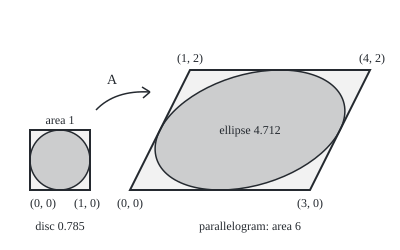
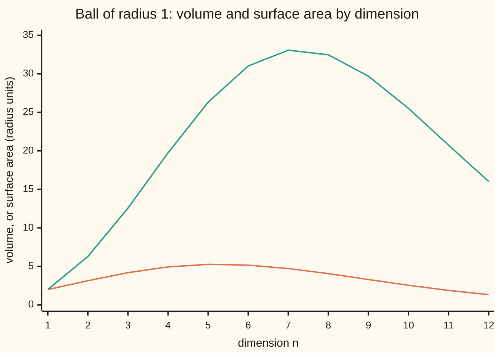

# Change of variables for Lebesgue measure: a linear map scales every volume by |det A|, a smooth map does so point by point, and polar coordinates follow

[Syllabus](../../../SYLLABUS.md) → [Measure and integration](../README.md) → [Product Measures and Fubini](../README.md#s06) → Change of variables for Lebesgue measure

---

## General Overview

A dart lands uniformly on a board 1 m by 1 m, at x metres across and y metres up: the chance of hitting a patch is its area. A disc of radius 0.5 m is painted in the middle, area π/4 = 0.785398 m², so the dart hits it with chance 0.785398. A camera records each landing point in skewed coordinates, through the matrix A = `[[3, 1], [0, 2]]`: the point (x, y) is recorded as (3x + y, 2y). The square becomes a parallelogram with corners (0, 0), (3, 0), (4, 2) and (1, 2), area 6 m². The disc becomes an ellipse of area 4.712389 m², which is 6 × 0.785398.

The factor 6 does not depend on the shape. Every Borel set (every set built from boxes by complements and countable unions) has its area multiplied by 6. The points of the board with an irrational x have area 1, and their image has area 6. The factor is the size of the determinant: 3 × 2 − 1 × 0 = 6 ([Determinants](../../03-Algebra/05-Solving%20Systems/04-determinants.md)).

The factor matters once the dart is random. The recorded point is spread evenly over the parallelogram at density 1/6 (chance per square metre), not 1. So it lands in the ellipse with chance 4.712389 / 6 = 0.785398, the same as the dart hitting the disc. A density of 1 would give the parallelogram total probability 6.

A curved map, such as polar coordinates, has no single factor. Near each point it acts like a matrix, its derivative, and it scales small pieces by that matrix's determinant. Polar coordinates in n dimensions then turn one known integral, the bell $`e^{-\lvert x\rvert^2}`$ over all of space, which is $`\pi^{n/2}`$, into the volume of the ball of radius 1. That volume is 4.1888 in three dimensions and 2.5502 in ten. The ten-dimensional ball fills only 0.249% of the cube that holds it.

**An invertible matrix A multiplies the Lebesgue measure of every Borel set by |det A|; a smooth one-to-one map multiplies it near each point by the determinant of its derivative there, so integrals move by that factor; and polar coordinates, with surface measure on the sphere, turn the Gaussian integral into the ball volumes π^(n/2)/Γ(n/2 + 1).**

**What kind of fact this is:** theorems, proved on this card in Why it works; surface measure on the sphere is a definition. The local estimate for smooth maps is quoted from [Change of variables in n dimensions, proved](../../06-Calculus%20and%20analysis/08-Multiple%20Integrals/08-change-of-variables-proved.md), which proves it for Jordan regions (bounded sets whose edge has volume zero) and continuous functions.

### The picture: one matrix, one factor

<p align="center"></p>

Drawn to scale, 60 drawing units per metre. Square and disc both grow by the same factor, 6.

---

## The formula

Notation first, in words. $`\lambda_n`$ (lambda n) is Lebesgue measure on $`\mathbb R^n`$, the space of lists of n real numbers: length when n = 1, area when n = 2, volume when n = 3. It is the product of n copies of length ([Product measure](02-product-measure.md)). $`A(E)`$ is the set of all points $`Ax`$ with $`x`$ in $`E`$. A **diffeomorphism** $`T`$ from an open set $`U`$ onto an open set $`V`$ is a one-to-one map onto $`V`$ with continuous partial derivatives, whose inverse also has them. $`DT(x)`$ is its **Jacobian matrix**, the n by n matrix of partial derivatives at $`x`$.

Linear maps, for every Borel set $`E`$ and every n by n matrix $`A`$:

```math
\lambda_n\big(A(E)\big) = \lvert \det A \rvert \, \lambda_n(E)
```

**Read it aloud:** the volume of the image of E equals the size of A's determinant times the volume of E.

Smooth maps, for every Borel function $`f \ge 0`$ on $`V`$, and for every integrable $`f`$:

```math
\int_V f(y)\,dy = \int_U f\big(T(x)\big)\,\lvert \det DT(x) \rvert\,dx
```

**Read it aloud:** to total f over the new places, total it over the old places, each weighted by the volume factor of the map there.

Polar coordinates write a nonzero point as $`x = r\omega`$: a distance $`r = \lvert x \rvert > 0`$ times a direction $`\omega`$ (omega) on the unit sphere $`S^{n-1}`$, the points at distance 1 from the origin. **Surface measure** $`\sigma`$ (sigma) gives a set of directions $`E`$ the size n times the volume of the cone $`\{r\omega : 0 < r \le 1,\ \omega \in E\}`$. Then, for every Borel $`f \ge 0`$ on $`\mathbb R^n`$:

```math
\int_{\mathbb R^n} f(x)\,dx = \int_0^\infty \int_{S^{n-1}} f(r\omega)\,d\sigma(\omega)\; r^{n-1}\,dr
```

**Read it aloud:** total f sphere by sphere: on the sphere of radius r, the directions carry r to the power n − 1 times their surface measure.

Put $`f(x) = e^{-\lvert x \rvert^2}`$, whose total is $`\pi^{n/2}`$. The gamma function $`\Gamma`$ (the factorial stretched to every positive number, $`\Gamma(k + 1) = k!`$; [The gamma function](../../07-Complex%20analysis/09-Special%20Functions%20and%20the%20Zeta%20Function/02-gamma-function.md)) gives the answers. $`B_n`$ is the ball of radius 1 and $`V_n`$ its volume:

```math
\sigma(S^{n-1}) = \frac{2\pi^{n/2}}{\Gamma(n/2)}, \qquad V_n = \lambda_n(B_n) = \frac{\sigma(S^{n-1})}{n} = \frac{\pi^{n/2}}{\Gamma(n/2 + 1)}
```

**Read it aloud:** the sphere's area is two times π to the n over 2, over gamma of n over 2; the ball's volume is that area over n.

So $`V_3 = 4\pi/3 = 4.188790`$ and $`V_{10} = \pi^5/5! = 2.550164`$.

| Symbol | Plain meaning | In our example | Push it up and the answer… |
| --- | --- | --- | --- |
| $`n`$, $`\mathbb R^n`$, $`\lambda_n`$ | number of coordinates; the space; Lebesgue measure on it | n = 2 for the board; 3 and 10 for balls | V_n rises to n = 5, then falls |
| $`E`$ | a Borel set, the set being measured | the board, the disc, the triangle below the diagonal | the image grows in proportion |
| $`A`$, $`\det A`$ | an n by n matrix; its determinant, the signed volume factor | `[[3, 1], [0, 2]]`; 6 | every image grows by the same factor |
| $`T`$, $`U`$, $`V`$ | a diffeomorphism; the open set it starts from; the open set it fills | polar coordinates on the plane | — |
| $`DT(x)`$, $`\lvert \det DT(x) \rvert`$ | the Jacobian matrix at x; the local volume factor | for polar in the plane: r | far points count more |
| $`f`$ | the function totalled | $`e^{-\lvert x \rvert^2}`$, the Gaussian bump | — |
| $`r`$, $`\omega`$, $`\theta`$ | distance from the origin; direction, a point of the unit sphere; the angle in the plane | r from 0 to ∞ | — |
| $`S^{n-1}`$, $`\sigma`$ | the unit sphere in R^n; surface measure on it | σ(S^2) = 4π = 12.566371 | — |
| $`B_n`$, $`V_n`$ | the ball of radius 1; its volume | V_3 = 4.188790, V_10 = 2.550164 | — |
| $`\Gamma`$ | the gamma function, $`\Gamma(s) = \int_0^\infty t^{s-1} e^{-t}\,dt`$ | Γ(5/2) = 1.329340, Γ(6) = 120 | the ball volume falls |
| $`\mu`$, $`c`$, $`\mathbf 1_E`$ | a second measure, compared with volume (in Step 1, one that ignores sliding); its value on the unit cube; 1 on E, 0 off it | μ(E) = λ_2(A(E)), with c = 6 | a bigger c, a bigger multiple of volume |
| $`x`$, $`y`$, $`v`$, and in the proofs $`a`$, $`b`$, $`k`$, $`m`$, $`j`$, $`Q`$, $`Q_m`$, $`K`$, $`d`$, $`t`$, $`D`$, $`P`$, $`H`$, $`I`$, $`u`$, $`C(E)`$, $`\rho`$, $`\Phi`$, $`s_k`$, $`f^\pm`$, $`\mathcal P`$ | old and new places; a slide; in the proofs, each defined where it appears | — | — |

### When it holds

- **E is a Borel set (or Lebesgue measurable).** For invertible A, A(E) is then Borel (or Lebesgue measurable) too. Every set used on this card is Borel; the Vitali set is not, and no volume rule applies to it ([Translation invariance and the Vitali set](../02-Length%20Done%20Properly/04-translation-invariance-and-the-vitali-set.md)).
- **The size of the determinant, not its sign.** The matrix `[[1, 3], [2, 0]]` has determinant −6 and still multiplies areas by 6. A negative determinant records a mirror flip; a measure is never negative.
- **A singular matrix gives zero.** If det A = 0, the image, Borel or not, lies in a flat subspace of volume 0, and the formula reads 0 = 0 × λ_n(E).
- **T one-to-one.** Run the polar angle twice round and each point is counted twice: 3.971731 instead of 1.985865 for the bump on the unit disc.
- **Edges of volume zero may be dropped.** Polar coordinates fail to be one-to-one only at the origin and along one ray. Those sets have volume 0, so the formula holds on all of R^n.

---

## Why it works

### Step 0: a measure that ignores sliding is fixed by one number

Slide a set E by a vector v, then apply A. The result is A(E) slid by Av. So the rule "E goes to the volume of A(E)" ignores sliding, just as volume does. A measure that ignores sliding, and gives the unit cube a finite size c, is c times volume. What is left is to find c: it is |det A|.

### Step 1: a slide-proof measure is a multiple of volume

Let $`\mu`$ be a Borel measure on $`\mathbb R^n`$ that ignores sliding, with $`\mu([0, 1)^n) = c`$ finite. Cut the unit cube into $`2^{kn}`$ cubes of side $`2^{-k}`$, for each whole number k: the **dyadic cubes**. They are slides of each other, so each has size $`c \cdot 2^{-kn}`$, which is c times its volume. So $`\mu`$ and $`c\,\lambda_n`$ agree on every dyadic cube.

Two dyadic cubes overlap in a dyadic cube or not at all, so they form a pi-system (a family closed under overlap). They generate the Borel sets. Inside each unit cube both measures are finite with the same total. By Dynkin's theorem ([Pi-systems and Dynkin's theorem](../01-Sets%20You%20Can%20Measure/06-pi-systems-and-uniqueness.md)) they agree on every Borel set there, and so everywhere. For $`\mu(E) = \lambda_n(A(E))`$ this gives a constant $`c(A)`$ with $`\lambda_n(A(E)) = c(A)\,\lambda_n(E)`$.

### Step 2: the constant is the determinant

Applying A then B gives $`c(BA) = c(B)\,c(A)`$, and determinants multiply the same way. Every invertible matrix is a product of three kinds of simple steps (row operations, [Determinants](../../03-Algebra/05-Solving%20Systems/04-determinants.md)), so it is enough to check each kind on the unit cube:

- **Stretch one coordinate by d.** The cube becomes a box of volume |d|, and the determinant is d.
- **Swap two coordinates.** The cube goes to itself: factor 1, determinant −1.
- **Shear: add a multiple of one coordinate to another.** Each line section of the cube is only slid along, so its length is unchanged. Integrating the section lengths ([Tonelli and Fubini](03-tonelli-and-fubini.md)) gives volume 1, and the determinant is 1.

Our A is a stretch by 3 across and 2 up, then the shear that adds half the new second coordinate to the first: `[[1, 0.5], [0, 1]]` times `[[3, 0], [0, 2]]` is `[[3, 1], [0, 2]]`. The factors are 3 × 2 × 1 = 6.

The code checks this on three sets by counting grid points spaced 1/400 m, on the board and on the box (0, 0) to (4, 2) around the parallelogram. A point y lies in A(E) exactly when $`A^{-1}y`$ lies in E, so the count needs no picture of the image.

| Set E | Area of E | Grid count of A(E) | 6 × area of E |
| --- | --- | --- | --- |
| the board | 1 | 6.000000 | 6 |
| the disc | 0.785398 | 4.712487 | 4.712389 |
| the triangle below the diagonal | 0.5 | 3.000000 | 3 |

### Step 3: smooth maps act like their Jacobian matrix on small pieces

Near a point x, a diffeomorphism T is close to the linear map DT(x). So a tiny box near x goes to a near-parallelogram of volume about $`\lvert \det DT(x) \rvert`$ times its own. [Change of variables in n dimensions, proved](../../06-Calculus%20and%20analysis/08-Multiple%20Integrals/08-change-of-variables-proved.md) turns this into an exact statement for Jordan regions and continuous functions, with Riemann integrals, which equal Lebesgue integrals there ([Riemann meets Lebesgue](../04-The%20Lebesgue%20Integral/05-riemann-meets-lebesgue.md), run on boxes). This step extends it to every Borel set, with the uniqueness tool of Step 1.

For Borel sets $`E`$ inside V, compare two measures: plain volume $`\lambda_n(E)`$, and $`\mu(E) = \int_U \mathbf 1_E(T(x))\,\lvert \det DT(x) \rvert\,dx`$. Here $`\mathbf 1_E`$ is 1 on E and 0 off it. The Riemann card shows they agree on every box whose closure lies in V. Those boxes form a pi-system that generates the Borel sets of V, and V is a countable union of them. So the two measures agree on every Borel set. Simple functions (finite sums of constants times sets) and monotone convergence (the integral of an increasing limit is the limit of the integrals) then carry the rule from sets to functions.

On the plane, polar coordinates are the map $`T(r, \theta) = (r\cos\theta, r\sin\theta)`$, with $`\det DT = r\cos^2\theta + r\sin^2\theta = r`$. The bump $`e^{-(x^2+y^2)}`$ on the unit disc then totals

```math
\int_0^{2\pi}\!\!\int_0^1 e^{-r^2}\, r\,dr\,d\theta = 2\pi \cdot \frac{1 - e^{-1}}{2} = \pi(1 - e^{-1}) = 1.985865 .
```

Slicing the disc in plain x and y, with no polar coordinates, gives 1.985865 too.

### Step 4: surface measure, and polar coordinates in n dimensions

Take a shell piece: the points $`r\omega`$ with $`a < r \le b`$ and $`\omega`$ in a set of directions E. It is the cone over E scaled by b, minus the cone scaled by a. Scaling by b is the matrix b times the identity, with determinant $`b^n`$. So Step 2 gives its volume:

```math
(b^n - a^n)\,\lambda_n(\text{cone}) = \frac{b^n - a^n}{n}\,\sigma(E) = \sigma(E)\int_a^b r^{n-1}\,dr .
```

That is exactly what the polar formula says for this shell piece. Shell pieces overlap in shell pieces, so they form a pi-system, and they generate the Borel sets of $`\mathbb R^n`$ minus the origin. So the polar formula holds for every Borel set, and then for every $`f \ge 0`$, as in Step 3. A rotation is a matrix with determinant ±1, so it keeps volumes and cones, and σ is the same in every direction.

### Step 5: the Gaussian gives the ball

The Gaussian integral is $`\int e^{-x^2}\,dx = \sqrt\pi = 1.772453851`$ ([The Gaussian integral](../../06-Calculus%20and%20analysis/08-Multiple%20Integrals/04-gaussian-integral.md)). In R^n, $`e^{-\lvert x \rvert^2}`$ is a product of n such factors, so Tonelli gives $`\pi^{n/2}`$. Polar coordinates give the same integral as sphere area times a radial integral:

```math
\pi^{n/2} = \sigma(S^{n-1}) \int_0^\infty e^{-r^2}\, r^{n-1}\,dr = \sigma(S^{n-1})\,\frac{\Gamma(n/2)}{2} .
```

The last step puts $`t = r^2`$, which turns the radial integral into half of Euler's integral for $`\Gamma(n/2)`$. Solve for σ, and divide by n for the ball (the whole sphere's cone is the ball):

| n | Gaussian over R^n | radial integral Γ(n/2)/2 | sphere area σ | ball volume V_n |
| --- | --- | --- | --- | --- |
| 2 | 3.141593 | 0.500000 | 6.283185 | 3.141593 |
| 3 | 5.568328 | 0.443113 | 12.566371 | **4.188790** |
| 10 | 306.019685 | 12.000000 | 25.501640 | **2.550164** |



Caption: the orange line is the ball volume V_n, the green line the sphere's area n V_n, both from the slicing road in the code, which never uses Γ or polar coordinates. Volume peaks at n = 5 and area at n = 7. Then both fall: $`\pi^{n/2}`$ multiplies in a fixed number, √π = 1.772454, once per dimension, but $`\Gamma(n/2 + 1)`$ grows like a factorial.

<details>
<summary>Detailed proof: linear maps, smooth maps and polar coordinates</summary>

**Claim 1: slide-proof measures.** Let $`\mu`$ be a Borel measure on $`\mathbb R^n`$ with $`\mu(E + v) = \mu(E)`$ for every Borel E and vector v, and $`c = \mu([0,1)^n) < \infty`$. For $`k \ge 0`$, $`[0,1)^n`$ is the disjoint union of $`2^{kn}`$ slides of $`[0, 2^{-k})^n`$, so $`\mu([0, 2^{-k})^n) = c\,2^{-kn} = c\,\lambda_n([0, 2^{-k})^n)`$. Every dyadic cube (a product of intervals $`[j 2^{-k}, (j+1) 2^{-k})`$, with a whole number j for each coordinate and one common k) is a slide of $`[0, 2^{-k})^n`$, so $`\mu = c\,\lambda_n`$ on dyadic cubes. Two dyadic cubes are nested or disjoint, so the dyadic cubes, with the empty set, form a pi-system $`\mathcal P`$. Every open set is a countable union of dyadic cubes, so $`\sigma(\mathcal P)`$ is the Borel sigma-algebra. Fix a unit cube $`Q_m = m + [0,1)^n`$ with m a list of whole numbers. On the Borel subsets of $`Q_m`$, $`\mu`$ and $`c\,\lambda_n`$ are finite measures with the same total c, agreeing on the dyadic cubes inside $`Q_m`$, a pi-system generating those subsets. Dynkin's theorem gives agreement on all Borel subsets of $`Q_m`$. The $`Q_m`$ partition $`\mathbb R^n`$ into countably many pieces, so $`\mu(E) = \sum_m \mu(E \cap Q_m) = c\,\lambda_n(E)`$.

**Claim 2: linear maps.** Let A be invertible. $`A(E) = (A^{-1})^{-1}(E)`$ is Borel because $`A^{-1}`$ is continuous. $`\mu_A(E) = \lambda_n(A(E))`$ is a measure (A is one-to-one, so it keeps disjoint unions disjoint), slide-proof since $`A(E + v) = A(E) + Av`$, and finite on the unit cube, whose image is bounded. By Claim 1, $`\lambda_n(A(E)) = c(A)\,\lambda_n(E)`$, and $`c(BA) = c(B)\,c(A)`$. A stretch $`D`$ of one coordinate by $`d \ne 0`$ makes the cube a box of volume |d|; a swap P maps the cube to itself. For a shear $`H`$ adding $`t`$ times coordinate j to coordinate i, fix every coordinate but the i-th: the section of $`H([0,1)^n)`$ is the section of the cube slid by $`t x_j`$, of length 1; Tonelli gives volume 1. Row reduction writes A as a product of such steps, and the determinant of each step is d, −1 or 1, multiplying to det A. So $`c(A) = \lvert \det A \rvert`$. If det A = 0, A maps into a flat subspace, which a rotation carries into $`\{x_n = 0\}`$, of volume 0.

**Claim 3: smooth maps.** Let $`T : U \to V`$ be a diffeomorphism of open sets. For Borel $`E \subset V`$ set $`\mu(E) = \int_U \mathbf 1_E(T(x))\,\lvert \det DT(x) \rvert\,dx`$; monotone convergence makes $`\mu`$ a measure. Let $`\mathcal P_V`$ be the half-open boxes whose closure lies in V, with the empty set: a pi-system, generating the Borel sets of V, with V a countable disjoint union of dyadic cubes in $`\mathcal P_V`$. For $`Q \in \mathcal P_V`$, $`K = T^{-1}(\overline Q)`$ is compact, and its edge is the image under the $`C^1`$ map $`T^{-1}`$ of the edge of Q, a set of zero content, so K is a Jordan region. The Riemann theorem with f = 1 gives $`\lambda_n(\overline Q) = \int_K \lvert \det DT \rvert`$. The edge of Q has $`\lambda_n`$ zero, and $`\mu`$ zero too, since its preimage has zero content; so $`\mu(Q) = \lambda_n(Q)`$, finite. Each member of $`\mathcal P_V`$ is finite for both measures, so the argument of Claim 1, run on that partition of V, gives $`\mu = \lambda_n`$ on the Borel sets of V. For a simple $`f \ge 0`$ the formula follows by linearity, for Borel $`f \ge 0`$ by simple $`s_k \uparrow f`$ and monotone convergence on both sides, and for integrable f by splitting $`f = f^+ - f^-`$.

**Claim 4: polar coordinates.** Let $`\Phi(x) = (\lvert x \rvert, x/\lvert x \rvert)`$, a continuous bijection from $`\mathbb R^n \setminus \{0\}`$ onto $`(0, \infty) \times S^{n-1}`$ with continuous inverse $`(r, \omega) \mapsto r\omega`$. For Borel $`E \subset S^{n-1}`$ let $`C(E) = \{r\omega : 0 < r \le 1, \omega \in E\}`$, a Borel set, and $`\sigma(E) = n\,\lambda_n(C(E))`$; C keeps disjoint unions disjoint, so $`\sigma`$ is a measure. Let $`\rho(dr) = r^{n-1}\,dr`$ on $`(0, \infty)`$. For $`0 < a < b`$, $`\Phi^{-1}((a, b] \times E) = bC(E) \setminus aC(E)`$, so by Claim 2 with $`A = bI`$ and $`A = aI`$,

$`\displaystyle \lambda_n\big(\Phi^{-1}((a, b] \times E)\big) = (b^n - a^n)\,\lambda_n(C(E)) = \rho((a, b])\,\sigma(E) .`$

The sets $`(a, b] \times E`$ form a pi-system generating the product sigma-algebra, which is the Borel sigma-algebra of $`(0, \infty) \times S^{n-1}`$ by the countable-box argument of [Product sigma-algebras](01-product-sigma-algebras.md): both factors have countable bases, so every open set of the product is a countable union of open boxes. The pieces $`(k, k+1] \times S^{n-1}`$ are countably many and finite for both measures. So the image of $`\lambda_n`$ under $`\Phi`$ equals $`\rho \times \sigma`$ ([Product measure](02-product-measure.md)), and Tonelli gives $`\int f\,d\lambda_n = \int_0^\infty \int_{S^{n-1}} f(r\omega)\,d\sigma(\omega)\,r^{n-1}\,dr`$ for Borel $`f \ge 0`$; the origin has volume 0.

**Claim 5: sphere and ball.** Step 5's computation needs two more details. The open ball differs from $`C(S^{n-1})`$ by the origin and the sphere, of volume 0, so $`V_n = \sigma(S^{n-1})/n`$. And $`(n/2)\,\Gamma(n/2) = \Gamma(n/2 + 1)`$, so $`V_n = \pi^{n/2}/\Gamma(n/2 + 1)`$.

</details>

The code checks finitely many cases; the proof covers every Borel set and every diffeomorphism.

---

## Worked numbers, by hand

| Step | Arithmetic | Value |
| --- | --- | --- |
| determinant of A | 3 × 2 − 1 × 0 | 6 |
| image of the board | corners (0, 0), (3, 0), (4, 2), (1, 2); base 3, height 2 | 6 m² |
| image of the disc | 6 × π/4 | 4.712389 m² |
| density of the recorded point | 1 / det A | 1/6 per m² |
| P(recorded point in the ellipse) | 4.712389 × 1/6 | 0.785398 = P(dart in disc) |
| bump on the unit disc, polar | π(1 − e^(−1)) | 1.985865 |
| Gaussian over R^3 | 1.772454^3 | 5.568328 |
| radial integral, n = 3 | Γ(3/2)/2 = (√π/2)/2 | 0.443113 |
| sphere area, n = 3 | 5.568328 / 0.443113 | 12.566371 = 4π |
| ball volume, n = 3 | 12.566371 / 3 | **4.188790** |
| ball volume, n = 10 | π^5 / Γ(6) = 306.019685 / 120 | **2.550164** |
| share of the cube [−1, 1]^10 | 2.550164 / 2^10 | 0.00249 |

The ball fills 52.36% of its cube in three dimensions and 0.249% in ten: in high dimensions a cube's volume sits in its corners.

### What breaks if you drop a piece

| Mistake | Comes out at | What went wrong |
| --- | --- | --- |
| Use the signed determinant of `[[1, 3], [2, 0]]` as the area factor | −6 | the sign only records a mirror flip; the factor is the size, 6 |
| Put the factor on the wrong side: ellipse area = disc area / 6 | 0.130900, not 4.712389 | the factor multiplies the old coordinates' volume; dividing is the inverse map's rule |
| Polar in the plane without the factor r | 4.692434, not 1.985865 | thin wedges near the centre are counted as wide as far ones |
| R^3 polar without r^(n−1) | 11.136656, not 5.568328 | the sphere of radius r has area r^2 times the unit sphere's |
| Take the sphere's area as the ball's volume | 12.566371, not 4.188790 | the ball is the cone over the sphere: divide by n |

---

## Code, from first principles, and it actually runs

The code takes independent roads to each answer. For the matrix: the determinant formula, the shoelace area of the image's corners, the stretch-and-shear factorisation, and exact whole-number grid counts of three sets before and after. The same grid checks the camera's density 1/6. For the smooth map: polar coordinates against slicing the disc in plain x and y. For the balls: road one is the Gaussian in polar form, divided by a radial integral summed by the midpoint rule. Road two slices each ball into balls one dimension lower (Fubini), with no Γ and no polar coordinates. Road three throws 200,000 points into a cube with a SplitMix64 random-number generator, seed 2026. The gamma function is built by hand from Γ(1) = 1, Γ(1/2) = √π and Γ(s + 1) = sΓ(s); nothing imported holds it.

### Python

```python
# Change of variables for Lebesgue measure -- the check behind the card.  Standard library only.
# A = [[3, 1], [0, 2]] multiplies every area by |det A| = 6: checked by the determinant, the
# corners of the image, a stretch-then-shear factorisation and exact grid counts on three sets.
# Polar coordinates: the Gaussian over the plane and over R^n, ball volumes by three roads.
from fractions import Fraction as Fr
from math import cos, exp, pi, sin, sqrt

A = ((3, 1), (0, 2))
det = A[0][0] * A[1][1] - A[0][1] * A[1][0]
corners = [(0, 0), (1, 0), (1, 1), (0, 1)]
img = [(A[0][0] * x + A[0][1] * y, A[1][0] * x + A[1][1] * y) for x, y in corners]
shoelace = sum(img[k][0] * img[(k + 1) % 4][1] - img[(k + 1) % 4][0] * img[k][1] for k in range(4)) / 2
print(f"det A = 3 x 2 - 1 x 0 = {det}; image of the unit square has corners {img}, shoelace area {shoelace:g}")
S, H = ((3, 0), (0, 2)), ((1, Fr(1, 2)), (0, 1))                 # stretch by 3 and 2, then shear: first += second / 2
HS = [[sum(H[i][k] * S[k][j] for k in range(2)) for j in range(2)] for i in range(2)]
factors = (S[0][0], S[1][1], H[0][0] * H[1][1] - H[0][1] * H[1][0])  # the two stretches, and the shear's determinant
print(f"factorisation: shear [[1, 0.5], [0, 1]] after stretch [[3, 0], [0, 2]] = [[{'], ['.join(', '.join(str(v) for v in row) for row in HS)}]]; factors {' x '.join(str(f) for f in factors)} = {factors[0] * factors[1] * factors[2]}")

# Grid counts.  Points at odd multiples of 1/800 m (a 1/400 m grid, midpoints).  A point y lies in
# A(E) exactly when A^{-1} y = ((2 y1 - y2)/6, y2/2) lies in E; every test is in whole numbers.
def in_E(name, U, V, s):                    # u = U/(2s), v = V/(2s); s = 2400 below, or 400 for E itself
    if name == "square":
        return 0 <= U < 2 * s and 0 <= V < 2 * s
    if name == "disc":                      # centre (0.5, 0.5) m, radius 0.5 m
        return (U - s) ** 2 + (V - s) ** 2 < s * s
    return 0 <= V < U < 2 * s               # triangle: below the diagonal y < x
names, exact = ("square", "disc", "triangle"), (1.0, pi / 4, 0.5)
before = {n: sum(in_E(n, 2 * a + 1, 2 * b + 1, 400) for a in range(400) for b in range(400)) for n in names}
after = dict.fromkeys(names, 0)
for i in range(1600):
    Y1 = 2 * i + 1
    for j in range(800):
        Y2 = 2 * j + 1
        U, V = 2 * Y1 - Y2, 3 * Y2          # A^{-1} y in units of 1/4800 m
        for n in names:
            after[n] += in_E(n, U, V, 2400)
print("set E | exact m(E) | grid m(E) | grid m(AE) | 6 m(E) | grid m(AE) / exact m(E)")
ratios = []
for n, e in zip(names, exact):
    mb, ma = before[n] / 400 ** 2, after[n] / 400 ** 2
    ratios.append(ma / e)
    print(f"{n} | {e:.6f} | {mb:.6f} | {ma:.6f} | {6 * e:.6f} | {ma / e:.4f}")
dens = Fr(1, abs(det))                      # the dart lands uniformly; a camera records A x, spread at density 1/|det A|
p_ell, p_grid = abs(det) * pi / 4 * dens, after["disc"] / 400 ** 2 * dens
print(f"camera records (3x + y, 2y): density {dens} per m^2 on the parallelogram; P(recorded point in ellipse) = "
      f"{abs(det) * pi / 4:.6f} x {dens} = {p_ell:.6f} (grid {p_grid:.6f}); P(dart in disc) = {pi / 4:.6f}")
print(f"break, density 1 instead of {dens}: total probability over the parallelogram = {after['square'] / 400 ** 2:.0f}, not 1")

def midpoint(f, a, b, steps):
    h = (b - a) / steps
    return h * sum(f(a + (k + 0.5) * h) for k in range(steps))

# A smooth map: polar coordinates on the plane, |det DT(r, t)| = r.  The Gaussian bump on the unit disc;
# the Cartesian road slices at x = sin p, so the slice half-width is cos p.
polar = 2 * pi * midpoint(lambda r: exp(-r * r) * r, 0.0, 1.0, 10000)
cart = midpoint(lambda p: exp(-sin(p) ** 2) * cos(p) * 2 * midpoint(lambda y: exp(-y * y), 0.0, cos(p), 1000), -pi / 2, pi / 2, 1000)
print(f"unit disc, e^(-|x|^2): polar {polar:.6f}; Cartesian slices {cart:.6f}; pi(1 - 1/e) = {pi * (1 - exp(-1)):.6f}")
no_r = 2 * pi * midpoint(lambda r: exp(-r * r), 0.0, 1.0, 10000)
print(f"break, polar without the factor r: {no_r:.6f}; angle run twice round: {2 * polar:.6f}")
print(f"break, signed det of [[1, 3], [2, 0]] (A's columns swapped): {1 * 0 - 3 * 2}; area is |-6| = 6")
print(f"break, factor on the wrong side: ellipse area as disc area / 6 = {pi / 4 / 6:.6f}, not {6 * pi / 4:.6f}")

# Polar coordinates in R^n.  Road 1: the Gaussian integral and its product over n coordinates (Tonelli).
root_pi = midpoint(lambda x: exp(-x * x), -10.0, 10.0, 20000)
print(f"integral of e^(-x^2) over the line = {root_pi:.9f}; sqrt(pi) = {sqrt(pi):.9f}")
def gamma_half(m):                          # Gamma(m/2) from Gamma(1) = 1, Gamma(1/2) = root_pi, Gamma(s+1) = s Gamma(s)
    g, s = (1.0, 1.0) if m % 2 == 0 else (root_pi, 0.5)
    while s < m / 2 - 1e-9:
        g, s = g * s, s + 1
    return g
radial = {n: midpoint(lambda r: exp(-r * r) * r ** (n - 1), 0.0, 12.0, 120000) for n in (2, 3, 10)}
print("n | Gaussian over R^n | radial integral | Gamma(n/2)/2 | sphere area | ball volume | pi^(n/2)/Gamma(n/2+1)")
by_polar = {}
for n in (2, 3, 10):
    gauss = root_pi ** n
    sphere = gauss / radial[n]              # polar: integral = sphere area x radial integral
    by_polar[n] = sphere / n
    print(f"{n} | {gauss:.6f} | {radial[n]:.6f} | {gamma_half(n) / 2:.6f} | {sphere:.6f} | {sphere / n:.6f} | "
          f"{root_pi ** n / gamma_half(n + 2):.6f}")
print(f"Gamma(5/2) = {gamma_half(5):.6f}; Gamma(6) = {gamma_half(12):.0f}")
# Road 2: slicing (Fubini), no Gamma and no polar: V_n = V_(n-1) x integral of (1 - t^2)^((n-1)/2) over [-1, 1].
slab, V = [], 2.0
for n in range(1, 13):
    if n > 1:
        V *= midpoint(lambda t: (1 - t * t) ** ((n - 1) / 2), -1.0, 1.0, 200000)
    slab.append(V)
print("chart, n = 1 to 12, ball volume by slicing: " + ", ".join(f"{v:.4f}" for v in slab))
print("chart, n = 1 to 12, sphere area n V_n: " + ", ".join(f"{(k + 1) * v:.4f}" for k, v in enumerate(slab)))
print(f"share of the cube [-1, 1]^n filled by the ball: n = 3 {slab[2] / 8:.4f}, n = 10 {slab[9] / 2 ** 10:.5f}")
print(f"break, R^3 without r^(n-1): sphere area x half-line integral = {4 * pi * root_pi / 2:.6f}, "
      f"not {root_pi ** 3:.6f}; sphere area 4 pi = {4 * pi:.6f} taken as the volume")

state, N, hits = 2026, 200000, 0            # Road 3: SplitMix64 darts in the cube [-1, 1]^3
def uniform():
    global state
    state = (state + 0x9E3779B97F4A7C15) % 2 ** 64
    z = ((state ^ (state >> 30)) * 0xBF58476D1CE4E5B9) % 2 ** 64
    z = ((z ^ (z >> 27)) * 0x94D049BB133111EB) % 2 ** 64
    return ((z ^ (z >> 31)) >> 11) / 2 ** 53
for _ in range(N):
    x, y, z = 2 * uniform() - 1, 2 * uniform() - 1, 2 * uniform() - 1
    hits += x * x + y * y + z * z < 1
mc = 8 * hits / N
se = 8 * sqrt(slab[2] / 8 * (1 - slab[2] / 8) / N)
print(f"simulation, {N} points in [-1, 1]^3: {hits} inside, volume {mc:.4f}, standard error {se:.4f}")
print(f"figure, 60 px per m; square (30, 190) to (90, 130); parallelogram " +
      ", ".join(f"({130 + 60 * x}, {190 - 60 * y})" for x, y in img) + f"; ellipse centre ({130 + 60 * 2}, {190 - 60 * 1})")

assert det == 6 and abs(shoelace) == det                           # determinant against the corners
assert HS == [[3, 1], [0, 2]]                                       # the factorisation really gives A
assert factors[0] * factors[1] * factors[2] == det                  # the step factors multiply to det A
assert all(abs(r - 6) < 0.01 for r in ratios)                       # grid counts against |det A|
assert abs(after["disc"] / 400 ** 2 - 6 * pi / 4) < 0.005
assert after["square"] * dens == 400 ** 2                           # the recorded point's density totals 1
assert abs(p_grid - pi / 4) < 0.001                                 # P(ellipse) on the camera's grid = P(dart in disc)
assert abs(polar - cart) < 1e-5 and abs(polar - pi * (1 - exp(-1))) < 1e-6   # polar against Cartesian slices
assert abs(root_pi - sqrt(pi)) < 1e-12
assert all(abs(radial[n] - gamma_half(n) / 2) < 1e-9 for n in (2, 3, 10))
assert all(abs(by_polar[n] - slab[n - 1]) < 1e-6 for n in (2, 3, 10))   # polar road against slicing road
assert abs(slab[2] - 4 * pi / 3) < 1e-6 and abs(slab[9] - pi ** 5 / 120) < 1e-6
assert abs(mc - slab[2]) < 4 * se                                   # simulation against slicing
print("ALL CHECKS PASS")
```

**Ran 2026-11-23 on macOS, Python 3.14.10, standard library only. All checks passed. Output, pasted from the run:**

```
det A = 3 x 2 - 1 x 0 = 6; image of the unit square has corners [(0, 0), (3, 0), (4, 2), (1, 2)], shoelace area 6
factorisation: shear [[1, 0.5], [0, 1]] after stretch [[3, 0], [0, 2]] = [[3, 1], [0, 2]]; factors 3 x 2 x 1 = 6
set E | exact m(E) | grid m(E) | grid m(AE) | 6 m(E) | grid m(AE) / exact m(E)
square | 1.000000 | 1.000000 | 6.000000 | 6.000000 | 6.0000
disc | 0.785398 | 0.785475 | 4.712487 | 4.712389 | 6.0001
triangle | 0.500000 | 0.498750 | 3.000000 | 3.000000 | 6.0000
camera records (3x + y, 2y): density 1/6 per m^2 on the parallelogram; P(recorded point in ellipse) = 4.712389 x 1/6 = 0.785398 (grid 0.785415); P(dart in disc) = 0.785398
break, density 1 instead of 1/6: total probability over the parallelogram = 6, not 1
unit disc, e^(-|x|^2): polar 1.985865; Cartesian slices 1.985865; pi(1 - 1/e) = 1.985865
break, polar without the factor r: 4.692434; angle run twice round: 3.971731
break, signed det of [[1, 3], [2, 0]] (A's columns swapped): -6; area is |-6| = 6
break, factor on the wrong side: ellipse area as disc area / 6 = 0.130900, not 4.712389
integral of e^(-x^2) over the line = 1.772453851; sqrt(pi) = 1.772453851
n | Gaussian over R^n | radial integral | Gamma(n/2)/2 | sphere area | ball volume | pi^(n/2)/Gamma(n/2+1)
2 | 3.141593 | 0.500000 | 0.500000 | 6.283185 | 3.141593 | 3.141593
3 | 5.568328 | 0.443113 | 0.443113 | 12.566371 | 4.188790 | 4.188790
10 | 306.019685 | 12.000000 | 12.000000 | 25.501640 | 2.550164 | 2.550164
Gamma(5/2) = 1.329340; Gamma(6) = 120
chart, n = 1 to 12, ball volume by slicing: 2.0000, 3.1416, 4.1888, 4.9348, 5.2638, 5.1677, 4.7248, 4.0587, 3.2985, 2.5502, 1.8841, 1.3353
chart, n = 1 to 12, sphere area n V_n: 2.0000, 6.2832, 12.5664, 19.7392, 26.3189, 31.0063, 33.0734, 32.4697, 29.6866, 25.5016, 20.7251, 16.0232
share of the cube [-1, 1]^n filled by the ball: n = 3 0.5236, n = 10 0.00249
break, R^3 without r^(n-1): sphere area x half-line integral = 11.136656, not 5.568328; sphere area 4 pi = 12.566371 taken as the volume
simulation, 200000 points in [-1, 1]^3: 104940 inside, volume 4.1976, standard error 0.0089
figure, 60 px per m; square (30, 190) to (90, 130); parallelogram (130, 190), (310, 190), (370, 70), (190, 70); ellipse centre (250, 130)
ALL CHECKS PASS
```

### Rust

Same numbers, same labels; the float sums run in the same order.

```rust
// Change of variables for Lebesgue measure -- the same check as the Python, in Rust.  No crates.
// A = [[3, 1], [0, 2]] multiplies every area by |det A| = 6: checked by the determinant, the
// corners of the image, a stretch-then-shear factorisation and exact grid counts on three sets.
// Polar coordinates: the Gaussian over the plane and over R^n, ball volumes by three roads.
use std::f64::consts::PI;

fn in_e(name: &str, u: i64, v: i64, s: i64) -> bool {   // the point (u/(2s), v/(2s)); s = 2400, or 400 for E itself
    match name {
        "square" => 0 <= u && u < 2 * s && 0 <= v && v < 2 * s,
        "disc" => (u - s) * (u - s) + (v - s) * (v - s) < s * s,   // centre (0.5, 0.5) m, radius 0.5 m
        _ => 0 <= v && v < u && u < 2 * s,                          // triangle below the diagonal y < x
    }
}
fn midpoint(f: &dyn Fn(f64) -> f64, a: f64, b: f64, steps: usize) -> f64 {
    let h = (b - a) / steps as f64;
    h * (0..steps).fold(0.0, |s, k| s + f(a + (k as f64 + 0.5) * h))
}
fn gamma_half(m: u32, root_pi: f64) -> f64 {           // Gamma(m/2) from Gamma(1), Gamma(1/2) and the recurrence
    let (mut g, mut s) = if m % 2 == 0 { (1.0, 1.0) } else { (root_pi, 0.5) };
    while s < m as f64 / 2.0 - 1e-9 { g *= s; s += 1.0; }
    g
}
struct Rng(u64);                                       // SplitMix64
impl Rng {
    fn uniform(&mut self) -> f64 {
        self.0 = self.0.wrapping_add(0x9E3779B97F4A7C15);
        let mut z = (self.0 ^ (self.0 >> 30)).wrapping_mul(0xBF58476D1CE4E5B9);
        z = (z ^ (z >> 27)).wrapping_mul(0x94D049BB133111EB);
        ((z ^ (z >> 31)) >> 11) as f64 / 9007199254740992.0
    }
}
fn join(v: &[f64], d: usize) -> String { v.iter().map(|x| format!("{:.*}", d, x)).collect::<Vec<_>>().join(", ") }

fn main() {
    let a = [[3i64, 1], [0, 2]];
    let det = a[0][0] * a[1][1] - a[0][1] * a[1][0];
    let img: Vec<(i64, i64)> = [(0, 0), (1, 0), (1, 1), (0, 1)].iter()
        .map(|&(x, y)| (a[0][0] * x + a[0][1] * y, a[1][0] * x + a[1][1] * y)).collect();
    let shoelace = (0..4).map(|k| img[k].0 * img[(k + 1) % 4].1 - img[(k + 1) % 4].0 * img[k].1).sum::<i64>() / 2;
    println!("det A = 3 x 2 - 1 x 0 = {}; image of the unit square has corners [{}], shoelace area {}", det,
             img.iter().map(|p| format!("({}, {})", p.0, p.1)).collect::<Vec<_>>().join(", "), shoelace);
    // stretch by 3 and 2, then shear: first += second / 2; entries kept as halves (numerator over 2)
    let (s, h) = ([[6i64, 0], [0, 4]], [[2i64, 1], [0, 2]]);
    let hs: Vec<Vec<i64>> = (0..2).map(|i| (0..2).map(|j| (0..2).map(|k| h[i][k] * s[k][j]).sum::<i64>() / 4).collect()).collect();
    let factors = [s[0][0] / 2, s[1][1] / 2, (h[0][0] * h[1][1] - h[0][1] * h[1][0]) / 4];   // the two stretches, and the shear's determinant
    println!("factorisation: shear [[1, 0.5], [0, 1]] after stretch [[3, 0], [0, 2]] = [[{}, {}], [{}, {}]]; factors {} x {} x {} = {}",
             hs[0][0], hs[0][1], hs[1][0], hs[1][1], factors[0], factors[1], factors[2], factors.iter().product::<i64>());

    let names = ["square", "disc", "triangle"];
    let exact = [1.0, PI / 4.0, 0.5];
    let mut before = [0i64; 3];
    let mut after = [0i64; 3];
    for (t, n) in names.iter().enumerate() {
        for p in 0..400 { for q in 0..400 { if in_e(n, 2 * p + 1, 2 * q + 1, 400) { before[t] += 1; } } }
    }
    for i in 0..1600i64 {
        let y1 = 2 * i + 1;
        for j in 0..800i64 {
            let y2 = 2 * j + 1;
            let (u, v) = (2 * y1 - y2, 3 * y2);              // A^{-1} y in units of 1/4800 m
            for (t, n) in names.iter().enumerate() { if in_e(n, u, v, 2400) { after[t] += 1; } }
        }
    }
    println!("set E | exact m(E) | grid m(E) | grid m(AE) | 6 m(E) | grid m(AE) / exact m(E)");
    let mut ratios = Vec::new();
    for t in 0..3 {
        let (mb, ma) = (before[t] as f64 / 160000.0, after[t] as f64 / 160000.0);
        ratios.push(ma / exact[t]);
        println!("{} | {:.6} | {:.6} | {:.6} | {:.6} | {:.4}", names[t], exact[t], mb, ma, 6.0 * exact[t], ma / exact[t]);
    }
    let dens = 1.0 / det.abs() as f64;                     // the dart lands uniformly; a camera records A x, spread at density 1/|det A|
    let (p_ell, p_grid) = (det.abs() as f64 * PI / 4.0 * dens, after[1] as f64 / 160000.0 * dens);
    println!("camera records (3x + y, 2y): density 1/{} per m^2 on the parallelogram; P(recorded point in ellipse) = {:.6} x 1/{} = {:.6} (grid {:.6}); P(dart in disc) = {:.6}",
             det.abs(), det.abs() as f64 * PI / 4.0, det.abs(), p_ell, p_grid, PI / 4.0);
    println!("break, density 1 instead of 1/{}: total probability over the parallelogram = {:.0}, not 1", det.abs(), after[0] as f64 / 160000.0);

    let polar = 2.0 * PI * midpoint(&|r: f64| (-r * r).exp() * r, 0.0, 1.0, 10000);
    let cart = midpoint(&|p: f64| (-p.sin().powf(2.0)).exp() * p.cos() * 2.0 * midpoint(&|y: f64| (-y * y).exp(), 0.0, p.cos(), 1000),
                        -PI / 2.0, PI / 2.0, 1000);
    println!("unit disc, e^(-|x|^2): polar {:.6}; Cartesian slices {:.6}; pi(1 - 1/e) = {:.6}", polar, cart, PI * (1.0 - (-1.0f64).exp()));
    let no_r = 2.0 * PI * midpoint(&|r: f64| (-r * r).exp(), 0.0, 1.0, 10000);
    println!("break, polar without the factor r: {:.6}; angle run twice round: {:.6}", no_r, 2.0 * polar);
    println!("break, signed det of [[1, 3], [2, 0]] (A's columns swapped): {}; area is |-6| = 6", 1 * 0 - 3 * 2);
    println!("break, factor on the wrong side: ellipse area as disc area / 6 = {:.6}, not {:.6}", PI / 4.0 / 6.0, 6.0 * PI / 4.0);

    let root_pi = midpoint(&|x: f64| (-x * x).exp(), -10.0, 10.0, 20000);
    println!("integral of e^(-x^2) over the line = {:.9}; sqrt(pi) = {:.9}", root_pi, PI.sqrt());
    println!("n | Gaussian over R^n | radial integral | Gamma(n/2)/2 | sphere area | ball volume | pi^(n/2)/Gamma(n/2+1)");
    let mut radial = Vec::new();
    let mut by_polar = Vec::new();
    for n in [2u32, 3, 10] {
        let rad = midpoint(&|r: f64| (-r * r).exp() * r.powf((n - 1) as f64), 0.0, 12.0, 120000);
        let gauss = root_pi.powf(n as f64);
        let sphere = gauss / rad;                          // polar: integral = sphere area x radial integral
        radial.push((n, rad));
        by_polar.push((n, sphere / n as f64));
        println!("{} | {:.6} | {:.6} | {:.6} | {:.6} | {:.6} | {:.6}", n, gauss, rad, gamma_half(n, root_pi) / 2.0,
                 sphere, sphere / n as f64, root_pi.powf(n as f64) / gamma_half(n + 2, root_pi));
    }
    println!("Gamma(5/2) = {:.6}; Gamma(6) = {:.0}", gamma_half(5, root_pi), gamma_half(12, root_pi));
    let mut slab = Vec::new();                             // slicing: V_n = V_(n-1) x integral of (1 - t^2)^((n-1)/2)
    let mut vol = 2.0;
    for n in 1..13 {
        if n > 1 { vol *= midpoint(&|t: f64| (1.0 - t * t).powf((n - 1) as f64 / 2.0), -1.0, 1.0, 200000); }
        slab.push(vol);
    }
    println!("chart, n = 1 to 12, ball volume by slicing: {}", join(&slab, 4));
    let areas: Vec<f64> = slab.iter().enumerate().map(|(k, v)| (k + 1) as f64 * v).collect();
    println!("chart, n = 1 to 12, sphere area n V_n: {}", join(&areas, 4));
    println!("share of the cube [-1, 1]^n filled by the ball: n = 3 {:.4}, n = 10 {:.5}", slab[2] / 8.0, slab[9] / 1024.0);
    println!("break, R^3 without r^(n-1): sphere area x half-line integral = {:.6}, not {:.6}; sphere area 4 pi = {:.6} taken as the volume",
             4.0 * PI * root_pi / 2.0, root_pi.powf(3.0), 4.0 * PI);

    let (mut rng, n_pts) = (Rng(2026), 200000);
    let mut hits = 0i64;
    for _ in 0..n_pts {
        let x = 2.0 * rng.uniform() - 1.0;
        let y = 2.0 * rng.uniform() - 1.0;
        let z = 2.0 * rng.uniform() - 1.0;
        if x * x + y * y + z * z < 1.0 { hits += 1; }
    }
    let mc = 8.0 * hits as f64 / n_pts as f64;
    let se = 8.0 * (slab[2] / 8.0 * (1.0 - slab[2] / 8.0) / n_pts as f64).sqrt();
    println!("simulation, {} points in [-1, 1]^3: {} inside, volume {:.4}, standard error {:.4}", n_pts, hits, mc, se);
    println!("figure, 60 px per m; square (30, 190) to (90, 130); parallelogram {}; ellipse centre ({}, {})",
             img.iter().map(|p| format!("({}, {})", 130 + 60 * p.0, 190 - 60 * p.1)).collect::<Vec<_>>().join(", "), 130 + 60 * 2, 190 - 60 * 1);

    assert!(det == 6 && shoelace.abs() == det);                       // determinant against the corners
    assert!(hs == vec![vec![3, 1], vec![0, 2]]);                      // the factorisation really gives A
    assert!(factors.iter().product::<i64>() == det);                  // the step factors multiply to det A
    assert!(ratios.iter().all(|r| (r - 6.0).abs() < 0.01));           // grid counts against |det A|
    assert!((after[1] as f64 / 160000.0 - 6.0 * PI / 4.0).abs() < 0.005);
    assert!(after[0] == 160000 * det.abs());                          // the recorded point's density totals 1
    assert!((p_grid - PI / 4.0).abs() < 0.001);                       // P(ellipse) on the camera's grid = P(dart in disc)
    assert!((polar - cart).abs() < 1e-5 && (polar - PI * (1.0 - (-1.0f64).exp())).abs() < 1e-6);
    assert!((root_pi - PI.sqrt()).abs() < 1e-12);
    assert!(radial.iter().all(|&(n, r)| (r - gamma_half(n, root_pi) / 2.0).abs() < 1e-9));
    assert!(by_polar.iter().all(|&(n, v)| (v - slab[n as usize - 1]).abs() < 1e-6));   // polar road against slicing
    assert!((slab[2] - 4.0 * PI / 3.0).abs() < 1e-6 && (slab[9] - PI.powf(5.0) / 120.0).abs() < 1e-6);
    assert!((mc - slab[2]).abs() < 4.0 * se);                         // simulation against slicing
    println!("ALL CHECKS PASS");
}
```

**Ran 2026-11-23 on macOS, rustc 1.98.1, no crates. All checks passed. Output, pasted from the run:**

```
det A = 3 x 2 - 1 x 0 = 6; image of the unit square has corners [(0, 0), (3, 0), (4, 2), (1, 2)], shoelace area 6
factorisation: shear [[1, 0.5], [0, 1]] after stretch [[3, 0], [0, 2]] = [[3, 1], [0, 2]]; factors 3 x 2 x 1 = 6
set E | exact m(E) | grid m(E) | grid m(AE) | 6 m(E) | grid m(AE) / exact m(E)
square | 1.000000 | 1.000000 | 6.000000 | 6.000000 | 6.0000
disc | 0.785398 | 0.785475 | 4.712487 | 4.712389 | 6.0001
triangle | 0.500000 | 0.498750 | 3.000000 | 3.000000 | 6.0000
camera records (3x + y, 2y): density 1/6 per m^2 on the parallelogram; P(recorded point in ellipse) = 4.712389 x 1/6 = 0.785398 (grid 0.785415); P(dart in disc) = 0.785398
break, density 1 instead of 1/6: total probability over the parallelogram = 6, not 1
unit disc, e^(-|x|^2): polar 1.985865; Cartesian slices 1.985865; pi(1 - 1/e) = 1.985865
break, polar without the factor r: 4.692434; angle run twice round: 3.971731
break, signed det of [[1, 3], [2, 0]] (A's columns swapped): -6; area is |-6| = 6
break, factor on the wrong side: ellipse area as disc area / 6 = 0.130900, not 4.712389
integral of e^(-x^2) over the line = 1.772453851; sqrt(pi) = 1.772453851
n | Gaussian over R^n | radial integral | Gamma(n/2)/2 | sphere area | ball volume | pi^(n/2)/Gamma(n/2+1)
2 | 3.141593 | 0.500000 | 0.500000 | 6.283185 | 3.141593 | 3.141593
3 | 5.568328 | 0.443113 | 0.443113 | 12.566371 | 4.188790 | 4.188790
10 | 306.019685 | 12.000000 | 12.000000 | 25.501640 | 2.550164 | 2.550164
Gamma(5/2) = 1.329340; Gamma(6) = 120
chart, n = 1 to 12, ball volume by slicing: 2.0000, 3.1416, 4.1888, 4.9348, 5.2638, 5.1677, 4.7248, 4.0587, 3.2985, 2.5502, 1.8841, 1.3353
chart, n = 1 to 12, sphere area n V_n: 2.0000, 6.2832, 12.5664, 19.7392, 26.3189, 31.0063, 33.0734, 32.4697, 29.6866, 25.5016, 20.7251, 16.0232
share of the cube [-1, 1]^n filled by the ball: n = 3 0.5236, n = 10 0.00249
break, R^3 without r^(n-1): sphere area x half-line integral = 11.136656, not 5.568328; sphere area 4 pi = 12.566371 taken as the volume
simulation, 200000 points in [-1, 1]^3: 104940 inside, volume 4.1976, standard error 0.0089
figure, 60 px per m; square (30, 190) to (90, 130); parallelogram (130, 190), (310, 190), (370, 70), (190, 70); ellipse centre (250, 130)
ALL CHECKS PASS
```

The simulated volume, 4.1976, lies within one standard error of 4π/3.

### Lean

Lean proves the linear rule, the smooth rule for integrable functions, and the sphere and ball formulas, in every dimension n.

- Take any n by n matrix $`A`$ and any Borel set $`E`$. Then $`\lambda_n(A(E)) = \lvert \det A \rvert \, \lambda_n(E)`$.
- Suppose $`T`$ is a diffeomorphism from $`U`$ onto $`V`$, and $`f`$ is integrable on $`V`$. Then $`\int_V f(y)\,dy = \int_U f(T(x))\,\lvert \det DT(x) \rvert\,dx`$.
- Take surface measure $`\sigma`$ on the unit sphere $`S^{n-1}`$. Then $`\sigma(S^{n-1}) = 2\pi^{n/2}/\Gamma(n/2)`$.
- Take the ball $`B_n`$ of radius 1. Then $`V_n = \pi^{n/2}/\Gamma(n/2 + 1)`$.
- The matrix `[[3, 1], [0, 2]]` has determinant 6. It sends the corners (1, 0), (1, 1) and (0, 1) to (3, 0), (4, 2) and (1, 2).
- The stretch `[[3, 0], [0, 2]]`, then the shear `[[1, 0.5], [0, 1]]`, gives `[[3, 1], [0, 2]]`.
- The matrix `[[1, 3], [2, 0]]` has determinant −6, and its area factor is 6.
- $`\Gamma(6) = 120`$, the denominator of $`V_{10} = \pi^5/5!`$.

The polar formula, the Gaussian integral, the grid counts, the values 4.188790 and 2.550164, and the darts are left to the Python and Rust checks.

```lean
-- Change of variables for Lebesgue measure: a matrix multiplies the volume of every Borel set by |det A|, a C^1 diffeomorphism moves integrals by the determinant of its Jacobian matrix, and the unit sphere and ball in R^n have area 2π^(n/2)/Γ(n/2) and volume π^(n/2)/Γ(n/2 + 1).
import Mathlib.MeasureTheory.Measure.Lebesgue.EqHaar
import Mathlib.MeasureTheory.Function.Jacobian
import Mathlib.MeasureTheory.Measure.Lebesgue.VolumeOfBalls
import Mathlib.MeasureTheory.Constructions.HaarToSphere
import Mathlib.Analysis.Calculus.ContDiff.Defs
import Mathlib.LinearAlgebra.Matrix.Determinant.Basic

open MeasureTheory Matrix

/-- Linear maps: for every n by n matrix `A` and every Borel set `E` in `ℝⁿ`, the Lebesgue
measure of the image `A(E)` is `|det A|` times the Lebesgue measure of `E`. -/
theorem volume_image_matrix_eq_abs_det_mul {n : ℕ} (A : Matrix (Fin n) (Fin n) ℝ)
    (E : Set (Fin n → ℝ)) (hE : MeasurableSet E) :
    volume ((fun x => A *ᵥ x) '' E) = ENNReal.ofReal |A.det| * volume E := by
  have h := Measure.addHaar_image_linearMap (volume : Measure (Fin n → ℝ)) (Matrix.toLin' A) E
  rw [LinearMap.det_toLin'] at h
  rw [← h]
  rfl

/-- Smooth maps: if `T` is a `C¹` diffeomorphism from an open set `U` onto an open set `V` of `ℝⁿ`
(one-to-one onto `V`, with a `C¹` inverse `S`), then for every integrable `f` on `V`,
`∫_V f(y) dy = ∫_U f(T x) |det DT(x)| dx`, where `DT(x)` is the Jacobian matrix of `T` at `x`. -/
theorem integral_diffeomorph_eq_integral_abs_det_jacobian {n : ℕ}
    (T S : (Fin n → ℝ) → (Fin n → ℝ)) (U V : Set (Fin n → ℝ))
    (hU : IsOpen U) (hV : IsOpen V)
    (hTmaps : Set.MapsTo T U V) (hSmaps : Set.MapsTo S V U)
    (hleft : Set.LeftInvOn S T U) (hright : Set.RightInvOn S T V)
    (hT : ContDiffOn ℝ 1 T U) (hS : ContDiffOn ℝ 1 S V)
    (f : (Fin n → ℝ) → ℝ) (hf : IntegrableOn f V) :
    ∫ y in V, f y =
      ∫ x in U, f (T x) *
        |(LinearMap.toMatrix' (fderiv ℝ T x : (Fin n → ℝ) →ₗ[ℝ] (Fin n → ℝ))).det| := by
  have himg : T '' U = V := by
    apply Set.Subset.antisymm (hTmaps.image_subset)
    intro y hy
    exact ⟨S y, hSmaps hy, hright hy⟩
  have hd : ∀ x ∈ U, HasFDerivWithinAt T (fderiv ℝ T x) U x := fun x hx =>
    ((hT.differentiableOn one_ne_zero x hx).differentiableAt
      (hU.mem_nhds hx)).hasFDerivAt.hasFDerivWithinAt
  have hinj : Set.InjOn T U := hleft.injOn
  rw [← himg, integral_image_eq_integral_abs_det_fderiv_smul volume hU.measurableSet hd hinj f]
  refine setIntegral_congr_fun hU.measurableSet (fun x _ => ?_)
  simp only [smul_eq_mul, LinearMap.det_toMatrix']
  rw [mul_comm]

/-- Sphere and ball: in `ℝⁿ`, surface measure `σ` on the unit sphere (a set of directions gets
`n` times the volume of its cone) gives the whole sphere `σ(Sⁿ⁻¹) = 2π^(n/2)/Γ(n/2)`, and the
ball of radius 1 has volume `Vₙ = π^(n/2)/Γ(n/2 + 1)`. -/
theorem sphere_area_and_unit_ball_volume (n : ℕ) :
    (volume : Measure (EuclideanSpace ℝ (Fin n))).toSphere Set.univ =
        ENNReal.ofReal (2 * Real.pi ^ ((n : ℝ) / 2) / Real.Gamma ((n : ℝ) / 2)) ∧
      volume (Metric.ball (0 : EuclideanSpace ℝ (Fin n)) 1) =
        ENNReal.ofReal (Real.pi ^ ((n : ℝ) / 2) / Real.Gamma ((n : ℝ) / 2 + 1)) := by
  have hball : volume (Metric.ball (0 : EuclideanSpace ℝ (Fin n)) 1) =
        ENNReal.ofReal (Real.pi ^ ((n : ℝ) / 2) / Real.Gamma ((n : ℝ) / 2 + 1)) := by
    rcases Nat.eq_zero_or_pos n with rfl | hn
    · have : Metric.ball (0 : EuclideanSpace ℝ (Fin 0)) 1 = Set.univ := by
        ext x; simp [Subsingleton.elim x 0]
      rw [this, ← (PiLp.volume_preserving_toLp (Fin 0)).measure_preimage
        MeasurableSet.univ.nullMeasurableSet, Set.preimage_univ, volume_pi, Measure.pi_univ]
      simp
    · have : Nonempty (Fin n) := ⟨⟨0, hn⟩⟩
      rw [EuclideanSpace.volume_ball, Fintype.card_fin, ENNReal.ofReal_one, one_pow, one_mul]
      congr 2
      rw [Real.sqrt_eq_rpow, ← Real.rpow_natCast, ← Real.rpow_mul Real.pi_pos.le]
      ring_nf
  refine ⟨?_, hball⟩
  rw [Measure.toSphere_apply_univ, finrank_euclideanSpace, Fintype.card_fin, hball]
  rcases Nat.eq_zero_or_pos n with rfl | hn
  · simp
  · have hn' : ((n : ℝ) / 2) ≠ 0 := by positivity
    rw [Real.Gamma_add_one hn', ← ENNReal.ofReal_natCast, ← ENNReal.ofReal_mul (by positivity)]
    congr 1
    have hG : 0 < Real.Gamma ((n : ℝ) / 2) := Real.Gamma_pos_of_pos (by positivity)
    field_simp

-- The card's matrix A = [[3, 1], [0, 2]] has determinant 6.
example : Matrix.det !![(3 : ℤ), 1; 0, 2] = 6 := by norm_num [Matrix.det_fin_two_of]
-- The columns swapped, [[1, 3], [2, 0]], has determinant -6, and the area factor is |-6| = 6.
example : Matrix.det !![(1 : ℤ), 3; 2, 0] = -6 := by norm_num [Matrix.det_fin_two_of]
example : |Matrix.det !![(1 : ℤ), 3; 2, 0]| = 6 := by norm_num [Matrix.det_fin_two_of]
-- A sends the corners (1, 0), (1, 1), (0, 1) of the unit square to (3, 0), (4, 2), (1, 2).
example : !![(3 : ℤ), 1; 0, 2] *ᵥ ![1, 0] = ![3, 0] := by decide
example : !![(3 : ℤ), 1; 0, 2] *ᵥ ![1, 1] = ![4, 2] := by decide
example : !![(3 : ℤ), 1; 0, 2] *ᵥ ![0, 1] = ![1, 2] := by decide
-- Stretch by 3 and 2, then the shear [[1, 1/2], [0, 1]], gives A.
example : !![(1 : ℚ), 1 / 2; 0, 1] * !![3, 0; 0, 2] = !![3, 1; 0, 2] := by
  norm_num [Matrix.mul_fin_two]
-- Γ(6) = 5! = 120, the denominator of V₁₀ = π⁵/120.
example : Real.Gamma 6 = 120 := by
  norm_num [show (6 : ℝ) = (5 : ℕ) + 1 by norm_num, Real.Gamma_nat_eq_factorial, Nat.factorial]

#print axioms volume_image_matrix_eq_abs_det_mul
#print axioms integral_diffeomorph_eq_integral_abs_det_jacobian
#print axioms sphere_area_and_unit_ball_volume
```

**Checked 2026-11-23 on macOS, Lean 4.36.0-rc2, Mathlib v4.36.0-rc2. Every proof is complete and uses only Lean's standard axioms. Output, pasted from the run:**

```
'volume_image_matrix_eq_abs_det_mul' depends on axioms: [propext, Classical.choice, Quot.sound]
'integral_diffeomorph_eq_integral_abs_det_jacobian' depends on axioms: [propext, Classical.choice, Quot.sound]
'sphere_area_and_unit_ball_volume' depends on axioms: [propext, Classical.choice, Quot.sound]
```

> [!TIP]
> **Try changing**
> - **Drop the Jacobian.** Guess first: delete `* r` from the `polar = ...` line. Answer: the polar total prints 4.692434 against the Cartesian 1.985865, and the polar-against-Cartesian assert stops the run.
> - **The wrong power of r.** Guess first: change `r ** (n - 1)` to `r ** n`. Answer: the radial integrals print 0.443113, 0.500000 and 26.171389; the ball volumes become 3.544908, 3.712219 and 1.169291, and the radial-against-Γ assert stops the run.
> - **More darts.** Guess first: set N to 2000000. Answer: 1048244 points land inside, the volume reads 4.1930 and the standard error shrinks to 0.0028, about √10 times smaller. All checks still pass.

---

## The usual mistake

> [!warning]
> **Putting the Jacobian factor on the wrong side.** The factor $`\lvert \det DT(x) \rvert`$ goes with the old coordinates x, the ones the integral runs over after the change. It says how much volume one unit of x-space becomes. For A, the ellipse's area is 6 times the disc's area, 4.712389. Dividing instead gives 0.130900, the rule for the inverse map.
>
> - **The sign kept.** `[[1, 3], [2, 0]]` has determinant −6. A volume of −6 is impossible; the factor is 6.
> - **The r dropped in polar coordinates.** The bump on the unit disc comes out 4.692434, not 1.985865.
> - **The r^(n−1) dropped in n dimensions.** In R^3 the Gaussian comes out 11.136656, not 5.568328.
> - **Area for volume.** The unit sphere in R^3 has area 12.566371; the ball has volume 4.188790, a third of that.

---

## Where you meet it in real life

- **The multivariate normal distribution.** If X has density g and Y = AX + b, then Y has density $`g(A^{-1}(y - b)) / \lvert \det A \rvert`$. The $`\lvert \det A \rvert`$ in the bell curve's normalising constant comes from this card.
- **Generative models in machine learning.** Normalizing flows push simple noise through invertible maps and add up $`\log \lvert \det DT \rvert`$ at each step.
- **High-dimensional sampling.** A random point of the cube [−1, 1]^10 lands in the ball only 0.249% of the time, so sampling the ball by rejecting cube points fails in high dimensions.
- **Physics with round symmetry.** Gravity and heat spreading from a point are integrated shell by shell, each of volume $`4\pi r^2\,dr`$ in R^3.

> **Say it back**
> A matrix A multiplies the volume of every Borel set by |det A|: the map ignores sliding, so it is a constant times volume, and the constant is found one row operation at a time. The board's matrix has determinant 6 and turns the disc of 0.785398 m² into an ellipse of 4.712389 m². A smooth one-to-one map does the same near each point, with the determinant of its Jacobian matrix. Polar coordinates weight the sphere of radius r by r^(n−1) times surface measure. Equating the Gaussian's two forms gives the ball volume π^(n/2)/Γ(n/2 + 1): 4.188790 in R^3, 2.550164 in R^10.

---

## What this builds on

- [Product measure](02-product-measure.md): Lebesgue measure on R^n as a product of lengths, and the one-paragraph sketch of this card's rule.
- [Tonelli and Fubini](03-tonelli-and-fubini.md): the slicing that proves the shear keeps volume and splits the Gaussian into n factors.
- [Lebesgue measure](../02-Length%20Done%20Properly/03-lebesgue-measure.md): the measure itself, and its uniqueness from the lengths of intervals.
- [Pi-systems and Dynkin's theorem](../01-Sets%20You%20Can%20Measure/06-pi-systems-and-uniqueness.md): two measures that agree on boxes agree on every Borel set; used in every step.
- [Translation invariance and the Vitali set](../02-Length%20Done%20Properly/04-translation-invariance-and-the-vitali-set.md): the slide and stretch rules in one dimension, which this card carries to every matrix.
- [Change of variables in n dimensions, proved](../../06-Calculus%20and%20analysis/08-Multiple%20Integrals/08-change-of-variables-proved.md): the Riemann version for Jordan regions and continuous functions, which this card extends to Borel sets.
- [The Gaussian integral](../../06-Calculus%20and%20analysis/08-Multiple%20Integrals/04-gaussian-integral.md): the value √π that becomes the ball volumes.
- [Determinants](../../03-Algebra/05-Solving%20Systems/04-determinants.md): the determinant as the area factor, and its product rule.

## Where this goes next

- [The Ionescu-Tulcea theorem](09-ionescu-tulcea-theorem.md): the next card on this shelf, which builds measures on infinite sequences step by step, each step given by a rule that depends on the past.
- [Haar measure](../../20-Harmonic%20analysis/08-Harmonic%20Analysis%20on%20Groups/02-haar-measure.md): the one fair way to measure size on a group.

This card needs a map from n dimensions onto n dimensions; how to measure the area of a general curved surface sitting in space, beyond the sphere, where the Jacobian matrix is not square, is the question it leaves open.

---

## Sources

Verified 2026-11-23: every link below resolves to the publisher's page.

- Folland, Gerald B. *Real Analysis: Modern Techniques and Their Applications*, 2nd ed. Wiley, 1999. [Publisher page](https://www.wiley.com/en-us/Real+Analysis%3A+Modern+Techniques+and+Their+Applications%2C+2nd+Edition-p-9780471317166). Sections 2.6 and 2.7: Lebesgue measure under linear maps and diffeomorphisms, surface measure on the sphere, and polar coordinates.
- Stein, Elias M., and Rami Shakarchi. *Real Analysis: Measure Theory, Integration, and Hilbert Spaces*. Princeton University Press, 2005. [Publisher page](https://press.princeton.edu/books/hardcover/9780691113869/real-analysis). Chapter 6, section 3.2: the integration formula for polar coordinates.
- Axler, Sheldon. *Measure, Integration & Real Analysis*. Springer, Graduate Texts in Mathematics, 2020, open access. [Publisher page, with the free PDF](https://doi.org/10.1007/978-3-030-33143-6). Section 5C, result 5.44: the volume of the unit ball in R^n by slicing, the road the code uses as a cross-check.
